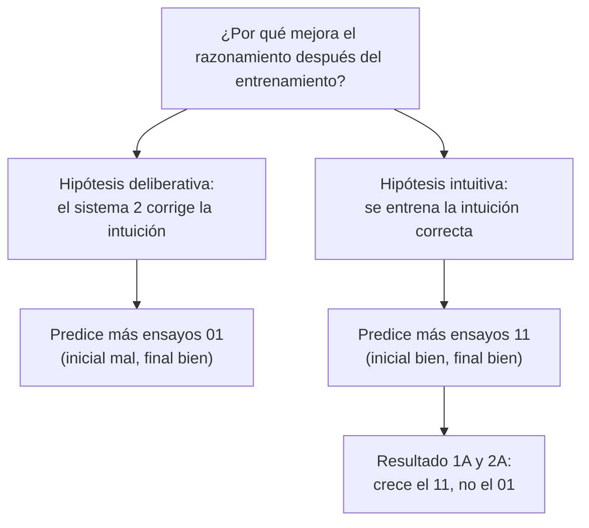
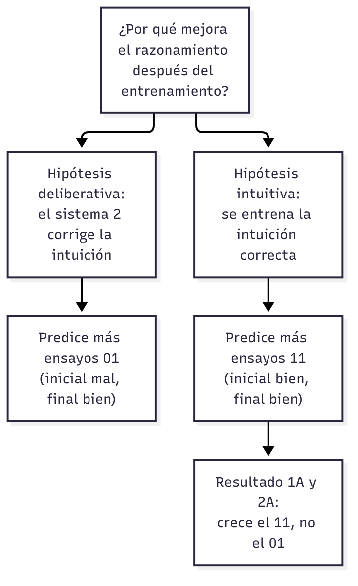
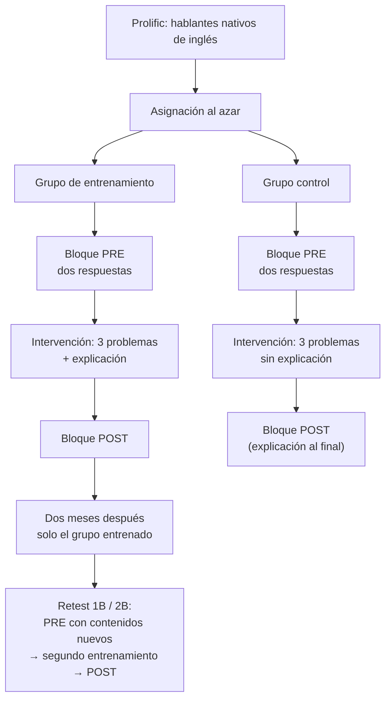
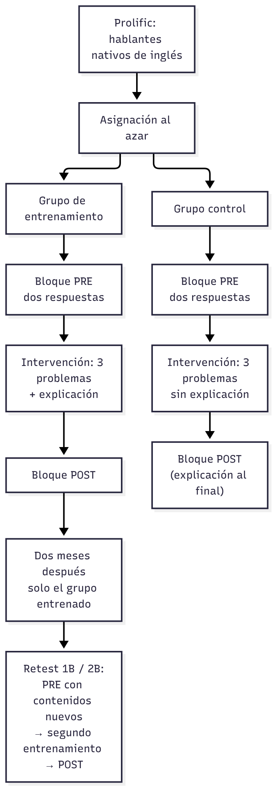

# Inv — Boissin et al. (2022): *Debiasing System 1*, lo necesario para el oral

> **Fuentes:**
>
> - Boissin, E., Caparos, S., Raoelison, M., y De Neys, W. (2021). From bias to sound intuiting: Boosting correct intuitive reasoning. *Cognition*, *211*, Artículo 104645. https://doi.org/10.1016/j.cognition.2021.104645
> - Boissin, E., Caparos, S., Voudouri, A., y De Neys, W. (2022). Debiasing System 1: Training favours logical over stereotypical intuiting. *Judgment and Decision Making*, *17*(4), 646-690. https://doi.org/10.1017/S1930297500008895
>
> **Materia:** Procesos Básicos III, 2.º año, Universidad Favaloro. Artículo del examen final (oral y grupal).

> **Aviso sobre las fuentes:** (1) Este resumen sale de la guía extendida del artículo (`Inv_Boissin2022_DebiasingSystem1_Guia`), que se hizo leyendo el artículo completo; las páginas son las de la revista. (2) Es para **entender el artículo** y poder exponerlo y defenderlo. El texto para decir en voz alta y la articulación con las unidades de la materia están en los **guiones** (`Global_ExamenFinal_AprendizajeYPensamiento_Guion` y `Global_ExamenFinal_AprendizajeMotivacionYPensamiento_Guion`). (3) **Queda afuera** (está en la guía extendida): los tiempos de cada pantalla del ensayo, los pilotos de los ítems, todos los estadísticos, la detección de conflicto en detalle, el estudio de 2021 completo y el banco de 27 preguntas. (4) Las críticas propias (bloque 5) son **nuestras**, salvo donde se cita a los autores. (5) El Material Suplementario del artículo no viene en el PDF y no se leyó.

> **Idea-fuerza:** una explicación de menos de cinco minutos sobre la lógica de un problema hace que la mayoría de las personas sesgadas **acierte desde la primera intuición**, sin necesidad de deliberar para corregirse. Funciona aunque la intuición errónea se apoye en **estereotipos**, se sostiene **dos meses** y **no se transfiere** a otros problemas. Para los autores, el sesgo no es falta de conocimiento: es una intuición estereotípica que le gana a una intuición lógica que ya existía.

**En una sola oración:** un entrenamiento breve logra que la gente acierte por intuición, y no por corrección deliberada, en problemas de tasas base y de conjunción, con un efecto que dura dos meses pero no generaliza.

> 🎯 **Para el final:** lo que no puede faltar es la cadena **pregunta → paradigma → patrón**. La pregunta: ¿el entrenamiento cambia la intuición o la deliberación? El paradigma de dos respuestas separa una de otra. El patrón "11" (y no el "01") es la prueba de que cambió la intuición.

## Consigna y pautas

- **Formato:** final oral y grupal, **10 minutos como máximo**, PowerPoint no obligatorio. Se articulan **dos unidades** de la materia con un artículo empírico reciente.
- **Secciones que pide la consigna** (rúbrica de 100 puntos): organización (10), marco teórico (15 + 15), objetivos e hipótesis (15), metodología (15), resultados y conclusiones (15), discusión con crítica propia y propuestas (15).
- **Dos guiones posibles:** el de **Aprendizaje y Pensamiento** (dos módulos, el que pide la consigna) y el de **Aprendizaje, Motivación y Pensamiento** (tres módulos; conviene confirmar con la cátedra que se acepta). El artículo es el mismo en los dos: lo que cambia es el marco teórico y algunas críticas.
- **Reparto:** los guiones no están repartidos entre quienes exponen. Una opción natural es cortar después de la metodología (minuto ~5:30): una persona presenta marco, objetivos y método; la otra, resultados, discusión y cierre.

**Mapa de origen de los temas**

| Tema | Origen | Bloque |
|---|---|---|
| Sistema 1 y 2, sesgos, tasas base y conjunción | Clase (Pensamiento) y artículo | 1 |
| Pregunta, hipótesis en competencia | Solo artículo (reconstruidas) | 2 |
| Paradigma de dos respuestas, diseño, variables | Solo artículo | 3 |
| Resultados de los cuatro estudios | Solo artículo | 4 |
| Limitaciones de los autores y críticas propias | Artículo y lectura propia | 5 |
| Articulación con Aprendizaje y Motivación | Clase | En los guiones |

## Guion por bloques: lo que hay que saber de cada sección

Los minutos son los del guion de dos módulos (entre paréntesis, los del de tres).

### 0. Apertura (0:25; 0:30)

Presentar el artículo: Boissin, Caparos, Voudouri y De Neys (2022), *Debiasing System 1: Training favours logical over stereotypical intuiting*, publicado en *Judgment and Decision Making*. Los autores son de la Université Paris Cité (LaPsyDÉ, CNRS) y de la Université Paris 8. Es una **investigación empírica**: cuatro estudios experimentales en línea, con licencia abierta (p. 646).

### 1. Marco teórico (2:40; 2:10)

**El ejemplo de apertura del artículo:** en un evento hay 995 técnicos en informática y 5 boxeadores. Se elige a alguien al azar y se lo describe como "fuerte". Mucha gente dice "boxeador" por el estereotipo, pero hay muchísimos más técnicos y también hay técnicos fuertes: lo correcto es "técnico". Ese error es el **descuido de las tasas base** (Boissin et al., 2022, pp. 646-647).

**Intuición y sesgo:** razonamos muchas veces con impresiones intuitivas rápidas (el "sistema 1"), que suelen servir pero a veces chocan con principios lógicos o probabilísticos y sesgan el razonamiento. El razonamiento deliberado, lento y costoso, es el "sistema 2" (p. 647).

**Lo que ya se sabía:** una sola explicación breve sobre el sesgo suele bastar para que la gente resuelva después problemas de la misma estructura. **Lo que no se sabía:** *en qué nivel* actúa ese entrenamiento (pp. 647-648).

- **Lectura tradicional:** el entrenamiento enseña a **deliberar** mejor para **corregir** la intuición errónea (el sistema 2 corrige al sistema 1).
- **Alternativa:** el entrenamiento cambia **la intuición misma**: después de entender la solución, la primera respuesta ya es correcta. Los autores lo comparan con la **pericia**, que convierte en intuitivo lo que antes exigía esfuerzo (p. 648).

**Por qué importa:** en la vida diaria muchas veces no hay tiempo, recursos ni motivación para deliberar. Si el entrenamiento solo enseñara a corregir deliberando, su impacto sería limitado; la meta es **evitar** las intuiciones sesgadas (p. 648).

**El antecedente:** Boissin et al. (2021) ya habían mostrado que se entrena la intuición correcta con el problema del **bate y la pelota** ("un bate y una pelota cuestan 1,10 dólares; el bate cuesta 1 dólar más que la pelota; ¿cuánto cuesta la pelota?": intuición errónea 10 centavos, correcta 5). Pero ese problema es atípico: la intuición errónea es un cálculo matemático mal hecho, y nadie defiende personalmente "10 centavos". En la mayoría de los sesgos la intuición se apoya en **creencias estereotípicas**, más difíciles de abandonar, incluso por **razonamiento motivado** (Boissin et al., 2022, pp. 648-649).

**Los dos sesgos estudiados:**

- **Descuido de las tasas base:** juzgar a qué grupo pertenece alguien por cuánto se parece al estereotipo, ignorando cuán frecuente es cada grupo (estudio 1A).
- **Falacia de la conjunción:** juzgar más probable la conjunción de dos sucesos que uno solo, violando la regla **p(A y B) ≤ p(A)**, porque la conjunción encaja mejor con el estereotipo (estudio 2A) (pp. 649, 664).

> ▸ **Complemento:** la articulación de este marco con las unidades de la materia (procesos duales y De Neys, representatividad, aprendizaje y ejecución, memoria de trabajo, transferencia y, en el guion de tres módulos, motivación) está escrita para decir en los guiones, §1.

### 2. Objetivos e hipótesis (1:05; 1:00)

**Objetivo general:** determinar si un entrenamiento breve ayuda a corregir las intuiciones estereotípicas erróneas **deliberando**, o si ayuda a **desarrollar intuiciones correctas**; es decir, poner a prueba si el hallazgo de 2021 se sostiene cuando la intuición se apoya en estereotipos (pp. 646, 649).

**Objetivos específicos:** probarlo con tasas base (1A) y con conjunción (2A); ver si el efecto persiste a los dos meses (1B y 2B); explorar si un segundo entrenamiento lo aumenta, si hay transferencia a otros problemas y qué pasa con la detección de conflicto (pp. 649, 653, 673).

> ⚠ **No confundir:** el artículo **no** enuncia hipótesis formales numeradas. Plantea una pregunta con dos respuestas posibles y preregistra el diseño y la pregunta, **no los análisis** (p. 650). Las hipótesis de abajo son una reconstrucción.

| | Hipótesis deliberativa | Hipótesis intuitiva |
|---|---|---|
| Qué propone | El entrenamiento enseña a deliberar y corregir | La primera intuición ya pasa a ser correcta |
| Qué debería aumentar | El patrón **"01"** (empieza mal, termina bien) | El patrón **"11"** (bien desde el principio) |
| ¿La apoyan los resultados? | No | **Sí** |

### 3. Metodología (1:45; 1:45)

**Participantes:** adultos hablantes nativos de inglés reclutados en **Prolific**, con secundario o título universitario, pagados 5 libras por hora (7 en el retest). **101** en 1A (50 entrenamiento, 51 control) y **100** en 2A (46 y 54), asignados **al azar**. En los retests volvieron **34** de los 50 entrenados de 1A y **41** de los 46 de 2A (pp. 650, 664, 673, 677).

**Diseño:** grupo (entrenamiento o control, entre sujetos) × bloque (pre y post, intra sujetos), con dos etapas de respuesta. Cada estudio tiene tres bloques: **pre → intervención → post** (p. 650).

**El paradigma de dos respuestas** (la clave del método): cada problema se responde dos veces seguidas (p. 654):

1. **Respuesta inicial (intuitiva):** "lo primero que te venga a la mente", con un **límite de tiempo** estricto (3 s en tasas base, 5 s en conjunción) y mientras se memoriza un patrón de **4 cruces en una grilla de 3 × 3** (tarea de **carga cognitiva**). Así se bloquea la deliberación.
2. **Respuesta final (deliberada):** el mismo problema, sin límite ni carga.

Se descartan los ensayos en los que no respondieron a tiempo o fallaron la tarea de memoria, porque ahí no se puede asegurar que la respuesta inicial haya sido intuitiva (pp. 654-656).

**Los problemas:**

- **Con conflicto** (los críticos): el estereotipo y la regla apuntan a respuestas distintas. Ej. de tasas base: "Este estudio contiene empresarios y bomberos. La persona K es valiente. Hay 996 empresarios y 4 bomberos. ¿Es más probable que K sea empresario o bombero?" Correcta: **empresario** (p. 651).
- **Sin conflicto** (control): estereotipo y regla coinciden (996 bomberos y 4 empresarios). Sirven para ver que prestan atención (p. 652).
- **Neutrales** (solo 1A): tasas base sin estereotipo. **De transferencia:** otra estructura lógica (un problema tipo CRT, el de la carrera de autos, y uno del otro sesgo). Sirven para ver si el efecto **generaliza** (pp. 652-653, 667).
- Ej. de conjunción: "Emery, de 30 años, estudió robótica y le gusta la inteligencia artificial. ¿Es más probable que sea: cajero / cantante pop / cajero y porrista / cajero y hacker?" Correcta: **cajero** (la característica sola); sesgada: **cajero y hacker** (p. 665).

**La intervención:** todos resuelven **tres problemas** con conflicto. El grupo de entrenamiento recibe después de cada uno una **explicación breve**: dice la respuesta correcta y la incorrecta típica, por qué la descripción engaña y por qué manda la tasa base (o la regla de la conjunción). **Sin retroalimentación personal** ("te equivocaste") y **sin fórmulas**, para no generar sensación de juicio ni ansiedad matemática. El control resuelve los mismos problemas sin explicación (la ve al final) (pp. 653-654, 667).

**Variables:**

- **VI:** grupo (manipulada), bloque (pre/post) y etapa de respuesta (inicial/final).
- **VD principal:** **precisión** en los problemas con conflicto, inicial y final.
- **Otras VD:** **dirección del cambio** (patrón de cada ensayo: "00" sesgado, "01" corrige deliberando, "11" intuición correcta, "10"), **confianza** de 0 a 100 (con ella se calcula un índice de detección de conflicto) y precisión en neutrales y de transferencia (pp. 656, 658, 660).
- **Análisis:** ANOVA mixto; lo que importa es la **interacción bloque × grupo** (que el entrenado mejore más que el control). En los retests, pruebas *t* (pp. 656, 674).

**Retests (1B y 2B):** dos meses después se volvió a evaluar **solo a los entrenados**, con problemas de contenido nuevo; luego recibían un **segundo entrenamiento** y un bloque post (pp. 672-673, 677).

### 4. Resultados y conclusiones (1:50; 1:40)

**Resultado central (respuesta inicial, la intuitiva):**

| | Tasas base (1A) | Conjunción (2A) |
|---|---|---|
| Entrenamiento | de 27,0 % a ~75 % (**+48,3 puntos**) | de 15,9 % a ~60 % (**+44,4 puntos**) |
| Control | +6,2 puntos | +2,5 puntos |

(Boissin et al., 2022, pp. 657, 670). La respuesta final también mejora: +32,8 contra +10,6 en 1A y +58,3 contra +4,2 en 2A. En 1A el efecto fue **mayor en la respuesta inicial que en la final** (pp. 657-658, 670).

**La prueba de que cambió la intuición:** en el grupo entrenado, los "00" caen y lo que crece es el **"11"**: +48 % en 1A y +51 % en 2A. Los "01" **bajan** en 1A y apenas suben en 2A (pp. 658, 671). Entre quienes mejoraron, la mayoría pasó de sesgado a **intuitivo**: 66,7 % en 1A y 86,7 % en 2A (pp. 659-660, 671).

**Cuántos mejoraron:** 58 % de los entrenados en 1A (contra 15,6 % de "mejorados naturales" en el control) y 65,2 % en 2A (en el control, el 90,7 % siguió sesgado) (pp. 659, 671).

**A los dos meses (1B y 2B):** el efecto **bajó pero se sostuvo**, muy por encima del punto de partida. Respuesta inicial: en tasas base, 28 % antes → 76 % justo después → 59 % a los dos meses; en conjunción, 13,5 % → 63 % → 43 % (la caída fue mayor). Quienes volvieron no eran los mejores del principio (pp. 674-675, 678). El **segundo entrenamiento** recuperó el nivel del primero, pero **no lo superó**, y casi no ayudó a quienes no habían mejorado (pp. 677, 680, 684).

**Transferencia: ninguna.** Ni a problemas neutrales de tasas base, ni de un sesgo al otro, ni al CRT (pp. 662-663, 672). En los sin conflicto, la precisión siguió alta (~96 % en 1A; ~78 % en 2A) (pp. 658, 670).

**Detección de conflicto** (dato secundario): en tasas base, los que mejoraron ya "dudaban" más de su error antes de entrenar; en conjunción **no se replicó**, y los autores lo atribuyen a que ese formato no permite medirla bien (pp. 662, 671-672).

**Conclusiones de los autores** (pp. 680-683):

1. Un entrenamiento breve corrige el sesgo **en el nivel intuitivo**, también con estereotipos, y el efecto **dura**.
2. Es **específico de la tarea**: no "afina" el sistema 1 en general. No es una panacea, pero es **barato y escalable** (menos de 5 minutos, sin entrenador humano): se podría armar una batería de entrenamientos breves (pp. 681-682).
3. **El sesgo no es falta de conocimiento:** nadie aprende un principio lógico de la nada en cinco minutos; el conocimiento ya estaba. Encaja con el **modelo dual 2.0** de De Neys: el problema evoca **dos intuiciones** (una estereotípica y otra lógica) con distinta fuerza; el entrenamiento fortalece la lógica hasta que domina (pp. 682-683).
4. **La deliberación sigue sirviendo:** hace falta para entender la explicación; lo que deja de hacer falta es deliberar para corregirse (p. 682).

### 5. Discusión (1:35; 1:35)

**Limitaciones que reconocen los autores** (pp. 681, 684):

- No todos mejoraron, y el segundo entrenamiento no ayudó a quienes no se habían beneficiado.
- El entrenamiento **no buscó maximizar la transferencia** (no usó analogías, que la favorecen).
- **Validez ecológica:** los estereotipos del laboratorio ("los bomberos son valientes") son inocuos; los de la vida real (género, raza, vacunas, clima) podrían resistir más.

**Por qué no es un "truco"** (por si lo preguntan): si hubieran aprendido "elegí lo contrario de lo que te parece", se habría transferido a otros problemas y habría hundido los sin conflicto, donde la intuición es correcta. No pasó. Y en los neutrales no eligieron ciegamente "el número más grande" (pp. 681-683).

**Críticas propias** (las del guion; elegir dos o tres):

1. **Línea de base desigual en 1A:** el grupo entrenado empezó más bajo (27 % contra 39,6 %), y parte de la mejora podría ser regresión a la media. *Respuesta posible:* en 2A partieron iguales y el efecto se repitió (pp. 657, 670).
2. **El retest no tiene grupo control:** no se puede separar el entrenamiento de la práctica con la tarea (pp. 672, 677).
3. **Transferencia con muy pocos ítems** (dos por bloque): "no hay transferencia" podría ser falta de potencia.
4. **Análisis no preregistrados** y muestra en línea de hablantes de inglés con pago fijo (p. 650).
5. **Estereotipos inocuos:** el argumento del razonamiento motivado (p. 649) queda sin poner a prueba.

**Propuestas:** control en el retest; más ítems de transferencia, cercana y lejana; un **entrenamiento activo** (que la persona explique la regla con sus palabras y compare problemas de distinta superficie y misma estructura); usar creencias personalmente relevantes. En el guion de tres módulos se suma **manipular el incentivo** y **medir la motivación**, que el artículo invoca pero no mide (pp. 648-649).

### 6. Cierre (0:15; 0:20)

Volver a la idea-fuerza: el sistema 1 es **más maleable** de lo que se suele suponer; con cinco minutos se puede entrenar la intuición, aunque solo para el problema entrenado. Los autores cierran diciendo que el debiasing del sistema 1 es más que una ilusión teórica (p. 684).

## Preguntas probables de la mesa (con respuesta breve)

1. **¿Cuál es la pregunta del artículo?** Si un entrenamiento breve mejora el razonamiento enseñando a deliberar y corregir, o haciendo que la primera intuición ya sea correcta (p. 646).
2. **¿Por qué hacía falta, si ya estaba el estudio de 2021?** Porque el bate y la pelota es atípico: la intuición errónea es matemática y nadie defiende esa creencia. Con estereotipos el entrenamiento podría fallar (p. 649).
3. **¿Cómo saben que la respuesta inicial es intuitiva?** Por el límite de tiempo (3 o 5 s, calibrado con pilotos), la tarea de memoria simultánea y la exclusión de los ensayos sin respuesta a tiempo o con la memoria fallida (pp. 654-656, 668).
4. **¿Cómo saben que mejoró la intuición y no la deliberación?** Porque crece el patrón "11" y no el "01", y la mayoría de los que mejoran pasan a ser "intuitivos" (pp. 658-660, 671).
5. **¿Para qué están los problemas sin conflicto?** Para controlar que presten atención y para descartar que hayan aprendido a invertir su intuición (pp. 652, 681).
6. **¿Qué hacía el grupo control?** Los mismos tres problemas, sin explicación; la veía al final (pp. 653, 656).
7. **¿Cuáles son las VI y las VD?** VI: grupo, bloque y etapa de respuesta. VD: precisión en problemas con conflicto, dirección del cambio, confianza y precisión en neutrales y de transferencia.
8. **¿El efecto dura?** Sí, al menos dos meses: baja, sobre todo en conjunción, pero queda muy por encima del punto de partida (pp. 674, 678).
9. **¿Sirvió el segundo entrenamiento?** Recuperó la caída, sin superar el primero (pp. 677, 680).
10. **¿Hubo transferencia?** No, a ningún tipo de problema (pp. 662-663, 672).
11. **Entonces, ¿la deliberación no sirve?** Sí: hace falta para entender la explicación (p. 682).
12. **¿Qué es el modelo dual 2.0?** La idea de que el problema evoca dos intuiciones, una estereotípica y una lógica, con distinta fuerza de activación; razonar bien no exige siempre que el sistema 2 corrija al 1 (pp. 682-683).
13. **¿La intuición correcta es razonamiento lógico?** Los autores dicen que no es lo mismo: quienes aciertan por intuición muchas veces no saben justificarlo sin pensar más (p. 683).
14. **¿Qué limitaciones agregan ustedes?** Línea de base desigual en 1A, retest sin control, pocos ítems de transferencia, análisis no preregistrados, estereotipos inocuos.
15. **¿Por qué eligieron este artículo?** (respuesta nuestra) Es empírico y reciente, sigue directamente a De Neys (trabajado en clase), y su pregunta (¿se puede *aprender* a intuir bien?) une Pensamiento con Aprendizaje.

## 🚩 Trampas

- **"Subió 48 %":** son **puntos porcentuales** (de 27 % a ~75 %).
- **"La correcta en conjunción es la conjunción":** al revés, es la característica sola.
- **"Los 101 recibieron el entrenamiento":** no, 50 y 51 control.
- **"El retest compara entrenados con controles":** no, solo se reevaluó a los entrenados.
- **"Midieron la motivación":** no la midieron; la usan para justificar el estudio.
- **"Las hipótesis y los análisis estaban preregistrados":** solo el diseño y la pregunta.

## Conceptos que conviene poder definir

| Concepto | Definición breve |
|---|---|
| Debiasing | Intervención para reducir un sesgo de razonamiento (p. 647) |
| Entrenar la intuición correcta (*sound intuiting*) | Lograr que la primera intuición ya dé la respuesta correcta, sin corrección deliberada (p. 648) |
| Tasa base | Frecuencia de cada grupo en la población (p. 646) |
| Regla de la conjunción | p(A y B) ≤ p(A): dos cosas juntas nunca son más probables que una sola (p. 664) |
| Paradigma de dos respuestas | Una respuesta rápida con límite de tiempo y carga, y otra sin límite, del mismo problema (p. 654) |
| Carga cognitiva | Memorizar 4 cruces en una grilla de 3 × 3 mientras se responde, para ocupar la memoria de trabajo (p. 654) |
| Problema con / sin conflicto | Estereotipo y regla apuntan a respuestas distintas / a la misma (pp. 651-652) |
| Dirección del cambio | Patrón de cada ensayo: 00, 01, 10 u 11 (p. 658) |
| Transferencia | Que lo aprendido mejore problemas no entrenados (pp. 662-663) |
| Mindware | Conocimiento de los principios lógicos necesarios (Stanovich, 2011, como se citó en Boissin et al., 2022, p. 652) |
| Modelo dual 2.0 | Dos intuiciones en competencia, estereotípica y lógica, con distinta fuerza (pp. 682-683) |
