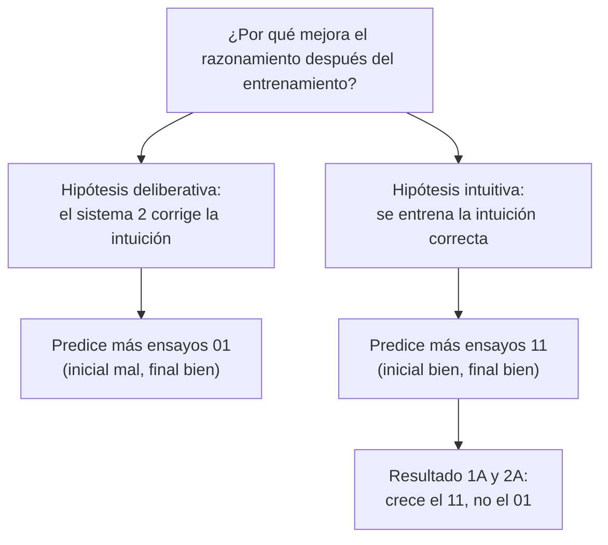
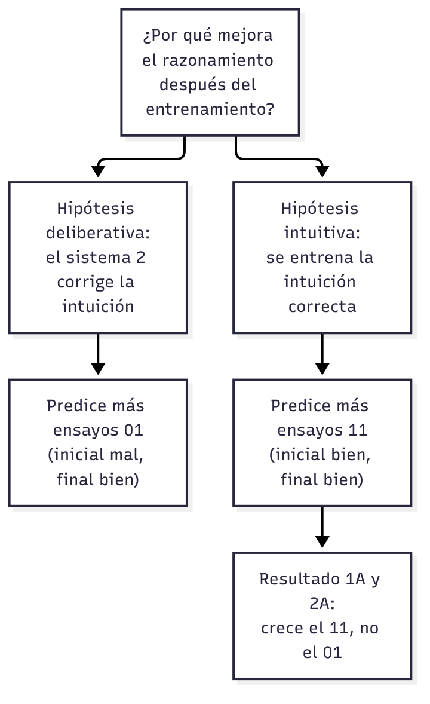
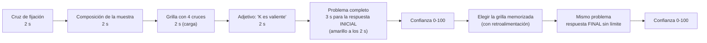
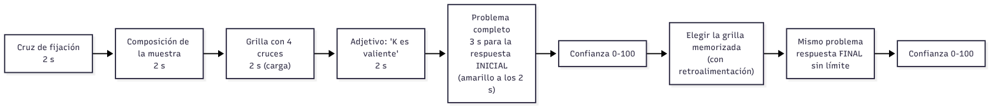
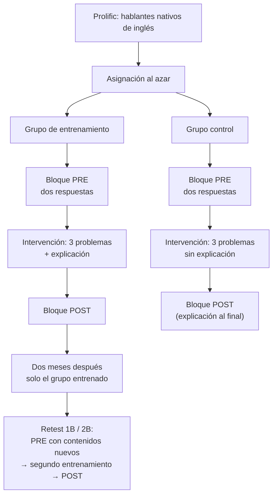
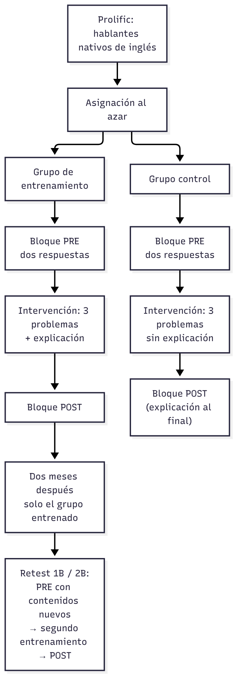

# Inv — Boissin et al. (2022): *Debiasing System 1*, explicado completo

> **Fuentes:**
>
> - Boissin, E., Caparos, S., Raoelison, M., y De Neys, W. (2021). From bias to sound intuiting: Boosting correct intuitive reasoning. *Cognition*, *211*, Artículo 104645. https://doi.org/10.1016/j.cognition.2021.104645
> - Boissin, E., Caparos, S., Voudouri, A., y De Neys, W. (2022). Debiasing System 1: Training favours logical over stereotypical intuiting. *Judgment and Decision Making*, *17*(4), 646-690. https://doi.org/10.1017/S1930297500008895
> - Cárdenas Poveda, C. (2026a). *Introducción a la psicología del aprendizaje y perspectivas conductistas* [Diapositivas de clase: Aprendizaje, Clase 01]. Procesos Básicos III, Universidad Favaloro.
> - Cárdenas Poveda, C. (2026b). *Perspectivas cognoscitivas del aprendizaje y procesos cognitivos complejos* [Diapositivas de clase: Aprendizaje, Clase 02]. Procesos Básicos III, Universidad Favaloro.
> - Cossavella, F. (2026a). *El proceso de la motivación* [Diapositivas de clase: Motivación I]. Procesos Básicos III, Universidad Favaloro.
> - Cossavella, F. (2026b). *Teorías biológicas y conductuales* [Diapositivas de clase: Motivación II]. Procesos Básicos III, Universidad Favaloro.
> - Cossavella, F. (2026c). *Teorías cognitivas y emoción* [Diapositivas de clase: Motivación III]. Procesos Básicos III, Universidad Favaloro.
> - De Neys, W. (2023a). Advancing theorizing about fast-and-slow thinking. *Behavioral and Brain Sciences*, *46*, Artículo e111. https://doi.org/10.1017/S0140525X2200142X
> - Díaz Abrahan, V. (2026). *Ciencias del aprendizaje* [Diapositivas de clase: Aprendizaje, Clase 03]. Procesos Básicos III, Universidad Favaloro.
> - Pérez Echeverría, M. P., y Bautista, A. (2014). Pensamiento probabilístico. En M. Carretero y M. Asensio (Coords.), *Psicología del pensamiento: Teoría y prácticas* (cap. 7, pp. 1-22). Alianza.
>
> **Materia:** Procesos Básicos III, 2.º año, Universidad Favaloro. Artículo del examen final (oral y grupal). El PDF está en `6_Entregables/Global_ExamenFinal_Articulo_Boissin2022.pdf`, con licencia abierta CC BY 4.0.

> **Aviso sobre las fuentes:** (1) El artículo de 2022 se leyó **completo** (pp. 646-684) y las páginas citadas son **las de la revista**. (2) El **Material Suplementario** (secciones A a J: lista completa de ítems, justificaciones, problemas sin conflicto, análisis por problema, dirección del cambio en los retests) **no se leyó**, porque no viene en el PDF. Si te preguntan por algo de ahí, decí que el artículo lo remite al suplemento. (3) El artículo de 2021, que es el antecedente (§9), se leyó en la versión preprint de HAL: sus páginas son las del preprint, no las de *Cognition*. (4) Las traducciones de los ejemplos y de las explicaciones del entrenamiento son **nuestras**. (5) La lectura crítica (§10) es **nuestra**, salvo donde se cita a los autores. (6) La articulación con la materia (§11) se apoya en las diapositivas de clase, citadas sin número de diapositiva porque no lo traen legible; en esta guía, Cárdenas Poveda (2026a, 2026b) son las diapositivas de **Aprendizaje**, no las de Pensamiento de las guías de U03.

> **Idea-fuerza:** Una explicación de menos de cinco minutos sobre la lógica de un problema hace que la mayoría de las personas sesgadas **acierte desde la respuesta intuitiva**, sin necesitar deliberar para corregirse. Funciona aunque la intuición equivocada se apoye en **estereotipos**, en problemas de tasas base y de conjunción, y el efecto **se sostiene dos meses**. Pero es **específico de la tarea**: no se transfiere a otros problemas. Para los autores, el sesgo no se debe a que falte el conocimiento, sino a que la intuición estereotípica le gana a una intuición lógica que ya existe, y el entrenamiento la refuerza.

## Hilo conductor: cómo se conectan las partes del artículo

El artículo parte de un hecho conocido: razonamos muchas veces con intuiciones rápidas que chocan con principios lógicos o probabilísticos, y por eso nos equivocamos (§1). También se sabe que una explicación breve de cómo resolver un problema mejora el rendimiento. Lo que no se sabe es **por qué** mejora. La lectura tradicional del modelo dual dice que el entrenamiento enseña a **deliberar** más (el sistema 2) para corregir la intuición errónea. La alternativa es que el entrenamiento cambie la **intuición misma** (el sistema 1), como pasa cuando alguien se vuelve experto.

Los mismos autores ya habían mostrado, con el problema del bate y la pelota, que pasa lo segundo (Boissin et al., 2021; §9). Pero ese problema es atípico: la intuición equivocada ("10 centavos") también es matemática, y nadie defiende personalmente esa respuesta. En la mayoría de los sesgos, la intuición se apoya en **creencias estereotípicas**, y abandonar una creencia propia puede ser más difícil, incluso por razonamiento motivado. Por eso el artículo de 2022 repite la prueba con dos sesgos clásicos ligados a estereotipos: **descuido de las tasas base** y **falacia de la conjunción** (§1-§2).

Para distinguir intuición de deliberación, usa el **paradigma de dos respuestas** (§3). Primero se responde rápido, con un límite de tiempo y una tarea de memoria que bloquea la deliberación; después se responde con todo el tiempo necesario. Si el entrenamiento solo mejora la deliberación, deberían aumentar los ensayos que empiezan mal y terminan bien ("01"). Si mejora la intuición, deberían aumentar los que ya empiezan bien ("11").

Los **estudios 1A** (tasas base, §4) y **2A** (conjunción, §5) comparan un grupo entrenado con un control, antes y después de la intervención. En los dos, el entrenamiento mejora la respuesta inicial y la final, y lo que crece es el patrón "11". Los **estudios 1B** y **2B** (§6-§7) vuelven a evaluar a los entrenados dos meses después: el efecto bajó, pero sigue muy por encima del punto de partida, y un segundo entrenamiento recupera el nivel sin superarlo. En ningún estudio hay **transferencia** a problemas distintos.

La discusión de los autores (§8) saca tres conclusiones. Primera: el entrenamiento puede actuar en el nivel intuitivo. Segunda: lo hace en una tarea específica, no en el sistema 1 en general. Tercera: el sesgo no es falta de conocimiento, sino una competencia entre dos intuiciones (el modelo dual 2.0 de De Neys). También reconocen límites: no todos mejoraron, el segundo entrenamiento no ayudó a quienes no habían mejorado y los estereotipos del laboratorio son más inocuos que los de la vida real.

Las secciones finales cierran el círculo hacia el examen: el estudio de 2021 como antecedente (§9), una lectura crítica propia con propuestas (§10), la articulación con las tres unidades de la materia (§11) y un banco de preguntas probables del profesor, con respuesta (§12).

> 🎯 **Para el final:** la conexión que no puede faltar es **pregunta → paradigma → patrón**. La pregunta es si el entrenamiento cambia la intuición o la deliberación. El paradigma de dos respuestas separa las dos. Y el patrón "11" (y no el "01") es la evidencia de que cambió la intuición.

**En una sola oración:** una explicación breve logra que las personas acierten por intuición, y no por corrección deliberada, en problemas de tasas base y de conjunción, con un efecto que dura dos meses pero no se transfiere a otros problemas.

## 0. Hoja de ruta

1. **El problema y la pregunta** (pp. 646-649): sesgos, intuición, debiasing y por qué hacía falta un estudio con estereotipos.
2. **Objetivos e hipótesis** (pp. 646, 649-650): reconstruidos a partir del artículo.
3. **Método común** (pp. 650-656): paradigma de dos respuestas, tarea de carga, problemas con y sin conflicto, intervención, variables y análisis.
4. **Estudio 1A, tasas base** (pp. 650-663): método completo y todos los resultados.
5. **Estudio 2A, conjunción** (pp. 663-672): lo que cambia respecto de 1A y resultados.
6. **Estudio 1B, retest de tasas base** (pp. 672-677).
7. **Estudio 2B, retest de conjunción** (pp. 677-680).
8. **Discusión general de los autores** (pp. 680-684).
9. **Antecedente: Boissin et al. (2021)**, el bate y la pelota.
10. **Lectura crítica propia** y propuestas.
11. **Articulación con la materia**.
12. **Banco de preguntas del profesor**, con respuesta.

## 🎯 Lo que entra sí o sí

1. **Pregunta:** ¿el entrenamiento ayuda a corregir intuiciones estereotípicas deliberando o genera intuiciones correctas? (Boissin et al., 2022, p. 646).
2. **Por qué estereotipos:** el estudio de 2021 usó un problema cuya intuición errónea es matemática; con creencias personales el entrenamiento podría fallar, incluso por razonamiento motivado (p. 649).
3. **Diseño:** 2 grupos (entrenamiento o control, al azar) × 2 bloques (pre y post), con paradigma de dos respuestas: inicial bajo límite de tiempo y carga cognitiva, final sin límite (pp. 650-655).
4. **Entrenamiento:** tres problemas, cada uno seguido de una explicación breve con la respuesta correcta y la incorrecta típica, sin retroalimentación personal ni fórmulas (p. 654).
5. **Resultado central:** la precisión inicial del grupo entrenado sube 48 puntos en tasas base y 44 en conjunción, contra 6 y 2,5 del control; lo que crece es el patrón "11" (pp. 657-658, 670-671).
6. **Duración:** a los dos meses el efecto baja, pero sigue por encima del nivel previo al entrenamiento (pp. 674, 678).
7. **Transferencia:** ninguna, ni a problemas neutrales ni a otros sesgos (pp. 662-663, 672, 681).
8. **Interpretación:** el conocimiento ya estaba; el entrenamiento refuerza la intuición lógica frente a la estereotípica (modelo dual 2.0) (pp. 682-683).

## Ficha técnica

| Dato | Detalle |
|---|---|
| Autores y afiliaciones | Esther Boissin, Aikaterini Voudouri y Wim De Neys (Université Paris Cité, LaPsyDÉ, CNRS); Serge Caparos (Université Paris 8, DysCo lab; Institut Universitaire de France) (p. 646) |
| Revista | *Judgment and Decision Making*, 17(4), julio de 2022, pp. 646-690 |
| Licencia | Creative Commons Atribución 4.0 (p. 646) |
| Financiamiento | Idex Université Paris Cité (ANR-18-IDEX-0001) y proyecto DIAGNOR (ANR-16-CE28-0010-01) de la Agence Nationale de la Recherche (p. 646) |
| Preregistro | Open Science Framework (https://osf.io/674gk/): diseño y pregunta, **sin análisis específicos** (pp. 650, 664, 673, 677) |
| Tipo | Investigación empírica: cuatro estudios experimentales en línea (dos con grupo control y asignación al azar; dos retests) |
| Plataformas | Reclutamiento en Prolific; experimento en Qualtrics (pp. 650, 655) |
| Muestra | 101 (1A), 100 (2A), 34 (1B) y 41 (2B) participantes; adultos hablantes nativos de inglés |
| Antecedente directo | Boissin et al. (2021), con el problema del bate y la pelota |

---

## 1. El problema: intuición, sesgo y entrenamiento (pp. 646-649)

**Textos:** (Boissin et al., 2022, pp. 646-649).

### 1.1 El ejemplo de apertura

En un evento hay 1.000 personas: 995 técnicos en informática y 5 boxeadores profesionales. Se elige a una al azar, la "persona X", y se la describe como "fuerte". ¿Es más probable que sea técnico o boxeador? Muchos dicen boxeador, por la asociación estereotípica "los boxeadores son fuertes". Si la descripción fuera el único dato, sería una conjetura razonable. Pero también hay técnicos fuertes, y te dijeron que hay muchísimos más técnicos: si se tiene en cuenta esa **tasa base**, la balanza se inclina hacia "técnico". La gente sin entrenamiento suele descuidar la tasa base y elegir la respuesta que le sugieren sus creencias estereotípicas (Boissin et al., 2022, pp. 646-647).

### 1.2 Pensamiento intuitivo y sesgo

Décadas de investigación muestran que el razonamiento tiende a basarse en **impresiones intuitivas rápidas** más que en un razonamiento deliberado y exigente (Evans, 2008; Kahneman y Tversky, 1973, como se citó en Boissin et al., 2022, p. 647). Ese pensamiento intuitivo o **heurístico** es útil, rápido, sin esfuerzo y muchas veces da soluciones válidas; pero a veces da respuestas que **chocan con principios lógicos o probabilísticos**, y ahí sesga el razonamiento (p. 647).

### 1.3 El debiasing y su pregunta abierta

Hace tiempo que se busca corregir el pensamiento sesgado (Lilienfeld et al., 2009; Milkman et al., 2009; Nisbett, 1993, como se citó en Boissin et al., 2022, p. 647). Varios estudios recientes mostraron que **una sola explicación breve** sobre el sesgo y la estrategia correcta suele bastar para que la gente resuelva después problemas de la misma estructura (Boissin et al., 2021; Claidière et al., 2017; Hoover y Healy, 2017; Morewedge et al., 2015; Purcell et al., 2020; Trouche et al., 2014, como se citó en Boissin et al., 2022, p. 647).

Lo que no está claro es **la naturaleza** de ese efecto: ¿afecta el pensamiento intuitivo o el deliberado, el "sistema 1" o el "sistema 2"? El supuesto habitual es que el entrenamiento hace que la gente **delibere** mejor y **corrija** la respuesta intuitiva, en línea con la idea de que el sistema 2 sirve sobre todo para corregir al sistema 1 (Evans, 2019; Kahneman, 2011; Lilienfeld et al., 2009; Milkman et al., 2009, como se citó en Boissin et al., 2022, pp. 647-648).

### 1.4 La alternativa: entrenar la intuición correcta

En teoría, también es posible que, una vez que se entiende la solución, la persona **ya no genere** la respuesta intuitiva incorrecta: su primera intuición alcanzaría para acertar, sin un proceso correctivo del sistema 2. Es el punto de vista del «intuitivo entrenado» (*trained intuitor*). Los autores comparan esta idea de **entrenar la intuición correcta** (*training sound intuiting*) con el desarrollo de la **pericia**, cuya meta también es convertir procesos que primero exigen el esfuerzo deliberado del sistema 2 en procesos intuitivos del sistema 1 (Hogarth, 2010; Kahneman y Klein, 2009; Larrick y Feiler, 2015, como se citó en Boissin et al., 2022, p. 648). En una nota agregan que en la formación de expertos esto se logra con explicaciones claras y práctica en un "ambiente amable" que da **retroalimentación inmediata**, como en los estudios de debiasing (p. 648, nota 1).

**Por qué importa:** aunque es bueno que la gente delibere más, en muchas situaciones cotidianas **no tiene tiempo, recursos ni motivación** para hacerlo. Si el debiasing solo ayudara a corregir deliberadamente, su impacto sería limitado. La meta no es solo corregir intuiciones erróneas, sino **evitar** las intuiciones sesgadas (Evans, 2019; Milkman et al., 2009; Reyna et al., 2015; Stanovich, 2018, como se citó en Boissin et al., 2022, p. 648).

### 1.5 El antecedente y su límite

Boissin et al. (2021) entrenaron a los participantes con versiones del problema del bate y la pelota ("un bate y una pelota cuestan 1,10 dólares; el bate cuesta 1 dólar más que la pelota; ¿cuánto cuesta la pelota?"; respuesta típica incorrecta, 10 centavos; correcta, 5 centavos) y midieron el rendimiento con el paradigma de dos respuestas. La mayoría acertaba después del entrenamiento, y lo clave fue que, en la mayoría de los antes sesgados, **la respuesta intuitiva ya era correcta** (Boissin et al., 2022, p. 648).

Pero era un solo problema, y **atípico**. En el bate y la pelota, la intuición errónea también se apoya en conocimiento lógico-matemático: se llega a 10 centavos restando 1 dólar de 1,10 en vez de aplicar la ecuación correcta, "1 + 2x = 1,10". En cambio, la mayoría de los problemas de sesgos sugieren una respuesta intuitiva basada en **creencias semánticas o estereotípicas** que la gente sostiene con más fuerza (por ejemplo, "los gerentes generales son hombres") (Boissin et al., 2022, p. 649).

Cuando la explicación del bate y la pelota dice que 1,10 + 0,10 da más que 1,10, nadie objeta ese hecho matemático. Puede ser mucho más difícil descartar una intuición cuando hay **creencias personales** en juego (Goel, 2022; Kaplan et al., 2016). Y cuando se cuestiona el sistema de creencias de alguien, puede activarse el **razonamiento motivado** o la **racionalización** para protegerlo (Ditto et al., 2019; Kahan, 2016, 2017; Kunda, 1990; Mercier y Sperber, 2011; Pennycook y Rand, 2019, como se citó en Boissin et al., 2022, p. 649). En suma, el hallazgo de 2021 podría limitarse a un problema que no desafía las creencias del que razona.

### 1.6 El plan del artículo

- **Estudio 1A:** problemas de **descuido de las tasas base** (Kahneman y Tversky, 1973), como el ejemplo de apertura.
- **Estudio 2A:** problemas de **falacia de la conjunción** (Tversky y Kahneman, 1983), en los que una descripción estereotípica lleva a juzgar la conjunción de dos sucesos más probable que uno de ellos.
- En cada uno se compara el rendimiento antes y después de un entrenamiento breve, contra un grupo control, con el paradigma de dos respuestas.
- **Estudios 1B y 2B:** los entrenados se reevalúan dos meses después, para ver si el efecto es robusto y se sostiene (Boissin et al., 2022, p. 649).

> 🔑 **Punto clave:** el artículo no pregunta *si* el entrenamiento funciona (eso ya se sabía), sino *en qué nivel* funciona, y si el hallazgo de 2021 sobrevive cuando la intuición se apoya en estereotipos.

---

## 2. Objetivos, preguntas e hipótesis

**Textos:** (Boissin et al., 2022, pp. 646, 649-650).

> ⚠ **No confundir:** el artículo **no** enuncia hipótesis formales numeradas. Plantea una pregunta de investigación con dos respuestas posibles y preregistra el diseño y la pregunta, pero no los análisis (p. 650). Lo que sigue es una reconstrucción fiel, útil para la sección «Objetivos e hipótesis» de la consigna.

**Objetivo general:** determinar si un entrenamiento breve contra los sesgos ayuda a corregir las intuiciones estereotípicas erróneas **mediante la deliberación**, o si ayuda a **desarrollar intuiciones correctas** (p. 646). En otras palabras, poner a prueba la robustez y la generalidad del efecto de entrenamiento intuitivo de Boissin et al. (2021) en problemas que sugieren una respuesta basada en creencias estereotípicas personales (p. 649).

**Objetivos específicos:**

1. Probar el efecto del entrenamiento en problemas de **tasas base** (estudio 1A).
2. Probar el mismo efecto en problemas de **conjunción** (estudio 2A).
3. Evaluar si el efecto **persiste dos meses** después (estudios 1B y 2B) (p. 649).
4. Explorar si un **segundo entrenamiento** mejora todavía más el rendimiento (pp. 673, 677).
5. De manera exploratoria, analizar la **transferencia** a problemas no entrenados, la **detección de conflicto** y si esa detección **predice** quién aprovecha el entrenamiento (pp. 653, 660-662).

**Hipótesis en competencia:**

| | Hipótesis deliberativa ("el sistema 2 corrige") | Hipótesis intuitiva ("se entrena la intuición correcta") |
|---|---|---|
| Qué propone | El entrenamiento enseña a deliberar y corregir la intuición estereotípica | El entrenamiento hace que la primera intuición ya sea correcta |
| Predicción sobre la respuesta inicial | No debería mejorar mucho | Debería mejorar tanto como la final |
| Patrón que debería aumentar | "01" (inicial mal, final bien) | "11" (inicial bien, final bien) |
| Apoyada por los resultados | No | Sí |

---

## 3. Método común a los cuatro estudios

**Textos:** (Boissin et al., 2022, pp. 650-656, 664-670).

### 3.1 El paradigma de dos respuestas

Cada problema se responde **dos veces seguidas** (Thompson et al., 2011, como se citó en Boissin et al., 2022, p. 654):

1. Una respuesta **rápida o inicial**: "la primera respuesta que te venga a la mente". Para minimizar la deliberación, se da con un **límite de tiempo estricto** y mientras se hace una **tarea de carga cognitiva** (Bago y De Neys, 2017, 2019; Raoelison y De Neys, 2019, como se citó en Boissin et al., 2022, p. 654).
2. Una respuesta **lenta o final**, sin límite de tiempo ni carga, después de reflexionar todo lo necesario.

Así se capturan por separado una respuesta "intuitiva" y una "deliberada" del mismo problema. El límite de tiempo y la carga se aplican **solo** a la respuesta inicial (p. 655).

### 3.2 La tarea de carga cognitiva

Se basa en la **tarea de memorización de puntos** (Miyake et al., 2001), usada antes para cargar los recursos ejecutivos durante tareas de razonamiento (De Neys, 2006; Franssens y De Neys, 2009; Verschueren et al., 2004, como se citó en Boissin et al., 2022, p. 654). Antes de cada problema se muestra brevemente un patrón visual complejo: **4 cruces en una grilla de 3 × 3**. Después de dar la respuesta inicial, la persona ve cuatro patrones y elige el que memorizó. Recibe retroalimentación sobre si acertó el patrón; si se equivocó, se le recuerda que es importante hacer bien la tarea de memoria (pp. 654-655).

### 3.3 Problemas con conflicto y sin conflicto

- **Con conflicto** (los críticos): la respuesta intuitiva estereotípica y la respuesta lógica **no coinciden**.
- **Sin conflicto** (de control): las dos **coinciden**. Deberían ser fáciles: si la persona presta un mínimo de atención y no responde al azar, su precisión debería ser alta (Bago y De Neys, 2019, como se citó en Boissin et al., 2022, p. 652).

**Contrabalanceo:** hay dos conjuntos de 16 ítems únicos (8 para el bloque pre y 8 para el post). Los problemas con conflicto de un conjunto son los sin conflicto del otro (se invierten las tasas base, o la opción). Cada participante recibe al azar un conjunto, así que **nunca ve dos veces el mismo contenido**: ve 16 ítems, cada uno con una asociación estereotípica distinta (pp. 652, 666).

### 3.4 Tres bloques y la intervención

Cada estudio tiene tres bloques, siempre en este orden: **preintervención**, **intervención** y **posintervención** (p. 650). En la intervención, todos resuelven **tres problemas con conflicto adicionales**, sin límite de tiempo ni carga. El **grupo de entrenamiento** recibe, después de responder cada uno, una **explicación** de la solución correcta; el **grupo control**, no (pp. 653, 667). Al final del estudio, el grupo control también ve las explicaciones (p. 656).

Las explicaciones siguen cuatro principios, tomados de Boissin et al. (2021) (Boissin et al., 2022, p. 654):

1. **Breves y simples**, para evitar fatiga o desenganche de la tarea.
2. Dicen explícitamente **la respuesta correcta y la respuesta incorrecta típica**.
3. **Sin retroalimentación personal** del tipo "tu respuesta fue incorrecta", para no generar sensación de ser juzgado (Trouche et al., 2014).
4. **Sin ecuaciones formales**, para no despertar ansiedad matemática (Hoover y Healy, 2017). En conjunción, tampoco símbolos ni diagramas de Venn (p. 667).

### 3.5 Variables

| Tipo | Variable | Niveles o medida |
|---|---|---|
| VI manipulada, entre sujetos | **Grupo** | Entrenamiento o control, asignación al azar |
| VI intra sujetos | **Bloque** | Pre y postintervención |
| VI intra sujetos | **Etapa de respuesta** | Inicial (intuitiva) y final (deliberada) |
| Factor intra sujetos | **Tipo de problema** | Con conflicto (críticos), sin conflicto (control), neutrales (solo 1A), de transferencia |
| VD principal | **Precisión** | Proporción de respuestas correctas en problemas con conflicto, en cada etapa y bloque |
| VD | **Dirección del cambio** | Patrón de cada ensayo: 00, 01, 10 u 11 |
| VD | **Confianza** | 0 a 100 después de cada respuesta; con ella se calcula el índice de detección de conflicto |
| VD | **Precisión en neutrales y de transferencia** | Para ver si el efecto generaliza |
| Exploratoria | **Justificación** | Texto libre después del último problema (solo en 1A) |

**La dirección del cambio:** en cada ensayo, la respuesta puede ser correcta (1) o incorrecta (0) en cada etapa, y eso da cuatro patrones (Bago y De Neys, 2017, 2019, como se citó en Boissin et al., 2022, p. 658):

- **"00":** incorrecta en las dos etapas (sesgado).
- **"11":** correcta en las dos (intuición correcta).
- **"01":** incorrecta al principio y correcta al final (corrección deliberada).
- **"10":** correcta al principio e incorrecta al final.

**El índice de detección de conflicto:** contrasta la confianza en los problemas **sin conflicto bien resueltos** con la confianza en los problemas **con conflicto mal resueltos**. Cuanto mayor la diferencia, más baja la confianza ante el error, y eso se interpreta como una experiencia de conflicto más marcada: la persona "duda" de su respuesta sesgada (De Neys et al., 2011; Bago y De Neys, 2019; Pennycook et al., 2015, como se citó en Boissin et al., 2022, pp. 660-661). Usan la confianza y no el tiempo de respuesta, porque la latencia inicial no es una medida confiable de la detección (Bago y De Neys, 2017, como se citó en Boissin et al., 2022, p. 660, nota 4).

### 3.6 Clasificación individual

Para cada participante se codifica la dirección del cambio en cada ensayo con conflicto, del principio al fin del experimento (Raoelison y De Neys, 2019, como se citó en Boissin et al., 2022, p. 658). Así se lo clasifica en:

- **Sesgado:** respuestas incorrectas ("00") durante todo el estudio.
- **Correcto:** respuestas correctas ("01" u "11") desde el principio; no necesitaba entrenamiento.
- **Mejorado:** empezó con "00" y aumentó "01" u "11" después de la intervención.
- **Mejorado natural:** lo mismo, pero en el grupo control, sin explicación.
- **Otro:** patrón inconsistente, no clasificable (solo en el control de 1A).

Y dentro de cada bloque, según su patrón dominante: **intuitivo** (mayoría de "11"), **deliberador** (mayoría de "01") o **sesgado** (mayoría de "00") (pp. 659-660).

### 3.7 Análisis y exclusión de ensayos

- **ANOVA mixto** con bloque (pre, post) intra sujetos y grupo (entrenamiento, control) entre sujetos, por separado para la precisión inicial y la final. El efecto clave es la **interacción bloque × grupo**: que el grupo entrenado mejore más que el control (p. 656).
- El tamaño del efecto se informa como **η²g, eta cuadrado generalizado** (p. 657, nota 2).
- En los retests se usan **pruebas t** para muestras relacionadas, con *d* de Cohen (pp. 674, 678).
- Se descartan los ensayos en que la persona **no respondió a tiempo** o **falló la tarea de carga**, porque en ese caso no se puede asegurar que la respuesta inicial haya sido intuitiva y con la memoria ocupada (pp. 656, 669-670).

---

## 4. Estudio 1A: entrenamiento en tasas base (pp. 650-663)

**Textos:** (Boissin et al., 2022, pp. 650-663).

### 4.1 Participantes

- **101 personas** (62 mujeres; edad media 31,0 años, DE = 10,7), reclutadas en Prolific. Requisito: hablantes nativos de inglés de Canadá, Australia, Nueva Zelanda, Estados Unidos o el Reino Unido.
- Se eligió **el mismo tamaño de muestra** que en Boissin et al. (2021).
- **Asignación al azar:** 50 al grupo de entrenamiento y 51 al control.
- **Nivel educativo:** 38 con secundario como máximo nivel y 63 con título universitario.
- **Pago:** 5 libras esterlinas por hora (p. 650).

### 4.2 Materiales

**Problemas de tasas base** (tomados de Bago y De Neys, 2017). Cada uno da la composición de una muestra, las tasas base y una descripción pensada para activar una asociación estereotípica; la persona indica a qué grupo pertenece más probablemente alguien elegido **al azar** de esa muestra (p. 650).

El formato es el de **respuesta rápida** de Pennycook et al. (2014): la información se presenta en serie y con el mínimo texto posible. Primero, los dos grupos ("este estudio contiene empresarios y bomberos"); después, la descripción, con un nombre neutro y **un solo rasgo de personalidad** ("la persona K es valiente"); por último, las tasas base, que varían entre **995/5, 996/4 y 997/3** (pp. 650-651).

> **Ejemplo con conflicto (traducción nuestra):** Este estudio contiene empresarios y bomberos. La persona K es valiente. Hay 996 empresarios y 4 bomberos. ¿Es más probable que la persona K sea: un empresario / un bombero? (p. 651). **Respuesta correcta:** empresario.

> **Ejemplo sin conflicto:** mismo problema, pero con 996 bomberos y 4 empresarios: la tasa base y el estereotipo apuntan a "bombero" (p. 651).

**Por qué descripciones moderadas y tasas base extremas:** Pennycook et al. (2014) pretestearon el material para que las palabras activaran la asociación estereotípica sin ser extremadamente diagnósticas. No es un detalle menor. Los críticos de la tarea de tasas base (Gigerenzer et al., 1988; Barbey y Sloman, 2007) señalaron que, si un razonador bayesiano combina tasa base y descripción, una descripción muy diagnóstica complica la interpretación. Si la descripción fuera "la persona A está embarazada", siempre habría que concluir que es mujer, sean cuales fueren las tasas base. Las descripciones moderadas ("amable", "divertida") evitan ese problema, y las tasas base extremas garantizan que hasta un razonador bayesiano aproximado tenga que elegir la respuesta que indican las tasas (De Neys, 2014) (Boissin et al., 2022, p. 651). Además, el formato de una sola palabra no cambia la precisión: la gente se sesga igual que con descripciones largas (Pennycook et al., 2014, como se citó en Boissin et al., 2022, p. 651).

**Composición de cada bloque:** 4 problemas con conflicto, 4 sin conflicto, 2 neutrales y 2 de transferencia: **12 en el pre y 12 en el post** (p. 650).

**Problemas neutrales** (de Pennycook et al., 2014): la descripción no activa ningún estereotipo, por ejemplo "este estudio contiene chicos y chicas; la persona T es joven; hay 4 chicos y 996 chicas" (p. 652). Se usan tradicionalmente para medir el conocimiento de los principios lógicos subyacentes, lo que Stanovich (2011) llama **mindware**; deliberando, se resuelven sin problema. Sirven para ver si aprender a descartar el estereotipo en los problemas con conflicto mejora en general el uso de las tasas base (p. 652).

**Problemas de transferencia,** con otra estructura lógica (p. 653):

- **Dos de tipo CRT** (del CRT-2, basados en el problema de la carrera de Thomson y Oppenheimer, 2016): "Imaginá que estás en una carrera de autos. Si pasás al auto que va en quinto lugar, ¿en qué lugar quedás?" (cuarto, quinto o sexto). La respuesta heurística es **cuarto**; la correcta, **quinto**; "sexto" es de relleno.
- **Dos de conjunción** (de Frey et al., 2018): "Jake tiene 20 años. Creció en una familia pobre en un barrio abandonado. Es bastante violento y ya cumplió una condena corta en prisión. ¿Qué es más probable? Jake toca el violín / Jake toca el violín y está desempleado". Como la conjunción no puede ser más probable que cada suceso, p(A y B) ≤ p(A), la correcta es la **no conjuntiva**.
- Al final de cada bloque se presentaban **un problema CRT y uno de conjunción**.

**Justificación:** después del último problema del bloque post, que siempre era con conflicto, se pidió escribir una justificación de la respuesta final. La mayoría de las respuestas correctas estaban bien justificadas: 35 de 40 en el grupo entrenado y 23 de 32 en el control. Como es retrospectiva y sin límite de tiempo, se tomó solo como dato exploratorio: **no permite concluir** si el procesamiento fue intuitivo o deliberado (p. 652).

### 4.3 La explicación del entrenamiento

> **Explicación (traducción nuestra):** La respuesta correcta al problema anterior es que la persona K es probablemente un "empresario". Mucha gente piensa que es "bombero", pero esa respuesta es incorrecta. La mayoría basa su respuesta solo en la descripción ("la persona K es valiente"). Si fuera toda la información que tenés, la respuesta sería correcta, porque es probable que en el mundo haya más bomberos valientes que empresarios valientes. Pero en el problema también tenías información sobre el número de empresarios y de bomberos en el grupo del que se sacó a K: 996 empresarios y solo 4 bomberos. Como hay muchos más empresarios que bomberos (¡200 veces más!), es más probable que K sea empresario. Al fin y al cabo, aunque los bomberos sean en general más valientes que los empresarios, también hay empresarios valientes. Si combinás esto con el número muchísimo mayor de empresarios en el grupo, es más plausible que se trate de un empresario valiente (p. 654).

### 4.4 Formato de dos respuestas y procedimiento

- **Límite de la respuesta inicial: 3 segundos** para los problemas de tasas base. Sale de pretests: es el tiempo que lleva leer los preámbulos, mover el mouse y hacer clic (Bago y De Neys, 2017, 2019; Raoelison et al., 2020). Para los problemas de transferencia, más largos, **6 segundos** (pp. 654-655).
- **Instrucciones:** el experimento dura de 13 a 15 minutos y **requiere toda la atención**. Interesa la primera respuesta que venga a la mente; después se puede reflexionar sin apuro (p. 655).
- **Práctica:** dos problemas con solo límite de tiempo, dos ensayos de memorización y los mismos dos problemas con el procedimiento completo (p. 655).
- **Secuencia de un ensayo:** cruz de fijación (2.000 ms) → composición de la muestra (2.000 ms) → grilla de la carga (2.000 ms) → adjetivo (2.000 ms) → problema completo con las tasas base y las opciones, **3.000 ms** para responder. A los 2.000 ms el fondo se pone **amarillo** como aviso. Si no respondía a tiempo, se le recordaba que era importante hacerlo en los siguientes. Después, confianza (0 a 100), elección de la grilla con retroalimentación, y otra vez el problema para la **respuesta final sin límite** y su confianza (p. 655).
- **Transferencia:** se presentaban en dos partes. La primera parte de la conjunción quedaba 4.000 ms y la del CRT, 2.000 ms; después, la grilla (2.000 ms) y el problema completo durante 6.000 ms, con aviso amarillo a los 4.000 ms. En estos problemas **no se pedía confianza** (pp. 655-656).
- Al final, el control veía las explicaciones y todos completaban los datos demográficos (p. 656).

### 4.5 Exclusión de ensayos

Se descartaron los ensayos sin respuesta inicial a tiempo (**3,5 %**) y, de los restantes, los que fallaron la carga (**12,9 %**). Se analizó el **84,1 %**: en promedio, 20,5 de 24 ensayos por participante (SEM = 0,6) (p. 656).

### 4.6 Resultados

**Precisión final (problemas con conflicto):**

- **Antes:** baja en los dos grupos: control 59,6 % (SEM = 5,6), entrenamiento 53,5 % (SEM = 6,1). Muchos eligen la respuesta estereotípica aun pudiendo reflexionar (p. 657).
- **Aumento:** entrenamiento **+32,8 puntos** (SEM = 5,5), control **+10,6** (SEM = 3,7).
- **Interacción bloque × grupo:** *F*(1, 99) = 11,39, *p* = ,001, η²g = ,02 (p. 657).

**Precisión inicial (problemas con conflicto):**

- **Antes:** control 39,6 % (SEM = 5,4), entrenamiento 27,0 % (SEM = 5,2).
- **Aumento:** entrenamiento **+48,3 puntos** (SEM = 5,5), control **+6,2** (SEM = 4,4).
- **Interacción bloque × grupo:** *F*(1, 99) = 36,17, *p* < ,001, η²g = ,07 (p. 657).

**Análisis de tres factores** (bloque × etapa × grupo): interacción significativa, *F*(1, 99) = 6,43, *p* = ,01, η²g = ,004. El efecto del entrenamiento fue **más marcado en la respuesta inicial que en la final**; en el control no hubo esa diferencia (p. 658, nota 3).

**Problemas sin conflicto:** en el techo: 96,2 % (SEM = 0,8) inicial y 97,4 % (SEM = 0,7) final. Indica que prestaban atención y no respondían al azar (p. 658).

**Dirección del cambio (figura 3):** en el grupo entrenado, la intervención produjo una **caída del 32,5 % en los "00"** acompañada de un **aumento del 48,0 % en los "11"**. Los "01" incluso **bajaron** (15,8 %). En el control, las tendencias fueron mucho menos marcadas. Conclusión de los autores: el entrenamiento hizo que aplicaran la estrategia correcta **en el nivel intuitivo** (p. 658).

**Clasificación individual (figura 4):**

| Grupo | Sesgados | Correctos | Mejorados | Otros |
|---|---|---|---|---|
| Entrenamiento | 12 % | 30 % | 58 % | — |
| Control | 19,6 % | 43,1 % | 15,6 % ("mejorados naturales") | 21,7 % |

- Entre los **correctos** del grupo entrenado, la mayoría eran intuitivos (86,7 %) y una minoría, deliberadores (13,3 %), antes y después.
- Entre los **mejorados** que antes eran sesgados, el **66,7 % pasó a intuitivo** y el 33,3 %, a deliberador.
- Además, el **48,3 % de los mejorados** pasó de **deliberador a intuitivo**: antes ya acertaban deliberando, después acertaban por intuición.
- En el control, de los mejorados naturales, el 55,5 % pasó a intuitivo y el 45,5 % a deliberador (porcentajes tal como figuran). Lo importante: ese 15,6 % es mucho menor que el 58 % de mejorados del grupo entrenado (pp. 659-660).

**Detección de conflicto (tabla 1):**

| Estudio 1A | Inicial pre | Inicial post | Final pre | Final post |
|---|---|---|---|---|
| Control | 13,3 % (4,7) | 7,4 % (4,9) | 20,6 % (5,9) | 13,0 % (4,9) |
| Entrenamiento | –0,6 % (3,2) | 8,1 % (4,2) | 7,1 % (7,0) | 17,7 % (9,2) |

En el grupo entrenado la duda ante el error **tendió a aumentar** después de la intervención; en el control, lo contrario. Solo hubo **tendencias** en la interacción grupo × bloque (final: *F*(1, 31) = 3,58, *p* = ,07, η²g = ,03; inicial: *F*(1, 51) = 2,52, *p* = ,12, η²g = ,02). Para los autores, quienes no lograron acertar quizá se beneficiaron igual, porque detectaban algo mejor que su respuesta era incorrecta; pero, por la debilidad de las tendencias, la conclusión es **especulativa** (p. 661).

**Detección de conflicto como predictor:** ¿los que mejoraron ya detectaban mejor el conflicto **antes** de entrenar? En la respuesta final, sí: mejorados 17,0 % (SEM = 7,9) contra sesgados –0,2 % (SEM = 2,2); *t*(22) = 2,06, *p* = ,05, *d* = 0,70. En la inicial, la misma tendencia, no significativa: 7,4 % (SEM = 4,4) contra –0,3 % (SEM = 0,3); *t*(29) = 1,75, *p* = ,09, *d* = 0,50. Los sesgados tuvieron un índice **negativo**: no dudaban de sus respuestas incorrectas (p. 662).

**Problemas neutrales:** mejora general del pre al post en los dos grupos, pero **sin interacción** bloque × grupo (final: *F*(1, 90) = 0,32, *p* = ,57, η²g = ,001; inicial: *F*(1, 88) = 0,79, *p* = ,38, η²g = ,004). Mejoraron algo por **exposición repetida**, no por el entrenamiento: aprendieron a preferir la tasa base **frente a un estereotipo en conflicto**, no a usar más las tasas base en general (p. 662).

**Transferencia (CRT y conjunción):** rendimiento estable en los dos grupos, sin interacción (final: *F*(1, 96) = 0,42, *p* = ,52, η²g = ,001; inicial: *F*(1, 91) = 2,00, *p* = ,16, η²g = ,01). Lo mismo problema por problema (suplemento, sección D). El efecto es **muy específico** de los problemas de tasas base con conflicto (p. 663).

> 🔑 **Punto clave:** en 1A crece la respuesta **inicial** más que la final, y lo que aumenta es el "11". Es la evidencia central de que el entrenamiento actúa en la intuición. Pero no hay transferencia, ni siquiera a problemas neutrales de tasas base.

---

## 5. Estudio 2A: entrenamiento en conjunción (pp. 663-672)

**Textos:** (Boissin et al., 2022, pp. 663-672).

### 5.1 Por qué la conjunción

En los problemas de conjunción se lee una descripción breve ("Perry, de 36 años, estudió literatura y le gusta la poesía") y se juzga qué es más probable: (A) "Perry es carpintero" o (B) "Perry es carpintero y escritor de novelas". La **regla de la conjunción**, una de las leyes más básicas de la probabilidad, dice que la probabilidad de la conjunción de dos sucesos no puede superar la de cada uno: **p(A y B) ≤ p(A), p(B)**. Siempre habrá más carpinteros que carpinteros que además escriben novelas. Pero, sin entrenamiento, la gente viola la regla en masa y elige B, guiada por el ajuste intuitivo con el estereotipo (Andersson et al., 2020; Tversky y Kahneman, 1983, como se citó en Boissin et al., 2022, p. 664).

### 5.2 Qué cambia respecto de 1A

No se pide justificación ni hay problemas neutrales, y la transferencia se mide con problemas CRT y de **tasas base** (p. 664).

### 5.3 Participantes

- **100 personas** (72 mujeres; edad media 35,7 años, DE = 11,8), con los mismos requisitos que en 1A.
- **Asignación al azar:** 46 al entrenamiento y 54 al control.
- **Nivel educativo:** 50 con secundario y 50 con título universitario.
- **Pago:** 5 libras por hora.
- Hubo además **95 personas** que empezaron pero no pudieron terminar por un **error de programación** en el bloque post. Esos datos parciales no se analizaron, pero están en la base pública (p. 664).

### 5.4 Materiales

**Composición de cada bloque:** 4 con conflicto, 4 sin conflicto y 2 de transferencia: **10 en el pre y 10 en el post** (p. 665).

**Formato** (de Andersson et al., 2020): una descripción breve con nombre, edad, estudios previos y un interés, y **cuatro opciones**, de las que se elige la más probable (p. 665):

> **Ejemplo con conflicto (traducción nuestra):** Emery, de 30 años, estudió robótica y le gusta la inteligencia artificial. ¿Es más probable que la persona descrita sea: un cajero / un cantante pop internacional / un cajero y una porrista / un cajero y un hacker informático? (p. 665).

- "Cajero": característica **improbable** sola. Es la opción que el artículo toma como correcta.
- "Cajero y hacker": **conjunción** de la improbable con una **probable** (el estereotipo). Es la respuesta sesgada.
- "Cantante pop internacional" (muy improbable) y "cajero y porrista" (dos improbables): **de relleno**.

En los **sin conflicto**, la opción improbable sola se reemplaza por la **probable** ("un hacker informático"). Así, el estereotipo ya no favorece la conjunción y se espera alta precisión (De Neys et al., 2011, como se citó en Boissin et al., 2022, pp. 665-666).

**Detalles de puntuación:** las opciones se presentaban en orden aleatorio. Andersson et al. (2020) usaron cuatro opciones para evitar estrategias visuales simples, como "elegí siempre la más corta". Las de relleno se eligieron poco (menos del 12 % de las veces). Elegir la "muy improbable" **no viola** la regla de la conjunción; como interesa el aprendizaje, se analizó de dos maneras, contándola como correcta y sin contarla, y las conclusiones no cambiaron. Se informa la versión en la que **correcta = evitar la falacia** (p. 666).

**Estudio piloto de los ítems:** a partir de un banco de 60 ítems (traducidos y adaptados de Andersson et al., 2020, más otros nuevos), 90 personas (60 mujeres; edad media 34,2, DE = 12,5) puntuaron de 0 a 10 cuánto se parecía cada opción a la persona descrita. Se eligieron los 32 ítems que mejor cumplían estos criterios:

- En la versión con conflicto, la combinación improbable + probable puntuaba al menos 3,5 y más que la improbable sola.
- En la versión sin conflicto, la probable puntuaba al menos 5 y más que la combinación.
- Se respetaba el orden esperado entre las opciones.

Las medias finales fueron: muy improbable 1,4 (DE = 1,8); improbable 2,0 (2,2); improbable + improbable 1,7 (1,9); improbable + probable 5,1 (2,5); probable 6,7 (2,6). La mitad de los ítems se usó en 2A y la otra mitad en 2B (p. 666).

**Transferencia** (p. 667):

- Los mismos dos problemas de la carrera del CRT-2.
- Dos problemas de **tasas base en formato largo** (de De Neys y Glumicic, 2008): "En un estudio se evaluó a 1.000 personas: 4 hombres y 996 mujeres. Jo es un participante elegido al azar. Jo tiene 23 años y está terminando una carrera de ingeniería. Los viernes a la noche le gusta salir a pasear en auto con amigos, escuchando música fuerte y tomando cerveza. ¿Qué es más probable? Jo es hombre / Jo es mujer". Se eligió el formato largo porque no requería familiarizar a los participantes con el formato de una palabra, y porque el timing estricto era menos crítico en una pregunta exploratoria.

### 5.5 La explicación del entrenamiento

> **Explicación (traducción nuestra):** La respuesta correcta al problema anterior es que Emery es más probablemente "un cajero". Mucha gente piensa que la respuesta es "un cajero y un hacker informático", pero es incorrecta. La mayoría basa su respuesta en la descripción. A veces la descripción nos lleva a una respuesta correcta, pero también puede engañarnos. Si miramos los estudios e intereses de Emery, parece más realista pensar en él como "cajero y hacker" que solo como "cajero", porque agregar "hacker" encaja mejor con nuestra representación de alguien que estudió robótica y le gusta la inteligencia artificial. Si una de las opciones hubiera sido "un hacker informático", ese razonamiento probablemente sería correcto. Pero acá "hacker" se presenta junto con otro suceso, "cajero". La probabilidad estadística de que Emery sea "cajero" es mayor que la de que sea "cajero Y hacker", porque un suceso solo siempre es más probable que la combinación de ese suceso con otro, encaje o no con la descripción. Pensá en la categoría "cajeros": algunos serán hackers y otros no. Los "cajeros y hackers" son un subgrupo de todos los cajeros. Por eso siempre habrá más personas que son solo cajeros que personas que además son hackers (pp. 667-668).

### 5.6 Formato de dos respuestas y procedimiento

- **Límite de la respuesta inicial: 5 segundos.** Sale de un **segundo piloto** con 25 personas (16 mujeres; edad media 36,1, DE = 13,2) que hicieron los mismos problemas con el mismo entrenamiento, pero en formato de **una sola respuesta** y sin instrucción de apurarse. Antes de la intervención, el tiempo medio fue de 8,5 s (SEM = 0,8), y 9,5 s (SEM = 2,0) en las respuestas correctas. Los 5 s equivalen al **cuartil más rápido** de ese tiempo sin restricción, lo que genera una presión de tiempo considerable (p. 668).
- **Transferencia de tasas base: 8 segundos**, según los tiempos de una sola respuesta de De Neys y Glumicic (2008) (p. 668).
- **Secuencia:** cruz de fijación (2.000 ms) → descripción del personaje (**5.000 ms**) → grilla (2.000 ms) → problema completo con la pregunta y las opciones, **5.000 ms** para responder, aviso amarillo a los 3.000 ms → confianza → grilla → respuesta final sin límite y confianza (p. 669).
- **Transferencia de tasas base:** primera parte (composición de la muestra) 5.000 ms → grilla 2.000 ms → problema completo durante 8.000 ms, aviso a los 6.000 ms (p. 669).

### 5.7 Exclusión de ensayos

Sin respuesta a tiempo, **2,0 %**; carga fallida, **9,2 %** de los restantes. Se analizó el **90,8 %**: en promedio, 17,7 de 20 ensayos (SEM = 0,5) (pp. 669-670).

### 5.8 Resultados

**Precisión final (problemas con conflicto):**

- **Antes:** muy baja: control 9,7 % (SEM = 3,0), entrenamiento 4,5 % (SEM = 1,7).
- **Aumento:** entrenamiento **+58,3 puntos** (SEM = 6,3), control **+4,2** (SEM = 2,3).
- **Interacción:** *F*(1, 98) = 72,25, *p* < ,001, η²g = ,21 (p. 670).

**Precisión inicial (problemas con conflicto):**

- **Antes:** control 15,4 % (SEM = 2,9), entrenamiento 15,9 % (SEM = 2,9). Acá los grupos **partieron iguales**.
- **Aumento:** entrenamiento **+44,4 puntos** (SEM = 6,5), control **+2,5** (SEM = 3,7).
- **Interacción:** *F*(1, 98) = 33,38, *p* < ,001, η²g = ,13 (p. 670).

**Análisis de tres factores:** interacción significativa, informada como *F*(1, 98) = 215,55, *p* = ,04, η²g = ,003. El efecto del entrenamiento fue **algo mayor en la respuesta final**. Un dato llamativo: en el control, y en el grupo entrenado antes de la intervención, la precisión **final fue menor que la inicial**, al revés de lo habitual, porque deliberar suele mejorar el rendimiento. Ese patrón invertido ya se observó con problemas de conjunción (Dujmović et al., 2020), y podría indicar que procesar la respuesta estereotípica requiere un mínimo de deliberación (p. 670, nota 5).

> ⚠ **No confundir:** el *F* de 215,55 con *p* = ,04 es **inconsistente** (un *F* así daría un *p* mucho menor). Parece una errata de la revista. Si sale el tema, citá la conclusión (el efecto fue algo mayor en la respuesta final), no el número.

**Problemas sin conflicto:** precisión alta desde el principio, aunque menor que en 1A: 77,6 % (SEM = 1,8) inicial y 79,4 % (SEM = 1,7) final. Los autores lo toman como señal de que prestaban atención (p. 670).

**Dirección del cambio (figura 3, panel derecho):** en el grupo entrenado, **caída del 53,1 % en los "00"** y **aumento del 51,4 % en los "11"**. Los "01" subieron apenas un 8,7 %. Otra vez, la caída de los "00" se explica por el aumento de los "11", no de los "01" (p. 671).

**Clasificación individual:**

- **Control:** el 90,7 % siguió sesgado todo el experimento.
- **Entrenamiento:** el **65,2 % mejoró** y el 34,8 % siguió sesgado.
- Entre los mejorados, el **86,7 % pasó de sesgado a intuitivo** y el 13,3 %, de sesgado a deliberador (p. 671).
- Ningún participante del grupo entrenado de 2A fue clasificado como "correcto" (p. 679, nota 6).

**Detección de conflicto:** a diferencia de 1A, **ningún indicio** de que el entrenamiento la aumentara (final: *F*(1, 70) = 2,29, *p* = ,13, η²g = ,016; inicial: *F*(1, 73) = 1,44, *p* = ,23, η²g = ,01). Valores de la tabla 1 para 2A: control, inicial 2,5 % → 8,9 % y final –6,5 % → 8,3 %; entrenamiento, inicial 4,9 % → 4,9 % y final 7,9 % → 2,9 % (pp. 662, 671).

**Detección como predictor:** **no se replicó.** Si algo, la tendencia fue opuesta: los sesgados dudaban más que los mejorados (final: 7,2 % contra –0,6 %; *t*(34) = 1,44, *p* = ,16, *d* = 0,44; inicial: 11,5 % contra –0,5 %; *t*(20) = 1,98, *p* = ,06, *d* = 0,68) (p. 671).

**Por qué falla la detección en conjunción:** una posible explicación es que este formato **no permite medirla bien** (Aczel et al., 2016; Scherer et al., 2017). En el ítem con conflicto, ninguna opción tiene un ajuste estereotípico óptimo: la opción probable sola, que es la que mejor encaja, no está. La confianza más baja podría deberse a eso y no a que la persona detecte el conflicto con la regla. Que los que menos aprovecharon el entrenamiento mostraran la mayor caída de confianza es coherente con esa explicación de **similitud superficial**. Por eso, bajar la confianza no sería un índice puro de detección de conflicto en estos problemas (p. 672).

**Transferencia:** ninguna, ni en la respuesta inicial (*F*(1, 87) = 0,01, *p* = ,91, η²g = ,000) ni en la final (*F*(1, 88) = 0,45, *p* = ,50, η²g = ,002) (p. 672).

> 🔑 **Punto clave:** 2A replica 1A con un sesgo distinto y con grupos que partían iguales: crece el "11", no el "01", y no hay transferencia. Lo único que no se replica es lo de la detección de conflicto, y los autores lo atribuyen al formato del problema.

---

## 6. Estudio 1B: retest de tasas base (pp. 672-677)

**Textos:** (Boissin et al., 2022, pp. 672-677).

**Diseño:** dos meses después de 1A se invitó a **todos los del grupo de entrenamiento** a un retest. Mismo procedimiento que 1A, pero con problemas de **contenido nuevo**. Después del bloque pre, volvían a recibir el entrenamiento y completaban un bloque post. Así se veía si el efecto persistía y si un **segundo entrenamiento** lo aumentaba (pp. 672-673).

**Participantes:** **34 de los 50** entrenados en 1A (24 mujeres; edad media 32,4, DE = 12,1): 5 clasificados como sesgados en 1A, 10 como correctos y 19 como mejorados. **Pago: 7 libras por hora** (p. 673).

**Exclusión:** sin respuesta a tiempo, 10,3 %; carga fallida, 6,9 %. Se analizó el 83,5 %: 20,2 de 24 ensayos en promedio (SEM = 0,4) (p. 673).

**¿Se sostuvo el efecto?** Se compara el post de 1A (justo después del entrenamiento) con el pre de 1B (dos meses después), y el pre de 1B con el pre de 1A (antes de todo) (p. 673):

| Respuesta | Pre 1A (antes) | Post 1A (justo después) | Pre 1B (dos meses) | Comparaciones |
|---|---|---|---|---|
| Final | 52,9 % | 87,0 % | 80,6 % | Dos meses contra justo después: *t*(33) = 1,73, *p* = ,09, *d* = 0,30 (baja no significativa). Dos meses contra antes: *t*(33) = 3,87, *p* < ,001, *d* = 0,66 |
| Inicial | 28,2 % | 76,5 % | 58,8 % | Dos meses contra justo después: *t*(33) = 3,50, *p* = ,001, *d* = 0,60 (baja significativa). Dos meses contra antes: *t*(33) = 4,97, *p* < ,001, *d* = 0,85 |

(p. 674). Conclusión: el efecto fue **robusto y se sostuvo al menos dos meses**, en las respuestas inicial y final (p. 675).

**Abandono:** volvió el **68 %** (34 de 50). Para descartar que volvieran solo los mejores, se comparó el pre de 1A de quienes volvieron (inicial 28,2 %, final 52,9 %) con el de quienes no volvieron (24,5 % y 54,7 %): **sin diferencias** (inicial: *t*(48) = 0,33, *p* = ,74, *d* = –0,10; final: *t*(48) = 0,13, *p* = ,90, *d* = 0,04) (pp. 674-675).

**Dirección del cambio por tipo de participante (figura 8):**

- **Correctos** (n = 10): siguieron con mayoría de "11".
- **Sesgados** (n = 5): siguieron sesgados, con mayoría de "00".
- **Mejorados** (n = 19): "00" en el 11,0 % de los ensayos a los dos meses, contra el 1,8 % justo después y el 47,4 % antes. "11" en el 57,5 % a los dos meses, contra el 11,4 % antes del entrenamiento. Y aun a los dos meses, más "11" (57,5 %) que "01" (30,3 %): la mayoría seguía **intuyendo** la solución (p. 675).

**Segundo entrenamiento:**

- **Final:** 84,9 % después, contra 80,1 % antes (*t*(32) = 2,3, *p* = ,03, *d* = 0,39), pero **igual** que después del primero (86,6 %; *t*(32) = 0,45, *p* = ,65, *d* = 0,08).
- **Inicial:** 75,6 % contra 59,1 % antes (*t*(32) = 3,21, *p* = ,003, *d* = 0,56), y prácticamente idéntico a después del primero (75,8 %; *t*(32) = 0,001, *p* = ,99) (pp. 676-677).
- El segundo entrenamiento **recuperó** la pequeña caída de los dos meses, pero **no superó** el nivel del primero (p. 677).
- En los sesgados hubo una leve tendencia a más "01", pero los "11" no mejoraron (p. 677).

> ⚠ **No confundir:** los porcentajes del retest varían levemente según la comparación (80,6 % y 80,1 %; 58,8 % y 59,1 %; 87,0 % y 86,6 %) porque se calculan con 34 o 33 participantes. Son los mismos datos.

---

## 7. Estudio 2B: retest de conjunción (pp. 677-680)

**Textos:** (Boissin et al., 2022, pp. 677-680).

**Diseño:** igual que 1B, para la conjunción (p. 677).

**Participantes:** **41 de los 46** entrenados en 2A (30 mujeres y 1 persona de género neutro; edad media 37,9, DE = 12,4): 15 sesgados y 26 mejorados en 2A. Pago: 7 libras por hora (p. 677).

**Exclusión:** sin respuesta a tiempo, 6,4 %; carga fallida, 8,5 %. Se analizó el 91,5 %: 16,1 de 20 ensayos en promedio (SEM = 0,3) (p. 678).

**¿Se sostuvo el efecto?**

| Respuesta | Pre 2A (antes) | Post 2A (justo después) | Pre 2B (dos meses) | Comparaciones |
|---|---|---|---|---|
| Final | 4,6 % | 62,9 % | 34,4 % | Dos meses contra justo después: *t*(39) = 4,50, *p* < ,001, *d* = 0,71. Dos meses contra antes: *t*(39) = 4,09, *p* < ,001, *d* = 0,65 |
| Inicial | 13,5 % | 63,0 % | 42,7 % | Dos meses contra justo después: *t*(38) = 3,07, *p* = ,004, *d* = 0,49. Dos meses contra antes: *t*(38) = 4,16, *p* < ,001, *d* = 0,67 |

(p. 678). La caída fue **mayor que en tasas base**, pero el efecto se sostuvo: el rendimiento siguió muy por encima del inicial (p. 678).

**Abandono:** **no** hubo un sesgo a favor de los mejores. Al contrario: en el pre de 2A, quienes **no** volvieron habían acertado **más** en la respuesta inicial (36,7 %) que quienes volvieron (13,4 %; *t*(44) = 2,63, *p* = ,01, *d* = 1,25). En la final no hubo diferencia (5,0 % y 4,5 %; *t*(44) = 0,10, *p* = ,93) (p. 678).

**Dirección del cambio por tipo:**

- **Sesgados** (n = 15): siguieron con mayoría de "00".
- **Mejorados** (n = 26): "00" en el 32,3 % a los dos meses, contra el 6,7 % justo después y el 87,5 % antes; "11" en el 44,0 %, contra el 1,3 % antes. Y más "11" (44,0 %) que "01" (7,0 %) (p. 679).

**Segundo entrenamiento:**

- **Final:** 65,8 % después, contra 34,4 % antes (*t*(39) = 4,67, *p* < ,001, *d* = 0,74); igual que después del primero (62,9 %; *t*(39) = 0,67, *p* = ,50, *d* = 0,11).
- **Inicial:** 66,2 % contra 42,7 % (*t*(38) = 3,48, *p* = ,001, *d* = 0,56); igual que después del primero (63,0 %; *t*(38) = 0,60, *p* = ,55, *d* = 0,10) (pp. 679-680).
- Recuperó la caída, pero **no superó** el primer entrenamiento. En los sesgados, apenas una leve tendencia a más "11" (p. 680).

---

## 8. La discusión general de los autores (pp. 680-684)

**Textos:** (Boissin et al., 2022, pp. 680-684).

### 8.1 Qué muestran

Un entrenamiento breve mejoró el rendimiento en problemas de tasas base y de conjunción. Una vez explicada la lógica, los participantes prefirieron la respuesta correcta frente a la estereotípica, **desde la etapa intuitiva**: ya no necesitaban deliberar para corregirse, y el efecto duró hasta dos meses. Esto confirma lo de 2021 y lo **generaliza** a tareas con creencias estereotípicas: aunque suele considerarse difícil corregir las creencias, una intervención modesta logró **reemplazar intuiciones estereotípicas por lógico-matemáticas** (p. 680).

### 8.2 Implicación aplicada

En la vida diaria muchas veces no hay tiempo ni recursos para deliberar; si el entrenamiento solo enseñara a deliberar más, sería subóptimo. Como en la educación en general, la meta es **evitar** las intuiciones sesgadas, no solo corregirlas, y las intervenciones que explican brevemente la lógica tienen ese potencial (pp. 680-681).

### 8.3 Sin transferencia: no es una panacea

El entrenamiento no es una panacea que "afina" mágicamente todo el sistema 1. Entrenar tasas base no ayudó en conjunción ni en otros problemas, y viceversa: la gente no aprendió a intuir (ni a deliberar) mejor en general, sino a resolver **el problema entrenado**. Coincide con que los entrenamientos cognitivos suelen ser específicos de la tarea o del dominio (Lilienfeld et al., 2009; Sala y Gobet, 2019; pero ver Morewedge et al., 2015; Trouche et al., 2014). Cuando se habla de "debiasing del sistema 1", hay que entenderlo **en ese nivel específico** (p. 681).

Además, como señaló un revisor, el entrenamiento **no fue diseñado para maximizar la transferencia**: usaron explicaciones breves y simples. La literatura sobre transferencia señala factores que ayudan, como el uso de **analogías** (Gentner y Jeziorski, 1993; Gentner y Holyoak, 1997; Gick y Holyoak, 1987), que acá no se usaron: eligieron explicaciones mínimas como las de estudios previos (Boissin et al., 2021; Bourgeois-Gironde y Van der Henst, 2009; Hoover y Healy, 2017; Purcell et al., 2020; Trouche et al., 2014). Un entrenamiento optimizado podría transferir (p. 681).

### 8.4 La falta de transferencia descarta una explicación alternativa

Podría pensarse que el entrenamiento solo enseñó una **heurística invertida**: "en estos problemas trampa, elegí lo contrario de lo que te parece". Eso daría aciertos en los problemas con conflicto, pero **debería transferirse** a los problemas no entrenados y **hundir** el rendimiento en los problemas sin conflicto, donde la intuición es correcta. Las precisiones altas en los sin conflicto van en contra. La gente aprendió a preferir la regla entrenada frente a una heurística en conflicto, sin volverse mejor intuitiva en general ni desconfiar ciegamente de su intuición (pp. 681-682).

### 8.5 Lo aplicado: barato y escalable

La especificidad no es necesariamente un problema: el entrenamiento lleva **menos de 5 minutos** y no requiere un entrenador humano. Se podría armar una **batería** de entrenamientos breves, uno por tarea o principio, para los problemas más frecuentes (p. 682).

### 8.6 La deliberación sigue teniendo un papel

Los resultados **no** dicen que la deliberación no sirva para el debiasing. Durante la intervención, los participantes podían reflexionar sin presión sobre las explicaciones; no tendría sentido explicar un problema sin dejar pensarlo. El punto es que, **una vez entendido** el principio, se aplica sin necesidad de deliberar para corregir la intuición (p. 682).

### 8.7 Implicación teórica: el sesgo no es falta de conocimiento

Que un entrenamiento de menos de 5 minutos alcance sugiere que el sesgo no viene de una falta de conocimiento, de un "*mindware gap*" o "*storage gap*" (De Neys y Bonnefon, 2013; Hoover y Healy, 2017, 2019; Stanovich, 2011). Es poco probable aprender los principios lógicos *ex nihilo* en cinco minutos: el conocimiento crítico **ya estaba implícito**, y la explicación solo hizo falta para destacarlo (p. 682).

Esto encaja con los **modelos duales 2.0** (De Neys, 2017; De Neys y Pennycook, 2019). Tradicionalmente se pensaba que razonar de acuerdo con la lógica en las tareas clásicas exigía que el sistema 2 lento anulara una intuición errónea del sistema 1 (Evans y Stanovich, 2013; Kahneman, 2011, como se citó en Boissin et al., 2022, p. 682); los modelos 2.0 cuestionan ese supuesto. Las tareas de sesgos evocarían **dos intuiciones**: una basada en asociaciones estereotípicas y otra en el conocimiento elemental del principio lógico, cuya aplicación se automatiza a lo largo de la escolaridad (De Neys, 2012; Raoelison et al., 2021; Stanovich, 2018). Las dos tienen distinta **fuerza de activación**, y en la mayoría la estereotípica domina. El entrenamiento, al destacar la relevancia del principio, aumentaría la activación de la intuición lógica hasta que domine. Es especulativo, pero ofrece un mecanismo, y cuestiona que el sesgo sea pura falta de conocimiento y que razonar bien requiera necesariamente deliberar (pp. 682-683).

### 8.8 ¿Es "razonamiento lógico" de verdad?

Las respuestas intuitivas correctas no tienen por qué tener el mismo estatus que el razonamiento lógico deliberado. Los modelos duales 2.0 no suponen que se generen por el mismo mecanismo. Por ejemplo, Bago y De Neys (2019) observaron que los intuitivos correctos suelen **no poder justificar** su respuesta sin deliberar más (p. 683).

Alguien podría decir que los participantes solo desarrollaron una **heurística "pseudológica"**, como "elegí el número más grande" o "elegí el ítem singular que forma parte de la conjunción más atractiva". Los autores responden con tres argumentos (p. 683):

1. No es una heurística invertida genérica (§8.4).
2. El aprendizaje persistió dos meses.
3. En los problemas neutrales de tasas base no aprendieron a elegir ciegamente "el número más grande", sino solo cuando la tasa base chocaba con la descripción.

Concluyen que el entrenamiento ayudó genuinamente a preferir una respuesta acorde a un principio lógico, aunque **eso no equivale a razonamiento lógico en sí**. Lograrlo de forma persistente "no es poca cosa", y no descartan entrenamientos más extensos que induzcan una mentalidad lógica más general, que tal vez sí se transfiera (p. 683).

### 8.9 Sobre las etiquetas "sistema 1" y "sistema 2"

Usan el marco dual como **herramienta de comunicación**. Las teorías de un solo proceso (Keren y Schul, 2009; Kruglanski y Gigerenzer, 2011; Osman, 2004) también estudian la interacción entre intuición y deliberación; la discusión es si la diferencia es cualitativa o cuantitativa (De Neys, 2021). Los resultados son **ortogonales** a esa discusión: un modelo de un solo proceso los explicaría igual de bien (p. 684).

### 8.10 Limitaciones reconocidas y líneas futuras

- La intervención ayudó a la mayoría, pero **no a todos** (p. 684).
- El **segundo entrenamiento**, dos meses después, tuvo poco impacto en quienes no se habían beneficiado del primero. Podría probarse un reentrenamiento más inmediato o frecuente; el cronograma óptimo está por explorarse (p. 684).
- **Validez ecológica:** las tareas clásicas tienen validez ecológica subóptima (Janssen et al., 2021; Politzer et al., 2017; Prado et al., 2020). El contexto es artificial y los estereotipos son relativamente **mundanos**. Las asociaciones estereotípicas de la vida diaria, como la discriminación de género o racial al contratar (Isaac et al., 2009) o las inferencias de amenaza según el color de piel (Payne, 2006), o creencias erróneas sobre el cambio climático, las vacunas, teorías conspirativas o ideologías extremas, podrían **resistir más** al cambio intuitivo (p. 684).
- **Cierre:** el sistema 1 sería **más maleable** de lo que se suele suponer, y el debiasing del sistema 1 "es más que una ilusión teórica" (p. 684).

---

## 9. El antecedente: Boissin et al. (2021), el bate y la pelota

**Textos:** (Boissin et al., 2021, pp. 1-35 del preprint).

**Pregunta:** la misma que en 2022: ¿el entrenamiento ayuda a corregir deliberando o a intuir correctamente? Pero con **un solo problema**, el del bate y la pelota (Frederick, 2005), cuya respuesta intuitiva "10 centavos" aparece incluso en universitarios muy calificados y tras exposición repetida (Boissin et al., 2021, pp. 2-3).

**Estudio pretest:**

- 123 participantes de Prolific (79 mujeres, edad media 34,9). Se excluyó a 19 que ya conocían el problema y daban "5 centavos"; quedaron 104.
- Tres problemas. En el original (sin límite), 21,2 % de aciertos. Después de una explicación, en un problema de la misma estructura y distinto contenido ("una banana y una manzana cuestan 1,40 dólares…"), **68,3 %**. En un tercero de opción múltiple con 6,5 s como máximo, 53,9 %, más del doble que en el primero (Boissin et al., 2021, pp. 6-9).

**Estudios 1 y 2:**

- **Muestras:** 99 personas cada uno, asignadas al azar. Excluyendo a quienes conocían el problema, se analizó a 84 (39 entrenados y 45 controles) y a 90 (47 y 43). Pago: 5 libras por hora (pp. 9-10).
- **Problemas:** bate y pelota con cantidades en vez de precios ("en una oficina hay 150 lapiceras y lápices en total; hay 100 lapiceras más que lápices; ¿cuántos lápices hay?"), con versiones con y sin conflicto. Más transferencia: CRT ("carrera" y "carpinteros") y problemas aritméticos neutrales (pp. 10-12).
- **Formato:** respuesta inicial en **8 segundos** con carga de memoria, y final sin límite (pp. 13-14).
- **Estudio 2:** agregó problemas de "**un bate y dos pelotas**" para descartar una heurística de "dividir por dos": requieren la misma lógica y una división extra (p. 12).

**Resultados:**

- **Precisión final:** aumento de 34,4 puntos (entrenamiento) contra 9,4 (control) en el estudio 1, y 47,2 contra 5,7 en el 2 (p. 15).
- **Precisión inicial:** 30,0 contra 11,9 en el estudio 1, y 45,7 contra 6,1 en el 2 (p. 16).
- **Dirección del cambio:** en el grupo entrenado aumentó sobre todo el "11" (41,4 % y 52,0 % después) y poco el "01" (7,8 % y 9,9 %) (p. 18).
- **Clasificación individual:** se clasificó como mejorados al 41,0 % y al 57,5 % de los entrenados (4,4 % y 7 % de mejorados naturales en el control), y el 77,5 % y el 74,8 % de sus aciertos fueron "11" (p. 19).
- **Transferencia:** ninguna, ni a problemas CRT ni a neutrales (pp. 23-24).
- **"Bate y dos pelotas":** el entrenamiento también los mejoró, y en los mejorados no aumentaron las respuestas de "dividir por dos" (pp. 25-26).

**Estudio 3 (retest a los dos meses):**

- Volvieron 34 de los 47 entrenados del estudio 2.
- **Final:** 51,5 % a los dos meses, contra 66,4 % justo después y 12,3 % antes.
- **Inicial:** 40,0 % a los dos meses, contra 57,8 % justo después y 6,4 % antes.
- Un **segundo entrenamiento** subió la inicial a 69,5 %, **por encima** del primero; la final a 75,0 %, sin diferencia significativa con el primero (pp. 27-31).

**Discusión 2021:** una vez explicado, la gente automatiza rápido las operaciones matemáticas: el error es de **ejecución y no de competencia**, porque los bloques ya estaban. La especificidad podría ser intrínseca a los entrenamientos del "sistema 1", más ligado a un dominio que el sistema 2 (Reber, 1992; Stanovich, 2009) (Boissin et al., 2021, pp. 31-33).

| | Boissin et al. (2021) | Boissin et al. (2022) |
|---|---|---|
| Problemas | Bate y pelota (CRT) | Tasas base y conjunción |
| De dónde sale la intuición errónea | De un cálculo matemático equivocado | De estereotipos |
| Estudios | Pretest, 1, 2 y retest (3) | 1A, 2A y retests (1B, 2B) |
| Límite de la respuesta inicial | 8 s | 3 s (tasas base) y 5 s (conjunción) |
| Control de familiaridad | Se excluyó a quien conocía el problema | El método no informa un control equivalente |
| Detección de conflicto como predictor | Tendencias | Sí en tasas base; no en conjunción |
| Segundo entrenamiento | Superó al primero en la respuesta inicial | Solo recuperó el nivel del primero |
| Transferencia | No | No |

---

## 10. Lectura crítica propia y propuestas

> **Aviso sobre las fuentes:** esta sección es **nuestra**. Sirve para la «Discusión» de la consigna: limitaciones y propuestas propias, conceptuales y metodológicas. Para cada crítica va también cómo podrían responder los autores, por si el profesor repregunta.

### 10.1 Críticas metodológicas

1. **Línea de base desigual en 1A.** El grupo entrenado empezó más bajo que el control: 27,0 % contra 39,6 % en la respuesta inicial y 53,5 % contra 59,6 % en la final (Boissin et al., 2022, p. 657). Tenía más margen para subir, y parte de la mejora podría ser **regresión a la media**. *Respuesta posible:* en 2A los grupos partieron iguales (15,9 % y 15,4 %) y el efecto se repitió (p. 670). *Propuesta:* asignación estratificada según el rendimiento previo, o incluirlo como covariable.
2. **El retest no tiene grupo control.** En 1B y 2B solo se reevaluó a los entrenados (pp. 672, 677). Sin un control reevaluado, no se puede separar el efecto del entrenamiento del de haber hecho la tarea antes (los controles también mejoraron algo por exposición, pp. 657, 662). *Propuesta:* reevaluar también al control.
3. **Abandono y autoselección.** Volvió el 68 % en 1B y el 89 % en 2B. Los autores controlaron el rendimiento previo y no hallaron un sesgo a favor de los mejores, pero en 2B quienes no volvieron acertaban **más** en la respuesta inicial (p. 678). Ese patrón no se discute. *Propuesta:* incentivos para el retest o análisis de sensibilidad.
4. **Transferencia con muy pocos ítems.** Dos problemas por bloque, uno de cada tipo, en 1A y en 2A (pp. 653, 665, 667). Con tan pocos ítems es difícil detectar un efecto chico: "no hay transferencia" podría ser falta de potencia. *Propuesta:* más ítems de transferencia y de distinta distancia (cercana y lejana).
5. **Análisis no preregistrados.** Se preregistraron el diseño y la pregunta, pero ningún análisis específico (pp. 650, 664). Los de detección de conflicto, por ejemplo, son exploratorios.
6. **Muestra.** Adultos en línea de Prolific, hablantes nativos de inglés de cinco países, con un pago por hora fijo (p. 650). La generalización a otras culturas, a estudiantes o a contextos aplicados queda abierta.
7. **Familiaridad previa.** En 2021 se excluyó a quienes ya conocían el bate y la pelota (Boissin et al., 2021, p. 6). En 2022, el método **no informa** un control equivalente para problemas de tasas base o de conjunción, que circulan mucho en cursos de psicología y en internet (*esto lo inferimos de lo que el método describe; puede estar en el suplemento*).
8. **Dudas sobre algunas medidas.** En 2A, la precisión en los problemas sin conflicto fue de ~78 %, muy por debajo del ~96 % de 1A (pp. 658, 670): uno de cada cinco errores en problemas "fáciles" sugiere ruido o dificultad del formato. El propio índice de detección de conflicto en conjunción quizá no mida lo que pretende (p. 672). Y la nota 5 trae un estadístico inconsistente (p. 670).
9. **¿La respuesta inicial es realmente intuitiva?** Se controla con el límite de tiempo, la carga y la exclusión de ensayos (pp. 654-656). Pero 5 segundos en conjunción son bastante más que los 3 de tasas base, y no hay una medida directa de que no se haya deliberado. *Respuesta posible:* el límite salió del cuartil más rápido de un piloto (p. 668).

### 10.2 Críticas conceptuales

1. **¿Aprender o recordar?** Si el conocimiento "ya estaba" (p. 682), el entrenamiento no enseña una regla nueva: la **activa** o le da prioridad. Desde Aprendizaje, sería aprender **cuándo** aplicar la regla, lo que la clase llama **conocimiento autorregulatorio** dentro de la metacognición (Cárdenas Poveda, 2026b), más que aprender la regla.
2. **"Intuición" o "regla automatizada".** Los autores reconocen que la respuesta intuitiva correcta no equivale a razonamiento lógico, y que quienes la dan no siempre saben justificarla (p. 683). La pregunta de fondo es qué se entrenó exactamente: una regla, una asociación nueva entre una estructura de problema y una operación, o una heurística pseudológica.
3. **Estereotipos inocuos.** "Los bomberos son valientes" no compromete a nadie. El argumento del razonamiento motivado (p. 649) queda sin poner a prueba: las creencias que importan tienen **valoración afectiva** (Cossavella, 2026a) y pueden operar como **prejuicios implícitos** (Cossavella, 2026c). Los autores lo reconocen (p. 684).
4. **La motivación no se mide.** El artículo la usa para justificar el estudio (no siempre hay motivación para deliberar, p. 648; razonamiento motivado, p. 649) y cuida el diseño para no desmotivar (p. 654), pero no mide expectativa, valor, esfuerzo ni ansiedad.

### 10.3 Propuestas para mejorarlo

1. **Grupo control en el retest** y asignación equilibrada por rendimiento previo.
2. **Más ítems de transferencia**, cercana y lejana.
3. **Entrenamiento activo:** que el participante explique la regla con sus propias palabras y compare problemas de distinta superficie y misma estructura (elaboración y tutelaje cognitivo: Cárdenas Poveda, 2026b; Díaz Abrahan, 2026). Los autores mismos señalan que no usaron analogías, que favorecen la transferencia (Boissin et al., 2022, p. 681).
4. **Manipular el incentivo** (pago fijo o por acierto) cruzado con el entrenamiento. Si la intuición entrenada es aprendizaje automatizado, no debería depender del incentivo; la respuesta deliberada del control, sí, porque es **ejecución** (Domjan, 2010, como se citó en Cárdenas Poveda, 2026a; Cossavella, 2026b).
5. **Creencias personalmente relevantes,** midiendo su valoración afectiva, para probar de verdad la hipótesis del razonamiento motivado.
6. **Medidas motivacionales** (expectativa de éxito, valor de la tarea, ansiedad) en cada sesión.

---

## 11. Articulación con la materia

> ▸ **Complemento:** el desarrollo de estas conexiones, listo para decir en el oral, está en los guiones `6_Entregables/Global_ExamenFinal_AprendizajeYPensamiento_Guion.md` y `Global_ExamenFinal_AprendizajeMotivacionYPensamiento_Guion.md`.

| Unidad | Concepto de la materia | Dónde aparece en el artículo |
|---|---|---|
| Pensamiento | Procesos duales; intuición lógica y automatización de lo deliberado (De Neys, 2023a, pp. 8, 13) | Toda la pregunta del artículo; el paradigma de dos respuestas; el modelo dual 2.0 (pp. 682-683) |
| Pensamiento | Heurístico de representatividad; no tener en cuenta las probabilidades previas; falacia de la conjunción (Pérez Echeverría y Bautista, 2014, pp. 12-13) | Los dos sesgos estudiados (1A y 2A) |
| Pensamiento | Los errores no se deben a desconocer las normas estadísticas (Pérez Echeverría y Bautista, 2014, p. 12) | "El conocimiento ya estaba" (p. 682) |
| Pensamiento | Intuiciones primarias y secundarias (Fischbein); la intuición se puede y se debe educar (Hogarth) (Pérez Echeverría y Bautista, 2014, pp. 7-9) | El entrenamiento como educación de la intuición; los que no mejoran |
| Aprendizaje | Aprendizaje (cambio duradero) y ejecución (Domjan, 2010, como se citó en Cárdenas Poveda, 2026a) | El retest a los dos meses (1B, 2B) |
| Aprendizaje | Memoria declarativa y no declarativa; memoria de trabajo limitada; carga cognitiva (Cárdenas Poveda, 2026b) | La tarea de carga; la respuesta correcta bajo carga como conocimiento automatizado |
| Aprendizaje | Metacognición: monitoreo y conocimiento autorregulatorio (Cárdenas Poveda, 2026b) | La detección de conflicto (confianza); aprender cuándo aplicar la regla |
| Aprendizaje | Transferencia; aprendizaje situado (Cárdenas Poveda, 2026b; Díaz Abrahan, 2026) | La ausencia de transferencia (p. 681) |
| Aprendizaje | Tutelaje cognitivo y elaboración (Cárdenas Poveda, 2026b; Díaz Abrahan, 2026) | La propuesta de entrenamiento activo |
| Motivación | Hull: impulso × hábito × incentivo (Cossavella, 2026b); aprendizaje latente de Tolman (Cossavella, 2026c) | Lo aprendido se ejecuta si hay motivo; el pago fijo por hora (p. 650) |
| Motivación | Proceso motivacional: evaluación del esfuerzo requerido (Cossavella, 2026a) | "No siempre hay tiempo, recursos o motivación para deliberar" (p. 648) |
| Motivación | Activación energética (fatiga) y tensa (ansiedad) (Cossavella, 2026a) | Explicaciones breves, sin juicio y sin fórmulas (p. 654) |
| Motivación | Motivación intrínseca y extrínseca; prejuicios implícitos (Cossavella, 2026c) | Pago fijo; estereotipos de la vida real (p. 684) |

---

## 12. Banco de preguntas del profesor (con respuesta)

**Sobre la pregunta y el marco**

1. **¿Cuál es la pregunta del artículo?** Si un entrenamiento breve contra los sesgos mejora el razonamiento haciendo que la gente delibere y corrija, o haciendo que su primera intuición ya sea correcta (p. 646).
2. **¿Qué es el sistema 1 y el sistema 2?** El procesamiento intuitivo, rápido y sin esfuerzo, y el deliberado, lento y costoso. Los autores usan las etiquetas de forma pragmática y aceptan que un modelo de un solo proceso explicaría igual los resultados (pp. 647, 684).
3. **¿Por qué hacía falta este estudio si ya estaba el de 2021?** Porque el bate y la pelota es atípico: la intuición errónea es matemática y nadie defiende la creencia. En la mayoría de los sesgos la intuición se apoya en estereotipos, más difíciles de abandonar, incluso por razonamiento motivado (p. 649).
4. **¿Qué es el descuido de las tasas base?** Juzgar a qué grupo pertenece alguien por cuánto se parece al estereotipo, ignorando cuán frecuente es cada grupo (pp. 646-647, 650; Pérez Echeverría y Bautista, 2014, p. 13).
5. **¿Qué es la falacia de la conjunción?** Juzgar la conjunción de dos sucesos más probable que uno de ellos, violando p(A y B) ≤ p(A), porque la conjunción encaja mejor con el estereotipo (p. 664).

**Sobre el método**

6. **¿Cuál es el diseño?** Mixto: grupo (entrenamiento o control, al azar, entre sujetos) × bloque (pre y post, intra sujetos), con dos etapas de respuesta (inicial y final). Más dos retests de los entrenados a los dos meses (pp. 650-656, 672-680).
7. **¿Cuáles son las variables independientes y dependientes?** VI: grupo (manipulada), bloque y etapa de respuesta. VD: precisión en problemas con conflicto (inicial y final), dirección del cambio, confianza (índice de detección de conflicto) y precisión en problemas neutrales y de transferencia (§3.5).
8. **¿Quiénes participaron?** Adultos hablantes nativos de inglés reclutados en Prolific: 101 en 1A y 100 en 2A; 34 y 41 en los retests. Con secundario o título universitario; pago de 5 libras por hora (7 en el retest) (pp. 650, 664, 673, 677).
9. **¿Cómo se asegura que la respuesta inicial sea intuitiva?** Límite de tiempo estricto (3 s en tasas base, 5 s en conjunción, calibrados con pilotos), tarea de memoria simultánea y exclusión de los ensayos sin respuesta a tiempo o con la carga fallida (pp. 654-656, 668-670).
10. **¿Para qué están los problemas sin conflicto?** Para controlar que la gente preste atención y no responda al azar, y para descartar una heurística invertida (pp. 652, 681).
11. **¿Para qué están los neutrales y los de transferencia?** Para ver si el entrenamiento generaliza: a usar más las tasas base en general (neutrales) o a otros sesgos (transferencia) (pp. 652-653).
12. **¿Qué decía la explicación?** La respuesta correcta y la incorrecta típica, por qué la descripción engaña y por qué la tasa base, o la regla de la conjunción, manda. Breve, sin retroalimentación personal y sin fórmulas (pp. 654, 667-668).
13. **¿Qué hacía el grupo control en la intervención?** Resolvía los mismos tres problemas, sin explicación; la recibía al final del estudio (pp. 653, 656).
14. **¿Por qué el formato de una sola palabra y las tasas base extremas?** Para medir mejor los tiempos y para que, aun desde un punto de vista bayesiano, la respuesta correcta sea inequívocamente la de las tasas base (p. 651).

**Sobre los resultados**

15. **¿Cuál es el resultado principal?** El grupo entrenado mejora mucho más que el control, también en la respuesta inicial: +48 contra +6 puntos en tasas base y +44 contra +2,5 en conjunción (pp. 657, 670).
16. **¿Cómo saben que mejoró la intuición y no la deliberación?** Por la dirección del cambio: crecen los "11" (+48 % y +51 %), no los "01", que bajan en 1A y apenas suben en 2A (pp. 658, 671); y en la clasificación individual, la mayoría de los mejorados pasa a "intuitivo" (pp. 659-660, 671).
17. **¿Se sostuvo el efecto?** Sí, al menos dos meses. Bajó, sobre todo en conjunción (de 63 % a 43 % en la inicial), pero quedó muy por encima de antes del entrenamiento (de 28 % a 59 % en tasas base; de 13,5 % a 43 % en conjunción) (pp. 674, 678).
18. **¿Sirvió el segundo entrenamiento?** Recuperó la caída, pero no superó el nivel del primero, y casi no ayudó a quienes no habían mejorado (pp. 676-677, 679-680, 684).
19. **¿Hubo transferencia?** No: ni a problemas neutrales de tasas base, ni de tasas base a conjunción o al CRT, ni al revés (pp. 662-663, 672, 681).
20. **¿Qué pasó con la detección de conflicto?** En tasas base, tendencia a más duda ante el error después del entrenamiento, y los que mejoraron ya dudaban más antes. En conjunción no se replicó, quizá porque el formato no permite medirla bien (pp. 661-662, 671-672).
21. **¿Qué tamaño tienen los efectos?** Interacciones bloque × grupo con η²g de ,02 a ,21 (la mayor, en la final de conjunción); en los retests, *d* de 0,65 a 0,85 al comparar con el nivel previo al entrenamiento (pp. 657, 670, 674, 678).

**Sobre la interpretación y las críticas**

22. **¿Qué concluyen los autores?** Que un entrenamiento breve puede corregir el sesgo en el nivel intuitivo, de forma persistente pero específica de la tarea, y que el sesgo no es falta de conocimiento sino una intuición estereotípica que domina sobre una lógica (pp. 680-683).
23. **¿Entonces la deliberación no sirve?** Sí sirve: hace falta para entender la explicación; lo que deja de hacer falta es deliberar para corregir, una vez entendido el principio (p. 682).
24. **¿No aprendieron simplemente un truco?** Los autores lo descartan: un truco genérico se habría transferido y habría bajado el rendimiento en los problemas sin conflicto; además, el efecto duró dos meses y los neutrales muestran que no elegían ciegamente el número más grande (pp. 681, 683).
25. **¿Qué limitaciones reconocen?** Que no todos mejoraron, que el segundo entrenamiento no ayudó a quienes no se beneficiaron, que el entrenamiento no buscó maximizar la transferencia y que los estereotipos del laboratorio son más inocuos que los de la vida real (pp. 681, 684).
26. **¿Qué limitaciones agregan ustedes?** Línea de base desigual en 1A, retest sin control, abandono, transferencia con pocos ítems, análisis no preregistrados y muestra en línea (§10).
27. **¿Qué propondrían?** Control en el retest, más ítems de transferencia, entrenamiento activo con explicación propia y comparación de problemas, manipulación del incentivo y creencias personalmente relevantes (§10.3).

---

## Tabla de distinciones

| Concepto | Qué es | Se confunde con | Criterio que los distingue |
|---|---|---|---|
| Problema con conflicto | El estereotipo y la regla apuntan a respuestas distintas | Problema sin conflicto | En el sin conflicto coinciden; sirve de control (p. 651) |
| Problema neutral | La descripción no activa ningún estereotipo (solo 1A) | Problema de transferencia | El neutral es de tasas base sin estereotipo; el de transferencia tiene otra estructura lógica (pp. 652-653) |
| Respuesta inicial | Con 3 o 5 s y carga de memoria | Respuesta final | La final es sin límite ni carga (pp. 654-655) |
| Patrón "11" | Bien en la inicial y en la final: intuición correcta | Patrón "01" | El "01" empieza mal y se corrige deliberando (p. 658) |
| Intuitivo | Mayoría de "11" en un bloque | Deliberador | El deliberador tiene mayoría de "01" (pp. 659-660) |
| Mejorado | Empieza sesgado y mejora tras la intervención (entrenado) | Mejorado natural | El natural mejora sin explicación, en el control (p. 660) |
| Correcto (tipo de participante) | Acierta desde el principio | Mejorado | El correcto no necesitaba el entrenamiento (p. 659) |
| Entrenar la intuición correcta | El entrenamiento cambia la primera intuición | Debiasing deliberativo | En el deliberativo se aprende a corregir la intuición errónea (pp. 647-648) |
| Heurística invertida | "Elegí lo contrario de lo que pensás" | Aprender la regla | La invertida se transferiría y hundiría los sin conflicto (p. 681) |
| Heurística pseudológica | "Elegí el número más grande" | Aprender la regla | Los neutrales muestran que no la aplicaban ciegamente (p. 683) |
| Estudio 1A / 2A | Entrenamiento con grupo control | Estudio 1B / 2B | 1B y 2B son retests de los entrenados, sin control (pp. 672, 677) |

## 🚩 Errores típicos y trampas de examen

- **"Demostraron que la deliberación no sirve."** No: la deliberación hace falta para entender la explicación (p. 682).
- **"No hubo transferencia, así que el entrenamiento no sirve."** Sirve para el problema entrenado, y dura; lo que no hace es generalizar (pp. 681-682).
- **"Los 101 participantes recibieron el entrenamiento."** No: 50 entrenamiento y 51 control (p. 650).
- **"El retest compara entrenados con controles."** No: solo se reevaluó a los entrenados (pp. 672, 677).
- **"Subió 48 %."** Son **puntos porcentuales**: de 27,0 % a ~75 % (p. 657).
- **"La respuesta correcta en conjunción es la conjunción."** Al revés: la correcta es la característica sola (pp. 664-665).
- **"Midieron la motivación."** No la midieron; aparece en la justificación y en el diseño (pp. 648-649, 654).
- **"Las hipótesis estaban preregistradas con sus análisis."** Se preregistraron el diseño y la pregunta, no los análisis (p. 650).
- **Confundir "intuición correcta" con "razonamiento lógico".** Los autores dicen que no son lo mismo (p. 683).

## Glosario

| Término | Definición breve |
|---|---|
| Debiasing | Intervención para reducir un sesgo de razonamiento (Boissin et al., 2022, p. 647) |
| Entrenar la intuición correcta (*sound intuiting*) | Lograr que la primera intuición dé la respuesta correcta, sin corrección deliberada (p. 648) |
| Paradigma de dos respuestas | Una respuesta rápida con límite de tiempo y carga, y otra sin límite, para el mismo problema (p. 654) |
| Carga cognitiva (en el estudio) | Memorizar 4 cruces en una grilla de 3 × 3 mientras se responde (p. 654) |
| Tasa base | Frecuencia de cada grupo en la población (p. 646) |
| Regla de la conjunción | p(A y B) ≤ p(A), p(B) (p. 664) |
| Dirección del cambio | Patrón 00, 01, 10 u 11 de un ensayo (p. 658) |
| Índice de detección de conflicto | Diferencia de confianza entre los sin conflicto bien resueltos y los con conflicto mal resueltos (pp. 660-661) |
| Mindware | Conocimiento de los principios lógicos y probabilísticos necesarios (Stanovich, 2011, como se citó en Boissin et al., 2022, p. 652) |
| Modelo dual 2.0 | Las tareas evocan dos intuiciones, una estereotípica y otra lógica, con distinta fuerza de activación (pp. 682-683) |
| η²g | Eta cuadrado generalizado: tamaño del efecto en los ANOVA (p. 657) |
| Abandono (*attrition*) | Pérdida de participantes entre el estudio y el retest (p. 674) |

## Autoevaluación (sin mirar la guía)

1. Formulá la pregunta del artículo en una oración y explicá por qué no alcanzaba con el estudio de 2021.
2. Describí un ensayo completo de tasas base, con sus tiempos.
3. ¿Qué patrón de dirección del cambio predice cada hipótesis y cuál apareció?
4. Nombrá las variables independientes y dependientes.
5. ¿Para qué sirven los problemas sin conflicto, los neutrales y los de transferencia?
6. Reconstruí los resultados de la respuesta inicial en 1A y 2A (antes, aumento, control).
7. ¿Qué pasó a los dos meses y con el segundo entrenamiento?
8. ¿Por qué la falta de transferencia descarta la heurística invertida?
9. ¿Qué es el modelo dual 2.0 y cómo explica el resultado?
10. ¿Qué diferencia hay entre el resultado de detección de conflicto en tasas base y en conjunción, y cómo lo explican los autores?
11. Enunciá tres limitaciones propias y una propuesta para cada una.
12. Conectá el retest con la definición de aprendizaje de Domjan, y la falta de transferencia con el aprendizaje situado.
