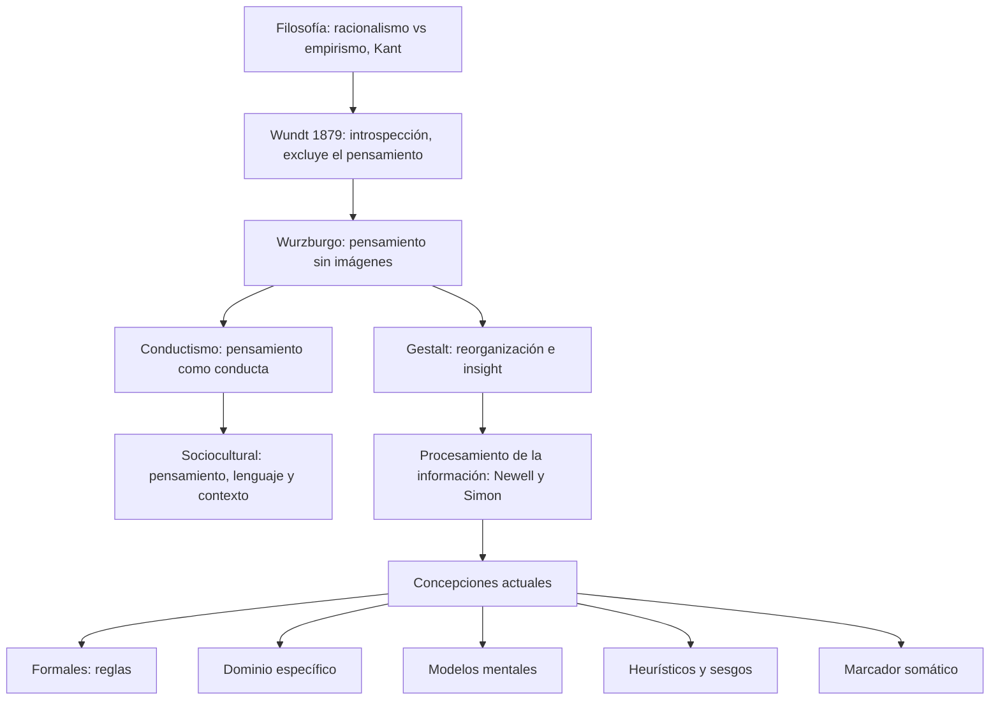
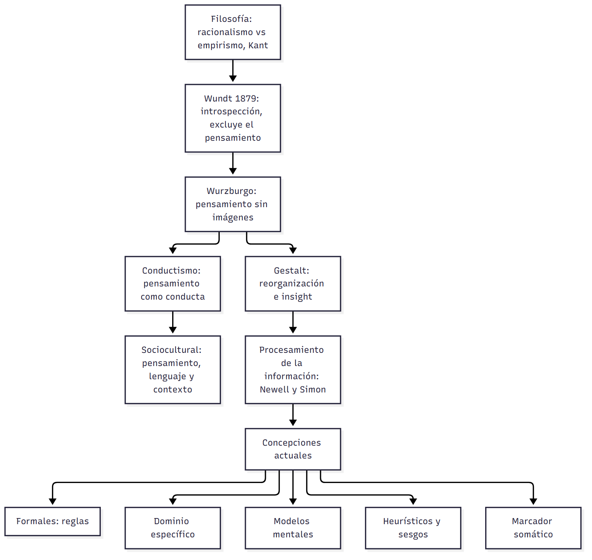

# U03 — Clase 01: Introducción al estudio del pensamiento · Versión de cursada

> **Fuentes:**
>
> - Cárdenas Poveda, C. (2026a). *Introducción: Desarrollo del estudio del pensamiento en psicología, desde enfoques clásicos a modelos contemporáneos* [Diapositivas de clase: Pensamiento, Clase 01]. Procesos Básicos III, Universidad Favaloro.
> - González Labra, M. J. (s. f.). Psicología del pensamiento: Esbozo histórico. En *Psicología del pensamiento* (cap. 1, pp. 1-22). UNED.
>
> **Materia:** Procesos Básicos III, 2.º año, Universidad Favaloro. Docente: Mg. Carolina Cárdenas Poveda. Unidad 3: Pensamiento.

> **Aviso sobre las fuentes:** esta es la **versión de cursada**: sigue las 25 diapositivas de la Clase 01, en su orden, y usa el texto de González Labra solo para explicar lo que la diapositiva dice en una línea. (1) El programa de la materia no está en el repositorio, así que el mapa de abajo marca el origen de cada tema como **Clase** o **Solo libro**, no contra el programa: es **provisorio**. (2) Quedan afuera, y están en `U03_IntroduccionAlEstudioDelPensamiento_Guia.md` si los necesitás: el marco «concepto y método» de González Labra, la psicología de las funciones mentales (Dewey, James), el neoconductismo (Tolman, Hull), la analogía computacional en detalle (Turing, Shannon, Wiener) y el problema mente-cuerpo. (3) La diapositiva 19 solo **nombra** el experimento de Luria en Uzbekistán; no trae su desarrollo. (4) Las páginas de González Labra son las del PDF digitalizado.

> **Idea-fuerza:** el pensamiento es un conjunto de actividades mentales (razonar, abstraer, generalizar) que sirven para **razonar, resolver problemas y tomar decisiones**. La psicología tardó en poder estudiarlo: Wundt lo excluyó, Wurzburgo mostró que existe pensamiento sin imágenes, el conductismo lo redujo a conducta, la Gestalt lo describió como reorganización (*insight*) y el procesamiento de la información lo modeló como búsqueda paso a paso. Hoy conviven modelos **formales**, **de dominio específico**, **semánticos** (modelos mentales), de **heurísticos y sesgos** y de **emoción** (marcador somático) (Cárdenas Poveda, 2026a, diapositivas 4-25).

## Hilo conductor

La clase responde una pregunta: **¿cómo llegó la psicología a estudiar el pensamiento y desde qué enfoques lo hace hoy?** Primero define el objeto y sus tres áreas (§1). Después presenta el debate filosófico de fondo, razón contra experiencia (§2), que vuelve una y otra vez. Luego recorre las escuelas psicológicas en orden: cada una corrige a la anterior en el método o en lo que acepta estudiar (§3-§5). Termina con las concepciones actuales, que son el mapa de lo que se ve en las clases 02 y 03 (§6).

## Mapa: qué se dio en clase

| Tema | Origen | Diapositivas | Sección |
|---|---|---|---|
| Definición de pensamiento y tres grandes áreas | Clase | 2-7 | §1 |
| Racionalismo, empirismo y Kant; debates recurrentes | Clase | 8-12 | §2 |
| Wundt y la escuela de Wurzburgo | Clase (+ libro) | 13-14 | §3 |
| Conductismo y Gestalt | Clase (+ libro) | 15-18 | §4 |
| Psicología sociocultural y procesamiento de la información | Clase | 19-20 | §5 |
| Concepciones actuales | Clase | 21-25 | §6 |

---

## 1. Qué es el pensamiento y cuáles son sus áreas

La clase parte del diccionario: *pensar* viene del latín *pensare*, «pesar», «calcular», y significa formar o combinar ideas o juicios en la mente (Cárdenas Poveda, 2026a, diapositivas 2-3). La definición de trabajo es la de Carretero y Asensio (2014): **«pensamiento» designa lo que contiene o aquello a lo que apunta un conjunto de actividades mentales u operaciones intelectuales** (razonar, abstraer, generalizar) **cuyas finalidades son, entre otras, resolver problemas, tomar decisiones y representarse la realidad externa** (Cárdenas Poveda, 2026a, diapositiva 4).

**Tres grandes áreas** (Cárdenas Poveda, 2026a, diapositivas 5-7):

- **Razonamiento:** extraer conclusiones a partir de premisas o hechos dados; obtener algo nuevo a partir de algo conocido.
  - **Deductivo:** la conclusión se infiere **necesariamente** de las premisas porque está incluida lógicamente en ellas. Hay **una sola conclusión**, y es verdadera si las premisas lo son.
  - **Inductivo:** generalización que obtiene una regla a partir de casos concretos. Las conclusiones son **posibles**: si la regla no se cumple en un caso, queda total o parcialmente falsa.
- **Solución de problemas:** un **problema** cumple dos condiciones: (1) hay un objetivo que no sabemos cómo alcanzar (Duncker, 1948) y (2) no tenemos un camino rápido para resolverlo (Lester, 1983).
- **Toma de decisiones.**

> **Esqueleto de la respuesta:**
> 1. **Definición:** actividades mentales cuyo fin es resolver problemas, decidir y representarse la realidad (Carretero y Asensio).
> 2. **Áreas:** razonamiento, solución de problemas, toma de decisiones.
> 3. **Deducción vs. inducción:** conclusión necesaria y única vs. conclusiones posibles.
> 4. **Problema:** meta desconocida + sin camino rápido (Duncker; Lester).

> ⚠ **No confundir:** en la *deducción* la verdad de la conclusión **depende de la verdad de las premisas** (si son verdaderas, la conclusión también); en la *inducción* un solo contraejemplo alcanza para que la regla deje de ser verdadera (Cárdenas Poveda, 2026a, diapositiva 6).

---

## 2. Antecedentes filosóficos

El debate de fondo es **racionalismo contra empirismo** (Cárdenas Poveda, 2026a, diapositivas 8-11):

| | Racionalismo | Empirismo | Kant |
|---|---|---|---|
| Tesis | La mente posee razonamiento y lo **impone** al mundo sensorial | Los procesos mentales **reflejan** el mundo externo | El **sujeto construye y ordena al objeto** |
| Autores | **Platón** (427-347 a. C.): teoría de las **reglas formales**, abstractas y de propósito general. **Descartes** (1596-1650): la verdad se alcanza por vía racional; privilegio de la razón y la matemática; mente racional separada de un cuerpo mecánico | **Locke** (1632-1704): rechaza la vía introspectiva; solo se conoce por los sentidos; el sujeto se vuelve racional generalizando su experiencia. Lo continúan **Hume y Berkeley** | Parte de un **sujeto cognoscente** e intenta resolver el debate |

La clase cierra el bloque con dos **debates recurrentes**: ¿el pensamiento es una **habilidad** o un **conjunto de procesos**?, ¿es **racional** o **irracional**? (Cárdenas Poveda, 2026a, diapositiva 12). Estos debates reaparecen después: la teoría de reglas formales (Clase 02) es la versión psicológica de Platón, y los heurísticos y sesgos (Clase 03) muestran el lado «no racional».

> ⚠ **No confundir:** el *racionalismo* pone la razón **antes** de la experiencia; el *empirismo* pone la experiencia **antes** de la razón; *Kant* no elige uno: el sujeto **construye** el objeto que conoce.

---

## 3. Los comienzos de la psicología: Wundt y Wurzburgo

**Wilhelm Wundt (1879).** Usa el **método de la introspección** (atención a las percepciones y descripción de ellas) y estudia lo perceptible y concreto, a partir de imágenes. **Excluye al pensamiento**, porque es imposible que el pensamiento se estudie a sí mismo (Cárdenas Poveda, 2026a, diapositiva 13).

**Escuela de Wurzburgo (Oswald Külpe, fines del siglo XIX)** (Cárdenas Poveda, 2026a, diapositiva 14):

- **No todos los procesos mentales son conscientes ni se presentan como imágenes** (pensamiento sin imágenes).
- El pensamiento es un **constructo general y abstracto**, al margen de los elementos concretos.
- Abre la posibilidad de estudiar los procesos «superiores», como el pensamiento y la inteligencia.
- Pero choca con las **dificultades de la introspección sistemática** como método fiable.

El libro agrega el hallazgo con el que esta escuela mostró que el pensamiento **tiene dirección**: la **tendencia determinante**, una preparación genérica que orienta la selección de respuestas según la tarea (González Labra, s. f., pp. 4-6).

> **Esqueleto de la respuesta:**
> 1. **Wundt:** introspección de lo perceptible; excluye el pensamiento.
> 2. **Wurzburgo:** pensamiento sin imágenes, no todo es consciente; tendencia determinante.
> 3. **Límite común:** la introspección no es un método fiable.

> ⚠ **No confundir:** *Wundt* usa la introspección y por eso **deja afuera** el pensamiento; *Wurzburgo* también usa introspección, pero la aplica al pensamiento y encuentra **contenidos sin imagen**. El problema que heredan los dos es el método (Cárdenas Poveda, 2026a, diapositivas 13-14).

---

## 4. Conductismo y Gestalt

**Concepción conductista** (Cárdenas Poveda, 2026a, diapositiva 15):

- **Watson (1924):** el pensamiento es **lenguaje subvocal**; como el lenguaje, se adquiere por asociación.
- **Skinner (1957):** **conducta verbal**.
- **Thorndike (1898):** pensamiento orientado a la **solución de problemas**, sin interés por los aspectos internos: ¿cómo resuelven problemas los animales? (ensayo y error).

**Concepción de la Gestalt** (Cárdenas Poveda, 2026a, diapositivas 16-18):

- **Köhler (1924):** experimentos con primates. Resolver un problema es **reorganizar los elementos de la tarea**; el todo es más que la suma de las partes.
- **El debate con el conductismo:** a las dos corrientes les interesa cómo aparecen conductas nuevas. El conductismo mira **aspectos externos** (recompensas y castigos); la Gestalt introduce **aspectos internos**, como el ***insight*** o «comprensión súbita».
- **Pensamiento productivo** (Wertheimer, 1945): el «verdadero pensamiento»; crea una solución **nueva** reorganizando los elementos del problema e implica *insight*.
- **Pensamiento reproductivo:** aplica una solución **ya conocida**; implica **ensayo y error**.
- **Críticas:** conceptos ambiguos, sin una teoría bien estructurada.
- **Aportes:** el análisis de los procesos **paso a paso** y la idea de que comprender un problema depende del **contexto** y de la **experiencia previa** de quien lo resuelve.

> **Esqueleto de la respuesta:**
> 1. **Punto en común:** las dos explican cómo aparece una conducta nueva.
> 2. **Conductismo:** factores externos; pensamiento = lenguaje subvocal o conducta verbal; ensayo y error.
> 3. **Gestalt:** factores internos; reorganización e *insight* (Köhler).
> 4. **Productivo vs. reproductivo** (Wertheimer).
> 5. **Balance de la Gestalt:** conceptos ambiguos, pero aporta el análisis paso a paso y el papel del contexto.

> ⚠ **No confundir:** el *pensamiento productivo* crea una solución **nueva** con *insight*; el *reproductivo* **repite** una solución conocida por ensayo y error. El ensayo y error es, entonces, lo que la Gestalt le atribuye al pensamiento reproductivo, y lo que el conductismo (Thorndike) toma como modelo de toda solución (Cárdenas Poveda, 2026a, diapositivas 15, 17).

---

## 5. Psicología sociocultural y procesamiento de la información

**Psicología sociocultural: Vigotsky, Leontiev y Luria (1920-1930)** (Cárdenas Poveda, 2026a, diapositiva 19):

- Propone una **reorganización estructural** de la psicología: hace falta una «psicología general».
- Vigotsky estudia sobre todo los vínculos entre **pensamiento y lenguaje** desde una perspectiva **evolutiva** (del desarrollo).
- Discute con la Gestalt, con el conductismo y con Piaget.
- Tesis: **no tiene sentido estudiar el pensamiento separado del lenguaje, del contexto social y del desarrollo ontogenético**.
- Ejemplo nombrado en clase: el **experimento de Luria en Uzbekistán con campesinos analfabetos**.

**Teoría del procesamiento de la información: Newell y Simon (1972)** (Cárdenas Poveda, 2026a, diapositiva 20):

- Método: **protocolos verbales** (la persona piensa en voz alta) y **simulaciones computacionales**.
- La solución de problemas es un **proceso gradual, continuo y acumulativo**, con recursiones, interrupciones, retrocesos y revisiones.
- Quien resuelve problemas posee un **sistema de procesamiento de información**, y ese sistema tiene **restricciones** propias de su arquitectura cognitiva.

→ La teoría del procesamiento de la información se desarrolla en `U03_RazonamientoProbabilisticoYSolucionDeProblemas_Cursada_Guia.md` §5.

> ⚠ **No confundir:** la *Gestalt* ve la solución como **súbita** (*insight*); el *procesamiento de la información* la ve como **gradual y acumulativa**, con retrocesos (Cárdenas Poveda, 2026a, diapositivas 17, 20).

---

## 6. Concepciones actuales

La clase cierra con cinco enfoques vigentes. Son el índice de las clases siguientes (Cárdenas Poveda, 2026a, diapositivas 21-25):

| Enfoque | Qué sostiene | Cómo explica el error | Se ve en |
|---|---|---|---|
| **Modelos formales** (desde los años 50) | Versión psicológica del planteo platónico: el pensamiento se guía por **reglas formales, abstractas y de propósito general** | (1) El sujeto no acepta la tarea como lógica; (2) comprende mal las premisas | Clase 02 |
| **Modelos de dominio específico** | Reglas **específicas de dominio y sensibles al contexto**, no de propósito general. (1) **Esquemas pragmáticos:** estructuras abstractas inducidas de la experiencia del mundo real (permiso, obligación, causalidad). (2) **Contrato social:** razonar en contexto social, por ejemplo para evitar que el otro te engañe | El contenido y el contexto cambian la respuesta | Clase 02 (críticas) |
| **Modelos mentales** (Johnson-Laird, 1983) | Enfoque **semántico**: no estudia las reglas que relacionan los elementos (sintaxis) sino su **significado**; un razonamiento es verdadero si concuerda con la realidad | Por los límites para construir todos los modelos | Clase 02 |
| **Teoría de las perspectivas** (Tversky y Kahneman, 1979) | Elegimos la alternativa que consideramos más útil; en la vida real razonamos con **sesgos, heurísticos o «atajos cognitivos»**, eficientes y ecológicos, pero menos rigurosos | Solo permite **entender los errores**; no es una alternativa a los modelos formales | Clase 03 |
| **Hipótesis del marcador somático** (Damasio, 1994) | «El error de Descartes» fue separar la razón de la emoción: la toma de decisiones está **modulada por la experiencia emocional** (marcadores somáticos positivos y negativos) | — | — |

> **Esqueleto de la respuesta:**
> 1. **Formales:** reglas generales (Platón → años 50); el error es de interpretación.
> 2. **Dominio específico:** esquemas pragmáticos y contrato social.
> 3. **Semánticos:** modelos mentales (Johnson-Laird).
> 4. **Heurísticos:** perspectivas (Tversky y Kahneman); explican los errores.
> 5. **Emoción:** marcador somático (Damasio) contra la separación cartesiana.

> ⚠ **No confundir:** los *modelos formales* atienden a la **forma** (sintaxis) y los *modelos mentales* al **significado** (semántica). Los *heurísticos* no compiten con ellos: la clase dice que **no son una alternativa** a los formales y que solo sirven para entender los errores (Cárdenas Poveda, 2026a, diapositivas 23-24).

---

## Para rendir (formato del parcial)

> 🎯 **Para el parcial:** el formato de la «Presentación Pensamiento» (28/10) no está confirmado. Estas preguntas son de respuesta corta; si es oral, usá los esqueletos como guion.

**1) Opción múltiple.** ¿Qué hallazgo de la escuela de Wurzburgo contradice a Wundt? (a) que el pensamiento es lenguaje subvocal; (b) **que no todos los procesos mentales son conscientes ni se presentan como imágenes**; (c) que el todo es más que la suma de las partes; (d) que la introspección es un método fiable. — *Respuesta: b* (Cárdenas Poveda, 2026a, diapositiva 14). La (a) es Watson, la (c) es la Gestalt y la (d) es al revés: Wurzburgo choca con los límites de la introspección.

**2) Verdadero o falso.** «En el razonamiento inductivo la conclusión está contenida lógicamente en las premisas.» — *Falso.* Eso define a la **deducción**; la inducción generaliza una regla a partir de casos concretos y admite varias conclusiones posibles (Cárdenas Poveda, 2026a, diapositiva 6).

**3) Verdadero o falso.** «La teoría de las perspectivas de Tversky y Kahneman es una alternativa a los modelos formales.» — *Falso.* La clase aclara que no son una alternativa: solo permiten entender los errores (Cárdenas Poveda, 2026a, diapositiva 24).

**4) Opción múltiple.** Resolver un problema aplicando una solución ya conocida, por ensayo y error, es para la Gestalt: (a) *insight*; (b) pensamiento productivo; (c) **pensamiento reproductivo**; (d) tendencia determinante. — *Respuesta: c* (Cárdenas Poveda, 2026a, diapositiva 17).

**5) Pregunta abierta (máx. 7 renglones).** *¿En qué se diferencian el conductismo y la Gestalt al explicar la aparición de conductas nuevas?*

*Respuesta modelo:* A las dos corrientes les interesa cómo aparece una conducta nueva, pero la explican de modos opuestos. El conductismo atiende a factores **externos** (recompensas y castigos): Watson reduce el pensamiento a lenguaje subvocal y Thorndike estudia cómo resuelven problemas los animales por ensayo y error, sin interés por lo interno. La Gestalt introduce factores **internos**: en los experimentos de Köhler con primates, resolver es reorganizar los elementos de la tarea, y la solución aparece por *insight*. Wertheimer distingue el pensamiento productivo (una solución nueva) del reproductivo (aplicar una conocida) (Cárdenas Poveda, 2026a, diapositivas 15-17).

**6) Pregunta abierta (máx. 7 renglones).** *¿Qué aporta la hipótesis del marcador somático al estudio del pensamiento?*

*Respuesta modelo:* Damasio (1994) critica lo que llama «el error de Descartes»: separar la razón de la emoción, como hacía la división cartesiana entre una mente racional y un cuerpo mecánico. Según su hipótesis, la toma de decisiones está modulada por la experiencia emocional, mediante marcadores somáticos positivos y negativos. Así, el pensamiento deja de verse como un cálculo puramente racional (Cárdenas Poveda, 2026a, diapositivas 9, 25).

## Tabla de distinciones

| Par | Criterio |
|---|---|
| Deducción / inducción | Conclusión necesaria y única / conclusiones posibles |
| Racionalismo / empirismo | La razón se impone al mundo / la mente refleja el mundo |
| Wundt / Wurzburgo | Excluye el pensamiento / pensamiento sin imágenes |
| Conductismo / Gestalt | Factores externos / factores internos (*insight*) |
| Productivo / reproductivo | Solución nueva con *insight* / solución conocida por ensayo y error |
| Gestalt / procesamiento de la información | Solución súbita / solución gradual y acumulativa |
| Modelos formales / modelos mentales | Sintaxis (reglas) / semántica (significado) |

## Referencias

Cárdenas Poveda, C. (2026a). *Introducción: Desarrollo del estudio del pensamiento en psicología, desde enfoques clásicos a modelos contemporáneos* [Diapositivas de clase: Pensamiento, Clase 01]. Procesos Básicos III, Universidad Favaloro.

González Labra, M. J. (s. f.). Psicología del pensamiento: Esbozo histórico. En *Psicología del pensamiento* (cap. 1, pp. 1-22). UNED.
