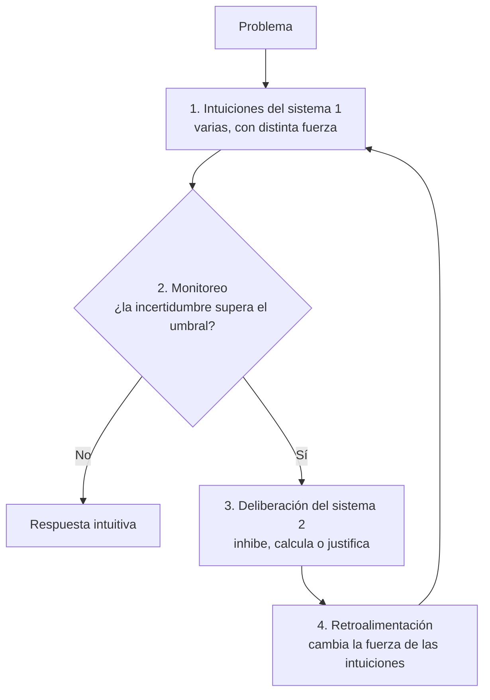
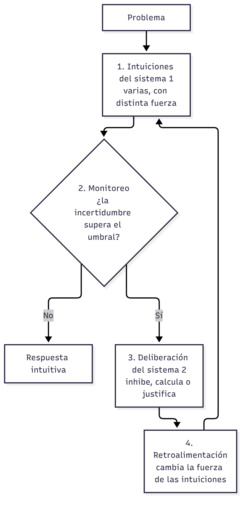

# Expositor 2 — Acierto 1: el control que faltaba

> **Para qué es esta guía:** para que entiendas lo que vas a decir, no para leerla en voz alta. Tu texto exacto está en el guion de la presentación (carpeta de entregables) y en las notas del orador de las diapositivas 6 a 8.
>
> **Aviso sobre las fuentes:** el artículo se leyó completo, a partir del texto extraído del PDF (que no se sube a git). Lo de clase sale de las guías de cursada de U03, que siguen las diapositivas de la docente. Las páginas de Valiña y Martín (2014) son las del PDF digitalizado. Los números del ejemplo de la fórmula son nuestros.

## Qué usás y de dónde viene

Esta tabla responde qué contenidos de clase usás. La columna «Origen» separa lo que **se dio en clase** de lo que está **solo en la bibliografía**: si te preguntan «¿eso lo vimos?», ahí está la respuesta.

| Tema que usás | Clase y diapositivas | Origen | Para qué te sirve |
|---|---|---|---|
| El sistema humano de procesamiento tiene **restricciones** por su arquitectura cognitiva (Newell y Simon) | Clase 01, diap. 20; Clase 03, diap. 18-19 | Clase | Apoya la idea de que el sistema 2 **no puede estar siempre encendido**: es caro. Es el argumento contra la explicación «en paralelo» |
| **Algoritmo** (garantiza la solución, pero es costoso) vs. **heurístico** (rápido, sin garantía) | Clase 03, diap. 22 | Clase | Es la misma tensión que entre sistema 2 y sistema 1: precisión contra economía |
| Los **heurísticos** de Tversky y Kahneman: rápidos, de poco esfuerzo y **no accesibles a la conciencia** | Clase 03, diap. 3-4; Clase 01, diap. 24 | Clase | Son ejemplos de las «intuiciones» del sistema 1 de las que habla el modelo |
| **Competencia vs. actuación** | Clase 02, diap. 27 | Clase | Puente nuestro para hablar de Evans: un sesgo (estadio heurístico) no prueba que falte la competencia lógica (estadio analítico) |
| Las tres preguntas de **Evans (1991)**: qué explica la competencia, qué produce los sesgos, por qué influye el contenido | Clase 02, diap. 30 | Clase | Es la única vez que Evans aparece en clase: de ahí partís para presentar su teoría |
| **Modelos mentales**: un modelo inicial simple, con información implícita, y una etapa de validación que «vuelve a empezar» si encuentra un contraejemplo | Clase 02, diap. 34-37 | Clase | Analogía útil: el modelo inicial es como la intuición, y la validación es como la deliberación que se activa cuando el modelo inicial no alcanza |
| **Teoría heurístico-analítica de Evans** (dos estadios, relevancia, «piensan selectivamente») | — | **Solo libro**: Valiña y Martín (2014), cap. 6, pp. 19-22 | Es el centro de tu acierto. La clase **no** la desarrolló |
| Un sistema que infiere necesita un **mecanismo de control** que elija las inferencias relevantes | — | **Solo libro**: González Labra (s. f.), p. 15 | Es tu segundo argumento: la retroalimentación de De Neys es ese control |
| Las cinco explicaciones del cambio y el modelo de cuatro piezas | — | **Artículo**: De Neys (2023a), pp. 6-11 | Es lo que presentás en las diapositivas 6 y 7 |

---

## 1. Tu parte en un minuto

Tenés **3 minutos** y las **diapositivas 6, 7 y 8**. Tu compañero 1 acaba de mostrar que la respuesta «lógica» muchas veces ya es intuitiva (no hay exclusividad) y te pasa la palabra con «sigue mi compañero con el cambio». Vos hacés tres cosas:

1. **Diapositiva 6 (0:55):** el problema del cambio. Cómo se decide pasar al sistema 2, y por qué fallan las explicaciones tradicionales.
2. **Diapositiva 7 (0:50):** la solución de De Neys, un modelo de cuatro piezas.
3. **Diapositiva 8 (1:10):** por qué eso es un acierto. Le da a la teoría de Evans el mecanismo que no tenía y responde al problema del control que ya planteaba la psicología cognitiva.

Después, el expositor 3 sigue con el segundo acierto (la intuición se educa).

## 2. Lo mínimo del artículo que tenés que tener claro

- **Modelos de proceso dual:** pensamos con un **sistema 1** (intuitivo, rápido, sin esfuerzo) y un **sistema 2** (deliberado, lento, costoso).
- **Exclusividad:** la idea de que la respuesta correcta («5 centavos» en el problema del bate y la pelota) **solo** la puede dar el sistema 2. El expositor 1 muestra que la evidencia no la sostiene.
- **Hipótesis del artículo:** la exclusividad y el problema del cambio **están ligados**. Tu parte es la que muestra **por qué**.

## 3. Diapositiva 6: el problema del cambio

**La pregunta.** Los modelos duales dicen que usamos el sistema 1 por defecto y que el sistema 2 «interviene cuando hace falta» (modelo serial o *default-interventionist*). Pero ¿cómo sabe una persona, **sola y sin que nadie le avise**, que su intuición está mal y que tiene que ponerse a pensar? ¿Y cuándo deja de pensar? (De Neys, 2023a, pp. 5-6).

**Las cinco respuestas tradicionales y por qué fallan** (De Neys, 2023a, pp. 6-7):

| Explicación | Qué propone | Por qué falla |
|---|---|---|
| **El sistema 2 vigila** | El sistema 2 controla lo que produce el sistema 1 y se activa si hay conflicto | Para detectar el conflicto ya tendría que haber calculado su propia respuesta, o sea, **ya estar activo**. Es una paradoja: el sistema 2 no puede encenderse a sí mismo |
| **Deliberación de bajo esfuerzo** | Vigila un sistema 2 «en modo ahorro» y, si detecta conflicto, pasa a pensar en serio | Si el modo ahorro ya alcanza para calcular la respuesta correcta, esa respuesta no es tan costosa. Si no alcanza, no puede detectar el conflicto. **El problema solo se corre un paso** |
| **Un sistema 3** | Un tercer sistema, automático, compara las salidas del 1 y del 2 | Para comparar necesita la respuesta del sistema 2, así que hay que activarlo antes. **Regresión infinita** |
| **Siempre en paralelo** | Los dos sistemas funcionan siempre a la vez, así que no hace falta decidir nada | Se pierde la ventaja de tener dos sistemas: gastaríamos recursos caros todo el tiempo, incluso cuando la intuición acierta. Y si el sistema 1 espera al 2, ya no somos rápidos |
| **Nunca cambiar** | La persona nunca pasa sola al sistema 2; se queda en el 1 | Es coherente, pero explica solo la mitad: no dice nada de **quienes sí aciertan** |

**La idea que tenés que transmitir:** todas fallan por lo mismo. Si la respuesta correcta está **solo** en el sistema 2, el sistema 1 no tiene con qué darse cuenta de que se equivoca. La salida que propone De Neys tiene dos partes: que la decisión de cambiar la tome el **propio sistema 1**, y que el sistema 1 **también** pueda generar la respuesta lógica. Eso es abandonar la exclusividad (De Neys, 2023a, p. 7).

> 🔗 **Clase:** el argumento contra la explicación «en paralelo» es el de la economía cognitiva. Newell y Simon plantean que el sistema humano de procesamiento tiene **restricciones** propias de su arquitectura (Cárdenas Poveda, 2026a, diapositiva 20; 2026c, diapositivas 18-19), y la clase contrasta el **algoritmo**, que garantiza pero cuesta, con el **heurístico**, rápido pero sin garantía (Cárdenas Poveda, 2026c, diapositiva 22).

## 4. Diapositiva 7: el modelo de cuatro piezas

1. **Intuiciones.** El sistema 1 no da una sola respuesta: activa **varias intuiciones**, cada una con una **fuerza**. En el bate y la pelota pueden activarse a la vez «10 centavos» y «5 centavos». La intuición lógica existe porque la respuesta se **automatizó** con la práctica (De Neys, 2023a, p. 8).
2. **Monitoreo de la incertidumbre.** El sistema 1 compara las fuerzas. Si una domina claramente, la incertidumbre es baja y se responde sin pensar. Si son parecidas, la incertidumbre sube y, pasado un **umbral**, se activa el sistema 2. La fórmula es U = 1 − |I1 − I2| (De Neys, 2023a, p. 8).
   - Ejemplo nuestro: si «10 centavos» vale 0,8 y «5 centavos» vale 0,3, U = 0,5. Si las dos valen 0,6, U = 1: máxima incertidumbre.
   - Ejemplo del autor, para entenderlo: a John le encanta el helado y odia los cupcakes, así que elige helado sin pensar. A Steve le gustan los dos por igual, así que tiene que pensarlo. Con las intuiciones pasa lo mismo (De Neys, 2023a, pp. 8-9).
3. **Deliberación.** Solo acá se piensa con esfuerzo. Puede servir para **inhibir** una intuición, para **calcular** paso a paso (por ejemplo, 220 × 30) o para **justificar** la intuición que uno ya tenía. Por eso pensar no garantiza acertar (De Neys, 2023a, p. 10).
4. **Retroalimentación.** Lo que hace el sistema 2 cambia la fuerza de las intuiciones. Si una queda claramente más fuerte, la incertidumbre baja del umbral y **se deja de pensar**. Esto responde a la pregunta que casi nadie se había hecho: no solo qué nos hace pensar, sino **qué nos hace dejar de pensar** (De Neys, 2023a, p. 10).

**Conclusión del autor:** todo modelo dual viable tiene que ser **no exclusivo** (De Neys, 2023a, p. 11).

> 🔗 **Clase:** las intuiciones del modelo se parecen a los **heurísticos** de Tversky y Kahneman, que son rápidos, de poco esfuerzo y no accesibles a la conciencia (Cárdenas Poveda, 2026c, diapositivas 3-4). Y el circuito recuerda a los **modelos mentales**: se arma un modelo inicial simple y, en la validación, si aparece un contraejemplo, «se vuelve a empezar» (Cárdenas Poveda, 2026b, diapositivas 34-37). Usalo solo como analogía si te preguntan: De Neys no cita a Johnson-Laird.

## 5. Diapositiva 8: por qué es un acierto

**Primer argumento: le da a Evans el mecanismo que le faltaba.**

- La teoría **heurístico-analítica** de Evans tiene dos estadios. El **heurístico** es preconsciente y rápido, y **selecciona** qué información es relevante. El **analítico** hace las deducciones sobre lo seleccionado (Valiña y Martín, 2014, pp. 19-20).
- Para Evans, los **sesgos** vienen del estadio heurístico y la **competencia** lógica, del analítico (Valiña y Martín, 2014, p. 22). Eso es exactamente la **exclusividad**: la respuesta correcta queda reservada a lo analítico.
- Evans no especificó **qué hace que intervenga** el estadio analítico. De Neys sí: la **incertidumbre** entre intuiciones.
- Además coinciden en algo: para Evans «las personas cometen errores en razonamiento porque piensan selectivamente» (Evans, 1995, como se citó en Valiña y Martín, 2014, p. 20). En De Neys, deliberar a veces solo **justifica** la intuición que uno ya tenía.

> 🔗 **Clase:** en clase, Evans aparece con sus tres preguntas: qué explica la competencia lógica, qué produce los sesgos y por qué el rendimiento depende del contenido (Cárdenas Poveda, 2026b, diapositiva 30). Y la clase distingue **competencia** (lo que uno puede hacer) de **actuación** (lo que hace en una tarea concreta) (Cárdenas Poveda, 2026b, diapositiva 27). Si te preguntan, podés tender este puente (es nuestro, no de Evans): así como un error de actuación no prueba que falte la competencia, el sesgo del estadio heurístico no prueba que falte la competencia lógica.

**Segundo argumento: resuelve el problema del control.** González Labra plantea que un sistema que hace inferencias necesita un **mecanismo de control** que elija las inferencias relevantes, porque si no se pierde en un sinfín de inferencias posibles (González Labra, s. f., p. 15). La retroalimentación de De Neys cumple ese papel: dice cuándo empezar a pensar y cuándo **parar**.

## 6. Preguntas que te pueden hacer

| Pregunta | Respuesta breve |
|---|---|
| ¿Por qué el sistema 2 no puede vigilar al sistema 1? | Porque para ver el conflicto necesita su propia respuesta, y para eso ya tiene que estar activo. Es una paradoja (De Neys, 2023a, p. 6). |
| ¿Qué es el umbral? | El nivel de incertidumbre a partir del cual se activa el sistema 2. El autor no le da un valor, y eso lo critica el expositor 4. |
| ¿Pensar más garantiza acertar? | No. La deliberación puede usarse para justificar la intuición equivocada (De Neys, 2023a, p. 10). |
| ¿La teoría de Evans la vimos en clase? | No en detalle: en clase aparecen sus preguntas (Clase 02, diap. 30); la teoría está en Valiña y Martín (2014), cap. 6. |
| ¿De Neys critica a Evans? | Critica la exclusividad de los modelos clásicos, pero en su respuesta reconoce que Evans y Stanovich ya la abandonaron en sus trabajos recientes (De Neys, 2023b, p. 67). Su aporte es mostrar la relación entre exclusividad y cambio. |
| ¿Y si no hay ninguna intuición? | La incertidumbre es máxima y hay que deliberar: es el caso de un problema totalmente nuevo (De Neys, 2023a, p. 9). |

## 7. Conceptos que conviene poder definir

- **Exclusividad:** suponer que una respuesta (la lógica) solo puede generarla el sistema 2.
- **Mecanismo de cambio:** cómo se decide pasar del sistema 1 al 2, y volver.
- **Modelo serial (*default-interventionist*):** primero actúa el sistema 1 y el 2 interviene solo si hace falta.
- **Incertidumbre (U):** cuán parecidas en fuerza son las intuiciones en competencia.
- **Umbral de deliberación:** el nivel de U a partir del cual se activa el sistema 2.
- **Retroalimentación:** el efecto del sistema 2 sobre la fuerza de las intuiciones, que permite dejar de pensar.
- **Estadio heurístico / analítico (Evans):** selección preconsciente de lo relevante / deducción sobre lo seleccionado.

## Referencias

Cárdenas Poveda, C. (2026a). *Introducción: Desarrollo del estudio del pensamiento en psicología, desde enfoques clásicos a modelos contemporáneos* [Diapositivas de clase: Pensamiento, Clase 01]. Procesos Básicos III, Universidad Favaloro.

Cárdenas Poveda, C. (2026b). *Teorías y modelos sobre razonamiento* [Diapositivas de clase: Pensamiento, Clase 02]. Procesos Básicos III, Universidad Favaloro.

Cárdenas Poveda, C. (2026c). *Razonamiento probabilístico y solución de problemas* [Diapositivas de clase: Pensamiento, Clase 03]. Procesos Básicos III, Universidad Favaloro.

De Neys, W. (2023a). Advancing theorizing about fast-and-slow thinking. *Behavioral and Brain Sciences*, *46*, Artículo e111. https://doi.org/10.1017/S0140525X2200142X

De Neys, W. (2023b). Further advancing fast-and-slow theorizing. *Behavioral and Brain Sciences*, *46*, Artículo e146. https://doi.org/10.1017/S0140525X23000559

González Labra, M. J. (s. f.). Psicología del pensamiento: Esbozo histórico. En *Psicología del pensamiento* (cap. 1, pp. 1-22). UNED.

Valiña, M. D., y Martín, M. (2014). Razonamiento pragmático. En M. Carretero y M. Asensio (Coords.), *Psicología del pensamiento: Teoría y prácticas* (cap. 6). Alianza.
