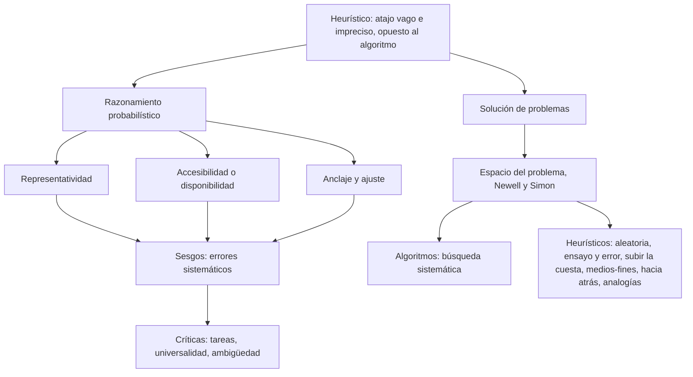
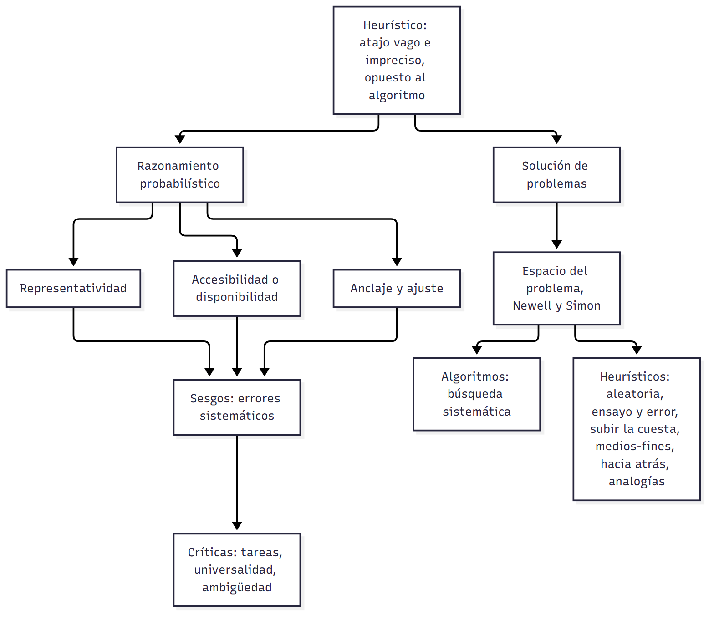

# U03 — Clase 03: Razonamiento probabilístico y solución de problemas · Versión de cursada

> **Fuentes:**
>
> - Cárdenas Poveda, C. (2026c). *Razonamiento probabilístico y solución de problemas* [Diapositivas de clase: Pensamiento, Clase 03]. Procesos Básicos III, Universidad Favaloro.
> - Pérez Echeverría, M. P., y Bautista, A. (2014). Pensamiento probabilístico. En M. Carretero y M. Asensio (Coords.), *Psicología del pensamiento: Teoría y prácticas* (cap. 7, pp. 1-22). Alianza.
> - Pérez Echeverría, M. P. (2014). Solución de problemas. En M. Carretero y M. Asensio (Coords.), *Psicología del pensamiento: Teoría y prácticas* (cap. 8, pp. 1-20). Alianza.
> - Postigo Angón, Y. (2014). Estrategias en solución de problemas. En M. Carretero y M. Asensio (Coords.), *Psicología del pensamiento: Teoría y prácticas* (cap. 9, pp. 1-28). Alianza.
>
> **Materia:** Procesos Básicos III, 2.º año, Universidad Favaloro. Docente: Ps. Mg. Carolina Cárdenas Poveda. Unidad 3: Pensamiento.

> **Aviso sobre las fuentes:** esta es la **versión de cursada**: sigue las 38 diapositivas de la Clase 03, con sus dos bloques (razonamiento probabilístico, diapositivas 2-12; solución de problemas, 13-37). La bibliografía que indica la clase son los capítulos 7 y 8 de Carretero y Asensio; el capítulo 9 se usa solo para resolver los problemas de la clase. (1) El programa no está en el repositorio: el mapa marca el origen como **Clase** o **Solo libro** y es **provisorio**. (2) Las diapositivas 7-10 (ejemplos de representatividad) son imágenes y videos: el texto extraído solo conserva «Ferrari», «Tokio», «Médico» y el título del sesgo; completalos con tu cuaderno. (3) Quedan afuera, y están en `U03_RazonamientoProbabilistico_Guia.md` y `U03_SolucionDeProblemas_Guia.md`: el origen de las intuiciones probabilísticas, el cuadro completo de sesgos, el heurístico de simulación, las fases de Polya y Mayer, y expertos y novatos en detalle. (4) Las páginas de los capítulos son las del PDF digitalizado.

> **Idea-fuerza:** en un mundo incierto no calculamos probabilidades: usamos **heurísticos** (representatividad, accesibilidad, anclaje y ajuste), atajos rápidos y no conscientes que funcionan casi siempre, pero producen **sesgos** sistemáticos (Tversky y Kahneman, 1974). Al resolver problemas pasa algo parecido: el espacio del problema se puede recorrer entero (**algoritmo**, que garantiza la solución pero es costoso) o con **heurísticos** (atajos que lo reducen, sin garantía): ensayo y error, subir la cuesta, medios-fines, búsqueda hacia atrás, analogías (Cárdenas Poveda, 2026c, diapositivas 2-34).

## Hilo conductor

Las dos mitades de la clase giran alrededor de una misma idea: **el heurístico**, un procedimiento vago e impreciso, opuesto al algoritmo (Cárdenas Poveda, 2026c, diapositiva 3). En el razonamiento probabilístico (§1-§3), los heurísticos explican cómo juzgamos lo probable y por qué erramos. En la solución de problemas (§4-§7), son estrategias para recorrer un espacio de estados sin revisarlo entero. La clase cierra con problemas para resolver e identificar la estrategia usada (§8).

## Mapa: qué se dio en clase

| Tema | Origen | Diapositivas | Sección |
|---|---|---|---|
| Qué es el razonamiento probabilístico | Clase | 2 | §1 |
| Heurísticos de Tversky y Kahneman y sus tres tipos | Clase (+ libro) | 3-11 | §2 |
| Críticas a Tversky y Kahneman | Clase | 12 | §3 |
| Problema: definición y clasificaciones | Clase | 14-15 | §4 |
| Enfoques: capacidades generales y novatos vs. expertos; teoría del procesamiento de la información | Clase | 16-21 | §5 |
| Algoritmos y heurísticos; estrategias generales | Clase | 22-29 | §6 |
| Pensamiento analógico | Clase | 30-34 | §7 |
| Problemas a resolver: lirios, hobbits y orcos | Clase (+ libro) | 35-37 | §8 |

---

## 1. Qué es el razonamiento probabilístico

Es hacer un **cálculo mental de la probabilidad** de que ocurran determinados acontecimientos. Responde a una manera de concebir el mundo y está determinado por la necesidad de **adaptarnos a un mundo dinámico**, en el que la información cambia continuamente y que no podemos conocer del todo. Se relaciona con el **razonamiento inductivo**: va de lo particular a lo general y admite **varias conclusiones posibles** (Cárdenas Poveda, 2026c, diapositiva 2).

> ⚠ **No confundir:** el *razonamiento probabilístico* es inductivo (conclusiones posibles); el *deductivo* de la Clase 02 da una conclusión única y necesaria (Cárdenas Poveda, 2026b, diapositiva 7; 2026c, diapositiva 2).

---

## 2. Los heurísticos de Tversky y Kahneman (1974)

En matemática, un **heurístico** es un procedimiento de solución que se diferencia del algoritmo por su **vaguedad y falta de precisión**. En psicología, los heurísticos aparecen en los métodos **intuitivos** con que enfrentamos la probabilidad y los problemas (Cárdenas Poveda, 2026c, diapositiva 3; Pérez Echeverría y Bautista, 2014, p. 9).

Tversky y Kahneman (1974) proponen **reglas básicas de inferencia probabilística** que usan los adultos (Cárdenas Poveda, 2026c, diapositiva 4):

- Son **independientes** de la cultura, del conocimiento de las leyes matemáticas de la probabilidad y del contenido.
- Son principios generales que **reducen tareas complejas a juicios simples**.
- Permiten decidir de manera razonable **en poco tiempo y con poco esfuerzo**.
- **No son accesibles a la conciencia**.
- Los **sesgos** son los **errores sistemáticos** que aparecen cuando se usa un heurístico de manera inapropiada.

**Los tres tipos** (Cárdenas Poveda, 2026c, diapositivas 5-11):

| Heurístico | Qué hace | Ejemplo o sesgo de la clase |
|---|---|---|
| **Representatividad** | Juzga por la relación entre un proceso o modelo y un ejemplo o acontecimiento vinculado a él: «la situación A se parece a la B, asumo que se comportarán de forma similar» | Ferrari, Tokio, Médico. **Sesgo de insensibilidad a la probabilidad previa de los resultados**: un personaje tímido, introvertido, ordenado y detallista se asigna a un grupo por su parecido con el estereotipo, sin tener en cuenta cuán frecuente es cada grupo |
| **Accesibilidad o disponibilidad** | Estima la probabilidad por la **facilidad con que vienen a la mente** ejemplos o asociaciones; influyen la **familiaridad** del evento y la **prominencia** de algún elemento | — |
| **Anclaje y ajuste** | Estima a partir de un **valor conocido** (el ancla) y lo ajusta | — |

El libro agrega que la insensibilidad a la probabilidad previa consiste en **no tener en cuenta las probabilidades previas**: es un factor que afecta a la probabilidad pero no a la representatividad (Pérez Echeverría y Bautista, 2014, p. 13). También suma un cuarto heurístico, la **simulación**, propuesto en 1982 (Pérez Echeverría y Bautista, 2014, p. 11).

> **Esqueleto de la respuesta:**
> 1. **Definición:** atajos de inferencia probabilística, rápidos, generales y no conscientes.
> 2. **Independencia:** de la cultura, del saber matemático y del contenido.
> 3. **Tipos:** representatividad (parecido), accesibilidad (facilidad de recuerdo), anclaje y ajuste (valor de partida).
> 4. **Sesgo:** error sistemático por uso inapropiado; ejemplo, insensibilidad a la probabilidad previa.

> ⚠ **No confundir:** *representatividad* es juzgar por **parecido** con un modelo; *accesibilidad* es juzgar por **facilidad para recordar** ejemplos; *anclaje y ajuste* es partir de un **valor conocido**. El *heurístico* es el atajo y el *sesgo* es el error que produce (Cárdenas Poveda, 2026c, diapositivas 4, 6, 11).

---

## 3. Críticas a Tversky y Kahneman

La clase las ordena en tres grupos (Cárdenas Poveda, 2026c, diapositiva 12):

1. **A la presentación del trabajo experimental:** las tareas son engañosas y esconden los datos relevantes entre otros; cuando la información se presenta de manera **estadística** se cometen menos sesgos; no se hace ningún análisis estadístico de la significación de los resultados.
2. **A la universalidad de los sesgos:** los **expertos** en estadística o en toma de decisiones cometen menos sesgos, igual que quienes conocen el contenido de la tarea; los sesgos dependen de la tarea y de las creencias y conocimientos sobre ella.
3. **A la ambigüedad de la teoría:** es más **descriptiva que explicativa**, y no permite saber de antemano si actuará la representatividad o la accesibilidad.

> ⚠ **No confundir:** la crítica a la *universalidad* (expertos y conocedores se equivocan menos) apunta contra la tesis de que los heurísticos son **independientes del contenido y del conocimiento** (Cárdenas Poveda, 2026c, diapositivas 4, 12).

---

## 4. Qué es un problema y cómo se clasifica

Un **problema** cumple dos condiciones: hay un **objetivo que no sabemos cómo alcanzar** (Duncker, 1948) y **no hay un camino rápido** para resolverlo (Lester, 1983) (Cárdenas Poveda, 2026c, diapositiva 14).

**Clasificaciones** (Cárdenas Poveda, 2026c, diapositiva 15):

- **Bien definidos vs. mal definidos:** en uno bien definido, el punto de partida, la meta y los pasos intermedios están restringidos y son fáciles de representar.
- **Simples vs. complejos:** depende de qué tan fácil es representarse o acceder a la información para construir el espacio del problema, y de su relación con otros problemas, la claridad de sus metas, su estabilidad espacio-temporal y su relación con el contexto.

---

## 5. Enfoques y teoría del procesamiento de la información

**Dos enfoques** (Cárdenas Poveda, 2026c, diapositivas 16-17):

- **Capacidades generales:** por debajo de las diferencias de ejecución, todo problema exige capacidades de razonamiento y habilidades **generales y comunes**, que se adaptan a cada tipo de problema.
- **Novatos vs. expertos:** no busca un proceso general; estudia cómo la **experiencia y el conocimiento específico** de un dominio afectan la solución de los problemas de ese dominio.

**Teoría del procesamiento de la información (TPI): Newell y Simon (1972)** (Cárdenas Poveda, 2026c, diapositivas 18-19):

- Fueron pioneros en usar **protocolos verbales y simulaciones computacionales**.
- La solución es un proceso **gradual, continuo y acumulativo**, con recursiones, interrupciones, retrocesos y revisiones.
- **Postulados:** (1) quien resuelve posee un **sistema de procesamiento de información**; (2) el sistema tiene **restricciones** por su arquitectura cognitiva; (3) aplica **operadores** (acciones físicas o mentales) a los **estados** del problema; (4) la solución surge de la **interacción** entre el sistema y la **estructura del problema**; (5) se analiza en detalle la secuencia de pasos.

**Espacio del problema** (Cárdenas Poveda, 2026c, diapositivas 20-21): es el **conjunto de todos los estados o secuencias posibles de operaciones**. Algunos problemas tienen un número finito de estados y operaciones; otros, uno muy grande o ilimitado. Las operaciones que elegimos dentro de ese espacio forman la **estrategia**. Ejemplo de clase: la **Torre de Londres**, que pide pasar de una configuración inicial a una final.

> ⚠ **No confundir:** el *espacio del problema* es **todo lo posible**; la *estrategia* es **el camino que elegimos** dentro de él (Cárdenas Poveda, 2026c, diapositiva 20).

---

## 6. Algoritmos, heurísticos y estrategias generales

**Dos formas de recorrer el espacio** (Cárdenas Poveda, 2026c, diapositiva 22):

| | Algoritmo | Heurístico |
|---|---|---|
| Qué es | Método que **garantiza** la solución: genera un espacio exhaustivo y elige la mejor alternativa | Atajo o búsqueda selectiva que da acceso rápido a la solución **reduciendo** los estados |
| Costo | Mucho tiempo y recursos en problemas grandes | Poco tiempo y recursos |
| Garantía | Sí | **No** |
| Ejemplo de clase | Probar todos los gustos de una heladería nueva | Elegir directamente «mi gusto favorito» |

**Estrategias generales** (Cárdenas Poveda, 2026c, diapositivas 24-29):

| Estrategia | Tipo | En qué consiste | Límite o cuándo conviene |
|---|---|---|---|
| **Búsqueda sistemática en profundidad** | Algoritmo | Seguir un camino hasta el final, hasta no poder moverse más; si no se llega, volver un nivel y bajar por otro camino | Exhaustiva y costosa |
| **Búsqueda aleatoria** | Heurístico | Recorrer el espacio al azar | La solución aparece de casualidad |
| **Ensayo y error** | Heurístico | Probar caminos de forma **ordenada y planificada**, comprobar cada resultado y registrar los fallidos para no repetirlos | — |
| **Subir la cuesta** | Heurístico | Variante de la búsqueda en profundidad: en cada punto elegir el movimiento que **más acerca a la meta** | Falla cuando hay que alejarse de la meta para llegar |
| **División en submetas** | Heurístico | Partir el problema en metas parciales | No siempre conviene: podemos centrarnos en submetas inadecuadas |
| **Análisis de medios-fines** | Heurístico | Comparar el estado inicial con el final, analizar la diferencia y buscar una acción que la reduzca, mediante submetas | — |
| **Búsqueda hacia atrás** | Heurístico | Trabajar desde la meta hacia el estado inicial | Útil cuando hay menos caminos desde la meta que desde el inicio |
| **Analogías** | Heurístico | Usar la solución de un problema diferente pero semejante | Ahorra tiempo, pero es **poco frecuente**: hay que detectar el parecido, recordar la solución anterior y saber aplicarla. Cuesta ver las **similitudes estructurales** |

> **Esqueleto de la respuesta:**
> 1. **Marco:** espacio del problema (Newell y Simon).
> 2. **Algoritmo vs. heurístico:** garantía y costo vs. rapidez sin garantía.
> 3. **Cada estrategia:** definición → cuándo conviene → límite → ejemplo.
> 4. **Cierre:** las analogías son potentes, pero cuesta detectar la semejanza estructural.

> ⚠ **No confundir:** *subir la cuesta* mira solo **el próximo paso** que más acerca; *medios-fines* compara el estado actual con la meta y arma **submetas** para reducir la diferencia; *búsqueda hacia atrás* empieza **por la meta** (Cárdenas Poveda, 2026c, diapositivas 27-28).

---

## 7. El pensamiento analógico

Es la **habilidad de captar que una situación o dominio está estructurado por un sistema de relaciones y roles similar** al de otra situación o dominio distinto (Cárdenas Poveda, 2026c, diapositiva 30). Se pasa de un **análogo base**, más conocido, a un **análogo meta**, menos conocido. Parte de una tendencia general a buscar patrones de similitud y a asimilar lo nuevo a partir de lo familiar (diapositiva 31). La clase lo ejemplifica con memes.

**Ejemplo de clase** (Cárdenas Poveda, 2026c, diapositivas 32-34):

- **Problema de la radiación (análogo meta):** un médico debe destruir un tumor de estómago con radiación de alta intensidad, pero a esa intensidad dañaría los tejidos sanos que atraviesan los rayos.
- **Problema militar (análogo base):** un general debe tomar una fortaleza a la que llegan muchos caminos minados; un ejército grande por un solo camino haría detonar las minas. Lo resuelve dividiendo el ejército en grupos pequeños que avanzan a la vez por varios caminos y se reúnen frente a la fortaleza.
- **Transferencia:** enviar **varios rayos débiles desde distintas direcciones**, que convergen en el tumor. La correspondencia es estructural (dividir la fuerza y hacerla converger), no superficial (ejército ≠ radiación).

> ⚠ **No confundir:** el *análogo base* es el problema **conocido**, del que se toma la solución; el *análogo meta* es el **nuevo** (Cárdenas Poveda, 2026c, diapositiva 31).

---

## 8. Problemas a resolver

La consigna de la clase pide: (1) resolver el problema, (2) describir paso a paso cómo se resolvió y (3) identificar las estrategias usadas, según lo visto en clase y en las lecturas (Cárdenas Poveda, 2026c, diapositiva 35).

**Los lirios** (Cárdenas Poveda, 2026c, diapositiva 36). Se duplican cada 24 horas y cubren el estanque en 60 días: ¿cuándo cubren la mitad?

- **Solución: 59 días.** Si el área se duplica cada día y el día 60 está completa, el día anterior estaba cubierta la mitad (Postigo Angón, 2014, p. 16).
- **Estrategia: búsqueda hacia atrás**, desde la meta. Es la trampa del problema: hacia adelante invita a responder 30 días.

**Hobbits y orcos** (Cárdenas Poveda, 2026c, diapositiva 37). Tres hobbits y tres orcos deben cruzar un río en una barca para dos; si en una orilla los orcos superan a los hobbits, se los comen. Es la versión del clásico «misioneros y caníbales» (Pérez Echeverría, 2014, pp. 11-12).

- **Solución:** **once viajes** (Postigo Angón, 2014, pp. 11-12).
- **Estrategias:** el espacio es chico, así que admite **búsqueda sistemática**; sirve el **análisis de medios-fines** (llevar la mayor cantidad posible a la otra orilla), y el problema muestra **por qué falla subir la cuesta**: en un momento hay que **devolver un hobbit y un orco**, alejándose de la meta, para poder llegar (Postigo Angón, 2014, pp. 11-13). Reconocer que es «el mismo» problema que misioneros y caníbales es usar una **analogía** (Postigo Angón, 2014, p. 18).

> ▸ **Complemento (verificado paso a paso; contrastalo con la figura 9.4 del libro):** H = hobbit, O = orco; entre paréntesis, quién queda en la orilla de partida.
> 1. Cruzan OO (3H 1O) → 2. vuelve O (3H 2O) → 3. cruzan OO (3H 0O) → 4. vuelve O (3H 1O) → 5. cruzan HH (1H 1O) → 6. **vuelven H y O** (2H 2O): el retroceso → 7. cruzan HH (0H 2O) → 8. vuelve O (0H 3O) → 9. cruzan OO (0H 1O) → 10. vuelve O (0H 2O) → 11. cruzan OO: todos del otro lado.

---

## Para rendir (formato del parcial)

> 🎯 **Para el parcial:** el formato de la «Presentación Pensamiento» (28/10) no está confirmado. Si es oral, los esqueletos sirven como guion.

**1) Opción múltiple.** Alguien cree que los accidentes de avión son más frecuentes que los de auto porque se acuerda enseguida de varios casos que salieron en las noticias. Usa el heurístico de: (a) representatividad; (b) **accesibilidad o disponibilidad**; (c) anclaje y ajuste; (d) subir la cuesta. — *Respuesta: b.* Estima la probabilidad por la facilidad con que vienen a la mente los ejemplos, influida por la prominencia del evento (Cárdenas Poveda, 2026c, diapositiva 11).

**2) Verdadero o falso.** «Los heurísticos de Tversky y Kahneman son accesibles a la conciencia y dependen del conocimiento matemático.» — *Falso.* No son accesibles a la conciencia y son independientes del conocimiento sobre las leyes de la probabilidad (Cárdenas Poveda, 2026c, diapositiva 4).

**3) Verdadero o falso.** «Un algoritmo garantiza la solución, pero puede consumir mucho tiempo y recursos.» — *Verdadero* (Cárdenas Poveda, 2026c, diapositiva 22).

**4) Opción múltiple.** Trabajar desde la meta hacia el estado inicial conviene cuando: (a) el espacio del problema es infinito; (b) **hay menos caminos desde la meta que desde el inicio**; (c) se desconoce la meta; (d) se quiere garantizar la solución. — *Respuesta: b* (Cárdenas Poveda, 2026c, diapositiva 28).

**5) Opción múltiple.** «La teoría de Tversky y Kahneman no permite saber a priori si actuará la representatividad o la accesibilidad.» Es una crítica a: (a) la presentación experimental; (b) la universalidad de los sesgos; (c) **la ambigüedad de la teoría**; (d) el espacio del problema. — *Respuesta: c* (Cárdenas Poveda, 2026c, diapositiva 12).

**6) Pregunta abierta (máx. 7 renglones).** *Resolvé el problema de los lirios e identificá la estrategia.*

*Respuesta modelo:* Si los lirios se duplican cada 24 horas y el día 60 cubren todo el estanque, el día anterior cubrían la mitad: la respuesta es 59 días. La estrategia es la búsqueda hacia atrás: en lugar de avanzar desde el primer lirio, se parte de la meta (estanque cubierto) y se retrocede un paso. Conviene porque desde la meta hay un solo camino evidente, y evita la respuesta intuitiva de 30 días (Cárdenas Poveda, 2026c, diapositivas 28, 36; Postigo Angón, 2014, p. 16).

**7) Pregunta abierta (máx. 7 renglones).** *¿Qué es el pensamiento analógico y por qué se usa poco?*

*Respuesta modelo:* Es la habilidad de captar que dos situaciones distintas comparten un sistema de relaciones y roles, y de trasladar la solución del análogo base (conocido) al análogo meta (nuevo). En el ejemplo de clase, la solución del general (dividir el ejército y converger por varios caminos) resuelve el problema del tumor (varios rayos débiles que convergen). Se usa poco porque hay que detectar el parecido, recordar cómo se resolvió el problema anterior y saber aplicarlo, y cuesta ver las similitudes estructurales detrás de las diferencias superficiales (Cárdenas Poveda, 2026c, diapositivas 29-34).

## Tabla de distinciones

| Par | Criterio |
|---|---|
| Heurístico / sesgo | Atajo de juicio / error sistemático por usarlo mal |
| Representatividad / accesibilidad | Parecido con un modelo / facilidad para recordar ejemplos |
| Algoritmo / heurístico | Garantiza, costoso / rápido, sin garantía |
| Capacidades generales / novatos vs. expertos | Habilidades comunes a todo problema / conocimiento específico del dominio |
| Subir la cuesta / medios-fines | El próximo paso que más acerca / reducir la diferencia con la meta mediante submetas |
| Análogo base / análogo meta | Problema conocido / problema nuevo |
| Bien definido / mal definido | Inicio, meta y pasos restringidos y fáciles de representar / lo contrario |

## Referencias

Cárdenas Poveda, C. (2026b). *Teorías y modelos sobre razonamiento* [Diapositivas de clase: Pensamiento, Clase 02]. Procesos Básicos III, Universidad Favaloro.

Cárdenas Poveda, C. (2026c). *Razonamiento probabilístico y solución de problemas* [Diapositivas de clase: Pensamiento, Clase 03]. Procesos Básicos III, Universidad Favaloro.

Pérez Echeverría, M. P. (2014). Solución de problemas. En M. Carretero y M. Asensio (Coords.), *Psicología del pensamiento: Teoría y prácticas* (cap. 8, pp. 1-20). Alianza.

Pérez Echeverría, M. P., y Bautista, A. (2014). Pensamiento probabilístico. En M. Carretero y M. Asensio (Coords.), *Psicología del pensamiento: Teoría y prácticas* (cap. 7, pp. 1-22). Alianza.

Postigo Angón, Y. (2014). Estrategias en solución de problemas. En M. Carretero y M. Asensio (Coords.), *Psicología del pensamiento: Teoría y prácticas* (cap. 9, pp. 1-28). Alianza.
