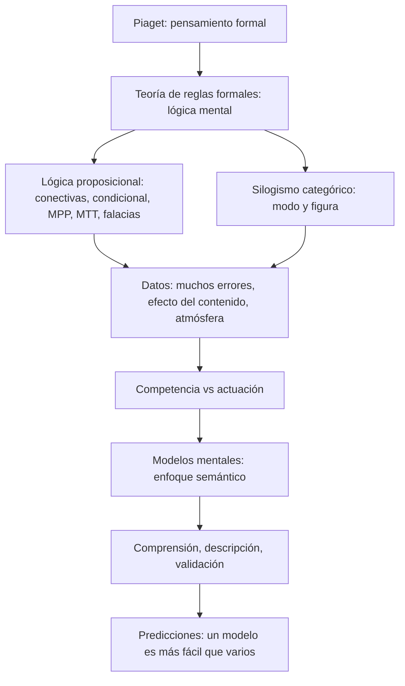
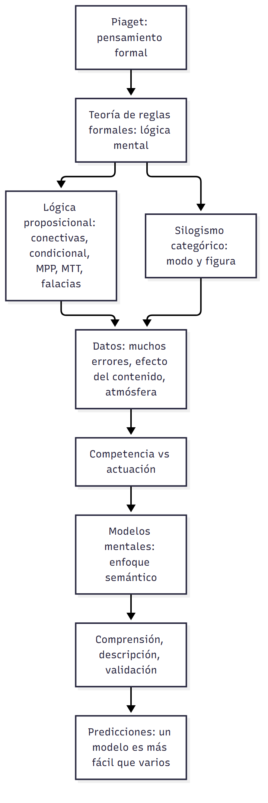
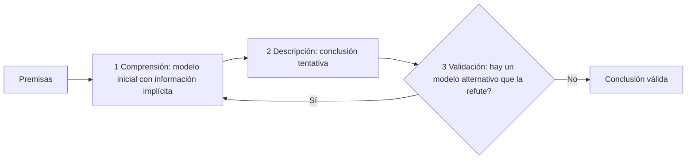
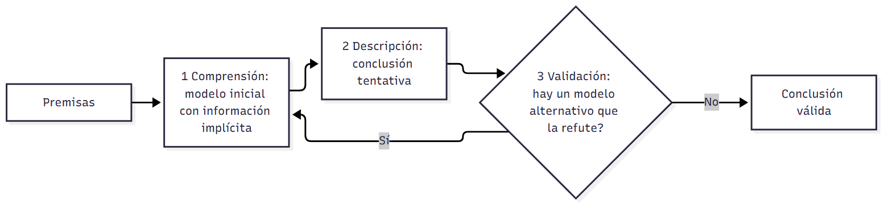

# U03 — Clase 02: Teorías y modelos sobre razonamiento · Versión de cursada

> **Fuentes:**
>
> - Cárdenas Poveda, C. (2026b). *Teorías y modelos sobre razonamiento* [Diapositivas de clase: Pensamiento, Clase 02]. Procesos Básicos III, Universidad Favaloro.
> - Quiroga, L. (2013). Razonamiento y representaciones mentales: Los límites entre lógica y psicología. *Praxis. Revista de Psicología, 15*(23), 69-92.
>
> **Materia:** Procesos Básicos III, 2.º año, Universidad Favaloro. Docente: Mg. Carolina Cárdenas Poveda. Unidad 3: Pensamiento.

> **Aviso sobre las fuentes:** esta es la **versión de cursada**: sigue las 39 diapositivas de la Clase 02 y sus cuatro contenidos (Piaget; reglas formales y razonamiento proposicional; revisiones y críticas; modelos mentales). (1) El programa no está en el repositorio: el mapa marca el origen como **Clase** o **Solo libro** y es **provisorio**. (2) Quedan afuera, y están en `U03_TeoriasYModelosSobreRazonamiento_Guia.md`: el razonamiento pragmático de Valiña y Martín (esquemas de permiso y obligación, contrato social, teoría heurístico-analítica de Evans) y la discusión de Quiroga sobre formato cognitivo y lógica *default*. La clase **no** desarrolló esos temas. (3) La tabla de silogismos válidos (diapositiva 22) llegó con errores de OCR y está reconstruida: contrastala con tu copia. (4) La clase nombra el problema THOG (Wason y Brooks, 1979), pero ninguna fuente trae su enunciado. (5) Las páginas de Quiroga son las del PDF (la página 1 del PDF es la 69 de la revista).

> **Idea-fuerza:** Piaget ubicó en la adolescencia un **pensamiento formal**, hipotético-deductivo y proposicional. La **teoría de reglas formales** lo convirtió en «lógica mental»: razonar sería aplicar reglas sintácticas, independientes del contenido. Pero los datos no coinciden: la gente comete muchos errores, se deja llevar por la «atmósfera» de las premisas y responde distinto según el contenido. Eso abre paso a los **modelos mentales** de Johnson-Laird, un enfoque **semántico**: razonamos construyendo representaciones de la situación y erramos cuando no buscamos los modelos alternativos (Cárdenas Poveda, 2026b, diapositivas 2-39).

## Hilo conductor

La clase hace una pregunta: **¿razonamos aplicando reglas lógicas?** Piaget dice que sí, al menos desde los 11 años (§1). La teoría de reglas formales lo formaliza (§2), y para ver qué predice hay que conocer la lógica proposicional y el silogismo (§3-§4). La respuesta empírica es «no del todo» (§5): el contenido importa. Los modelos mentales explican a la vez los aciertos (competencia) y los errores (actuación) (§6).

## Mapa: qué se dio en clase

| Tema | Origen | Diapositivas | Sección |
|---|---|---|---|
| Etapas de Piaget y características funcionales del pensamiento formal | Clase | 3-6 | §1 |
| Teoría de reglas formales | Clase (+ libro) | 7-8 | §2 |
| Lenguaje proposicional, conectivas y condicional (MPP, MTT, FAC, FNA) | Clase | 9-19 | §3 |
| Silogismo categórico | Clase | 20-23 | §4 |
| Revisiones y críticas; tarea de selección de Wason | Clase + Solo libro | 24-29 | §5 |
| Modelos mentales (Johnson-Laird) | Clase | 30-39 | §6 |

---

## 1. Piaget: el pensamiento formal

**Etapas del desarrollo cognitivo** (Cárdenas Poveda, 2026b, diapositiva 3):

| Etapa | Edad | Qué hace el niño |
|---|---|---|
| Sensoriomotor | 0-2 años | Comprende el mundo por ensayo y error, con los sentidos y el cuerpo |
| Preoperacional | 2-7 años | Piensa en el nivel simbólico, pero todavía no realiza operaciones mentales (pensar lógicamente, combinar elementos) |
| Operatorio concreto | 7-11 años | Pensamiento organizado y racional, pero **solo con objetos concretos** |
| Operatorio formal | 11 años en adelante | Pensamiento **abstracto**: manipula ideas sin necesidad de manipular objetos |

**De la lógica del niño a la del adolescente** (Piaget e Inhelder, 1955). En las **operaciones concretas**, el niño solo piensa los elementos del problema tal como se le presentan; lo posible es una prolongación de lo real. En las **operaciones formales**, invoca **todas las situaciones y relaciones causales posibles**, las analiza lógicamente y las confronta con la realidad mediante la **experimentación** (Cárdenas Poveda, 2026b, diapositiva 4).

**Características funcionales** del pensamiento formal (las estrategias para abordar problemas) (Cárdenas Poveda, 2026b, diapositivas 4-6):

1. **Razonamiento hipotético-deductivo.** Somete hipótesis a prueba en tres etapas: (1) **elimina las hipótesis admitidas** hasta entonces (las simples, evocando contraejemplos sin demostrarlos en la práctica); (2) **construye nuevas hipótesis** con elementos que vienen de abstracciones; (3) **verifica** la nueva hipótesis analizando sistemáticamente todas las combinaciones posibles de variables, con un **esquema de control de variables**: mantener constantes todos los factores menos uno.
2. **Razonamiento proposicional.** Analiza hipótesis y enunciados en términos proposicionales («si tiro el péndulo con más fuerza, entonces se mueve más rápido»). El operatorio concreto opera directamente sobre los datos de la realidad; el formal convierte esas operaciones de primer orden en **proposiciones abstractas** y opera sobre ellas: **operaciones sobre operaciones** (de segundo orden).

> **Esqueleto de la respuesta:**
> 1. **Tesis:** desde los 11 años aparece un pensamiento abstracto que trabaja sobre lo posible.
> 2. **Concreto vs. formal:** lo real tal como se presenta vs. todas las posibilidades.
> 3. **Hipotético-deductivo:** eliminar, construir y verificar hipótesis; control de variables.
> 4. **Proposicional:** operaciones de segundo orden.

> ⚠ **No confundir:** el *esquema de control de variables* pertenece al razonamiento **hipotético-deductivo** (verificar la hipótesis); las *operaciones de segundo orden* pertenecen al razonamiento **proposicional** (Cárdenas Poveda, 2026b, diapositivas 5-6).

---

## 2. La teoría de reglas formales

Razonar es **inferir una conclusión nueva**. El razonamiento deductivo (conclusión única y verdadera) incluye la **inducción categórica** (silogística) y el **razonamiento condicional**; el inductivo (conclusiones posibles) incluye el **razonamiento probabilístico** (Cárdenas Poveda, 2026b, diapositiva 7).

Según la **teoría de reglas formales**, razonar es **aplicar las reglas mentales de inferencia que el sujeto posee**. La deducción es un **proceso formal y sintáctico** de tres pasos (Cárdenas Poveda, 2026b, diapositiva 8):

1. Comprender la **forma lógica** de los enunciados.
2. Acceder al **repertorio de reglas formales**.
3. **Derivar** la conclusión.

A esto se lo llama **lógica mental**: las unidades del razonamiento deductivo son reglas formales (Cárdenas Poveda, 2026b, diapositiva 8; Quiroga, 2013, pp. 3-4).

> ⚠ **No confundir:** que una teoría sea *sintáctica* quiere decir que **no importa el contenido**, solo la forma del enunciado. Por eso, si el contenido cambia la respuesta (§5), la teoría queda en problemas.

---

## 3. El razonamiento proposicional

Se razona sobre situaciones con el **cálculo proposicional**, es decir, con relaciones entre proposiciones y partículas de unión. Ese lenguaje sirve para representar el conocimiento y las transformaciones que se hacen sobre él (Cárdenas Poveda, 2026b, diapositiva 9). Es **abstracto y universal**, **no semántico** (no importa el contenido), no lingüístico, distinto del lenguaje natural, y **potente y parsimonioso** (diapositiva 10).

**Estructura:** las **proposiciones** (P, Q) son las unidades mínimas del discurso a las que se puede asignar un valor de verdad; las **conectivas** las relacionan. Ejemplo: «(P) Si llueve, entonces (Q) Juana lleva paraguas» (Cárdenas Poveda, 2026b, diapositiva 11). Los valores se calculan con **tablas de verdad**: 1 proposición da 2 filas; 2 dan 4; 3 dan 8 (diapositiva 12).

**Conectivas binarias** (Cárdenas Poveda, 2026b, diapositivas 13-14):

| Conectiva | Se lee | Es verdadera cuando… |
|---|---|---|
| Conjunción (P ∧ Q) | «y» | **ambas** son verdaderas |
| Disyunción inclusiva (P ∨ Q) | «o» | **al menos una** es verdadera |
| Disyunción exclusiva | «uno u otro» | **solo una** es verdadera |
| Condicional (P → Q) | «si… entonces…» | siempre, **salvo** antecedente V y consecuente F |

Tabla del condicional («Si sale el sol, salgo a correr»):

| P | Q | P → Q |
|---|---|---|
| V | V | V |
| V | F | **F** |
| F | V | V |
| F | F | V |

**Reglas y falacias del condicional** (Cárdenas Poveda, 2026b, diapositivas 15-18):

| Nombre | Dato que se agrega | ¿Qué se concluye? | Ejemplo de clase |
|---|---|---|---|
| **Modus ponendo ponens (MPP)** — válida | Se afirma el antecedente (P) | Q, con certeza | «Si voy a la heladería, te traigo un helado»; fue: trae el helado |
| **Modus tollendo tollens (MTT)** — válida | Se niega el consecuente (¬Q) | ¬P, con certeza | «Si querés conocer la literatura argentina, tenés que leer a Cortázar»; no leyó a Cortázar: no la conoce |
| **Falacia de afirmación del consecuente (FAC)** | Se afirma el consecuente (Q) | **Nada** necesariamente cierto | «Si no servís para nada, metete en política»; se metió en política: no se puede concluir que no sirve para nada |
| **Falacia de negación del antecedente (FNA)** | Se niega el antecedente (¬P) | **Nada** necesariamente cierto | No conoce la literatura argentina: no se puede concluir si leyó o no a Cortázar |

Truco para la tabla: cuando el consecuente es verdadero (FAC) o el antecedente es falso (FNA), quedan **dos filas posibles** con condicional verdadero, así que no hay una conclusión única.

La clase da como ejemplo de tarea el **problema THOG** (Wason y Brooks, 1979) (Cárdenas Poveda, 2026b, diapositiva 19).

> **Esqueleto de la respuesta:**
> 1. **Condicional:** falso solo con antecedente V y consecuente F.
> 2. **Válidas:** MPP (afirmo P → Q) y MTT (niego Q → ¬P).
> 3. **Falacias:** FAC (afirmo Q) y FNA (niego P): no permiten concluir.
> 4. **Ejemplo** de la clase para cada una.

> ⚠ **No confundir:** *MTT* niega el **consecuente** y es válido; *FNA* niega el **antecedente** y es falacia. *MPP* afirma el **antecedente** y es válido; *FAC* afirma el **consecuente** y es falacia.

---

## 4. El silogismo categórico

Es una inferencia a partir de **dos premisas** en la que tanto las premisas como la conclusión son **proposiciones categóricas**, es decir, enunciados que cuantifican la relación entre un sujeto y un predicado. Las premisas se relacionan mediante un **término medio** (Cárdenas Poveda, 2026b, diapositiva 20).

- **Modo:** combina cantidad (universal o particular) y polaridad (afirmativa o negativa): **A** = todos los A son B; **I** = algún A es B; **E** = ningún A es B; **O** = algún A no es B.
- **Figura:** depende de dónde está el término medio en las premisas.
- 4 × 4 × 4 × 4 = **256 silogismos**, de los cuales **solo 24 son válidos** (Cárdenas Poveda, 2026b, diapositiva 21).

Ejemplo de la figura 1: «Todos los españoles son europeos / Todos los madrileños son españoles / ∴ Todos los madrileños son europeos» (Cárdenas Poveda, 2026b, diapositiva 23).

Resultado: **los datos experimentales no coinciden con la teoría**. Las personas se dejan llevar por la **«atmósfera de las premisas»**, es decir, por su tono global (universal o particular, afirmativo o negativo) y no por su estructura lógica (Cárdenas Poveda, 2026b, diapositiva 24).

---

## 5. Revisiones y críticas a las reglas formales

**Lo que muestran los datos** (Cárdenas Poveda, 2026b, diapositivas 25-26):

- Ante proposiciones y conectivas, las personas **no siempre se comportan como predice el modelo lógico**: hay muchos errores y sesgos, y las respuestas correctas **varían según el contenido y el contexto**.
- El éxito en estas pruebas va del **40 % al 70 %** en estudiantes universitarios y adultos, y **un tercio** de los adultos examinados queda **por debajo del 30 %**.
- Conclusión: el pensamiento de adolescentes y adultos no funciona solo con la **estructura** de los problemas, sino también con su **contenido**. No es solamente «formal», y se cuestiona la **universalidad** de las operaciones formales.

**¿Son las operaciones formales el estadio final?** (Cárdenas Poveda, 2026b, diapositiva 27):

- **Competencia vs. actuación:** lo que un adulto **es capaz** de hacer (competencia) no es lo mismo que cómo **realiza** una tarea concreta (actuación). Las fallas dependen de (1) la **tarea** (cómo se presenta, qué demanda), (2) el **sujeto** (diferencias individuales, nivel educativo) y (3) el **conocimiento previo**.
- La idea de «lógica pura» es inconsistente: las tareas de Inhelder y Piaget evalúan un tipo particular de razonamiento, más cercano al **pensamiento científico**.

Hoy la psicología cognitiva entiende que somos **procesadores biológicos de información**: el comportamiento y el conocimiento del mundo responden más a aspectos **funcionales** que **formales**. La pregunta que queda abierta es qué pasa con los aspectos **pragmáticos y semánticos** (Cárdenas Poveda, 2026b, diapositivas 28-29).

**La tarea de selección de Wason** (solo libro). Se muestran cuatro cartas, **E · K · 4 · 7**, con la regla «si una carta tiene una vocal de un lado, tiene un número par del otro». Casi todos dan vuelta la E, pero la respuesta correcta es **E y 7** (p y no-q). En la versión con contenido real («cada vez que viajo a Manchester, viajo en tren») sube la proporción de quienes eligen la carta que puede refutar la regla. El contenido, entonces, cambia el razonamiento (Quiroga, 2013, pp. 7-8).

> **Esqueleto de la respuesta:**
> 1. **Predicción:** si razonar es aplicar reglas sintácticas, el contenido no debería importar.
> 2. **Datos:** 40-70 % de éxito; un tercio por debajo del 30 %; efecto de atmósfera; efecto del contenido (Wason).
> 3. **Revisión:** competencia vs. actuación (tarea, sujeto, conocimiento previo).
> 4. **Cierre:** se cuestiona la universalidad del pensamiento formal y se buscan explicaciones semánticas y pragmáticas.

> ⚠ **No confundir:** la *competencia* es lo que el sistema **puede** hacer; la *actuación* es lo que **hace** en una tarea concreta. Un error de actuación no prueba que falte la competencia (Cárdenas Poveda, 2026b, diapositiva 27).

---

## 6. La teoría de los modelos mentales (Johnson-Laird, 1983)

Responde a las preguntas de Evans (1991): ¿qué mecanismo explica la **competencia lógica**?, ¿qué produce los **errores y sesgos**?, ¿por qué el rendimiento depende tanto del **contenido y del contexto**? (Cárdenas Poveda, 2026b, diapositiva 30).

**Qué son los modelos mentales** (Cárdenas Poveda, 2026b, diapositiva 31):

- Representaciones de situaciones **reales o imaginarias**, construidas a partir de percepciones, de la imaginación o del discurso.
- Es un **enfoque semántico**: importan menos las reglas que el **contenido** y la **interpretación**, o sea, el significado.
- Un argumento es **válido cuando no hay modelos alternativos** compatibles con las premisas en los que la conclusión sea falsa.
- Pone en juego la **memoria de trabajo** y la capacidad de **combinar** las unidades de representación.

**Ejemplo:** «B está a la derecha de A; C está a la derecha de B. ¿Qué relación hay entre A y C?». Se arma A B, después B C, y se integran en **A B C**: «C está a la derecha de A» (Cárdenas Poveda, 2026b, diapositivas 32-33).

**Estadios** (Cárdenas Poveda, 2026b, diapositiva 34):

1. **Comprensión:** se construyen modelos de las premisas; el conjunto inicial deja **implícita** la mayor cantidad de información posible, con un esquema lo más simple posible.
2. **Descripción (interpretación):** se busca una conclusión que describa de modo sencillo lo representado en los modelos.
3. **Evaluación (validación):** se buscan **modelos alternativos** admitidos por las premisas en los que esa conclusión sea falsa. Si aparece uno, se vuelve a empezar.

**El condicional con modelos** («Si viene Antonela, entonces viene Messi») (Cárdenas Poveda, 2026b, diapositivas 35-37):

- El **modelo inicial** representa solo «Antonela – Messi»; las otras posibilidades quedan como **modelos implícitos**.
- **Modus ponens** («viene Antonela»): alcanza con el modelo inicial y se descartan los implícitos. Por eso es **fácil**.
- **Modus tollens** («no viene Messi»): el modelo inicial ya no sirve; hay que **desplegar todos los modelos implícitos** y elegir el compatible. Por eso es **más difícil**.

**Predicciones** (Cárdenas Poveda, 2026b, diapositivas 38-39):

1. Los problemas de **un modelo** son más fáciles que los de **varios modelos**.
2. En los problemas de varios modelos, los errores más frecuentes coinciden con los **modelos iniciales** de las premisas.
3. La teoría predice conclusiones **válidas** cuando el sujeto ejecuta bien los procedimientos (**competencia**) y errores **específicos** cuando los límites de los recursos cognitivos afectan la ejecución (**actuación**).

> **Esqueleto de la respuesta:**
> 1. **Tesis:** razonar es construir y revisar representaciones de la situación (enfoque semántico).
> 2. **Validez:** no hay un modelo alternativo que refute la conclusión.
> 3. **Estadios:** comprensión, descripción y validación.
> 4. **Ejemplo:** Antonela y Messi; MP fácil, MT difícil.
> 5. **Predicciones:** un modelo es más fácil que varios; los errores salen de los modelos iniciales; competencia vs. actuación.

> ⚠ **No confundir:** para las *reglas formales*, el MT es difícil porque requiere **más pasos de reglas**; para los *modelos mentales*, porque obliga a **desplegar modelos implícitos** y carga la memoria de trabajo (Cárdenas Poveda, 2026b, diapositivas 8, 37).

---

## Para rendir (formato del parcial)

> 🎯 **Para el parcial:** el formato de la «Presentación Pensamiento» (28/10) no está confirmado. Si es oral, los esqueletos sirven como guion.

**1) Opción múltiple.** «Si estudio, apruebo. No aprobé.» ¿Qué se concluye? (a) Estudié; (b) **no estudié**; (c) nada; (d) aprobé. — *Respuesta: b.* Es un **modus tollendo tollens**: negar el consecuente permite negar el antecedente con certeza (Cárdenas Poveda, 2026b, diapositiva 16).

**2) Opción múltiple.** «Si estudio, apruebo. Aprobé.» ¿Qué se concluye? (a) Estudié; (b) no estudié; (c) **nada necesariamente cierto**; (d) no aprobé. — *Respuesta: c.* Concluir «estudié» es la **falacia de afirmación del consecuente** (Cárdenas Poveda, 2026b, diapositiva 17).

**3) Verdadero o falso.** «El condicional P → Q es falso cuando el antecedente es falso.» — *Falso.* Solo es falso cuando el antecedente es **verdadero** y el consecuente **falso** (Cárdenas Poveda, 2026b, diapositiva 14).

**4) Verdadero o falso.** «Para los modelos mentales, un argumento es válido si se puede derivar con reglas formales.» — *Falso.* Es válido cuando **no hay modelos alternativos** compatibles con las premisas que refuten la conclusión; es un enfoque semántico, no sintáctico (Cárdenas Poveda, 2026b, diapositiva 31).

**5) Opción múltiple.** El esquema de control de variables (mantener constantes todos los factores menos uno) es propio de: (a) el operatorio concreto; (b) **el razonamiento hipotético-deductivo**; (c) los modelos implícitos; (d) el efecto de atmósfera. — *Respuesta: b* (Cárdenas Poveda, 2026b, diapositiva 5).

**6) Pregunta abierta (máx. 7 renglones).** *¿Por qué se cuestionó la teoría de reglas formales?*

*Respuesta modelo:* La teoría sostiene que razonar es aplicar reglas sintácticas, independientes del contenido. Pero los datos no coinciden: solo entre el 40 % y el 70 % de los universitarios y adultos resuelve estas tareas, y un tercio de los adultos queda por debajo del 30 %. En los silogismos, las personas se dejan llevar por la atmósfera de las premisas, y las respuestas cambian según el contenido y el contexto. Por eso se distingue la competencia de la actuación y se cuestiona que el pensamiento formal sea universal (Cárdenas Poveda, 2026b, diapositivas 24-27).

**7) Pregunta abierta (máx. 7 renglones).** *Según los modelos mentales, ¿por qué el modus tollens es más difícil que el modus ponens?*

*Respuesta modelo:* Ante «si viene Antonela, viene Messi», se construye un modelo inicial simple (Antonela-Messi) y se dejan implícitas las demás posibilidades. Con el modus ponens («viene Antonela») alcanza con ese modelo inicial. Con el modus tollens («no viene Messi») el modelo inicial ya no sirve: hay que desplegar los modelos implícitos y elegir el compatible, lo que exige más memoria de trabajo. La teoría predice que los problemas de varios modelos son más difíciles y que los errores coinciden con el modelo inicial (Cárdenas Poveda, 2026b, diapositivas 35-38).

## Tabla de distinciones

| Par | Criterio |
|---|---|
| Operatorio concreto / formal | Opera sobre lo real / opera sobre proposiciones (segundo orden) |
| MPP / FAC | Afirma el antecedente (válido) / afirma el consecuente (falacia) |
| MTT / FNA | Niega el consecuente (válido) / niega el antecedente (falacia) |
| Disyunción inclusiva / exclusiva | Al menos una verdadera / solo una verdadera |
| Reglas formales / modelos mentales | Sintaxis, reglas / semántica, representaciones |
| Competencia / actuación | Lo que se puede hacer / lo que se hace en la tarea |

## Referencias

Cárdenas Poveda, C. (2026b). *Teorías y modelos sobre razonamiento* [Diapositivas de clase: Pensamiento, Clase 02]. Procesos Básicos III, Universidad Favaloro.

Quiroga, L. (2013). Razonamiento y representaciones mentales: Los límites entre lógica y psicología. *Praxis. Revista de Psicología, 15*(23), 69-92.
