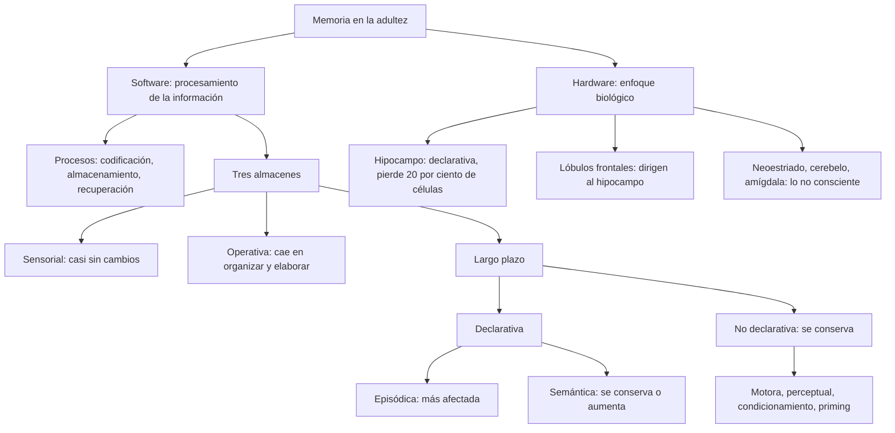
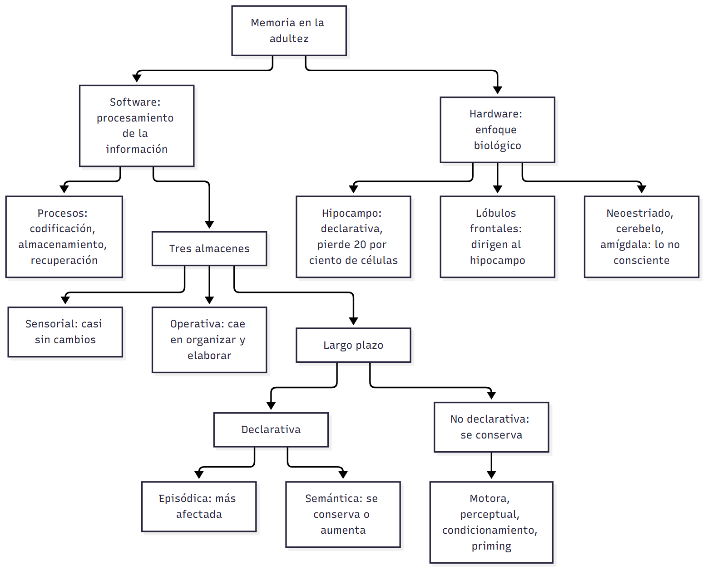
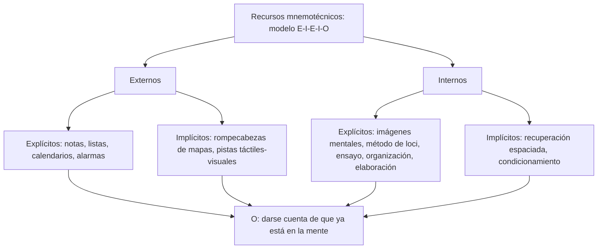
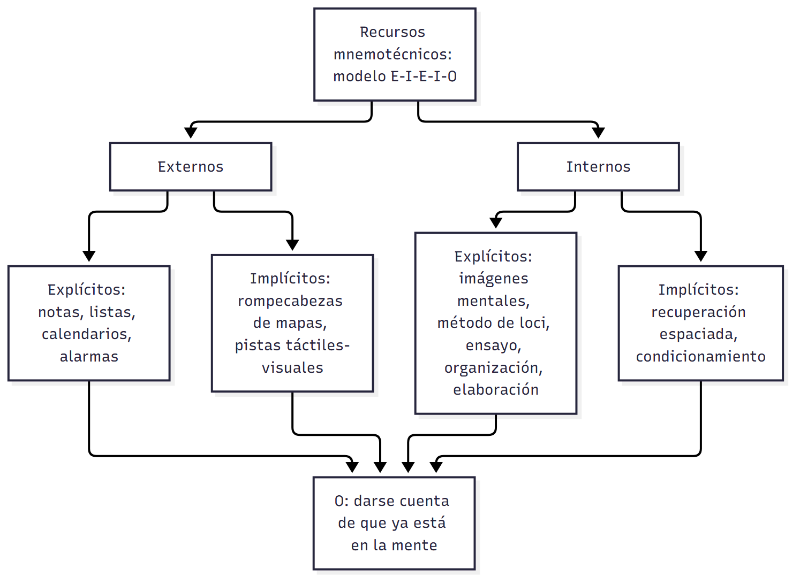
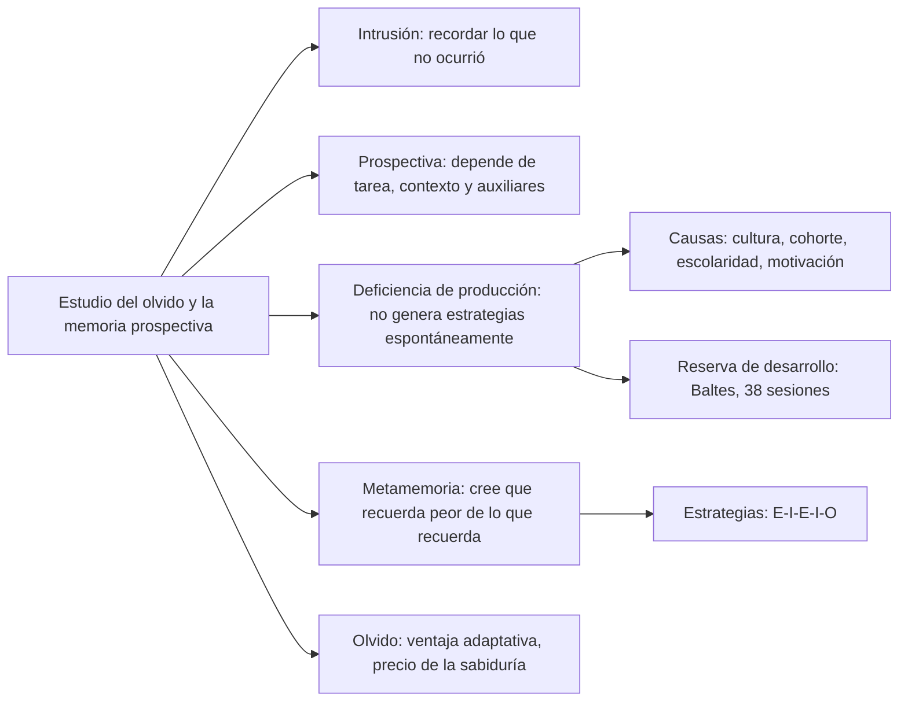
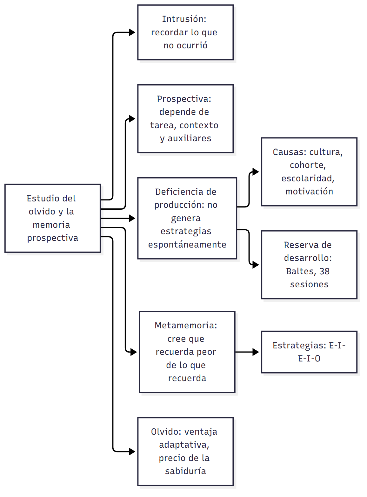

# C17 — Memoria en la adultez: software, hardware y olvido

> **Fuentes:**
>
> - Cátedra de Psicología Evolutiva. (2026a). *Desarrollo cognitivo en la adultez* [Diapositivas de clase]. Universidad Favaloro.
> - Cátedra de Psicología Evolutiva. (2026b). *Memoria en la adultez* [Diapositivas de clase]. Universidad Favaloro.
> - Papalia, D. E., Sterns, H. L., Feldman, R. D., & Camp, C. J. (2009b). Memoria. En *Desarrollo del adulto y vejez* (cap. 5, pp. 153-190). McGraw Hill Interamericana. [Bibliografía obligatoria de la unidad 9]
>
> **Materia:** Psicología Evolutiva, 2.º año, Universidad Favaloro (docente a cargo: Dra. Verónica A. Ramírez). Unidad 9, clase 17 (cronograma: 15/09/2026). Examen: 4.º parcial, 03/11/2026.

> **Aviso sobre las fuentes:** (1) Las páginas citadas son las **impresas** del libro (153-190), no las del PDF. (2) Tus apuntes de esta clase están vacíos salvo la nota «memoria: esto es MUY importante para la catedrática»; por eso la guía se arma sobre el capítulo 5 y las diapositivas. (3) La Tabla 5.2 (p. 168) perdió en la extracción la posición de las X; la sección 4 la reconstruye con el texto del capítulo y la diapositiva 10 de la cátedra: **contrastala con tu copia impresa**. (4) Las diapositivas «Desarrollo cognitivo en la adultez» (2026a) mezclan tres temas: memoria (acá), **creatividad e inteligencia** (van en la guía C18). (5) El programa anuncia también «teorías post-piagetianas» e «introducción a las demencias» para esta fecha, pero el capítulo 5 y las diapositivas no las desarrollan: las demencias aparecen solo de pasada (Alzheimer, Huntington, recuperación espaciada).

> **Idea-fuerza:** La memoria no es una capacidad única sino un sistema de procesos y «almacenes» que se estudia desde dos lados: el **software** (cómo se procesa la información: codificar, almacenar, recuperar) y el **hardware** (qué estructuras del cerebro lo soportan). Con la edad **no todo declina**: la memoria sensorial, la motora, el condicionamiento y la memoria semántica se conservan (o mejoran); lo que más sufre es la **memoria episódica** y las tareas que exigen esfuerzo, organización y elaboración. Y el olvido no es solo falla: también es una función adaptativa. Todo se ve modulado por la cultura, la salud, la motivación y las estrategias (Papalia et al., 2009b, pp. 154-155, 168-169, 188-189).

## Hilo conductor: cómo se conectan los temas de esta guía

El capítulo parte de una pregunta práctica: ¿por qué un actor extraordinario como Laurence Olivier, a los 57 años, empezó a tener fallas para aprender sus líneas y, al mismo tiempo, a los 76 podía contar con lujo de detalles una cascada de anécdotas de sesenta años de amistad? Esa paradoja (se pierde algo, se gana algo) organiza todo lo que sigue. La respuesta del capítulo es que la memoria **no es una cosa** sino un conjunto de sistemas, y que cada sistema envejece de modo distinto.

Para ordenar esa complejidad hay dos miradas que se complementan. Primero, el **enfoque del procesamiento de la información** (el «software», sección 2 de esta guía) describe qué hace la mente con un dato: lo **codifica**, lo **almacena** y lo **recupera**; y lo hace pasando por tres «almacenes» (sección 3): la memoria **sensorial**, la **operativa** y la **de largo plazo**. Dentro de la de largo plazo se distinguen contenidos **declarativos** (episódica y semántica) y **no declarativos** (motora, perceptual, condicionamiento, priming). Cuando uno pregunta «¿qué cambia con la edad?», la respuesta se lee almacén por almacén (sección 4, la tabla resumen).

Segundo, el **enfoque biológico** (el «hardware», sección 5) pregunta dónde vive cada cosa: el **hipocampo** (dirigido por los **lóbulos frontales**) para lo declarativo; el **neoestriado**, el **cerebelo** y la **amígdala** para lo no consciente. Ahí se entiende por qué lo declarativo y la memoria de trabajo sufren más (el hipocampo pierde células, los lóbulos frontales también) y lo implícito se salva (otras estructuras).

Lo tercero es el **contexto**: la memoria no depende solo del cerebro sino del sueño, la nutrición, la actividad, la cultura y las creencias sobre la vejez (sección 6). Y lo cuarto es lo que **hacen las personas** con su memoria (sección 7): cometen errores de intrusión, tienen memoria prospectiva dependiente de las pistas, no producen espontáneamente estrategias (deficiencia de producción), creen que su memoria es peor de lo que es (metamemoria), usan recursos mnemotécnicos (modelo E-I-E-I-O) y olvidan, lo cual, bien mirado, es una ventaja. El círculo se cierra con la idea del ciclo vital: envejecer implica **ganancias y pérdidas** (el olvido selectivo como precio de la sabiduría).

> 🎯 **Para el parcial:** En cualquier pregunta de memoria, andá de lo general a lo particular: (1) enfoque (software/hardware), (2) sistema o almacén, (3) qué cambia con la edad **y qué no**, (4) por qué (estructura cerebral, atención, motivación, cultura), (5) ejemplo. Nunca digas «la memoria empeora con la edad» sin decir cuál.

**En una sola oración:** la memoria adulta es un sistema de varios almacenes y estructuras que envejece de manera desigual —se resienten la memoria episódica y las tareas costosas, se conservan la sensorial, la motora y la semántica— y cuyo rendimiento depende también de las estrategias, la cultura y el estilo de vida.

## 0. Hoja de ruta

1. **Punto de partida y dos enfoques** (Papalia et al., 2009b, pp. 153-155): Olivier; software vs. hardware.
2. **El software: procesar la información** (pp. 156-158): supuestos; codificación, almacenamiento, recuperación.
3. **Los tres «almacenes»** (pp. 158-168): sensorial; operativa; largo plazo (declarativa/no declarativa).
4. **Resumen: memoria y edad** (pp. 168-169): la tabla 5.2.
5. **El hardware** (pp. 169-174): hipocampo, lóbulos frontales, estructuras de lo no consciente; sueño y nutrición.
6. **Nuevas direcciones** (pp. 174-175): factores externos al cerebro (institucionalización, estrógenos, cultura).
7. **Aspectos de la memoria y el olvido** (pp. 175-189): intrusión, prospectiva, deficiencia de producción, metamemoria, recursos mnemotécnicos, olvido.
8. **Para rendir** (preguntas y respuestas modelo).

## 🎯 Lo que entra sí o sí

1. **Software vs. hardware** y los **tres supuestos** del procesamiento de información (Papalia et al., 2009b, pp. 155-156).
2. **Codificación, almacenamiento, recuperación** y qué problemas aparecen en la vejez en cada uno (pp. 156-158; Cátedra de Psicología Evolutiva, 2026b, diapositivas 6-9).
3. Los **tres almacenes** (sensorial, operativa, largo plazo), el modelo de **Baddeley** (ejecutivo central, bucle fonológico, dispositivo visuoespacial, buffer episódico) y qué cambia en cada uno (pp. 158-161).
4. **Declarativa (episódica/semántica) vs. no declarativa**; **explícita vs. implícita** (pp. 161-164).
5. **Memoria episódica**: es la que más cambia; déficit en el **origen** de la memoria (pp. 163, 168).
6. **Condicionamiento clásico y priming** (pp. 165-168).
7. **Hipocampo** (pierde ~20 % de sus células) y **lóbulos frontales** (dirigen al hipocampo; pérdida de células) (pp. 169-173).
8. **Errores de intrusión, memoria prospectiva, deficiencia de producción, metamemoria** (pp. 175-183).
9. **Modelo E-I-E-I-O** y ejemplos de cada cuadrante (pp. 183-186).
10. **El olvido como función adaptativa** (pp. 188-189).

---

## 1. Punto de partida: Olivier, y los dos enfoques de estudio de la memoria

### 1.1 Respuesta modelo (para escribir en el parcial)

> **Esqueleto de la respuesta:**
> 1. **Tesis:** la memoria se estudia desde dos perspectivas complementarias: software (procesamiento de información) y hardware (biología).
> 2. **Software:** operaciones mentales (codificar, almacenar, recuperar) con tres almacenes (Papalia et al., 2009b, pp. 155-156).
> 3. **Hardware:** estructuras y conexiones cerebrales que soportan esos procesos (p. 155).
> 4. **Articulación:** se complementan; cada vez hay más investigación conjunta (p. 174).
> 5. **Ejemplo:** Olivier (pérdida de líneas, pero anécdotas vívidas) (pp. 153-154).
> 6. **Cierre:** la edad trae pérdidas y ganancias, no un deterioro general.

El enfoque del procesamiento de información explica la memoria como el recorrido de un dato desde que se percibe hasta que se recupera (el *software*); el enfoque biológico describe las estructuras cerebrales y sus conexiones (el *hardware*). Son complementarios: el primero dice qué operaciones se alteran con la edad y el segundo, en qué lugar del cerebro. Así se entiende el caso de Olivier, que a los 57 años perdía líneas de su texto, pero a los 76 recordaba con vividez anécdotas de seis décadas: se afecta la codificación de información nueva, no el recuerdo del conocimiento acumulado (Papalia et al., 2009b, pp. 153-155).

> ⚠ **No confundir:** *software* (procesos, intangible: codificar-almacenar-recuperar, almacenes) y *hardware* (estructuras físicas: hipocampo, lóbulos frontales, etc.). Las diapositivas lo dicen así: «lo intangible» frente a «lo tangible» (Cátedra de Psicología Evolutiva, 2026b, diapositiva 3).

### 1.2 Desarrollo ampliado

**El caso de Laurence Olivier** (Papalia et al., 2009b, pp. 153-154). En su juventud, el gran actor británico tenía una memoria excepcional: a los 20 años memorizó al pie de la letra un papel de una obra en menos de una semana (su colega Ralph Richardson elogió su capacidad de memorizar con rapidez). A los 57 años, en la cumbre de su carrera, comenzó a tener **ataques de pánico escénico** (se quedaba sin aliento, se le cerraba la garganta, la mente en blanco, sudor y desvanecimientos), que duraron casi 20 años y que el texto vincula con el temor a envejecer y a perder la memoria. A los 62 se quejaba: aprender una escena le llevaba tres semanas, cuando de joven aprendió Romeo en dos días; un colega lo encontró entre bambalinas repasando desesperadamente: «Ésta no es una profesión para una persona adulta». En sus últimos años se limitó a cine y televisión, donde las «tomas» cortas permiten tener pocas líneas en mente. Pero a los 73 años recitó de un tirón fragmentos de obras en las que había actuado 50 o 60 años antes y citó pasajes de *Hamlet*; a los 76 «ya no podía recordar con precisión la línea de un diálogo», pero en el funeral de Richardson contó con vívidos detalles una cascada de anécdotas de seis décadas de amistad. En sus últimos papeles (el rey Lear, entre otros) mostró más profundidad que nunca. Él mismo dijo: «Tu mente se expande conforme tu cuerpo se encoge».

**Por qué importa la memoria** (p. 154): es el «residuo de la experiencia». Sin memoria los bebés recién nacidos serían como adultos mayores sin recuerdos: la realidad sería una serie de imágenes volátiles, «un cuadro que se debe recrear continuamente»; apelar a la experiencia almacenada es la clave para pensar y resolver problemas, y permite aprender de los encuentros con el ambiente y ponerlo en práctica a lo largo de todo el ciclo de vida. Los pequeños fallos generan temor, por lo general infundado, de padecer demencia, pero **los problemas de memoria no indican necesariamente un deterioro general** de las habilidades mentales. La vejez puede traer ganancias y pérdidas (enfoque del ciclo de vida), e incluso el olvido puede tener un lado positivo (se retoma en la sección 7.7).

**Variabilidad individual** (p. 155). El texto da un ejemplo de tres personas: Jorge (58 años) recuerda el promedio de bateo de cada jugador de las grandes ligas, pero al entrar a una habitación olvida qué necesitaba; su hijo Julio (35) también olvida lo que iba a hacer; su madre Juanita (75) no muestra cambios importantes. Hay **grandes diferencias individuales** en la memoria entre ancianos (Rowe y Kahn, 1998; Hoyer y Verhaeghen, 2006, citados en p. 155).

**Visión actual** (p. 155). Desde la década de 1950, disciplinas diversas (psicología, biología, medicina) ven a la memoria no como una capacidad aislada sino como un **complejo sistema dinámico de procesos y «almacenes»**; algunos componentes, aunque no todos, operan de modo diferente conforme la gente envejece. Como las computadoras se programan para «aprender» y «recordar», se las usa como analogía, con dos líneas de investigación independientes:

- **Procesamiento de información** → *el software*: las operaciones mentales del recuerdo; modelos teóricos de la trayectoria de un dato desde que se percibe hasta que se recupera (puede ser meses o años después).
- **Investigación biológica** → *el hardware*: estructuras físicas, mecanismos bioquímicos y «el cableado y las conexiones» del cerebro y sistema nervioso; con ayuda de estudios en animales, de personas con daño cerebral y de registros de la actividad cerebral, los neurocientíficos localizan dónde ocurren las funciones.

> 🔑 **Punto clave:** en la pregunta de apertura de la clase («¿por qué sucede? ¿qué trayectorias hay? ¿hay casos donde sea ventaja?») la respuesta es: porque son sistemas distintos con trayectorias distintas, y sí, a veces es una ventaja (olvido selectivo, sabiduría) (Cátedra de Psicología Evolutiva, 2026b, diapositiva 3).

▸ **Complemento (diapositiva 2, no está en el texto asignado):** la cátedra ilustra el valor del olvido con **Funes**, el joven uruguayo del cuento de Borges que, tras un accidente, recuerda todo con absoluta precisión; esa capacidad es una carga que le impide abstraer, generalizar y pensar, y lo aísla del mundo (Cátedra de Psicología Evolutiva, 2026b, diapositiva 2). El capítulo menciona el mismo cuento de Borges (1964) como «un hombre que no podía olvidar termina ahogado en sus recuerdos» (Papalia et al., 2009b, p. 188).

---

## 2. El software: el enfoque del procesamiento de la información

### 2.1 Respuesta modelo (para escribir en el parcial)

> **Esqueleto de la respuesta:**
> 1. **Tesis:** la memoria archiva en tres pasos: codificación, almacenamiento, recuperación; con la edad cambian de manera desigual.
> 2. **Supuestos** (3) (Papalia et al., 2009b, p. 156).
> 3. **Codificación:** asignar «código/etiqueta» (p. 156); los mayores codifican con menos habilidad y precisión (pp. 157-158).
> 4. **Almacenamiento:** evidencia de pequeño deterioro, pero hay reaprendizaje (p. 158).
> 5. **Recuperación:** recuerdo libre peor, reconocimiento casi igual (p. 158).
> 6. **Cierre:** la diferencia disminuye con familiaridad, práctica y ritmo propio.

Según el enfoque del procesamiento de la información, la memoria funciona como un sistema que archiva la información en tres pasos: la **codificación** le asigna una etiqueta para prepararla, el **almacenamiento** la guarda y la **recuperación** la busca cuando hace falta. Parte de tres supuestos: las personas buscan activamente información útil, procesan solo una cantidad limitada a la vez y transforman lo que perciben mediante procesos mentales para poder recordarlo después. En la vejez hay menor habilidad para codificar (menos organización y asociaciones espontáneas), un posible aumento pequeño de las fallas de almacenamiento y peor desempeño en recuerdo libre, pero casi igual en reconocimiento; la brecha se reduce con familiaridad, práctica y ritmo propio (Papalia et al., 2009b, pp. 156-158).

> ⚠ **No confundir:** *recuerdo* (recall: producir la respuesta, como en una pregunta abierta) con *reconocimiento* (elegir entre opciones, como en múltiple choice). Los mayores rinden peor en el primero y casi igual en el segundo (p. 158).

### 2.2 Desarrollo ampliado

**Meta del enfoque** (p. 156): descubrir qué hacen las personas con la información desde que la perciben hasta que la usan. Como se centra en **diferencias individuales** en el comportamiento inteligente, es adecuado para describir cambios a lo largo del ciclo de vida y permite distinguir entre funciones que cambian mucho y las que cambian poco, en la misma persona o entre personas (Lovelace, 1990, citado en p. 156). Las primeras investigaciones se hicieron en laboratorios (aprender listas de palabras, repetir series de números); en las décadas de 1980-1990 algunos investigadores estudiaron la memoria en la vida cotidiana.

**Los tres supuestos** (p. 156; Cátedra de Psicología Evolutiva, 2026b, diapositiva 4):
1. Los seres humanos buscan de forma activa información útil acerca de su mundo.
2. Pueden manejar solo una cantidad limitada de información en un momento dado; la información que no se usa de manera inmediata se almacena en la memoria.
3. La información que se obtiene a través de los sentidos se transforma mediante una serie de procesos mentales para poder almacenarse y recordarse en otro momento.

> ⚠ **Advertencia metodológica (p. 156):** la mayoría de los estudios del procesamiento de información son **transversales**, por lo que sus hallazgos pueden reflejar **diferencias de cohorte** y no cambios relacionados con la edad.

**Los tres procesos** (pp. 156-157). La metáfora es la del archivero: *codificar* es decidir en qué «carpeta» se pone algo (por ejemplo, «personas conocidas» o «lugares visitados»): se asigna un «código» o «etiqueta» para prepararlo y facilitar su localización; *almacenar* es ponerlo en la carpeta; *recuperar* es buscar el archivo y tomarlo cuando se lo requiere. Los mecanismos precisos varían con la situación, el tipo de información y el uso que se le dará. La manera en que se codifica y almacena afecta su accesibilidad: un ítem mal archivado será difícil de recuperar (si archivás la información sobre Alaska en «islas tropicales», no la encontrás); hay problemas cuando un ítem cabe en más de una categoría (la palabra *cimiento* archivada solo en «términos usados en béisbol» no se recupera al buscar un sinónimo); y elementos similares (*principal* y *principio*) generan confusión si no se codifican de manera distinta (p. 157).

**¿Cómo cambian con la edad?** (pp. 157-158). Un hallazgo es que la habilidad para recuperar información recientemente encontrada parece disminuir: después de horas, días o semanas, los adultos jóvenes recuerdan pares de palabras o párrafos, o reconocen cuadros, mejor que los ancianos (Craik, 1977; Park et al., 1986, 1988; Poon, 1985, citados en p. 157). La pregunta es dónde está la falla: en la recuperación, en una pérdida del material almacenado o en cómo se codificó en primer lugar. Respuesta: puede ser cualquiera.

- **Problemas de codificación** (pp. 157-158): en general, los ancianos tienen menos habilidad que los jóvenes para codificar nueva información y recuperarla más fácilmente; es menos probable que dispongan el material espontáneamente en orden alfabético o que hagan asociaciones mentales. Con **entrenamiento o instrucción** pueden mejorar, pero el beneficio relativo depende de la tarea (Craik y Jennings, 1992); además, la codificación de los ancianos parece ser **menos precisa** (Craik y Byrd, 1982). Ejemplo: es más probable que reconozcan a un familiar que no ven hace mucho que recuerden el nombre de alguien que acaban de conocer (Papalia et al., 2009b, p. 157; Cátedra de Psicología Evolutiva, 2026a, diapositiva 6).
- **Problemas de almacenamiento** (p. 158): una posible explicación del olvido es que el material almacenado se deteriore tanto que la recuperación sea difícil o imposible. La mayoría de los estudios **no** apoya que los ancianos olviden más rápido que los jóvenes (Poon, 1985), pero hallazgos recientes sugieren un **pequeño aumento en la «falla de almacenamiento»** con la edad (Camp y McKitrick, 1989; Giambra y Arenberg, 1993). Aun si los recuerdos se deterioran, pueden permanecer **rastros**, y puede ser posible reconstruirlos o al menos **reaprender** el material rápidamente.
- **Problemas de recuperación** (p. 158): al recuperar información almacenada, los ancianos pueden no ser capaces de responder una pregunta abierta, pero sí una de opción múltiple. Tienen más problemas para recordar **detalles**, pero se desempeñan casi tan bien como los jóvenes en el **reconocimiento** de detalles que conocen (Hultsch, 1971; Lovelace, 1990). Les toma **más tiempo** buscar en sus recuerdos (Anders et al., 1972). El recuerdo de detalles de acontecimientos recientes mejora al ver fotografías o leer descripciones. La diferencia de edad pierde importancia cuando los ancianos están **familiarizados con el material, tienen oportunidad de practicarlo y pueden trabajar a su propio ritmo** (Lovelace, 1990; Poon, 1985).

> 🔑 **Punto clave:** la falla no es de un solo tipo: codificación menos eficiente (el problema central), algo de almacenamiento, y recuperación lenta/libre. Las tres mejoran con estrategias, repaso, familiaridad y ritmo propio (Papalia et al., 2009b, pp. 157-158; Cátedra de Psicología Evolutiva, 2026b, diapositivas 7-9).

---

## 3. Los tres «almacenes» de la memoria

### 3.1 Respuesta modelo (para escribir en el parcial)

> **Esqueleto de la respuesta:**
> 1. **Tesis:** tres almacenes diferentes pero ligados; la edad los afecta de modo desigual.
> 2. **Sensorial:** punto de entrada, segundos; casi sin cambios (Papalia et al., 2009b, p. 159).
> 3. **Operativa:** 5-9 elementos, ~30 s; ejecutivo central (Baddeley); cae en tareas que exigen manipular, organizar, elaborar (pp. 159-161).
> 4. **Largo plazo:** capacidad casi ilimitada; declarativa y no declarativa (p. 162).
> 5. **Qué cambia:** episódica cae; semántica y no declarativa se conservan (pp. 163-168).
> 6. **Cierre:** atención y motivación explican parte del declive.

La memoria se visualiza como un depósito de tres almacenes distintos pero ligados. La **sensorial** es el punto de entrada y casi no cambia con la edad. La **operativa** retiene y manipula unos 5 a 9 elementos durante unos 30 segundos; el ejecutivo central (Baddeley) la controla; con la edad rinde menos cuando la tarea exige manipular, organizar o elaborar. La de **largo plazo** guarda de manera casi ilimitada información declarativa (episódica, la que más cambia, y semántica, que se conserva o aumenta) y no declarativa (motora, perceptual, condicionamiento y priming, que se conservan) (Papalia et al., 2009b, pp. 158-168). Parte del declive se atribuye a menos recursos atencionales y menor motivación (p. 161).

> ⚠ **No confundir:** *memoria operativa* (corto plazo, activa, limitada) con *memoria a largo plazo* (almacén «inactivo» y casi ilimitado). Y *memoria sensorial* (fracciones de segundo) con *memoria operativa* (~30 s sin ensayo) (pp. 159-161).

### 3.2 Memoria sensorial (pp. 158-159)

Es el **primer almacén**: registra temporalmente lo que ves, escuchas, hueles, saboreás o tocás. Se llama **ecoica** para sonidos e **icónica** para imágenes. Sin cierto procesamiento, se desvanece rápido: el «eco» dura segundos o fracciones de un segundo (Lovelace, 1990). **Cambia poco con la edad**: el recuerdo inmediato de un niño de cinco años es casi tan bueno como el de un adulto (Siegler, 1998); a pesar de las pérdidas visuales del envejecimiento, la memoria icónica se conserva bastante bien, y las diferencias entre jóvenes y mayores para identificar una serie de letras que destellan en una pantalla son mínimas. Una pérdida ligera probablemente juega un papel insignificante en los problemas de aprendizaje de los ancianos (Poon, 1985), aunque algunos investigadores especulan que pérdidas ligeras pueden conducir a mayores déficits en memoria a corto y largo plazo (Craik y Jennings, 1992) (Papalia et al., 2009b, p. 159). La cátedra recuerda que es el «punto de entrada al sistema», previo a la memoria de trabajo (Cátedra de Psicología Evolutiva, 2026b, diapositiva 11).

### 3.3 Memoria operativa (pp. 159-161)

Es el almacén intermedio de **corto plazo** o «banco operativo» para archivos activos: la información que la mente codifica o recupera *en el momento* (Papalia et al., 2009b, p. 159). Ejemplo: mirás un número de teléfono y lo mantenés hasta marcarlo.

- **Capacidad:** aproximadamente **5 a 9 elementos** separados (números, letras, palabras) (G. A. Miller, 1956). Se puede ampliar **agrupando** (el número 2-9-7-5-3-8-4 se retiene mejor como 297-53-84: tres conjuntos en vez de siete dígitos).
- **Duración:** unos **30 segundos**, salvo que se haga **ensayo** (repetición consciente) u otro esfuerzo intencional. El ensayo es un dispositivo simple para conservar información.
- **Modelo de Baddeley** (1981, 1986, 2002; figura 5.1, pp. 159-160): un **ejecutivo central** controla el procesamiento y puede expandir la capacidad al desplazar información a **sistemas subsidiarios**: el **bucle articulatorio (fonológico)** para ensayo de material verbal (repetir un teléfono mientras pensás en lo que vas a decir); el **dispositivo visuoespacial** (visual o espacial), que mantiene imágenes «en espera»; y el **buffer episódico**, interfaz entre la memoria a largo plazo y los sistemas subsidiarios; almacena en episodios y recupera de múltiples fuentes a la vez. Estos sistemas subsidiarios son parte de la memoria a corto plazo (almacenamiento temporal, **sistemas fluidos**); los **sistemas cristalizados** son el almacenamiento en la memoria a largo plazo.
- **Del corto al largo plazo** (p. 160): el ejecutivo central ordena información preparada (codificada) para transferirla a la memoria a largo plazo, de capacidad virtualmente ilimitada, y también la recupera. La información **ensayada** con suficiente frecuencia puede transferirse. Otras estrategias más complejas de codificación son la **organización** (categorizar los elementos u ordenarlos en algún patrón coherente) y la **elaboración** (encontrar una relación entre lo que se intenta recordar, como *té* y *taza*, o *caliente* y *frío*, o asociarlo con algo que ya se conoce).

**¿Qué pasa con la edad?** (pp. 160-161). Es creencia difundida que la capacidad de la memoria operativa se reduce. Las pruebas de **retención de dígitos** (repetir secuencias cada vez más largas, p. ej., 4-9-7; 5-3-7-1-8-2-9; etc.) muestran que el desempeño es **solo ligeramente afectado** por la edad: al repetirlos hacia atrás, la persona anciana puede tardar un poco más y, por lo general, no lo hace tan bien, pero la diferencia no es drástica (Craik y Jennings, 1992; Poon, 1985; Wingfield y Stine, 1989). El factor clave es la **complejidad de la tarea**: cuánto esfuerzo requiere. Las tareas de **retención pasiva** muestran muy poco declive; las que requieren **reorganización, elaboración u otra manipulación mental** muestran los mayores descensos. Ejemplo: repetir «gasa, elefante, periódico» en orden de tamaño creciente («gasa, periódico, elefante») exige traer a mente el conocimiento previo de cada objeto, y reorganizar consume más capacidad limitada (Cherry y Park, 1993) (Papalia et al., 2009b, pp. 160-161).

**¿Por qué?** (p. 161). Algunos investigadores señalan que, al envejecer, hay **menos energía mental o menos recursos atencionales** para enfocarse en las tareas (Craik, 1994; Craik y Byrd, 1982; Wingfield y Stine, 1989; Zacks et al., 2000). Por eso los ancianos tienden a no organizar ni elaborar, aun cuando son las estrategias de codificación más efectivas (Craik y Jennings, 1992; Salthouse, 1991). También la **motivación**: los ancianos pueden poner menos atención porque no consideran necesario recordar ciertos materiales y no quieren gastar energía en ello (Craik y Byrd, 1982). Ejemplos: la **figura 5.2** (¿cuál es el verdadero centavo?; Nickerson y Adams, 1979), que casi nadie resuelve aunque haya visto monedas toda su vida, porque no presta atención a los detalles menores; y **Einstein**, a quien se atribuye haber respondido, cuando le preguntaron cuántos pies hay en una milla: «No lo sé. ¿Por qué debería llenar mi cabeza con cosas como ésa, cuando puedo buscarlas en cualquier libro de referencia en dos minutos?» (Papalia et al., 2009b, p. 161).

La cátedra lo resume: los descensos se asocian a tareas con manipulación (dígitos hacia atrás), menos energía mental y recursos atencionales; complejidad de tarea como factor clave; rendimientos levemente menores y mayores tiempos de reacción; ejemplo: ordenar elefante-gasa-periódico (Cátedra de Psicología Evolutiva, 2026b, diapositiva 14).

### 3.4 Memoria a largo plazo (pp. 161-168)

Es el almacén de capacidad virtualmente ilimitada, pero **no todos sus contenidos son igualmente accesibles**: ¿por qué es fácil recordar cómo andar en bicicleta tras años sin hacerlo, y no los nombres de personas que no ves hace años? Una respuesta: la memoria a largo plazo se divide en «cuartos» con distintos contenidos y el envejecimiento los afecta de manera diferente (p. 161-162; Tabla 5.1).

**Declarativa y no declarativa** (p. 162, Tabla 5.1).

| | **Declarativa** («saber qué…») | **No declarativa** («saber cómo…», procedural) |
|---|---|---|
| Qué es | Nombres, fechas, definiciones, anécdotas: lo que se puede «declarar» (verbal o imagen mental, un rostro, un lugar, un sentimiento de familiaridad) | Información relacionada con habilidades, hábitos y formas de hacer las cosas |
| Ejemplos (Tabla 5.1) | Hechos (¿de qué está hecho el pan?), lenguaje (plural de *vaca*), costumbres sociales, episodios personales (el pastel del último cumpleaños) | Hábitos (morderse las uñas), habilidades motoras (jugar ping-pong), habilidades perceptuales (recordar el camino a casa), respuestas condicionadas (reacción ante una serpiente) |
| Proceso | **Explícita**: recuerdo consciente o intencional; con frecuencia se evalúa con pruebas de reconocimiento y recuerdo | **Implícita**: ocurre sin esfuerzo o sin atención consciente; mucha información llega a la memoria a largo plazo directamente desde la sensorial, **evitando la memoria operativa y el ejecutivo central** |

(Papalia et al., 2009b, p. 162; Squire, 1992; Schacter, 1992). La cátedra suma el esquema clásico de la memoria a largo plazo: *declarativa* (hechos, acontecimientos; lóbulo temporal medial, neocorteza) y *no declarativa* (priming, procedimientos, aprendizaje asociativo, aprendizaje no asociativo; neoestriado, amígdala, cerebelo, vías reflejas) (Cátedra de Psicología Evolutiva, 2026b, diapositiva 15).

> 🔑 **Punto clave:** si hay deficiencias de memoria operativa, se esperan más problemas para recordar **información declarativa** que **no declarativa** (que puede evitar la memoria operativa). «En general, esto es cierto, pero tal afirmación no es tan simple» (Papalia et al., 2009b, p. 163).

#### 3.4.1 Memoria declarativa: episódica y semántica (pp. 163-164)

- **Episódica**: experiencias, actividades y eventos personales ligados a momentos y lugares específicos («episodios»): ¿qué desayunaste?, ¿cerraste el auto?, ¿le diste de comer al gato? Es lo que se entiende cuando decís **«yo recuerdo»**.
- **Semántica**: conocimiento general de hechos históricos, ubicaciones geográficas, costumbres sociales, significados de palabras: **«yo sé»**.
- **Relación**: la semántica *surge de la episódica*; cuando encontrás cierta información con suficiente frecuencia se vuelve parte del conocimiento general o conocimiento base (Camp, 1989) (p. 163).
- **Efecto de la edad**: la episódica es el sistema **más susceptible** a los efectos de la edad; la procedural y la semántica con frecuencia **no son afectadas** de manera significativa (Hoyer y Verhaeghen, 2006; Smith y Earles, 1996) (p. 163).

**Memoria episódica y edad** (p. 163). Aun cuando los ancianos recuerden eventos particulares tan bien como los jóvenes, con frecuencia no recuerdan el **contexto** donde ocurrieron: tienen un **déficit en el origen de la memoria** (Chalfonte y Johnson, 1996). Dicho déficit puede deberse a una **pérdida en la codificación de las características del contexto** donde se originó el recuerdo, o a una **asociación poco adecuada** de esas características contextuales al evento (Naveh-Benjamin, 2000). Además, los ancianos tuvieron muchas experiencias parecidas y las particulares pueden confundirse en sus mentes; un fenómeno similar explicaría que «recuerden» cosas que nunca ocurrieron o estén inseguros de si algo aconteció (¡«Estoy seguro de que hoy tomé mi medicina!», «¿Firmé el cheque antes de enviarlo?») o cuenten la misma historia más de una vez sin darse cuenta (Cohen y Faulkner, 1989). Pero cuando perciben un evento como **distintivo o novedoso**, lo recuerdan tan bien como los jóvenes (Camp, 1989; Cavanaugh et al., 1985; Kausler, 1990).

**Memoria semántica y edad** (p. 164). Toma varias formas, ninguna depende de recordar cuándo y dónde se aprendió algo.
- **Conocimiento del mundo** (¿capital de Francia?, ¿cuántos días tiene un año?): los ancianos suelen desempeñarse bien en juegos de trivia, porque acumularon conocimiento factual y lo recuperan con eficiencia, aunque los jóvenes puedan hacerlo más rápido en algunas circunstancias (Camp, 1989; Horn, 1982b; Lachman y Lachman, 1980; Backman et al., 2001).
- **Conocimiento social**: conciencia del comportamiento adecuado en una situación (¿cuánto tiempo debe guardar luto una viuda?, ¿qué hacer si un invitado te insulta en una cena?). Los ancianos son «transmisores de costumbres y valores culturalmente correctos»; en algunas sociedades presiden las ceremonias de transiciones de la vida, como la pubertad y el matrimonio (Mergler y Goldstein, 1983).
- **Lenguaje**: vocabulario y reglas lingüísticas (¿cuántos sinónimos de *grasa*?, ¿plural de *niño*?, diferencia entre *coser* y *cocer*) por lo general **no se deterioran y hasta pueden aumentar** a lo largo de la adultez (Camp, 1989; Horn, 1982b).
- **Excepción: «en la punta de la lengua»** (descubrimiento/denominación de palabras): los ancianos con frecuencia tienen más problemas con otros aspectos de la memoria lingüística; saber una palabra pero no poder expresarla, o no recordar un nombre (como Olivier al final de su vida). Es el problema de memoria más molesto para los adultos de todas las edades, pero los ancianos lo experimentan con más frecuencia que los jóvenes, quizás en parte por problemas de memoria operativa (Burke y Shafto, 2004; West, 1985; Heller y Dobbs, 1993; Light, 1990) (p. 164).

> ⚠ **No confundir:** *episódica* («yo recuerdo»; se debilita; déficit en el origen) con *semántica* («yo sé»; se conserva o aumenta, salvo la denominación de palabras) y con *procedural* (saber hacer). La semántica surge de la repetición de episodios (Cátedra de Psicología Evolutiva, 2026b, diapositiva 17).

#### 3.4.2 Memoria no declarativa (pp. 164-168)

Para estudiarla, los investigadores aprendieron mucho de personas con **amnesia, Alzheimer y algunos tipos de daño cerebral**, que deterioran severamente la memoria pero conservan ciertas funciones que, por inferencia, deben ser independientes del control consciente (pp. 164-165). Si la memoria no declarativa es resultado de un procesamiento no consciente, no debería resultar afectada por problemas de memoria operativa; entonces las deficiencias de los ancianos tienden a ser insignificantes o pequeñas (Hoyer y Verhaeghen, 2006; Kausler, 1990) (p. 164).

1. **Memoria motora** (p. 165). Ejemplos de persistencia del aprendizaje motor: el pianista **Vladimir Horowitz** dio conciertos hasta su muerte a los 85 años (cuatro días antes completó su última grabación); **Arthur Rubinstein** tocó su recital de despedida a los 89 años. Es procesamiento no consciente o automático: a pacientes **amnésicos y con Alzheimer** se les enseñó con éxito a sostener una aguja sobre un disco giratorio (Heindel et al., 1988); es posible conducir mientras se habla con un pasajero; intentar recordar deliberadamente cómo se hace algo puede **empeorar** el desempeño (la frase atribuida a Yogi Berra: «¿cómo puedes pensar y golpear la bola al mismo tiempo?»). La actividad motora puede ayudar a recordar información declarativa: los **kpelle** de Liberia recuerdan mejor canciones épicas tradicionales cuando las cantan y bailan (Lancy, 1977); tus dedos «saben» un número de teléfono familiar aunque tu mente consciente esté en blanco. Funciona de manera adecuada a lo largo de la adultez, aunque los ancianos pueden compensar la lentificación: los **mecanógrafos expertos** copian tan rápido como los jóvenes porque miran algunos caracteres por adelantado (Salthouse, 1985); la práctica y la familiaridad reducen la diferencia de rapidez (Dixon et al., 1993).
2. **Memoria perceptual** (pp. 165-166): habilidad para juzgar y reconstruir las características físicas, la frecuencia u orden de ocurrencia, o la ubicación de algo (¿cuántas veces se usó *codificación* en este capítulo?, ¿qué se mencionó primero, la memoria sensorial o el bucle articulatorio?). Si la codificación es no consciente, las habilidades perceptuales deberían permanecer relativamente constantes: **la estimación de la frecuencia desciende muy poco** y solo después de la adultez media; pero la **memoria del orden y la ubicación** se deteriora más pronto y de manera más aguda. Un estudio con adultos jóvenes, medios y mayores encontró que los mayores estimaron la frecuencia de palabras casi tan bien como los jóvenes, pero tuvieron deficiencias pronunciadas en orden y ubicación (Salthouse, Kausler y Saults, 1988, citados por Kausler, 1990). Por tanto, la distinción consciente/no consciente **no puede explicar por completo** si aparecen o no deficiencias por edad en la memoria no declarativa (p. 166). La cátedra: «estimación de frecuencia desciende muy poco; orden y ubicación se deterioran antes y más» (Cátedra de Psicología Evolutiva, 2026b, diapositiva 20).
3. **Respuestas condicionadas** (p. 166): el **condicionamiento clásico** (una respuesta se produce automáticamente ante un estímulo por asociación con otro que normalmente la evoca; **Pavlov**, 1927: perros que salivan al sonido de una campana). En el **condicionamiento de parpadeo** (un tono asociado a un soplido en los ojos), los adultos jóvenes adquirieron el parpadeo condicionado mucho más rápido que los ancianos (Woodruff-Pak, 1990). Un estudio **transversal** con adultos de **20 a 89 años** encontró grandes diferencias, pero no aparecen abruptamente a los sesenta: los participantes en sus **cuarenta** ya mostraban menor nivel de condicionamiento, sin declives significativos después (Woodruff-Pak y Jaeger, 1998). En un estudio **longitudinal** (2-3 años), los participantes cognitivamente normales, incluso los más ancianos, **no mostraron cambio significativo**; los que sí mostraron descensos probablemente estaban cerca de morir o de desarrollar demencia (Ferrante y Woodruff-Pak, 1995). Los primeros reportes de grandes descensos (Solomon et al., 1989) pudieron haber sido exagerados o relacionados con enfermedad más que con el envejecimiento normal (p. 166).
4. **Imprimación (priming)** (p. 167): aumento en la habilidad para hacer una tarea vista con antelación o para recordar material previamente observado (como la capa de imprimación que prepara una superficie para la pintura). Ejemplo: completar «G_R_L_» en «La rueda de la fortuna»; si ya viste la respuesta (*gorila*) en un programa, la dás más fácil al verlo repetido. Aparece tanto en la memoria declarativa como en la no declarativa. Es **automático y no consciente**: ocurre aunque la persona recuerde o no dónde vio la información, incluso si ya la había visto; Roediger (1990) lo llama **«retención sin recordar»**: saber algo sobre la base de experiencia previa, sin recordar la experiencia. Ejemplos: **amnésicos** que levantaron pesos con una mano juzgaron mejor el peso de objetos levantados con la otra, aunque no recordaban haberlos levantado (Benzing y Squire, 1989); en ejercicios de completar series, los amnésicos tienden a dar las palabras que se les mostraron antes sin recordarlas. La **rapidez** es el indicio de que ocurrió priming; para que sea efectivo, los estímulos anterior y posterior deben ser idénticos tanto como sea posible. Es igualmente eficiente en jóvenes y ancianos; los ancianos normales con memoria episódica debilitada se benefician tanto como los jóvenes. En un estudio con 48 jóvenes y 48 ancianos, que debían elegir imágenes ya vistas (prueba al día, a la semana y a las tres semanas), aproximadamente la misma cantidad de ancianos y jóvenes seleccionó las imágenes familiares, y más rápido, aunque los ancianos fueron menos capaces de decir cuáles habían visto antes (Mitchell et al., 1990) (Papalia et al., 2009b, pp. 167-168).

La cátedra agrega, en sus diapositivas, que los adultos con y sin Alzheimer pueden identificar más rápidamente imágenes que observaron antes (Camp y McKitrick, 1992) y los ejemplos «G_R_L_» y los exámenes de múltiple choice como priming (Cátedra de Psicología Evolutiva, 2026b, diapositivas 22-23).

> 🔑 **Punto clave:** lo no declarativo se conserva mucho mejor que lo declarativo: **pero** con matices (orden y ubicación en la memoria perceptual; el condicionamiento «cae» pronto pero se estabiliza; el priming no cae).

---

## 4. Resumen: memoria y edad (Tabla 5.2)

> **Esqueleto de la respuesta (síntesis):** sensorial = casi sin efecto; operativa = peor en tareas complejas (organizar/elaborar), casi igual en retención de dígitos; largo plazo = episódica cae, semántica se conserva o aumenta, no declarativa se conserva (Papalia et al., 2009b, pp. 168-169).

| Memoria | Aumenta con la edad | No cambia o descenso pequeño | Descenso moderado a grande |
|---|---|---|---|
| **Sensorial** | | ✔ | |
| **Operativa**: retención de dígitos (adelante y atrás) | | ✔ | |
| **Operativa**: organización y elaboración (estrategias) | | | ✔ |
| **Largo plazo, declarativa, episódica**: memoria para experiencias y actividades | | | ✔ |
| **Largo plazo, declarativa, semántica**: conocimiento del mundo, vocabulario | ✔ | | |
| **Semántica**: descubrimiento/denominación de palabras («punta de la lengua») | | | ✔ |
| **No declarativa**: habilidades perceptuales (frecuencia), aprendizaje motor, condicionamiento clásico | | ✔ | (orden y ubicación: sí se deterioran más) |

*Fuente de la clasificación:* texto del capítulo (pp. 159-168) y diapositiva 10 de la cátedra («Descenso moderado a grave: memoria episódica; WM organización y elaboración; denominación. Sin cambios o leve descenso: memoria sensorial; WM dígitos adelante y atrás; memoria no declarativa. Aumento: memoria semántica») (Cátedra de Psicología Evolutiva, 2026a, diapositiva 10). La Tabla 5.2 del libro también lista «historia personal» dentro de la episódica; su columna no se pudo recuperar de la extracción.

**Conclusiones del resumen** (Papalia et al., 2009b, pp. 168-169): la edad tiene poco o ningún efecto sobre la **memoria sensorial**; el envejecimiento sí afecta la capacidad de la **memoria operativa** para procesar con éxito ciertos tipos de información declarativa y almacenarla a largo plazo. Los ancianos pueden tener **menos recursos de atención** para manipular información y pueden **no usar las estrategias más efectivas** para codificar. A una edad más avanzada **el recuerdo de episodios específicos comienza a desvanecerse y los eventos tienden a mezclarse**. Por otra parte, **la habilidad para recuperar el conocimiento general aumenta**, a diferencia de la de **expresarlo verbalmente**. El recuerdo no consciente (habilidades, procedimientos) tiende a **conservarse bien** con la edad. La cátedra lo sintetiza en cuatro frases (diapositiva 24): la edad puede afectar la memoria operativa para procesar información declarativa y almacenarla; casi no afecta la sensorial; la episódica se desvanece pero el conocimiento general aumenta; la motora se conserva (Cátedra de Psicología Evolutiva, 2026b).

---

## 5. El hardware: el enfoque biológico

### 5.1 Respuesta modelo (para escribir en el parcial)

> **Esqueleto de la respuesta:**
> 1. **Tesis:** hay múltiples sistemas de memoria anatómicamente distintos.
> 2. **Hipocampo:** codifica y recupera lo declarativo; temporal (consolidación en corteza); pierde ~20 % de células; vulnerable a presión arterial y estrés (Papalia et al., 2009b, pp. 169-172).
> 3. **Lóbulos frontales:** dirigen al hipocampo; estrategias, memoria episódica y operativa; pérdida celular (p. 173).
> 4. **No consciente:** neoestriado (habilidades), cerebelo (condicionamiento muscular), amígdala (emocional), corteza posterior (priming directo) (p. 174).
> 5. **Cierre:** por eso se resiente lo declarativo y se conserva lo implícito.

El hipocampo, que está en el lóbulo temporal medial, es crucial para la información declarativa: crea y recupera de inmediato nuevos recuerdos, que luego se consolidan en la corteza. Con la edad pierde alrededor del 20 % de sus células y es vulnerable a los cambios de presión arterial y a las hormonas del estrés. Los lóbulos frontales lo dirigen: aportan las estrategias de codificación y recuperación (como el ejecutivo central) y también pierden células. Lo no consciente depende de otras estructuras: el neoestriado (habilidades motoras y perceptuales), el cerebelo (condicionamiento muscular) y la amígdala (condicionamiento emocional). Por eso se resiente lo declarativo y se conserva lo implícito (Papalia et al., 2009b, pp. 169-174).

> ⚠ **No confundir:** *hipocampo* (codifica y recupera lo declarativo, **temporalmente**; no almacena para siempre) con *lóbulos frontales* (supervisan y dan estrategia, como el ejecutivo central). El hipocampo no «piensa»: codifica rápidamente lo que se percibe conscientemente pero carece de discriminación «inteligente» (p. 173).

### 5.2 Desarrollo ampliado

**Premisa** (p. 169): el cerebro es como una máquina (circuitos eléctricos, canales de entrada y salida, partes específicas para tipos particulares de información) pero la analogía vale solo hasta cierto punto: es un **sistema biológico vivo**, necesita sueño, nutrición y oxígeno, y puede repararse a sí mismo. Los estudios con daño cerebral, y técnicas como **IRM** y **tomografía por emisión de positrones (TEP)**, confirman que hay **múltiples sistemas de memoria anatómicamente distintos** involucrados en la adquisición y el almacenamiento de diferentes tipos de información (Squire, 1992, p. 214, citado en Papalia et al., 2009b, p. 169).

**Estructuras que controlan la memoria consciente (explícita)** (pp. 169-173): el **hipocampo** y estructuras vecinas, y los **lóbulos frontales**.

- **Hipocampo** (pp. 169-172): estructura con forma de caballito de mar, en la porción central más profunda del cerebro (**lóbulo temporal medial**), crucial para la memoria de información declarativa. Sin él, el aprendizaje no consciente por lo general continúa; el consciente, no. Actúa «como un tablero de mandos» que controla la capacidad de recordar muchos tipos de información declarativa, desde pares de palabras hasta eventos de vida (p. 170). Mientras mirás algo o lo tenés en mente, la imagen mental permanece; cuando cambiás la atención, el recuerdo depende de conexiones corticales activadas por el hipocampo; **sin hipocampo esas conexiones no se pueden almacenar**. En términos de procesamiento de información, es vital en las **funciones de codificación** de la memoria operativa (p. 171). Su papel es **temporal**: interviene en la creación y recuperación inmediata de nuevos recuerdos, pero luego se **consolidan y almacenan de forma permanente en otra parte** (probablemente la corteza), de donde se recuperan sin su ayuda; por eso los amnésicos con daño reciente recuerdan eventos remotos pero no recientes (pp. 171-172).
- **Con el envejecimiento** (p. 172): el hipocampo **pierde alrededor de 20 %** de sus células nerviosas (Ivy et al., 1992), lo que puede explicar por qué muchos ancianos tienen problemas para asimilar nueva información declarativa. La ubicación y el ordenamiento de las arterias que lo irrigan lo hacen particularmente **vulnerable a cambios en la presión arterial** (Horn, 1982b). Si se deteriora, pueden verse afectadas las habilidades de **alerta, concentración y organización** necesarias para procesar información nueva; pero el recuerdo del aprendizaje previo, que parece independiente del hipocampo, puede **mejorar** por la creciente complejidad de las conexiones corticales. Además, los **altos niveles de hormonas del estrés** juegan un papel: en algunos ancianos el «interruptor» regulador de la producción de hormonas de estrés parece estar siempre «encendido» y ese torrente afecta al hipocampo, reduciendo el rendimiento en atención y memoria (Sapolsky, 1992). Junto con cambios en los lóbulos frontales, pueden hacer que los adultos sean gradualmente menos capaces de almacenar material nuevo a largo plazo.
- **Lóbulos frontales** (p. 173): son las porciones frontales de la corteza cerebral, que controlan el pensamiento de nivel superior; la habilidad de pensar en **estrategias** para codificar y recuperar parece ser su función (Shimamura et al., 1991). Juegan un papel en los cambios de memoria **normales y patológicos**. Según el modelo de **Moscovitch y Winocur** (1992), la codificación, el almacenamiento y la recuperación reales son labor del hipocampo y sus estructuras asociadas, **bajo la supervisión y el control de los lóbulos frontales**; el hipocampo codifica rápidamente lo que se percibe conscientemente (y puede recuperar información asociada), pero **carece de discriminación «inteligente»**: es como una búsqueda por palabras clave en una computadora. Los lóbulos frontales **dan dirección** al hipocampo: **coordinan, interpretan y elaboran** información para dar instrucciones adecuadas de codificación y recuperación, y evalúan constantemente su salida («¿tiene sentido esta respuesta? ¿cuál es la mejor?»). Cumplen un papel similar al del **ejecutivo central** de la memoria operativa. La **memoria episódica** (recordar cuándo y dónde aprendiste algo) parece relacionada con ellos (Craik et al., 1990), igual que el aprendizaje que requiere organización y elaboración; en cambio, su daño por lo general **no obstaculiza** el aprendizaje que puede codificarse sin crear nuevas categorías o asociaciones (Shimamura et al., 1991). Las deficiencias de la memoria operativa en ancianos se pueden deber a una **gran pérdida (hasta 50 %) de células nerviosas** en los lóbulos frontales, que ayudan a enfocar la atención e inhiben respuestas irrelevantes (H. Brody, 1991); aun así, el cerebro puede compensar en parte agregando nuevas conexiones (cap. 4) (p. 173).

**Estructuras que controlan la memoria no consciente** (p. 174): como lo no declarativo sobrevive al daño del hipocampo, otras estructuras deben ser responsables.
- **Neoestriado** (estructura subcortical por arriba del hipocampo que controla la actividad motora): habilidades perceptuales y motoras. Los pacientes con **enfermedad de Huntington**, que destruye el neoestriado, pierden la capacidad de aprender estas habilidades; no así los pacientes en las primeras etapas de Alzheimer, cuya estructura todavía no está afectada (Heindel et al., 1991).
- **Cerebelo** (centro coordinador de la actividad muscular, bajo la corteza cerca de la parte posterior de la cabeza): **condicionamiento muscular**, como la respuesta de parpadeo o cambios en el ritmo cardíaco por miedo condicionado. El condicionamiento simple puede ocurrir independientemente del hipocampo; el hipocampo contribuye al condicionamiento **más complejo**, afectado por visiones, sonidos u olores circundantes (Penick y Solomon, 1991).
- **Amígdala** (estructura con forma de almendra cerca del hipocampo, contigua al lóbulo temporal): **condicionamiento emocional**. Ejemplo: amnésicos o personas con Alzheimer aprenden a tener aversión por una persona que los lastima o se enoja con ellos, aunque no la reconozcan ni recuerden el incidente (Camp et al., 1993).
- **Priming directo (repetición)**: resultado de cambios en los sistemas de procesamiento perceptual de la **parte posterior de la corteza**, antes de cualquier análisis de significado y sin involucrar al hipocampo; por eso amnésicos y personas normales se benefician igual. Otras funciones de priming implican regiones corticales de los hemisferios derecho o izquierdo; solo para la visión se identificaron hasta **30 áreas** que pueden contribuir (Squire, 1992).

La cátedra agrega, de las diapositivas: el hipocampo «pierde 20 % de células, vulnerable a cambios de presión arterial y estrés»; lóbulos prefrontales «pérdida celular»; neoestriado «funciones ejecutivas asociadas a memoria; habilidades perceptuales y motoras (no declarativa)»; amígdala «condicionamiento emocional»; cerebelo «condicionamiento motor» (Cátedra de Psicología Evolutiva, 2026a, diapositiva 13). ▸ **Complemento (diapositiva 29):** la enfermedad de Huntington se caracteriza por problemas motores (movimientos incontrolados, llamados *corea*), cognitivos (dificultad para pensar y razonar) y psiquiátricos (depresión, irritabilidad) (Cátedra de Psicología Evolutiva, 2026b).

**Recuadro 5.1: «El mejor auxiliar de la memoria: un estilo de vida saludable»** (pp. 170-171).
- **Fumar** tiene efectos negativos en la resolución de problemas complejos que demandan memoria operativa y a largo plazo (Spilich et al., 1992).
- **Sueño**: trabajar hasta tarde interfiere con la transferencia de información a la memoria de largo plazo. Karni et al. (1994), con los NIH, estudiaron cómo se adquiere una habilidad visual (ubicar formas en una pantalla); los participantes lo hacían mejor al día siguiente de un entrenamiento. Despertaron a participantes durante la noche: los despertados del **sueño ligero** recordaban lo aprendido; los despertados del **sueño REM** (etapa más profunda, con sueños, movimientos oculares rápidos y ondas regulares) **no retuvieron** el nuevo conocimiento. Conclusión: el **sueño REM es importante para la consolidación** del nuevo aprendizaje. Implica a los jóvenes que sacrifican sueño y puede explicar problemas de memoria en ancianos (especialmente varones), que duermen más ligeramente, se despiertan más, sueñan menos y tienen menos sueño profundo (Webb, 1987; Woodruff, 1985).
- **Nutrición**: la energía del cerebro proviene sobre todo de la **glucosa** (extraída de almidones). Manning, Hall y Gold (1990) dieron limonada con glucosa y luego con un sustituto artificial, dos días seguidos, a ancianos sanos: con glucosa rindieron mejor en memoria declarativa (recordar una historia y una lista de palabras); quienes regulan mal la glucosa rindieron especialmente mal con el sustituto (como los diabéticos, con memoria deteriorada). La **fructosa** provee energía a los tejidos pero no al cerebro; mejor una manzana o galletas (carbohidratos que se descomponen en azúcares). El **aspartame** contiene **fenilalanina** (el aminoácido de la fenilcetonuria) y en exceso puede deteriorar el desempeño mental, sobre todo con dulces; comer proteínas (cacahuates, queso) compensa. El **cinc** es crucial para las células nerviosas de la corteza que controlan la memoria y el pensamiento complejo; la deficiencia se ve en moretones que sanan lento, manchas en las uñas, visión pobre en luz débil, gusto y olfato desensibilizados; **demasiado cinc es tóxico** y se asocia con la enfermedad de Pick (Chafetz, 1992, base de la sección).

> 🔑 **Punto clave:** el esquema de la cátedra: **hipocampo** (declarativa, 20 % de pérdida, PA y estrés) · **lóbulos frontales** (estrategias; dirigen al hipocampo) · **neoestriado** (habilidades motoras y perceptuales) · **amígdala** (condicionamiento emocional) · **cerebelo** (condicionamiento motor).

---

## 6. Nuevas direcciones para la investigación

Siguiendo el enfoque del ciclo de vida, la memoria **no puede estudiarse desde una sola perspectiva**: quienes estudian el software y el hardware cooperan cada vez más (Hoyer y Verhaeghen, 2006); la **neurociencia** se apoya en biología, neuropsicología, psicología cognitiva, neurología. Las nuevas tecnologías permiten «mirar» el cerebro mientras procesa información de manera activa, para poner a prueba directamente las relaciones función-estructura (Papalia et al., 2009b, p. 174).

El enfoque del ciclo de vida sugiere además influencias **externas al cerebro**: salud, educación, estilo de vida, personalidad (p. 175). Tres hallazgos:

1. **Institucionalización** (Moscovitch y Winocur, 1992): ancianos institucionalizados rindieron peor en mediciones neuropsicológicas que miembros de un grupo de control elegido para hacerlos coincidir, que vivían en la comunidad, eran más activos y sentían mayor control de los factores externos de sus vidas. Entre los institucionalizados, los mejor ajustados tendieron a rendir mejor en aprendizaje y memoria; los cambios en el nivel de actividad y el **control percibido** se correlacionaron con transformaciones en el desempeño cognitivo.
2. **Estrógenos y menopausia** (Phillips y Sherwin, 1992): la investigación es escasa. En un estudio con **19 mujeres** evaluadas antes y dos meses después de una extirpación quirúrgica de ovarios, las que recibieron inyecciones de estrógeno rindieron tan bien o mejor en varias tareas de memoria; las del placebo (aceite de ajonjolí) mostraron un declive en el recuerdo de **pares de palabras** (no en series de dígitos ni en recuerdo de imágenes). El estrógeno podría afectar la repetición mecánica de recuerdo verbal o el aprendizaje de nuevas asociaciones.
3. **Cultura y actitudes hacia el envejecimiento** (Levy y Langer, 1994): estudio transcultural con **chinos continentales, estadounidenses promedio y estadounidenses sordos**. Entre los **jóvenes** el desempeño de memoria fue idéntico en los tres grupos; los **mayores estadounidenses promedio**, con las actitudes más negativas hacia el envejecimiento, rindieron peor en memoria explícita de nueva información; los **ancianos chinos** (cultura con visión más positiva de la vejez) rindieron aproximadamente tan bien como los chinos jóvenes. Confirma lo que predice el ciclo de vida: fuerzas sociales y psicológicas, además de las biológicas, influyen en la memoria. La investigación futura debe estudiar influencias biológicas, funcionales, ambientales y psicológicas para saber qué se puede hacer para **evitar, compensar y acaso revertir** las pérdidas (p. 175).

> 🎯 **Para el parcial:** si piden «factores que influyen en la memoria en la adultez», no te limites a la biología: sumá sueño, nutrición, actividad y control percibido, cultura y actitudes, estilo de vida, escolaridad.

---

## 7. Aspectos de la memoria y el olvido en la adultez

Los ancianos se quejan con frecuencia de la memoria; olvidar tiene consecuencias negativas (se ve a quien olvida como menos capaz; Erber y Prager, 1999) (p. 176). El capítulo se pregunta por qué los ancianos adornan las historias, tienen problemas para recordar lo que planeaban hacer o no usan las estrategias más efectivas.

### 7.1 Respuesta modelo (intrusión y prospectiva)

> **Esqueleto de la respuesta:**
> 1. **Tesis:** los mayores cometen más errores de intrusión, pero estos pueden ser benéficos; la memoria prospectiva depende de la tarea y las pistas.
> 2. **Intrusión:** recordar lo que no ocurrió (Pompi y Lachman, 1967; Papalia et al., 2009b, p. 176).
> 3. **Explicación:** conocimiento acumulado y tendencia a distraerse con información extraña (Hasher, 1992) (p. 176).
> 4. **Prospectiva:** recordar hacer algo; edad-contradictorio (p. 178).
> 5. **Factores:** tarea demandante, significado y contexto, auxiliares externos (p. 178).
> 6. **Cierre:** con notas, pastilleros y rutinas, los mayores rinden igual o mejor.

Un error de intrusión es «recordar» información relevante o irrelevante que originalmente no se presentó. En el estudio de Pompi y Lachman (1967), tras leer un pasaje sobre una operación, los participantes reconocieron palabras como *médico*, *sangre* o *escalpelo*, que no estaban. Los mayores, por su gran acumulación de experiencia, son más propensos, sobre todo al volver a contar historias, y esto puede ser benéfico (hacen mejores cuentos, mejores ideas). La memoria prospectiva (recordar hacer algo en el futuro) no siempre declina: depende de si la tarea concurrente es demandante, del significado y el contexto, y de la disponibilidad de auxiliares externos como notas o alarmas (Papalia et al., 2009b, pp. 176-178).

> ⚠ **No confundir:** *memoria prospectiva* (recordar hacer algo en el futuro) con *memoria retrospectiva* (recordar lo que pasó). Y *error de intrusión* (recordar lo que no pasó) con *olvido* (no recordar lo que sí pasó).

### 7.2 Errores de intrusión (pp. 176-177)

- **Qué son:** recordar lo que no ocurrió; información extraña que llega a la memoria operativa por asociaciones recuperadas de la memoria a largo plazo; esos «cuentos largos» con detalles adicionales (y con frecuencia imprecisos) pueden ser su resultado.
- **Estudio de Pompi y Lachman (1967):** los adultos jóvenes leyeron el pasaje del jefe de residentes Jones (la mesa, el instrumento afilado, la línea roja, el tumor demasiado grande para ser extirpado); luego se les mostró una lista de palabras para marcar cuáles habían aparecido. Muchos «recordaron» palabras como *médico*, *sangre* y *escalpelo*, que **no** aparecieron en el texto. (La cátedra repite este «juego de memoria» en clase con su propia lista de palabras) (Cátedra de Psicología Evolutiva, 2026b, diapositivas 30-33).
- **Ancianos:** más proclives, en especial cuando vuelven a contar historias (Hasher, 1992). **Explicaciones:** (a) su vasto conocimiento les «pone trampas» y los hace «recordar» cosas que no ocurrieron (pistas falsas); (b) una tendencia a distraerse con información extraña, que también explicaría dificultades en tareas que involucran memoria operativa (Craik y Jennings, 1992; Hasher y Zacks, 1988). Los errores de **falso reconocimiento** ocurren con más frecuencia ante objetos comunes (más fáciles de recuperar de la memoria semántica); con objetos abstractos se reducen a niveles insignificantes; **alentar a examinar con cuidado el estímulo** reduce de manera considerable los errores (Koutstaal, 1999, 2003) (p. 176). La cátedra lo formula como dos hipótesis: «mayor conocimiento da pistas falsas» y «mayor tendencia a la distracción» (Cátedra de Psicología Evolutiva, 2026b, diapositiva 35).
- **Lado benéfico:** los ancianos pueden ser **cuentacuentos más interesantes** porque enriquecen los relatos (Hasher, 1992); en muchas culturas no occidentales son ellos quienes transmiten la historia oral y los valores morales («cuando un anciano muere, se quema toda una biblioteca», dicho de aborígenes sudamericanos; Cole y Scribner, 1974; Mergler y Goldstein, 1983); también son buenos para la **lluvia de ideas**, pues rechazan menos las ideas espontáneas (Hasher, 1992) (pp. 176-177).
- **El propósito de contar afecta la precisión** (Dudukovic, Marsh y Tversky, 2004; p. 177): cuando los mayores cuentan una historia para **entretener**, usan el presente, más palabras emocionales y más certeza; cuando lo hacen para **informar**, usan el pasado y más palabras «tentativas» (*posiblemente*, *quizá*). Al volver a contar días después, la historia contada para entretener tuvo **más errores de intrusión** y fue menos precisa y detallada; la contada para informar se recordó con más precisión y detalle.

### 7.3 Memoria prospectiva (pp. 177-178)

Recordar hacer algo en el futuro: es como una alarma que el ejecutivo central pone como recordatorio (hacer una llamada, acudir a una cita, estudiar para un examen). ¿Declina con la edad? **Resultados contradictorios**: algunos estudios encuentran déficits (Dobbs y Rule, 1987); otros, desempeño igual o mejor en los mayores (Einstein y McDaniel, 1990; Hoyer y Verhaeghen, 2006; Sinnott, 1989). La explicación son las **condiciones**: hay diferencias de edad cuando los mayores deben recordar completar una tarea mientras hacen una actividad **demandante** (Einstein et al., 1997); son mínimas cuando la actividad en marcha no lo es. Otros factores: **significado y contexto** de la tarea; **disponibilidad de pistas o auxiliares externos**. Con obligación social percibida y notas de recordatorio, los mayores rinden tan bien o mejor (Sinnott, 1989); los déficits aparecen cuando tienen que depender de su «reloj interno» (Craik y Jennings, 1992; G. Einstein, 1992) (p. 178).

**Caso de la medicación** (p. 178): planificar y recordar tomar medicamentos es una función central de la memoria prospectiva en los ancianos, que pueden tomar muchos distintos a distintas horas. El **cumplimiento** del tratamiento cae en promedio a **57 %** en esta población (Van Eijken et al., 2003); a mayor cantidad de tomas diarias, menos probable es que mayores de 75 las cumplan (Paes et al., 1997). Estrategias: **cajas de píldoras** con compartimentos; pistas (tomarla en las comidas o tras la ducha: ligar la toma a otra actividad); alarma o luz destellante (pero puede no oírse/verse o no recordarse qué señala; Cramer y Rosenheck, 1998); **contenedores electrónicos** que registran fecha y hora de apertura **más entrenamiento** de pista de dosis con un entrenador que da retroalimentación: mayor cumplimiento que la caja sin retroalimentación (Rosen et al., 2004); dispositivos de monitorización que envían información de adherencia al médico, que puede llamar a quien olvidó una dosis. (La cátedra suma «pastilleros con los días de la semana»; Cátedra de Psicología Evolutiva, 2026b, diapositiva 36.)

### 7.4 Deficiencia de producción (pp. 178-180)

**Definición** (pp. 178-179): los ancianos son notablemente débiles en **elaboración y organización** y tienden a no usar estas estrategias de codificación a menos que se los capacite, se les indique o se les recuerde (Craik y Jennings, 1992; Salthouse, 1991). Esta falla para **producir espontáneamente** estrategias eficaces se llama **deficiencia de producción**.

**¿Por qué?** (p. 179)
- **Cultura/escolaridad**: los **kpelle** de Liberia rara vez usan la organización a menos que se les pida; carecen de educación formal y rara vez necesitan memorizar; sí la usan si la historia que se les cuenta agrupa los elementos por categorías (Cole y Scribner, 1974). En **Yucatán** (México), solo los adultos con mayor nivel educativo, con un promedio de 10 años de escolaridad, usaban categorías para recordar (Sharp, Cole y Lave, 1978). Las personas se desempeñan mejor en las **habilidades valoradas en su cultura** (Dube, 1982).
- **Cohorte, no biología:** puede ser que, para los ancianos de la cultura estadounidense, no tenga utilidad; es posible que la deficiencia esté más relacionada con la **cohorte** que con la edad (a medida que aumente la proporción de ancianos con educación superior, se reduciría o desaparecería). Los estudios transculturales sugieren que **no tiene base biológica** (Wagner, 1981). La incapacidad para beneficiarse del entrenamiento puede ser señal de **envejecimiento patológico** más que normal (Baltes, 1993).
- **Límites: la «reserva de desarrollo»** (Baltes, 1993; Baltes y Kliegl, 1992; p. 179): para poner a prueba los límites, Baltes entrenó a ancianos sanos con educación escolar para aprender **listas de treinta palabras** con una estrategia compleja, el **método de loci**: **38 sesiones en un año**, con listas distintas cada vez, y comparó con jóvenes con el mismo entrenamiento. Hipótesis: al presionar al máximo, aparecerían diferencias por edad en los **límites biológicos de plasticidad** (como una prueba de esfuerzo del corazón). Resultado: los ancianos se beneficiaron del aprendizaje de la estrategia, pero **los jóvenes rindieron todavía mejor y se perfeccionaron más rápido**: las diferencias por edad **se acentuaron**. Baltes lo explica con una **reserva de desarrollo** menor (menor potencial de mejora de la memoria), análoga a la menor *capacidad de reserva* para el funcionamiento físico; mantener el paso al caminar pero no al correr: las diferencias aparecen en tareas más desafiantes. Además, a los mayores les cuesta **experimentar** nuevas formas de hacer las cosas (Kliegl y Lindenberger, 1993).

**Recuadro 5.2 «Memoria y cultura»** (pp. 180-181). La investigación transcultural muestra diferencias en **qué** recuerdan los adultos y **cómo** lo hacen (Wagner, 1981).
- *Qué recuerdan*: las **memorias prodigiosas generales son raras**; es más común que se desarrolle una memoria enorme para tipos específicos de información en los que la persona tiene intenso interés o experiencia (Luria, 1968: un hombre nacido en Letonia que memorizó gran parte del Talmud). Estudiantes del **Corán** no rindieron mejor que marroquíes rurales no escolarizados al recordar la posición de tarjetas de animales; al reconocer **imágenes de tapetes orientales**, los estudiantes fueron superados por vendedores de tapices sin educación formal y por campesinos marroquíes, más familiarizados (Wagner, 1978). El material familiar es más fácil de codificar y el **conocimiento base** varía de cultura a cultura. Los sin educación formal rinden mal en tareas que no tienen que ver con su cultura (Cole y Scribner, 1974) pero pueden ser excelentes en las que su cultura valora: un **pastor swazi** recordó con precisión, un año después, el precio y las marcas de cada vaca de una serie de transacciones (Bartlett, 1932), «como un fanático del béisbol» recuerda marcadores y porcentajes.
- *Cómo recuerdan*: los adultos «tienden a destacar en las habilidades que [su] cultura alienta» (Dube, 1982, p. 275, citado en Papalia et al., 2009b, p. 181). Las sociedades tradicionales de transmisión oral usan técnicas especiales: los **bardos analfabetos** de Yugoslavia componían y cantaban poemas épicos de miles de líneas con un **«guión» de temas, palabras y frases fórmula** («Cuando el amanecer extiende sus alas»), de modo que dos versiones cantadas con días o años de separación eran marcadamente similares (Lord, 1982); cantar ayuda (el tono y el ritmo son pistas), como los niños que aprenden el abecedario cantando. En cambio, la **organización por categorías** es menos común en culturas no occidentales como la de los kpelle. Por eso es un error medir a los adultos de culturas no occidentales, o a los ancianos occidentales respecto de los jóvenes, con la misma vara: conviene pensar menos en **déficits** y más en **diferencias y cambio**.

### 7.5 Metamemoria (pp. 181-183)

**Definición:** creencias o conocimiento acerca de cómo funciona la propia memoria. Se mide con el **Cuestionario de Metamemoria en la Adultez (MIA)**, de Roger Dixon y David Hultsch, uno de los primeros tests diseñados para medirla en adultos de todas las edades (ítems como «Ahora soy menos eficiente de lo que solía para recordar cosas», «Tengo poco control sobre mi memoria», «Soy tan bueno para recordar como siempre he sido»).

- **Creencias sobre la memoria personal** (p. 182): los ancianos reportan **mayor percepción de cambio, menor capacidad y menor control** que los jóvenes (Dixon et al., 1988). Las expectativas estereotipadas los llevan a suponer que lapsos menores son signos de deterioro (Hertzog et al., 1990; Poon, 1985); muchos creen el estereotipo y **reportan una disminución mayor que la real** (Hess y Pullen, 1996). En un test de conocimiento de palabras (Camp y Pignatiello, 1988), la mayoría dijo que ya no era tan buena para recordar pero que había mejorado para hacer deducciones —coherente con la sabiduría convencional, pero la creencia **no correspondía** con el desempeño real. Sin embargo, cuando se les pregunta qué tan confiados están de **respuestas particulares**, los mayores son **precisos** para juzgar cuáles fueron correctas («sensación de conocimiento»; Hertzog y Dixon, 1994; Salthouse, 1991). Las quejas con frecuencia **no se relacionan** con el desempeño objetivo, pero esto no considera las diferencias individuales: alguien con memoria sobresaliente puede notar una pérdida no perceptible frente a la norma; un estudio que lo tomó en cuenta encontró **un vínculo modesto** entre quejas y desempeño (Levy-Cushman y Abeles, 1998).
- **Metamemoria y uso de estrategias** (pp. 182-183): la mayoría de los estudios halló que mayores y jóvenes tienen un conocimiento **aproximadamente igual** sobre qué estrategias son efectivas (Salthouse, 1991). Entonces, ¿por qué no las usan? Quizá estén **menos atentos** a cuándo se necesitan y a dar seguimiento a su uso (Hertzog et al., 1990). En el experimento de Brigham y Pressley (1988), los jóvenes tuvieron **más del doble** de probabilidad de elegir la más efectiva de dos estrategias para aprender significados de palabras poco comunes: la de la **palabra clave** (por ej., para *cenacho*, «Él sostuvo la cesta sobre su penacho») frente a la de **contexto** (usar la palabra en una oración); la mayoría de los ancianos eligió la de contexto («más directo», «lo he usado durante años»): eligieron una estrategia **más sencilla y familiar** en vez de una poco familiar difícil de manejar. Pero la evidencia es cuestionable como fracaso de monitoreo, porque las ganancias de la nueva estrategia fueron modestas. En el mundo real la metamemoria puede funcionar mejor que en el laboratorio. Cuando se **instruyó** a ambos grupos en una estrategia efectiva (imágenes visuales) para pares de palabras, las diferencias de edad en frecuencia de uso fueron **pequeñas**: los ancianos podrían usar la misma estrategia **de manera menos efectiva** (Dunlosky y Hertzog, 1998).

### 7.6 Recursos mnemotécnicos y el modelo E-I-E-I-O (pp. 183-187)

> **Esqueleto de la respuesta:**
> 1. **Tesis:** los recursos mnemotécnicos son estrategias para mejorar la codificación, el almacenamiento y el recuerdo; el modelo **E-I-E-I-O** (Camp et al., 1993) los clasifica.
> 2. **Dos ejes:** (1) tipo de recuerdo: **explícito (E)** o **implícito (I)**; (2) dónde se almacena la información inicialmente: **externa (E)** o **interna (I)**; la **O** es el «¡Oh!»: el darse cuenta de que la información ahora está interna y disponible.
> 3. **Cuatro cuadrantes con ejemplos** (Tabla 5.3) (Papalia et al., 2009b, p. 184).
> 4. **Combinados:** Mark Twain y las estacas.
> 5. **Cierre:** las herramientas más poderosas combinan más de una estrategia; lo implícito sirve en deterioro.

| | **Explícita** (consciente) | **Implícita** (sin esfuerzo consciente) |
|---|---|---|
| **Externa** (en el ambiente) | **Notas, listas, calendarios**; pistas sensoriales u objetos (carta junto a la puerta; alarmas, temporizadores; los iatmul de Nueva Guinea usan hojas, conchas y arpones para recordar miles de nombres de tótems) | **Pistas táctiles-visuales**: rompecabezas tridimensionales de mapas de ciudades (armarlo da un mapa cognitivo; al visitar la ciudad, experiencia «O») |
| **Interna** (en la mente) | **Imágenes mentales**, **método de loci**, ensayo, organización, elaboración, rimas, primera letra, historias | **Recuperación espaciada** (basada en priming y condicionamiento clásico); condicionamiento |

(Papalia et al., 2009b, pp. 183-186; Tabla 5.3). Detalle de cada uno:

- **Auxiliares externos explícitos** (p. 184): notas, listas y calendarios para el aprendizaje o recuperación consciente de hechos, nombres, citas. Los recordatorios escritos son los auxiliares **más populares** en adultos de todas las edades (Park et al., 1990), particularmente útiles para los mayores porque complementan la atención limitada y el espacio de almacenamiento en la memoria operativa. Las **pistas sensoriales u objetos** compensan lo borroso de la episódica (la carta a enviar en un lugar visible; alarmas, temporizadores para la prospectiva); amarrar una cuerda al dedo por lo general no funciona; las pistas funcionan mejor cuando se ligan específicamente a la información (West, 1985).
- **Auxiliares internos explícitos** (pp. 184-185): la periodista **Georgie Ann Geyer**, a los 31 años, se encontró ante Fidel Castro sin su cuaderno; desarrolló un método para «centrar la mente» en frases importantes mientras las pronunciaba, con el sentimiento de «una mano que provenía de mi mente que las asía y congelaba»: podía retener citas al menos tres días (Geyer, 1983). Es una forma de **imágenes mentales** (por ejemplo, para recordar nombres, imaginar a *María Puentes* saltando en un puente; West, 1985). Los mayores las usan menos, y cuando lo hacen sus imágenes tienden a ser relevantes de acuerdo con su experiencia más que arbitrarias y «confeccionadas» (Camp et al., 1983). El **método de loci**, atribuido al griego **Simónides**, consiste en identificar lugares asociados con los elementos a recordar y luego volver a «ver» esos lugares; sirve también para acciones prospectivas (asociar tareas con habitaciones de la casa) y se entrenó a ancianos para recordar listas de compras (Camp, 1988; West, 1985). Como exigen **esfuerzo consciente** de la memoria operativa, son más útiles a jóvenes; los mayores entrenados mejoran menos, en especial en tareas difíciles, y tienden a **abandonarlas** sin monitoreo y apoyo periódicos, porque el esfuerzo parece excesivo (Anschutz et al., 1987; Baltes, 1993; Camp, 1988; Camp et al., 1993).
- **Auxiliares internos implícitos** (pp. 185-186): útiles para los mayores, **especialmente para los que tienen deterioro de memoria**, cuya memoria no consciente probablemente sigue intacta (Howard, 1991). La **recuperación espaciada** (que puede involucrar priming o condicionamiento clásico) entrena a ancianos sin deterioro o con demencia a recordar durante periodos cada vez más largos: se pide recuperar el dato en un intervalo muy corto y, si lo logran, en intervalos sucesivamente más largos; si se equivocan, se les da la respuesta correcta y se los evalúa de nuevo en un intervalo más corto. Personas que normalmente no podían asociar un rostro con un nombre por más de **1 minuto** llegaron a recordarlo hasta **5 semanas** (Camp y Stevens, 1990); fue efectiva en pacientes con **Alzheimer** (Camp y McKitrick, 1992; Riley, 1992), incluso en una tarea prospectiva (McKitrick et al., 1992). Otra técnica con condicionamiento clásico, en un centro de atención diurna: un grupo de mujeres con demencia abusaba verbalmente de un hombre afroamericano (prejuicio racial recordado); no podían codificar de forma explícita las instrucciones de ser «amables»; al darles la tarea de manejar recompensas y premios se condicionaron a asociarlo con sentimientos positivos y el abuso disminuyó, aunque no podían explicar por qué ahora les caía bien ni recordaban haberlo abusado (Camp et al., 1993) (p. 186).
- **Auxiliares externos implícitos** (p. 186): los **rompecabezas tridimensionales de mapas de ciudades** (París: Torre Eiffel, Louvre) dan un mapa cognitivo que prepara para reconocer ubicaciones; al visitar, se puede tener una experiencia «O». Promete mejorar la memoria implícita en ancianos, sobre todo con deterioro.
- **Auxiliares combinados** (p. 186): **Mark Twain** clavó estacas en el camino de su granja a intervalos proporcionales a la duración del reinado de cada monarca inglés, con nombre y fechas escritos en cada una; los nietos absorbieron sin darse cuenta la longitud relativa de los reinados (**externo implícito**) y los carteles eran **externos explícitos**; agregó un reto: el niño que adivinara en qué «reino» caía una manzana lanzada podía comérsela. Moraleja: (1) el aprendizaje puede y debe ser divertido; (2) las herramientas más poderosas combinan más de una estrategia (West, 1985; Twain, 1963).
- **Recuadro 5.3, «Intervenciones en la demencia»** (p. 187): Cameron Camp y colegas refinaron la **recuperación espaciada** para personas con demencia: permite acceder a un procesamiento de memoria **relativamente automático (implícito)** con poco esfuerzo cognitivo (Camp et al., 1996). Personas con Alzheimer aprendieron nombres de objetos, asociaciones rostro-nombre y objeto-ubicación y una tarea prospectiva (lavarse las manos antes de comer); mantuvieron asociaciones durante **semanas** cuando antes no recordaban nada después de unos minutos. Se las entrenó en la estrategia **«observar el calendario»**: al inicio nadie podía usar el calendario sin entrenamiento; de las **23 personas** que vivían en la comunidad, el **87 %** aprendió la estrategia y el **75 %** pudo ponerla en práctica; al cambiar los recordatorios del calendario cada día, los cuidadores podían capacitarlas para realizar actividades cotidianas: una especie de **«prótesis cognitiva»**. Luego se capacitó a **cuidadores** y a **terapeutas del lenguaje** (Brush y Camp, 1998) para aplicarla en cuidados a largo plazo. Punto: para tener impacto a gran escala, la intervención debe ser aplicable en el marco del servicio real y verse como **redituable**.

> 🔑 **Punto clave (la tarea de la clase):** la cátedra dividió al curso en cuatro grupos (externos explícitos, externos implícitos, internos explícitos, internos implícitos) para leer pp. 183-186 y armar dos diapositivas: una explicando el tipo de estrategia y otra con **un ejemplo distinto al del texto** (Cátedra de Psicología Evolutiva, 2026b, diapositiva 40). Preparate un ejemplo propio para cada cuadrante.

### 7.7 El olvido y sus sorprendentes beneficios (pp. 186-189)

> **Esqueleto de la respuesta:**
> 1. **Tesis:** el olvido no es solo falla sino función adaptativa.
> 2. **Perspectiva del procesamiento:** pérdida o incapacidad de recuperar (p. 188).
> 3. **Memoria = síntesis recuerdo/olvido en equilibrio** (Camp y McKitrick, 1989) (p. 188).
> 4. **Ejemplos:** Borges (Funes), «S.» de Luria, William James (pp. 188).
> 5. **Mayores:** olvido selectivo en la vida diaria (pp. 188-189).
> 6. **Cierre:** el olvido puede ser el precio de la sabiduría.

Desde el procesamiento de la información, el olvido es una falla: pérdida del material almacenado o incapacidad de recuperarlo; una computadora no borra su memoria, la mente sí. Pero la memoria puede verse como una síntesis dinámica de recuerdo y olvido en equilibrio: el recuerdo da continuidad y estabilidad; el olvido limpia el camino para la frescura, la creatividad y la innovación. Se vuelve disfuncional cuando el olvido domina (Alzheimer) o cuando el recuerdo domina (Funes, «S.»). En los mayores el olvido selectivo les permite gastar energía en lo que importa en su momento de vida y encontrar patrones y principios: puede ser el precio del cambio que permite que la sabiduría surja (Papalia et al., 2009b, pp. 188-189).

- **Ilustraciones** (p. 188): un exconcursante de programas de preguntas: «Ha sido una maldición contar con una buena memoria. En realidad no sé cómo olvidar» (R. D. Feldman, 1982, p. 278, citado en Papalia et al., 2009b, p. 186). El cuento de **Borges** (1964): un hombre que no podía olvidar termina «ahogado en sus recuerdos». Un cocinero de pedidos pequeños que no pudiera olvidar estaría abrumado por órdenes cumplidas (W. Epstein, 1977). El olvido como «un componente esencial de un sistema de memoria, que evita que la mente se confunda con información caduca e inútil» (Kihlstrom, 1983, p. 73, citado en Papalia et al., 2009b, p. 188): una mente incapaz de olvidar confundiría lo importante con lo no importante y no podría **generalizar**. El memorista «**S.**» de **Luria** (1968) recordaba una lista de 50 palabras años después de una sola vez, ¡pero tenía problemas para reconocer un rostro!: recordaba cada expresión volátil pero no podía formar una imagen mental compuesta. **William James** (1890): «si recordáramos todo, en algunas ocasiones estaríamos tan enfermos como si no recordáramos nada» (James, 1890, p. 680, citado en Papalia et al., 2009b, p. 188).
- **¿Olvidan más o menos los ancianos?** Los estudios citados no hallaron diferencias significativas por edad en el olvido en el laboratorio (por ej., Pavur et al., 1984), pero es más probable que los mayores puedan olvidar **en la vida cotidiana**. La idea del olvido como habilidad por derecho propio cambia la lectura de las «pérdidas»: la renuencia de los mayores a usar ciertas estrategias, aun si se les enseñan, puede indicar que **no son adecuadas para sus necesidades**; pueden pasar a un **olvido selectivo**, para emplear su energía y atención en las tareas que importan, interesarse más en **patrones y principios** que en detalles, y encontrar significado en lo que consideran relevante. *Desde una perspectiva de ciclo de vida*, el olvido puede ser **el precio de un cambio del desarrollo que permite que la sabiduría surja** (Camp, 1988; Camp y McKitrick, 1989, citados en pp. 188-189).

> 🔑 **Punto clave:** memoria y olvido en equilibrio; si domina el olvido (Alzheimer, otras demencias) o el recuerdo (Funes, «S.»), la memoria es disfuncional.

---

## 8. Para rendir: preguntas y respuestas modelo

El formato del último parcial de la cátedra fue: opción múltiple con justificación (máx. 4 renglones), verdadero/falso con justificación (máx. 4) y una pregunta abierta (máx. 7 renglones) (ver el simulacro de la cátedra del 3.er parcial). Los siguientes modelos usan ese formato; las respuestas abiertas tienen unas 90-110 palabras (≈ 7 renglones).

### 8.1 Opción múltiple (justificar en 4 renglones)

**1) La memoria episódica se diferencia de la semántica en que:**
A. Almacena habilidades motoras. B. Almacena experiencias personales ligadas a momentos y lugares. C. Es la que más se conserva con la edad. D. Surge de la memoria motora.

*Respuesta: B.* La episódica guarda eventos personales con su contexto («yo recuerdo»); la semántica guarda conocimiento general («yo sé»). A es memoria motora (no declarativa); C es falsa: la episódica es la más susceptible a la edad; D es falsa: la semántica surge de la repetición de episodios (Papalia et al., 2009b, p. 163). *(Fuente: C17_Memoria_Guia.md, §3.4.1)*

**2) ¿Cuál sistema de memoria presenta el menor cambio con la edad?**
A. Memoria episódica. B. Estrategias de organización y elaboración. C. Memoria sensorial. D. Denominación de palabras.

*Respuesta: C.* La edad tiene poco o ningún efecto sobre la memoria sensorial; A, B y D muestran descenso moderado a grande (pp. 159, 168-169; Cátedra de Psicología Evolutiva, 2026a, diapositiva 10).

**3) El hipocampo:**
A. Controla las habilidades motoras. B. Guarda para siempre todos los recuerdos declarativos. C. Es crucial para codificar y recuperar nuevos recuerdos declarativos. D. Es independiente de la edad.

*Respuesta: C.* El hipocampo codifica y recupera de forma inmediata la información declarativa y luego los recuerdos se consolidan en la corteza; pierde ~20 % de sus células con el envejecimiento. A corresponde al neoestriado; B es falsa (su rol es temporal); D es falsa (pp. 170-172).

### 8.2 Verdadero o falso (justificar en 4 renglones)

**4) Con la edad, el condicionamiento clásico desaparece.** *Falso.* Los estudios longitudinales no muestran cambio significativo en ancianos normales; los descensos aparecen cerca de la muerte o de una demencia; los reportes de grandes descensos pudieron ser exagerados (Papalia et al., 2009b, p. 166).

**5) La memoria prospectiva siempre declina con la edad.** *Falso.* Los resultados son contradictorios: depende de si hay una actividad demandante concurrente, del significado y contexto y de si hay auxiliares externos; con notas y obligación social, los mayores rinden igual o mejor (p. 178).

**6) La deficiencia de producción tiene una base biológica establecida.** *Falso.* Los estudios transculturales (kpelle, Yucatán) sugieren que está relacionada con la cultura, la cohorte y la escolaridad; no hay causa biológica establecida (Papalia et al., 2009b, p. 179; Cátedra de Psicología Evolutiva, 2026b, diapositiva 38).

**7) El priming no funciona en personas con amnesia.** *Falso.* Los amnésicos mostraron priming (levantar pesos, completar series) sin recordar la experiencia previa: es «retención sin recordar»; es automático y no consciente (Papalia et al., 2009b, p. 167).

### 8.3 Preguntas abiertas (máx. 7 renglones)

**9) Explicá por qué la memoria no declina de manera uniforme en la adultez.**

> **Esqueleto de la respuesta:**
> 1. **Tesis:** la memoria es un sistema de varios almacenes que envejecen de modo distinto.
> 2. **Se conservan:** sensorial, motora, condicionamiento, priming; semántica aumenta (Papalia et al., 2009b, pp. 159, 165-168, 164).
> 3. **Declinan:** episódica (déficit en el origen), organización/elaboración, denominación (pp. 163, 161, 164).
> 4. **Por qué:** menos recursos atencionales, pérdida celular en hipocampo (~20 %) y lóbulos frontales (pp. 161, 172-173).
> 5. **Ejemplo:** Olivier (pp. 153-154).
> 6. **Cierre:** pérdidas y ganancias; la cultura y las estrategias modulan.

*Respuesta modelo (≈ 7 renglones):* La memoria es un sistema de varios almacenes y estructuras, por eso no declina de manera uniforme. La sensorial, la motora, el condicionamiento y el priming se conservan, y la semántica incluso aumenta; en cambio la memoria episódica, con su déficit en el origen, y las estrategias de organización y elaboración de la memoria operativa descienden. Esto se vincula con menos recursos atencionales y con la pérdida de células en el hipocampo (≈ 20 %) y en los lóbulos frontales, que dirigen la codificación. Olivier, a los 62 años, tardaba tres semanas en aprender una escena, pero a los 76 contaba con vívidos detalles seis décadas de amistad. La cultura, la motivación y las estrategias también modulan el rendimiento (Papalia et al., 2009b, pp. 153-154, 161-173).

**10) Compará el enfoque del procesamiento de la información con el enfoque biológico.** (Respuesta en 1.1.)

**11) Explicá el modelo E-I-E-I-O y dá un ejemplo propio de cada cuadrante.**

> **Esqueleto de la respuesta:**
> 1. **Tesis:** clasifica los recursos mnemotécnicos por dos ejes (Camp et al., 1993).
> 2. **Ejes:** explícito/implícito × externo/interno; «O» = darse cuenta (Papalia et al., 2009b, p. 183).
> 3. **Cuadrantes con ejemplo propio** (distinto del texto, como pidió la cátedra).
> 4. **Cierre:** combinar estrategias; lo implícito sirve en deterioro (pp. 185-186).

*Respuesta modelo (≈ 7 renglones):* El modelo E-I-E-I-O clasifica los recursos mnemotécnicos según el tipo de recuerdo, explícito o implícito, y el lugar donde la información se almacena inicialmente, externo o interno; la «O» es el darse cuenta de que ahora está en la mente. Ejemplos propios: *externo explícito*, una alarma en el celular para tomar la medicación; *externo implícito*, armar un rompecabezas del mapa de una ciudad antes de viajar; *interno explícito*, el método de loci o repetir mentalmente una lista; *interno implícito*, la recuperación espaciada, que sirve a personas con Alzheimer. Las estrategias más potentes combinan varias (Mark Twain y sus estacas) (Papalia et al., 2009b, pp. 183-186).

**12) ¿Por qué se dice que el olvido puede tener un lado positivo?** (Respuesta en 7.7.)

---

## Diagrama

## Tabla de distinciones

| Concepto | Qué es | Se confunde con | Criterio que los distingue (cita APA) |
|---|---|---|---|
| Software / hardware | Procesos mentales / estructuras cerebrales | — | Intangible vs. tangible (Cátedra de Psicología Evolutiva, 2026b, diapositiva 3) |
| Memoria sensorial / operativa | Registro de fracciones de segundo / banco de ~30 s con 5-9 elementos | — | Duración y capacidad (Papalia et al., 2009b, p. 159) |
| Operativa / largo plazo | Almacén activo, limitado / almacén casi ilimitado | Corto plazo | La operativa es corto plazo (pp. 159-160) |
| Declarativa / no declarativa | «Saber qué» / «saber cómo» | Explícita/implícita | Declarativa se evoca con esfuerzo; la no declarativa sin atención consciente (p. 162) |
| Explícita / implícita | Recuerdo consciente / sin esfuerzo | Declarativa/no declarativa | Son el *proceso*; declarativa/no declarativa el *contenido* (p. 162) |
| Episódica / semántica | «Yo recuerdo» / «yo sé» | — | Contexto temporoespacial vs. conocimiento general (p. 163) |
| Recuerdo / reconocimiento | Producir / elegir | — | Los mayores: peor en el primero (p. 158) |
| Intrusión / olvido | Recordar lo que no pasó / no recordar lo que pasó | — | Error de comisión vs. de omisión (p. 176) |
| Prospectiva / retrospectiva | Recordar hacer / recordar lo ocurrido | — | Orientación futura (p. 177) |
| Deficiencia de producción / metamemoria | No genera estrategias / creencias sobre la memoria | — | Conducta vs. conocimiento/creencia (pp. 178-181) |
| Hipocampo / lóbulos frontales | Codifica y recupera lo declarativo / dirige y supervisa | — | Hipocampo sin «discriminación inteligente» (p. 173) |
| Priming / condicionamiento clásico | Mejora por exposición previa / respuesta por asociación de estímulos | — | Pavlov (p. 166) vs. «G_R_L_» (p. 167) |

## 🚩 Errores típicos y trampas de examen

- Decir «la memoria declina con la edad» sin aclarar **qué** memoria.
- Confundir **memoria operativa** con **memoria a corto plazo sensorial**: la sensorial dura fracciones de segundo.
- Atribuir los déficits **solo** a la biología: el capítulo insiste en cultura, cohorte, motivación, atención, estereotipos.
- Olvidar que los estudios son **transversales** (diferencias de cohorte).
- Mezclar **declarativa/no declarativa** (contenido) con **explícita/implícita** (proceso).
- Decir que los mayores «olvidan más rápido»: la mayoría de los estudios **no** lo apoya (p. 158).
- Afirmar que el **hipocampo almacena** los recuerdos: los consolida en otra parte.
- Olvidar el **lado positivo** del olvido y de los errores de intrusión.

## Articulación con el resto de la materia

| Viene de / va hacia | Cómo se conecta |
|---|---|
| Unidad 6 (memoria y funciones ejecutivas en la infancia; `U06_DesarrolloCognitivo1_Guia.md`) | El mismo modelo de procesamiento de información, ahora aplicado al otro extremo del ciclo vital |
| Unidad 8 (`C16_AdultezYEnvejecimiento_Guia.md`) | Envejecimiento primario/secundario, enfoque del ciclo de vida, edadismo: contexto de los estereotipos de la metamemoria |
| Clase 18 (inteligencia) | La **inteligencia fluida y cristalizada** de la cátedra se paraleliza con sistemas fluidos y cristalizados de Baddeley; la «reserva de desarrollo» de Baltes reaparece |

## Glosario

| Término | Definición breve (cita APA) |
|---|---|
| **Codificación** | Asignar un «código» o «etiqueta» a la información para prepararla para el almacenamiento (Papalia et al., 2009b, p. 156) |
| **Almacenamiento** | Guardar el material codificado (p. 156) |
| **Recuperación** | Buscar y traer la información cuando se la requiere (p. 156) |
| **Memoria sensorial** | Registro temporal inicial de lo percibido; ecoica e icónica (p. 159) |
| **Memoria operativa** | Almacén intermedio de corto plazo (5-9 elementos, ~30 s) (p. 159) |
| **Ejecutivo central** | Dispositivo que controla el procesamiento de la memoria operativa (Baddeley) (p. 159) |
| **Bucle fonológico / dispositivo visuoespacial / buffer episódico** | Sistemas subsidiarios de la operativa (pp. 159-160) |
| **Organización / elaboración** | Estrategias de codificación a largo plazo (p. 160) |
| **Retención de dígitos** | Número de dígitos recordados en el orden presentado (p. 160) |
| **Memoria declarativa / no declarativa** | «Saber qué» / «saber cómo» (p. 162) |
| **Memoria explícita / implícita** | Recuerdo consciente / sin esfuerzo (p. 162) |
| **Memoria episódica / semántica** | Eventos personales / conocimiento general (p. 163) |
| **Déficit en el origen** | No recordar el contexto de un evento (p. 163) |
| **Condicionamiento clásico** | Respuesta ante un estímulo por asociación con otro (p. 166) |
| **Imprimación (priming)** | Mejora en una tarea por exposición previa (p. 167) |
| **Hipocampo** | Estructura del lóbulo temporal medial crucial para la memoria declarativa (p. 169) |
| **Lóbulos frontales** | Dirigen estrategias de codificación y recuperación (p. 173) |
| **Neoestriado / cerebelo / amígdala** | Habilidades motoras y perceptuales / condicionamiento muscular / condicionamiento emocional (p. 174) |
| **Errores de intrusión** | Recordar lo que no ocurrió (p. 176) |
| **Memoria prospectiva** | Recordar hacer algo en el futuro (p. 177) |
| **Deficiencia de producción** | No generar espontáneamente estrategias eficaces (p. 179) |
| **Reserva de desarrollo** | Potencial de mejora de la memoria, menor en los mayores (Baltes) (p. 179) |
| **Metamemoria** | Creencias o conocimiento sobre el funcionamiento de la propia memoria (p. 181) |
| **Recursos mnemotécnicos / modelo E-I-E-I-O** | Estrategias para mejorar la memoria; clasificación de Camp et al. (p. 183) |
| **Método de loci** | Asociar elementos con lugares y recorrerlos mentalmente (p. 185) |
| **Recuperación espaciada** | Recordar a intervalos cada vez más largos (p. 185) |

## Autoevaluación (sin mirar la guía)

1. Reconstruí el esqueleto de «software vs. hardware» y dá el ejemplo de Olivier.
2. ¿Cuáles son los tres supuestos del procesamiento de información?
3. ¿Qué cambia con la edad en la codificación, el almacenamiento y la recuperación?
4. Describí el modelo de Baddeley: ¿qué hace cada componente?
5. ¿Qué diferencia hay entre explícita/implícita y declarativa/no declarativa?
6. ¿Por qué la memoria episódica es la más afectada? ¿Qué es el déficit en el origen?
7. ¿Qué pasa con el condicionamiento clásico y el priming con la edad? ¿Qué evidencia (estudio longitudinal, 20-89 años)?
8. ¿Qué papel cumplen el hipocampo y los lóbulos frontales? ¿Y el neoestriado, el cerebelo y la amígdala?
9. Explicá el recuadro 5.1 (sueño REM, glucosa, fructosa, cinc).
10. ¿Qué mostró el estudio de Levy y Langer (1994)?
11. ¿Qué es un error de intrusión y por qué ocurre? ¿Cómo influye el propósito de contar una historia?
12. ¿De qué depende la memoria prospectiva? ¿Qué porcentaje de cumplimiento con la medicación se encontró?
13. ¿Qué es la deficiencia de producción? ¿Qué mostró el estudio de Baltes (38 sesiones, método de loci)?
14. ¿Qué es la metamemoria y qué hallazgos hay (MIA, Brigham y Pressley)?
15. Armá la tabla E-I-E-I-O con un ejemplo propio por cuadrante.
16. ¿Por qué el olvido puede ser una ventaja? Dá tres ejemplos (Funes, «S.», James).

## Referencias

Cátedra de Psicología Evolutiva. (2026a). *Desarrollo cognitivo en la adultez* [Diapositivas de clase]. Universidad Favaloro.

Cátedra de Psicología Evolutiva. (2026b). *Memoria en la adultez* [Diapositivas de clase]. Universidad Favaloro.

Papalia, D. E., Sterns, H. L., Feldman, R. D., & Camp, C. J. (2009b). Memoria. En *Desarrollo del adulto y vejez* (cap. 5, pp. 153-190). McGraw Hill Interamericana.
