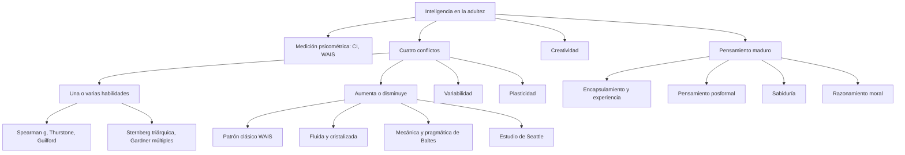
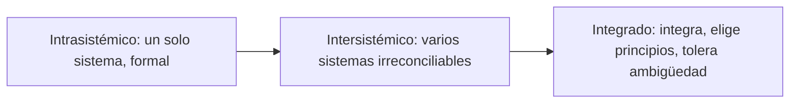
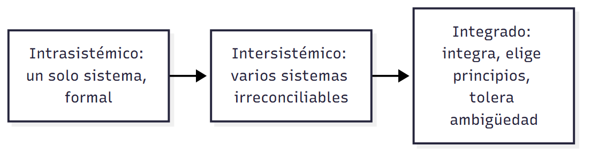
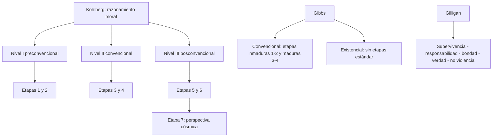
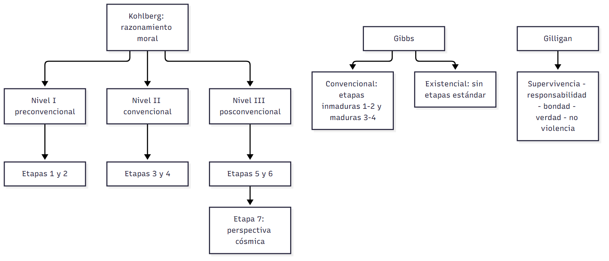

# C18 — Inteligencia, creatividad, pensamiento maduro, sabiduría y razonamiento moral en la adultez

> **Fuentes:**
>
> - Cátedra de Psicología Evolutiva. (2026a). *Desarrollo cognitivo en la adultez* [Diapositivas de clase]. Universidad Favaloro.
> - Cátedra de Psicología Evolutiva. (2026c). *Inteligencia y creatividad durante la adultez* [Diapositivas de clase, unidad 9]. Universidad Favaloro.
> - Papalia, D. E., Sterns, H. L., Feldman, R. D., & Camp, C. J. (2009b). Inteligencia y creatividad. En *Desarrollo del adulto y vejez* (cap. 6, pp. 191-229). McGraw Hill Interamericana. [Bibliografía obligatoria de la unidad 9]
> - Papalia, D. E., Sterns, H. L., Feldman, R. D., & Camp, C. J. (2009b). Pensamiento maduro, sabiduría e inteligencia moral. En *Desarrollo del adulto y vejez* (cap. 7, pp. 230-268). McGraw Hill Interamericana. [Bibliografía obligatoria de la unidad 9]
>
> **Materia:** Psicología Evolutiva, 2.º año, Universidad Favaloro (docente a cargo: Dra. Verónica A. Ramírez). Unidad 9, clase 18 (cronograma: 22/09/2026). Examen: 4.º parcial, 03/11/2026.

> **Aviso sobre las fuentes:** (1) Las páginas son las **impresas** del libro (cap. 6: 191-229; cap. 7: 230-268). (2) Tus apuntes de esta clase están vacíos (la única nota «memoria: MUY importante para la catedrática» está en la clase 17 y se desarrolla en `C17_Memoria_Guia.md`). (3) El PDF de diapositivas «CI (Unidad 9)» (2026c) tiene tres diapositivas sin texto (la 8, la 9 y la 24: imágenes de la WAIS y de la figura de inteligencia fluida/cristalizada) y se complementa con las diapositivas 14-40 del archivo «Desarrollo cognitivo en la adultez» (2026a), que también tratan creatividad e inteligencia. (4) El programa de la cátedra incluye en esta fecha «uso de pruebas psicométricas, estabilidad del CI» y «razonamiento moral»; este último está en el capítulo 7 (Kohlberg, Gibbs, Gilligan), que la cátedra no desarrolló en las diapositivas que subiste: por eso esa parte se arma solo con el libro y va con aviso. (5) El libro tiene una errata: el resumen de la p. 267 dice «cinco etapas» de Schaie y el texto (pp. 244-245) describe **siete**. (6) La figura 7.1 aparece impresa como «figura 6.1» (p. 245).

> **Idea-fuerza:** La inteligencia adulta **no declina en bloque**: es multidimensional y multidireccional. Declinan antes las capacidades «fluidas» (mecánica, procesamiento de información novedosa) y se mantienen o mejoran las «cristalizadas» (pragmática, conocimiento acumulado), con enorme variabilidad individual, efectos de cohorte y plasticidad (entrenamiento). Las pruebas de CI miden solo una parte, y por eso hay que complementarlas con la **creatividad**, el **pensamiento maduro (posformal)**, la **sabiduría** y el **razonamiento moral**: formas de inteligencia que se nutren de la experiencia y pueden crecer en la adultez (Papalia et al., 2009b, pp. 193, 217-218, 230-232, 265).

## Hilo conductor: cómo se conectan los temas de esta guía

El capítulo 6 arranca con Akira Kurosawa, un genio creativo que siguió creando hasta casi los 90 años, y se pregunta cuatro cosas: ¿qué es la inteligencia y cómo se mide?; ¿se mantiene, mejora o declina en la adultez?; ¿qué relación tiene con la creatividad?; ¿qué papel juegan la personalidad, la motivación, la experiencia, el contexto y la edad? Esas preguntas ordenan esta guía.

**Primero** (secciones 1-2), la definición y la medición. El enfoque **psicométrico** supone que la inteligencia se puede cuantificar (CI, WAIS), pero esas pruebas miden el desempeño en un momento y lugar, están teñidas de cultura y de escolaridad y, en los mayores, se ven afectadas por la salud, los sentidos, la velocidad y la ansiedad. De ahí los **cuatro conflictos** de la sección 3: ¿una habilidad o muchas? (g de Spearman, Thurstone, Guilford, la **triárquica de Sternberg**, las **inteligencias múltiples de Gardner**); ¿aumenta o disminuye? (patrón clásico de la WAIS, **inteligencia fluida y cristalizada** de Horn y Cattell, **mecánica y pragmática** de Baltes, el **Estudio Longitudinal de Seattle** de Schaie); ¿varía de persona a persona? (género, cohorte, salud); y ¿es modificable? (**plasticidad**, ADEPT).

**Segundo** (sección 4), la **creatividad**, que el CI casi no predice: se estudia con tests (**pensamiento divergente**, Torrance), con biografías (Gardner, Gruber y Darwin) y en el laboratorio (**detección de problemas**), y su curva con la edad depende del campo.

**Tercero** (secciones 5-7), el capítulo 7 pregunta qué hace distinta la cognición adulta: no es más lógica formal sino **conocimiento experto encapsulado**, **resolución de problemas cotidianos**, **pensamiento integrativo**, **reflexivo** y **posformal** (Labouvie-Vief, Sinnott, Perry), y el modelo de ciclo de vida de **Schaie**. Ese pensamiento maduro desemboca en la **sabiduría** (Sternberg, Erikson, Clayton, Meacham, Baltes, Labouvie-Vief, la mirada espiritual) y en el **razonamiento moral** (Kohlberg, Gibbs, Gilligan). El cierre es Gandhi: «hay un límite al progreso en la inteligencia, pero el desarrollo de las cualidades del corazón no conoce fronteras» (Papalia et al., 2009b, p. 265).

> 🎯 **Para el parcial:** el eje que une todo es la contraposición **biología (declina) vs. experiencia/cultura (se sostiene o mejora)**. Aplicala a cada tema: fluida/cristalizada, mecánica/pragmática, creatividad (entusiasmo/experiencia), pensamiento (formal/posformal), sabiduría (edad/experiencia), moral (cognición/experiencia).

**En una sola oración:** la inteligencia adulta cambia en direcciones distintas según la habilidad, la persona, la cohorte y la práctica; y las formas más maduras de pensar (creatividad, pensamiento posformal, sabiduría, juicio moral) dependen más de la experiencia que del CI.

## 0. Hoja de ruta

1. **Qué es la inteligencia** (Papalia et al., 2009b, pp. 193-195): comportamiento inteligente; cultura.
2. **Medición psicométrica** (pp. 194-201): CI, WAIS, sesgo cultural, influencias en mayores, balance.
3. **Cuatro conflictos del desarrollo intelectual** (pp. 202-218): una o varias; aumenta o disminuye; variabilidad; plasticidad.
4. **Creatividad** (pp. 218-229).
5. **El papel de la experiencia y el pensamiento posformal** (pp. 230-245).
6. **Sabiduría** (pp. 245-254).
7. **Desarrollo moral** (pp. 254-266).
8. **Para rendir**.

## 🎯 Lo que entra sí o sí

1. **Comportamiento inteligente:** orientado a metas y adaptativo; depende de valores y creencias culturales (Papalia et al., 2009b, p. 193; Cátedra de Psicología Evolutiva, 2026c, diapositiva 2).
2. **CI:** edad mental (Binet), CI = EM/EC (Stern), **CI de desviación** (Wechsler); **no** es innato ni fijo (pp. 196-198).
3. **Sesgo cultural**: «sin sesgo» ≠ «culturalmente justas» (p. 199).
4. **Por qué los mayores puntúan menos**: salud, sentidos, velocidad, ansiedad/motivación (pp. 199-201).
5. **Triárquica de Sternberg** (componencial, experiencial, contextual) y **Gardner** (inteligencias múltiples; ojo: «neuromito» según la cátedra) (pp. 203-207).
6. **Patrón clásico de envejecimiento**, **fluida/cristalizada**, **mecánica/pragmática**, **optimización selectiva con compensación** (pp. 208-213).
7. **Estudio Longitudinal de Seattle** (diseño secuencial; hallazgos; multidimensional) (pp. 211-214).
8. **Creatividad:** pensamiento divergente vs. convergente; potencial vs. rendimiento; curva por campo (pp. 218-227).
9. **Pensamiento posformal** (Labouvie-Vief: intrasistémico, intersistémico, integrado) y **encapsulamiento** (Hoyer) (pp. 233, 239-240).
10. **Sabiduría** (Baltes y sus cinco criterios; Erikson; Labouvie-Vief; Sternberg) (pp. 246-253).
11. **Kohlberg, Gibbs, Gilligan** (pp. 254-265).

---

## 1. ¿Qué es la inteligencia? El comportamiento inteligente y la cultura

### 1.1 Respuesta modelo (para escribir en el parcial)

> **Esqueleto de la respuesta:**
> 1. **Tesis:** no hay definición única de inteligencia, pero sí acuerdo sobre lo que hace: comportamiento orientado a metas y adaptativo.
> 2. **Evidencia del acuerdo:** más de mil expertos eligieron razonamiento, adquisición de conocimiento y resolución de problemas (Snyderman y Rothman, 1987, citado en Papalia et al., 2009b, p. 193).
> 3. **Cultura:** la definición depende de valores y creencias culturales (osos de Luria; kpelle) (pp. 194-195).
> 4. **Cierre:** no se puede aplicar la misma vara a todas las culturas ni a todas las edades.

No existe una definición única de inteligencia (en el simposio de 1921 más de una docena de psicólogos no pudieron ponerse de acuerdo), pero hay acuerdo en lo que hace: el comportamiento inteligente se orienta a metas, conscientes y deliberadas, y es adaptativo, dirigido a identificar y resolver problemas. Más de mil expertos eligieron razonamiento, capacidad de adquirir conocimiento y resolución de problemas. Pero incluso este consenso depende de la cultura: los campesinos de Luria rechazaban razonar sobre osos que no habían visto, y los kpelle clasificaban «funcionalmente», como lo haría «un hombre sabio». Por eso las diferencias pueden ser de punto de vista y no de déficit (Papalia et al., 2009b, pp. 193-195).

> ⚠ **No confundir:** *clasificación funcional* (cuchillo con naranja) con un «nivel inferior de pensamiento»: para los kpelle era la forma sabia; el «orden superior» (alimentos, herramientas) lo daban cuando se les preguntaba cómo lo haría «un tonto» (p. 195).

### 1.2 Desarrollo ampliado

**Punto de partida: Akira Kurosawa** (pp. 191-193). El director de cine japonés (*Rashomon*, 1951; *Los siete samuráis*, 1954) quería ser pintor; usó la pantalla como un lienzo. Desde niño era un líder natural; a los 20 y pico, como aprendiz de Kajiro Yamamoto en Toho, mostró amplitud de conocimiento, escribió guiones con facilidad, editó, experimentó con sonido; Yamamoto: «Es completamente creativo». Su debut fue *Sanshiro Sugata* (1943). Era perfeccionista (en *Barba roja* creó «manchas por el paso del tiempo» en tazas de té que nunca se verían, y retardó la filmación dos años), sufrió censura, depresión y un intento de suicidio en 1971, recibió el apoyo de Spielberg, Lucas y Coppola, y murió en 1998 trabajando en *Todavía no* («rechazo al retiro»). Sus temas: inteligencia y creatividad, clases o aspectos de la inteligencia (artística, verbal, práctica, interpersonal), personalidad, motivación, experiencia y contexto social, y cómo la edad afecta la productividad (p. 193).

**Preguntas del capítulo** (p. 193): ¿la mente sigue desarrollándose aunque el cuerpo no?; ¿algunas habilidades intelectuales declinan como las físicas?; ¿surgen nuevos tipos de habilidades?; ¿qué es la inteligencia y la creatividad, cómo difieren, cómo se miden?; ¿una persona puede ser creativa sin ser inteligente, o viceversa?; ¿responder preguntas factuales indica más inteligencia que escribir un ensayo bien argumentado, aprovechar una oportunidad, establecer buenas relaciones o enfrentar contratiempos?

**Definir la inteligencia** (p. 193). Los psicólogos discutieron durante años si es heredada o adquirida; hoy hay acuerdo en que ambos factores juegan un papel (con peso relativo difícil de determinar). Pero sigue sin resolverse qué es y cómo medirla. En un **simposio en 1921** (*Journal of Educational Psychology*) más de una docena de eminentes psicólogos no pudieron acordar una definición (Sattler, 1988); también fracasó un intento ulterior (Sternberg y Detterman, 1986). Sí hay amplio acuerdo en **qué hace**: el comportamiento inteligente (1) se orienta a **metas** (conscientes y deliberadas, no automáticas ni accidentales) y (2) es **adaptativo** (dirigido a identificar y resolver problemas). Cuando a más de mil expertos en psicología, educación, sociología y genética se les pidió clasificar elementos de comportamiento inteligente, casi todos escogieron tres de trece opciones: **razonamiento, capacidad para adquirir conocimiento y habilidad para resolver problemas** (Snyderman y Rothman, 1987). Aun este consenso se invalida con la investigación transcultural: algunas culturas tienen otras visiones del comportamiento inteligente (recuadro 6.1) (Papalia et al., 2009b, p. 193). La cátedra suma que «depende de valores y creencias culturales» (Cátedra de Psicología Evolutiva, 2026c, diapositiva 2).

**Recuadro 6.1, «¿El comportamiento inteligente es el mismo en todas las culturas?»** (pp. 194-195).
- **Los osos de Novaya Zemlya** (Luria, 1976): «En el extremo norte todos los osos son blancos. Novaya Zemlya se encuentra en el extremo norte. ¿De qué color son ahí los osos?». Los adultos occidentales escolarizados dicen «blancos»; los campesinos no escolarizados de Asia Central (y los ancianos occidentales con menos escolaridad: Botwinick, 1978; Denney, 1974) con frecuencia fracasan. ¿Incapacidad de pensar lógicamente? No: muchos campesinos **rechazaban** resolver el problema («debes preguntar a quienes han estado ahí y los han visto», «no hablemos de lo que no hemos visto»). Scribner (1979) lo llamó «**sesgo concreto**», que se corrige con educación formal (Luria lo comprobó); e incluso algunos campesinos no escolarizados respondieron desde un enfoque «teórico» y correctamente.
- **Los kpelle** (Liberia central; Glick, 1975): ante 20 objetos, los adultos los ordenaban por categorías **funcionales** (cuchillo con naranja, papa con hoz); los psicólogos occidentales lo asocian con bajo nivel de pensamiento, pero ellos decían que así lo haría «un hombre sabio». Cuando el investigador preguntó «¿cómo lo haría uno tonto?», dieron las categorías de «orden superior» (alimentos, herramientas) que esperaba.
- **Labouvie-Vief** (1985): las personas de culturas distintas abordan los problemas de modo distinto según su experiencia y conocimientos previos; su forma de resolver puede ser correcta en ese contexto. Ejemplo de Luria: tres campesinos de Uzbekistán ven imágenes de una sierra, un martillo y un hacha y se les pregunta si un **tronco** es de la misma categoría («herramientas»): «hacemos toda suerte de cosas con los troncos: manubrios, puertas…»; «tenemos un dicho: mira en los campos y verás herramientas». Luria lo vio como incapacidad de clasificar; Labouvie-Vief propone que investigador y campesinos estaban en «longitudes de onda» culturales distintas y los campesinos argumentaban «burlonamente» por una definición más flexible. Lo mismo vale para los ancianos occidentales, que pueden cuestionar la validez de una tarea si sus motivos no están claros: hay que tener cuidado al suponer «déficits» donde puede haber **diferencias de punto de vista** (p. 195).

> 🔑 **Punto clave:** la cátedra usa los mismos ejemplos (osos y kpelle) para mostrar que «las personas con culturas diferentes suelen abordar los problemas de modo distinto con base en su experiencia y conocimientos previos, y su forma de resolver un problema puede ser correcta en dicho contexto» (Cátedra de Psicología Evolutiva, 2026c, diapositivas 3-4).

---

## 2. La medición de la inteligencia: el enfoque psicométrico

### 2.1 Respuesta modelo (para escribir en el parcial)

> **Esqueleto de la respuesta:**
> 1. **Tesis:** el enfoque psicométrico supone que la inteligencia es cuantificable (CI), pero el CI no es una medida fija ni innata.
> 2. **Historia:** Binet-Simon (1905), edad mental; Stern (1911), CI = EM/EC; Wechsler (1939), CI de desviación (media 100) (Papalia et al., 2009b, p. 196).
> 3. **Qué mide:** desempeño en un momento y lugar, reflejo de lo aprendido; inseparable de escolaridad y cultura (p. 198).
> 4. **Límites:** sesgo cultural; en mayores, salud, sentidos, velocidad, ansiedad (pp. 199-201).
> 5. **Valor:** predice bien el éxito académico; menos el laboral (pp. 201; Cátedra de Psicología Evolutiva, 2026c, diapositiva 7).

El enfoque psicométrico supone que la inteligencia es cuantificable. Binet y Simon crearon en 1905 la primera prueba y el concepto de edad mental; Stern (1911) propuso el cociente (EM/EC × 100) y Wechsler (1939) el CI de desviación, con media 100 para adultos. El CI no es innato ni fijo: indica cómo rinde una persona en cierta tarea, en un lugar y momento, respecto de otras, y refleja lo aprendido, por lo que no se puede separar de la escolaridad y la cultura. En los mayores, la salud, los sentidos, la velocidad y la ansiedad pueden bajar los puntajes. Aun así predice bien el rendimiento académico y es útil si se usa con cautela (Papalia et al., 2009b, pp. 196-201).

> ⚠ **No confundir:** *pruebas sin sesgo cultural* (sin contenido cultural relacionado, p. ej. laberintos) con *culturalmente justas* (conformadas solo de experiencias comunes a varias culturas): lo primero se intentó y no eliminó las influencias culturales; lo segundo es virtualmente imposible (p. 199; Cátedra de Psicología Evolutiva, 2026c, diapositiva 10).

### 2.2 Desarrollo ampliado

**El enfoque psicométrico** (pp. 194-196). Ante la dificultad de definir la inteligencia, la pregunta por cómo valorarla es controversial. En la vida cotidiana se hacen juicios informales («Juan es más inteligente que Felipe»), que suponen que la inteligencia es cuantificable, algo que los individuos poseen en mayor o menor cantidad; esa es la **suposición básica del enfoque psicométrico**, dominante desde fines del siglo xix. *Psicométrico* literalmente significa «medición de la mente» (p. 195). Las pruebas miden mediante preguntas o tareas que sirven como indicadores o predictores del funcionamiento intelectual (comprensión verbal, cálculo matemático, razonamiento, ciertas habilidades de rendimiento no verbal). Se evalúan por lo bien que **predicen el comportamiento inteligente y el rendimiento escolar**; han probado ser valiosas, aunque a veces se las critica por prestar atención a productos cognitivos y por su falta de relación con el desempeño cognitivo de la vida diaria (Dixon y Hultsch, 1999) (pp. 195-196).

**Normas estandarizadas, edad mental y CI** (p. 196). Las calificaciones se basan en **normas estandarizadas** (derivadas de una gran muestra representativa que contestó el mismo instrumento). Las primeras pruebas fueron para niños: **Alfred Binet y Theodore Simon crearon la primera prueba, la escala Binet-Simon, en 1905**, y el concepto de **edad mental**: un niño con edad mental de 9 obtuvo una calificación aproximadamente igual a la del niño promedio de 9 años. Pero un niño de 8 y uno de 12 con edad mental 9 no son igualmente inteligentes: **William Stern (1911)** acuñó «coeficiente mental», que devino **coeficiente intelectual (CI)**: edad mental ÷ edad cronológica × 100 (CI 100: edad mental = cronológica; un niño de 10 con CI 120 tiene edad mental de 12). El CI permanece bastante constante en la niñez. **Adultos:** no muestran mejoras estables ligadas con la edad, así que la solución fue el **CI de desviación** (David **Wechsler**, 1939, Escala Wechsler-Bellevue): se asigna 100 a la calificación media y se miden las demás por su distancia (desviación estándar) de la media, en una curva con forma de campana (figura 6.1): dos tercios se ubican entre 85 y 115; menos de 5 % por debajo de 70 o arriba de 130. Sirve tanto para niños como para adultos (Papalia et al., 2009b, p. 196). La cátedra: «CI = EM/EC (cociente); CI de desviación (Wechsler, 1939)» (Cátedra de Psicología Evolutiva, 2026c, diapositiva 5).

**La WAIS** (pp. 197-198). La **Escala de Inteligencia para Adultos de Wechsler (WAIS)** (como las escalas para niños) tiene **subpruebas** con puntuaciones separadas; las calificaciones de las **11 subpruebas** se combinan para dar un **CI verbal**, un **CI de desempeño** y un **CI total**. Ejemplos de ítems (figura 6.2): *Escala verbal* (información: ¿en qué continente está el Taj Mahal?; comprensión: explicar «un viaje de mil millas comienza con un solo paso»; aritmética: un par de zapatos de 70 dólares rebajados 20 %; semejanzas: ¿en qué se parecen un radio y un televisor?); *Escala de desempeño* (símbolos de dígitos, compleción de figuras, ensamble de objetos, etc.). La tendencia hacia el desempeño no verbal hace que la mayoría de los mayores baje más ahí. Es una de las pruebas más utilizadas y la WAIS-III es la versión más relevante para adultos (también se usa en poblaciones como Alzheimer) (Dixon y Hultsch, 1999) (pp. 197-198). La cátedra: la WAIS «predice relativamente bien el desempeño académico (aunque no tan bien el laboral)» y ejemplifica subpruebas: vocabulario (¿qué es *terminar*?), información (¿quién fue Ícaro?), aritmética (Juan tiene 28 libros…), semejanzas (¿en qué se parecen *permitir* y *restringir*?) (Cátedra de Psicología Evolutiva, 2026c, diapositiva 7; 2026a, diapositivas 29-30).

**Qué mide el CI (y qué no)** (p. 198). Muchos creen que el CI es una cifra innata y fija; en realidad indica **cuán bien hace una persona cierta tarea en un momento y lugar particulares**, comparada con otras. Si miden alguna aptitud, lo hacen solo de manera indirecta; reflejan casi inevitablemente la **información y habilidades previamente aprendidas**, por lo que es imposible separar la inteligencia medida del logro, que depende de memoria, escolaridad y otras influencias. Ej.: en un estudio de **gemelos idénticos criados en hogares distintos**, las diferencias de CI se relacionaron con los años de educación (Bronfenbrenner, 1979). Y, aunque en general son estables, algunos individuos muestran cambios marcados, evidencia de que se mide algo más que una habilidad innata (Kopp y McCall, 1982). La inteligencia innata sería solo un ingrediente de la competencia; también pesan la motivación, las metas, la educación y la experiencia de vida (Papalia et al., 2009b, p. 198; Cátedra de Psicología Evolutiva, 2026c, diapositiva 6).

**Antecedente:** Francis **Galton**, médico inglés del siglo xix, estableció un laboratorio para medir diferencias individuales (cálculo de pesos, sonidos agudos): precursor de las pruebas actuales (p. 198).

**Sesgo cultural** (pp. 198-199). Hay diferencias reales de habilidad entre individuos, pero hay serios cuestionamientos a la precisión con que las pruebas las valoran. Los miembros de ciertos grupos étnicos rinden mejor que otros por razones muy debatidas: por ejemplo, **15 puntos** de diferencia en el CI promedio entre estadounidenses blancos y afroamericanos (E. B. Brody y N. Brody, 1976; Reynolds, 1988). Aunque algunos lo atribuyen a la genética (Herrnstein y Murray, 1994; Jensen, 1969), se lo atribuye más comúnmente a influencias de **ingreso, nivel de educación y estimulación ambiental**, que afectan autoestima, motivación y desempeño académico (Brooks-Gunn et al., 2003; Kamin, 1974, 1981); y las brechas parecen estrecharse cuando mejoran las oportunidades educativas (Neisser et al., 1996). Algunos críticos hablan de **sesgo cultural**: la tendencia a incluir preguntas que emplean cierto vocabulario o piden información o habilidades más familiares o significativas para algunos grupos culturales que para otros (Sternberg, 1985a, 1987); las pruebas se construyen en torno al estilo de pensamiento y lenguaje dominante de las personas blancas de ascendencia europea, lo que desventaja a niños de minorías (Helms, 1992). También puede influir en la situación de aplicación (un niño de una cultura que valora la cooperación puede estar en desventaja al hacer una prueba solo). Aun así, los estudios control no han podido demostrar su influencia en las diferencias grupales (Neisser et al., 1996) (p. 199).

- **Pruebas sin sesgo cultural** (*culture-free*): sin contenido cultural relacionado, con tareas que no requieren lenguaje (trazar laberintos, poner formas en huecos, completar imágenes). No eliminaron todas las influencias culturales. **Culturalmente justas**: conformadas solo de experiencias comunes a personas de diversas culturas; los diseñadores las consideran **virtualmente imposibles** (Anastasi, 1988; Kottak, 1994; Miller-Jones, 1989; Sternberg, 1985a). La cátedra: «pruebas sin sesgo cultural ≠ pruebas culturalmente justas» (Cátedra de Psicología Evolutiva, 2026c, diapositiva 10).
- También es casi imposible reconocer los valores y actitudes que fomenta la cultura: los kpelle clasifican por relaciones funcionales; en EE. UU. las personas de **clase baja** clasifican más como los kpelle, y los grupos socioeconómicos más bajos suelen valorar la **memoria rutinaria**, mientras que las clases media y alta valoran el **razonamiento** (Sternberg, 1985a, 1986; Miller-Jones, 1989). Las personas de culturas que ponen menos énfasis en la **rapidez y la competencia** pueden estar en desventaja en pruebas cronometradas (Kottak, 1994), igual que, por otros motivos, los ancianos (p. 199).
- **Ejemplo histórico** (p. 200): en la Primera Guerra Mundial los soldados blancos de algunos estados del sur rindieron mejor que los afroamericanos del sur (escuelas segregadas de baja calidad); pero los soldados afroamericanos que habían vivido en ciudades del norte, con escuelas integradas, obtuvieron calificaciones más altas, y mientras más tiempo vivieron allí, más altas (Kottak, 1994): la educación influye en los resultados.

**Influencias sobre el desempeño en las pruebas aplicadas a adultos mayores** (pp. 199-201). Salud, comodidad, energía, ansiedad, motivación, hábitos de estudio y habilidad para responder pruebas afectan los puntajes de todos, pero algunas influencias se acentúan al envejecer y pueden llevar a **subestimar** la habilidad intelectual de los mayores. Su rendimiento puede mejorar si se controlan estas condiciones:
1. **Salud física:** una habilidad mental alta se asocia con altos niveles de educación, estatus ocupacional e ingreso; quienes los tienen suelen acceder a mejores servicios de salud. Los estudios longitudinales de Seattle y Duke: los adultos con mejor rendimiento tenían buena condición física, descansaban bien, pocos indicadores de problemas neurofisiológicos y baja incidencia de problemas cardiovasculares (que restringen el flujo sanguíneo al cerebro) (Palmore et al., 1985; Schaie, 1990; Schaie y Willis, 1996) (pp. 199-200).
2. **Visión y audición:** pueden dificultar entender las instrucciones y realizar las tareas (p. 200).
3. **Rapidez, coordinación y movilidad:** los límites de tiempo resultan particularmente estresantes; los procesos físicos y psicológicos (incluidas las habilidades perceptuales) se lentifican con la edad (Schaie, 1994) y los mayores rinden mejor cuando tienen tiempo ilimitado (Hertzog, 1983). Si equiparar inteligencia con rapidez es un error (Sternberg, 1985a, 1987), cronometrar puede mostrar a los mayores como menos inteligentes de lo que son; otros psicólogos sostienen que la rapidez es una función del sistema nervioso central y un verdadero indicador del funcionamiento intelectual, y algunos estudios sugieren que aun sin cronometrar los mayores rinden menos (Botwinick, 1984) (pp. 200-201).
4. **Actitudes hacia una situación de prueba:** ansiedad al examen (si no están familiarizados), falta de confianza, expectativa de mal desempeño que se vuelve «profecía autosugestiva», temor a un fallo de memoria que lleva a saltear preguntas (Cavanaugh y Morton, 1989); falta de **motivación** si la prueba no significa nada para ellos a menos que sea para un empleo (p. 201). (La cátedra resume las cuatro: salud física, visión/audición, velocidad de procesamiento/motriz, actitudes ante la evaluación; Cátedra de Psicología Evolutiva, 2026c, diapositiva 11.)

**Balance de las pruebas psicométricas** (p. 201). Tienen una larga historia útil; sus objeciones deben tomarse en cuenta y deben buscarse métodos que se aproximen a la complejidad de la inteligencia adulta. Las pruebas individuales (las más usadas con adultos) arrojan información útil: entrevistas clínicas revelan cómo maneja la persona el estrés, el fracaso y el éxito, y los reportes incluyen descripciones de apariencia, ansiedad, motivación, estatus socioeconómico, antecedentes educativos y ocupacionales, historia familiar y razones para aplicar el test. Los tests han probado ser razonablemente efectivos en lo que fueron diseñados para hacer (**predecir el éxito académico**): dan mediciones precisas de habilidades verbales y matemáticas y son predictores muy confiables del desempeño en empleos que requieren esas habilidades. Pero tal como se diseñan y usan hoy pueden pintar una imagen **excesivamente descolorida e incompleta** de las habilidades cognitivas de los ancianos y pasar por alto habilidades que pueden surgir o volverse más importantes en la adultez (Papalia et al., 2009b, p. 201).

> 🔑 **Punto clave:** el CI es una medida relativa (a la muestra de normalización), contextual (momento y lugar) y entrelazada con lo aprendido; no una «cantidad» innata.

---

## 3. Cuatro conflictos básicos del desarrollo intelectual en la adultez

> **Esqueleto de la respuesta (visión de conjunto):**
> 1. **Tesis:** cuatro conflictos básicos (Dittman-Kohli y Baltes, 1990; Baltes, 1987): ¿una o varias habilidades?, ¿crece o declina?, ¿varía entre personas?, ¿es modificable? (Papalia et al., 2009b, p. 202).
> 2. **Una o varias:** la mayoría cree que son múltiples; las pruebas miden solo algunas (p. 217).
> 3. **Crece o declina:** depende de la habilidad: las dependientes de la condición física del cerebro declinan, las de conocimiento se mantienen o aumentan (pp. 217-218).
> 4. **Varía:** enormemente entre y dentro de individuos; género, cultura, cohorte, salud (pp. 214-216).
> 5. **Modificable:** el entrenamiento mejora incluso lo fluido (pp. 216-217).

### 3.1 ¿La inteligencia es una habilidad o muchas?

#### Respuesta modelo (para escribir en el parcial)

> **Esqueleto de la respuesta:**
> 1. **Tesis:** el debate unitaria vs. multidimensional es vigente y tiene consecuencias (qué se mide y quién accede a qué oportunidades).
> 2. **Visión unitaria:** Spearman (factor g y factores s) (Papalia et al., 2009b, pp. 202-203).
> 3. **Multidimensional:** Thurstone (8 habilidades primarias), Guilford (150 factores) (p. 203).
> 4. **Tendencia actual:** Sternberg (triárquica) y Gardner (inteligencias múltiples) (pp. 203-207).
> 5. **Cierre:** la visión multidimensional permite avances y retrocesos simultáneos.

La discusión sobre si la inteligencia es una habilidad general (g) o varias es central, porque la respuesta determina qué se busca medir y a quién se le dan oportunidades educativas y laborales. Spearman propuso un factor general g que subyace a factores específicos s; Thurstone, ocho habilidades primarias independientes; Guilford, 150 factores. El análisis factorial no zanja la discusión porque es subjetivo. Sternberg (triárquica: componencial, experiencial y contextual) y Gardner (siete u ocho inteligencias autónomas) lideran la visión multidimensional, que permite explicar avances y retrocesos simultáneos en la adultez, algo que una visión unitaria no admite (Papalia et al., 2009b, pp. 202-207).

> ⚠ **No confundir:** *Sternberg* (tres **aspectos/procesos** de la inteligencia: componencial, experiencial, contextual) con *Gardner* (ocho **inteligencias** autónomas: lingüística, lógico-matemática, musical, espacial, corporal-cinestésica, interpersonal, intrapersonal y naturalista).

#### Desarrollo ampliado

**El conflicto** (p. 202). Las pruebas que producen un solo CI devienen una **visión unitaria**; los tests que generan calificaciones por categorías (razonamiento abstracto, resolución de problemas prácticos) reflejan una **visión multidimensional**. Un CI único de 110 brinda un panorama muy distinto de «90 verbal y 130 no verbal». Para el desarrollo adulto: una visión multidimensional **posibilita avances y retrocesos simultáneos**; una unitaria, no. Los diseñadores de pruebas dejaron de dar tanta importancia a la inteligencia general y enfatizan distinciones entre habilidades (Anastasi y Urbina, 1997; Daniel, 1997). La cátedra: «a lo largo de los años se tendió a privilegiar visiones más multidimensionales: permiten capturar una riqueza mayor y evaluar diferenciadamente avances y retrocesos» (Cátedra de Psicología Evolutiva, 2026c, diapositiva 13).

**Análisis factorial** (pp. 202-203). Desde fines de la década de 1920, a partir del trabajo de **Charles E. Spearman**, se usa para determinar estadísticamente cuál de las dos visiones es correcta: busca factores subyacentes comunes a un conjunto de pruebas en las que las mismas personas obtienen las mismas calificaciones (p. ej., altas en lectura y en vocabulario sugiere una habilidad verbal). **Problema:** puede ser muy **subjetivo** (el punto de vista del investigador afecta la selección de datos, procedimientos y designación de factores), y ha dado argumentos a ambos bandos.
- **Spearman** (1927): un **factor general (g)** subyace a los **factores específicos (s)** (razonamiento matemático, comprensión verbal, comprobación de hipótesis) (teoría bifactorial; la cátedra: «g general, libre de sesgo cultural; s específicos, dependientes de dominios»; Cátedra de Psicología Evolutiva, 2026c, diapositiva 14).
- **Thurstone** (1938; Prueba de Habilidades Mentales Primarias): **ocho habilidades «primarias»**, más o menos independientes (comprensión verbal, razonamiento inductivo y deductivo, rapidez perceptual, memoria rutinaria…); un análisis posterior mostró que no eran tan independientes.
- **Guilford** (1956-1982): modelo de la «estructura del intelecto» con **150 factores** de pensamiento entrecruzados.
- El debate sigue: Kranzler y Jensen (1991) sostienen que g es producto de al menos cuatro procesos independientes; Carroll (1991), con otro método sobre los mismos datos, dice que apoya mejor una g unitaria (p. 203).

**Teoría triárquica de Sternberg** (pp. 203-206). Robert Sternberg (Yale) y Howard Gardner (Harvard) lideran la tendencia que ve la inteligencia como **multidimensional** y afirman que las pruebas tradicionales fracasan al medir importantes habilidades. Ejemplo para introducir (Trotter, 1986): **Alix**, **Bárbara** y **Courtney** postulan a un posgrado en Yale. Alix: promedio altísimo, GRE muy alto, excelentes recomendaciones. Bárbara: calificaciones buenas, GRE bajo, pero cartas que elogian sus creativos proyectos de investigación. Courtney: todo bueno pero no entre los mejores. Alix y Courtney fueron admitidas; Bárbara no (la contrataron como investigadora asociada y tomó clases por su parte). Alix rindió muy bien un año y luego su desempeño bajó; Bárbara terminó cofundando el comité de admisiones por su notable trabajo; Courtney tuvo un desempeño «adecuado» pero fue la que consiguió empleo más fácilmente.
Sternberg (1997, 2003a) define la inteligencia como **un grupo de habilidades intelectuales necesarias para adaptarse a cualquier contexto ambiental, y para seleccionar y dar forma a los contextos en que se vive**; le interesan menos la estructura de la mente que los **procesos** subyacentes. Su **teoría triárquica** abarca tres elementos de procesamiento de información:
1. **Elemento componencial** (aspecto **analítico**): cuán eficientemente se procesa la información; cómo se resuelven problemas, se monitorean soluciones y se evalúan resultados. Fuerte en **Alix** (buena en pruebas de inteligencia y para encontrar fallas en los argumentos). Menos relacionado con creatividad (Cátedra de Psicología Evolutiva, 2026c, diapositiva 15).
2. **Elemento experiencial** (aspecto **intuitivo**): cómo se abordan tareas **novedosas o familiares**; permite comparar la nueva información con lo que ya se sabe y encontrar nuevas formas de poner juntos hechos e ideas, es decir, pensar **originalmente**; el desempeño automático de operaciones familiares (reconocer palabras) libera la mente para tareas no familiares. Fuerte en **Bárbara**. Se relaciona con la creatividad (Papalia et al., 2009b, pp. 204-205).
3. **Elemento contextual** (aspecto **práctico**): cómo se lidia con el entorno; habilidad para valorar una situación y decidir qué hacer: **adaptarla, cambiarla o encontrar un nuevo escenario**. Fuerte en **Courtney** («sabiduría callejera»: elegía temas «controversiales», enviaba artículos a las revistas «adecuadas», sabía dónde postularse). Su componente principal es el **conocimiento tácito**: «influencias internas» o «erudición» que no se enseña formalmente ni se expresa abiertamente; se aprende por experiencia y se modifica para adaptarse al entorno actual (ganar una promoción o un trato privilegiado). Se evalúa comparando el plan de acción elegido por una persona en situaciones laborales hipotéticas con las elecciones de expertos y «reglas empíricas»; **no está relacionado con el CI** y predice el desempeño laboral moderadamente bien (Sternberg, 2003b; Sternberg y Wagner, 1993). Se necesita más investigación sobre cómo y cuándo se adquiere y si puede enseñarse directamente (pp. 205-206).
La teoría interesa a quienes estudian el desarrollo adulto porque se enfoca en aspectos de la inteligencia que pueden volverse **cada vez más valiosos en la vida adulta** (p. 205). En el ejemplo: la inteligencia componencial de Alix la ayudó con los exámenes del colegio, pero en el posgrado, donde se espera pensamiento original, brillaron la experiencial de Bárbara y la contextual de Courtney (p. 206).

**Recuadro 6.2, «¿Las pruebas de inteligencia son el mejor método para predecir el desempeño laboral?»** (pp. 204-205). Ree y Earles (1992) afirmaron que las pruebas de inteligencia general (**g**) son los mejores predictores del desempeño en **cualquier** empleo (revisión estadística de grandes estudios, muchos en las fuerzas armadas). Sternberg y Wagner (1993) los refutaron («El punto de vista g-océntrico de la inteligencia y el rendimiento laboral es erróneo», comparándolo con creer que la Tierra es el centro del universo): las pruebas predicen el rendimiento laboral con menos confiabilidad que el escolar porque los problemas académicos (muy específicos, con una respuesta correcta y toda la información) difieren de los de la vida real. Jensen (1993): g no se limita a la inteligencia académica, pero factores como personalidad, motivación, intereses y valores explican mejor la diferencia entre lo que predice la prueba y el desempeño real. McClelland (1993): omiten género, raza, educación y clase social, que pueden predecir mejor el desempeño. Ree y Earles replicaron con las relaciones entre g y motivación, liderazgo y habilidades sociales. El texto señala un problema omitido: los hombres blancos recomendados por pruebas rindieron menos de lo predicho y los afroamericanos más (lo que llevó a la controvertida «norma racial», declarada ilegal); y critica que Ree y Earles usaron como indicador de desempeño la **complejidad del empleo** (un ingeniero con CI más alto que un leñador no prueba que sea mejor trabajador).

**Teoría de Gardner: inteligencias múltiples** (pp. 206-207). Casos como **Brian** (daño grave en el hemisferio izquierdo en la infancia: no habla ni entiende lo que le dicen, pero dibuja, canta y compone) y **Loretta** (talentosa abogada que no puede imaginar cómo meter el equipaje en el maletero) convencieron a Gardner (1983) de que la inteligencia es **múltiple**. Identificó **siete «inteligencias» o talentos autónomos**: **lingüística** (escritores, editores, traductores), **lógico-matemática** (científicos, gente de negocios, médicos), **musical** (músicos, compositores), **espacial** (arquitectos, mecánicos, planificadores de ciudades), **corporal-cinestésica** (bailarines, atletas, cirujanos), **interpersonal** (profesores, actores, políticos) e **intrapersonal** (consejeros, psiquiatras, líderes espirituales); luego agregó una **octava, naturalista** (Gardner, 1999). Una inteligencia alta en una de las áreas no implica altas en otras; solo algunas (lingüística, lógico-matemática y, en cierta medida, espacial) se miden en las pruebas convencionales. Según Gardner, la investigación del cerebro apoya fuertemente las inteligencias múltiples (distintas partes procesan distinto tipo de información); Einstein, T. S. Eliot y Pablo Casals pudieron ser igualmente inteligentes, cada uno en un área diferente (Kirschenbaum, 1990). Los talentos se desarrollan en «**competencias**» con entrenamiento y práctica y a menudo se revelan en un «**momento cristalizado**» en que la persona descubre una habilidad insospechada; la cultura y la familia alientan ciertas habilidades. Las inteligencias se desarrollan y cambian a lo largo del ciclo de vida, **con ritmos distintos** (la lógico-matemática tiende a desarrollarse antes y declinar más rápido que la interpersonal), con variación individual y plasticidad. En vez de medir una habilidad innata, juzgaría cada inteligencia por sus **productos** (qué tan bien contar una historia, recordar una melodía, recorrer un área no familiar), mediante observación extensa; los defensores de las pruebas psicométricas la tachan de demasiado subjetiva (Papalia et al., 2009b, pp. 206-207).

▸ **Complemento (cátedra):** las diapositivas matizan que la teoría de Gardner «presenta evidencia contradictoria», «no hay claridad sobre el sustrato neural de las distintas inteligencias» y «es señalada desde algunos ámbitos de las neurociencias como un **neuromito**»; también que, según la teoría, ningún tipo de inteligencia es más importante que otro (Cátedra de Psicología Evolutiva, 2026c, diapositiva 17; 2026a, diapositiva 35). Es una postura de la cátedra que **no** está en Papalia: tenela presente porque el parcial puede evaluarla.

### 3.2 ¿La inteligencia aumenta o disminuye durante la adultez?

#### Respuesta modelo (para escribir en el parcial)

> **Esqueleto de la respuesta:**
> 1. **Tesis:** depende de qué habilidad: algunas declinan, otras se mantienen o mejoran.
> 2. **Patrón clásico de la WAIS:** el descenso es casi todo en desempeño no verbal (Botwinick, 1984, citado en Papalia et al., 2009b, p. 208).
> 3. **Fluida vs. cristalizada** (Horn y Cattell): la fluida declina desde la adultez joven; la cristalizada crece hasta tarde (pp. 209-210).
> 4. **Mecánica y pragmática** (Baltes): las ganancias pragmáticas compensan las pérdidas mecánicas; **optimización selectiva con compensación** (pp. 211-213).
> 5. **Seattle** (Schaie): cambio multidimensional; pérdidas tardías y selectivas (pp. 212-214).
> 6. **Cierre:** el CI único no describe bien los cambios.

Los adultos mayores rinden menos en la WAIS, pero el descenso se concentra en las tareas no verbales (patrón de envejecimiento clásico), mientras que las verbales casi se mantienen. Horn y Cattell lo explican con dos tipos de inteligencia: la fluida (biológica, para información novedosa), que declina desde la adultez joven, y la cristalizada (cultural, conocimiento acumulado), que se sostiene o mejora hasta tarde. Baltes habla de mecánica y pragmática y propone la optimización selectiva con compensación: usar las fortalezas pragmáticas para compensar la mecánica debilitada. El estudio longitudinal de Seattle (Schaie) mostró que el cambio es multidimensional y que la mayoría de las pérdidas son tardías, selectivas y en situaciones complejas o no familiares (Papalia et al., 2009b, pp. 207-214).

> ⚠ **No confundir:** *inteligencia fluida* (procesar información novedosa; biológica; declina) con *cristalizada* (conocimiento adquirido; cultural; se mantiene o aumenta). La mecánica y la pragmática de Baltes son «parientes» de esas dos, pero el modelo de Baltes incluye la idea de compensación y de plasticidad (p. 211-213).

#### Desarrollo ampliado

**Controversia de los años setenta** (pp. 207-208). ¿La inteligencia, como la fuerza física, alcanza su cima en la adultez temprana o media y luego disminuye? Unos desafiaban el «mito» del deterioro intelectual general en la vejez (Baltes y Schaie, 1974, 1976; Schaie, 2001); otros lo descartaban como ingenuo (Horn y Donaldson, 1976, 1977; McArdle et al., 1998). Los hallazgos no eran verdaderamente contradictorios; las diferencias estaban en el énfasis, y las posiciones se aproximaron: **algunas habilidades pueden disminuir, otras permanecen estables o incluso mejoran** a lo largo de la mayor parte de la vida adulta (p. 208).

**CI adulto: el patrón clásico** (p. 208; figura 6.3). Los ancianos, como grupo, no rinden tan bien como los jóvenes en la WAIS, pero **el descenso ocurre casi por completo en el desempeño no verbal**: en las **cinco subpruebas** de la escala de **ejecución** las calificaciones declinan con la edad; en las **seis** de la escala **verbal** (en particular vocabulario, información y comprensión) descienden solo ligeramente y de manera muy gradual. A esto se lo llama **patrón de envejecimiento clásico** (Botwinick, 1984). Explicación: los ítems verbales se basan en **conocimiento directo**, no requieren imaginar o hacer algo nuevo; las tareas de ejecución involucran rapidez y habilidades perceptuales y motoras; la diferencia se atribuye a la **lentificación muscular y neurológica** (Storandt, 1976) (Papalia et al., 2009b, p. 208). (La cátedra plantea la pregunta «¿se les ocurre por qué?»; Cátedra de Psicología Evolutiva, 2026c, diapositiva 18.)

**Inteligencia fluida y cristalizada: biología frente a cultura** (pp. 209-210). **John L. Horn** (1967-1982) y **Raymond B. Cattell** (1965) proponen distinguir:
- **Inteligencia fluida:** capacidad para **procesar información novedosa** (p. ej., seguir las instrucciones de un diagrama para modelar un cisne doblando papel); habilidad para aplicar facultades intelectuales a situaciones que requieren **poco o ningún conocimiento previo**; se basa en la percepción de relaciones complejas, implicaciones e inferencias; determinada en su mayor parte por **factores genéticos y fisiológicos** (el estado del cerebro y del sistema nervioso); **declina con la edad**. Se mide con las **matrices progresivas de Raven** (elegir el patrón que completa mejor una serie; figura 6.4).
- **Inteligencia cristalizada:** habilidad para aplicar la información y la experiencia aprendidas, es decir, el **conocimiento adquirido a lo largo de la vida**; depende de educación, antecedentes culturales y memoria (semántica, cap. 5); se manifiesta en comprensión de lenguaje, razonamiento matemático, aplicación de conocimiento de hechos, costumbres sociales y valores; depende del procesamiento automático de información bien aprendida, sobre todo en tareas complejas como leer. Se mide con **vocabulario, información general, analogías, asociaciones de palabras, respuestas a situaciones sociales y dilemas**. En algunas tareas se usan ambas.
- **Trayectoria** (figura 6.5): la fluida comienza a declinar en la adultez joven (acaso por cambios cerebrales); la cristalizada **se incrementa a lo largo de la adultez media y con frecuencia hasta cerca del final de la vida**; hasta los 55-65 años, el aumento de la cristalizada es aproximadamente igual al declive de la fluida; las habilidades verbales se agudizan cuando se emplean regularmente (Horn y Donaldson, 1980). En el patrón clásico de la WAIS, las dos trayectorias son de **grado**, no de naturaleza: los puntajes verbales y de ejecución declinan en la mayor parte de la adultez; la diferencia es de grado (Papalia et al., 2009b, p. 210).
(La cátedra presenta las definiciones y la gráfica de las dos trayectorias: Cátedra de Psicología Evolutiva, 2026a, diapositivas 37-40; 2026c, diapositivas 19-20.)

**El modelo de proceso dual: mecánica y pragmática** (p. 211). **Baltes** y colegas (1993; Baltes, Dittman-Kohli y Dixon, 1984; Li et al., 2004) construyen sobre Horn y Cattell. El poeta William Carlos Williams, que escribió tres libros de poemas tras una apoplejía a los 68 años, decía que «la edad se suma mientras se aleja».
- **Mecánica de la inteligencia:** funciones básicas del cerebro determinadas **fisiológicamente**: rapidez y precisión del procesamiento sensorial, visual y de memoria motora, y habilidades como comparar y categorizar en la memoria operativa. Como la fluida, **declina con la edad** (p. ej., deterioro en la habilidad para ignorar información extraña, similar a los errores de intrusión del cap. 5).
- **Pragmática de la inteligencia:** se construye sobre la mecánica; **conocimientos y habilidades acumulados con base cultural** (lectura, escritura, comprensión de lenguaje, pensamiento práctico, experiencia especializada, habilidades ocupacionales), áreas de **crecimiento potencial**; similar a la cristalizada; depende enormemente de la memoria a largo plazo. Las personas en la adultez media y los ancianos mejoran en el uso de la información y el «saber hacer». Estas habilidades **sobrepasan con frecuencia la condición mecánica**: un anciano que aprendió a leer a los 70 puede superar a un joven con mejor neurología que no desarrolló habilidades pragmáticas (Baltes, 1993; Li et al., 2004) (p. 211). (Cátedra de Psicología Evolutiva, 2026c, diapositiva 21.)

**Optimización selectiva con compensación** (p. 213). Schaie (1990) sugiere que los adultos pueden **optimizar el funcionamiento cognitivo global manteniendo algunas habilidades y perdiendo otras**: concepto que Baltes (1993; Baltes y Baltes, 1980, 1990; Freund y Baltes, 2002) llama **optimización selectiva con compensación**: los ancianos usan sus fortalezas pragmáticas para compensar las habilidades mecánicas debilitadas y acortan la brecha entre su habilidad y su nivel de desempeño esperado (Dixon y Hultsch, 1999). **Ejemplo:** el pianista **Arthur Rubinstein**, a los 80 años en buen estado de salud, explicó en una entrevista cómo se las ingeniaba: tocaba **pocas piezas**, **practicaba cada pieza más frecuentemente** y **aminoraba antes de un pasaje rápido** para que el público no pensara que tocaba más rápido de lo que hacía; **Vladimir Horowitz**, octogenario, bajó sus tempos, eligió un repertorio técnicamente menos demandante, pero sus ejecuciones mostraban «extraordinaria madurez y fineza» («la fuerza no necesariamente disminuye con la edad, simplemente cambia su forma», Schonberg, 1992, p. 288, citado en Papalia et al., 2009b, p. 214). Los ancianos pueden tardar más y ser menos hábiles con lo no familiar, pero se benefician del juicio maduro (pp. 213-214). La cátedra pregunta si esto se relaciona con la **plasticidad** (Cátedra de Psicología Evolutiva, 2026c, diapositiva 22).

**Investigación secuencial: el Estudio Longitudinal de Seattle** (pp. 211-214).
- **Problema de los diseños:** la mayoría de los estudios de inteligencia adulta son **transversales** y confunden cohorte con edad: los jóvenes pueden rendir mejor no por la juventud sino porque son más saludables y mejor nutridos, tienen más o mejor escolaridad, más información de la TV, empleos que dependen del pensamiento, más experiencia resolviendo pruebas; el promedio más pobre de los mayores puede reflejar la **caída terminal** (súbita reducción del desempeño intelectual poco antes de morir; Botwinick, 1984; Riegel y Riegel, 1972). Los primeros estudios **longitudinales** mostraban aumento hasta al menos los 50 años (Bayley y Oden, 1955; Owens, 1966), pero favorecen una muestra más selecta por la **práctica** y la **muerte experimental** (los que puntúan más bajo abandonan) (pp. 211-212).
- **Diseño:** el **Estudio de Inteligencia Longitudinal Seattle**, dirigido por **K. Warner Schaie** durante más de cuatro décadas, usa **experimentación secuencial** (combinación de métodos transversales, longitudinales y de series cronológicas). **Comenzó en 1956 con 50 participantes elegidos al azar** (25 hombres y 25 mujeres en cada grupo formado cada 5 años, entre los 20 y los 70 años). Batería de pruebas **cronometradas** de cinco habilidades intelectuales primarias (tabla 6.1, de Thurstone): significado verbal, número, facilidad de palabra, orientación espacial, razonamiento inductivo. Cada siete años se reexamina a los participantes originales y se agregan nuevos; hacia 1998, unas **6 000 personas**; también historias personales y de salud y pruebas psicológicas (pp. 212-213).
- **Tabla 6.1 (habilidades primarias):** *significado verbal* (reconocimiento y comprensión de palabras; hallar sinónimos; **cristalizada**); *número* (aplicación de conceptos numéricos; revisar sumas; **cristalizada**); *facilidad de palabra* (recuperar palabras de la memoria a largo plazo; palabras con una letra dada en un tiempo dado; **parte cristalizada, parte fluida**); *orientación espacial* (rotación mental de objetos; **fluida**); *razonamiento inductivo* (identificar regularidades e inferir reglas; completar una serie de letras; **fluida**) (p. 213).
- **Hallazgos** (pp. 212, 214): los adultos más saludables no experimentaron deterioro significativo en la mayoría de las habilidades **hasta después de los 60**. En promedio, **incremento intelectual hasta fines de los treinta o principios de los cuarenta**, **estabilidad hasta mediados de los cincuenta o principios de los sesenta** y luego pequeñas bajas hasta los 70. Incluso entonces, **menos de un tercio a los 74 y menos de la mitad a los 81** habían descendido significativamente en los 7 años anteriores. Aunque la mayoría pierde alguna competencia en sus 80 y 90, las pérdidas se muestran sobre todo en circunstancias **no familiares, muy complejas, desafiantes o estresantes** (Schaie, 1990, 1994, 2000, 2005). El cambio es **multidimensional**: «no hay un patrón uniforme de cambios relacionados con la edad [para] todas las habilidades intelectuales» (Schaie, 1994, p. 306, citado en Papalia et al., 2009b, p. 212): virtualmente ninguno descendió en todos los frentes, y muchos mejoraron en áreas específicas. Las habilidades fluidas descienden antes (razonamiento inductivo y orientación espacial, **desde mediados de los 60**) que las cristalizadas (**desde los 70 u 80**) (Willis y Schaie, 1999). Ninguna medida única, como el CI, describe adecuadamente los cambios por la edad (Schaie, 1994). Esto apoya el enfoque del ciclo de vida de Baltes.

### 3.3 ¿Los cambios en la inteligencia varían?

#### Respuesta modelo (para escribir en el parcial)

> **Esqueleto de la respuesta:**
> 1. **Tesis:** sí: hay gran variación entre individuos, por género, cultura, cohorte y salud.
> 2. **Individual:** algunos declinan desde los 30, otros recién a los 70; un tercio de los mayores de 70 supera al adulto joven promedio (Papalia et al., 2009b, p. 214).
> 3. **Predictores de buen desempeño tardío:** salud, flexibilidad, nivel educativo, trabajo complejo, vida estimulante, matrimonio estable, rapidez perceptual (p. 214).
> 4. **Género:** diferencias pequeñas; hombres declinan más rápido globalmente (p. 215).
> 5. **Cohorte:** los efectos de cohorte distorsionan los hallazgos transversales (pp. 215-216).

Los cambios varían mucho. En Seattle, algunas personas empiezan a declinar a los 30 y otras no hasta los 70, y un tercio de los mayores de 70 puntúa más que el adulto joven promedio. Quienes mantienen buenos puntajes en la vejez tienden a ser flexibles, saludables, bien educados, con trabajos complejos, vidas activas y estables. Hay pequeñas diferencias de género (los hombres decaen globalmente más rápido y las mujeres conservan ventaja en razonamiento inductivo y memoria verbal) y fuertes efectos de cohorte (salud, educación, avances tecnológicos), por lo que los estudios transversales pueden confundir edad con generación (Papalia et al., 2009b, pp. 214-216).

#### Desarrollo ampliado

**Variación individual** (p. 214). Una característica sorprendente del estudio de Seattle es la **gran variación** entre individuos: para algunos las habilidades empiezan a declinar a los 30; para otros no hasta los 70; **aproximadamente un tercio de los mayores de 70 califica más alto que el adulto joven promedio**; más de la mitad, aun en sus 80, mantiene competencia en **al menos cuatro de las cinco áreas primarias**; hay un rango más amplio de habilidad entre los ancianos que entre los jóvenes; algunos son fuertes en un área y otros en otra (Schaie, 1990, 1994, 2000, 2005). Por eso los investigadores desplazaron la atención de las diferencias etarias globales a **patrones individuales** y a las variables que los explican. Quienes puntúan alto en la vejez tienden a: ser **flexibles** y estar **satisfechos con sus logros** a mitad de vida; no padecer enfermedades cardiovasculares ni otros males crónicos; ser relativamente **adinerados y bien educados**; tener **matrimonios estables con cónyuges intelectualmente ágiles**; haber realizado **trabajos complejos no rutinarios**; vivir **vidas activas y estimulantes**; y mantener alta **rapidez de procesamiento perceptual** (Gribbin et al., 1980; Gruber-Baldini, 1991; Hertzog et al., 1978; Schaie, 1984, 1990, 1994, 2001).

**Diferencias de género** (p. 215). Existen pero son pequeñas y pueden reflejar los tipos de habilidades en que se alienta a hombres y mujeres. En Seattle, el funcionamiento global de los **hombres disminuyó más rápido** que el de las mujeres (la **caída terminal** puede ser un factor: a cualquier edad hay más hombres cerca de morir). Las mujeres parecen deteriorarse más pronto en habilidades **fluidas** y los hombres en **cristalizadas**. Las habilidades **espaciales** (encontrar direcciones en un mapa, armar un librero) se deterioran aproximadamente al doble en mujeres que en hombres, quienes se mantienen estables en esa área hasta bien entrados sus 80. Las mujeres conservan su ventaja inicial en **razonamiento inductivo** (que declina a la misma tasa en ambos sexos), en **memoria verbal**, **facilidad de palabra** y **comprensión verbal** (aunque ésta desciende a los 80) (Maitland et al., 2000). La orientación espacial, el vocabulario y la memoria verbal de los hombres alcanzan su cúspide a los 50; las mujeres a principios de los 60; la rapidez perceptual de las mujeres declina más rápido (Willis y Schaie, 1999). Posible base neurológica: los **lóbulos frontales** de los hombres (planeación estratégica y gestión de tareas) muestran pérdidas funcionales a los 70, unos diez años antes que los de las mujeres (Hochanadel, 1991); y el cerebro femenino tiene un **cuerpo calloso más grueso**, que podría permitir usar las fortalezas verbales (izquierda) para compensar las debilidades espaciales (derecha) (Foreman, 1994; Innocenti, 1994) (p. 215).

**Efectos culturales y de cohorte** (pp. 215-216). Seattle encontró que salud, trabajo y educación influyen en el desempeño intelectual adulto; por tanto, la disponibilidad y calidad de la atención a la salud y de oportunidades educativas y laborales importan. Las tendencias en salud, educación y estilo de vida, así como avances tecnológicos, guerras, plagas y hambrunas, son parte de la experiencia compartida de cada **cohorte**, y las diferencias de cohorte distorsionan los hallazgos acerca de la edad. Birren y Morrison (1961), con un análisis factorial de la WAIS, hallaron que el **nivel educativo** pesaba mucho más que la edad en g (las cohortes viejas tenían menos escolaridad). Un estudio de 20 estudiantes universitarios y 20 ancianos con educación preuniversitaria no halló diferencias en razonamiento formal (Blackburn, 1984). **Salud:** factor engañoso por su relación con la edad: los ancianos saludables rinden mejor (Botwinick, 1984; Gottfredson y Deary, 2004); pero controlar la salud en estudios de edad puede dar una muestra artificialmente sesgada. En Seattle, cohortes sucesivas calificaron progresivamente más alto en las mismas edades en **razonamiento inductivo y significado verbal** (el promedio de 40 años en 1985 rindió mejor que el de 1971), pero la ganancia se ha equilibrado y en **habilidades numéricas** el desempeño ha **declinado** entre las cohortes recientes. Schaie (1990) concluye que se puede llegar a un punto en que los ancianos ya no estén en desventaja competitiva (en habilidades numéricas incluso pueden superar a los jóvenes) y que la sociedad estadounidense puede estar acercándose a un límite de mejora por cohortes (p. 216).

### 3.4 ¿La inteligencia muestra plasticidad?

#### Respuesta modelo (para escribir en el parcial)

> **Esqueleto de la respuesta:**
> 1. **Tesis:** sí: el entrenamiento mejora el desempeño, incluso en habilidades fluidas.
> 2. **Posturas:** Horn y Cattell subrayan el declive fluido «inevitable»; Schaie y Baltes enfatizan la plasticidad (Papalia et al., 2009b, p. 216).
> 3. **ADEPT** (Penn State): grupos entrenados no declinaron en siete años; autoenseñanza también mejora y se sostiene (p. 217).
> 4. **Seattle:** ~4 de cada 10 recuperaron el nivel de 14 años antes; ganancias a 7 años (p. 217).
> 5. **Implicancia:** parte del descenso puede deberse a falta de práctica; mantener actividades intelectuales (p. 217).

La plasticidad es la modificabilidad del desempeño intelectual. Horn y Cattell subrayan el declive fluido como biológicamente inevitable; Schaie, Baltes y colegas sostienen que incluso lo fluido puede mejorar con entrenamiento y práctica. En el proyecto ADEPT, quienes entrenaron en relaciones figurales mejoraron y no declinaron en siete años; en Seattle, cerca de cuatro de cada diez participantes con declive recuperaron el nivel de catorce años antes. Esto sugiere que parte del descenso se debe a la falta de práctica y estimulación (Papalia et al., 2009b, pp. 216-217).

#### Desarrollo ampliado

**Posturas** (p. 216). Horn y Cattell subrayan el declive en inteligencia fluida, que conciben como biológicamente inevitable; Schaie, Baltes y sus colegas destacan el fuerte desempeño de las habilidades cristalizadas o pragmáticas y el surgimiento de nuevas habilidades (cap. 7) y afirman que incluso lo fluido mejora en cierta medida con entrenamiento y práctica (Papalia et al., 2009b, p. 216). La cátedra: «Proyecto de Desarrollo y Enriquecimiento Adulto (ADEPT)» (Cátedra de Psicología Evolutiva, 2026c, diapositiva 23).

**ADEPT** (Adult Development and Enrichment Project, Pennsylvania State University; Baltes y Willis, 1982) (pp. 216-217). Un seguimiento de **siete años** mostró que los participantes entrenados **declinaron significativamente menos** que un grupo control (Willis, 1990; Willis y Nesselroade, 1990). En un estudio basado en ADEPT, adultos de edad promedio **70 años** entrenados en **relaciones figurales** (reglas para determinar la siguiente figura en una serie; medida de inteligencia fluida) mejoraron más que un control sin entrenamiento; un tercer grupo que trabajó con los mismos materiales **sin instrucción formal** (autoenseñanza) también superó al control y **mantuvo la mejora un mes después** (Blackburn, 1988): la oportunidad de trabajar sus propias soluciones fomentó un aprendizaje más duradero.

**Seattle: entrenamiento individual** (p. 217). Los ancianos que ya mostraban declives mejoraron significativamente en dos áreas fluidas (**orientación espacial** y, especialmente, **razonamiento inductivo**); **aproximadamente cuatro de cada diez participantes recuperaron los niveles de pericia de catorce años antes**. Los varones mejoraron más con el entrenamiento en razonamiento inductivo y las mujeres con el de orientación espacial (acortando la brecha de género en este último). Los entrenados conservaron ventaja sobre un control **siete años después**, y las ganancias en tareas de laboratorio se correlacionaron sustancialmente con mediciones de tareas cotidianas (Willis et al., 1992; Schaie, 1994).

**Implicancia** (p. 217). Si el entrenamiento mejora o revierte las pérdidas, cierto grado de descenso «normal» puede deberse a la **falta de práctica**: los ancianos se deterioran en parte porque ya no se involucran en actividades o carecen del apoyo social y cultural que permitiría mantener ciertas habilidades (Dixon y Hultsch, 1999). Los adultos pueden mantener o expandir su capacidad de reserva con un programa de ejercicio intelectual: tocar un instrumento, aprender un idioma, reparar objetos, cualquier reto con tareas nuevas o no familiares (Golden, 1994). La vejez no necesariamente es una época de declive intelectual.

**Resumen: inteligencia y edad** (pp. 217-218). La mayoría de los investigadores cree que la inteligencia está conformada por **múltiples habilidades**, y las pruebas miden solo algunas. Las que dependen de la condición física del cerebro declinan con la edad (a ritmos distintos); las que dependen del conocimiento acumulado siguen estables o aumentan. Las diferencias entre y dentro de individuos (influidas por género y cultura) existen incluso en habilidades que por lo general disminuyen; hay ancianos que no declinan. Esto es paralelo a la investigación sobre sistemas biológicos (cap. 4) y a las mejoras de fuerza muscular con pesas hasta en adultos de 90 años (cap. 3). Pero la biología puede limitar la mejora más en ancianos que en jóvenes (como en memoria; cap. 5). Como indica Sternberg, las pruebas de CI tienden a restar importancia a los aspectos **innovadores y prácticos** de la inteligencia (p. 218).

---

## 4. Creatividad

### 4.1 Respuesta modelo (para escribir en el parcial)

> **Esqueleto de la respuesta:**
> 1. **Tesis:** la creatividad es el rendimiento (qué y cuánto se produce), producto de una red de fuerzas biológicas, personales, sociales y culturales; el CI casi no la predice.
> 2. **Definición:** potencial (niñez) vs. rendimiento (adultez); cinco niveles (Taylor, 1959, citado en Papalia et al., 2009b, p. 220).
> 3. **Medición:** psicométrico (divergente: Guilford, Torrance), biográfico (Gardner, Gruber) y de laboratorio (detección de problemas) (pp. 220-226).
> 4. **Con la edad:** pico a fines de los 30; depende del campo; la calidad no se relaciona con la edad (pp. 226-227).

La creatividad se estudia a través del potencial (niñez) y del rendimiento creativo (adultez), que depende de una red de fuerzas biológicas, personales, sociales y culturales. Tiene cinco niveles (de la expresión espontánea al principio revolucionario). El CI casi no la predice: los tests de creatividad apelan al pensamiento divergente (fluido, flexible, original, elaborativo) y no al convergente. Se estudia con tests (Torrance), con biografías (Gardner, Gruber con Darwin) y en el laboratorio (detección de problemas). Con la edad, el pico de productividad ronda fines de los 30, varía según el campo, y la proporción de obras maestras no depende de la edad (Papalia et al., 2009b, pp. 218-227).

> ⚠ **No confundir:** *pensamiento convergente* (una sola respuesta correcta, la convencional; lo que miden las pruebas de CI) con *divergente* (amplia gama de posibilidades; fluido, flexible, original, elaborativo; lo que miden las de creatividad) (p. 220; Cátedra de Psicología Evolutiva, 2026a, diapositiva 20).

### 4.2 Desarrollo ampliado

**¿Qué es la creatividad?** (pp. 218-219). La creatividad comienza con el talento, pero éste no es suficiente. Los **niños** pueden mostrar **potencial** creativo; en los **adultos** lo que cuenta es el **rendimiento creativo**: qué y cuánto se produce (Sternberg y Lubart, 1995). Es el producto de una **red de fuerzas biológicas, personales, sociales y culturales**; surge de la interacción dinámica entre el **creador, las reglas y técnicas del dominio y los colegas que trabajan en ese dominio** (Gardner, 1986, 1988; Simonton, 2000b). Los talentos excepcionales son **menos innatos que aprendidos** (requieren entrenamiento y práctica sistemática; Simonton, 2000b); el logro extraordinario resulta de (Keegan, 1996): (1) **conocimiento profundo y enormemente organizado** de una materia; (2) **motivación intrínseca** (trabajar tenazmente por amor al trabajo, no por recompensas externas); (3) un fuerte **vínculo emocional** con el trabajo que lleva a perseverar. Lo que lleva a un Einstein «a rebasar el umbral del pensador competente pero ordinario» es la **adquisición de conocimiento experto**: primero hay que profundizar en un campo para poder ver sus limitaciones y vislumbrar partidas radicales y un punto de vista nuevo (p. 219). (En las diapositivas: se diferencia entre **potencial creativo** —medible en la niñez— y **rendimiento creativo** —medible en la adultez, con producción en calidad y cantidad—; Cátedra de Psicología Evolutiva, 2026a, diapositiva 16.)

**Experiencia y creatividad** (p. 219). La relación es compleja: en un estudio de **59 compositores clásicos**, la creatividad no siguió un curso recto ascendente; las últimas composiciones fueron con frecuencia menos exitosas que las primeras; el tiempo total en entrenamiento y composición predecía el éxito estético en un género (óperas) mejor que el tiempo en ese género: el **sobreentrenamiento en un género puede obstaculizar la creatividad** y la **versatilidad** importa (Simonton, 2000a). **Rasgos** de las personas muy creativas: toman iniciativas y se arriesgan (Torrance, 1998); son independientes, no conformistas, no convencionales, flexibles y abiertas a nuevas ideas y experiencias (Simonton, 2000b); sus procesos de pensamiento son con frecuencia **no conscientes** (súbitos momentos de iluminación; Torrance, 1988); como Gandhi, observan un problema más profundamente y encuentran soluciones que a otros no se les ocurren (Sternberg y Horvath, 1998). La creatividad se desarrolla **durante toda la vida, en un contexto social, no necesariamente en ambientes nutricios**: parece surgir de experiencias diversas que debilitan las restricciones convencionales y de experiencias desafiantes que fortalecen la perseverancia; el ambiente político y cultural puede favorecerla o inhibirla (como en la antigua Unión Soviética) (Simonton, 2000b) (p. 219). (Cátedra de Psicología Evolutiva, 2026a, diapositiva 17: personas creativas: no se sobreentrenan en un género, versátiles, toman la iniciativa y se arriesgan, independientes, no conformistas, flexibles y abiertas.)

**Creatividad e inteligencia** (pp. 219-220). Los tres aspectos de Sternberg juegan un papel (Sternberg y Lubart, 1995): el **componente intuitivo** (experiencial) ayuda a definir un problema o verlo desde una nueva perspectiva; las personas creativas muestran un «**insight**» especial de tres formas: (1) escogen información relevante sobre el problema que nadie más consideró; (2) «juntan unidades de información de dos en dos», encontrando relaciones entre información aparentemente no relacionada; (3) ven **analogías** entre un problema nuevo y uno ya encontrado (se vuelven más eficientes con la experiencia). El **componente analítico** permite evaluar una idea y decidir si vale la pena continuar (James D. Watson, descrito por un estudiante de Harvard como poseedor de «un instinto sagaz para los problemas importantes»). El aspecto **práctico** entra al «vender» una idea (Thomas Edison: más de mil patentes, creó compañías para venderlas); puede fortalecerse en la adultez media. La cátedra: la creatividad «se relaciona con la teoría triárquica de Sternberg» (Cátedra de Psicología Evolutiva, 2026c, diapositiva 25).

**Cinco niveles** (Taylor, 1959; Papalia et al., 2009b, p. 220): (1) **expresión espontánea** (garabatos de los niños); (2) **producir trabajos artísticos o científicos**; (3) **inventar** un objeto, método o técnica nuevo y útil; (4) **modificar un concepto**; (5) **originar un nuevo principio o movimiento revolucionario** (rara vez se logra: los estudios psicométricos se centran en los otros cuatro; Torrance, 1988). Hay tres grandes enfoques de estudio: psicométrico, biográfico y de laboratorio (detección de problemas) (la cátedra: «medidas de creatividad: enfoque psicométrico, biográfico y de detección de problemas»; Cátedra de Psicología Evolutiva, 2026a, diapositiva 18).

**Enfoque psicométrico: pensamiento divergente** (pp. 220-222). La inteligencia general medida por el CI tiene **poca relación** con el desempeño creativo (Simonton, 2000b): las personas creativas tienden a ser inteligentes, pero los más dotados académicamente no suelen ser los más originales (Getzels, 1964, 1984; MacKinnon, 1962); el CI óptimo para el desarrollo creativo sería de solo ~**19 puntos por encima del promedio** del campo (Simonton, 1985). Guilford distingue **pensamiento convergente** (busca una sola respuesta correcta, la convencional) y **divergente** (amplia gama de posibilidades; no solo fluido —muchas respuestas— sino también **flexible, original y elaborativo**). Las pruebas de inteligencia apelan al convergente; las de creatividad al divergente (figura 6.6: «¿cuántas cosas diferentes podrían ser estos dibujos?»; «¿qué tienen en común la carne y la leche?» —respuesta común: «ambas provienen de animales»; creativa: «ambas son inspeccionadas por el gobierno»—; «¿de cuántas formas se podría usar un periódico?» —común: sombreros de papel; creativa: romperlo si estás enojado—; Wallach y Kogan, 1967). La cátedra los usó como ejercicio en clase (Cátedra de Psicología Evolutiva, 2026a, diapositivas 19-21).
- **Prueba de Pensamiento Creativo de Torrance** (1966, 1974): probablemente el test psicométrico más usado; incluye citar usos inusuales de un objeto común (un clip), completar una figura, escribir lo que un sonido trae a la mente. Torrance encontró que los individuos creativos son audaces, independientes, honestos, tenaces, curiosos y no temen arriesgarse; sobre todo, como Kurosawa, **apasionados por lo que hacen**. Son bastante **confiables**, pero se discute su **validez de constructo** (si identifican a las personas creativas en la vida real) (Anastasi, 1988; Simonton, 1990). Torrance (1988) sustenta su validez en estudios longitudinales con seguimiento de 7 a 22 años en escolares: predijeron quiénes serían creativos como adultos; pero se aplican menos a adultos, por lo que se sabe poco de su valor predictivo a lo largo de la adultez. Y, como Guilford reconoció, el divergente no es el único factor: también la sensibilidad y la habilidad para redefinir o reinterpretar problemas (p. 222).

**Enfoque biográfico: estudio de triunfadores creativos** (pp. 222-225). Estudia personas, vivas o muertas, reconocidas como creativas, mediante biografías, autobiografías, diarios y cartas. Defensor actual: **Howard Gardner**: mientras los psicométricos suponen que la creatividad es igual en científicos, artistas y otros, él sugiere que es **multifactorial y opera de manera distinta en distintos campos**; comienza con alto talento en una o más áreas cognitivas, pero «el talento no lo es todo». Su propuesta: investigación interdisciplinaria (psicólogos, científicos cognitivos, historiadores, antropólogos, neurobiólogos) de las vidas de gigantes creativos; la ilustra con **Freud** (a partir de la biografía de Jones, 1961): talento en varias inteligencias (lingüística, lógica, intrapersonal e interpersonal); según Jones, lo que lo llevó al pináculo fue su habilidad para ver en un hecho aislado una clave de las fuerzas que motivan la conducta; Freud mismo lo atribuyó a su **personalidad** (curiosidad compulsiva, naturaleza aventurera, pasión por conquistar, autodisciplina, tenacidad, perseverancia, tolerancia a críticas hostiles; adicto al trabajo). El estudio debe examinar también el **campo** y la **sociedad** (Viena del siglo xix) y rastrear cómo cambian las ideas en cada paso, como hizo **Gruber** (1981) con los cuadernillos de Darwin. **La tensión como trampolín** (Gardner, 1988): un ajuste pobre entre elementos de la vida de una persona (constitución biológica, fortalezas y debilidades intelectuales, estilos, campo elegido) motiva a «tomar una nueva dirección» y crear (en Freud, la búsqueda de su campo hasta fines de sus treinta; en Kurosawa, la exposición a las culturas oriental y occidental permitió reinterpretar a Shakespeare en *Ran* y *Trono de sangre*). Para **Freud** (1910/1957), la tensión sexual está en la raíz del esfuerzo creativo: sublimada, produce obras creativas (la *Mona Lisa* como expresión del deseo enterrado por la madre soltera). El acto de creación surge de sueños y fantasías infantiles no dominados por la mente consciente racional; la **alternancia de discernimiento espontáneo con esfuerzo racional consciente** es un tema recurrente en autorreportes (Jonas Salk, que imaginaba cómo sería ser un virus; Getzels, 1964: las introspecciones destellan tras ensoñación perezosa o lucha infructuosa). Un estudio con doce científicos de renombre confirmó la **motivación intrínseca** y la **tolerancia a la frustración** (sentimientos negativos como parte necesaria del proceso) (Runco y Albert, 1990; Shaw, 1992) (pp. 222-224).

**Recuadro 6.3, «La creatividad cuesta trabajo a cualquier edad»** (pp. 224-225). Ejemplos de logros en la adultez media y la vejez: Ella Fitzgerald comenzó a grabar a los 48 una serie de 19 álbumes de casi 250 clásicos populares (11 años); Bernstein compuso *Mass* a los 53; Golding escribió 11 novelas tras *El señor de las moscas* (a los 43) y ganó el Booker a los 69; Chagall diseñó *Las cuatro estaciones* a fines de sus 80 y *America Windows* a los 90. **Gruber** estudió los cuadernillos de **Darwin** (publicó la teoría de la evolución a los 50, dos décadas después del viaje): sorprendió cuánto tardó en pensar una idea nueva; llegó a un callejón sin salida hasta leer el ensayo de **Malthus** (la lucha por la supervivencia), pero aun así tardó meses en desarrollar la selección natural y más de dos décadas en publicar. Rasgos comunes de los muy creativos (Gruber): (1) trabajan **minuciosa y lentamente** para dominar el conocimiento (Darwin estudió pinzones 8 años); (2) **visualizan ideas** constantemente (el árbol ramificado); (3) tienen **metas** y orientación al logro; (4) tienen **redes de proyectos** (varios a la vez); (5) hacen a un lado problemas sin información suficiente y adoptan **suposiciones operativas temporales**; (6) son **audaces**; (7) **colaboran y discuten** con otros, no trabajan aislados; (8) **disfrutan** dar vueltas a las ideas (Darwin leía a Malthus por diversión); (9) a través del trabajo arduo **se transforman** (lo difícil parece fácil). Para Gruber, el crecimiento creativo adulto puede ser un proceso de desarrollo que abarca años, como el crecimiento cognitivo infantil (p. 225).

**Investigación de laboratorio: «detección de problemas»** (p. 226). «La formulación de un problema con frecuencia es más importante que su solución» (Einstein e Infeld, 1938, p. 92). **Detección de problemas** = la habilidad para **identificar y formular problemas novedosos e importantes**. Estudio longitudinal clásico de estudiantes de arte (Getzels y Csikszentmihalyi, 1968, 1975, 1976): se les pidió seleccionar y ordenar objetos para una **naturaleza muerta**; establecían sus propios problemas artísticos; los que más tarde tuvieron trabajos mejor juzgados y mayor éxito fueron los que plantearon problemas **más inusuales y complejos** (replicado por Arlin, 1975, 1984). Se conecta con Sternberg y con el **pensamiento posformal** (cap. 7): cambio de énfasis de resolver a detectar problemas. (La cátedra: «habilidad para identificar y formular problemas novedosos e importantes»; Cátedra de Psicología Evolutiva, 2026a, diapositiva 18.)

**Creatividad y edad** (pp. 226-227). En pruebas de pensamiento divergente las edades pico, en promedio, giran en torno a **fines de los treinta**, tanto en datos transversales como longitudinales; una curva similar surge al medir la producción (publicaciones, pinturas, composiciones). Una persona en la última década de una carrera creativa produce **aproximadamente la mitad** que a fines de los treinta o principios de los cuarenta, aunque algo más que en sus veinte (Simonton, 1990). **Tres formas de lograr un gran resultado:** (1) **comenzar temprano**, (2) **seguir intentando** (perseverar) y (3) **ser inusualmente prolífico**; están ligados (Feist y Barron, 2003). **Picasso** comenzó a pintar en la niñez y hasta su muerte, a los 91 años, produjo más de 200 pinturas y esculturas al año. **La curva varía según el campo:** poetas, matemáticos y físicos teóricos, más prolíficos a fines de los 20 o principios de los 30; psicólogos investigadores, pico alrededor de los 40, seguido por declive moderado; novelistas, historiadores y filósofos, cada vez más productivos en sus 40 o 50 y luego se equilibran; estos patrones se comprueban en distintas culturas y períodos (Dixon y Hultsch, 1999; Simonton, 1990). **Razón de calidad** (proporción de grandes obras a producción total): **no tiene relación con la edad**; los períodos de mayor cantidad de obras memorables son también los de más obras olvidables (Simonton, 1998); la probabilidad de que una obra sea una obra maestra no depende de la edad (las canciones de Irving Berlin: escribió éxitos en sus 50, 60, 70 y 80, con la misma probabilidad de ser inmortales). A veces las pérdidas en productividad se compensan con ganancias en calidad (temas de la antigua Grecia y de Shakespeare que pasan del amor juvenil a asuntos más relevantes; el «canto de cisne» de 172 compositores: obras cortas y melódicamente simples, entre las más ricas e importantes; Simonton, 1983, 1986, 1989). **Teoría de Beard (1874):** dos factores: **entusiasmo** (pico temprano) y **experiencia** (se acumula): explica por qué la cantidad se mantiene tarde en filosofía e historia; las obras tardías, con reflexión, introspección y sabiduría, aportan lo que falta a la juventud. El poeta **Rilke**: «los versos representan tan poco cuando uno los escribe joven… casi al final, uno quizá pueda escribir diez líneas que sean buenas» (p. 227). (La cátedra: «el pico llegaría al final de los 30; grandes variaciones según el área»; Cátedra de Psicología Evolutiva, 2026c, diapositiva 28.)

**Resumen creatividad** (p. 229). Se define con productos, actitudes, proyectos, habilidades o procesos; con frecuencia se la considera una forma de resolución de problemas. Fuentes y condiciones: **tensión, motivación intrínseca, tolerancia al afecto, detección de problemas e interjuego de pensamiento consciente y no consciente, racional e irracional**. Se aprecia un declive relacionado con la edad en tests y producción real; los individuos producen la mayor cantidad (no necesariamente la mayor proporción) de obras principales en los períodos pico (mitad de la vida o antes, según el campo).

> 🔑 **Punto clave:** el Resumen del cap. 6 formula el hilo de esta sección: la inteligencia (CI) no basta para comprender el logro adulto; la creatividad depende de conocimiento experto, motivación intrínseca, contexto y perseverancia, y su declive con la edad es de cantidad más que de calidad.

---

## 5. El papel de la experiencia y el pensamiento posformal (capítulo 7)

### 5.1 Respuesta modelo (para escribir en el parcial)

> **Esqueleto de la respuesta:**
> 1. **Tesis:** el pensamiento adulto no es solo más de lo mismo (operaciones formales): cambia cualitativamente por la experiencia.
> 2. **Experiencia y expertise:** encapsulamiento (Hoyer): la inteligencia fluida se enfoca en sistemas de conocimiento específicos (Papalia et al., 2009b, p. 233).
> 3. **Problemas cotidianos:** mejoran en la adultez media y pueden mantenerse en la vejez (pp. 235-236).
> 4. **Pensamiento integrativo, reflexivo y posformal** (pp. 236-240).
> 5. **Posformal:** relativista, tolera contradicciones; Perry; tres niveles de Labouvie-Vief (pp. 239-240).
> 6. **Schaie:** siete etapas; validez ecológica (pp. 244-245).

Más allá de Piaget, el pensamiento adulto se vuelve cualitativamente distinto. Con la experiencia, la inteligencia fluida se «encapsula» en campos específicos de conocimiento (Hoyer): los adultos son expertos en su área aunque la fluida general decline. Resuelven bien problemas cotidianos e integran lo nuevo con lo que ya saben (pensamiento integrativo). El pensamiento reflexivo y el posformal (Labouvie-Vief, Sinnott) son relativistas: toleran ambigüedad, contradicción y subjetividad, y avanzan desde el nivel intrasistémico al intersistémico y al integrado. Schaie propone siete etapas cognitivas y reclama pruebas con validez ecológica (Papalia et al., 2009b, pp. 232-245).

> ⚠ **No confundir:** *pensamiento formal* (Piaget: abstracto, sistemático, lógico; un solo sistema «correcto») con *posformal* (relativista, integra lógica y experiencia, tolera ambigüedades) y con *reflexivo* (Dewey: consideración activa y cuidadosa de creencias según la evidencia; surge entre los 20 y 25 años) (pp. 237-239).

### 5.2 Desarrollo ampliado

**Punto de partida: Nelson Mandela** (pp. 230-232). Líder de la lucha contra el apartheid, nacido en una familia de realeza, abogado, miembro del CNA, arrestado en 1956 (juicio de cuatro años, absuelto), clandestino; decidió con renuencia que el movimiento tomara las armas (sin atacar civiles); condenado a cadena perpetua en 1964 (45 años), estudió en prisión, rechazó en 1985 una liberación condicionada, fue liberado en 1990 por De Klerk; ambos recibieron el Nobel de la paz en 1993; presidente a los 75 años, impulsó a los negros sudafricanos a aprender afrikáans y a cantar el antiguo himno junto al nuevo («de reconciliación, de construcción nacional»). La pregunta: ¿sus experiencias lo llevaron a una forma de pensamiento más sabia y madura? ¿Los adultos con experiencias menos extraordinarias desarrollan nuevas formas de pensamiento? El capítulo se enfoca en **cambios cualitativos** (perspectivas organicista y contextual) y en sus implicaciones para la evaluación de la inteligencia (p. 232).

**El papel de la experiencia** (pp. 232-235). Según Piaget, el desarrollo cognitivo culmina en las operaciones formales; algunos investigadores se enfocan en la **acumulación de experiencia** (aprendizaje intenso y práctica que conducen a destrezas con altos grados de especialidad; Sinnott, 1994, 1996) y otros identifican un estadio adicional, el **pensamiento posformal**.
- **Aplicación de la experiencia** (p. 233): dos médicos residentes ven una placa de rayos X («parece un gran tumor»); un radiólogo veterano dice: «este paciente tiene un pulmón colapsado y necesita cirugía inmediata» (Lesgold, 1983). En adultos maduros, la capacidad para resolver **problemas novedosos** (inteligencia fluida) puede disminuir, pero crece la competencia para resolver problemas en **sus campos**. Respuesta de **Hoyer** y colegas (Hoyer y Rybash, 1994; Rybash et al., 1986): el **conocimiento especializado**, una forma de inteligencia **cristalizada o pragmática**: acumulación y organización de mucha información muy específica acerca de conceptos y procedimientos, y su fácil acceso en la memoria; relativamente independiente de la inteligencia general y de la maquinaria de procesamiento del cerebro.
- **Hipódromo** (Ceci y Liker, 1986): 30 hombres de adultez media y vejez, apostadores y espectadores; divididos en «expertos» y «no expertos» según su habilidad para elegir ganadores; el CI no difirió; los expertos usaban un razonamiento **sofisticado**, integrando información interrelacionada sobre cada caballo; los no expertos, métodos más simples; los expertos con bajo CI usaban razonamiento más complejo que los no expertos con alto CI.
- **Encapsulamiento** (Hoyer y Rybash, 1994): con la experiencia, el procesamiento de información y el pensamiento fluido se **enfocan en sistemas de conocimiento específicos**; el encapsulamiento facilita la **incorporación, el acceso y el uso** del conocimiento dentro de cada campo; es **principalmente unidireccional e irreversible** y, mientras los adultos estén sanos, siguen acumulando experiencia. Las habilidades de uso general (resolver problemas fuera del campo) se vuelven menos disponibles. A pesar de una pérdida general en inteligencia fluida, el encapsulamiento «captura» o salva habilidades fluidas para la resolución de problemas especiales. Niños y adolescentes asimilan una amplia variedad de conocimiento nuevo; los adultos se concentran en **perfeccionar y ampliar** el conocimiento existente de manera flexible para aplicarlo a situaciones multifacéticas e impredecibles de la vida real (comprar acciones, elegir ganadores en la pista) (p. 233).
- **Pensamiento experto** (p. 234): parece automático e intuitivo; los expertos no están conscientes de los procesos en que basan sus decisiones y no pueden explicar cómo llegaron a una conclusión; el radiólogo no podría explicar por qué los residentes diagnosticarían un tumor; un maestro ajedrecista ni siquiera considera los movimientos que un novato evaluaría. No se apoyan en reglas: aplican intuitivamente su experiencia acumulada, o lo que Sternberg llama **conocimiento tácito** (Dreyfus, 1993-1994). Ejemplo: enfermeras **novatas** siguen las reglas aprendidas para cuidar bebés; las **experimentadas** usan la intuición para decidir cuándo no apegarse a ellas (Benner, 1984). **Técnicos de laboratorio médico** (Hoyer e Ingolfsdottir, 2003): grupos de 24 y 49 años identificaron bacterias; con pistas de ubicación y de contexto, los de 49 rindieron igual que los de 24 (p. 234-235): el conocimiento adquirido sobre constantes de la tarea permite eficiencia sin diferencias por edad. El modelo es coherente con el ciclo de vida de Baltes: mayor habilidad en algunas áreas a pesar del deterioro en otras; los avances en experiencia especializada continúan **al menos a lo largo de la adultez media**, antes de que un deterioro fisiológico los limite (p. 235).

**Resolución de problemas cotidianos** (pp. 235-236). La **inteligencia cotidiana** es la aplicación de habilidades cognitivas a problemas cotidianos complejos y multidimensionales (Schaie y Willis, 1996); los **auxiliares** para la cognición cotidiana incluyen etiquetas de medicamentos y manuales claros.
- **Denney y Palmer** (1981): 84 adultos de 20 a 79 años resolvieron dos tipos de problemas: (a) un juego tipo «veinte preguntas» con 42 imágenes de objetos comunes (la calificación se basaba en la cantidad de preguntas y en el porcentaje de las que eliminaban a más de un objeto: «¿es un animal?» vs «¿es una vaca?»): cuanto más ancianos, peor; (b) problemas prácticos («tu sótano se inunda», «tu hijo de 8 años debió llegar hace hora y media de la escuela, estás atrapado en el auto en una tormenta de nieve»): las respuestas con **autoconfianza y reconocimiento de causas y soluciones** puntuaban más; las personas de **40 y 50 años**, basadas en experiencias cotidianas, hallaron mejores soluciones. En un seguimiento con problemas más familiares para mayores (jubilación, viudez, mala salud), los de 40 todavía eran mejores (Denney y Pearce, 1989): los beneficios de la experiencia alcanzan un límite, quizás en la adultez media.
- **Cornelius y Caspi** (1987): inventario de problemas típicos (consumidor, casa, conflictos con familia/amigos/compañeros, información técnica; 4 respuestas posibles, p. ej. no ser tomado en cuenta para un ascenso); jueces de distintas edades, mayormente no psicólogos, calificaron la efectividad: **no disminuyó después de la adultez media**; como la cristalizada, **mejoró en la adultez tardía**. **Camp, Doherty, Moody-Thomas y Denney** (1989): mezcla de problemas de Denney y problemas reales (peleas matrimoniales, disputas con vecinos, emergencias de salud, pérdida de empleo, violencia callejera); los participantes generaban las soluciones, calificadas por su **calidad**; los ancianos **no mostraron deficiencias** por edad y estaban **más satisfechos** con sus soluciones (p. 236).

**Pensamiento integrativo** (pp. 236-237). Integración de la nueva experiencia con lo que ya se conoce: los adultos maduros interpretan lo que leen, ven o escuchan en términos de su propio significado, filtrándolo por sus experiencias de vida. **Estudio** (Labouvie-Vief y Hakim-Larson, 1989): universitarios y ancianos (74 años promedio) recordaron y resumieron una **fábula** (el lobo promete recompensar a una cigüeña que le retira un hueso de la garganta; la cigüeña pone la cabeza en las fauces del lobo; el lobo responde que su recompensa es que puede irse viva). Ambos recordaron los detalles; los resúmenes de los estudiantes fueron más largos y apegados al texto; los de los ancianos, **más cortos y puntuales**, integrando la «moraleja» con observaciones de la experiencia real (una buena acción es una recompensa en sí misma, pero «cierta astucia» del lobo, que buscó ayuda pero no pudo dar nada de sí). El pensamiento de los ancianos fue **más flexible**. Implicaciones emocionales y sociales: permite resolver episodios infantiles perturbadores (Schafer, 1980); la madurez y adaptación de las mujeres adultas se relaciona con **cómo perciben** el comportamiento de sus madres y no con lo que realmente ocurrió (Main, 1987); los adultos maduros crean mitos y leyendas inspiradoras (Gutmann, 1977); hay que pensar integrativamente para ser líder moral o espiritual. La intuición, el pensamiento integrativo y la interpretación subjetiva son características de lo que algunos ven como una etapa especial: el **pensamiento posformal** (p. 237).

**Más allá de Piaget** (pp. 237-239). Muchos adolescentes alcanzan las operaciones formales (abstracto, sistemático y lógico; formulan y prueban hipótesis). Algunos sostienen que la cognición va más allá: (a) **pensamiento reflexivo** y (b) **pensamiento posformal**.
- **Pensamiento reflexivo** (p. 237-238): definido por **John Dewey** (1910/1991) como «consideración activa, persistente y cuidadosa» de información o creencias, con base en la evidencia y las conclusiones a las que conduce; los pensadores reflexivos cuestionan hechos supuestos, extraen inferencias y hacen conexiones; pueden crear **sistemas intelectuales complejos que reconcilian ideas opuestas** (integrar teorías de la física moderna o una teoría general del desarrollo humano; Fischer y Pruyne, 2003). Se cree que surge **entre los 20 y 25 años**, cuando las regiones corticales manejan el pensamiento de orden superior en un sistema nervioso completamente mielinizado, con nuevas neuronas, sinapsis y conexiones dendríticas; casi todos los adultos desarrollan la capacidad, pocos alcanzan destreza óptima y quizá no la aplican de manera consistente (un adulto joven entiende *justicia* pero tiene dificultad para relacionarla con bienestar social, ley, ética y responsabilidad: eso explicaría por qué pocos llegan a los niveles altos de Kohlberg). La educación superior estimula el progreso.
- **Pensamiento posformal** (p. 238): a fines de los 60 y principios de los 70 se aplicaron a adultos las tareas piagetianas infantiles; respuestas «infantiles» de ancianos (el agua vertida a un recipiente ancho «pesaba más porque era más grande») se leyeron como **regresión** (Papalia, 1972), pero luego se vio que algunos ancianos daban respuestas «erróneas» porque su pensamiento tomaba **más hechos en cuenta** (una anciana, ante casas hechas con el mismo número de bloques: «cuando comienzas a decorarla, se pierde siempre algo de espacio porque debes tener un pasillo escaleras arriba y abajo»; Roberts et al., 1982). Desde fines de los setenta se sugiere que el pensamiento maduro es más rico que las manipulaciones abstractas piagetianas: **flexible, abierto, adaptativo, individualista**; se apoya en la **intuición** y la lógica; aplica la experiencia personal a **situaciones ambiguas**; puede trascender un sistema social o de pensamiento; se caracteriza por la habilidad de lidiar con **incertidumbres, inconsistencias, contradicciones, imperfecciones y compromisos** (Arlin, 1984; Labouvie-Vief, 1985; Sinnott, 1984...).
- **Cómo se desarrolla** (pp. 239-240): en el estadio formal predomina el pensamiento **polarizado** («negro o blanco»: un lado es correcto y el otro equivocado; en conflictos emocionales culpa al otro); los posformales aprecian **matices de gris** y son **relativistas**, pueden **trascender un solo sistema lógico** y reconciliar o elegir entre demandas en conflicto (como las de israelíes y palestinos). Se desarrolla con experiencias que abren una posibilidad de mirar de manera poco convencional; la **universidad** socava la creencia en verdades absolutas; muchos pasan por un giro de 180 grados («todo es relativo»), y con el tiempo salen del relativismo total. **Perry** (1970): entrevistó a **67 estudiantes de Harvard y Radcliffe** a lo largo de sus años de estudio: del pensamiento rígido a la flexibilidad y a **convicciones elegidas voluntariamente**; primero reconocen múltiples puntos de vista y su incertidumbre (esperando «la respuesta correcta»); luego conceptualizan todo conocimiento y valores como **relativos** (sus opiniones valen tanto como las de un padre o profesor) pero se sienten perdidos («el orden se sustituyó por caos»); finalmente logran un **compromiso dentro del relativismo**: generan sus propios juicios y eligen sus creencias y compromisos a pesar de la incertidumbre.
- **Tres niveles de Labouvie-Vief** (p. 240): (1) **intrasistémico** (≈ operaciones formales): razona dentro de un solo sistema (geometría euclidiana o no euclidiana, capitalismo o socialismo, cristianismo o budismo) pero no puede «salirse» y reflexionar sobre él; le cuesta aceptar que un sistema alternativo sea tan válido como el propio (adolescentes y quienes entran a la universidad); (2) **intersistémico**: consciente de múltiples sistemas contradictorios; los discute y tolera mejor el conflicto, pero los ve distintos e **irreconciliables**; (3) **integrado**: apertura, flexibilidad, reflexión responsable y autónoma; el cambio y la diversidad se ven como positivos; eligen sus principios y actúan en consecuencia («como Nelson Mandela»), integrando subjetividad con una forma más madura de objetividad; la verdad no se percibe como absoluta ni totalmente relativa sino juzgada por reflexión racional y disciplinada y pensamiento y discusión colectivos. **No hay edad fija**: el posformal no se logra hasta la adolescencia tardía o adultez temprana, y los adultos de 40 no necesariamente piensan más maduramente que los de 20 (Labouvie-Vief et al., 1987).
- **Razonamiento social y posformal** (pp. 240-241): los dilemas sociales están menos estructurados y cargados de emoción; hay **subjetividad necesaria** (la visión de cada persona afecta a la del otro; la realidad es en parte creación de la experiencia; Sinnott, 1984). En una pareja hay **tres realidades lógicas** (cada miembro y la relación misma): el pensamiento posformal permite una **síntesis ganar-ganar** (p. ej., ir más allá de los roles de género adquiridos para repartir tareas de la casa; Sinnott, 2003). Un estudio: los adolescentes y adultos jóvenes culpan a los individuos de un conflicto matrimonial hipotético; los de la adultez media atribuyen el comportamiento a una **interrelación entre personas y ambiente**; cuanto más ambigua la situación, mayor la diferencia por edad (Blanchard-Fields y Norris, 1994). Un estudio longitudinal con **130 estudiantes de medicina**: su **tolerancia a la ambigüedad** más la **empatía** (cognición + emoción) en el primer año predijeron su desempeño clínico, según calificaron sus pacientes (Morton et al., 2000) (p. 241).
- **Cambio cultural y posformal** (pp. 241-243): el pensamiento posformal aparece cuando las ideas o interpretaciones de la realidad «ya no pueden dar sentido adecuado al mundo» (Johnson, 1991): una forma de estudiarlo es observar grupos bajo situaciones estresantes y aislados. **Los viajeros uruguayos en los Andes** (45 personas, 1972; diez semanas): el análisis de los diarios del primer mes (Sinnott, 1984): tras el pánico, quienes operaban en niveles concreto o formal no reconocían que los papeles normales no funcionaban en la crisis y sus intentos de «hablar» con los histéricos solo los irritaban; al mes, el grupo se reestructuró: relaciones y roles cambiaron; **los posformales flexibles surgieron como líderes**. **Recuadro 7.1 (Honduras)**: programa de AID (1984) para «empoderar» mujeres de granjas de subsistencia: criar y comercializar cerdos importados; los esposos y líderes debían aceptar; dos facilitadoras: la de los dos grupos exitosos actuó en nivel **posformal** (las costumbres locales «diferentes, pero no inferiores»; comunicación con retroalimentación; ante la acusación a la tesorera exploró causas desde varios puntos de vista y sugirió una lista de gastos con recibos); la que fracasó, en nivel **formal**: dominante, moralista, despreciaba las costumbres locales, habría decidido unilateralmente si la tesorera era culpable.
- **Criterios de Sinnott** (1984, 1998, 2003) (pp. 242-244): **«caja de cambios»** (pensar en al menos dos sistemas lógicos y pasar del razonamiento abstracto a la práctica y viceversa); **definición de problemas** (discernir parámetros y la clase de problema: «esto es un problema ético, no legal»); **cambio proceso-producto** (resolver con un proceso general o con una solución concreta); **pragmatismo** (elegir la mejor entre varias soluciones lógicas y reconocer criterios: «si quieres la solución más barata, haz esto»); **soluciones múltiples** (la mayoría de los problemas tiene más de una causa; las personas persiguen metas distintas); **conciencia de la paradoja**; **pensamiento autorreferencial** (una persona debe ser evaluada con la lógica que usa; sabe que usa pensamiento posformal).

**Un modelo de ciclo de vida del desarrollo cognitivo: Schaie** (pp. 244-245). Schaie (1977-1978; Schaie y Willis, 2000) es de los pocos que propuso un modelo de ciclo de vida completo; el desarrollo intelectual como proceso acorde con cómo se interpretan y responden las **demandas** de cada etapa; transiciones de la **adquisición** (qué necesito saber) a la **integración práctica** (cómo usar lo que sé) y a la **búsqueda de significado y propósito** (por qué debo saberlo). **Siete etapas** (figura 7.1, impresa como «6.1»):
1. **Adquisitiva** (niñez y adolescencia): adquieren información y habilidades para interactuar en sociedad.
2. **De logro** (fin de la adolescencia/principios de los 20 hasta principios de los 30): usan lo que saben para lograr metas profesionales y familiares.
3. **Responsable** (fines de los 30 hasta principios de los 60): resuelven problemas prácticos vinculados a sus responsabilidades hacia otros (familia, empleados).
4. **Ejecutiva** (30-40 años a lo largo de la adultez media; puede traslaparse con las anteriores): responsables de sistemas sociales (organizaciones, movimientos); relaciones complejas en múltiples niveles.
5. **Reorganizativa** (fin de la adultez media, comienzo de la tardía): al jubilarse reorganizan su vida y energías intelectuales en torno a búsquedas significativas.
6. **Reintegrativa** (adultez tardía): más **selectivos** con las tareas; se concentran en las más significativas.
7. **De creación de legado** (vejez avanzada): dictan instrucciones sobre sus posesiones, hacen arreglos funerarios, comparten historias orales o escriben su vida como legado.
Implicación: las pruebas psicométricas tradicionales, que usan las mismas tareas en todos los períodos, pueden ser **inadecuadas** para adultos; hace falta **validez ecológica** (Schaie, 1978): pruebas que muestren competencia en retos reales (balancear una cuenta de cheques, consultar un horario de trenes, decidir sobre problemas médicos). También atrae la atención hacia un desarrollo cognitivo tardío que puede coincidir con lo que se entiende por **sabiduría** (pp. 244-245).

> 🔑 **Punto clave:** el pensamiento posformal es el «puente» entre la inteligencia y la sabiduría: apertura a la ambigüedad, integración de lógica y emoción, elección de compromisos.

---

## 6. Sabiduría

### 6.1 Respuesta modelo (para escribir en el parcial)

> **Esqueleto de la respuesta:**
> 1. **Tesis:** la sabiduría no tiene una definición única; hay enfoques de personalidad, cognitivos, afectivo-cognitivos y espirituales.
> 2. **Erikson:** virtud de la integridad vs. desesperación (Papalia et al., 2009b, p. 250).
> 3. **Clayton y Meacham:** reconciliar paradojas; humildad (p. 250).
> 4. **Baltes:** conocimiento experto en la pragmática fundamental de la vida; cinco criterios (pp. 250-252).
> 5. **Labouvie-Vief:** integración de logos y mythos (p. 253).
> 6. **Relación con la edad:** no hay datos claros: la sabiduría no es exclusiva de la vejez (p. 254).

No hay una definición única de sabiduría. Para Erikson es la virtud que resulta de resolver integridad vs. desesperación; Clayton la define como la habilidad de enfrentar paradojas y reconciliar contradicciones (y pregunta si debe hacerse algo); Meacham, como equilibrio entre conocimiento y reconocimiento de la propia falibilidad; Baltes, como conocimiento experto en la pragmática fundamental de la vida, evaluado con cinco criterios; Labouvie-Vief, como integración de logos y mythos; y la visión espiritual, como trascendencia del yo. La investigación no muestra que la edad por sí sola conduzca a la sabiduría (Papalia et al., 2009b, pp. 249-254).

> ⚠ **No confundir:** *inteligencia* (ayuda a saber cómo hacer algo) con *sabiduría* (pregunta si debe hacerse; Clayton). Y la visión de **Clayton** (sabiduría distinta de inteligencia) con la de **Baltes** (sabiduría como parte de la pragmática de la inteligencia) (p. 251).

### 6.2 Desarrollo ampliado

**Sabiduría e inteligencia y creatividad (Sternberg)** (pp. 245-247; recuadro 7.2, tabla 7.1). «Los procesos de sabiduría, inteligencia y creatividad son los mismos; lo que los diferencia es su uso» (Sternberg, 1990, p. 153, citado en Papalia et al., 2009b, p. 246). Diferencias:
- **Conocimiento:** la persona **inteligente** lo recuerda, analiza y usa de manera efectiva; la **sabia** sobresale en **metacognición** (conocimiento sobre el conocimiento), entiende lo que sabe y lo que no, los límites; la **creativa** va más allá de lo que conoce. Metáfora: si el conocimiento es una **prisión**, la sabia intenta comprenderla y sus fronteras, la inteligente la hace lo más llevadera, la creativa piensa cómo **escapar**.
- **Procesos:** la inteligente usa procesos automáticos; la creativa se resiste a la automatización; la sabia intenta entender cómo y por qué funciona la automatización.
- **Estilo intelectual:** inteligente = **ejecutivo** (aplica reglas); creativo = **legislador** (decide qué hacer); sabio = **juez** (evalúa, sin rigidez).
- **Ambigüedad:** la inteligente intenta eliminarla; la creativa la ve como un mal necesario y redefine problemas; la sabia se siente cómoda con ella.
- **Metas:** inteligente, saber más; sabia, entender a profundidad; creativa, ver las cosas de manera diferente.
- **Ambiente:** cada atributo se valora de manera distinta según el contexto. Con la edad algunas distinciones pueden perderse (sabiduría y creatividad más integradas; Simonton, 1990); la detección de problemas es característica del pensamiento creativo y del posformal (Arlin, 1984) (pp. 246-247).

**Sabiduría en el folclor, los mitos y la filosofía** (pp. 247-249). El concepto es antiguo, pero la investigación sistemática es reciente. La **sabiduría popular** (parábolas, proverbios, historias) es conocimiento pragmático con tres funciones: **práctica, moral y espiritual**; gira en torno a figuras como el rey Salomón; se transmitía oralmente por ancianos (Mandela escuchó el consejo comunal de niño). La **sabiduría ancestral** de la Biblia y el Corán forma la base de enseñanzas religiosas. Los mitos muestran **héroes jóvenes** que dominan el mundo exterior; las historias sobre adultos maduros se centran en la **búsqueda de sabiduría** (Chinen, 1985). Jung (1933): **arquetipos** (el viejo sabio): *Vasilisa la Sabia* (cuento ruso, la iniciación de una niña en sus poderes intuitivos), **Mentor** (tutor de Telémaco, hijo de Odiseo) y, en el cine, **Obi-Wan Kenobi** (Luke Skywalker apaga la computadora y confía en la «fuerza»). **Filosofía griega:** guía de la conducta correcta; para **Sócrates**, autoexamen y comportamiento moral (el más sabio por saber cuánto desconocía); para **Platón**, la acción virtuosa como producto del pensamiento racional; **Aristóteles** distinguía entre ética práctica y la búsqueda de conocimiento de la naturaleza. **Oriente** (Vedas, jainismo, budismo): sabiduría en armonía con la naturaleza interior del yo; desapego del cuerpo y de la mente, «ir con el flujo de la vida», «trascender las fronteras del yo»; elementos comunes: rechazo de la lógica superior y habilidad para una perspectiva más allá del yo (Atchley, 1991; Dittman-Kohli y Baltes, 1990, p. 68, citado en Papalia et al., 2009b, p. 249).

**Conceptos psicológicos** (pp. 249-254). Con el envejecimiento del planeta, la sabiduría se volvió tema de investigación psicológica. Hay un abordaje clásico (sabiduría como aspecto del **desarrollo de la personalidad en la vida tardía**), uno **cognitivo/contextual**, otro de **integración intelecto-emoción** y uno **espiritual** (p. 249).
- **Erikson** (p. 250): la sabiduría es una «virtud» que resulta de la resolución exitosa del **último conflicto (integridad vs. desesperación)**: la comprensión del sentido de la vida ante la proximidad de la muerte, una «preocupación informada y desapegada de la vida ante la muerte» (Erikson, 1985, p. 61, citado en Papalia et al., 2009b, p. 250): asumir la vida vivida sin mayor arrepentimiento, aceptar a los padres como personas que hicieron lo mejor que pudieron, resignarse a la muerte, y aceptar de forma realista la imperfección de sí mismo, de los padres y de la vida.
- **Clayton** (1975, 1982, University of Southern California) y **Meacham** (1990) (p. 250): Clayton define la sabiduría como la habilidad de **enfrentar paradojas, reconciliar contradicciones y hacer y aceptar compromisos**; útil para la toma de decisiones prácticas en un contexto social (tensiones raciales, custodia de un niño). **«Mientras que la inteligencia ayuda a saber cómo hacer algo, la sabiduría pregunta si debe hacerse.»** Meacham (State University of New York en Buffalo): es más probable que la sabiduría sea atributo de **los jóvenes**, pues los ancianos «saben demasiado y están muy seguros de su conocimiento»; la **humildad** (Sócrates) es ingrediente importante: los sabios **equilibran la adquisición de conocimiento con el reconocimiento de su falibilidad**; no saben más que los ignorantes, solo lo usan distinto; la experiencia, lejos de producir sabiduría, «presenta la mayor amenaza a la sabiduría» cuando conduce a la simple acumulación de información, al éxito y al poder; puede perderse en la vejez a menos que haya personas que permitan expresar dudas.
- **Baltes** (pp. 250-252): la sabiduría es un tipo especial de **conocimiento experto**; es «**conocimiento especializado de la pragmática fundamental de la vida**» que «permite excelentes juicios y consejos acerca de asuntos relevantes e inciertos» (Baltes, 1993, p. 586, citado en Papalia et al., 2009b, p. 251); la pragmática fundamental de la vida: conocimiento y habilidades sobre la dirección, interpretación y significado de la vida. **Cinco criterios** (figura 7.2): (1) **conocimiento factual** y (2) **conocimiento procedimental** de la pragmática fundamental de la vida; (3) **conciencia de las incertidumbres** de la vida; (4) **relativismo de valores, metas y prioridades**; (5) comprensión de la importancia del **contexto y el cambio social**. En el modelo de proceso dual, la sabiduría es parte de la **pragmática** de la inteligencia (estable o creciente en la adultez tardía); para Clayton es distinta de la inteligencia. Es un **equivalente funcional de la experiencia especializada** (como el ajedrez) en el campo del «cómo vivir bien»; **no todos** se vuelven sabios; puede ser excepcional; condiciones favorables: vida más larga, habilidad mental general, educación o entrenamiento, práctica, guía de mentores, liderazgo, especialización profesional; las pérdidas fisiológicas pueden limitar el refinamiento. **Estudios:** (a) **Smith y Baltes** (1990): **60 profesionales alemanes** con altos niveles de estudio, de **25 a 81 años**, respondieron cuatro **dilemas** hipotéticos (profesional de 33 años: ascenso o familia; hombre de 63: jubilación temprana o mudarse; mecánico despedido: mudarse o quedarse con sus hijos; viuda de 60 años con negocio nuevo cuyo hijo quiere que cuide a sus nietos); respuestas calificadas por un panel con los cinco criterios; **solo 5 % de 240 soluciones fueron «sabias»**; los mayores no mostraron más ni menos sabiduría que los jóvenes (las once respuestas sabias se distribuyeron casi equitativamente entre jóvenes, medios y ancianos); pero jóvenes y ancianos mostraron más sabiduría en dilemas de **su propia etapa de vida** (los ancianos, los de la viuda). (b) **Baltes, Staudinger, Maercker y Smith** (1993): **personalidades distinguidas** (edad promedio 67) identificadas como sabias; casi 60 % publicó autobiografías y más de 40 % había participado en la resistencia alemana contra los nazis; con dos dilemas (la viuda y el amigo que quiere suicidarse) superaron a psicólogos clínicos ancianos y a controles. **Hallazgo clave:** la sabiduría, aunque no exclusiva de la vejez, es un área en la que los ancianos, **en especial quienes han tenido ciertos tipos de experiencias**, pueden sobresalir. (Shier, 1992: «muchas personas nunca alcanzan ningún tipo de madurez o sabiduría; las experiencias de la vida para muchos no les aportan nada nuevo»).
- **Labouvie-Vief** (1990a, 1990b) (p. 253): sabiduría = **integración de dos modos de conocimiento**: **logos** (objetivo, analítico, racional) y **mythos** (subjetivo, experiencial, emocional); es la principal tarea de desarrollo de un adulto sano: «un modo [mythos] proporciona riqueza y fluidez experiencial, y el otro [logos] cohesión lógica y estabilidad» (Labouvie-Vief, 1990b, p. 53, citado en Papalia et al., 2009b, p. 253). **Alcanza su cima en la adultez media**, no es solo experiencia; es «el conocimiento de temas que son parte de la condición humana»; abarca moral y ética, comprender las emociones propias y diferenciarlas de las ajenas. Baltes cita su obra como complementaria; las emociones mejoran el procesamiento cognitivo en etapas posteriores (Isaacowitz et al., 2000).
- **Sabiduría y desarrollo espiritual** (pp. 253-254): muchas culturas orientales buscan el **desapego** de la mente consciente. Achenbaum y Orwoll (1991): tres facetas: **intrapersonal** (autoexamen, autoconocimiento, integridad), **interpersonal** (empatía, comprensión y madurez en las relaciones) y **transpersonal** (capacidad para trascender el yo y crecer espiritualmente; similar a la «conciencia impersonal» védica). La **interioridad** (preocupación por la vida interior) que se asocia con el envejecimiento (Jung, 1966; Neugarten, 1977) puede estimularla: 92 adultos jubilados con localizadores electrónicos pasaron casi **la mitad de su tiempo de caminata en soledad**, absortos en pensamientos (Larson, Zuzanek y Mannell, 1985).
- **Resumen: sabiduría y edad** (p. 254): los hallazgos no son claros. Baltes supone que la edad puede conducir a la sabiduría pero no encuentra datos que lo confirmen (ciertas experiencias «productoras de sabiduría» dan ventaja a los ancianos); Labouvie-Vief sugiere que alcanza su máximo en la **adultez media**. ¿Por qué las tradiciones la ubican en la vejez? Quizá por el aumento de longevidad (los antiguos imaginaban «ancianos sabios» de 40 años) o por la definición (si requiere trascender el yo, tarda más). G. Stanley Hall (1922): los ancianos, libres de las preocupaciones profesionales, aportan imparcialidad y amplitud de visión: la guía moral.

---

## 7. Desarrollo moral

### 7.1 Respuesta modelo (para escribir en el parcial)

> **Esqueleto de la respuesta:**
> 1. **Tesis:** el razonamiento moral se relaciona con el desarrollo cognitivo, pero la experiencia en la adultez es decisiva; las teorías (Kohlberg, Gibbs, Gilligan) lo describen distinto.
> 2. **Kohlberg:** tres niveles (preconvencional, convencional, posconvencional) y siete etapas; se evalúa el razonamiento, no la respuesta (Papalia et al., 2009b, pp. 255-258).
> 3. **Experiencia:** muchos adultos no pasan del nivel convencional; la experiencia y la emoción impulsan (pp. 255-257).
> 4. **Gibbs:** fases convencional (etapas inmaduras y maduras) y existencial (pp. 260-261).
> 5. **Gilligan:** moralidad del cuidado; la evidencia no sostiene diferencias de género (pp. 264-265).
> 6. **Cierre:** liderazgo moral no requiere las etapas más altas de Kohlberg (pp. 262-263).

Kohlberg describe tres niveles de razonamiento moral —preconvencional (evitar castigos), convencional (conformidad con roles y orden social) y posconvencional (principios autónomos)— y evalúa el razonamiento detrás de la respuesta, no la respuesta. Muchos adultos no pasan del nivel convencional; la experiencia (cuestionamiento de valores, responsabilidad por otro) y la emoción impulsan el avance. Gibbs reemplaza los niveles por etapas inmaduras/maduras y una fase existencial; Gilligan propone una moralidad del cuidado, aunque la evidencia no respalda diferencias de género. Los ejemplares morales de Colby y Damon muestran que no hace falta alcanzar las etapas más altas para vivir una vida moral ejemplar (Papalia et al., 2009b, pp. 254-265).

> ⚠ **No confundir:** *nivel de razonamiento* (cómo se justifica la respuesta) con *respuesta* al dilema (robar o no): dos personas con respuestas opuestas pueden estar en el mismo nivel si razonan con factores similares (p. 255).

### 7.2 Desarrollo ampliado

**Teoría de Kohlberg** (pp. 254-258). **Dilema de Heinz** (Kohlberg, 1969): una mujer está por morir de cáncer; un químico descubrió un medicamento y cobra 2 000 dólares (10 veces lo que cuesta elaborarlo); el esposo, Heinz, pide prestado y reúne 1 000; el químico se niega («yo descubrí el medicamento y ganaré dinero con él»); Heinz lo roba: ¿debía hacerlo? Kohlberg estudió durante más de 30 años a **75 hombres jóvenes** desde 1950 (10-16 años): muchos llegan a juicios morales de manera independiente. Le interesaba el **razonamiento** detrás de las respuestas, centrado en la **justicia**. **Tres niveles** (acordes a los estadios cognitivos de Piaget: preoperacional, operaciones concretas y formales):
- **Nivel I, preconvencional:** bajo controles externos, obedecen reglas para evitar el castigo o actúan en su propio interés; típico de niños de 4 a 10 años.
- **Nivel II, de conformidad a roles convencionales:** interiorizan los patrones de las figuras de autoridad; interesa ser «buenos», agradables y mantener el orden social; se alcanza generalmente después de los 10 años; **muchas personas no van más allá, incluso en la adultez**.
- **Nivel III, de principios morales autónomos:** moralidad completamente internalizada; reconocen conflictos entre estándares y toman sus propias decisiones basadas en lo correcto, la igualdad y la justicia; generalmente no se alcanza antes de los 13 años o más comúnmente en la adultez joven, si es que se alcanza.
Cada nivel tiene dos etapas; Kohlberg agregó un nivel de transición y una séptima etapa (**tabla 7.2**, p. 256-257): **etapa 3** (mantenimiento de relaciones y expectativas mutuas: empatía, regla de oro); **etapa 4** (mantenimiento del sistema y conciencia social: «¿y si todos lo hicieran?»; un acto es malo si viola una regla); **etapa 4½** (transición, elección emocional subjetiva: relativista arbitrario; posconvencional pero sin principios); **etapa 5** (utilitarismo y derechos fundamentales: el mayor beneficio para la mayoría, pero ciertos derechos sobrepasan la regla mayoritaria); **etapa 6** (principios éticos universales: igualdad de derechos humanos, dignidad, aunque choquen con las leyes de una sociedad); **etapa 7** (perspectiva cósmica: la propia conducta como parte del universo; derechos y ética basados en la ley natural).
**«Vive y aprende»: experiencia y moralidad** (pp. 255-257). La experiencia lleva a reevaluar criterios sobre lo correcto y justo: las personas que han tenido **cáncer** o cuyos parientes o amigos lo padecieron perdonan el robo de una medicina costosa para salvar a una esposa moribunda y lo explican por su experiencia (Bielby y Papalia, 1975). Aunque la conciencia cognitiva de los principios superiores se desarrolla en la adolescencia, la mayoría no se compromete hasta la adultez, cuando los momentos cruciales de la identidad se relacionan con conflictos morales (Kohlberg, 1973). **Dos experiencias** impulsan el desarrollo moral en la adultez joven: **el cuestionamiento conflictivo de valores fuera de casa** (universidad, servicio militar, viajes al extranjero) y **ser responsable del bienestar de otra persona** (paternidad). Las etapas cognitivas no lo explican todo: alguien en operaciones concretas no razonará posconvencionalmente, pero ni siquiera con operaciones formales se alcanza el nivel más alto sin que la experiencia coincida con la cognición: muchos adultos capaces de razonar lógicamente no escapan del molde convencional **a menos que, como Mandela, sus experiencias los preparen** (p. 257). Hay paralelismos con el **pensamiento posformal** (experiencia, emoción y principios elegidos subjetivamente para resolver la ambigüedad), aunque Kohlberg igualaba la moralidad posconvencional con el razonamiento formal (pp. 257-258).
**Séptima etapa: la perspectiva cósmica** (p. 258). Kohlberg cuestionó su sexta etapa por la dificultad de encontrar personas con ese nivel; antes de morir trabajaba en una séptima, que va más allá de la justicia y se parece a trascender el yo de la tradición oriental: «¿Por qué ser moral? ¿Por qué ser justo en un universo que parece injusto?» (Kohlberg y Ryncarz, 1990, p. 192, citado en Papalia et al., 2009b, p. 258): la respuesta está en una **perspectiva cósmica** («sensación de unidad con el cosmos, la naturaleza o Dios»); en paralelo con la etapa de fe más madura de **James Fowler** (1981; ~400 entrevistas a personas de 4 a 80 años); la ética se sustenta en la ley natural; todo está conectado. Ejemplo: el jefe nativo americano **Seattle**: «Somos parte de la Tierra y ella es parte de nosotros… Todas las cosas están conectadas».
**Investigación transcultural** (pp. 258-259). Los niños estadounidenses seguidos hasta la adultez avanzaron por las etapas **en secuencia** sin saltarse ninguna; sus juicios correlacionaron con edad, educación, CI y estatus socioeconómico (Colby et al., 1983). Los estudios transculturales confirman la secuencia en parte: los ancianos de otros países puntúan en etapas más avanzadas que los jóvenes, pero las culturas no occidentales **rara vez superan la etapa 4** (Edwards, 1977; Nisan y Kohlberg, 1982; Snarey, 1985): quizá algunos aspectos de la jerarquía no encajen con sus valores. **China:** el dilema de Heinz en Taiwan: un tendero respondió que no daría comida al hombre para su esposa; lo normal sería «debes dar cosas a las personas, tengan o no dinero» (Wolf, 1968); las personas discuten abiertamente dilemas, se guían por **estándares comunitarios** y buscan complacer a tantas partes como sea posible; la moral se ve como tendencias intuitivas apoyadas por la sociedad; el ethos chino tiende a la **conciliación y la armonía**, no a la justicia (Dien, 1982). Pero no hay que generalizar en exceso: occidente individualista y oriente colectivista ignora diferencias individuales (Turiel, 1998); la donación estadounidense para las víctimas del tsunami mostró compasión.
**Teoría de Gibbs** (pp. 260-261, tabla 7.3). Gibbs (**neokohlbergiano**, colega de Kohlberg) concuerda en que importa cómo se razona, que el juicio moral es un **proceso de toda la vida** (no mera internalización: se «construye» por interacción con pares y toma de perspectiva), y que la secuencia debe ser evidente en todas las culturas. Pero las etapas posconvencionales 5 y 6 son raras incluso en EE. UU. y no son evidentes ni entre líderes morales: representan filosofías occidentales de élite. El problema está en el enfoque de dilemas (desarrolló un cuestionario estructurado) y en que Kohlberg tomó los tres niveles de los escritos especulativos de **Dewey** (Dewey y Tufts, 1908), no de datos. Gibbs (2003, *Moral Development and Reality*): dos **fases que se traslapan**:
- **Desarrollo convencional** (con normas de edad): *etapas inmaduras o superficiales* (se construyen en la niñez temprana; la moral se confunde con lo físico, momentáneo o pragmático): **etapa 1, centraciones** («Papá es el jefe porque es grande y fuerte»; «es justo porque lo quiero») y **etapa 2, intercambios pragmáticos** (regla de oro malentendida: «haz algo por los demás si ellos lo hicieron por ti»); *etapas profundas o maduras* (niñez tardía y adolescencia): **etapa 3, mutualidades** (regla de oro; reciprocidad ideal, confianza mutua; la versión relativizada es «transición 3½») y **etapa 4, sistemas** (los contextos sociales se expanden a un sistema social complejo). Se apoyan en las operaciones formales de Piaget.
- **Desarrollo existencial:** cambios cualitativos que ya no son una secuencia estándar; puede comenzar tan temprano como en la adolescencia o **permanecer ausente**; incluye contemplación hipotética, reflexión metaética, formulación de principios o filosofías morales, despertar espiritual; puede revitalizar la dedicación a la vida moral.
**Recuadro 7.3: liderazgo moral** (pp. 262-263). **Colby y Damon** (1992) buscaron durante dos años a personas con excelencia moral poco común; con un panel de **22 nominadores expertos** definieron cinco criterios (compromiso sustancial con principios; conducta congruente con los ideales; voluntad de arriesgar el interés propio; inspirar a otros; humildad). Identificaron **23 «personas morales ejemplares»** (10 hombres y 13 mujeres de 35 a 86 años). Sorpresa: ante el dilema de Heinz, de 22 respuestas calificadas **solo la mitad** puntuó en el nivel posconvencional y la otra mitad en el convencional; la principal diferencia fue el **nivel educativo**: ninguno de los que solo tenía secundaria superó el convencional: **no hace falta calificar en las etapas más altas de Kohlberg para vivir una vida moral ejemplar**. Eran estables en su compromiso y a la vez abiertos al cambio; colaborativos (tomaban consejo de sus seguidores); con rasgos de personalidad duraderos (regocijo con la vida, solidaridad, dedicación, sentido del humor, humildad, optimismo); no se veían como valientes: sus metas personales y morales coincidían.
**Teoría de Gilligan** (pp. 264-265, tabla 7.4). Como Kohlberg estudió niños y hombres, **Carol Gilligan** (1982) sostuvo que su sistema favorece valores «masculinos» (justicia, imparcialidad) por sobre «femeninos» (compasión, responsabilidad, bondad); el dilema moral central de la mujer sería el **conflicto entre sus necesidades y las de otros**. Entrevistó a **29 mujeres embarazadas** que decidían continuar o terminar su embarazo: veían la moralidad en términos de **egoísmo frente a responsabilidad** (obligación de cuidar y evitar lastimar). Niveles (tabla 7.4): **Nivel 1** orientación de supervivencia individual → **transición 1** (de egoísmo a responsabilidad) → **Nivel 2** bondad como autosacrificio → **transición 2** (de bondad a verdad; honestidad consigo misma) → **Nivel 3** moralidad de la **no violencia** («igualdad moral» entre ella y los demás). Pero otras investigaciones no encontraron diferencias de género significativas: un análisis de **66 estudios** (Walker, 1984; Brabeck y Shore, 2003) y otro de **113 estudios** (Jaffee y Hyde, 2000: las mujeres más proclives al cuidado y los hombres a la justicia, diferencias **pequeñas**, y la edad y el tipo de dilema pesaban más que el género). La evidencia no respalda un sesgo masculino ni una perspectiva femenina distinta (L. Walker, 1995). Gilligan y colegas (1990) con dilemas reales: muchas personas de 20 años estaban insatisfechas con una lógica moral estrecha y vivían mejor con contradicciones: el **sistema alternativo no se basaba en el género**; y la séptima etapa de Kohlberg lo acerca a Gilligan: ambos colocan la **responsabilidad hacia otros** en el nivel más alto.
**Cierre: inteligencia, creatividad, sabiduría y desarrollo moral** (pp. 265-266). «Hay un límite al progreso en la inteligencia; pero el desarrollo de las cualidades del corazón no conoce fronteras» (Gandhi, citado por Kumar y Puri, 1983). **Gandhi**: luchó décadas por la independencia de la India, consideraba que la violencia nunca estaba justificada; en 1947-48 hizo huelgas de hambre para frenar la violencia entre hindúes y musulmanes, lo que logró «lo que muchas divisiones no podrían haber hecho» (*London Times*); asesinado a los 78 años. Su filosofía de no violencia influyó en Mandela y Martin Luther King Jr. Ejemplifica la **fusión creativa de intelecto y emoción, espiritualidad y persuasión moral** (sabiduría). Pocos alcanzan esas cumbres, pero cuidar y preocuparse por los demás son cualidades importantes en cualquier adulto (p. 266).

---

## 8. Para rendir: preguntas y respuestas modelo

Formato del 3.er parcial de la cátedra (se asume igual para el 4.º): opción múltiple con justificación (máx. 4 renglones), verdadero/falso con justificación (máx. 4) y una pregunta abierta (máx. 7 renglones, unas 90-110 palabras).

### 8.1 Opción múltiple (justificar en 4 renglones)

**1) Según el patrón de envejecimiento clásico de la WAIS:**
A. Declinan más las subpruebas verbales. B. Declinan más las de ejecución (no verbales). C. No hay cambios con la edad. D. El CI total sube en la vejez.

*Respuesta: B.* El descenso ocurre casi por completo en el desempeño no verbal (cinco subpruebas de ejecución); las seis verbales descienden poco y muy gradualmente, porque se basan en conocimiento directo y las de ejecución exigen rapidez y habilidades perceptuales y motoras (Papalia et al., 2009b, p. 208). *(Fuente: C18_Inteligencia_Guia.md, §3.2)*

**2) La inteligencia cristalizada se caracteriza por:**
A. Procesar información novedosa. B. Estar determinada por factores genéticos y fisiológicos. C. Aplicar el conocimiento adquirido a lo largo de la vida. D. Declinar desde la adultez joven.

*Respuesta: C.* La cristalizada es la aplicación de la información y experiencia aprendidas (vocabulario, información general), depende de la educación y la cultura, y aumenta o se mantiene hasta tarde; A, B y D describen la fluida (pp. 209-210).

**3) La habilidad de «identificar y formular problemas novedosos e importantes» se llama:**
A. Pensamiento convergente. B. Detección de problemas. C. Conocimiento tácito. D. Encapsulamiento.

*Respuesta: B.* Es característica del pensamiento creativo y del posformal (Getzels y Csikszentmihalyi, citados en Papalia et al., 2009b, p. 226).

**4) Según Labouvie-Vief, en el nivel intersistémico la persona:**
A. Razona solo dentro de un sistema. B. Es consciente de múltiples sistemas, pero los ve irreconciliables. C. Integra los sistemas con una nueva objetividad. D. Es incapaz de tolerar el conflicto.

*Respuesta: B.* El intrasistémico razona dentro de un solo sistema; el integrado los reconcilia (p. 240).

### 8.2 Verdadero o falso (justificar en 4 renglones)

**5) El CI es una medida innata y fija de la inteligencia.** *Falso.* Indica cuán bien rinde una persona en una tarea en un momento y lugar particulares, respecto de otras; refleja lo aprendido y no puede separarse de la escolaridad y la cultura (Papalia et al., 2009b, p. 198).

**6) La teoría de Gardner es una visión unitaria de la inteligencia.** *Falso.* Es multidimensional: ocho inteligencias autónomas; la cátedra además la señala como un «neuromito» por su evidencia contradictoria (pp. 206-207; Cátedra de Psicología Evolutiva, 2026c, diapositiva 17).

**7) El Estudio Longitudinal de Seattle mostró un descenso uniforme de todas las habilidades a partir de los 60.** *Falso.* Mostró cambio multidimensional: ninguno descendió en todos los frentes, hubo mejoras, las fluidas bajan desde mediados de los 60 y las cristalizadas desde los 70-80 (pp. 212, 214).

**8) La sabiduría solo aparece en la vejez.** *Falso.* Baltes no encuentra datos de que la edad conduzca a la sabiduría; Labouvie-Vief la ubica en la adultez media; en el estudio de Smith y Baltes las respuestas sabias se repartieron entre jóvenes, adultos medios y ancianos (pp. 252, 254).

**9) Para Kohlberg, todos los adultos alcanzan el nivel posconvencional.** *Falso.* Muchos permanecen en el convencional incluso en la adultez; el posconvencional es raro (pp. 255, 260).

### 8.3 Preguntas abiertas (máx. 7 renglones)

**10) Explicá cómo cambia la inteligencia en la adultez (fluida/cristalizada, mecánica/pragmática, Seattle).**

> **Esqueleto de la respuesta:**
> 1. **Tesis:** cambia de modo multidimensional y variable.
> 2. **Fluida vs. cristalizada** (Horn y Cattell) (Papalia et al., 2009b, pp. 209-210).
> 3. **Mecánica vs. pragmática** (Baltes); compensación (pp. 211, 213).
> 4. **Seattle:** estable hasta los 50-60; pérdidas tardías y selectivas (pp. 212, 214).
> 5. **Cierre:** variabilidad individual y plasticidad (pp. 214, 217).

*Respuesta modelo (≈ 7 renglones):* La inteligencia adulta cambia en direcciones distintas según la habilidad. Horn y Cattell distinguen la fluida (información novedosa, biológica), que declina desde la adultez joven, de la cristalizada (conocimiento acumulado), que crece hasta tarde; Baltes lo llama mecánica y pragmática y propone la optimización selectiva con compensación. El Estudio de Seattle (Schaie, diseño secuencial) halló aumento hasta fines de los 30-40, estabilidad hasta los 50-60 y pérdidas posteriores selectivas, sobre todo en tareas complejas o no familiares. Hay gran variabilidad (un tercio de los mayores de 70 supera al adulto joven promedio) y plasticidad: el entrenamiento mejora incluso lo fluido (Papalia et al., 2009b, pp. 209-217).

**11) Compará las teorías de Sternberg y Gardner sobre la inteligencia.**

> **Esqueleto de la respuesta:**
> 1. **Coinciden:** ambas son multidimensionales y critican el CI (Papalia et al., 2009b, p. 203).
> 2. **Sternberg:** tres aspectos de procesamiento: componencial, experiencial, contextual (pp. 203-206).
> 3. **Gardner:** ocho inteligencias autónomas (p. 206).
> 4. **Diferencia:** procesos vs. dominios de talento; Gardner con evidencia contradictoria (cátedra: neuromito).
> 5. **Ejemplo:** Alix, Bárbara y Courtney / Brian y Loretta.

*Respuesta modelo (≈ 7 renglones):* Ambos consideran la inteligencia multidimensional y critican al CI por medir solo una parte. Sternberg define la inteligencia como el conjunto de habilidades para adaptarse a un contexto, seleccionarlo y darle forma, y la divide en tres aspectos: componencial (analítico), experiencial (intuitivo, creativo) y contextual (práctico, con el conocimiento tácito); Alix, Bárbara y Courtney ejemplifican cada uno. Gardner postula ocho inteligencias autónomas (lingüística, lógico-matemática, musical, espacial, corporal, interpersonal, intrapersonal y naturalista), apoyadas en casos de daño cerebral como el de Brian. Sternberg se centra en procesos, Gardner en dominios de talento; la cátedra advierte que la teoría de Gardner tiene evidencia contradictoria y se la considera un neuromito (Papalia et al., 2009b, pp. 203-207).

**12) ¿Qué es el pensamiento posformal y cómo se vincula con la sabiduría?**

> **Esqueleto de la respuesta:**
> 1. **Tesis:** pensamiento maduro más allá de las operaciones formales.
> 2. **Características:** relativista, tolera contradicciones, integra lógica y experiencia (Papalia et al., 2009b, p. 238).
> 3. **Niveles de Labouvie-Vief:** intrasistémico, intersistémico, integrado (p. 240).
> 4. **Sabiduría:** Baltes (pragmática de la vida), Labouvie-Vief (logos+mythos) (pp. 251, 253).
> 5. **Ejemplo:** Mandela o la facilitadora de Honduras.

*Respuesta modelo (≈ 7 renglones):* El pensamiento posformal es una forma de pensar más allá de las operaciones formales de Piaget: relativista, flexible, apoyada en la intuición y la experiencia, capaz de tolerar incertidumbre, contradicciones y compromisos. Labouvie-Vief distingue tres niveles: intrasistémico (un solo sistema), intersistémico (varios sistemas irreconciliables) e integrado (los integra y elige principios propios, como Mandela). Se vincula con la sabiduría: para Baltes es conocimiento experto de la pragmática de la vida (con relativismo e incertidumbre) y para Labouvie-Vief, integración de logos y mythos; ambas exigen manejar la ambigüedad más que sumar información (Papalia et al., 2009b, pp. 238-240, 251, 253).

**13) Compará las teorías morales de Kohlberg y Gilligan.**

> **Esqueleto de la respuesta:**
> 1. **Kohlberg:** justicia; tres niveles, siete etapas (Papalia et al., 2009b, pp. 255-258).
> 2. **Gilligan:** cuidado y responsabilidad; niveles en mujeres (pp. 264-265).
> 3. **Evidencia:** sin diferencias de género significativas (66 y 113 estudios) (p. 264).
> 4. **Convergencia:** ambos ubican la responsabilidad hacia otros en lo más alto.

*Respuesta modelo (≈ 7 renglones):* Kohlberg estudió el razonamiento moral a partir del concepto de justicia en tres niveles (preconvencional, convencional y posconvencional) y siete etapas, ligados al desarrollo cognitivo. Gilligan lo criticó por sesgo masculino y propuso una moralidad del cuidado y la responsabilidad, con niveles que van de la supervivencia al autosacrificio y a la no violencia, a partir de mujeres que decidían sobre un embarazo. Los análisis de 66 y 113 estudios no hallaron diferencias de género significativas, y la séptima etapa de Kohlberg acercó ambas teorías, pues las dos colocan la responsabilidad hacia otros en el nivel más alto (Papalia et al., 2009b, pp. 255-258, 264-265).

---

## Diagrama

## Tabla de distinciones

| Concepto | Qué es | Se confunde con | Criterio que los distingue (cita APA) |
|---|---|---|---|
| Inteligencia fluida | Procesar información novedosa; biológica; declina | Cristalizada | Poco o ningún conocimiento previo (Papalia et al., 2009b, p. 209) |
| Inteligencia cristalizada | Conocimiento adquirido; cultural; se mantiene o crece | Fluida | Depende de educación, cultura y memoria (p. 209) |
| Mecánica / pragmática (Baltes) | Funciones fisiológicas básicas / conocimiento acumulado de base cultural | Fluida / cristalizada | Parientes, pero Baltes agrega compensación (pp. 211, 213) |
| Pruebas sin sesgo cultural | Sin contenido cultural | Culturalmente justas | Las justas serían solo experiencias comunes entre culturas (p. 199) |
| Pensamiento convergente / divergente | Una sola respuesta correcta / amplia gama | CI / creatividad | Las pruebas de CI apelan al convergente; las de creatividad al divergente (p. 220) |
| Potencial / rendimiento creativo | Niñez / adultez (qué y cuánto se produce) | — | (p. 218) |
| Pensamiento formal / reflexivo / posformal | Piaget / Dewey / relativista e integrador | — | (pp. 237-239) |
| Intrasistémico / intersistémico / integrado | Un sistema / varios irreconciliables / integra | — | Labouvie-Vief (p. 240) |
| Inteligencia / sabiduría (Clayton) | Cómo hacer / si debe hacerse | — | (p. 250) |
| Clayton / Baltes | Sabiduría distinta de la inteligencia / parte de la pragmática | — | (p. 251) |
| Kohlberg / Gibbs / Gilligan | Niveles de justicia / etapas inmaduras-maduras y existencial / cuidado | — | (pp. 255, 260, 264) |

## 🚩 Errores típicos y trampas de examen

- Decir «la inteligencia declina con la edad» sin distinguir **fluida/cristalizada** o **mecánica/pragmática**.
- Tratar el CI como cantidad innata y fija (p. 198).
- Confundir **sin sesgo cultural** con **culturalmente justas** (p. 199).
- Atribuir los puntajes bajos de los mayores solo al «deterioro»: salud, sentidos, velocidad, ansiedad y motivación (pp. 199-201).
- Olvidar que los estudios **transversales** confunden **cohorte** con edad (p. 211).
- Olvidar la **plasticidad**: el entrenamiento mejora incluso lo fluido (pp. 216-217).
- Pensar que creatividad = CI alto (p. 220) o que la «calidad» de la obra cae con la edad (p. 227).
- Decir que la sabiduría «es de la vejez»: la evidencia es mixta (p. 254).
- Decir que Kohlberg evalúa la respuesta al dilema: evalúa el **razonamiento** (p. 255).
- Pasar por alto la postura de la cátedra sobre Gardner (neuromito).

## Articulación con el resto de la materia

| Viene de / va hacia | Cómo se conecta |
|---|---|
| Unidad 6 (CI en la infancia; `U06_DesarrolloCognitivo1_Guia.md`) | Misma lógica psicométrica (edad mental, CI de desviación), ahora con la WAIS y adultos |
| Unidad 7 (operaciones formales y moral; `C13_DesarrolloCognitivoAdolescente_Guia.md`, `C14_DesarrolloMoral_Guia.md`) | El pensamiento posformal va «más allá» de las operaciones formales; Kohlberg ya apareció en la adolescencia |
| Clase 17 (memoria; `C17_Memoria_Guia.md`) | Sistemas fluidos y cristalizados de Baddeley; memoria semántica = inteligencia cristalizada; errores de intrusión = mecánica |
| Clase 21 (personalidad) | Erikson (integridad vs. desesperación) y la personalidad se retoman en el cap. 11 |
| Clase 23 (muerte y duelo) | Erikson y la sabiduría ante la proximidad de la muerte |

## Glosario

| Término | Definición breve (cita APA) |
|---|---|
| **Comportamiento inteligente** | Orientado a metas y adaptativo (Papalia et al., 2009b, p. 193) |
| **Enfoque psicométrico** | Supone que la inteligencia es cuantificable (p. 194) |
| **Edad mental / CI / CI de desviación** | Binet / Stern (EM/EC × 100) / Wechsler (p. 196) |
| **WAIS** | Escala de inteligencia de Wechsler para adultos: CI verbal, de desempeño y total (p. 197) |
| **Sesgo cultural** | Preguntas más familiares para algunos grupos (p. 199) |
| **Análisis factorial** | Método estadístico para hallar factores subyacentes (p. 202) |
| **Factor g / s** | General / específicos (Spearman) (p. 202) |
| **Teoría triárquica** | Componencial, experiencial, contextual (Sternberg) (p. 203) |
| **Conocimiento tácito** | Saber práctico no enseñado formalmente (p. 206) |
| **Inteligencias múltiples** | Ocho inteligencias autónomas (Gardner) (p. 206) |
| **Patrón de envejecimiento clásico** | Descenso en ejecución, no en lo verbal (p. 208) |
| **Inteligencia fluida / cristalizada** | Información novedosa / conocimiento adquirido (p. 209) |
| **Mecánica / pragmática** | Funciones fisiológicas / conocimiento acumulado (Baltes) (p. 211) |
| **Caída terminal** | Descenso súbito poco antes de morir (p. 211) |
| **Optimización selectiva con compensación** | Mantener algunas habilidades y compensar con otras (p. 213) |
| **Plasticidad** | Modificabilidad del desempeño (p. 216) |
| **ADEPT** | Proyecto de Desarrollo y Enriquecimiento Adulto (p. 216) |
| **Pensamiento divergente / convergente** | Muchas posibilidades / una respuesta (Guilford) (p. 220) |
| **Detección de problemas** | Identificar y formular problemas novedosos e importantes (p. 226) |
| **Encapsulamiento** | Enfoque de la fluida en sistemas de conocimiento específicos (Hoyer) (p. 233) |
| **Pensamiento integrativo** | Integrar nueva experiencia con lo conocido (p. 236) |
| **Pensamiento reflexivo** | Consideración activa y cuidadosa de creencias (Dewey) (p. 237) |
| **Pensamiento posformal** | Relativista, integra lógica y experiencia (p. 238) |
| **Validez ecológica** | Pruebas que miden competencia en retos reales (Schaie) (p. 245) |
| **Metacognición** | Conocimiento acerca del conocimiento (p. 246) |
| **Pragmática fundamental de la vida** | Dominio de la sabiduría para Baltes (p. 251) |
| **Logos / mythos** | Conocimiento objetivo-racional / subjetivo-emocional (Labouvie-Vief) (p. 253) |
| **Moralidad preconvencional / convencional / posconvencional** | Niveles de Kohlberg (p. 255) |
| **Perspectiva cósmica** | Séptima etapa de Kohlberg (p. 258) |

## Autoevaluación (sin mirar la guía)

1. ¿Cuándo se creó la primera prueba de inteligencia, por quién y qué introdujo? ¿Qué aportaron Stern y Wechsler?
2. ¿Por qué el CI no es «innato y fijo»? Dá la evidencia de los gemelos.
3. ¿Qué diferencia hay entre pruebas «sin sesgo cultural» y «culturalmente justas»?
4. Enumerá las cuatro razones por las que los mayores pueden puntuar menos en una prueba de inteligencia.
5. Describí la teoría triárquica con el ejemplo de Alix, Bárbara y Courtney.
6. ¿Cuáles son las inteligencias de Gardner? ¿Qué dice la cátedra de su teoría?
7. Explicá el patrón de envejecimiento clásico y por qué ocurre.
8. Fluida vs. cristalizada vs. mecánica vs. pragmática: ¿qué relación hay?
9. Describí el diseño y los hallazgos del Estudio Longitudinal de Seattle.
10. ¿Qué mostró ADEPT? ¿Qué porcentaje recuperó niveles de 14 años antes?
11. ¿Cuáles son los cinco niveles de creatividad? ¿Qué es el pensamiento divergente?
12. ¿Cómo cambia la creatividad con la edad? ¿Qué son los tres caminos al gran logro?
13. ¿Qué es el encapsulamiento? Dá el ejemplo del hipódromo.
14. ¿Qué mostró el estudio de resolución de problemas cotidianos de Denney vs. Cornelius y Caspi?
15. Los tres niveles de Labouvie-Vief y la investigación de Perry.
16. Los criterios de sabiduría de Baltes y el estudio de Smith y Baltes (5 % de respuestas sabias).
17. Compará las definiciones de sabiduría de Erikson, Clayton, Meacham, Baltes y Labouvie-Vief.
18. Los tres niveles y las etapas de Kohlberg. ¿Qué experiencias impulsan el desarrollo moral adulto?
19. ¿Qué agrega Gibbs? ¿Qué mostraron Colby y Damon?
20. ¿Por qué las críticas de Gilligan no se sostienen empíricamente?

## Referencias

Cátedra de Psicología Evolutiva. (2026a). *Desarrollo cognitivo en la adultez* [Diapositivas de clase]. Universidad Favaloro.

Cátedra de Psicología Evolutiva. (2026c). *Inteligencia y creatividad durante la adultez* [Diapositivas de clase, unidad 9]. Universidad Favaloro.

Papalia, D. E., Sterns, H. L., Feldman, R. D., & Camp, C. J. (2009b). Inteligencia y creatividad. En *Desarrollo del adulto y vejez* (cap. 6, pp. 191-229). McGraw Hill Interamericana.

Papalia, D. E., Sterns, H. L., Feldman, R. D., & Camp, C. J. (2009b). Pensamiento maduro, sabiduría e inteligencia moral. En *Desarrollo del adulto y vejez* (cap. 7, pp. 230-268). McGraw Hill Interamericana.
