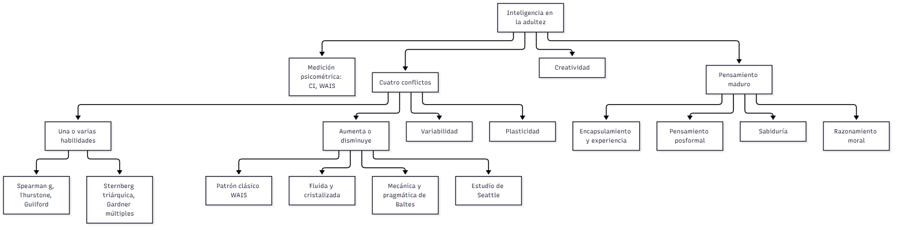

# C18 — Inteligencia · Ficha de repaso

> **Idea-fuerza:** La inteligencia adulta **no declina en bloque**: es multidimensional y multidireccional. Declinan antes las capacidades «fluidas» (mecánica) y se mantienen o mejoran las «cristalizadas» (pragmática), con enorme variabilidad individual, efectos de cohorte y plasticidad. El CI mide solo una parte: se la complementa con **creatividad, pensamiento maduro (posformal), sabiduría y razonamiento moral**, que se nutren de la experiencia (Papalia et al., 2009b, pp. 193, 217-218, 230-232, 265).

## Esqueletos de respuesta

**P1. Cambio de la inteligencia con la edad.** 1) Tesis: multidimensional y variable. 2) Fluida vs. cristalizada (Horn y Cattell) (pp. 209-210). 3) Mecánica vs. pragmática (Baltes); optimización selectiva con compensación (pp. 211-213). 4) Seattle (Schaie): estable hasta los 50-60, pérdidas tardías y selectivas (pp. 212-214). 5) Variabilidad individual y plasticidad (pp. 214, 217).

**P2. Sternberg y Gardner.** Coinciden en ser multidimensionales y criticar el CI (p. 203). Sternberg: tres aspectos de procesamiento (componencial, experiencial, contextual) (pp. 203-206). Gardner: ocho inteligencias autónomas (p. 206). Diferencia: procesos vs. dominios de talento; la cátedra advierte que la evidencia de Gardner es contradictoria.

**P3. Plasticidad.** Horn y Cattell subrayan el declive fluido; Schaie y Baltes, la plasticidad (p. 216). ADEPT: los grupos entrenados no declinaron en siete años (p. 217). Seattle: ~4 de cada 10 recuperaron el nivel de 14 años antes (p. 217).

**P4. Creatividad.** Rendimiento (qué y cuánto se produce), producto de fuerzas biológicas, personales, sociales y culturales; se mide con pruebas de pensamiento divergente, estudios biográficos y laboratorio; pico a fines de los 30, según el campo; la calidad no se relaciona con la edad (pp. 220-227).

**P5. Pensamiento posformal.** Va más allá de las operaciones formales: relativista, tolera contradicciones e integra lógica y experiencia (p. 238); niveles de Labouvie-Vief: intrasistémico, intersistémico, integrado (p. 240); expertise y encapsulamiento (p. 233).

**P6. Sabiduría.** Enfoques: Erikson (integridad), Clayton y Meacham (reconciliar paradojas), Baltes (conocimiento experto en la pragmática de la vida, cinco criterios), Labouvie-Vief (logos + mythos); no es exclusiva de la vejez (pp. 250-254).

**P7. Razonamiento moral.** Kohlberg: tres niveles, siete etapas; se evalúa el razonamiento, no la respuesta (pp. 255-258). Gibbs: fases convencional y existencial. Gilligan: moralidad del cuidado; la evidencia no sostiene diferencias de género (p. 264).

## No confundir

| X | Y | Criterio |
|---|---|---|
| Inteligencia fluida | Cristalizada | Información novedosa, biológica, declina / conocimiento adquirido, cultural, se mantiene (pp. 209-210) |
| Sternberg | Gardner | Tres aspectos / ocho inteligencias (pp. 203-206) |
| Convergente | Divergente | Una respuesta correcta (CI) / amplia gama de posibilidades (creatividad) (p. 220) |
| Formal | Posformal / reflexivo | Lógico y absoluto / relativista e integrador / examen cuidadoso de creencias (pp. 237-239) |
| Inteligencia | Sabiduría | Saber cómo hacer / preguntar si debe hacerse (Clayton) (p. 251) |
| Nivel de razonamiento | Respuesta al dilema | Cómo se justifica / qué se decide (p. 255) |
| Sin sesgo cultural | Culturalmente justa | Sin contenido cultural / solo experiencias comunes: virtualmente imposible (p. 199) |

## Datos que conviene saber

- CI: Binet-Simon (1905), Stern (1911, EM/EC), Wechsler (1939, CI de desviación, media 100) (Papalia et al., 2009b, p. 196).
- Cuatro conflictos: una o varias habilidades; crece o declina; varía; es modificable (p. 202).
- Un tercio de los mayores de 70 supera al adulto joven promedio (p. 214).

## Referencias

Papalia, D. E., Sterns, H. L., Feldman, R. D., & Camp, C. J. (2009b). *Desarrollo del adulto y vejez*. McGraw Hill Interamericana.

## Autoevaluación rápida

1. ¿Qué mide el enfoque psicométrico y cuáles son sus límites?
2. Diferenciá fluida/cristalizada y mecánica/pragmática.
3. ¿Qué mostraron ADEPT y Seattle sobre la plasticidad?
4. Diferenciá Sternberg y Gardner.
5. ¿Qué es el pensamiento posformal?
6. Enfoques de sabiduría: Erikson, Clayton, Baltes, Labouvie-Vief.
7. Niveles de Kohlberg y la crítica de Gilligan.
