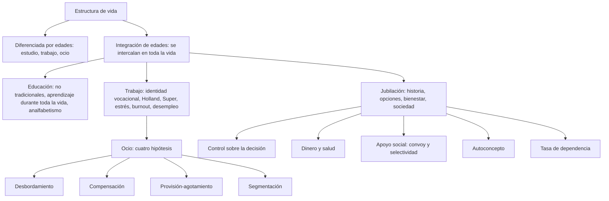

# C19 — Educación, trabajo, ocio y jubilación en la adultez

> **Fuentes:**
>
> - Cátedra de Psicología Evolutiva. (2026d). *Educación, trabajo, ocio y jubilación* [Diapositivas de clase, unidad 9]. Universidad Favaloro.
> - Cátedra de Psicología Evolutiva. (2026e). *Jubilación y ocio* [Diapositivas de clase, unidad 10]. Universidad Favaloro.
> - Cátedra de Psicología Evolutiva. (2026f). *Estudio, trabajo y ocio* [Diapositivas de clase, unidad 9; versión anterior]. Universidad Favaloro.
> - Papalia, D. E., Sterns, H. L., Feldman, R. D., & Camp, C. J. (2009b). Educación, trabajo, ocio y jubilación. En *Desarrollo del adulto y vejez* (cap. 8, pp. 269-310). McGraw Hill Interamericana. [Bibliografía obligatoria de la unidad 10]
>
> **Materia:** Psicología Evolutiva, 2.º año, Universidad Favaloro (docente a cargo: Dra. Verónica A. Ramírez). Unidad 10, clase 19 (cronograma: 29/09/2026). Examen: 4.º parcial, 03/11/2026.

> **Aviso sobre las fuentes:** (1) Las páginas citadas son las **impresas** del libro (269-310). (2) Tus apuntes de esta clase están vacíos («ni idea, no anoté nada»), así que la guía se arma con el capítulo 8 y con las tres presentaciones. (3) Las tres presentaciones se superponen: «Educación, trabajo, ocio y jubilación» (2026d) es la versión actual de «Estudio, trabajo y ocio» (2026f), que conserva una diapositiva con datos de ANSES que la nueva no tiene; «Jubilación y ocio» (2026e) la armó otra persona (aparece un mail de contacto) y agrega legislación argentina. (4) Las diapositivas citan datos **argentinos** (INDEC, ANSES, CONEAU, haber mínimo) que no están en Papalia y **cambian con el tiempo**: van marcados con **▸ Complemento** y contrastalos con tu cuaderno. (5) Varias diapositivas son tablas e imágenes de INDEC y de la ley universitaria argentina que la extracción no recuperó (sin texto). (6) El libro es de 2009 y usa cifras de Estados Unidos de los años 2000-2004: sirven para entender las ideas, no como datos actuales.

> **Idea-fuerza:** En las sociedades industrializadas la vida se divide por edades (estudiar de joven, trabajar de adulto, jubilarse de viejo), pero esa estructura ya no encaja con una vida más larga: lo que se perfila es una **integración de edades**, con educación, trabajo y ocio repartidos a lo largo de toda la adultez. Dentro de ese marco, el trabajo es central para la identidad, la educación se prolonga toda la vida y la jubilación pasó de ser un evento a ser un **proceso** de autogestión, cuyo bienestar depende del control sobre la decisión, el dinero, la salud, el apoyo social y el autoconcepto (Papalia et al., 2009b, pp. 271-272, 293, 305-310).

## Hilo conductor: cómo se conectan los temas de esta guía

El capítulo empieza con Jimmy Carter: un presidente impopular que, tras dejar el cargo, se volvió uno de los ex presidentes más activos (enseña, construye casas, fundó el Carter Center, ganó el Nobel de la Paz a los 78 años). Su caso plantea la pregunta de fondo de la clase: **¿cómo se distribuyen las actividades de estudio, trabajo y ocio a lo largo de la vida?** (la pregunta que abre las diapositivas, Cátedra de Psicología Evolutiva, 2026d, diapositiva 3).

La respuesta tiene un punto de partida (sección 1): la estructura **diferenciada por edades** de las sociedades industrializadas y su alternativa, la **integración de edades** (Riley, 1994). Esa idea ordena los tres grandes bloques. Primero, la **educación** (sección 2): cada vez hay más estudiantes «no tradicionales», el aprendizaje durante toda la vida se expande, los adultos vuelven a estudiar por razones laborales, tecnológicas, de envejecimiento y de ocio, y el analfabetismo adulto sigue siendo un problema. Segundo, el **trabajo y el ocio** (secciones 3 y 4): cómo se elige una vocación (Parsons, Holland, Super), cómo cambian los patrones ocupacionales, qué pasa con el género, las minorías y la edad, qué estresa (estrés, burnout, desempleo) y cómo se relacionan trabajo y ocio (cuatro hipótesis). Tercero, la **jubilación** (sección 5): su historia, las opciones actuales, por qué y cuándo se jubila la gente, cómo se financia, cómo usan su tiempo los jubilados y cómo les afecta (bienestar, salud, apoyo social, autoconcepto), y qué implica para la sociedad (tasa de dependencia). El cierre vuelve al comienzo: si todos equilibráramos estudio, trabajo y ocio en cada edad, los jóvenes sentirían menos presión, los adultos medios menos agobio y los mayores estarían más estimulados y serían más útiles (Papalia et al., 2009b, p. 308).

> 🎯 **Para el parcial:** en cualquier pregunta de esta clase, partí de la **tensión estructura por edades vs. integración de edades** y bajá a un ejemplo (estudiantes no tradicionales, trabajo después de los 65, voluntariado). Los conceptos que más se pueden preguntar son: integración de edades, aprendizaje durante toda la vida, Holland y Super, estrés/burnout/desempleo, las cuatro hipótesis trabajo-ocio, convoy y selectividad, y control sobre la decisión de jubilarse.

**En una sola oración:** estudiar, trabajar y descansar dejaron de ser «etapas» para volverse actividades que se reparten a lo largo de la vida adulta, y el modo en que cada persona transita el trabajo y la jubilación (con control, recursos y apoyo) define su bienestar.

## 0. Hoja de ruta

1. **Estructura de vida: diferenciada vs. integrada por edades** (Papalia et al., 2009b, pp. 270-272).
2. **Educación** (pp. 272-278): universidad, aprendizaje durante toda la vida, analfabetismo.
3. **Trabajo** (pp. 278-291): vocación y carrera, patrones ocupacionales, género y minorías, edad y desempeño, estrés, burnout, desempleo.
4. **Trabajo, ocio y desarrollo intelectual** (pp. 291-292).
5. **Jubilación y otras opciones para la vejez** (pp. 292-310).
6. **Complemento argentino** (diapositivas de la cátedra).
7. **Para rendir**.

## 🎯 Lo que entra sí o sí

1. **Estructura diferenciada vs. integración de edades** (Riley, 1994) (Papalia et al., 2009b, pp. 271-272; Cátedra de Psicología Evolutiva, 2026d, diapositiva 5).
2. **Aprendizaje durante toda la vida** y las **cinco metas de los adultos que estudian** (Willis, 1985) (pp. 274-275; 2026d, diapositiva 11).
3. **Analfabetismo**: primario, secundario, funcional y tecnológico (2026d, diapositiva 14) y el analfabetismo adulto global (p. 278).
4. **Identidad vocacional**, teorías de **Parsons, Holland y Super** y sus críticas (pp. 279-282).
5. **Edad y desempeño laboral** y discriminación por edad (ADEA) (pp. 285-288).
6. **Estrés laboral, burnout y desempleo** (pp. 288-291; 2026d, diapositivas 20-22).
7. **Cuatro hipótesis de la relación trabajo-ocio**: desbordamiento, compensación, provisión-agotamiento de recursos, segmentación (p. 292; 2026d, diapositiva 25; 2026e, diapositiva 4).
8. **Historia y causas de la jubilación**; autogestión; razones para jubilarse (pp. 292-297).
9. **Uso del tiempo de los jubilados**: trabajo pagado, voluntariado, ocio (ocio serio) (pp. 300-303).
10. **Bienestar en la jubilación**: control sobre la decisión, salud, **teoría del convoy** y **teoría de la selectividad socioemocional**, autoconcepto (pp. 303-306).
11. **Tasa de dependencia** y «envejecimiento productivo» (pp. 307-308).

---

## 1. La estructura de vida: diferenciada vs. integrada por edades

### 1.1 Respuesta modelo (para escribir en el parcial)

> **Esqueleto de la respuesta:**
> 1. **Tesis:** la estructura tradicional de roles diferenciados por edades ya no se ajusta a una vida más larga; se avanza hacia la integración de edades.
> 2. **Diferenciada:** educación (jóvenes), trabajo (adultos), ocio/jubilación (ancianos) (Papalia et al., 2009b, p. 271).
> 3. **Críticas (Riley, 1994):** casi un tercio de la vida adulta en el retiro; 55 años «muy viejo»; desaprovecha capacidades (p. 271).
> 4. **Integrada:** educación, trabajo y ocio intercalados a lo largo de la vida (p. 272).
> 5. **Ejemplo:** universitarios que trabajan, varias carreras, jubilados que estudian.
> 6. **Cierre:** muchas investigaciones reflejan el modelo viejo; las cohortes futuras serán distintas.

En las sociedades industrializadas los roles se diferencian por edades: los jóvenes estudian, los adultos trabajan y los ancianos se jubilan y descansan. Riley (1994) cuestiona esa estructura: no tiene sentido pasar casi un tercio de la vida adulta en el retiro, acumular trabajo en la adultez media ni llamar «muy viejas» a personas de 55 años que quieren trabajar. En una sociedad de integración de edades, el aprendizaje, el trabajo y el juego estarían disponibles para adultos de todas las edades y se intercalarían a lo largo del ciclo de vida: universitarios que trabajan o que pausan sus estudios, varias carreras sucesivas, jubilados que vuelven a estudiar (Papalia et al., 2009b, pp. 271-272).

> ⚠ **No confundir:** *diferenciada por edades* (cada edad, un rol: «atraso estructural») con *integración de edades* (todas las actividades disponibles en todas las edades). Y no es lo mismo «jubilación» (fin del trabajo formal) que «ocio» (uso discrecional del tiempo).

### 1.2 Desarrollo ampliado

**Punto de partida: Jimmy Carter** (pp. 269-270). James Earl «Jimmy» Carter Jr., uno de los presidentes más impopulares del siglo xx, tras dejar el cargo se convirtió en uno de los ex presidentes más activos y admirados. Sus padres le transmitieron valores tradicionales (educación, trabajo duro, fe religiosa, servicio público); eligió la marina por influencia de un tío, estudió en la Naval Academy y fue oficial de máquinas del primer submarino nuclear bajo las órdenes del capitán Hyman G. Rickover («esperaba lo máximo de nosotros, pero siempre aportó más»). Tras la muerte de su padre renunció a la marina y regresó a administrar la granja y el almacén de cacahuates de la familia; fue senador de Georgia (1962) y gobernador (1970) (reestructuró el gobierno estatal, promovió la equidad en el apoyo a los distritos escolares, centros comunitarios para niños con discapacidad intelectual, protección ambiental, selección meritoria de jueces). En 1976 ganó la presidencia en medio del escándalo Watergate (el «extraño» que «limpiaría» el gobierno): logros como la paz entre Israel y Egipto y el tratado del canal de Panamá, pero se empantanó en la crisis de los rehenes iraníes y en el aumento del precio del combustible, y perdió ante Reagan en 1980. Después: profesor en Emory University, diácono y profesor de escuela dominical, construye casas con **Habitat for Humanity**, fundó el **Carter Center** (derechos humanos, educación, salud preventiva, técnicas agrícolas, resolución de conflictos), supervisó elecciones (Nicaragua, Indonesia, Nigeria, Mozambique…), negoció un cese al fuego entre musulmanes bosnios y serbios, y recibió el premio Nobel de la Paz en 2002 (a los 78). Escribió más de 15 libros, entre ellos *The Virtues of Aging* («tenemos un grado de libertad sin precedente para elegir lo que queremos hacer; la oportunidad de sanar heridas y de fortalecer lazos»). Carter «usó su presidencia como un trampolín para conseguir cosas más grandes» (Bird, 1990, citado en p. 270).

**Estructura diferenciada por edades** (pp. 271-272). Pocos adultos tienen los recursos de un ex presidente, pero hay muchos mayores cuyo activismo en la edad tardía los conduce a pensar cómo se estructura la vida. La estructura típica de las sociedades industrializadas se **diferencia por edades**: los roles se basan en la edad (figura 8.1a): **educación** para los jóvenes, **trabajo** para adultos jóvenes y medios, **ocio/jubilación** para la vejez. Matilda **Riley** (1994, National Institute on Aging) la critica: «¿tiene sentido gastar casi un tercio de la vida adulta en el retiro? ¿O acumular más trabajo en los ocupados años de la adultez media? ¿O etiquetar como "muy viejo" a personas tan jóvenes como de 55 años que quieren trabajar? ¿Tiene sentido suponer que los ancianos físicamente capaces, un estimado de 40 millones en el próximo siglo, deben esperar mayor apoyo de la sociedad que de lo que aportan?» (p. 445, citado en Papalia et al., 2009b, p. 271).

Los papeles diferenciados por edades son **vestigio de una época antigua** (vida más corta, instituciones menos diversas). El resultado: la vida es más larga, pero las oportunidades para emplear y recompensar las habilidades de los mayores son inadecuadas; y al dedicarse a un solo aspecto de la vida por vez, las personas **no disfrutan cada período tanto como podrían ni se preparan para el siguiente** (quien se concentra en el trabajo puede olvidar cómo jugar y, al retirarse, no saber qué hacer con el tiempo de ocio). En una sociedad de **integración de edades** (figura 8.1b) aprendizaje, trabajo y juego estarían disponibles para adultos de todas las edades (Bolles, 1979; Riley, 1994): podrían intercalarse períodos de educación, trabajo y ocio. Las cosas parecen modificarse en esa dirección: estudiantes con programas de trabajo-estudio o un año sabático, personas en la adultez media con varias carreras sucesivas (cada una con nueva educación), ancianos que regresan a la escuela, jubilados que estudian o desarrollan una nueva forma de trabajo; las personas pueden retirarse antes o después que en el pasado, o no hacerlo (p. 272). **Advertencia:** muchas investigaciones reflejan el modelo viejo; las cohortes futuras pueden tener experiencias y actitudes muy distintas (p. 272).

(La cátedra lo resume: la estructura diferenciada = «atraso estructural, oportunidades de empleo inadecuadas para ancianos, no se disfruta cada período ni hay preparación para el siguiente»; la integrada = «el mundo se mueve hacia esta integración»; Cátedra de Psicología Evolutiva, 2026d, diapositivas 4-5.)

> 🔑 **Punto clave:** la diferenciación por edades es una construcción social heredada de una época con vida más corta; la longevidad la deja obsoleta.

---

## 2. Educación en la adultez

### 2.1 Respuesta modelo (para escribir en el parcial)

> **Esqueleto de la respuesta:**
> 1. **Tesis:** la educación deja de ser exclusiva de la juventud: crece el aprendizaje durante toda la vida.
> 2. **Estudiantes no tradicionales:** más mujeres, adultos que trabajan y tienen hijos (Papalia et al., 2009b, p. 273).
> 3. **Por qué estudian los adultos (Willis, 1985):** 5 metas (pp. 275-276).
> 4. **Programas:** universidades para ancianos en China, Elderhostel, kouminkans en Japón (p. 274).
> 5. **Analfabetismo adulto:** problema mundial; círculo vicioso (p. 278).
> 6. **Ejemplo/cierre:** capacitación computacional para ancianos (recuadro 8.1).

Cada vez más adultos estudian: las universidades reciben estudiantes «no tradicionales» (de 24 años o más, que trabajan, tienen dependientes, en su mayoría mujeres) y crece el aprendizaje durante toda la vida: universidades para ancianos en China, Elderhostel en más de 90 países, centros comunitarios en Japón. Willis (1985) identifica cinco metas: adaptarse y actualizarse en el trabajo, capacitarse para nuevas ocupaciones, afrontar el cambio tecnológico y cultural, comprender el propio envejecimiento y desarrollar nuevos roles de retiro y ocio. El analfabetismo adulto sigue siendo un problema mundial, que crea un círculo vicioso de oportunidades reducidas (Papalia et al., 2009b, pp. 272-278).

> ⚠ **No confundir:** *estudiante tradicional* (se inscribe tiempo completo tras el bachillerato, trabaja poco y depende de los padres: 27 % hoy) con *no tradicional* (24+ años, trabaja, tiene dependientes) (p. 273). Y las **cuatro formas de analfabetismo** de la cátedra (primario, secundario, funcional, tecnológico) no son las del libro, que habla de analfabetismo adulto y funcional (pp. 278; 2026d, diapositiva 14).

### 2.2 Desarrollo ampliado

**Universidad y estudios superiores** (pp. 272-274). Goya, a los 80 años, escribió «Aún aprendo» en un dibujo de un anciano con muletas. El rostro de la educación superior en EE. UU. cambia: más personas obtienen títulos, sobre todo **mujeres**. De los adultos de 25 a 29 años en 2003, **28 %** completó el bachillerato universitario (uno por ciento menos que el récord de 2002); las mujeres superaron a los varones (**32 % vs. 27 %**); alrededor de **58 %** de todos los títulos del ciclo 2001-2002 fueron para mujeres, aunque los varones todavía obtienen más doctorados (53 %) y grados profesionales (52 %). La inscripción a licenciatura alcanzó **14,3 millones** en 2002, casi el doble que en 1970; mientras tanto los **estudiantes «tradicionales»** (tiempo completo tras el bachillerato, trabajan medio tiempo o nada, dependen de sus padres) son solo **27 %**. Del total: 44 % en escuelas de dos años; 39 % a tiempo parcial. Los **no tradicionales** (24 años o más: **43 %**; mujeres: **56 %**; con dependientes: **27 %**; padres solteros: **13 %**; con empleo: **80 %**, de los cuales **39 %** de tiempo completo): mujeres casadas o divorciadas que necesitan más ingresos, mujeres cuyos hijos se fueron, mujeres que buscan independencia. Muchas universidades les facilitan faltar o ganar créditos por experiencia laboral o estudio independiente y buscan activamente a estudiantes maduros que abandonaron; se adaptan con tiempo parcial, clases sabatinas y nocturnas, guarderías en los campus, apoyo financiero, cursos gratuitos o reducidos y educación a distancia. Los adultos que regresan están enormemente motivados y aportan su individualidad y experiencia de vida.
**Minorías:** el número de estudiantes de minorías casi se duplicó desde 1980 (25 % de la inscripción en licenciatura en instituciones de cuatro años y 36 % en las públicas de dos años en 2002). Afroamericanos con cuatro o más años de educación superior: +**6,3 %** (1990-2004) vs. 4,8 % en los veinte años previos; blancos: +10,3 % (1970-1990), +6,2 % (1990-2004). En 2004 (25+ años): blancos 26,4 % (mujeres) y 30 % (varones); afroamericanos 18,5 % y 16,6 %; hispanos 12,3 % y 11,8 %. La educación es una llave para obtener empleo: menor nivel educativo → más desempleo. **Ganancias vitalicias** (promedios de 1999): ~medio millón de dólares para graduados de secundaria y **un millón** para poseedores de un título universitario; los hombres ganan más que las mujeres en cada nivel; los varones con grados profesionales ganarán ~**2 millones más** que las mujeres equivalentes (p. 273-274).

**Aprendizaje durante toda la vida** (pp. 274-278). **Qian Likun**, de 102 años, camina a sus clases de atención a la salud y poesía china antigua, en la red china de «**universidades para ancianos**» (más de **800** desde los 80). El **aprendizaje durante toda la vida** es el estudio sostenido y organizado para adultos de todas las edades. **Elderhostel**: red internacional de unas 1 600 instituciones educativas y culturales en más de 90 países, ~10 000 programas de bajo costo sin créditos para mayores de **55**; la satisfacción con la experiencia de aprendizaje **no tiene relación con la edad** (Abraham, 1998). **Japón:** desde **1949** la ley de aprendizaje durante toda la vida fomenta oficialmente el aprendizaje (**kouminkans**, centros educativos comunitarios adultos, con subsidios; las empresas pagan cursos e incentivos); pero los estudiantes «maduros» (22+) son menos del 1 % de los graduados y 10 % de los posgraduados. En EE. UU. los ancianos tienen mayor nivel educativo que sus predecesores, y 90 % de la fuerza laboral civil tiene bachillerato. Sin contar a los universitarios de edad tradicional (16-24), la participación en programas de **educación adulta** subió de **34 %** (1991) a **47 %** (2001); más de la mitad usa tecnología; las tasas más altas: mujeres, blancas, de las islas de Asia y del Pacífico, y con mayor nivel educativo. Tres de cada cuatro participantes a tiempo parcial tienen 25-34 años. Los **cursos relacionados con el trabajo** son los más comunes (30 %), seguidos por cursos de **interés personal** (21 %); gran parte los paga el empleador; más de 40 % de la fuerza laboral y más de 50 % de los graduados de bachillerato carecen de habilidades básicas para sus empleos (encuesta a más de 40 empleadores); los empleadores observan mejor ánimo, calidad, trabajo en equipo y resolución de problemas (Conference Board, 1999) (pp. 274-275).

**¿Por qué los adultos maduros van a la escuela?** Cinco metas (**Willis, 1985**) (p. 275; Cátedra de Psicología Evolutiva, 2026d, diapositiva 11):
1. Adquirir **conocimientos y habilidades** para adaptarse y mantenerse al día en el trabajo, obtener un ascenso o abrir un negocio propio (casi dos tercios de los adultos de tiempo parcial lo hacen por razones laborales).
2. **Capacitarse para nuevas ocupaciones** cuando las antiguas quedan obsoletas o cambian los intereses (p. ej., mujeres que dedicaron su adultez joven a la maternidad y reingresan al mercado).
3. **Comprender y enfrentar cambios tecnológicos y culturales** (computadoras: quieren comunicarse con hijos y nietos, correo electrónico, Internet).
4. **Comprender el propio envejecimiento** (memoria y cognición) y aprender estrategias para compensarlo.
5. **Desarrollar nuevos papeles de retiro y ocio** (explorar intereses no atendidos; aprender un idioma para viajar).

**Recuadro 8.1: capacitación computacional** (pp. 276-277). En una universidad de Nueva Orleans, los cursos gratuitos de computación para mayores de 65 son los más populares (lista de espera larga). Al principio los mayores tenían actitudes menos positivas hacia las computadoras («deshumanizadoras»); una encuesta de 1981: el uso bajaba de **40 %** (45-54 años) a **19 %** (65+) y se relacionaba con el nivel socioeconómico y educativo. Hoy ~**70 %** de los de 25 a 50 años usa computadoras; entre los **70+**, el uso subió de ~5 % (1991) a >25 % (2001) (parte efecto de cohorte). Los mayores **pueden capacitarse** (el desempeño mejora con tiempo y experiencia) pero tardan más; las ansiedades previas no afectaron el desempeño final en Ontario (Charness et al., 1992). No se necesitan técnicas especiales: los métodos efectivos con jóvenes valen para mayores (computadora + tutorial; instructor + manual; ritmo propio). **Seis sugerencias:** instrucción más lenta o a su propio ritmo; entrenamiento práctico en parejas o grupos pequeños; instructor disponible; más ayuda ante problemas novedosos; monitorear el progreso para anticipar problemas de confianza; interfaz de menús en vez de comandos. Las experiencias de aprendizaje que atraen a los mayores: temas personalmente significativos, aprendizaje directo, control sobre el proceso, bajo costo; quieren aprender lo que enriquece sus vidas, los mantiene saludables y les da regocijo (AARP, 2000). Hay creciente necesidad de programas para **viudas** (vida independiente, finanzas, nuevas relaciones). «Parece claro que, en la compleja sociedad de hoy, la educación nunca termina»: se necesitará **reentrenamiento** y varias carreras (pp. 276-277).

**Analfabetismo adulto** (p. 278). Ed, un impresor de seda de 29 años, es hábil y agradable, pero no lee más allá del cuarto o quinto grado y ha perdido empleos por ello. Casi la mitad de los adultos estadounidenses no comprende materiales escritos, manipula números y usa documentos lo bastante bien para triunfar en la economía actual (Sum et al., 2002); en 2003 rindieron peor que Bermudas, Noruega y Suiza (mejor que Italia). Los analfabetos son de todos los niveles educativos; pesan la calidad de la educación y el estatus socioeconómico. **Casi 800 millones** de adultos eran analfabetos en 2002 (UNESCO, 2004), sobre todo mujeres en países en desarrollo; en muchos, más de la mitad de la población joven y adulta lo es, con **dos tercios mujeres**. Crea su **círculo vicioso**: reduce oportunidades, estigmatiza, y obstaculiza la capacitación; la expansión de programas de alfabetización es apremiante.

▸ **Complemento (diapositivas, Argentina):** la cátedra pregunta «¿sigue aplicando la misma definición de analfabetismo en 2026?» y distingue cuatro tipos (según INDEC y UNVIME): **primario** (nunca se aprendió a leer y escribir); **secundario** (se aprendió pero se olvidó porque el aprendizaje fue superficial); **funcional** (se leen y escriben frases sencillas, pero no se domina la lectoescritura ni la matemática básica); **tecnológico** (se desconoce el uso de las herramientas tecnológicas) (Cátedra de Psicología Evolutiva, 2026d, diapositiva 14). También: datos del sistema universitario argentino (síntesis estadística de la Secretaría de Educación; imágenes sin texto), las **recomendaciones de CONEAU** para la permanencia universitaria (sostener programas de acompañamiento y mejorar la duración real de las carreras; políticas de contención y bienestar; diagnosticar fallas en el ingreso, avance y egreso; flexibilizar los currículos, en especial en el último nivel, para alumnos que trabajan; fortalecer los equipos de retención) y la **inclusión digital** (Centro de Formación Digital del Gobierno de la Ciudad: charlas, capacitaciones itinerantes y virtuales, inclusión financiera y emprendedurismo digital) (2026d, diapositivas 9 y 13). Preguntas de la clase: «¿por qué el gobierno de Japón financia esto?» y «¿qué cambios deberían realizarse en la educación superior para promover el aprendizaje durante toda la vida?» (diapositivas 10 y 12).

> 🔑 **Punto clave:** la educación es la «llave» del empleo y, en la adultez, responde a motivos prácticos (trabajo, tecnología) y personales (envejecer bien, ocio).

---

## 3. Trabajo en la adultez

### 3.1 Respuesta modelo (para escribir en el parcial)

> **Esqueleto de la respuesta:**
> 1. **Tesis:** el trabajo es central para la identidad adulta y se entrelaza con todas las áreas del desarrollo.
> 2. **Términos:** empleo, ocupación, vocación, profesión, carrera (Papalia et al., 2009b, p. 279).
> 3. **Teorías de elección de carrera:** Parsons (rasgos y habilidades), Holland (6 tipos de personalidad), Super (8 etapas ligadas al autoconcepto) (pp. 279-282).
> 4. **Críticas:** ignoran contexto, cultura, género; las carreras no son tan ordenadas (pp. 280-282).
> 5. **Cambios actuales:** más puestos profesionales y de servicio; reestructuración (pp. 282-283).
> 6. **Cierre:** la identidad vocacional y la adaptabilidad (aprender a aprender) importan más.

El trabajo define quiénes somos («¿a qué te dedicás?») y se entrelaza con lo intelectual, físico, social y emocional. Parsons relacionó rasgos y habilidades con carreras; Holland propuso seis tipos de personalidad (realista, investigadora, artística, social, emprendedora y convencional) que se ajustan a ambientes laborales; Super describió ocho etapas del desarrollo de carrera ligadas al autoconcepto (cristalización… retiro). Las tres se critican por ignorar el contexto, la cultura y el género, y porque las carreras actuales (varias en una vida) no siguen un orden previsible (Papalia et al., 2009b, pp. 278-282).

> ⚠ **No confundir:** *empleo* (actividad pagada, puede ser temporal) con *ocupación* (campo de trabajo regular y permanente), *vocación* (campo elegido), *profesión* (requiere formación universitaria y juicio independiente) y *carrera* (ruta dinámica de logro) (p. 279). Y *identidad vocacional* (claridad y estabilidad de metas, intereses, personalidad y talentos) no es lo mismo que el *tipo de personalidad* de Holland (pp. 281; 2026d, diapositiva 16).

### 3.2 Desarrollo ampliado

**Definiciones** (p. 278-279). La primera pregunta entre adultos suele ser «¿a qué te dedicás?» (la cátedra agrega: «mi empleo me dio estructura de vida; alrededor de éste giró todo lo demás»; 2026d, diapositiva 16). **Empleo:** actividad por una paga, por lo general siendo empleado de alguien y no manejando un negocio propio; puede ser temporal. **Ocupación:** campo de trabajo o medio de sustento regular y relativamente permanente. **Vocación:** campo elegido. **Profesión:** ocupación o vocación que requiere formación universitaria o de posgrado e implica mucho juicio y control independiente. **Carrera:** tiene calidad dinámica, es una ruta de logro de desarrollo que, si sigue su curso, puede ser la obra de una vida. **Ocio:** uso discrecional del tiempo, tiempo libre (ver sección 4); la línea con el trabajo no siempre es fácil de dibujar (la fotografía puede ser trabajo para uno y pasatiempo para otro); solo en las sociedades modernas desarrolladas el ocio es un aspecto significativo de la vida adulta y no es sino hasta después del retiro que es central; EE. UU. adoptó en los años treinta la semana de 5 días de 8 horas (p. 279).

**Elección vocacional y desarrollo de carrera** (pp. 279-282).
- **Parsons** (1909): método para relacionar individuos con carreras adecuadas según **rasgos de personalidad y habilidades**; valoración de logros pasados, habilidades y destrezas actuales y **aptitudes** (potencial). El **Inventario de Intereses Strong** relaciona intereses con éxito ocupacional (compara con los de personas exitosas y felices en cada ocupación) (pp. 279-280).
- **Holland** (1985): seis tipos de personalidad y sus ambientes: **investigadora** (científicos, detectives), **social** (salud mental, enseñanza), **realista** (mecánicos, electricistas), **artística** (escritores, artistas, músicos), **convencional** (contabilidad, banca) y **emprendedora** (negocios, administración). Las mujeres tienden a rasgos artísticos, sociales y convencionales. La **satisfacción laboral** es mayor, y la permanencia más probable, cuando la personalidad coincide con el ambiente. **Limitaciones:** una persona o ambiente no se describe con un solo rasgo «puro»; algunos empleos requieren mezcla de rasgos; no trata con las **fuerzas ambientales o culturales** (quien vive en zona de minas de carbón es más probable que sea minero; las diferencias socioeconómicas y las oportunidades educativas limitan; el **género**: las mujeres con educación superior todavía escogen enfermería y docencia); no explica **cómo** ocurre la elección ni cómo se desarrolla la carrera (el ambiente laboral cambia a la persona: el electricista que descubre su veta artística en un teatro); las **expectativas** pesan más que el ajuste personalidad-empleo. Holland (1996) modificó su teoría para incluir efectos interactivos individuo-ambiente y el papel de la **identidad vocacional** («nivel de claridad y estabilidad de las metas, intereses, personalidad y talentos, y cómo influyen en la toma de decisiones en un ambiente ambiguo»; Carson y Mowsesian, 1993) (pp. 280-281). (La cátedra: los inventarios de personalidad usados en orientación vocacional «no consideran las influencias ambientales o culturales»; otros factores: empleos disponibles, ambiente físico, diferencias socioeconómicas, oportunidades educativas y género; Cátedra de Psicología Evolutiva, 2026d, diapositiva 17.)
- **Super** (1957, 1985): teoría organicista de **ocho etapas** desde la pubertad, que evolucionan con la maduración del **autoconcepto** (Papalia et al., 2009b, pp. 281-282): 1) **cristalización** (adolescencia temprana: ideas generales; confusión de identidad de Erikson); 2) **especificación** (adolescencia tardía-universidad: aprenden de las ocupaciones y reconocen que elegir implica renunciar); 3) **implementación** (principios de los 20: primeros empleos, entrenamiento; la elección puede modificarse); 4) **establecimiento** (mediados de los 20: compromiso con una carrera; el trabajo es parte del autoconcepto); 5) **consolidación** (mediados de los 30: ascender tan rápido como sea posible); 6) **mantenimiento** (mediados de los 40: mantener prestigio, autoridad y responsabilidad); 7) **desaceleración** (fines de los 50: reducen la carga y se distancian del trabajo; quienes tienen un autoconcepto muy ligado al trabajo sufren); 8) **retiro** (tradicionalmente a los 65: separación formal y ajuste). **Críticas:** supone decisiones basadas en una comprensión racional del yo y del mundo laboral; las carreras suelen resultar de **suerte o factores emocionales**; no considera restricciones a la libertad de decidir (Neff, 1985); se desarrolló cuando menos mujeres trabajaban y una decisión a los 20 definía la vida laboral de un hombre; hoy muchos inician una segunda, tercera o más carreras, y el retiro a los 65 ya no es tan típico: **un conjunto universal de etapas no parece explicar adecuadamente** el desarrollo de carrera (p. 282). (Vaillant y Levinson, cap. 11, describen etapas similares.)

**Cambio en los patrones ocupacionales** (pp. 282-283). Por primera vez hay más personas en empleos **ejecutivos, profesionales y técnicos** (casi uno de cada tres) que en manufactura o transporte de bienes (uno de cada cinco); los empleos administrativos aumentaron **38 %** de 1980 a 1990 y los especializados en fábricas declinaron; solo 4 % tiene empleos no calificados; hay un agudo descenso de oportunidades y salarios para quienes tienen **menos estudios**. Rasgos del mercado: pérdida de empleos fabriles; desplazamiento al servicio y al trabajo basado en conocimientos; reducción de plazas; jerarquías más horizontales (más responsabilidad a más trabajadores); más productividad; **horarios flexibles** (más de 28 % en 1998). Al reestructurarse las organizaciones, los adultos medios y mayores pueden enfrentar **pérdida de empleo, estancamiento y obsolescencia de habilidades**; los trabajadores ancianos con frecuencia son despedidos por **estereotipos** (inadecuados para reentrenamiento o para ritmos rápidos) y ocupan mandos medios, foco de la reducción. Deben asumir **más responsabilidad en el manejo de su carrera**; cambia la relación empresa-empleado (compromiso mutuo solo mientras se satisfagan expectativas); se enfatizan la **adaptabilidad y «aprender a aprender»** (Hall y Mirvis, 1996).

**Género en el centro de trabajo** (pp. 283-284). Las mujeres fueron el **47 %** de la fuerza laboral total en 2003; el empleo femenino aumenta en todo el mundo (figura 8.2: casi **60 %** de la población femenina estadounidense tenía empleo en 2003). Una vida más larga, el matrimonio y la crianza tardíos, familias más pequeñas, horarios flexibles y dos cónyuges que trabajan facilitan metas ocupacionales; pero en gran parte del mundo las mujeres tienen empleos de oficina, ventas y servicios, sobre todo durante la crianza (UNESCO, 2000). En EE. UU. el género guarda menos relación con la elección vocacional que antes y hay más mujeres en empresas, gobierno y profesiones, pero los puestos más importantes siguen en manos de varones; en 2002, la **mitad** de las posiciones gerenciales y profesionales las tenían mujeres (41 % en 1983); el mayor grupo de mujeres profesionales son las **profesoras** (4,2 millones; 98 % de preescolar, 80 % de primaria, 96 % de asistentes administrativos y secretarias, 90 % de enfermeras registradas, solo 15 % de ingenieros químicos). **Ingresos:** ~**78 %** de los de los varones; graduadas universitarias **809** dólares semanales vs. **1 089** de los varones; los ingresos reales de las mujeres con educación superior subieron 27 % desde 1979 vs. 1 % de los varones (BLS, 2004).
**Minorías** (pp. 284-285): tasas de empleo y salarios de afroamericanos disminuyeron frente a los blancos desde 1940 pese a los avances educativos; **desempleo:** afroamericanos 10,2 %, hispanos 7,6 %, blancos 5,1 % (BLS, 2002); los hombres afroamericanos a tiempo completo ganan 75 % de lo que ganan los blancos y las mujeres afroamericanas, 86 % de lo de las mujeres blancas; ingresos semanales: hispanos 423, afroamericanos 498, blancos 624 dólares; en niveles profesionales: hombres afroamericanos 79 %, mujeres afroamericanas 57 %.

**Edad y desempeño laboral** (pp. 285-288). La discriminación por edad ha crecido; se eliminó el retiro obligatorio para la mayoría de las ocupaciones; ¿**la edad afecta el desempeño**? La imposibilidad de hallar una **relación lineal consistente** entre edad y desempeño sugiere que no existe (Sterns et al., 2001). El **ausentismo** da resultados contradictorios (los jóvenes faltan por razones evitables, los mayores por razones ineludibles: salud más frágil). La **experiencia** predice mejor el desempeño que la edad (Sterns y Gray, 1999); las diferencias dependen de cómo se mide el desempeño y de las demandas del empleo. Estudio de búsqueda de información en base de datos con personas de distintas edades sin experiencia: la diferencia cuantitativa se debió a la **rapidez física**; no hubo diferencia en eficacia de navegación ni en precisión; tras el primer día, las diferencias disminuyeron y los mayores mejoraron más entre el 4.º y 5.º día (Czaja y Sharit et al., 2001): los mayores **aprenden más lento pero las diferencias disminuyen y pueden desaparecer**. En programadores experimentados no hubo diferencias entre grupos de edad (Perry et al., 2003). **Actitudes:** los jóvenes están menos satisfechos con sus trabajos que los mayores (Salthouse y Maurer, 1996); un empleo que requiere reflejos rápidos lo hace mejor un joven; uno que depende del juicio maduro, un mayor; los mayores pueden trabajar más lento pero son más **precisos** (Czaja y Sharit, 1998). Los mayores son confiables, leales y respetuosos de la autoridad (AARP, 1999); aun así los gerentes suponen que tienen menos energía, son menos eficientes y flexibles y es poco probable que se los capacite; en tiempos difíciles son los primeros descartados o presionados a jubilarse; sin embargo en la recesión de 2003 se desempeñaron mejor que los jóvenes (en parte por cambios demográficos). Hay estereotipos de **adultos mayores** (edades más avanzadas, varios contextos) y de **trabajadores mayores** (edades más jóvenes, contexto laboral).

**Recuadro 8.2: discriminación por edad** (pp. 286-287). ¿Deben retirarse a los 65 policías, bomberos y guardias de prisión? La **ADEA** (Ley contra la discriminación por edad en el empleo, 1986) prohibió el retiro obligatorio pero exceptuó a los oficiales de seguridad pública hasta valorar si los mayores podían desempeñarse. Un grupo interdisciplinario presidido por **Frank Landy** revisó casi dos años **más de 5 000 artículos** y recopiló datos de más de **500 ciudades**. Hallazgos: la edad de jubilación obligatoria de esos oficiales variaba de **55 a 72**; solo **30 %** del tiempo de un oficial se emplea en tareas de seguridad pública directa; la condición física y las habilidades mentales **varían más dentro de los grupos de edad que entre ellos**; los oficiales de 60 a 65 años tenían mejor condición que los de 45 a 55 (los menos aptos dejan pronto); el declive fue mínimo, no uniforme y dependió de estilo de vida, nutrición, ejercicio y salud; la probabilidad de una emergencia médica incapacitante es muy pequeña (en un departamento de 500 miembros, una vez cada 25 años) y muchas tareas se hacen en equipo. Recomendación: sustituir la edad obligatoria por **pruebas de habilidad individual**. Conclusión: la idea de que los mayores, como grupo, ponen en peligro la seguridad pública **no tiene fundamentos reales**. Pero los sindicatos atacaron el estudio (temían pruebas periódicas y perder pensiones); la exención expiró a fines de 1993 y el Congreso la reinstaló en 1996; en 2000 la Corte Suprema decidió que los empleados estatales con prejuicio por edad solo se protegen con su estatuto estatal. Landy (1994): «ahora hay un claro reconocimiento del fundamento científico para eliminar este último vestigio de la discriminación por edad». La conclusión general: cada individuo debe evaluarse **por sus méritos, habilidades y motivaciones** y no por estereotipos de su grupo de edad (Sterns y Gray, 1999) (p. 287). **ADEA** (1986): protege a la mayoría de los trabajadores de **40 años y más** (no ser contratados, despedidos, pagados menos o forzados a retirarse por su edad), se aplica a compañías con 20 o más empleados; eliminó prácticas como anunciar «edad: 25 a 35 años»; pero muchos empleadores se resisten, hay quejas crecientes y la EEOC demora casi un año en investigar cada una; **es difícil de probar** (casi 700 casos entre 1970 y mediados de los ochenta: el empleador ganó casi dos tercios de las veces; Snyder y Barrett, 1988) (p. 288).

**Estrés laboral** (pp. 288-290). Los japoneses tienen una palabra: **karoshi**, «muerte por exceso de trabajo»; 40 % de los trabajadores japoneses teme literalmente trabajar hasta morir. Es una «epidemia mundial» (meseras en Suecia, conductores de autobús en Europa, trabajadores de línea en países en desarrollo; OIT, 1993); los costos de lesiones y enfermedades por estrés en EE. UU. alcanzaron **400 mil millones de dólares** al año (NIOSH, 2002). Resulta de la **interacción entre el trabajador individual y el ambiente ocupacional**; condiciones: **sobrecarga de trabajo, demandas conflictivas, ruido y hacinamiento, conflicto y ambigüedad de roles, bajo control en el empleo, conflictos interpersonales, sentido de tiempo o esfuerzo desperdiciado** (Nelson y Burke, 2000); trabajar más duro y por más tiempo, dos empleos; falta de metas claras; conflictos con supervisores y compañeros; **violencia en el centro de trabajo** (miedo, incertidumbre, percepción de injusticia). Consecuencias: enfermedades cardiovasculares, artritis, trastornos musculoesqueléticos, trastornos psicológicos, lesiones; ausentismo, bajas ventas, intención de renunciar. Intervenciones: reconocer contribuciones, abordar los problemas, programas de prevención. Los cambios organizacionales tienen efectos positivos (flexibilidad, aprendizaje) y negativos; **el aumento de responsabilidad es un arma de doble filo**. **Mujeres:** el estrés de equilibrar trabajo y familia es **mayor** que para los hombres (mayor demanda familiar e interferencia; las cargas domésticas recaen principalmente en ellas); programas políticos de integración, **acoso de género**, y el «**techo de cristal**» (Federal Glass Ceiling Commission, 1995) que inhibe el ascenso. Programas para mujeres: formas positivas de afrontar el estrés, entrenamiento en asertividad, talleres para hombres y mujeres sobre trabajo en equipo (pp. 288-290). **Acoso sexual** (p. 290): dos tipos legales: 1) **favores sexuales demandados bajo amenaza de consecuencias en el empleo**; 2) **ambiente hostil** (abuso severo y repetido por género que interfiere con el desempeño). El acosador puede ser hombre o mujer; 15 % de los cargos ante la EEOC (2002) fueron presentados por hombres (9 % en 1992). Para probarlo, el comportamiento debe ser tan «grave e invasivo» que cree un ambiente que «una persona razonable encontraría hostil o abusivo». **Violencia** (amenazas verbales, chismes, insultos, bravuconadas; las mujeres son víctimas de ~dos tercios de las agresiones, 70 % de ellas en ocupaciones de servicio, NIOSH, 2001). **Burnout** (síndrome de agotamiento): resultado del estrés relacionado con el trabajo; **agotamiento emocional, sentimiento de incapacidad ante las labores y desamparo y pérdida de control**; común en las **profesiones de ayuda** (docencia, medicina, terapia, trabajo social, policía) que se sienten frustradas por no poder ayudar tanto como querrían; respuesta a estrés **acumulado**, no a una crisis inmediata; síntomas: fatiga, insomnio, dolores de cabeza, resfriados persistentes, trastornos estomacales, abuso de alcohol o drogas, problemas para llevarse bien con la gente; puede renunciar súbitamente, alejarse de su familia y hundirse en la depresión (Maslach y Jackson, 1985) (p. 290). (La cátedra suma el «balance vida-trabajo en la era del teletrabajo»; Cátedra de Psicología Evolutiva, 2026d, diapositivas 20-21.)

**Desempleo** (p. 291). «Acaso el mayor factor de estrés relacionado con el trabajo es la pérdida súbita e inesperada de un empleo» (6 % de desempleo en EE. UU. en 2003). Se liga a enfermedades físicas y mentales (infartos, apoplejías, depresión, ansiedad), problemas conyugales y familiares, problemas en los niños y suicidio, homicidio y otros crímenes (Brenner, 1991; Voydanoff, 1990). El estrés proviene **de la pérdida de ingreso y de los efectos sobre el autoconcepto** (identidad a partir del trabajo, hombría como sostén de la familia, valía en términos monetarios). Las mujeres se afectan igual (Perrucci et al., 1988: planta de Indiana cerrada en 1982: dolores de cabeza, problemas estomacales, presión alta, menos control). **Un sentido de control interno es crucial** (190 desempleados: quienes creían tener control sobre su despido sufrieron menos ansiedad y depresión, menos síntomas físicos y más autoestima y satisfacción; Cvetanovski y Jex, 1994). Enfrentan mejor quienes tienen **recursos financieros**, no se culpan, **valoran su situación objetivamente** y tienen **apoyo** de familia y amigos; quienes lo ven como un **reto** pueden crecer y cambiar la dirección de su carrera (Voydanoff, 1990) (p. 291). (La cátedra lo vincula con datos de INDEC sobre mercado de trabajo; Cátedra de Psicología Evolutiva, 2026d, diapositivas 18-19 y 22.)

▸ **Complemento (diapositivas, Argentina):** la versión anterior de las diapositivas traía datos de ANSES (1.er trimestre de 2024): el haber mínimo de marzo era de **$134.445**; **64 %** de los beneficiarios son mujeres; **74 %** de quienes accedieron a moratorias fueron mujeres; **56 %** tiene entre 60 y 74 años (Cátedra de Psicología Evolutiva, 2026f, diapositiva 25). Las diapositivas de «trabajo en la adultez» remiten a informes del mercado de trabajo del INDEC (EPH), que no se recuperaron como texto.

> 🔑 **Punto clave:** la edad por sí sola predice mal el desempeño laboral; importan la experiencia, el estilo de vida y la salud. La discriminación se sostiene en estereotipos.

---

## 4. Trabajo, ocio y desarrollo intelectual

### 4.1 Respuesta modelo (para escribir en el parcial)

> **Esqueleto de la respuesta:**
> 1. **Tesis:** trabajo y ocio se relacionan; hay cuatro hipótesis.
> 2. **Desbordamiento:** el aprendizaje de uno se traslada al otro (Kohn, 1980) (Papalia et al., 2009b, p. 292).
> 3. **Compensación:** el ocio compensa lo que no da el trabajo (Wilensky, 1960).
> 4. **Provisión-agotamiento:** el trabajo da o quita tiempo, energía y dinero (Staines, 1980).
> 5. **Segmentación:** independientes (Dubin, 1956).
> 6. **Evidencia:** la complejidad sustantiva del trabajo predice el nivel intelectual del ocio (Miller y Kohn, 1983).

Hay cuatro hipótesis sobre la relación entre trabajo y ocio: en el desbordamiento lo que se aprende en uno pasa al otro (el trabajo complejo lleva a un ocio intelectualmente más exigente); en la compensación el ocio suple lo que el trabajo no da (el monótono busca emoción; el desafiante descansa); en la provisión-agotamiento, el trabajo da o quita tiempo, energía y dinero para el ocio; y en la segmentación son independientes. La evidencia más sólida apoya el desbordamiento: la complejidad sustantiva del trabajo influye en el nivel intelectual del ocio sin importar ingreso ni educación (Papalia et al., 2009b, p. 292).

> ⚠ **No confundir:** *desbordamiento* (continuidad: el trabajo complejo → ocio complejo) con *compensación* (contraste: el trabajo monótono → ocio estimulante). Los ejemplos de la cátedra: la ingeniera que resuelve problemas todo el día y arma juegos de lógica (desbordamiento); el operario de tarea monótona que practica motociclismo (compensación); el directivo que paga viajes (provisión) y la enfermera cansada y con poco dinero (agotamiento); el contador rutinario que toca la guitarra y camina por la montaña (segmentación) (Cátedra de Psicología Evolutiva, 2026e, diapositiva 4).

### 4.2 Desarrollo ampliado

**Kohn (1980)** (pp. 291-292): una combinación de estudios transversales y longitudinales reveló una **relación recíproca** entre la **complejidad sustantiva del trabajo**, el grado de pensamiento y juicio independiente que requiere y la **flexibilidad intelectual** de la persona: quienes tienen trabajos más complejos se vuelven pensadores más flexibles, y los flexibles siguen haciendo trabajo más complejo. Razón posible: en una sociedad en que el trabajo es central, **dominar tareas complejas da confianza** para manejar y resolver problemas, abre la mente a nuevas experiencias y estimula a ser más autodirigido. El tipo de trabajo afecta y es afectado por lo que se hace en otras áreas: quienes tienen trabajo complejo «llegan a involucrarse en actividades de ocio más demandantes intelectualmente» (Kohn, 1980, p. 204, citado en Papalia et al., 2009b, p. 292).

**Cuatro hipótesis** (p. 292):
1. **Desbordamiento (*spillover*):** el aprendizaje se desplaza de un ámbito al otro o hay factores de personalidad que afectan a ambos; trabajo y ocio son «dos caras de la misma moneda».
2. **Compensación** (Wilensky, 1960): las actividades de ocio compensan lo que no ofrece el trabajo; quien realiza trabajo monótono busca ocio estimulante; quien realiza trabajo desafiante descansa y se relaja.
3. **Provisión-agotamiento de recursos** (Staines, 1980): el trabajo promueve o restringe ciertos tipos de ocio al proporcionar o reducir **tiempo, energía y dinero**.
4. **Segmentación** (Dubin, 1956; Kabanoff, 1980): trabajo y ocio son **independientes**.
**Evidencia** (Miller y Kohn, 1983): la complejidad sustantiva del trabajo, más que cualquier otro aspecto de la situación laboral, influye de manera contundente en el nivel intelectual de las actividades de ocio de hombres y mujeres, sin importar ingreso ni educación: **apoya el desbordamiento**. Consecuencias: el tipo de trabajo influye en cómo se aprovechará el tiempo después del retiro; y, con trabajo y ocio cada vez más complejos, cabe esperar **desarrollo intelectual continuo en la vida tardía** (p. 292).

---

## 5. Jubilación y otras opciones para la vejez

### 5.1 Respuesta modelo (para escribir en el parcial)

> **Esqueleto de la respuesta:**
> 1. **Tesis:** la jubilación es una idea reciente que se volvió un proceso de autogestión con múltiples rutas.
> 2. **Historia:** poco común hasta mediados del s. XIX; surge por sindicatos y la idea de ancianos menos capaces; seguridad social (1935) (Papalia et al., 2009b, pp. 292-293).
> 3. **Hoy:** ADEA elimina la jubilación obligatoria; autogestión; empleos puente, tiempo parcial (p. 293).
> 4. **Por qué se jubilan:** más lo financiero que la salud (pp. 296-297).
> 5. **Bienestar:** control sobre la decisión, salud, apoyo social (convoy, selectividad), autoconcepto (pp. 303-306).
> 6. **Sociedad:** tasa de dependencia (p. 307).

La jubilación es reciente: poco común hasta mediados del siglo XIX (los ancianos eran valorados por su sabiduría), surgió a fines del XIX por el ascenso de los sindicatos y se volvió obligatoria como mecanismo para desplazar a trabajadores considerados menos capaces y más costosos; la seguridad social estadounidense (1935) la universalizó a los 65. Hoy las leyes contra la discriminación por edad eliminaron casi toda jubilación obligatoria, de modo que la decisión pasó al individuo (autogestión) y existen múltiples rutas (empleos puente, tiempo parcial, nueva carrera, no jubilarse). Se decide más por razones financieras que de salud; el bienestar depende del control sobre la decisión, el dinero, la salud, el apoyo social y el autoconcepto (Papalia et al., 2009b, pp. 292-306).

> ⚠ **No confundir:** *jubilación obligatoria* (derecho/protección o discriminación por edad según la perspectiva) con *jubilación voluntaria* (con control sobre la decisión: más satisfacción y menos deterioro cognitivo) (p. 305; 2026d, diapositiva 24; 2026e, diapositiva 14).

### 5.2 Desarrollo ampliado

**¿Cómo ha cambiado la jubilación?** (pp. 292-294). Es una idea **relativamente nueva**, instaurada en países industrializados a fines del siglo xix y comienzos del xx; en países menos desarrollados, la mayoría trabaja hasta que no puede. **Historia en EE. UU.** (Sterns y Kaplan, 2003): durante el siglo xviii y mediados del xix era poco común; los ancianos eran valorados por su experiencia y sabiduría y el retiro forzado habría sido contrario a la ideología social. Su surgimiento a fines del xix estuvo influido por el **ascenso de los sindicatos**, que buscaban privilegios con base en la antigüedad; la gerencia respondió que los mayores eran **menos capaces y más costosos**; la jubilación obligatoria se volvió un **mecanismo para desplazar trabajadores ancianos** y dar oportunidades a más jóvenes, y se asoció con pobreza e inutilidad. La depresión de los años treinta impulsó la **seguridad social (1935)**, que junto con planes de pensión negociados por los sindicatos abrió la puerta a la jubilación casi universal a los **65**. **ADEA:** 1967 creó una clase protegida de 40+ pero mantuvo la jubilación obligatoria a 65; 1978 la elevó a **70** y la eliminó para federales; 1986 suprimió toda jubilación obligatoria con excepciones (pilotos comerciales, controladores aéreos, oficiales de seguridad, milicia, ciertos cargos electos y posiciones de liderazgo con pensiones mayores a 44 mil dólares). Con la prohibición hay más opciones: jubilación temprana, retiro para iniciar otra carrera, trabajo de tiempo parcial, volver a la escuela, voluntariado, otros intereses o no jubilarse. Aumentó la **autonomía individual y la responsabilidad** de elegir cuándo y cómo dejar la fuerza laboral; la **autogestión** (mantener actualizados conocimientos y habilidades) es el tema principal; la transición puede tomar forma de **empleos puente**, trabajos de tiempo parcial o nuevas carreras: **la jubilación es un proceso**. Los ambientes económicos cambiantes afectan el bienestar financiero (algunos deben trabajar más de lo planeado o aceptar un retiro anticipado antes que arriesgarse al despido) (pp. 292-294). (La cátedra: «en algunos países la jubilación es obligatoria y en otros no; según la perspectiva se piensa como derecho o como discriminación por edad»; Cátedra de Psicología Evolutiva, 2026d, diapositiva 24.)

**Jubilarse o no jubilarse** (pp. 294-296). Hay un amplio rango de sentimientos: «Me dan escalofríos sólo de pensar en no trabajar… La jubilación es la muerte» vs. «Estoy impaciente… sólo una forma diferente de invertir mi actividad». Hay ancianos triunfadores que siguen trabajando: **George Burns** («Nunca me jubilaré», actuaba a casi 100), **Jessica Tandy** (premio de la Academia a los 81 por *Driving Miss Daisy*), Armand Hammer (dirigía Occidental Petroleum a los 91), Julia Child, Jonas Salk (vacuna contra el SIDA a los 80). **Cómo evalúan su situación laboral** los mayores: cómo suponen que los ven sus supervisores, resultados de pruebas, oportunidades de crecimiento, aumentos, participación, trato; conocer fortalezas y debilidades; **mantener la capacidad profesional**; la **cultura organizacional**; las **relaciones con compañeros** (una relación negativa puede llevar a un mayor valioso a retirarse); **matrimonio** y relaciones significativas (planear la jubilación juntos; cuidar a los padres; estar cerca de hijos y nietos: **80 %** de los mayores se queda en su comunidad); la educación formal para la jubilación. Aun sin jubilación obligatoria, la mayoría de los que pueden hacerlo se jubilan: el tiempo promedio de retiro de los hombres pasó de poco más de **un año** (años sesenta) a **doce** hacia 1995; el de las mujeres, de **9 a 21 años**; solo ~16 % de los hombres y 8 % de las mujeres mayores de 65 permanecen en la fuerza laboral (figura 8.3: completamente retirados 64 %, retirados que trabajan 13 %, no retirados 14 %, amas de casa 10 %, tal como está impreso) (pp. 294-295). (La cátedra enumera los factores de decisión: condición socioeconómica, nuevas oportunidades de empleo o ascenso, capacidad profesional, clima laboral y relaciones significativas fuera del trabajo; Cátedra de Psicología Evolutiva, 2026d, diapositiva 27.)
**En países en desarrollo** (p. 296): muchos mayores siguen trabajando por ingresos (más de 40 % en Perú y Corea del Sur, más de 50 % en México); son útiles económica y socialmente (tareas domésticas, enseñanza, orientación, negociación de matrimonios, rituales religiosos), pero más de **90 %** no puede o apenas puede satisfacer sus necesidades básicas.

**Financiamiento de la jubilación** (pp. 296-300). **¿Por qué se jubilan?** (figura 8.4): la salud deficiente es un factor en algunas decisiones, pero **no el de más peso**; es más relevante la **seguridad financiera** (seguridad social, ahorros) (Parnes y Sommers, 1994). Los «boomers» no jubilados califican como más importantes la seguridad social y los ahorros que los jubilados actuales, y como menos importantes las razones familiares, la salud y la presión del empleador. Aproximadamente **un tercio** de los ancianos del mundo (60+) cuenta con programas de seguridad públicos. **Cuatro formas** de protección gubernamental (p. 297): (1) **seguros sociales** (beneficios vitalicios según contribuciones y duración del trabajo); (2) **pensiones universales** (como derecho, independiente de ganancias previas); (3) combinación de ambos; (4) **planes de pensión voluntarios** (Reino Unido, EE. UU.) o **fondos previsores** / planes de ahorro obligatorios (países en desarrollo; el trabajador recibe una suma única; ciertos grupos, como los agrícolas, quedan sin cobertura; **sector informal y áreas rurales** fuera; **Chile**: sistema con fondo previsor + regulación y garantías públicas). En EE. UU. (figura 8.5, 2000), fuentes de ingreso de los jubilados: **seguridad social 42 %, pensión del empleador 25 %, ahorros personales 20 %, pensión tipo IRA 12 %** (p. 300). La edad de elegibilidad para beneficios completos subirá de 65 a **67** para los nacidos después de 1937; hay un cambio de planes de **beneficios definidos** a planes de **contribución definida**, más riesgosos (p. 297).
**Recuadro 8.3: Japón** (pp. 298-299). Meta oficial para 2010: mantener en la fuerza laboral a todas las personas saludables hasta los **65** (la mayor expectativa de vida y una de las tasas de natalidad más bajas; el único país industrializado con historia de políticas para alentar el empleo de los ancianos). Tres pilares: concesiones a empleadores que contraten ancianos, mejorar los servicios de empleo y fomentar el reempleo, asistencia de colocación. Respeta a los ancianos y tiene políticas colectivistas: antes de despedir se recortan pagos a accionistas y beneficios gerenciales. Pensión pública: pensiones del empleado + pensión básica de tasa fija; 37 % de quienes cumplen las condiciones no contribuye. **Teinen** (jubilación obligatoria parcial, a los 60: pago único, termina el contrato vitalicio; puede pasar a un puesto de segundo nivel con menor salario, con pensión parcial) y **shukko** (transferencia a subsidiarias más pequeñas; ahorra al grupo mayor costos de salario por edad). Resultado: empleo de hombres de 60-64: **75 %** (vs. 55 % en EE. UU. y Gran Bretaña y 20-40 % en Europa continental). Pero hay discriminación por edad (80 % de los avisos fijan un límite de ~41 años) y las mujeres no están cubiertas por el empleo de por vida.

**Preparación para la jubilación** (pp. 300-301). «Ser útil es esencial para mi sentido de quién soy». Debe comenzar en la **adultez media**. Encuesta a personas de 45-59 años: **cuatro de cada diez** habían ahorrado muy poco o nada y **dos de cada tres** esperaba serios problemas con sus ingresos de jubilación (Rix, 1994). Los «baby boomers» tienen más educación e ingresos, pero los tardíos enfrentarán menos probabilidades de mantener su nivel; mujeres que nunca se casaron, divorciadas y afroamericanos, especialmente vulnerables. La planeación debe incluir no solo lo financiero sino la **estructuración de vida** después, anticipar problemas físicos y emocionales y discutir cómo afectará al cónyuge (talleres, libros, programas de la compañía).

**¿Cómo usan su tiempo los jubilados?** (pp. 301-303). La **ética de ocupación** (Ekerdt, 1986): necesidad de mantenerse ocupado para no parecer o sentirse holgazán o inútil; los jubilados más satisfechos son personas en buena condición física que usan sus habilidades en trabajo pagado o voluntario de tiempo parcial (Schick, 1986). Tres formas: **trabajo pagado** (tiempo parcial o nuevo empleo; los «semijubilados»; los autoempleados hacen menos cambio abrupto), **voluntariado** (de un tercio a la mitad de los estadounidenses de 45+ en formas tradicionales; **87 %** si se incluyen formas no tradicionales; en 2003, 24 % de los de 65+ vs. 35 % de 35-44, 33 % de 45-54 y 24 % de 16-24 años; la mayoría trabaja con adultos de todas las edades, más de la mitad en iglesias o sinagogas; razones: cambio de la imagen de los ancianos como activos y saludables y mayor educación) y **ocio**. **Ocio:** para muchos la vida no es muy diferente: más tiempo para las mismas actividades de siempre; estudio de 25 «excepcionales» jubilados de una planta procesadora de alimentos: **continuidad** más que cambio, «envejecieron en el lugar», actividades accesibles y de bajo costo (conversar, ver TV, visitar parientes, restaurantes baratos, cartas), un nuevo sentido de **libertad** (Kelly, 1994); ninguno participó en actividades para «ciudadanos maduros»: **concepto del yo atemporal** (Kaufman, 1986). Hay **continuidad** en el nivel y la elección de actividades, aunque el número se estrecha y se abandonan las físicamente demandantes (Atchley, 1999). Dos patrones (Kelly, 1987): **estilo de vida enfocado en la familia** (trabajadores fabriles) e **inversión balanceada** (mayor educación: tiempo equitativo entre familia, trabajo y ocio); los más jóvenes más satisfechos viajaban y asistían a eventos culturales; después de los 75, la actividad en torno a la familia y el hogar. **Ocio serio:** actividad que «demanda habilidad, atención y compromiso» (Kelly, 1994; Mannell, 1993): los jubilados extraordinariamente satisfechos (pintores dominicales, carpinteros aficionados) convierten su interés en el foco de su vida. **Perspectiva étnica:** menos de uno de cada cuatro ancianos afroamericanos hizo deportes al aire libre (vs. 85 % o más de blancos, hispanos y nativos americanos); hacen cosas útiles (coser, jardinería, pesca); pobreza y discriminación pueden haberlos excluido del ocio por diversión (Brown y Tedrick, 1993). Rasgos comunes: **actividades y relaciones satisfactorias**, «una extensión de las historias que han desarrollado» (Kelly, 1994) (pp. 301-303). (La cátedra: ética de ocupación, voluntariado, planeación; «ocio serio»; Cátedra de Psicología Evolutiva, 2026e, diapositivas 12-13.)

**¿Cómo afecta la jubilación al bienestar?** (pp. 303-306).
- **Dinero:** «mejor ser rico y sano que pobre y enfermo»; los jubilados con seguridad financiera y buena salud son más felices. **Pobreza** (p. 303-304): entre 1959 y 1999 la proporción de ancianos estadounidenses pobres cayó de 35 % a menos de 10 %; las mujeres tienen más probabilidad (y los afroamericanos e hispanos tres y casi dos veces la de los blancos); **más de 23 %** de los afroamericanos y **19 %** de los hispanos son pobres vs. 11 % de los blancos; **la viuda tiene cuatro veces más probabilidad** que la casada de caer bajo el límite de pobreza; quienes viven solos o sin parientes, casi tres veces. Dinero y salud son las principales preocupaciones; el costo de la atención de largo plazo, la mayor.
- **Salud física y mental** (p. 304-305): la jubilación en sí tiene **poca influencia en la salud física**; depende de cuándo y por qué se jubila la gente: la jubilación temprana por mala salud conduce a mayor deterioro (Palmore et al., 1984, 6 estudios longitudinales); en el *Normative Aging Study* de Boston (1 516 ancianos) los jubilados reportaron más depresión, conducta obsesivo-compulsiva y síntomas físicos sin causa orgánica, pero quizá **se jubilan porque ya tenían problemas**; los forzados o con deterioros experimentan **más estrés de jubilación** (Bossé et al., 1991). **Control:** para los mayores de 65, quienes tenían **control sobre la decisión** estaban más satisfechos y presentaron **menos deterioro cognitivo** (Herzog et al., 1991). La jubilación involuntaria afecta especialmente a las **mujeres** (Ontario: 124 mujeres y 176 hombres jubilados hace ~8 años; el mejor predictor del efecto en la moral era retirarse **en un momento de su propia elección**; las mujeres se jubilan más por razones ligadas a otros, p. ej. el esposo).
- **Apoyo social** (pp. 305-306): el trabajo es fuente de contacto social. Los jubilados desde hace tiempo tienen menos contactos que quienes siguen trabajando, pero **la calidad del apoyo no decrece** (estudio longitudinal de tres años con 1 311 ancianos sanos del Boston Normative Aging Study; Bossé et al., 1993). Dos explicaciones: **teoría del convoy** (Kahn y Antonucci, 1980): distingue las relaciones por su **intimidad**; solo los **círculos exteriores** (compañeros de trabajo) se ven afectados por la jubilación y son sustituidos; el círculo interno (amigos cercanos y familia) es estable; **teoría de la selectividad socioemocional** (Carstensen, 1991, 1995, 1998): la interacción social tiene tres funciones —**fuente de información, desarrollo y mantenimiento del sentido del yo, fuente de placer o bienestar emocional**—; las dos primeras declinan por menos necesarias; la **emocional** se vuelve central; los jubilados son **más selectivos** con quienes realmente disfrutan y con quienes pueden contar: las limitaciones de la red pueden ser **positivas y adaptativas**. Las redes familiares, de amistad y de grupo promueven el ajuste; estar casado amortigua la incertidumbre (753 jubilados y trabajadores de 58-64 años; Mutran et al., 1997); la calidad marital se relaciona con el ajuste, y la disminución de la satisfacción marital se asoció con declive de la moral en mujeres de adultez media tardía, no en hombres (Kim y Moen, 2001).
- **Autoconcepto** (p. 306): influyen la comprensión del cambio y la conciencia del paso del tiempo; tres factores: (1) **comprensión del yo pasado** (valores y deseos basados en el ayer; volver a donde se vivía, contacto con viejos amigos) y nueva perspectiva del **yo futuro**; (2) **percepción de control** sobre la vida (recursos, posición, antigüedad; muchos vuelven a trabajar por paga para mantener su nivel); (3) **introspección personal** (autoestudio, educación y asesoría ayudan). La capacidad de manejar el retiro requiere interpretación, planeación, complejidad y sabiduría (Sterns y Kaplan, 2003). (La cátedra: ejes temporal —pasado, presente— y de control; Cátedra de Psicología Evolutiva, 2026e, diapositiva 15.)

**¿Cómo afecta la jubilación a la sociedad?** (pp. 306-308). Cómo y cuándo se jubila la gente afecta a la sociedad como un todo; los países industrializados se preocupan por el costo de apoyar a poblaciones envejecidas. Una respuesta es alentar a seguir trabajando (eliminar la jubilación obligatoria, elevar la edad de beneficios); en cambio el desempleo y los altos costos laborales llevaron a políticas para retirar a los mayores (Francia, Alemania, Holanda), hoy en revisión. **Tasa de dependencia:** el tamaño comparativo de las secciones productivas y dependientes: en EE. UU. caerá de **5,5** (1980) a **2,5** (2040) la razón entre población de 18-64 y de 65+; pero los mayores no son el único grupo dependiente (hay menos niños) y algunos adultos mayores y menores de 18 trabajan; los estudios sugieren que la **carga total** sobre la población trabajadora **disminuirá** porque habrá más trabajadores, incluidas más mujeres y minorías (Adamchak y Friedmann, 1983; Crown, 1993). Los cálculos dependen de supuestos (natalidad, inmigración, desempleo, políticas, actitudes); «la costeabilidad de una población que envejece estará dictada principalmente por el crecimiento económico futuro» (Crown, 1993, p. 36, citado en Papalia et al., 2009b, p. 307). Hay que reconocer el **trabajo no remunerado** (cuidado de hijos, nietos, padres; sobre todo las mujeres): si el trabajo doméstico y el cuidado se incluyeran, el producto mundial subiría **25 a 30 %** (ONU, 1991); hay quienes piden **redefinir el trabajo**. Algunos expertos predicen un «**fin de la jubilación como se la conoce**» (S. C. Taylor, 1993): no el regreso a «trabaja hasta que caigas», sino una proliferación de opciones de **envejecimiento productivo**. Riley (1994): si las personas de todas las edades equilibraran estudio, trabajo y ocio, los jóvenes sentirían menos presión, los adultos medios estarían menos abrumados y los ancianos serían más estimulados y útiles (p. 308).

> 🔑 **Punto clave:** la jubilación no es buena ni mala en sí; lo que predice bienestar es la **elección** (control), la **seguridad financiera**, la **salud**, el **apoyo social de calidad** y un **autoconcepto** que integre pasado y futuro.

---

## 6. Complemento argentino (diapositivas de la cátedra)

> **Aviso sobre las fuentes:** esta sección **no está en Papalia**. Sale de las diapositivas «Jubilación y ocio» (2026e) y «Educación, trabajo, ocio y jubilación» (2026d). Los montos cambian con el tiempo: usalos como ejemplos y verificá los valores vigentes antes de citarlos en un examen.

- **Legislación** (2026e, diapositiva 7): EE. UU.: ley de seguridad social de 1935 y leyes contra la discriminación por edad. **Argentina:** en **1904**, la **Ley 4.349** creó el primer sistema estatal de jubilaciones (empleados públicos); la **Ley 24.241** (octubre de 1993; vigente desde julio de 1994) creó el **sistema integrado**, mixto (parte estatal de reparto y otra privada de capitalización); en **2008**, la **Ley 26.425** terminó con la capitalización individual y volvió al sistema **público de reparto**; contra la discriminación por edad: **Convención Interamericana sobre Protección de los Derechos Humanos de las Personas Mayores (Ley 27.360)**.
- **Por qué se jubilan** (2026e, diapositiva 9): la razón principal parece ser **institucional**; en la mayoría de los países en desarrollo la seguridad social tiene un historial irregular y una mayoría (sobre todo el sector informal y las áreas rurales) queda fuera. La diapositiva menciona que la **jubilación mínima** quedó en **$428.633,20** (sin fecha: cambia constantemente).
- **Problemáticas estatales** (diapositiva 10): EE. UU.: caída del mercado de valores; **Argentina: déficit fiscal** (el gasto público supera los ingresos del gobierno; históricamente se intentó cubrir con **emisión monetaria** y **recorte del gasto público**, que incluye el sector jubilaciones).
- **Creciente población anciana** (diapositiva 11): la población que trabaja y aporta es cada vez menor y la que precisa recursos, cada vez mayor (secciones productivas y dependientes); los **tres pilares** de Japón.
- **Datos de ANSES** (2026f, diapositiva 25): ver sección 3.
- **Preguntas de reflexión de la cátedra** (diapositivas 10 y 12 de 2026d): ¿por qué el gobierno de Japón financia el aprendizaje de los mayores?; ¿qué cambios requiere la educación superior para promover el aprendizaje durante toda la vida?

---

## 7. Para rendir: preguntas y respuestas modelo

Formato del 3.er parcial de la cátedra (se asume igual para el 4.º): opción múltiple con justificación (máx. 4 renglones), verdadero/falso con justificación (máx. 4) y una pregunta abierta (máx. 7 renglones, unas 90-110 palabras).

### 7.1 Opción múltiple (justificar en 4 renglones)

**1) Una sociedad de «integración de edades» se caracteriza por:**
A. Asignar educación a los jóvenes, trabajo a los adultos y ocio a los ancianos. B. Permitir que educación, trabajo y ocio estén disponibles y se intercalen en todas las edades. C. Obligar a jubilarse a los 65. D. Eliminar la educación formal.

*Respuesta: B.* Es la alternativa de Riley (1994) a la estructura diferenciada por edades (A); permite programas de trabajo-estudio, varias carreras y jubilados que estudian (Papalia et al., 2009b, pp. 271-272). *(Fuente: C19_EducacionTrabajoOcioYJubilacion_Guia.md, §1)*

**2) Según Holland, la satisfacción laboral es mayor cuando:**
A. El empleo paga más. B. El tipo de personalidad coincide con el ambiente laboral. C. La persona cambia de carrera con frecuencia. D. Se trabaja por tiempo parcial.

*Respuesta: B.* Holland relaciona seis tipos de personalidad (investigadora, social, realista, artística, convencional, emprendedora) con ambientes laborales; la coincidencia aumenta la satisfacción y la permanencia (p. 280).

**3) La hipótesis de compensación sostiene que:**
A. El aprendizaje en el trabajo se traslada al ocio. B. El ocio compensa lo que el trabajo no ofrece. C. Trabajo y ocio son independientes. D. El trabajo da o quita recursos para el ocio.

*Respuesta: B.* A es desbordamiento, C segmentación y D provisión-agotamiento de recursos (p. 292).

**4) Según la teoría de la selectividad socioemocional de Carstensen, en la jubilación:**
A. Las tres funciones de la interacción social aumentan. B. La función emocional se vuelve central y las personas son más selectivas. C. Desaparece el apoyo social. D. Se pierde el círculo íntimo.

*Respuesta: B.* Las funciones de información e identidad declinan por menos necesarias; la emocional se vuelve central; las limitaciones de la red son adaptativas (p. 306).

### 7.2 Verdadero o falso (justificar en 4 renglones)

**5) La edad cronológica predice de manera consistente el desempeño laboral.** *Falso.* No se halló una relación lineal consistente entre edad y desempeño; la experiencia predice mejor, y las diferencias dependen de cómo se mide el desempeño y de las demandas del empleo (Papalia et al., 2009b, p. 285).

**6) El burnout es una reacción a una crisis inmediata.** *Falso.* Es una respuesta al estrés **acumulado** (crónico): agotamiento emocional, sentimiento de incapacidad y pérdida de control, frecuente en profesiones de ayuda (p. 290; Cátedra de Psicología Evolutiva, 2026d, diapositiva 21).

**7) Quienes pueden jubilarse deciden sobre todo por motivos de salud.** *Falso.* La salud es un factor en algunos casos, pero por lo general pesan más la seguridad financiera (seguridad social, ahorros) (p. 296).

**8) Los jubilados pierden por completo su red de apoyo social.** *Falso.* Se reducen los contactos de los círculos exteriores (compañeros de trabajo), pero la calidad del apoyo no decrece; el convoy y la selectividad lo explican (pp. 305-306).

### 7.3 Preguntas abiertas (máx. 7 renglones)

**9) Explicá cómo influye el control sobre la decisión de jubilarse en el bienestar, y qué otros factores intervienen.**

> **Esqueleto de la respuesta:**
> 1. **Tesis:** el bienestar depende más de cómo y por qué se jubila la persona que de la jubilación en sí.
> 2. **Control:** quienes eligieron más satisfechos y menos deterioro cognitivo (Herzog et al., 1991, citado en Papalia et al., 2009b, p. 305).
> 3. **Otros factores:** dinero, salud, apoyo social (convoy, selectividad), autoconcepto (pp. 303-306).
> 4. **Ejemplo:** mujeres jubiladas por razones ligadas a otros (p. 305).
> 5. **Cierre:** planificar desde la adultez media (p. 300).

*Respuesta modelo (≈ 7 renglones):* La jubilación en sí tiene poca influencia en la salud física; lo que importa es cuándo y por qué se jubila la persona. Quienes tuvieron control sobre la decisión están más satisfechos y tienen menos deterioro cognitivo que quienes se retiran de manera involuntaria (por salud o cierre del trabajo), y las mujeres, que a menudo se jubilan por razones ligadas a otros, son más vulnerables. También pesan la seguridad financiera, la salud, el apoyo social (según el convoy se pierden los vínculos laborales exteriores, pero se conserva el círculo íntimo; según la selectividad se priorizan relaciones emocionalmente gratificantes) y un autoconcepto que integre pasado y futuro. Conviene planificar desde la adultez media (Papalia et al., 2009b, pp. 300-306).

**10) Compará las teorías de Holland y de Super sobre la elección de carrera.**

> **Esqueleto de la respuesta:**
> 1. **Holland:** ajuste entre seis tipos de personalidad y ambientes (Papalia et al., 2009b, p. 280).
> 2. **Super:** ocho etapas ligadas a la maduración del autoconcepto (pp. 281-282).
> 3. **Críticas:** ambas ignoran contexto y género; Super no explica carreras múltiples (pp. 281-282).
> 4. **Cierre:** identidad vocacional y adaptabilidad (p. 281, 283).

*Respuesta modelo (≈ 7 renglones):* Holland propone que la elección se basa en el ajuste entre el tipo de personalidad (investigadora, social, realista, artística, convencional, emprendedora) y el ambiente laboral: a mayor coincidencia, más satisfacción y permanencia. Super, desde una perspectiva organicista, describe ocho etapas (cristalización, especificación, implementación, establecimiento, consolidación, mantenimiento, desaceleración y retiro) que evolucionan con el autoconcepto. Ambas ignoran fuerzas ambientales, culturales y de género, y Super supone una vida laboral ordenada que hoy, con varias carreras, no se cumple; Holland incorporó luego la identidad vocacional (Papalia et al., 2009b, pp. 280-282).

**11) ¿Qué es el aprendizaje durante toda la vida y por qué estudian los adultos?** (Respuesta en 2.1.)

**12) Explicá las cuatro hipótesis sobre la relación trabajo-ocio con un ejemplo de cada una.** (Respuesta en 4.1.)

---

## Diagrama

## Tabla de distinciones

| Concepto | Qué es | Se confunde con | Criterio que los distingue (cita APA) |
|---|---|---|---|
| Diferenciada / integrada por edades | Un rol por edad / actividades intercaladas | — | Riley (Papalia et al., 2009b, pp. 271-272) |
| Estudiante tradicional / no tradicional | Tiempo completo, 18-24, dependiente / 24+, trabaja, dependientes | — | (p. 273) |
| Empleo / ocupación / vocación / profesión / carrera | Actividad paga / campo regular / campo elegido / requiere formación y juicio / ruta de logro | — | (p. 279) |
| Holland / Super | Ajuste personalidad-ambiente / etapas con autoconcepto | — | (pp. 280-282) |
| Identidad vocacional | Claridad y estabilidad de metas, intereses y talentos | Tipo de personalidad | (p. 281) |
| Estrés laboral / burnout | Interacción trabajador-ambiente / respuesta a estrés acumulado | — | (pp. 288, 290) |
| Desbordamiento / compensación | Continuidad trabajo→ocio / contraste | — | (p. 292) |
| Provisión-agotamiento / segmentación | El trabajo da o quita recursos / independientes | — | (p. 292) |
| Jubilación obligatoria / voluntaria | Impuesta / con control | — | (p. 305) |
| Teoría del convoy / selectividad | Círculos de intimidad / funciones de la interacción social | — | (p. 305-306) |
| Ocio / ocio serio | Uso discrecional del tiempo / actividad que demanda habilidad, atención y compromiso | — | (pp. 279, 303) |

## 🚩 Errores típicos y trampas de examen

- Mezclar **empleo, ocupación, vocación, profesión y carrera** (p. 279).
- Hablar de Holland y Super sin sus críticas.
- Decir que los mayores rinden peor en el trabajo **por la edad**: depende de cómo se mide y de la experiencia (p. 285).
- Confundir **desbordamiento** y **compensación** (con los ejemplos de la ingeniera y el operario).
- Atribuir la decisión de jubilarse a la salud: pesa más lo financiero (p. 296).
- Olvidar que hay **control sobre la decisión** como predictor del bienestar (p. 305).
- Citar cifras argentinas de las diapositivas como si fueran del libro.
- Olvidar que los **círculos exteriores** son los afectados según el convoy (p. 305).

## Articulación con el resto de la materia

| Viene de / va hacia | Cómo se conecta |
|---|---|
| Clase 16 (`C16_AdultezYEnvejecimiento_Guia.md`) | Edadismo y estereotipos del envejecimiento reaparecen en la discriminación laboral y la jubilación |
| Clase 18 (`C18_Inteligencia_Guia.md`) | Complejidad del trabajo → flexibilidad intelectual (Kohn); inteligencia práctica y expertise |
| Clase 20 (relaciones íntimas y familiares) | Matrimonio, cuidado de padres y nido vacío influyen en la decisión de jubilarse; convoy y selectividad vuelven en la clase 20 |
| Clase 22 (afrontamiento) | Estrés laboral, desempleo y jubilación como fuentes de estrés que se afrontan |
| Clase 23 (muerte y duelo) | Autoconcepto y pérdidas en la vejez |

## Glosario

| Término | Definición breve (cita APA) |
|---|---|
| **Estructura diferenciada por edades** | Roles de educación, trabajo y ocio asignados por edad (Papalia et al., 2009b, p. 271) |
| **Integración de edades** | Educación, trabajo y ocio disponibles en todas las edades (p. 272) |
| **Aprendizaje durante toda la vida** | Estudio sostenido y organizado para adultos de todas las edades (p. 274) |
| **Analfabetismo funcional** | Se lee y escribe pero no lo suficiente para funcionar en la sociedad (p. 278) |
| **Empleo / ocupación / vocación / profesión / carrera** | Ver sección 3 (p. 279) |
| **Identidad vocacional** | Claridad y estabilidad de metas, intereses, personalidad y talentos (p. 281) |
| **Estrés laboral** | Resultado de la interacción trabajador-ambiente (p. 288) |
| **Techo de cristal** | Barrera invisible que inhibe el ascenso de las mujeres (p. 289) |
| **Acoso sexual** | Favores demandados bajo amenaza o ambiente hostil (p. 290) |
| **Síndrome de agotamiento (burnout)** | Agotamiento emocional por estrés acumulado (p. 290) |
| **Complejidad sustantiva del trabajo** | Grado de pensamiento y juicio independiente que exige (p. 291) |
| **Hipótesis de desbordamiento** | El aprendizaje pasa del trabajo al ocio (p. 292) |
| **Hipótesis de compensación** | El ocio compensa lo que falta en el trabajo (p. 292) |
| **Hipótesis de provisión-agotamiento de recursos** | El trabajo da o quita tiempo, energía y dinero (p. 292) |
| **Hipótesis de segmentación** | Trabajo y ocio independientes (p. 292) |
| **Autogestión** | Responsabilidad individual de mantener habilidades y decidir cuándo jubilarse (p. 293) |
| **Teinen / shukko** | Jubilación obligatoria parcial / transferencia a subsidiarias (Japón) (p. 299) |
| **Ética de ocupación** | Necesidad de mantenerse ocupado (p. 301) |
| **Ocio serio** | Actividad que demanda habilidad, atención y compromiso (p. 303) |
| **Teoría del convoy** | Distingue relaciones por intimidad; solo los círculos exteriores se afectan (p. 305) |
| **Teoría de selectividad** | Interacción social: información, yo, bienestar emocional (p. 306) |
| **Tasa o razón de dependencia** | Tamaño comparativo de las secciones productiva y dependiente (p. 307) |

## Autoevaluación (sin mirar la guía)

1. Reconstruí el esqueleto de «diferenciada vs. integrada por edades» y dá dos ejemplos de integración.
2. ¿Cuáles son las cinco metas de los adultos que estudian (Willis)?
3. ¿Quiénes son los estudiantes «no tradicionales»? Dá tres rasgos con cifras.
4. Diferenciá los cuatro tipos de analfabetismo de la cátedra.
5. ¿Qué es la identidad vocacional? ¿Qué críticas se le hacen a Holland y a Super?
6. Enumerá las ocho etapas de Super.
7. ¿Por qué la edad no predice el desempeño laboral? ¿Qué mostró el estudio de Landy (recuadro 8.2)?
8. ¿Qué factores generan estrés laboral? ¿Qué es el burnout y quiénes lo sufren?
9. ¿Por qué el desempleo es un factor de estrés? ¿Qué lo atenúa?
10. Explicá las cuatro hipótesis trabajo-ocio con los ejemplos de la cátedra.
11. ¿Cómo y por qué surgió la jubilación? ¿Qué cambió con la ADEA?
12. ¿Por qué se jubila la gente (salud vs. dinero)? ¿Qué es el «teinen» y el «shukko»?
13. ¿Cómo usan su tiempo los jubilados? ¿Qué es el ocio serio?
14. Convoy vs. selectividad: ¿qué dice cada una sobre el apoyo social tras la jubilación?
15. ¿Qué es la tasa de dependencia y por qué la carga total podría no aumentar?
16. Complemento: ¿qué leyes marcaron el sistema jubilatorio argentino?

## Referencias

Cátedra de Psicología Evolutiva. (2026d). *Educación, trabajo, ocio y jubilación* [Diapositivas de clase, unidad 9]. Universidad Favaloro.

Cátedra de Psicología Evolutiva. (2026e). *Jubilación y ocio* [Diapositivas de clase, unidad 10]. Universidad Favaloro.

Cátedra de Psicología Evolutiva. (2026f). *Estudio, trabajo y ocio* [Diapositivas de clase, unidad 9; versión anterior]. Universidad Favaloro.

Papalia, D. E., Sterns, H. L., Feldman, R. D., & Camp, C. J. (2009b). Educación, trabajo, ocio y jubilación. En *Desarrollo del adulto y vejez* (cap. 8, pp. 269-310). McGraw Hill Interamericana.
