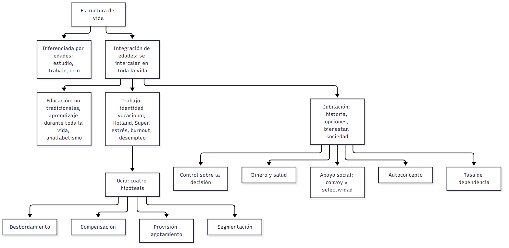

# C19 — Educación, trabajo, ocio y jubilación · Ficha de repaso

> **Idea-fuerza:** La vida se dividía por edades (estudiar, trabajar, jubilarse), pero esa estructura ya no encaja con una vida más larga: se perfila una **integración de edades**. El trabajo es central para la identidad, la educación se prolonga toda la vida y la jubilación pasó de evento a **proceso** de autogestión, cuyo bienestar depende del control sobre la decisión, el dinero, la salud, el apoyo social y el autoconcepto (Papalia et al., 2009b, pp. 271-272, 293, 305-310).

## Esqueletos de respuesta

**P1. Estructura diferenciada vs. integrada.** 1) Diferenciada: educación (jóvenes), trabajo (adultos), ocio/jubilación (ancianos) (p. 271). 2) Críticas de Riley (1994): casi un tercio de la vida adulta en retiro, capacidades desaprovechadas (p. 271). 3) Integrada: educación, trabajo y ocio a lo largo de la vida (p. 272). 4) Ejemplos: universitarios que trabajan, jubilados que estudian.

**P2. Educación en la adultez.** Estudiantes no tradicionales (más mujeres, adultos que trabajan y tienen hijos) (p. 273); cinco metas de Willis (1985) (pp. 275-276); programas para mayores (p. 274); analfabetismo adulto y funcional (p. 278).

**P3. Trabajo y elección de carrera.** Términos (empleo, ocupación, vocación, profesión, carrera) (p. 279); Parsons (rasgos), Holland (seis tipos de personalidad), Super (ocho etapas ligadas al autoconcepto) (pp. 279-282); críticas: ignoran contexto, cultura y género; identidad vocacional y adaptabilidad (pp. 281-283).

**P4. Trabajo y ocio: cuatro hipótesis.** Desbordamiento (Kohn), compensación (Wilensky), provisión-agotamiento (Staines), segmentación (Dubin); la complejidad del trabajo predice el nivel intelectual del ocio (Miller y Kohn, 1983) (p. 292).

**P5. Jubilación.** Idea reciente (seguridad social, 1935); hoy proceso de autogestión; se jubilan más por lo financiero que por la salud; bienestar según control de la decisión, salud, apoyo social (convoy, selectividad) y autoconcepto (pp. 292-306).

**P6. Estrés y desempleo.** Estrés laboral, *burnout* y desempleo afectan la salud y la identidad (pp. 284-285, 288-290).

## No confundir

| X | Y | Criterio |
|---|---|---|
| Estructura diferenciada | Integrada por edades | Cada edad, un rol / todas las actividades en todas las edades (pp. 271-272) |
| Estudiante tradicional | No tradicional | Tiempo completo tras el bachillerato / 24+ años, trabaja, dependientes (p. 273) |
| Empleo | Ocupación / vocación / profesión / carrera | Actividad pagada / campo regular / campo elegido / requiere formación y juicio independiente / ruta dinámica (p. 279) |
| Identidad vocacional | Tipo de personalidad de Holland | Claridad de metas e intereses / ajuste persona-ambiente (pp. 280-281) |
| Desbordamiento | Compensación | Continuidad (trabajo complejo → ocio complejo) / contraste (trabajo monótono → ocio estimulante) (p. 292) |
| Jubilación obligatoria | Voluntaria | Sin control / con control: más satisfacción y menos deterioro cognitivo (p. 305) |

## Datos que conviene saber

- Seguridad social en EE. UU.: 1935; la ADEA elimina la jubilación obligatoria (Papalia et al., 2009b, p. 293).
- Quienes eligen jubilarse están más satisfechos y tienen menos deterioro cognitivo (Herzog et al., 1991, citado en Papalia et al., 2009b, p. 305).
- Tasa de dependencia (p. 307). Los datos argentinos de las diapositivas de la cátedra son del ▸ Complemento de la guía (sujetos a actualización).

## Referencias

Papalia, D. E., Sterns, H. L., Feldman, R. D., & Camp, C. J. (2009b). *Desarrollo del adulto y vejez*. McGraw Hill Interamericana.

## Autoevaluación rápida

1. ¿Qué críticas hace Riley a la estructura diferenciada por edades?
2. ¿Quiénes son los estudiantes no tradicionales?
3. Describí Holland y Super; ¿qué críticas reciben?
4. Las cuatro hipótesis trabajo-ocio con un ejemplo cada una.
5. ¿Por qué la jubilación pasó de evento a proceso?
6. ¿Qué factores determinan el bienestar en la jubilación?
