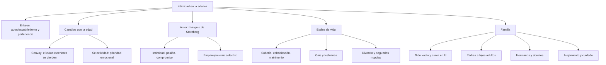
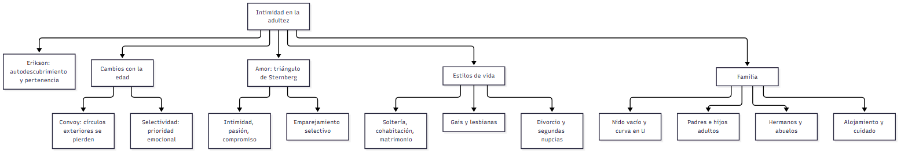
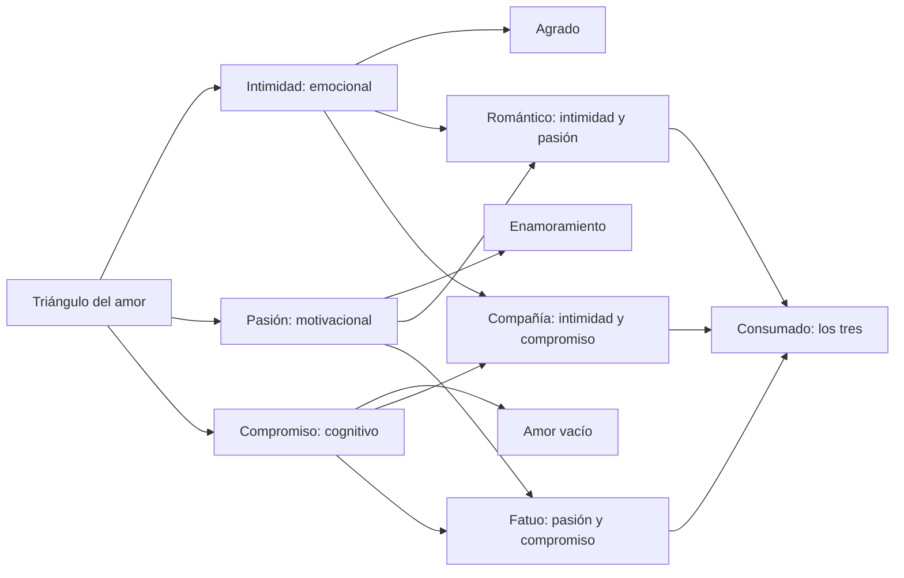
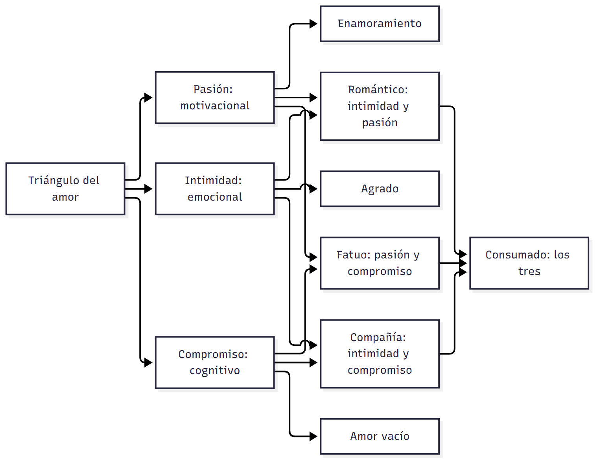
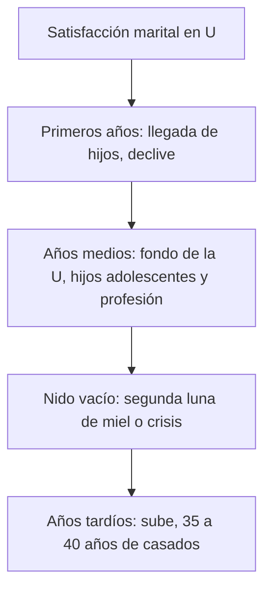
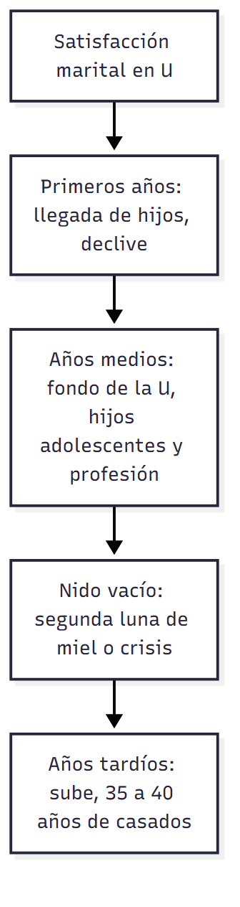

# C20 — Intimidad, estilos de vida y relaciones familiares en la adultez

> **Fuentes:**
>
> - Papalia, D. E., Sterns, H. L., Feldman, R. D., & Camp, C. J. (2009b). Relaciones íntimas y estilos de vida. En *Desarrollo del adulto y vejez* (cap. 9 [selección], pp. 311-353). McGraw Hill Interamericana. [Bibliografía obligatoria de la unidad 10]
> - Papalia, D. E., Sterns, H. L., Feldman, R. D., & Camp, C. J. (2009b). Lazos de parentesco maduros y arreglos para el alojamiento. En *Desarrollo del adulto y vejez* (cap. 10, pp. 355-391). McGraw Hill Interamericana. [Bibliografía obligatoria de la unidad 10]
>
> **Materia:** Psicología Evolutiva, 2.º año, Universidad Favaloro (docente a cargo: Dra. Verónica A. Ramírez). Unidad 10, clase 20 (cronograma: 06/10/2026). Examen: 4.º parcial, 03/11/2026.

> **Aviso sobre las fuentes:** (1) Las páginas son las **impresas** del libro (cap. 9: 311-353; cap. 10: 355-391). (2) El PDF del capítulo 9 es una **selección**: faltan las pp. 341-348 (la sección sobre la paternidad hoy y las decisiones de ser padres), que la cátedra no incluyó; la guía salta de la p. 340 a la 349. (3) **No hay diapositivas de esta clase** en la carpeta: el esquema de la cátedra sale de **tus apuntes** del 06/10 (Erikson, convoy, selectividad; Sternberg; emparejamiento selectivo de Epstein y Gutmann; matrimonio y divorcio; parentalidad y nido vacío; tareas de cuidado ≠ tareas de apoyo; factores protectores del envejecimiento). (4) Los **factores protectores del envejecimiento satisfactorio** que anotaste (cambio y continuidad) **no están en el capítulo**: aparecen en la sección 8 como **▸ Complemento** (apuntes de clase); contrastalos con la presentación de la clase. (5) Las cifras son de EE. UU. de los años 1990-2004: sirven para entender las ideas.

> **Idea-fuerza:** La intimidad es la tarea central de la adultez joven (Erikson) y se expresa en la amistad, el amor y la sexualidad; a lo largo de la adultez cambian los estilos de vida (soltería, cohabitación, matrimonio, divorcio, segundas nupcias, con o sin hijos) y los lazos familiares (con padres, hermanos, hijos, nietos). Con la edad se reduce el tamaño de la red pero se **conserva la calidad del apoyo**, porque las personas se vuelven más selectivas (convoy, selectividad socioemocional). La familia adulta es una red intergeneracional de **ayuda mutua** que se reorganiza en cada transición: salida de los hijos (nido vacío), envejecimiento de los padres (cuidado), nacimiento de los nietos (abuelazgo) (Papalia et al., 2009b, pp. 313-315, 349-353, 357-367, 391).

## Hilo conductor: cómo se conectan los temas de esta guía

El capítulo 9 empieza con Ingrid Bergman, cuya vida reúne casi todo lo que se estudia: amistad, amor, matrimonios (tres), un divorcio escandaloso, hijos, cohabitación previa y la lucha por la custodia. El capítulo 10 arranca con Marian Anderson, cuya vida muestra el otro costado: la red familiar multigeneracional que la sostuvo (abuela, madre, tías) y a la que ella sostuvo después (sobrino, hermana). Esas dos historias plantean la pregunta de la clase: **¿cómo se construyen, se mantienen y se transforman los vínculos íntimos y familiares a lo largo de la adultez?**

La respuesta se arma en tres niveles. **Primero** (secciones 1-4), los **fundamentos de las relaciones íntimas**: la intimidad como tarea del desarrollo (Erikson: autodescubrimiento y pertenencia), cómo cambia la red con la edad (convoy y selectividad), la amistad, el amor (triángulo de Sternberg; emparejamiento selectivo) y la sexualidad (orientación, actitudes, SIDA). **Segundo** (secciones 5-6), los **estilos de vida**: soltería, relaciones gais y lésbicas, cohabitación, matrimonio (felicidad, dos proveedores), divorcio y segundas nupcias, y qué hace que un matrimonio funcione; y la **vida familiar**: estructuras cambiantes, paternidad, nido vacío y satisfacción marital en forma de U, parejas sin hijos. **Tercero** (sección 7), los **lazos de parentesco maduros** del capítulo 10: familia extensa y nuclear, relación con padres (en la adultez joven, media y vejez), hermanos, familias multigeneracionales, abuelos y bisabuelos, crianza de nietos, y dónde y con quién viven los mayores (alojamiento) y cómo se los cuida (servicio de cuidado, generación sándwich, apoyo comunitario, perspectiva internacional). Un mismo hilo cruza todo: **ayuda mutua que fluye en ambas direcciones y cambia de dirección con la edad**, y la idea de que lo que importa no es la «forma» del hogar sino la **calidad de la relación** (Papalia et al., 2009b, p. 340).

> 🎯 **Para el parcial:** conectá siempre (a) la **etapa de la vida** (joven, media, mayor), (b) el **vínculo** (pareja, amigos, padres, hijos, hermanos, nietos) y (c) el **mecanismo** (intimidad, convoy/selectividad, ayuda mutua, ajuste de roles). Los conceptos de tus apuntes (Erikson, convoy, selectividad, Sternberg, emparejamiento selectivo, matrimonio/divorcio, nido vacío, tareas de cuidado vs. apoyo) son los que seguro entran.

**En una sola oración:** la adultez es una trama de vínculos íntimos y familiares en la que la intimidad es la tarea del adulto joven y la calidad (más que el tamaño) del apoyo y la reciprocidad entre generaciones sostiene el bienestar en cada etapa.

## 0. Hoja de ruta

1. **Fundamentos de las relaciones íntimas** (Papalia et al., 2009b, pp. 313-316): Erikson, convoy y selectividad, amistad.
2. **Amor y elección de pareja** (pp. 316-318): Sternberg, emparejamiento selectivo.
3. **Sexualidad** (pp. 318-322).
4. **Estilos de vida maritales y no maritales** (pp. 322-339): soltería, gais y lesbianas, cohabitación, matrimonio, divorcio, segundas nupcias.
5. **Vida familiar** (pp. 339-353): estructuras, nido vacío, satisfacción marital, sin hijos.
6. **Lazos de parentesco maduros** (pp. 356-373): padres, hermanos, abuelos.
7. **Alojamiento y cuidado** (pp. 373-391).
8. **Complemento de tus apuntes** (factores protectores del envejecimiento).
9. **Para rendir**.

## 🎯 Lo que entra sí o sí

1. **Intimidad (Erikson)**: autodescubrimiento y sentido de pertenencia (Papalia et al., 2009b, pp. 313-314).
2. **Teoría del convoy** y **teoría de la selectividad socioemocional** (pp. 314-315, 305-306).
3. **Teoría triangular del amor** (intimidad, pasión, compromiso) y los ocho patrones (Tabla 9.1) (pp. 316-317).
4. **Emparejamiento selectivo** / hipótesis de emparejamiento (Epstein y Gutmann, 1984) (p. 318).
5. **Orientación sexual** y actitudes sexuales (reproductiva, recreativa, relacional) (pp. 318-320).
6. **Matrimonio**: felicidad, expectativas diferentes de hombres y mujeres, parejas de dos proveedores (pp. 328-332).
7. **Divorcio**: factores, consecuencias económicas y emocionales, segundas nupcias (pp. 332-338).
8. **Qué hace que un matrimonio funcione** (compromiso, comunicación) (p. 338-339).
9. **Nido vacío** y **satisfacción marital en forma de U** (pp. 349-352).
10. **Relaciones con padres** (adulto joven, hijos medios y padres ancianos) y **responsabilidad filial** (pp. 359-364).
11. **Abuelos**: estilos (remoto, acompañante, involucrado); crianza de nietos (pp. 367-373).
12. **Servicio de cuidado**, **generación sándwich**, **agotamiento del cuidador** (pp. 382-387).

---

## 1. Fundamentos de las relaciones íntimas

### 1.1 Respuesta modelo (para escribir en el parcial)

> **Esqueleto de la respuesta:**
> 1. **Tesis:** la intimidad es la tarea crucial de la adultez joven (Erikson) y se mantiene a lo largo de la vida.
> 2. **Componentes:** autodescubrimiento y sentido de pertenencia (Papalia et al., 2009b, pp. 313-314).
> 3. **Adulto joven:** autonomía respecto de los padres, relaciones con pares y parejas (p. 314).
> 4. **Adulto mayor:** menos contactos, pero apoyo de calidad: convoy y selectividad socioemocional (pp. 314-315).
> 5. **Amistad:** apoyo, identidad; las mujeres, más íntimas (pp. 315-316).
> 6. **Cierre:** el tamaño de la red se reduce; la calidad no.

La intimidad es la tarea crucial de la adultez joven (Erikson): implica autodescubrimiento (revelar información importante de uno mismo a otro) y un sentido de pertenencia. Los adultos jóvenes redefinen la relación con sus padres y construyen vínculos con pares y parejas. Con la edad se pasa menos tiempo con otros, pero el contacto que se mantiene importa más: según la teoría del convoy solo se afectan los círculos exteriores y se conserva un círculo íntimo estable; según la selectividad socioemocional, los mayores priorizan relaciones emocionalmente gratificantes. Por eso el tamaño de la red se reduce y la calidad del apoyo no (Papalia et al., 2009b, pp. 313-315).

> ⚠ **No confundir:** *convoy* (**quiénes** nos acompañan: círculos por intimidad; los exteriores se pierden, el interno se mantiene) con *selectividad socioemocional* (**por qué** elegimos: al percibir que queda poco tiempo se priorizan las necesidades emocionales sobre las metas a largo plazo) (pp. 314-315).

### 1.2 Desarrollo ampliado

**Ingrid Bergman** (pp. 312-313). Actriz sueca, obsesionada con actuar desde los 11 años; a los 22 se casó con el dentista (luego cirujano cerebral) Petter Lindstrom; a los 23 llegó a Hollywood (*Intermezzo*, productor Selznick) con su hija Pia; veía a su marido como sobreprotector, controlador y celoso; escribió a Rossellini, hizo *Stromboli* con él y a los 33 años abandonó a su esposo y a su hija de diez años por el director italiano casado, en 1949 (*Notorious*, «infame»): paria en Hollywood, nacimiento ilegítimo de Robertino (1950), divorcio en México, matrimonio por poder, gemelas (1952), Pia (que durante seis años no vio a su madre) del lado de su padre. El amor «tempestuoso» no duró; Bergman cedió la custodia, rehizo su carrera y a los 43 años se casó con Lars Schmidt (16 años de matrimonio, a pesar de constantes separaciones laborales, y divorcio amigable; siguieron siendo amigos). Su historia toca los temas del capítulo: amistad, amor, matrimonio, paternidad. Hoy, en muchas sociedades las personas pueden decidir si y cuándo casarse, divorciarse, volver a casarse, cuándo y cómo ser padres; permanecer solteras, vivir solas o en grupo, no tener hijos o demorarlos, ser padres solteros. Internet dio una nueva dimensión: en un estudio longitudinal de **93 familias de Pittsburgh**, los usuarios de Internet se involucraban menos socialmente, se comunicaban menos con su familia y tenían menos amigos, con más soledad y depresión (Kraut et al., 1998); un seguimiento sugiere que estos efectos se relacionan con el empleo inicial de la tecnología y disminuyen con el uso rutinario (Kraut et al., 2002) (p. 313).

**Intimidad según Erikson** (pp. 313-314). Erikson vio el desarrollo de las relaciones íntimas como **la tarea crucial de la adultez joven**; puede incluir o no contacto sexual. Un elemento relevante es el **autodescubrimiento** («revelar información importante de uno mismo a otro»; Collins y Miller, 1994, p. 457, citado en p. 314): se establece y mantiene a través de los descubrimientos compartidos, la sensibilidad a las necesidades del otro y la aceptación y el respeto mutuos. La intimidad incluye una **sensación de pertenencia**: la necesidad de establecer relaciones fuertes, duraderas y cariñosas es un poderoso motivador del comportamiento humano; las emociones más fuertes, positivas y negativas, se evocan en los apegos íntimos; las personas con relaciones cercanas satisfactorias tienden a ser más saludables y a vivir más (Baumeister y Leary, 1995; Myers y Diener, 1995) (p. 314). (Los apuntes de la cátedra: «Erikson: autodescubrimiento; sensación de pertenencia».)

**Adultez joven y relaciones con los padres** (p. 314). Al entrar a la universidad o al trabajo, los adultos jóvenes toman decisiones propias, adquieren responsabilidades y deben completar la **negociación de autonomía** iniciada en la adolescencia y redefinir sus relaciones con los padres (Lamberth y Hallett, 2002); si no resuelven sanamente los conflictos con los padres pueden representarlos en nuevas relaciones con amigos, colegas y parejas. También encuentran pares de diversos grupos étnicos y necesitan habilidades (autoconciencia, empatía, comunicación de emociones, toma de decisiones sexuales, resolución de conflictos y sostener compromisos) para decidir casarse, formar sociedades sin matrimonio u homosexuales, vivir solos y tener o no hijos.

**Cambios con la edad: convoy y selectividad** (pp. 314-315; también en pp. 305-306). Con la edad se pasa menos tiempo con otros (Carstensen, 1996); el trabajo es fuente de contacto social (los jubilados desde hace tiempo tienen menos contactos); las enfermedades dificultan salir; los ancianos se sienten satisfechos con redes más pequeñas. Aun así, el contacto que mantienen **importa más que nunca** para su bienestar (Lansford, Sherman y Antonucci, 1998).
- **Teoría del convoy** (Kahn y Antonucci, 1980): los cambios en el contacto social por lo general afectan solo los **círculos exteriores, menos íntimos** (compañeros de trabajo, amigos casuales); la mayoría de los ancianos conserva un **círculo interno estable de «escoltas»** (amistades cercanas y miembros de la familia) que representa un apoyo continuo y afecta mucho su bienestar para bien o para mal (Antonucci y Akiyama, 1995) (p. 314).
- **Teoría de la selectividad socioemocional** (Carstensen, 1991, 1995, 1996): los ancianos se vuelven cada vez más **selectivos**; cuando las personas perciben que **les queda poco tiempo**, las **necesidades emocionales inmediatas** se vuelven prioritarias sobre las metas a largo plazo. Ejemplo: un estudiante soporta a un profesor que le desagrada para adquirir conocimientos; un anciano está menos dispuesto a pasar tiempo valioso con un amigo que le altera los nervios; los adultos jóvenes con media hora libre pueden elegir a alguien que querrían conocer mejor, los ancianos eligen a alguien que ya conocen bien (pp. 314-315).
- **Conclusión:** aunque los ancianos establezcan menos relaciones cercanas, se sienten bien con las que tienen; el tamaño de la red y la frecuencia de contactos se reducen, pero **la calidad del apoyo social no** (Bossé et al., 1993); las relaciones personales siguen siendo relevantes, quizás más que antes (p. 315).

**Amistad** (pp. 315-316). Parte importante de la vida en toda edad: compañía, actividades compartidas, apoyo emocional en tiempos difíciles, sensación de identidad e historia; se basa en intereses y valores mutuos y suele darse entre personas de la misma generación o etapa de vida familiar, que **validan creencias y comportamientos** (Dykstra, 1995). Los adultos jóvenes (estableciéndose en el trabajo y criando bebés) tienen poco tiempo para los amigos. Las personas con amigos tienden a tener más bienestar (o las que se sienten bien consigo mismas hacen amigos más fácilmente; Hartup y Stevens, 1999). Las **mujeres** establecen amistades más **íntimas** y satisfactorias con otras mujeres; los **hombres** comparten información y actividades, no confidencias (Rosenbluth y Steil, 1995). En la **adultez media** las redes son más pequeñas e íntimas; la calidad compensa la falta de tiempo; los amigos son fuente de apoyo en crisis (divorcio, problema con un padre anciano). En la **vejez** las amistades dejan de ligarse al trabajo y la paternidad, y se enfocan en **compañía y apoyo**; **elegir** a los amigos importa a los mayores, que sienten que pierden el control de sus vidas, y quienes tienen un círculo activo de amigos son más felices y sanos; las mujeres siguen viendo a sus amigos con frecuencia; los ancianos los ven menos o en grupo y disfrutan más el tiempo con amigos que con sus familias; los amigos y vecinos sustituyen a familiares lejanos y no reemplazan al cónyuge pero compensan su falta. Los mayores de **85** años llaman amigo a alguien que antes habrían considerado un conocido; si las discapacidades impiden el contacto cara a cara, las amistades se mantienen por teléfono o correo, aunque menos íntimas (pp. 315-316).

> 🔑 **Punto clave:** en la vejez no se pierde intimidad: se concentra. «Menos contactos, mejor apoyo» (convoy + selectividad).

---

## 2. Amor y elección de pareja

### 2.1 Respuesta modelo (para escribir en el parcial)

> **Esqueleto de la respuesta:**
> 1. **Tesis:** el amor tiene tres componentes y la elección de pareja tiende a la similitud.
> 2. **Sternberg:** intimidad (emocional), pasión (motivacional), compromiso (cognitivo) (Papalia et al., 2009b, p. 316).
> 3. **Combinaciones (Tabla 9.1):** sin amor, agrado, enamoramiento, amor vacío, romántico, de compañía, fatuo, consumado (p. 317).
> 4. **Elección de pareja:** emparejamiento selectivo (Epstein y Gutmann, 1984) e hipótesis de emparejamiento (p. 318).
> 5. **Apego temprano:** la confianza depende de apegos tempranos (p. 318).
> 6. **Cierre:** los opuestos no se atraen como regla.

Según la teoría triangular del amor (Sternberg), el amor tiene tres componentes: intimidad (emocional), pasión (motivacional) y compromiso (cognitivo); su presencia o ausencia define ocho patrones (de «sin amor» al «amor consumado», con los tres). En la elección de pareja rige el emparejamiento selectivo: las personas tienden a enamorarse y casarse con alguien muy parecido (apariencia, atractivo, salud, inteligencia, estatus socioeconómico, religión, educación); y la hipótesis de emparejamiento dice que quienes son casi igualmente atractivos son los más probables de formar relaciones cercanas. Los opuestos no se atraen, como regla (Papalia et al., 2009b, pp. 316-318).

> ⚠ **No confundir:** *amor romántico* (intimidad + pasión, sin compromiso) con *amor de compañía* (intimidad + compromiso, sin pasión) y con *amor fatuo* (pasión + compromiso, sin intimidad). Y *emparejamiento selectivo* (tendencia a elegir similares) con *hipótesis de emparejamiento* (similar nivel de atractivo) (pp. 317-318).

### 2.2 Desarrollo ampliado

**Teoría triangular del amor** (Sternberg, 1985b; Sternberg y Barnes, 1985; Sternberg y Grajek, 1984) (pp. 316-317). El amor tiene tres fases o elementos: **intimidad** (el elemento **emocional**; involucra autodescubrimiento, lo que conduce a conexión, calidez y confianza), **pasión** (el elemento **motivacional**; se basa en impulsos internos que traducen la excitación fisiológica en deseo sexual) y **compromiso** (el elemento **cognitivo**; la decisión de amar y permanecer con el ser amado). El grado en que los tres están presentes determina el tipo de amor y las incongruencias provocan problemas. **Tabla 9.1, patrones de amor:**

| Tipo | Componentes presentes | Descripción |
|---|---|---|
| **Sin amor** | ninguno | La mayoría de las relaciones personales: interacciones casuales |
| **Agrado** | intimidad | Verdadera amistad y muchas relaciones amorosas: cercanía, comprensión, apoyo emocional, afecto, adhesión, calidez |
| **Enamoramiento** | pasión | «Amor a primera vista»: fuerte atracción física y excitación sexual, sin intimidad ni compromiso; puede morir tan rápido como nace o, a veces, durar |
| **Amor vacío** | compromiso | Relaciones de largo plazo que perdieron intimidad y pasión; matrimonios arreglados |
| **Amor romántico** | intimidad + pasión | Se atraen físicamente y se enlazan emocionalmente, pero no están comprometidos |
| **Amor de compañía** | intimidad + compromiso | Amistad comprometida de largo plazo; matrimonios en los que la atracción física murió pero hay cercanía y decisión de permanecer juntos |
| **Amor fatuo** | pasión + compromiso | Cortejo turbulento; compromiso sobre la base de la pasión sin tiempo para desarrollar intimidad; por lo general no dura |
| **Amor consumado** | los tres | Amor «completo» por el que luchan muchos; es más fácil alcanzarlo que conservarlo; si uno cambia lo que quiere y el otro no, la relación puede disolverse |

(Papalia et al., 2009b, p. 317; Sternberg, 1985b). La cátedra, en tus apuntes: «Teoría triangular del amor (Sternberg): intimidad (emocional), pasión (motivacional), compromiso (cognitivo)».

**Apego temprano** (p. 318): algunas investigaciones sugieren que la **confianza**, esencial para la intimidad con un amante, depende de la **seguridad de los apegos tempranos** a padres o cuidadores (DeAngelis, 1994).

**¿Los opuestos se atraen?** (p. 318). No, como regla: hay una tendencia hacia el **emparejamiento selectivo** (Epstein y Gutmann, 1984): así como las personas eligen amigos con quienes tienen algo en común, tienden a enamorarse y casarse con alguien muy parecido. **Hipótesis de emparejamiento:** quienes salen y son **casi igualmente atractivos** son los más probables de desarrollar relaciones cercanas (Harvey y Pauwels, 1999). Los amantes suelen parecerse en **apariencia física y atractivo, salud mental y física, inteligencia, popularidad y calidez**; en la felicidad de sus padres (como individuos y como pareja); y en **estatus socioeconómico, raza, religión, educación e ingreso** (Murstein, 1980); también en temperamento (quienes corren riesgos suelen casarse con arriesgados, aunque puedan exponerse a un divorcio temprano; Zuckerman, 1994). El amor no siempre dura: entre estudiantes que recordaron cómo y por qué se enamoraron o desenamoraron, quienes explicaban por qué terminaron sus relaciones anteriores estaban más satisfechos con sus parejas actuales (Clark y Collins, 1993).

> 🔑 **Punto clave:** el «amor consumado» (los tres componentes) es el ideal, pero **mantenerlo exige que ambos cambien juntos**. Y el emparejamiento selectivo es «similitud», no «complementariedad».

---

## 3. Sexualidad

### 3.1 Respuesta modelo (para escribir en el parcial)

> **Esqueleto de la respuesta:**
> 1. **Tesis:** la sexualidad adulta tiene un lado físico y otro social, y las actitudes cambiaron.
> 2. **Orientación sexual:** homosexual, heterosexual, bisexual; no es una elección consciente (Papalia et al., 2009b, p. 318-319).
> 3. **Causas:** biología (gemelos), no se sostienen las teorías de la crianza ni del aprendizaje (p. 319).
> 4. **Actitudes:** tres visiones: reproductiva, recreativa, relacional (p. 320).
> 5. **Cambios:** doble estándar cuestionado; más aceptación del sexo prematrimonial (p. 318, 320).
> 6. **SIDA:** cambió el comportamiento (pp. 321-322).

La orientación sexual (homosexual, heterosexual, bisexual) se refiere a sentimientos y autoconcepto, no solo al comportamiento; para la mayoría surge en la adolescencia temprana y los psicólogos no la consideran una elección consciente. La investigación respalda más una base biológica (tasas de concordancia en gemelos) que las explicaciones por crianza (Freud) o aprendizaje, y se piensa en una interacción de genes, hormonas y ambiente. Las actitudes sexuales en EE. UU. se dividen en reproductivas (30 %), recreativas (25 %) y relacionales (45 %); se cuestionó el doble estándar y hay más aceptación del sexo prematrimonial y de la homosexualidad. El SIDA llevó a cambios del comportamiento (Papalia et al., 2009b, pp. 318-322).

> ⚠ **No confundir:** *orientación sexual* (sentimientos y autoconcepto) con *comportamiento sexual* (lo que se hace); una persona puede tener una orientación que no expresa (p. 318).

### 3.2 Desarrollo ampliado

**Cambios sociales** (p. 318). En EE. UU. hay más apertura para discutir y expresar la sexualidad y mayor aceptación de la actividad sexual como normal, sana y placentera. Tres cambios: (1) mayor aceptación del **sexo prematrimonial o no marital**, sobre todo en relaciones monógamas amorosas; (2) el cuestionamiento del **estándar doble** (más libertad sexual para los hombres que para las mujeres); (3) mayor apertura y aceptación hacia la **homosexualidad**.

**Orientación sexual** (pp. 318-320). Tres orientaciones: **homosexual** (atracción hacia el propio género; «gay» u «lesbiana»), **heterosexual**, **bisexual**. Se refiere a sentimientos y autoconcepto; puede o no expresarse en el comportamiento (APA, 2001). La homosexualidad se considera normal en muchas sociedades, su incidencia parece similar en diversas culturas (Hyde, 1986). En EE. UU. solo **2,8 %** de los hombres y **1,4 %** de las mujeres se identifican como homosexuales o bisexuales; pero **5 %** de los hombres y **4 %** de las mujeres reportan al menos un encuentro homosexual como adultos; la identificación fue más prevalente en las grandes ciudades (9 % hombres, 3 % mujeres) (Michael et al., 1994). No se limita a un tipo particular de persona. **Surge** para la mayoría en la adolescencia temprana sin experiencia sexual previa; algunas personas intentaron arduamente cambiarla sin éxito: los psicólogos **no la consideran una elección consciente** (APA, 2001). **Causas:** Freud (estilos de paternidad) y los teóricos del aprendizaje (imitación y reforzamiento) no son apoyados contundentemente; una revisión indica un papel **biológico** (Gladue, 1994): un gemelo idéntico de un homosexual tiene ~**50 %** de probabilidades de serlo; un gemelo fraterno, ~**20 %**; un hermano adoptado, **10 % o menos**; los estudios que vincularon la homosexualidad masculina con una región del cromosoma X heredada de la madre (Hamer et al., 1993) no pudieron replicarse (Rice et al., 1999); se reportó una diferencia anatómica en un área cerebral (LeVay, 1991), sin poder afirmar causalidad. Probablemente sea un proceso complejo en que los **genes interactúan con aspectos hormonales y ambientales cruciales**. Las actitudes negativas hacia la homosexualidad disminuyen lentamente: casi la mitad la considera un pecado y un tercio una enfermedad (contrario a la APA); el estigma y la discriminación pueden afectar la salud mental de gais y lesbianas (mayor riesgo de ansiedad, depresión) (pp. 319-320).

**Actitudes y comportamiento sexuales** (pp. 320-321). Tres visiones (Laumann y Michael, 2000): **tradicional o reproductiva** (**~30 %**: el sexo solo con fines reproductivos dentro del matrimonio), **recreativa** (**~25 %**, más hombres: todo lo que se siente bien y no lastima), **relacional** (**~45 %**: el sexo debe acompañarse de amor o afecto, no necesariamente matrimonio). Sexo prematrimonial: lo admitían 61 % de los hombres y 12 % de las mujeres nacidos antes de 1910; en los años ochenta las mujeres tenían casi tanta experiencia como los hombres (T. W. Smith, 1994). Entre 1965 y 1994 la desaprobación del sexo antes del matrimonio cayó de 63 a 30 % entre hombres y de 80 a 44 % entre mujeres (Scott, 1998). Pero el cambio no es tan radical: la media de compañeros sexuales desde los 18 años es **2** para mujeres y **6** para hombres; la mayoría encuentra pareja por conocidos y es similar en edad, nivel educativo y antecedentes; la desaprobación del **sexo extramarital** es **94 %** (mayor que la de la homosexualidad). Europa: fuerte desaprobación del extramarital y débil del prematrimonial (Alemania y Suecia: 3-7 % desaprueba el prematrimonial); EE. UU. más restrictivo que casi todos salvo Irlanda; China se liberalizó. Para la mayoría de los ancianos, la calidad de las relaciones interpersonales es más relevante que la buena relación sexual; la actividad sexual declina con la edad (condiciones médicas, pérdida de pareja); la brecha generacional sugiere una vida sexual más activa para las generaciones futuras (AARP, 1999) (p. 321).

**SIDA** (pp. 321-322). ~30 % de los adultos dice haber modificado su comportamiento (menos compañeros, elegir con cuidado, condones, abstinencia); ~11 % se abstiene por completo. Las prácticas de sexo seguro se volvieron prevalentes entre los homosexuales a principios de los noventa. Cifras: 816 149 estadounidenses con SIDA (CDC, 2001); 42 millones en el mundo; 21,8 millones muertos (3,1 millones en 2002); 5 millones infectados por año (15 mil por día); en EE. UU. las muertes anuales bajaron de 50 610 (1995) a 16 371 (2002) gracias a los nuevos medicamentos; preocupación por el acceso a tratamiento costeable en África.

---

## 4. Estilos de vida maritales y no maritales

### 4.1 Respuesta modelo (para escribir en el parcial)

> **Esqueleto de la respuesta:**
> 1. **Tesis:** las normas dejaron de exigir casarse, permanecer casado o tener hijos; los estilos de vida son diversos y cambian durante la adultez.
> 2. **Datos:** hogares con parejas casadas con hijos: 40 % (1970) → 24 % (2000); personas que viven solas 17 → 26 %; 95 % se casó alguna vez antes de los 65 (Papalia et al., 2009b, p. 322).
> 3. **Estilos:** soltería, relaciones gais y lésbicas, cohabitación, matrimonio, divorcio, segundas nupcias (pp. 322-338).
> 4. **Matrimonio:** felicidad, expectativas diferentes por género, parejas de dos proveedores (pp. 328-332).
> 5. **Qué hace que funcione:** compromiso, comunicación (pp. 338-339).

Hoy las personas se casan más tarde o no se casan, cohabitan, se divorcian, se vuelven a casar, tienen o no hijos; la proporción de hogares de parejas casadas con hijos propios bajó de 40 % (1970) a 24 % (2000) y los hogares de una persona subieron de 17 a 26 %, aunque 95 % se casó alguna vez antes de los 65. La felicidad se asocia con el matrimonio, pero la brecha con los solteros se estrechó; los matrimonios de dos proveedores se volvieron el patrón dominante; el divorcio aumentó en muchos países y tiene consecuencias económicas más negativas para mujeres y niños; los matrimonios que funcionan comparten compromiso, comunicación e intimidad con autonomía (Papalia et al., 2009b, pp. 322-339).

> ⚠ **No confundir:** *cohabitación* (unión libre; no aumenta de por sí el riesgo de divorcio si es con el futuro marido) con *matrimonio*; *soltería por elección* con *por falta de pareja*; *divorcio* (proceso, no un solo hecho) con *separación*.

### 4.2 Desarrollo ampliado

**Soltería** (pp. 322-323). En 2000, **45 %** de las personas de 25 a 29 años no se había casado (tres veces más que en 1970); incluso entre los de 35 a 44, **15,5 %** nunca se había casado; entre las mujeres afroamericanas, **35 %** siguen sin casarse a fines de sus treinta (Teachman et al., 2000). En un estudio de 300 mujeres solteras afroamericanas, blancas y latinas de Los Ángeles, todas tuvieron dificultad para encontrar hombres con antecedentes educativos y sociales similares; las afroamericanas (edad promedio 40) parecían relativamente despreocupadas (Tucker y Mitchell-Kernan, 1998). Hay solteros **por elección** (mujeres que se mantienen a sí mismas, menor presión social; quieren libertad para correr riesgos, viajar, estudiar, hacer trabajo creativo, libertad sexual, o temen el divorcio): el aplazamiento tiene sentido porque **mientras más jóvenes sean las personas al casarse, más probabilidad hay de que se separen**. En general a los solteros les gusta su estatus y la mayoría no están solos. En más de la mitad del mundo, 5 % o menos de los ancianos y 10 % o menos de las ancianas nunca se casaron; en EE. UU., solo 4 % de los mayores de 65; probablemente aumente conforme envejezcan los de adultez media de hoy. Los ancianos que nunca se casaron prefieren la vida de solteros y están menos solos que los divorciados o viudos (Dykstra, 1995); las mujeres que nunca se casaron ni tuvieron hijos se apoyaron en lazos con parientes consanguíneos, lazos de tutoría con más jóvenes y amistades de la misma generación (Rubinstein et al., 1991). Los ancianos anteriormente casados salen más con alguien que las ancianas (mayor disponibilidad de mujeres); la mayoría de los que tienen citas son sexualmente activos pero no esperan casarse; las mujeres pueden temer quedar «encerradas» en roles tradicionales; una anciana afroamericana que vive sola tiene **tres veces** más probabilidad de ser pobre que una blanca en esa situación (pp. 323-324).

**Relaciones gais y lésbicas** (pp. 324-326). Los adultos tienen más probabilidad que los adolescentes de identificarse como homosexuales. **Salir del armario** (King, 1996) tiene cuatro etapas que posiblemente nunca se logren por completo: (1) **reconocimiento de la homosexualidad** (puede ocurrir temprano en la niñez o recién en la adolescencia o más tarde; experiencia a veces solitaria, dolorosa y confusa); (2) **conocer a otros homosexuales y establecer relaciones** sexuales y románticas (puede no ocurrir hasta la adultez; disminuye el aislamiento y mejora la autoimagen); (3) **informar a la familia y amigos** (muchos no lo hacen o lo hacen tarde; puede traer desaprobación, conflicto y rechazo, o profundizar la solidaridad); (4) **apertura completa** (colegas, empleadores; aceptación saludable de la homosexualidad como parte de quiénes son). Los estudios tienen **problemas de muestreo** (hombres blancos urbanos con ingreso y educación sobre el promedio; lesbianas blancas, profesionales, de clase media o alta). La mayoría de los homosexuales, como los heterosexuales, busca **amor, compañía y satisfacción sexual** con una persona; los ingredientes de la satisfacción a largo plazo son muy similares (Patterson, 1995); las **lesbianas** tienen más probabilidad de relaciones monógamas estables que los hombres gais (aunque desde el SIDA los gais se interesan más en relaciones de largo plazo); las parejas que viven juntas tienden a estar tan comprometidas como las casadas (Kurdek, 1995). Las relaciones son más fuertes si la familia y los amigos las reconocen y apoyan; las parejas gais y lésbicas tienden a ser más **igualitarias**. Un estimado de **8 a 10 millones** de niños estadounidenses viven con padres homosexuales (p. 325). En la adultez media y la vejez: efecto de cohorte (crecieron cuando la homosexualidad se consideraba una enfermedad mental; más de 25 % de las lesbianas de adultez media vivía sola aun con pareja); los que salieron del armario tarde pasan por una prolongada búsqueda de identidad (culpa, secreto, matrimonio heterosexual); los homosexuales mayores tienen fuertes necesidades de intimidad, contacto social y redes (las redes de amistad pueden sustituir a la familia); **salir del armario** es una transición del desarrollo que puede mejorar la salud mental, la satisfacción de vida y suavizar el ajuste al envejecimiento; los problemas surgen de las actitudes sociales (discriminación, falta de servicios, duelo y conflictos de herencia cuando el compañero muere). Reclaman reconocimiento legal de sus uniones (Holanda, Vermont; Francia, Suecia, Noruega, Dinamarca), derecho a adoptar y criar; la American Academy of Pediatrics apoya la adopción por parejas homosexuales (pp. 325-326).

**Cohabitación** (pp. 326-327). Estilo de vida en que una pareja no casada con relación sexual vive junta de modo informal (unión consensual); es la norma en países como Suecia y Dinamarca (derechos legales casi iguales) y cada vez más común en EE. UU. y Canadá; Gran Bretaña: **70 %** de las primeras relaciones son cohabitaciones y **60 %** de las parejas que cohabitan se casan; Canadá: 12 % en 1996, el doble que en 1981. Puede ser **sustituto o ensayo de matrimonio**; **más de la mitad** de las parejas estadounidenses que se casan primero han vivido juntas; **58 %** de las primeras cohabitaciones que duraron tres años y **70 %** de las de cinco años terminaron en matrimonio; son **menos estables** que los matrimonios; las parejas con un hijo tienen menos probabilidad de separarse. Según algunas investigaciones, quienes cohabitan antes del matrimonio tienen matrimonios más infelices y mayor probabilidad de divorcio; en parte por **selección** (actitudes no convencionales, padres divorciados, hijastros, actitudes liberales hacia el divorcio); **Teachman (2003)**: no aumenta el riesgo de divorcio para las mujeres si la cohabitación se limita al futuro marido.

**Matrimonio** (pp. 327-329). No tiene el mismo significado en todas partes (Tíbet: un hombre y su padre comparten esposa; Zaire: una mujer comparte su marido con su madre), pero la universalidad de alguna forma de matrimonio muestra que satisface necesidades fundamentales: asegurar la crianza ordenada de los hijos, división del trabajo, unidad de consumo e idealmente intimidad, amistad, afecto, satisfacción sexual y compañerismo. La «**edad casadera**» varía: Europa Oriental temprano (Hungría: 70 % de las mujeres y 33 % de los hombres de 20 a 24 casados); Escandinavia: 85 % de las mujeres y 95 % de los hombres de 20 a 24 todavía no se casan (cohabitan); Japón: viven con sus padres; Francia: novio 30 y novia 28; Canadá: novias de 23 a 27 y novios de 26 a 29 desde 1961; EE. UU.: novias 25 y novios ~27 (3 años más que en 1975). En 1998, **110,6 millones** de adultos (56 %) estaban casados y vivían con su cónyuge; entre las personas de 25 a 34, 34,7 % nunca se casó (53,4 % de los afroamericanos: desempleo masculino, independencia económica de las mujeres, menor expectativa de vida de los hombres). En 2003, 71 % de los ancianos y 41 % de las ancianas estaban casados.
- **Matrimonio y felicidad** (pp. 328-329): las encuestas muestran que el matrimonio es el **factor más relevante de la felicidad**, más que el trabajo o la amistad; pero algunos beneficios ya no se limitan al matrimonio (sexo y compañía fuera de él; ya no es la única fuente de seguridad para las mujeres); como la mayoría de las casadas trabaja y los esposos no comparten igualmente las tareas domésticas, el matrimonio puede **aumentar el estrés de la mujer**. **Expectativas diferentes:** para las mujeres la intimidad marital es **compartir sentimientos y confidencias**; el hombre tiende a expresar intimidad **a través del sexo**, ayuda práctica y compañía, y a hacer cosas juntos (Thompson y Walker, 1989); muchos hombres se sienten incómodos hablando de sentimientos; las mujeres hacen más cosas importantes para los hombres, quienes obtienen más de lo que les importa, lo que explicaría que la asociación entre matrimonio y bienestar psicológico sea **más pronunciada para los hombres** (Ross et al., 1990).
- **Actividad sexual marital y extramarital** (pp. 329, 332): los estadounidenses tienen sexo con menos frecuencia de lo que sugieren los medios, pero las personas casadas más que los solteros que no cohabitan: casi un tercio tiene relaciones dos o más veces por semana (40 % de las parejas casadas y más de 50 % de las que cohabitan; menos de 25 % de quienes no viven con un compañero) (Michael et al., 1994); las casadas reportan más satisfacción emocional del sexo (Waite y Joyner, 2000); la frecuencia es mayor en el primer año y baja luego; en los ancianos baja pero puede ser intensamente placentera. **Sexo extramarital:** mucho menos común de lo que se piensa: ~**21 %** de los hombres y **11,5 %** de las mujeres alguna vez casados lo reportan (los adultos jóvenes más que quienes nacieron antes de 1940; T. W. Smith, 1994).
- **Recuadro 9.1: parejas de dos proveedores** (pp. 330-332). En 1940 las mujeres eran un cuarto de la fuerza laboral; en 1997, casi la mitad; casi **dos de cada tres** familias de pareja casada con hijos menores de 18 son de dos proveedores; dos de cada tres futuras madres primerizas trabajan durante el embarazo y tres cuartos regresan en el primer año. Causas: costo de vida, cambios en leyes de divorcio, seguridad social e impuestos, actitudes sobre roles de género, electrodomésticos, brecha de ingresos reducida; algunas simplemente quieren ser empleadas. Hay diversidad (un proveedor principal y uno secundario; ambos con carreras de gran impulso, como Lindstrom y Bergman; familias que reducen ingresos para tener más tiempo; parejas que negocian). **Lo positivo:** sale de la pobreza o alcanza ingreso medio; las mujeres, más independientes y con más poder económico (**47 %** aporta la mitad o más del ingreso); relación más equitativa, mejor salud, mayor autoestima, relación más cercana entre padre e hijo. **Lo negativo:** demandas de tiempo y energía, conflictos trabajo-familia, rivalidad, ansiedad y culpa por los hijos. Hombres y mujeres se afectan igual por el estrés trabajo-familia, pero por aspectos distintos: los hombres, **sobrecarga** (no socializados para las responsabilidades domésticas); las mujeres, **tensión de expectativas de rol conflictivas** (agresiva y competitiva en el trabajo, compasiva y maternal en casa). **Roles múltiples** (Barnett y Hyde, 2001): combinar trabajo y familia por lo general es **benéfico** para hombres y mujeres en salud mental, física y fortaleza de la relación (ingreso, apoyo social, éxito en más de un área, perspectivas más amplias, autoconcepto más complejo, similitud de experiencias), según cuántos roles, demandas de tiempo, éxito o satisfacción y actitudes tradicionales. «La inevitabilidad de un "segundo turno" para las esposas se exagera» (Gilbert, 1994): tres patrones: **convencional** (ambos ven las tareas domésticas y la atención de los hijos como «trabajo de mujeres»), **moderno** (comparten el cuidado de los hijos pero la esposa hace más trabajo doméstico) y **compartición de rol** (el más equitativo; al menos **un tercio** de las familias heterosexuales de dos proveedores). Las cargas siguen cayendo más en la mujer: en 1997 los hombres casados empleados hicieron casi una hora más de faenas domésticas y media hora más con los hijos que en 1977, pero **dos tercios** de lo que hacen las mujeres (Bond y Galinsky, 1998). Importa más la **percepción de justicia**: en una encuesta longitudinal de 3 284 mujeres, hubo mayor probabilidad de divorcio con más horas de trabajo de la mujer si ella tenía una visión **no tradicional** de los roles (Greenstein, 1995). En casi **uno de cuatro** hogares de dos proveedores la esposa gana más que el esposo.

**Divorcio** (pp. 332-337). Las tasas aumentaron drásticamente en muchos países (Reino Unido, Suecia, Francia, la ex Unión Soviética) con leyes más liberales (sin necesidad de culpables); Japón bajas y estables; Italia e Irlanda (oposición religiosa) sin tasas muy altas; **EE. UU. tiene una de las tasas más altas** (algo menor desde 1980): en 2000 había 19,8 millones de divorciados (9,8 % de la población). Entre los afroamericanos baja el casamiento y sube el divorcio (mujeres casadas: de 62 % a 36,1 %; divorcio de 3 % a 11,7 %; blancas: de 66 % a 57,4 %; divorcio de 2 % a 10,2 %). Un tercio de los divorcios ocurre en los primeros diez años. Los «baby boomers» que envejecen tienen tasas crecientes (años de vida saludable tras la crianza). **Las leyes sin culpables no son la causa**: respondieron a una mayor demanda (Marvell, 1989); factores sociales: mujeres financieramente independientes, menos permanencia «por los hijos» (permanecer en un matrimonio infeliz puede causar mayor daño), creciente número de parejas sin hijos, menores expectativas de permanencia.
- **Factores personales asociados al divorcio (Tabla 9.2)** (p. 334): **cohabitación prematrimonial** (se explica porque quienes cohabitan son menos convencionales; en cohortes recientes el efecto es más débil; con el futuro esposo no aumenta el riesgo); **casarse a edad temprana** (el predictor más fuerte de divorcio en los primeros cinco años); **criar un hijo antes del matrimonio** (el embarazo prematrimonial por sí mismo no aumenta el riesgo); **no tener hijos** (tener al menos un hijo reduce el riesgo, sobre todo si es varón: los padres se relacionan más con los hijos y su mayor participación en la crianza reduce el riesgo); **hijastros en el hogar** (estrés y lealtades divididas); **divorcio de los propios padres**; **ser afroamericano** (diferencia que persiste controlando estatus socioeconómico, fertilidad, proporción de sexos y edad al casarse). También: edad al casarse (adolescentes con altas tasas; quienes esperan hasta los 20 tienen mejor oportunidad), nivel educativo e ingreso (los graduados universitarios y parejas con alto ingreso se divorcian menos), religión (quienes le dan relevancia, menos disolución).
- **Consecuencias económicas** (pp. 335-336): la situación económica de la mayoría de las mujeres **empeora** (Kreider y Fields, 2002); la pensión alimenticia se otorga a cualquier cónyuge en solo ~**uno de cada siete** casos y por 2 a 5 años; se permite que un cónyuge obtenga el divorcio sin consentimiento del otro; la mujer divorciada promedio recibe solo **70 %** de su ingreso anterior en el año siguiente, y a los cinco años no mejora; **más de 40 %** ve reducidos sus ingresos en más de la mitad; el estándar de vida del hombre tiende a subir; resultado: aumento de la pobreza de mujeres y niños; **más de la mitad** de las familias pobres de EE. UU. está encabezada por madres solteras (cuatro de cada cinco estuvieron casadas); a nivel mundial, los hogares encabezados por mujeres tienden a ser más pobres. **Mediación**: tercero neutral que guía a la pareja para ordenar derechos y responsabilidades; puede ser más amigable, rápida, menos costosa, con mejor acatamiento y ayudar a cooperar por los hijos.
- **Ajuste emocional** (pp. 336-337): el divorcio es un **proceso** («una secuencia de experiencias potencialmente estresantes que comienzan antes de la separación física y continúan después»; Morrison y Cherlin, 1995, p. 801, citado en Papalia et al., 2009b, p. 336); salud pobre, tasas elevadas de enfermedad y muerte; dificultad para realizar actividades sociales ordinarias (más las mujeres divorciadas que las viudas). A largo plazo tiende a **reducir el bienestar**, en especial para quien no lo inició o no vuelve a casarse (interrupción de la relación padre-hijo, desacuerdos con el ex, dificultades económicas, pérdida de apoyo emocional, mudanza); sentimientos de fracaso, culpa y hostilidad; pero terminar un matrimonio muy conflictivo puede mejorar el bienestar (Amato, 2000). Las mujeres se ven más afectadas que los hombres; en un estudio de 272 mujeres entrevistadas ~14 años después, casi la mitad inició el divorcio pero ~80 % dijo que le tomó **tres años o más** sentirse cómodas; mejor ajuste: mayores, sin hijos, sin abuso, con altos ingresos y buena representación legal (Thabes, 1997). Un factor relevante es el **desapego emocional** del ex cónyuge y una vida social activa. Es especialmente traumático en adultez media y tardía (quienes se divorcian después de los 50, sobre todo mujeres, tienen más problemas; los ancianos divorciados y separados están menos satisfechos con amistades y ocio; redes de apoyo inadecuadas).
- **Segundas nupcias** (pp. 337-338): «el triunfo de la esperanza sobre la experiencia» (Samuel Johnson). ~**tres cuartos** de las mujeres divorciadas se vuelven a casar dentro de diez años; las jóvenes (menos de 25) más probabilidad, pero también de volver a divorciarse; los hombres, igual probabilidad que las mujeres según el texto (p. 337; el resumen del capítulo, p. 353, dice «más»); la mitad lo hace dentro de ~tres años; **más probabilidad de terminar en divorcio** (sobre todo en los primeros cinco años, con hijastros; intereses y valores menos similares; ven el divorcio como solución). Segundas nupcias en la vejez: más confiados, tolerantes y menos necesitados de intercambio de sentimientos (125 personas con alta educación); los hombres más satisfechos que las mujeres; beneficios sociales (menos necesidad de ayuda comunitaria, conservar pensión).

**¿Qué hace que un matrimonio funcione?** (pp. 338-339). Factores: **compromiso** (en 2 331 casados, la dependencia mutua importó, pero el factor más fuerte fue un **sentimiento de obligación** hacia el cónyuge; Nock, 1995); en 15 parejas con más de 30 años de casados: relaciones agradables, compromiso con la idea del matrimonio y con el compañero, **intimidad equilibrada con autonomía**, buena comunicación, percepciones similares de la relación y orientación religiosa (Robinson y Blanton, 1993). **Comunicación y conflicto:** los cónyuges de matrimonios largos resuelven los problemas juntos; gimotear, defenderse, obstinarse y **retirarse** son signos de problema; discutir y mostrar el enojo (como comunicación) parece bueno (Gottman y Krokoff, 1989); quienes aprendieron a **«pelear de manera justa»** (150 parejas, 13 años) tuvieron **50 % menos** de divorcio (Markman et al., 1993). **Dificultades económicas** (400 parejas, 4 años): resistieron más las que mostraron apoyo mutuo, escucha, sensibilidad al punto de vista del otro y expresión de aprobación (Conger et al., 1999).

> 🔑 **Punto clave:** tus apuntes: «Matrimonio y divorcio; factores protectores en el matrimonio; predictores de la duración del matrimonio». Protectores: compromiso, comunicación, intimidad con autonomía, apoyo mutuo ante la adversidad, religión, casarse mayor, mayor educación/ingreso. Predictores de duración: edad al casarse (el mejor), educación e ingreso, religión, no cohabitación previa (con matices), hijos, no tener padres divorciados.

---

## 5. Vida familiar: estructuras, nido vacío y satisfacción marital

### 5.1 Respuesta modelo (para escribir en el parcial)

> **Esqueleto de la respuesta:**
> 1. **Tesis:** el nido vacío no es el fin de la crianza: es el paso a un tipo distinto de relación con los hijos; y la satisfacción marital sigue una curva en U.
> 2. **Nido vacío:** muchas mujeres lo viven como liberador; más difícil para parejas con identidad parental o problemas maritales (Papalia et al., 2009b, p. 349).
> 3. **Curva en U:** alta al inicio, mínima en la adultez media tardía, sube en la adultez tardía (p. 350).
> 4. **Por qué:** crianza y profesión; luego resolución de diferencias, libertad (pp. 350-352).
> 5. **Cierre:** el cuidado de la pareja enferma y las tareas domésticas pueden tensar; los vínculos mutuos benefician.

El nido vacío (la partida de los hijos) tiene menos efectos negativos de los que se supone: muchas mujeres lo viven como liberador y solo es difícil para parejas cuya identidad depende del rol parental o que postergaron problemas maritales; no es el fin de la crianza sino un cambio en su tipo. La satisfacción marital sigue una curva en U: alta al inicio, mínima en la adultez media tardía (cuando se cría a adolescentes y se avanza en la profesión) y sube en la adultez tardía, cuando los cónyuges resolvieron sus diferencias, se libraron de los roles de proveedor y cuidador y valoran la intimidad, la interdependencia y la pertenencia (Papalia et al., 2009b, pp. 349-352).

> ⚠ **No confundir:** *nido vacío* (la partida de los hijos) con *nido no tan vacío* o *síndrome de puertas giratorias* (los hijos adultos que regresan, p. 373); y la **«paternidad prolongada»** con la dependencia patológica.

### 5.2 Desarrollo ampliado

**Estructuras familiares cambiantes** (pp. 339-340). La «familia tradicional» (esposo, esposa e hijos biológicos) está lejos de ser universal; la vida familiar es diversa y rápidamente cambiante. En EE. UU., la mayoría de los niños menores de 18 vive con sus dos padres, pero la proporción disminuyó dramáticamente (figura 9.4: según la figura impresa, ~87 % con padres casados en 1970 y ~69 % en 2000, con aumento de hogares de madre sola y de padre solo; confirmá las cifras en tu libro); muchas familias de dos padres son **compuestas** (divorcio y segundas nupcias); también de padres solteros, gais y lésbicas, abuelos. Los niños tienden a desarrollarse mejor en una familia tradicional de dos padres, **pero la estructura en sí no es la clave: la relación entre los padres y su habilidad para crear una atmósfera favorable** afecta el ajuste (Bray y Hetherington, 1993; Hetherington, 1989) (p. 340).

▸ **Nota:** las pp. 341-348 (la paternidad hoy: Nepal; familias grandes en sociedades preindustriales, costos de los hijos, planificación familiar; decisiones de ser padres, etc.) no están en la selección de la cátedra: el PDF salta de la p. 340 a la 349.

**Cuando los hijos se alejan: el nido vacío** (p. 349). «A final de cuentas, la crianza es un proceso de **dejar ir**»; el curso normal de desarrollo conduce a los hijos hacia la independencia. Es irónico que las dos épocas de más crisis emocional (**adolescencia y adultez media**) suelan vivirse en el mismo hogar; los padres lidian con sus propias preocupaciones y con adolescentes con grandes cambios, y a veces se manifiestan sus propias fantasías adolescentes enterradas; ver a sus hijos en el umbral de la adultez les hace percatarse de lo que en su vida quedó atrás (Meyers, 1989). La investigación reciente contradice el estereotipo de adolescencia como época de inevitable turbulencia: la **tarea importante de los padres** es aceptar a los hijos como son (no copias ni modelos mejorados de ellos). **Nido vacío:** la investigación desafía las ideas populares: aunque algunas mujeres, muy identificadas con la maternidad, tienen problemas, **son muy superadas en número por las que encuentran la partida como liberadora** (Antonucci et al., 2001; Helson, 1997); reconstituirlo con hijos que regresan es **mucho más estresante**. **El nido vacío no señala el fin de la paternidad: es una transición hacia una nueva etapa, la relación entre padres e hijos adultos**; para muchas mujeres brinda alivio de la «**emergencia crónica de la paternidad**» (Cooper y Gutmann, 1987, p. 347, citado en Papalia et al., 2009b, p. 349): pueden seguir sus propios intereses y gozar del calor de los logros de los hijos. Es más duro para parejas cuya identidad depende del rol parental o que habían hecho a un lado problemas maritales. En un estudio longitudinal de mujeres casadas empleadas con múltiples roles, el nido vacío no afectó la salud psicológica; reducir el tiempo de empleo aumentó el estrés, mientras que ir a trabajar a tiempo completo lo disminuyó (Wethington y Kessler, 1989). En una comparación de estrés a varias edades, los **hombres** en el nido vacío tuvieron más probabilidad de reportar estrés relacionado con la salud (Chiriboga, 1997). (Apunte: «Nido vacío: no es fin de crianza, es cambio de tipo de crianza».)

**Paternidad, cambio de roles y satisfacción marital** (pp. 350-352). Con la mayor expectativa de vida y el aumento de divorcios, ~**un matrimonio de cada cinco dura 50 años**. La satisfacción marital sigue una **curva en forma de U**: alto punto temprano, declina hasta la adultez media tardía y luego sube en la primera parte de la adultez tardía (Anderson et al., 1983; Gilford, 1984; Glenn, 1991). La época menos feliz coincide con la crianza infantil y las profesiones. Los aspectos positivos (cooperación, discusión, risas compartidas) siguen la U; los negativos (sarcasmo, ira, desacuerdo) declinan desde la adultez joven hasta los 69 (quizá porque terminan los más problemáticos). Orbuch et al. (1996): dos encuestas, 8 929 personas: durante los primeros **20 a 24 años** de matrimonio, mientras más tiempo, menos satisfacción; luego la asociación se vuelve positiva; a los **35 o 40 años** de casados la pareja se siente incluso más satisfecha que en los primeros cuatro años.
- **Primeros años** (pp. 350-351): cuando llegan los niños se acaba la luna de miel: estudio longitudinal de 10 años de parejas que se casaron a fines de sus veinte: marcado declive en los primeros cuatro años, una meseta y otro declive; más pronunciado con hijos tempranos o numerosos. Matrimonios que se deterioran: compañeros más jóvenes, menos educación, menos ingreso, poco tiempo casados, baja autoestima, maridos poco sensibles, bebés de temperamento difícil; sorprendentemente, las parejas **más románticas «antes del bebé»** tienen más problemas «después» (expectativas irreales); las mujeres que **planearon** sus embarazos tienden a ser más infelices; si el reparto igualitario de tareas antes del bebé se desplaza a la mujer, la felicidad marital baja, sobre todo en esposas no tradicionales (Belsky et al., 1986).
- **Años medios** (p. 351): la U toca fondo con hijos adolescentes; los conflictos de identidad de la mujer afectan sus sentimientos hacia el matrimonio (no los del esposo); la **comunicación** mitiga el estrés por el envejecimiento, la pérdida del impulso sexual, los cambios laborales y la muerte de padres y amigos; en un buen matrimonio la partida de los hijos puede anunciar una «**segunda luna de miel**»; en uno tambaleante, el nido vacío puede imponer una **crisis**.
- **Años tardíos** (pp. 351-352): las parejas en sus sesenta consideran más satisfactorio su matrimonio (resolvieron diferencias; o lo dicen como justificación de haberlo mantenido); tres beneficios: **intimidad** (sexual y emocional), **interdependencia** (compartir tareas y recursos) y **pertenencia mutua** (Atchley, 1985; Gilford, 1986); satisfacción vinculada a la **libertad** al despojarse de los roles de proveedor y cuidador; más interés mutuo; pero al jubilarse el marido, la esposa puede interesarse más en el trabajo o en el crecimiento personal; discusiones por **quién hace qué** (los esposos jubilados dedican menos de ocho horas semanales más al trabajo doméstico, mientras sus esposas casi 20 horas más; Rexroat y Shehan, 1987). Las personas mayores de 70 se consideran menos felices en el matrimonio que las de 63-69; las mujeres, que esperan más calor, tienden a estar menos satisfechas; la edad y la enfermedad tensan; **cuidar a un cónyuge** (sobre todo con demencia) es muy demandante; los cuidadores optimistas, equilibrados y que mantienen contacto con amistades se desempeñan mejor.

**Permanecer sin hijos** (p. 352). Un creciente número lo elige (profesión, causas sociales, intimidad de la luna de miel, libertad de viajar, temor a los cambios en la relación o en la figura, cargas financieras: criar un hijo hasta los 18 en una familia de dos padres, dos hijos e ingreso medio costaba **165 630 dólares** en 2000; Lino, 2001). En 1998, **una de cada cinco** mujeres estadounidenses no tenía hijos. **Ancianos sin hijos:** no son más solitarios ni negativos ni temen más a la muerte que quienes tienen hijos; algunas ancianas que nunca tuvieron hijos expresan **arrepentimiento**, que se intensifica con la edad; las viudas sin hijos carecen de una fuente de consuelo; carecen de un recurso incondicional de cuidado (en Canadá, tres cuartos de los ancianos sin cónyuge ni hijos reportan falta de apoyo, sobre todo emocional) (p. 352). **Cierre del capítulo 9** (p. 353): sea que un adulto permanezca soltero, tenga relaciones homosexuales, cohabite, se case, divorcie, vuelva a casarse o tenga hijos, **todas son opciones que involucran establecer (o no) lazos con padres, nietos y hermanos**, y esas relaciones también evolucionan.

> 🔑 **Punto clave:** nido vacío ≠ fin de la crianza; satisfacción marital en U; lo que predice el ajuste no es la estructura sino la calidad de la relación.

---

## 6. Lazos de parentesco maduros

### 6.1 Respuesta modelo (para escribir en el parcial)

> **Esqueleto de la respuesta:**
> 1. **Tesis:** los lazos familiares siguen siendo centrales en la adultez; la ayuda mutua cambia de dirección con la edad.
> 2. **Familia extensa vs. nuclear:** extensa en países menos desarrollados y minorías; nuclear en industrializados (Papalia et al., 2009b, p. 357).
> 3. **Adulto joven y padres:** negociar autonomía; seis patrones (Frank et al., 1988) (pp. 360-361).
> 4. **Adultos medios y padres ancianos:** contacto frecuente, ayuda mutua; hijos dan cada vez más apoyo; hijas, cuidadoras principales (pp. 361-363).
> 5. **Responsabilidad filial:** los hijos ponderan más obligaciones que los padres (Tabla 10.1) (pp. 363-364).
> 6. **Hermanos:** lazos duraderos, en reloj de arena (pp. 364-366).

Los lazos de parentesco siguen siendo relevantes hasta edades muy avanzadas. La familia extensa predomina en países menos desarrollados y en comunidades minoritarias; la nuclear en los industrializados, aunque los adultos jóvenes y los padres quieren ser mutuamente independientes. En la adultez joven hay que negociar la autonomía con los padres (se describen seis patrones de relación); entre los hijos de edad media y los padres ancianos el contacto es frecuente y la ayuda mutua fluye en ambos sentidos, con más apoyo de los hijos a medida que los padres envejecen y con las hijas como cuidadoras principales; los hijos adultos ponderan más obligaciones que los padres esperan; y las relaciones fraternales son las más duraderas (reloj de arena) (Papalia et al., 2009b, pp. 357-366).

> ⚠ **No confundir:** *tareas de cuidado* (atención informal y no remunerada a una persona cuya independencia está limitada: mandados, chofer, finanzas, quehaceres, cuidado físico; p. 382) con *tareas de apoyo* (emocional, consejo, hablar de temas importantes; p. 363): la mayoría de los padres espera apoyo más que cuidado; los hijos suelen ponderar que deben dar **más ayuda** que la que los padres necesitan realmente (Hamon y Blieszner, 1990).

### 6.2 Desarrollo ampliado

**Marian Anderson** (pp. 355-357). La contralto Marian Anderson (afroamericana; en 1939, tras ser rechazada en un concierto en Washington por prejuicio racial, cantó ante 75 mil personas en las escalinatas del Lincoln Memorial por gestión de Eleanor Roosevelt; en 1955, a los 57, fue la primera persona de color en cantar con la Ópera Metropolitana) creció en una red de apoyo multigeneracional: su padre paleaba carbón y hielo, su madre trabajaba en una lavandería; tras la muerte del padre se mudaron con los abuelos paternos, la tía y sus hijas; la abuela «era la jefa», enseñó a compartir un hogar con otros; la influencia más importante fue su **madre** («Cualquier cosa que hagas… nunca podrás agradar a todos»); compraron una casa frente a la de la abuela; la madre vivió hasta los 89 años en esa casa; Anderson no tuvo hijos propios pero sus sobrinos pasaban los veranos con ella y a los 95, viuda y débil, vivió con su sobrino James DePriest. Lo que nunca cambió: la fuerte red de apoyo de relaciones **intra e intergeneracionales**.
**Familia extensa y nuclear** (p. 357): la **familia extensa** es el complejo entrecruzamiento de lazos de parentesco (familia de origen y nuevas familias de los hijos, parientes distantes); en los países menos desarrollados predominan los hogares extensos multigeneracionales, pero cambia (Ghana: modernización, industrialización, migración urbana, religiones occidentales). En EE. UU. y otros industrializados, la **familia nuclear** (dos generaciones: padres e hijos en crecimiento) es la unidad común; hijos adultos y padres quieren ser mutuamente independientes; los ancianos prefieren vivir independientes y resisten la dependencia (Luborsky y McMullen, 1999); a veces, sobre todo en familias minoritarias, viven con parientes (problema financiero, pérdida del cónyuge, padre débil o pobre).
**Recuadro 10.1: hogares de familias extensas en culturas hispanas** (p. 358): la mayoría de los ancianos latinoamericanos vive en hogares extensos (de 52 % en México a 64 % en República Dominicana; de Vos, 1990); las personas solteras más que las casadas (dos tercios vs. casi la mitad); como en EE. UU., dos parejas casadas rara vez viven juntas salvo que una sea muy anciana o muy joven, pero **en EE. UU., a diferencia de América Latina, los ancianos solteros viven solos**; las mujeres más que los hombres; en comunidades hispanas de EE. UU., los ancianos son más respetados y los abuelos influyen en la crianza y decisiones (como en las familias afroamericanas), con redes de ayuda activas.

**Hijos adultos jóvenes y padres en la adultez media** (pp. 359-361). Los hijos adultos y sus padres ya no tienen una relación padre-hijo «activa» pero siguen siendo padres; las relaciones con los hermanos también cambian (la anécdota de Elliott Roosevelt: «me dijo que me comiera mis chícharos»). El papel del padre de adultos jóvenes plantea **nuevos conflictos** y requiere nuevas actitudes de ambas generaciones; en familias de clase media los padres en la adultez media dan más apoyo del que obtienen (económico, cuidado de nietos, primer hogar) mientras los jóvenes se establecen (Antonucci et al., 2001); en un ambiente cálido, los conflictos se manejan con comunicación abierta (Putney y Bengtson, 2001). La mayoría disfruta de la compañía mutua: **85 %** de los padres de hijos de 16 años o más expresa satisfacción con su rol paterno; cuatro de cada cinco están contentos con el desarrollo de sus hijos, aunque tres de cada cuatro están a veces molestos (valores, deseo de que sean como ellos) (Umberson, 1992). Los recién casados (sobre todo mujeres) mantienen lazos cercanos con los padres.
- **Recuadro 10.2: establecer relaciones maduras con los padres** (pp. 360-361): el adulto joven (AJ) se vuelve adulto por lo general a fines de los veinte, **entre los 24 y 28 años** (cambio drástico en la madurez psicológica, detectable en la relación con los padres), para graduados de bachillerato blancos de clase media (150 entrevistados, 22 a 32 años; Frank et al., 1988); once medidas (cinco de **autonomía** y cinco de **relaciones entre generaciones**). **Seis patrones:** (1) **individualista** (se siente respetado, pide consejo, pocos conflictos pero se siente separado de los padres; falta de intensidad); (2) **conectado-competente** (muy independiente, convicciones distintas, más empático, ayuda a los padres; entiende sus limitaciones); (3) **pseudoautónomo** (pretende no preocuparse por los conflictos, se desconecta; padres como desinteresados o intrusivos); (4) **identificado** (relación abierta e íntima; acepta los valores de los padres; busca consejo); (5) **dependiente** (no puede enfrentar la vida sin ayuda de los padres; aflicción; luchas de poder infantiles); (6) **conflictivo** (solo con los padres: padre de temperamento violento, incapaz de relación cercana; desea estar más cerca). Las mujeres tienden a ser «conectadas-competentes» con sus madres e «identificadas» o «conflictivas» con sus padres; los hombres, «individualistas» o «pseudoautónomos» con sus padres; para ambos sexos importó la edad: casi la mitad de los mayores de 28 sentía que podía enfrentar la vida sin pedir ayuda a los padres, y solo uno de cada cinco tenía serias dudas; entre los menores de 24 se invirtió. **Generación Y** (72 millones, nacidos 1974-1997): más de la mitad de las personas de 21 años vivía en casa; se sienten cerca de sus padres y los admiran (Weiss, 2003); refleja que los jóvenes de clase media dependen más tiempo del apoyo parental; la adultez puede llegar antes para los de menor nivel económico.

**Hijos en la adultez media y padres ancianos** (pp. 361-363). Los lazos son fuertes, se nutren de los vínculos tempranos (Cicirelli, 1980; Rossi y Rossi, 1990), con contacto frecuente y ayuda mutua; en 1984, cuatro de cada cinco ancianos tenían hijos vivos, dos de cada tres vivían a 30 minutos de al menos uno, seis de cada diez los veían al menos una vez por semana y tres de cada cuatro les hablaban por teléfono con frecuencia (AARP, 1994); los ancianos con mejor salud tienen más contacto. **Madres e hijas** mantienen el contacto más cercano; las hijas con buena relación con sus padres reportan más bienestar y menos ansiedad o depresión; entre afroamericanos, los hijos adultos tienen más probabilidad de visitar a sus madres que a sus padres. Muchas personas en la adultez media consideran a sus padres **más objetivamente** (fortalezas y debilidades); un día ven a su madre o padre «como anciano», lo que puede ser estresante (Troll y Fingerman, 1996); los ancianos ven al hijo en la cima de sus logros con una mirada más respetuosa. **El equilibrio de la ayuda mutua cambia**: a medida que los padres envejecen, los hijos dan **más** apoyo (sobre todo en países en desarrollo, aunque los ancianos siguen aportando: tareas domésticas y cuidado de niños). En países desarrollados los apoyos institucionales (seguridad social, Medicare) quitaron algunas responsabilidades, pero muchos hijos dan asistencia significativa; en EE. UU. es más probable que los padres ancianos den apoyo financiero que lo reciban; los inmigrantes viven con hijos adultos y dependen de ellos. Los **padres ancianos siguen preocupados por sus hijos** (más probabilidad de deprimirse si sus hijos enfrentan problemas serios; más de la mitad de las madres y un tercio de los padres sufrieron estrés por problemas de los hijos); los ancianos ayudan a los hijos; los de **clase media dan más servicios y dinero a sus hijos, y los hijos dan más apoyo emocional, ayuda doméstica y cuidado en enfermedad** (Troll, 1986); en clase trabajadora el dinero fluye de hijos a padres. Muchos ancianos retoman un papel paterno activo: hijos solteros reciben más ayuda financiera que los casados; divorciados, ayuda emocional y de cuidado infantil; hijos con alcoholismo, drogadicción, enfermedad mental, discapacidad o SIDA. Los ancianos pueden **deprimirse si necesitan ayuda** de sus hijos (valoran su independencia): «los padres no quieren ser una carga». En el modelo de responsabilidad **las hijas son las principales cuidadoras** de los padres enfermos (Stephens y Franks, 1999).
- **Responsabilidad filial** (pp. 363-364; Tabla 10.1): 144 pares padre-hijo (Hamon y Blieszner, 1990): ambas generaciones dieron la más alta clasificación a las mismas tres: **ayudar a los padres a comprender sus recursos, dar apoyo emocional y hablar de asuntos importantes**; ambas dan menos peso al ajuste de horarios laborales o familiares. **Los hijos creen que deben dar más** (dinero, alojar en emergencias, cuidar cuando enferman, sacrificar libertad personal, dar ayuda financiera, sentirse responsables) que lo que los padres esperan (los ítems con asterisco muestran diferencias significativas: p. ej., alojar en emergencias, 94,4 % de los hijos vs. 73,0 % de los padres; cuidar cuando enferman, 92,4 % vs. 64,3 %; ayuda financiera, 84,6 % vs. 41,1 %; sacrificar libertad personal, 93,7 % vs. 81,0 %). (Tus apuntes: «Hijos ponderan que deben dar más ayuda que lo que los padres realmente necesitan».)

**Hermanos** (pp. 364-366). Las relaciones fraternales son las **más duraderas** de la vida; algunas investigaciones transversales sugieren una forma de **reloj de arena** (más contacto en la niñez y en la adultez media a tardía, menos durante los años de crianza); el conflicto tiende a disminuir con la edad. Para las mujeres, los sentimientos positivos hacia los hermanos se ligan a un autoconcepto favorable; para los hombres, a alta calidad moral (Paul, 1997); las **hermanas** son especialmente vitales para mantener relaciones y bienestar familiar. **Adultez media:** los hermanos renuevan lazos y la rivalidad se sustituye por intimidad y afecto; más de dos tercios de las personas con hermanos vivos se sienten cerca (85 % en la adultez media) y mantienen buenas relaciones; se reúnen varias veces al año; **cuidar a padres que envejecen** acerca a unos hermanos y causa resentimiento y conflicto entre otros (división del cuidado, herencia). **Vejez:** las hermanas **Delany** (Bessie, 102, y Sadie, 104, hijas de un esclavo liberado; dentista y profesora; nunca se casaron y vivieron juntas tres décadas): *Having Our Say*; para quienes tienen pocos o ningún hijo las relaciones fraternales son una fuente de apoyo; los ancianos cercanos a sus hermanas se sienten mejor y se preocupan menos por envejecer; en Holanda, perder una hermana fue más difícil que perder un cónyuge o un padre; los que restablecen lazos fraternales sienten que han logrado algo importante (pp. 364-366).

**Familias multigeneracionales en la vida tardía** (pp. 366-367). Hoy muchas familias de los países desarrollados incluyen **cuatro o cinco generaciones** (con menos miembros en cada una): una persona puede ser abuelo y nieto a la vez; presiones especiales: divorcio y segundas nupcias interfieren con relaciones abuelo-nieto; algunos abuelos crían nietos; muchos «ancianos jóvenes» tienen un padre con enfermedades crónicas; **muchas mujeres pasan más tiempo de sus vidas cuidando a sus padres que a sus hijos** (Abel, 1991); la **tasa de apoyo a los padres** (personas de 85+ por cada 100 de 50-64 años) se triplicó (de 3 a 10) entre 1950 y 1993 y puede triplicarse de nuevo hacia 2053 (Bureau of the Census, 1995) (p. 367). (Apunte: «Tiempo de cuidado».)

**Abuelos y bisabuelos** (pp. 367-373). Abuelos «nobles» en comunidades africanas; en Japón, las abuelas visten de rojo. En EE. UU. se llega a abuelo a los **48 años** en promedio (AARP); **más de 75 %** de los ancianos son abuelos y más de 40 % bisabuelos. Hoy son más probables abuelos que «diseñan mecedoras en vez de sentarse en ellas». En sociedades en desarrollo (América Latina, Asia: Tailandia y Taiwan, ~40 % de la población de 50+ vive con un nieto menor) los abuelos son parte integral de la crianza; en EE. UU. predomina la familia nuclear; **68 %** de los abuelos ve a un nieto cada una o dos semanas; 45 % vive lejos, y la distancia no afecta necesariamente la calidad. El abuelo estadounidense tiene **6 nietos** (12 a 15 a principios del siglo xx); casi uno de cinco es divorciado, viudo o separado; las abuelas de los niños pequeños trabajan más; la jubilación temprana libera a los abuelos; muchos cuidan a sus propios padres; **conflicto entre necesidades personales y familiares** («sienten que ya criaron a sus hijos»).
- **Estilos** (Cherlin y Furstenberg, 1986a): **remoto** (29 %: ven tan poco a sus nietos que la relación es más simbólica), **acompañante** (**55 %**, el predominante: no intervienen en la crianza pero disfrutan la compañía frecuente y casual) e **involucrado** (**16 %**: disciplinan, aconsejan, se les consulta, intercambian ayuda) (p. 369); los abuelos más jóvenes, los que ven a sus nietos casi todos los días y los que tienen relación cercana con la madre del niño tienen más probabilidad de involucrarse; los estilos varían con la edad del nieto (más involucrados en los años preadolescentes; el contacto disminuye al crecer, pero el afecto sigue). Actividades más frecuentes (AARP): cenar, ver TV, ir de compras, leer; más de la mitad se ejercita con ellos; más de la mitad gasta en necesidades educativas; ~**15 %** cuida al niño mientras los padres trabajan; hoy los abuelos son los **proveedores de cuidado infantil número uno**: 21 % de los preescolares y 15 % de los niños en edad escolar están con sus abuelos mientras sus madres trabajan (Smith, 2002). Los abuelos son «**perros guardianes**» de la familia (Troll, 1980): vigilan desde el margen y se involucran en crisis (divorcio, enfermedad, problemas económicos).
- **Género y raza** (pp. 370-371): las **abuelas** son las cuidadoras de la parentela; relaciones más cercanas, cálidas y afectivas con los nietos (sobre todo nietas); los padres de la madre están más cerca; los abuelos pueden ser más paternales que con sus hijos («segunda oportunidad» para enmendar errores; Kivnick, 1982); los **abuelos afroamericanos** se involucran más en la crianza aun sin crisis.
- **Después de un divorcio o segundas nupcias** (p. 371): los abuelos maternos tienen más contacto; los paternos, menos; las segundas nupcias de la madre reducen la necesidad de apoyo pero no el contacto; para los paternos aumenta la probabilidad de ser desplazados. Todo estado dio a los abuelos **derecho de visita** si el juez lo considera en el mejor interés del niño; en junio de 2000 la Corte Suprema invalidó la ley del estado de Washington por intrusiva en los derechos paternos. **Abuelastros y nietastros:** pueden «construir puentes, no muros» (nuevas tradiciones, incluir a todos, ofrecer un lugar seguro).
- **Bisabuelos** (p. 372): menos involucrados que los abuelos y sin lineamientos claros; la mayoría encuentra el rol emocionalmente satisfactorio (de 40 bisabuelos de 71 a 90 años, **93 %** se sentía entusiasta; más de un tercio, sobre todo mujeres, estaba cerca de sus bisnietos). Tanto abuelos como bisabuelos son fuentes de sabiduría, compañía en juegos, vínculos con el pasado y símbolos de la continuidad (**Erikson**: aspiración a trascender la mortalidad invirtiendo en generaciones futuras).
- **Crianza de nietos y bisnietos** (pp. 372-373): un creciente número de abuelos y bisabuelos funcionan como «**padres por defecto**» (padres adictos, divorciados, fallecidos, enfermos, no casados, menores, desempleados, abusivos, presos…). En 2000, **más de 4,5 millones** de niños vivían en 2,4 millones de hogares encabezados por abuelos (+30 % desde 1990); 6 % de los abuelos tienen nietos viviendo con ellos, y en más de 43 % de esos hogares no hay padre presente. Otros países: migración rural-urbana, **epidemia de SIDA** en África subsahariana (doble cuidado: a los hijos adultos con SIDA y a los huérfanos). Costos: desgaste físico, emocional y financiero (renuncia a empleos, planes de retiro, ocio y vida social, salud; ingresos fijos); sin embargo, dos tercios reportan un mayor sentido de propósito en la vida (Jendrek, 1994); ambivalencia, culpa y fracaso por el hijo adulto que falló, y problemas legales (sin custodia legal, no tienen derechos ni acceso a seguro médico o a la escuela; propuesta de «adopción de parentesco»).

---

## 7. Alojamiento, servicio de cuidado y apoyo comunitario

### 7.1 Respuesta modelo (para escribir en el parcial)

> **Esqueleto de la respuesta:**
> 1. **Tesis:** la mayoría de los ancianos quiere vivir y vive en la comunidad; cuando necesitan cuidado, la familia (sobre todo las mujeres) es la principal proveedora, con costos que el apoyo comunitario puede reducir.
> 2. **Alojamiento:** ~95,5 % vive en la comunidad; ~30 % solo; opciones semiindependientes (Papalia et al., 2009b, pp. 375-379).
> 3. **Institucionalización:** 4,5 % en 2000, aumenta con la edad (pp. 380-382).
> 4. **Servicio de cuidado:** informal; hijas; burnout del cuidador; generación sándwich (pp. 382-386).
> 5. **Apoyo:** centros de día, grupos, licencias; intervención legal (pp. 386-388).
> 6. **Perspectiva internacional:** desinstitucionalización (pp. 388-390).

La mayoría de los ancianos estadounidenses (95,5 %) vive en la comunidad, solos (alrededor de 30 %; más las mujeres) o con el cónyuge, y quiere «envejecer en el lugar». Hay opciones semiindependientes (alojamiento asistido, comunidades de retiro, compartido, ECHO, hogares grupales). Solo ~4,5 % vive en asilos, pero la probabilidad aumenta con la edad (de ~1 % a 18 % a los 85+). El cuidado de los ancianos vulnerables recae sobre todo en la familia, en las mujeres (esposas, hijas), con riesgo de agotamiento del cuidador y de la «generación sándwich»; los centros de día, los servicios domiciliarios, los grupos de apoyo y las licencias lo alivian (Papalia et al., 2009b, pp. 374-388).

> ⚠ **No confundir:** *síndrome de puertas giratorias / fenómeno bumerán* (hijos adultos que vuelven a casa) con *nido vacío*; *burnout laboral* (cap. 8) con *agotamiento del cuidador* (cansancio físico, mental y emocional del que cuida a un familiar anciano; p. 383).

### 7.2 Desarrollo ampliado

**Hijos adultos en casa: el nido no tan vacío** (pp. 373-374). Desde los ochenta, en la mayoría de las naciones occidentales más hijos adultos **demoran dejar la casa paterna** y el **síndrome de las puertas giratorias** (**fenómeno bumerán**) se volvió común: adultos jóvenes (sobre todo hombres) regresan, a veces más de una vez, con sus propias familias. En EE. UU., en 2000, **10,5 %** de las personas de 25 a 34 años vivía en la casa familiar. Quienes más regresan: solteros, divorciados, hijos separados, quienes terminan una cohabitación. La paternidad prolongada contradice las expectativas tradicionales (los padres esperan que se independicen; la autonomía del hijo es señal de éxito del nido); tensión, conflictos y hostilidad si el hijo está desempleado y dependiente; las relaciones son más llevaderas cuando los padres ven al hijo moverse hacia la autonomía; el hijo adulto está menos satisfecho que los padres; desacuerdos en tareas domésticas y estilo de vida; funciona mejor cuando negocian roles, reconocen el estatus adulto del hijo y el derecho de privacidad de los padres.

**Arreglos de alojamiento para ancianos** (pp. 374-379). Influyen estatus matrimonial, finanzas, salud, tamaño de la familia, tradiciones culturales, servicios sociales y tipos de alojamiento. En los países en desarrollo viven con hijos y nietos; en los desarrollados creció enormemente la minoría que vive sola; la principal persona de la que dependen es su cónyuge. En 2000, **95,5 %** de los estadounidenses de 65+ vivía en la comunidad (alrededor de un tercio solo y la mayoría con el cónyuge, 55 %, y otros familiares); los ancianos más probabilidad que las ancianas, y los blancos más que los afroamericanos, de vivir con cónyuge; ~**30 % vive solo** (41 % de las mujeres, 16 % de los hombres; aumenta con la edad); los que viven en la comunidad se sienten mejor que quienes viven en instituciones; ~ocho de cada diez cabezas de hogar son propietarios. «**Envejecer en el lugar**» tiene sentido para quienes se manejan solos, tienen ingreso adecuado y son felices en el vecindario; problemas: escaleras, vecindario deteriorado, vivir en suburbios diseñados para jóvenes, discapacidad. **El factor más importante para evitar la institucionalización es estar casado.** Aproximadamente cuatro de cada cinco ancianos que viven solos son viudos, y casi la mitad no tiene hijos o viven lejos; son más pobres, pero generalmente con mejor salud que quienes viven acompañados; la abrumadora mayoría valora su independencia; la **soledad** depende más de personalidad, habilidades cognitivas, salud y una red social agotada que de vivir solo; actividades sociales (iglesia, centro de ancianos, voluntariado) ayudan.
- **Opciones (Tabla 10.2; recuadro 10.3)** (pp. 378-379): **hotel de retiro** (servicios de hotel); **comunidad de retiro** (departamentos independientes con servicios y recreación); **alojamiento compartido** (informal entre padres e hijos o amigos, o mediado por agencias); **departamento secundario / alojamiento ECHO** (*Elder Cottage Housing Opportunity*; unidad independiente en el terreno de una casa unifamiliar); **programa de servicios de vivienda congregados** (alimentos, labores domésticas, transporte, actividades; **hogar grupal**); **instalaciones de alojamiento asistido** (habitación o departamento propio con atención personal y supervisión; casas de huéspedes con atención); **hogar de cuidado adoptivo**; **comunidad de retiro de cuidado continuo** (de departamento independiente a asilo; las de «cuidado de la vida» garantizan cuidado por un período específico o de por vida con cuota de admisión sustancial).
- **Con hijos adultos** (pp. 379-380): en Singapur casi nueve de cada diez viven con hijos; los ancianos estadounidenses suelen rechazarlo (molestar, ceder libertad); problemas: privacidad, inutilidad y aislamiento del padre, riesgo para el matrimonio del hijo; muchos viven con hijos con el aumento de edad; el éxito depende de la **calidad de la relación previa** y de la comunicación abierta; debe ser un acuerdo mutuo y meditado.
- **Instituciones** (pp. 380-382): la institucionalización es muy rara en regiones en desarrollo; en los desarrollados varió de 2 % (Portugal) a casi 9 % (Holanda y Suecia) en los noventa; los programas de visita domiciliaria geriátrica (Reino Unido, Dinamarca, Australia) mantienen bajas las admisiones. En EE. UU. en 2000, **4,5 %** de los ancianos vivía en instituciones (5,1 % en 1990); la probabilidad en la vida es más alta para las mujeres (casi la mitad de las mujeres y un tercio de los hombres que tenían 60 años en 1990 estarán en un asilo al menos una vez); aumenta con la edad: de ~**1 %** (65-74) a **18 %** (85+). Mayor riesgo: quienes viven solos, sin actividades sociales, con mala salud o discapacidad, con cuidadores sobrecargados. **Tres cuartos** de los residentes son mujeres (viudas blancas de ochenta y tantos); poco más de la mitad con deterioro cognitivo; necesitan ayuda con cuatro a cinco de seis actividades básicas de la vida diaria. Un buen asilo: personal profesional, seguro, niveles de atención, actividades, privacidad, servicios y **oportunidad de tomar decisiones y ejercer control**; residentes con más autoestima, menos depresión y mayor sentido de significado tuvieron menos probabilidad de morir en cuatro años (O'Connor y Vallerand, 1998); la ley federal (OBRA 1987 y 1990) establece derechos (elegir médicos, estar informados, no sufrir abuso o restricciones) y hay *ombudsmen* voluntarios; el número de residentes se duplicará hacia 2030, pero hay desplazamiento hacia servicios domiciliarios y alojamiento grupal.

**Servicios de cuidado de la familia** (pp. 382-387). **Servicio de cuidado** (*caregiving*): atención **informal y sin paga** hacia una persona cuya independencia está limitada física, mental, emocional o económicamente (mandados, chofer, finanzas, quehaceres, cuidado físico completo); absorbente, estresante y continuo. Casi uno de tres individuos (**52 millones**) brinda atención informal; ~**67 %** de los ancianos con atención a largo plazo se apoya exclusivamente en cuidadores informales; **68 %** de los cuidadores primarios viven con la persona; la mayoría son **cónyuges (40 %)** o **hijos adultos**; las mujeres tienen más probabilidad de dar y recibir cuidado; el patrón más común es **la hija que cuida a la madre** (las mujeres sobreviven a sus maridos). **Cargas y tensiones** (pp. 383-386): los hijos adultos y los padres se llevan mejor mientras los padres son vigorosos; cuando son vulnerables o con deterioro mental la relación se tensa; **agotamiento del cuidador** (*burnout*): cansancio excesivo físico, mental y emocional; puede llevar a **abuso, negligencia o abandono**; los cuidadores de pacientes con **Alzheimer** están bajo más estrés que los pacientes; la incertidumbre del diagnóstico estresa más que la enfermedad. **Tabla 10.3 (estresores):** crítica o queja del padre (71,6 %), padre insensible, padre no cooperador, ayudar con el cuidado personal, preguntas repetitivas, padre agitado, asuntos legales/financieros, declive en la salud, supervisión, no recibir ayuda de amigos o familia, gastos adicionales, padre olvidadizo. **No todos** sufren igual: depende de edad, circunstancias, relación y recursos; sienten más la carga quienes trabajan a tiempo completo, crían hijos menores, carecen de apoyo y tienen recursos limitados; si no se sienten cerca de la persona y si es agresiva o violenta; las hijas afroamericanas reportan menos tensión que las blancas. Es una demanda **no normativa** y no anticipada; las personas no esperan cuidar a sus padres. **Generación sándwich** («generación intermedia»): la persona de edad media que debe asignar tiempo, dinero y energía tanto a sus propios hijos como a sus padres ancianos; puede renunciar o recortar el trabajo, tensar el matrimonio; **la mayor pérdida suele ser la del sentido de control sobre la propia vida**; sentimientos de decepción, ira, culpa y ambivalencia. **Investigación reciente cuestiona la prevalencia de la generación sándwich**: pocos adultos de edad media están atrapados entre cuidado, trabajo e hijos dependientes (los hijos suelen irse antes de que surja el cuidado); algunos cuidadores prosperan en múltiples roles; puede ser una oportunidad de **crecimiento** (**Tabla 10.4, recompensas**: saber que el padre fue bien cuidado, cumplir con la obligación familiar, pasar tiempo en su compañía, dar cuidado porque se quería, verlo disfrutar las pequeñas cosas, afecto o aprecio, relación más cercana).
**Reducción de las tensiones: apoyo comunitario** (pp. 386-387): los cuidadores necesitan permiso para velar por sí mismos; servicios de apoyo: programas de actividades diurnas gratuitos o de bajo costo, transporte y acompañamiento, servicios a domicilio (alimentos, limpieza, auxiliares), **respiro** (por un día, un fin de semana o una semana); horarios flexibles; **Family and Medical Leave Act (1993)**: licencia sin paga para cuidar a cónyuge, padre o hijo; centros de atención diurna para adultos (~3 mil en EE. UU.); videos para pacientes con Alzheimer (University of Utah); **grupos de asesoría, apoyo y autoayuda** (los cuidadores con apoyo comunitario reportaron crecimiento personal: más comprensivos, pacientes, compasivos, más cuidadosos de su salud). **Intervención legal** (pp. 387-388): cuando los padres no pueden manejar sus asuntos: cuenta bancaria **mancomunada**, fideicomiso, **poder notarial** (revocable), y el paso más serio, declarar legalmente **incompetente** al adulto mayor y asignarle un **tutor** (pierde derechos a negocios, contratos, voto y a decidir dónde vivir; algunas cortes designan un tutor *ad litem*); conviene especificar por adelantado quién actuará como tutor.

**Perspectiva internacional** (pp. 388-390). **Inglaterra y Holanda:** desinstitucionalización desde los ochenta (meta británica: permitir que las personas, tanto como sea posible, vivan en sus casas); cambios lentos; preocupación por los costos aun con estado de bienestar (Holanda, Suecia, Australia); Australia: incentivos para pasar de asilos a albergues semiindependientes; Finlandia, Dinamarca, Noruega, Suecia y Reino Unido: mayor proporción de ancianos con ayuda doméstica (15 a 24 %). **Países en desarrollo de Asia, África y Latinoamérica:** las instituciones son raras; el cuidado familiar es la norma aunque la migración a las ciudades lo vuelve menos viable; sureste asiático: los asilos se aceptan más por menos niños que sirvan de cuidadores. **Japón:** población anciana de más rápido crecimiento; los hogares de familia extensa declinan y aumentan los ancianos que viven solos o con cónyuge (figura 10.3); desde 1990 los asilos aumentaron diez veces; la estrategia oficial es limitar la hospitalización mediante atención domiciliaria y programas preventivos. **China:** las políticas refuerzan las costumbres tradicionales; se espera que la familia y la comunidad local den el cuidado (gobierno central mínimo); comités vecinales y unidades de trabajo; hogares para ancianos sin hijos en áreas rurales; institutos de bienestar social. Moraleja: evitar «la reclusión por un lado y la explotación de los cuidadores familiares por el otro» (p. 390).

---

## 8. Complemento: factores protectores del envejecimiento satisfactorio (apuntes de clase)

> **Aviso sobre las fuentes:** este contenido **no está en los capítulos 9 y 10**. Sale de tus apuntes del 06/10/2026 («Factores protectores del envejecimiento satisfactorio») y probablemente de la presentación de la clase, que no está en la carpeta. Complementalo con ella antes del examen.

▸ **Complemento (apuntes de clase):**
- **Relacionados con el cambio:** flexibilidad y disposición al cambio; autocuestionamiento; riqueza psíquica y creatividad; pérdidas y vacíos que se compensan con ganancias; diversificación de vínculos e intereses.
- **Relacionados con la continuidad:** capacidad de autoindagación, reflexión y espera; autocuidado y autonomía; posición anticipada respecto de la propia vejez; posición anticipada respecto de la finitud; vínculos intergeneracionales.

**Cómo se conecta con la guía:** «pérdidas compensadas con ganancias» y «diversificación de vínculos» ↔ selectividad socioemocional y convoy (sección 1); «vínculos intergeneracionales» ↔ abuelos, bisabuelos y relación con hijos y nietos (sección 6); «posición anticipada respecto de la finitud» ↔ clase 23 (muerte y duelo); «autocuidado y autonomía» ↔ preferencia por vivir independientes (sección 7).

---

## 9. Para rendir: preguntas y respuestas modelo

Formato del 3.er parcial de la cátedra (se asume igual para el 4.º): opción múltiple con justificación (máx. 4 renglones), verdadero/falso con justificación (máx. 4) y una pregunta abierta (máx. 7 renglones, unas 90-110 palabras).

### 9.1 Opción múltiple (justificar en 4 renglones)

**1) Según la teoría triangular del amor de Sternberg, el «amor de compañía» combina:**
A. Pasión y compromiso. B. Intimidad y compromiso. C. Intimidad y pasión. D. Solo pasión.

*Respuesta: B.* Es una amistad comprometida de largo plazo, sin pasión (A es amor fatuo, C amor romántico, D enamoramiento) (Papalia et al., 2009b, p. 317). *(Fuente: C20_IntimidadYRelacionesFamiliares_Guia.md, §2)*

**2) La teoría de la selectividad socioemocional sostiene que, al percibir que queda poco tiempo:**
A. Se priorizan las metas a largo plazo. B. Se priorizan las necesidades emocionales inmediatas. C. Se amplía la red social. D. Se rompen los vínculos íntimos.

*Respuesta: B.* Los ancianos eligen a quienes conocen y aprecian; reducen su red pero conservan la calidad del apoyo (pp. 314-315).

**3) Respecto de la satisfacción marital a lo largo del ciclo de vida:**
A. Es constante. B. Es mínima al inicio y máxima en la adultez media. C. Tiene forma de U. D. Disminuye siempre con la edad.

*Respuesta: C.* Alta al comienzo, declina hasta la adultez media tardía (crianza y profesión) y sube en la adultez tardía (p. 350).

**4) Un abuelo «acompañante» es el que:**
A. Ve a sus nietos tan poco que la relación es simbólica. B. No interviene en la crianza pero disfruta la compañía frecuente y casual. C. Disciplina y aconseja. D. Cría a sus nietos.

*Respuesta: B.* Es el estilo predominante (55 %); el remoto (29 %) es A y el involucrado (16 %) es C (p. 369).

### 9.2 Verdadero o falso (justificar en 4 renglones)

**5) Con la edad desaparece el apoyo social porque disminuye el número de contactos.** *Falso.* El tamaño de la red y la frecuencia de contactos se reducen, pero la calidad del apoyo no; el convoy conserva un círculo íntimo estable y la selectividad lleva a priorizar vínculos emocionalmente gratificantes (Papalia et al., 2009b, pp. 314-315).

**6) Los opuestos se atraen: las personas tienden a elegir parejas muy distintas a ellas.** *Falso.* Hay emparejamiento selectivo: tienden a elegir parejas similares en apariencia, atractivo, salud, inteligencia, estatus, religión, educación (Epstein y Gutmann, 1984, citado en p. 318).

**7) El nido vacío es siempre una experiencia negativa para las madres.** *Falso.* Muchas lo viven como liberador; es más difícil para parejas cuya identidad depende del rol parental o con problemas maritales; es una transición hacia una nueva relación entre padres e hijos adultos (p. 349).

**8) La mayoría de los ancianos estadounidenses vive en instituciones.** *Falso.* ~95,5 % vive en la comunidad y solo ~4,5 % en asilos, aunque la probabilidad aumenta con la edad (pp. 375, 380).

### 9.3 Preguntas abiertas (máx. 7 renglones)

**9) Explicá cómo cambian las relaciones sociales en la vejez según las teorías del convoy y de la selectividad socioemocional.**

> **Esqueleto de la respuesta:**
> 1. **Tesis:** se reduce el tamaño de la red pero no la calidad del apoyo.
> 2. **Convoy** (Kahn y Antonucci, 1980): círculos exteriores se pierden; círculo interno estable (Papalia et al., 2009b, p. 314).
> 3. **Selectividad** (Carstensen): al percibir poco tiempo, se priorizan necesidades emocionales (pp. 314-315).
> 4. **Ejemplo:** el anciano elige tiempo con alguien conocido, no con un amigo que le altera los nervios (p. 315).
> 5. **Cierre:** la limitación de la red es adaptativa.

*Respuesta modelo (≈ 7 renglones):* Con la edad se pasa menos tiempo con otros, pero el bienestar se mantiene porque se conserva la calidad del apoyo. Según la teoría del convoy (Kahn y Antonucci), solo cambian los círculos exteriores y menos íntimos (compañeros de trabajo, amigos casuales), mientras que se conserva un círculo interno estable de amigos cercanos y familiares. Según la teoría de la selectividad socioemocional (Carstensen), cuando las personas perciben que les queda poco tiempo, priorizan las necesidades emocionales inmediatas: los ancianos eligen a quienes conocen y disfrutan, en lugar de relaciones útiles a largo plazo. Así, reducir la red es adaptativo (Papalia et al., 2009b, pp. 314-315).

**10) Comparación de los factores que protegen el matrimonio y que predicen el divorcio.**

> **Esqueleto de la respuesta:**
> 1. **Tesis:** el compromiso y la comunicación protegen; la edad temprana al casarse predice el divorcio.
> 2. **Protectores:** compromiso (obligación), intimidad con autonomía, comunicación, «pelear de manera justa», apoyo mutuo ante la adversidad, religión (Papalia et al., 2009b, pp. 338-339).
> 3. **Predictores de divorcio (Tabla 9.2):** casarse joven, cohabitación (matizada), hijastros, padres divorciados, no tener hijos, bajo nivel educativo (p. 334, 339).
> 4. **Cierre:** el divorcio es un proceso con consecuencias económicas desiguales (pp. 335-337).

*Respuesta modelo (≈ 7 renglones):* Los matrimonios duran más cuando hay compromiso (sentimiento de obligación con el cónyuge), intimidad equilibrada con autonomía, buena comunicación y resolución conjunta de problemas (quienes aprenden a «pelear de manera justa» se divorcian 50 % menos), apoyo mutuo ante dificultades económicas y, en muchos casos, importancia dada a la religión. En cambio, casarse joven es el mayor predictor de divorcio inicial; también la cohabitación (por selección), tener hijastros, ser hijo de padres divorciados y menores educación e ingreso; tener hijos lo reduce. El divorcio es un proceso estresante con consecuencias económicas más graves para mujeres y niños (Papalia et al., 2009b, pp. 334-339).

**11) ¿Qué cambia en la relación entre padres e hijos adultos? Considerá la ayuda mutua y la responsabilidad filial.**

> **Esqueleto de la respuesta:**
> 1. **Tesis:** la relación sigue siendo central y la ayuda mutua fluye en ambos sentidos, con un cambio de dirección con la edad.
> 2. **Adulto joven:** negocia autonomía; patrones (individualista, conectado-competente…) (Papalia et al., 2009b, pp. 360-361).
> 3. **Padres ancianos:** hijos dan cada vez más apoyo; las hijas cuidan (pp. 362-363).
> 4. **Responsabilidad filial:** los hijos ponderan más obligaciones que las que esperan los padres (Hamon y Blieszner, 1990) (pp. 363-364).
> 5. **Cierre:** cuidado ≠ apoyo; independencia valorada.

*Respuesta modelo (≈ 7 renglones):* La relación continúa siendo central y la ayuda mutua fluye en ambos sentidos. El adulto joven negocia su autonomía (hay patrones como individualista, conectado-competente, dependiente o conflictivo); en la adultez media los padres dan más apoyo del que reciben, y a medida que los padres envejecen los hijos dan cada vez más (las hijas son las principales cuidadoras). En la responsabilidad filial, ambas generaciones coinciden en ayudar a comprender recursos y dar apoyo emocional, pero los hijos creen que deben dar más (dinero, alojar, cuidar) de lo que los padres esperan, que valoran su independencia (Papalia et al., 2009b, pp. 360-364).

**12) Explicá el nido vacío y la satisfacción marital a lo largo de la vida.** (Respuesta en 5.1.)

**13) ¿Qué es el servicio de cuidado y qué es la generación sándwich?** (Respuesta en 7.1 y 7.2.)

---

## Diagrama

## Tabla de distinciones

| Concepto | Qué es | Se confunde con | Criterio que los distingue (cita APA) |
|---|---|---|---|
| Convoy / selectividad | Círculos por intimidad / por qué se eligen | — | Qué se pierde vs. qué se prioriza (Papalia et al., 2009b, pp. 314-315) |
| Amor romántico / de compañía / fatuo | Intimidad + pasión / intimidad + compromiso / pasión + compromiso | — | (p. 317) |
| Emparejamiento selectivo / hipótesis de emparejamiento | Elegir similares / elegir igualmente atractivos | — | (p. 318) |
| Orientación / comportamiento sexual | Sentimientos y autoconcepto / conducta | — | (p. 318) |
| Cohabitación / matrimonio | Unión informal / unión legal | — | (pp. 326-328) |
| Nido vacío / puertas giratorias | Partida de los hijos / regreso | — | (pp. 349, 373) |
| Familia extensa / nuclear | Varias generaciones y parientes / padres e hijos | — | (p. 357) |
| Abuelo remoto / acompañante / involucrado | 29 % / 55 % / 16 % | — | (p. 369) |
| Cuidado / apoyo | Atención a persona dependiente / apoyo emocional, consejo | — | (pp. 363, 382) |
| Agotamiento del cuidador / burnout laboral | Cansancio del cuidador familiar / estrés laboral acumulado | — | (pp. 383, 290) |
| Generación sándwich | Adulto medio entre hijos y padres ancianos | — | (p. 385) |

## 🚩 Errores típicos y trampas de examen

- Decir que «con la edad se pierden las relaciones»: se pierde el círculo exterior; el interno se conserva (convoy).
- Confundir los tres elementos del amor (intimidad = emocional; pasión = motivacional; compromiso = cognitivo).
- Creer que «los opuestos se atraen» (p. 318).
- Presentar el nido vacío como una crisis universal.
- Olvidar que la satisfacción marital tiene **forma de U** y el momento de cada tramo.
- Atribuir los problemas de los hijos a la estructura familiar: lo que importa es la relación (p. 340).
- Suponer que los ancianos viven mayoritariamente en asilos (4,5 %).
- Pensar que la generación sándwich es la norma (investigación reciente la cuestiona).
- Mezclar tareas de **cuidado** con tareas de **apoyo**.

## Articulación con el resto de la materia

| Viene de / va hacia | Cómo se conecta |
|---|---|
| Unidad 4 (apego; guías de la primera parte del año) | Los apegos tempranos y la confianza en la intimidad adulta (DeAngelis, 1994) |
| Unidad 7 (identidad y sexualidad en la adolescencia; `C15_IdentidadYSexualidad_Guia.md`) | Orientación sexual: «surge en la adolescencia temprana» |
| Clase 19 (`C19_EducacionTrabajoOcioYJubilacion_Guia.md`) | Convoy y selectividad **se introducen en la jubilación**; trabajo-familia; jubilación y matrimonio |
| Clase 21 (personalidad, Erikson) | Generatividad (abuelos y bisabuelos como continuidad), intimidad vs. aislamiento |
| Clase 22 (afrontamiento) | Divorcio y cuidado como fuentes de estrés |
| Clase 23 (muerte y duelo) | Viudez, duelo por un cónyuge o hermano |

## Glosario

| Término | Definición breve (cita APA) |
|---|---|
| **Intimidad** | Autodescubrimiento y sensación de pertenencia; tarea del adulto joven (Papalia et al., 2009b, p. 313) |
| **Teoría del convoy** | Solo los círculos exteriores se afectan; círculo íntimo estable (p. 314) |
| **Teoría de la selectividad socioemocional** | Con poco tiempo, se priorizan las necesidades emocionales (p. 314) |
| **Teoría triangular del amor** | Intimidad, pasión, compromiso (p. 316) |
| **Emparejamiento selectivo** | Tendencia a elegir parejas similares (p. 318) |
| **Hipótesis de emparejamiento** | Parejas igualmente atractivas (p. 318) |
| **Orientación sexual** | Homosexual, heterosexual, bisexual (p. 318) |
| **Estándar doble** | Más libertad sexual a los hombres (p. 318) |
| **Cohabitación** | Pareja no casada que vive junta (p. 326) |
| **Parejas de dos proveedores** | Ambos cónyuges con empleo (p. 330) |
| **Nido vacío** | Partida de los hijos del hogar (p. 349) |
| **Síndrome de puertas giratorias (bumerán)** | Hijos adultos que regresan a casa (p. 373) |
| **Familia extensa / nuclear** | Parentela multigeneracional / padres e hijos (p. 357) |
| **Responsabilidad filial** | Obligaciones de los hijos adultos hacia los padres (p. 363) |
| **Abuelo remoto / acompañante / involucrado** | Estilos de ser abuelo (Cherlin y Furstenberg) (p. 369) |
| **Envejecer en el lugar** | Permanecer en la propia casa y comunidad (p. 375) |
| **Servicio de cuidado** | Atención informal no remunerada a una persona dependiente (p. 382) |
| **Agotamiento del cuidador** | Cansancio físico, mental y emocional por cuidar (p. 383) |
| **Generación sándwich** | Adulto medio entre hijos y padres ancianos (p. 385) |
| **Mediación (divorcio)** | Tercero neutral que ayuda a acordar (p. 335) |

## Autoevaluación (sin mirar la guía)

1. ¿Qué es la intimidad para Erikson? ¿Cuáles son sus dos componentes?
2. Diferenciá convoy y selectividad socioemocional con un ejemplo.
3. Describí los tres elementos del amor de Sternberg y nombrá los ocho patrones.
4. ¿Qué dice el emparejamiento selectivo? ¿En qué se parecen las parejas?
5. ¿Qué es la orientación sexual? ¿Qué se sabe de sus causas?
6. ¿Cuáles son las tres visiones de la sexualidad (reproductiva, recreativa, relacional) y sus porcentajes?
7. ¿Cuáles son las cuatro etapas de «salir del armario»?
8. ¿Qué diferencia hay entre los tres patrones de parejas de dos proveedores?
9. Enumerá los factores personales asociados al divorcio (Tabla 9.2) y las consecuencias económicas para las mujeres.
10. ¿Qué hace que un matrimonio funcione? ¿Qué es «pelear de manera justa»?
11. Explicá la curva en U de la satisfacción marital y sus tres tramos.
12. ¿Por qué el nido vacío no es el fin de la crianza?
13. Describí los seis patrones de relación con los padres en el adulto joven.
14. ¿Qué diferencias hay entre lo que los hijos creen que deben y lo que los padres esperan (Tabla 10.1)?
15. ¿Cuáles son los tres estilos de ser abuelo? ¿Qué es el «padre por defecto»?
16. ¿Qué es el servicio de cuidado? ¿Cuáles son sus tensiones y recompensas? ¿Qué es la generación sándwich?
17. Enumerá los factores protectores del envejecimiento satisfactorio que anotaste (cambio y continuidad).

## Referencias

Papalia, D. E., Sterns, H. L., Feldman, R. D., & Camp, C. J. (2009b). Lazos de parentesco maduros y arreglos para el alojamiento. En *Desarrollo del adulto y vejez* (cap. 10, pp. 355-391). McGraw Hill Interamericana.

Papalia, D. E., Sterns, H. L., Feldman, R. D., & Camp, C. J. (2009b). Relaciones íntimas y estilos de vida. En *Desarrollo del adulto y vejez* (cap. 9 [selección], pp. 311-353). McGraw Hill Interamericana.
