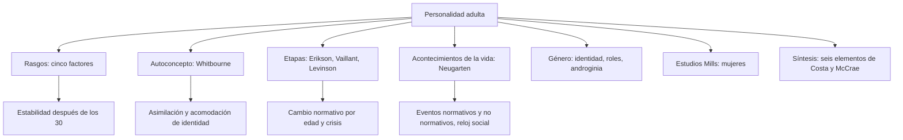
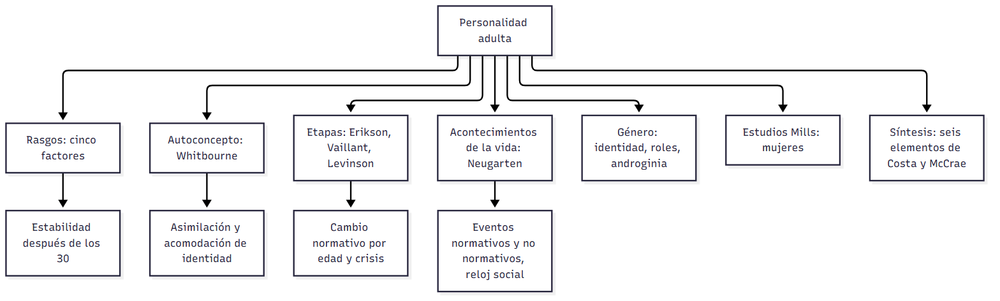
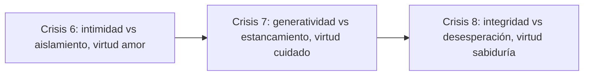
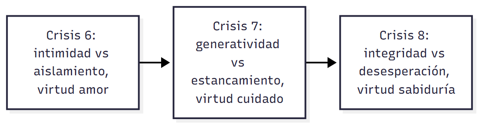
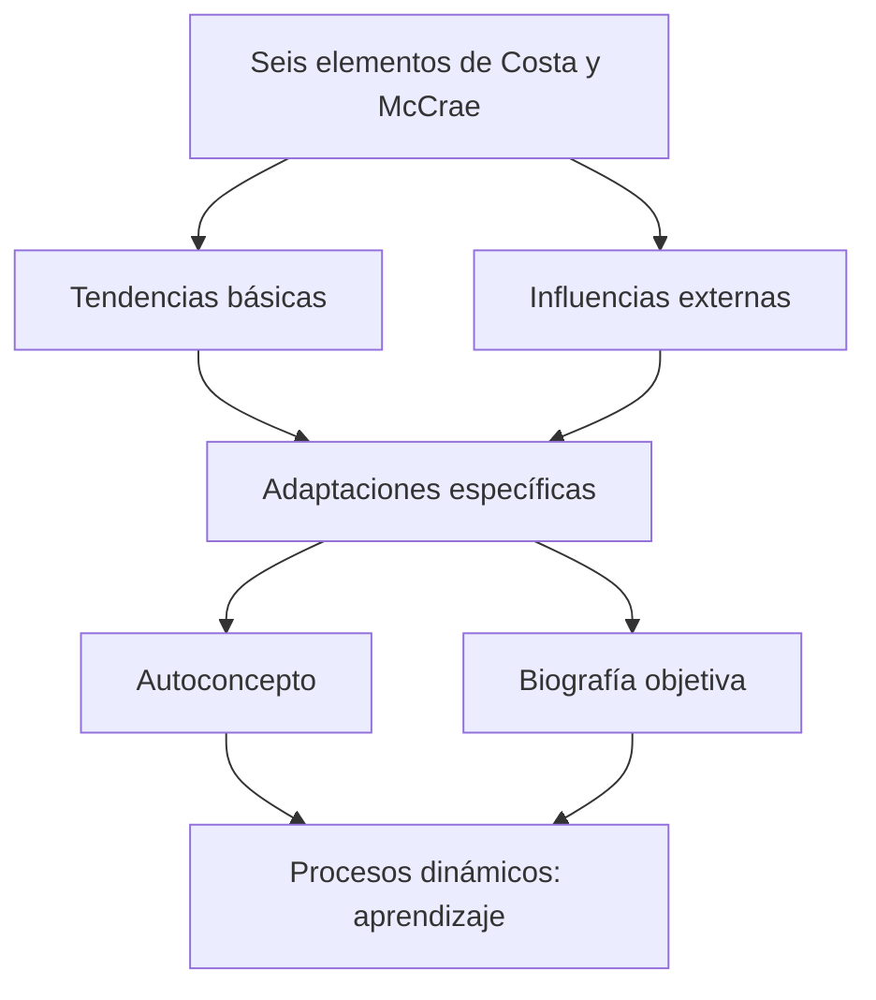
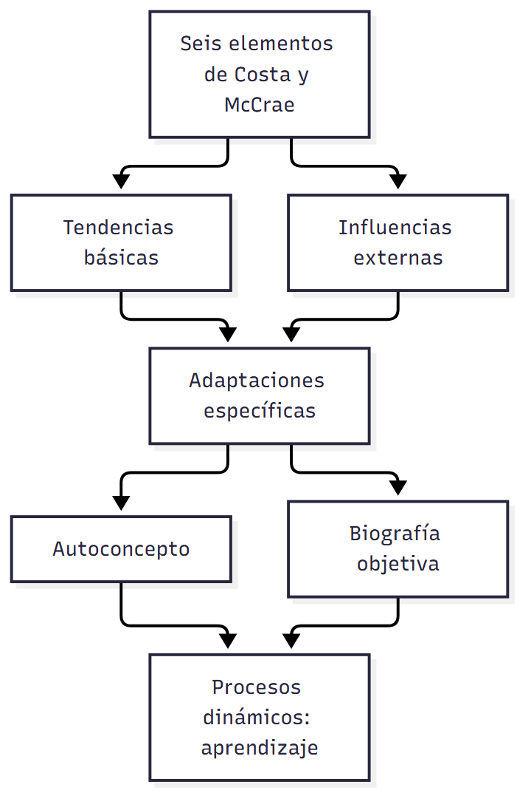

# C21 — Personalidad en la adultez: estabilidad, cambio y género

> **Fuentes:**
>
> - Papalia, D. E., Sterns, H. L., Feldman, R. D., & Camp, C. J. (2009b). Desarrollo de la personalidad. En *Desarrollo del adulto y vejez* (cap. 11, pp. 392-430). McGraw Hill Interamericana. [Bibliografía obligatoria de la unidad 10]
>
> **Materia:** Psicología Evolutiva, 2.º año, Universidad Favaloro (docente a cargo: Dra. Verónica A. Ramírez). Unidad 10, clase 21 (cronograma: 13/10/2026). Examen: 4.º parcial, 03/11/2026.

> **Aviso sobre las fuentes:** (1) Las páginas son las **impresas** del libro (392-430). (2) Esta clase **todavía no se dictó** (13/10/2026): no hay diapositivas ni apuntes de clase, así que la guía sale solo del capítulo 11; cuando tengas la presentación y tus apuntes, **contrastá** lo que la cátedra resalta (por ejemplo, el programa dice «teorías de la personalidad, cambios en la personalidad y desarrollo de la creatividad»; la creatividad está en el cap. 6 → `C18_Inteligencia_Guia.md`). (3) La portada (p. 392) quedó mezclada en la extracción: de ella solo se recuperan el título («Desarrollo de la personalidad») y las dos citas que abren el debate; la historia de Eva Perón se arma con las pp. 393-394. (4) Los datos son de EE. UU. y de estudios de los años 1930-2004.

> **Idea-fuerza:** La personalidad adulta combina **estabilidad y cambio**. Según los **modelos de rasgos** (Costa y McCrae: cinco factores), los rasgos básicos son muy estables después de los 30 años; según los **modelos de etapas** (Erikson, Vaillant, Levinson, Helson), hay cambios normativos ligados a la edad; según el **modelo de los acontecimientos de la vida** (Neugarten), importa el momento («reloj social») en que ocurren los eventos; y según los **modelos del autoconcepto** (Whitbourne), la persona regula su desarrollo equilibrando asimilación y acomodación de identidad. El **género** modula todo el desarrollo, y las mujeres de Mills (Helson) muestran que sus cambios normativos difieren de los de los varones de los estudios clásicos (Papalia et al., 2009b, pp. 399-400, 427-428).

## Hilo conductor: cómo se conectan los temas de esta guía

El capítulo empieza con **Eva Perón**, un enigma: ¿una santa o una arpía? ¿Qué tanto fue producto de su origen (hija ilegítima, pobre, rechazada) y qué tanto de su temperamento? ¿Cambió con el éxito o su carácter siguió igual? Y, como murió a los 33 años, ¿cómo habría sido de haber llegado a la adultez media y a la vejez? Esas preguntas, que se pueden hacer sobre cualquier adulto, organizan la guía: **¿de dónde viene la personalidad adulta, cuánto cambia y por qué?**

Primero (sección 1) se **define** la personalidad y se ve cómo se **mide** (inventarios, Q-sort) y de dónde **proviene** (temperamento heredado + experiencia, en interacción). Segundo (sección 2) se plantea el **gran debate estabilidad vs. cambio** y se presentan los cuatro grandes modelos con la propuesta de integración de Costa y McCrae (seis elementos): **rasgos** (cinco factores: estabilidad), **autoconcepto** (Whitbourne: asimilación/acomodación de identidad), **etapas** (Erikson, Vaillant, Levinson: cambio normativo; crisis de la adultez media) y **acontecimientos de la vida** (Neugarten: eventos normativos y no normativos, reloj social). Tercero (sección 3), el **género**: estereotipos, roles e identidad, cómo se desarrolla la identidad de género (psicoanálisis, yo en relación, aprendizaje social, cognitivo-evolutiva, esquema de género), androginia y cambios en la adultez (Jung, Gutmann). Cuarto (sección 4), los **estudios Mills** de Helson: mujeres cuyo desarrollo corrige el sesgo masculino de los modelos de etapas. Quinto (sección 5), la **síntesis**: la personalidad adulta ilustra el enfoque del ciclo de vida (multidireccionalidad, contexto histórico y cultural, interdisciplina) y su función central es la **adaptación**, tema del capítulo 12 (Papalia et al., 2009b, pp. 394, 428).

> 🎯 **Para el parcial:** para cada modelo respondé siempre tres cosas: (1) **qué mide o describe** (rasgos / autoconcepto / etapas / eventos), (2) **qué dice de estabilidad vs. cambio**, (3) **su crítica** (muestras masculinas y de élite, cohorte, cultura). Y cuando compares, nombrá el eje: Costa y McCrae = estabilidad; Erikson/Levinson = cambio por etapas; Neugarten = cambio por eventos y tiempo; Whitbourne = equilibrio dinámico.

**En una sola oración:** la personalidad es un patrón de pensar, sentir y comportarse que combina rasgos relativamente estables con cambios ligados a la edad, a los acontecimientos de la vida y al género, y cuya función es la adaptación.

## 0. Hoja de ruta

1. **Punto de partida y definición** (Papalia et al., 2009b, pp. 392-395).
2. **Medición y orígenes de la personalidad** (pp. 396-399).
3. **Modelos de la personalidad adulta: estabilidad o cambio** (pp. 399-417): rasgos, autoconcepto, etapas, acontecimientos de la vida.
4. **Género y personalidad** (pp. 417-422).
5. **Los estudios Mills** (pp. 421-427).
6. **Síntesis** (pp. 427-428).
7. **Para rendir**.

## 🎯 Lo que entra sí o sí

1. **Definición de personalidad** (Mischel): patrones distintivos de comportamiento, pensamientos y emociones que caracterizan la adaptación; función de **adaptación** (Papalia et al., 2009b, p. 395).
2. **Inventario de personalidad, metodología Q, yo real / yo ideal** (pp. 397-398).
3. **Temperamento** y **herencia + experiencia** en interacción (pp. 398-399).
4. **Los cuatro modelos** (rasgos, autoconcepto, etapas, acontecimientos) y los **seis elementos** de Costa y McCrae (pp. 399-400).
5. **Cinco factores** (neuroticismo, extraversión, apertura a la experiencia, meticulosidad, amabilidad) y la evidencia de estabilidad (pp. 401-404).
6. **Whitbourne**: estilos de identidad; asimilación y acomodación de identidad (p. 406).
7. **Erikson** (crisis 6, 7 y 8: intimidad, generatividad, integridad), **Vaillant** (estudio Grant), **Levinson** (estructura de vida) (pp. 407-413) y la **crisis de la adultez media** (recuadro 11.2).
8. **Neugarten**: eventos normativos / no normativos, reloj social (pp. 415-417).
9. **Identidad y roles de género; androginia (Bem)**; teorías de la identidad de género (pp. 417-420).
10. **Cambios en los roles de género en la adultez** (Jung, Gutmann) y los **estudios Mills** (Helson) (pp. 420-427).

---

## 1. Definición, medición y orígenes de la personalidad

### 1.1 Respuesta modelo (para escribir en el parcial)

> **Esqueleto de la respuesta:**
> 1. **Tesis:** la personalidad es el conjunto de patrones distintivos y relativamente constantes de pensar, sentir y comportarse con que cada persona se adapta.
> 2. **Definición** (Mischel, 1986) y función adaptativa (Papalia et al., 2009b, p. 395).
> 3. **Medición:** inventarios, Q-sort (yo real/ideal), entrevistas y autorreportes; sesgos (pp. 397-398).
> 4. **Orígenes:** temperamento hereditario + experiencia (ambiente no compartido); interacción (pp. 398-399).
> 5. **Ejemplo:** estudio Terman: la meticulosidad predice longevidad (pp. 396-397).

La personalidad es la forma única y relativamente constante de sentir, pensar y comportarse de una persona; sirve para adaptarse (ajustarse a los eventos y circunstancias). Se mide con inventarios de personalidad, la metodología Q (Q-sort), entrevistas y autorreportes, todos con riesgos de sesgo, aunque el juicio humano resulta una fuente razonablemente válida. Se origina en la interacción de herencia (temperamento) y experiencia: los gemelos muestran que el ambiente explica la mitad de las variaciones, y es un ambiente en buena parte no compartido. En el estudio Terman, la meticulosidad (disciplina, autocontrol) predijo mejor la longevidad que el optimismo infantil (Papalia et al., 2009b, pp. 395-399).

> ⚠ **No confundir:** *personalidad* (patrón de pensamientos, emociones y conductas, incluye estructura interna) con *conducta observable* (la definen así los conductistas, como Skinner) y con *temperamento* (disposición biológica de abordar y reaccionar emocionalmente; parte de la personalidad, pp. 395, 398).

### 1.2 Desarrollo ampliado

**Eva Perón** (pp. 392-394). Eva («Evita») nació en 1919 en Los Toldos: quinta hija ilegítima de una campesina pobre e inculta y de un hombre casado; cuando su padre murió, la familia de éste intentó impedirles ir al funeral; fueron rechazados por las personas «respetables»; ella se llamó a sí misma «mujer del pueblo». Niña frágil, apasionada, dada a las rabietas e impulsada por sueños de gloria; solo fue a la escuela primaria; aprendió en el «tempestuoso hogar materno» «que la vida era una lucha por la sobrevivencia». A los 15 años migró a Buenos Aires para ser actriz (no muy talentosa, pero hacia 1943 protagonizó una serie radiofónica); fue amante del coronel Juan Domingo Perón (viudo que le doblaba la edad), que la puso al frente del sindicato de la radio; cuando Perón fue arrestado (octubre de 1945), el 17 de octubre miles de trabajadores marcharon a la casa de gobierno (una demostración «espontánea» que Eva ayudó a organizar); se casaron y él fue presidente; Eva, con fuerza política propia, trabajaba jornadas de 18 horas, recibía hasta 26 delegaciones por día, hizo una gira por Europa, tuvo tres periódicos, impulsó el voto femenino, organizó la rama femenina del partido peronista y creó la **Fundación Eva Perón** (hospitales, clínicas, escuelas, juguetes; financiada con aportes obligatorios y donativos que sus opositores llamaron extorsiones). Compitió por la vicepresidencia en 1951 y se retiró presionada por los militares; enferma de cáncer, mantuvo un ritmo frenético y murió al mes siguiente de cumplir 33 años; su fila de dolientes se extendió 35 cuadras; fue honrada como santa y tres años después, al caer Perón, derribaron sus estatuas. Fue «un enigma»: para unos, amiga desinteresada de los marginados y luchadora por los derechos de la mujer; para sus enemigos, ávida de poder, manipuladora y cruel. Preguntas del capítulo: ¿en qué medida fue **producto de sus antecedentes familiares y de las condiciones sociales**? ¿**cambió** con el éxito o su carácter permaneció igual? ¿cómo habría sido de haber vivido hasta la adultez media y la vejez? Preguntas sobre cualquier adulto: ¿la personalidad es producto de **tendencias innatas** o de la **experiencia**? ¿cómo y en qué medida cambia durante la vida adulta? ¿cuánto influyen la **cultura** y el **género**? (pp. 393-394). (En la extracción, los rasgos de Eva Perón en los cinco factores: alta extraversión y apertura, alta en algunas facetas de neuroticismo, baja amabilidad; pp. 401-402.)

**¿Qué es la personalidad?** (pp. 395). Hay casi tantas definiciones como investigadores, pero un concepto subyace a casi todas: la personalidad es **la esencia de una persona, lo que la hace única e irrepetible**. Es difícil de definir porque **no se puede ver, escuchar o tocar: se infiere del comportamiento**. Los **conductistas** (B. F. Skinner) la definen como el comportamiento observable; la mayoría de los psicólogos la piensan también como una **estructura interna** de la mente y las emociones detrás de lo que las personas dicen y hacen (Hjelle y Ziegler, 1992), responsable de actitudes y patrones de comportamiento suficientemente regulares. Si un amigo cambia súbitamente de tímido a sociable y de pasivo a agresivo, se diría que «no es él mismo». **Adaptación:** ajuste a los eventos, circunstancias y condiciones de la vida; **función importante de la personalidad**; las personas se adaptan modificando algo de sí mismas, del entorno o de ambos, pero las formas de adaptarse muestran **estabilidad** (generalizaciones consistentes; Block, 1993): ante un examen reprobado, uno se queja de que no fue justo, otro se culpa por no haber estudiado; ante un accidente automovilístico reaccionarían igual. **Definición de Mischel (1986, p. 4, citado en Papalia et al., 2009b, p. 395):** un conjunto de «patrones de comportamiento, pensamientos y emociones distintivos que caracterizan la forma en que cada individuo se adapta a las situaciones de su vida»; es decir, **la única y relativamente constante forma de sentir, pensar y comportarse de una persona** (p. 395).

**Recuadro 11.1: ¿la personalidad predice la salud y la longevidad?** (pp. 396-397). Estudio Terman de niños sobredotados: ~**1 500** escolares californianos elegidos a los 11 años por CI alto, seguidos desde **1921**; entre 1986 y 1991, con los sobrevivientes cerca de los 80 años, se analizaron cuántos habían muerto y a qué edad para identificar predictores de longevidad (Friedman et al., 1993, 1995; Tucker y Friedman, 1996); los «**termitas**» eran muy inteligentes y cultos, de modo que no se confundían con nutrición deficiente, pobreza o falta de atención médica. Hallazgos: **ni la autoconfianza infantil, ni la energía ni la sociabilidad ni el optimismo** se relacionaron con la longevidad; de hecho, **los niños alegres tuvieron más probabilidad de morir más jóvenes**; lo que sí predijo la longevidad fue la dimensión llamada **meticulosidad o confiabilidad** (disciplina, prudencia, autocontrol). Los niños alegres crecen quizá más descuidados con su salud; una visión despreocupada puede servir en el corto plazo (recuperarse de una enfermedad) pero ser peligrosa a largo plazo (Martin et al., 2002). Las personas meticulosas tienden a conductas saludables (menos fumar, beber, drogas, sedentarismo, mala alimentación, violencia, sexo riesgoso, conducción peligrosa, suicidio; Bogg y Roberts, 2004); en un estudio longitudinal de **883** miembros ancianos del clero católico, los muy meticulosos tuvieron la mitad del riesgo de morir en cinco años; los de alto neuroticismo casi el doble de riesgo (Wilson et al., 2004). En Terman, la meticulosidad se asoció con más años de educación, menos problemas mentales y menos divorcio. La **estabilidad matrimonial** (no el matrimonio en sí): los termitas en su primer matrimonio a los 40 vivieron más que los divorciados; **quienes sufrieron el divorcio de sus padres antes de los 21 años (13 % de la muestra) vivieron, en promedio, cuatro años menos**; la muerte temprana de un padre influyó poco; los niños impulsivos tuvieron más probabilidad de matrimonios inestables y de morir más jóvenes; los hijos de padres divorciados tuvieron más probabilidad de divorciarse. Conclusión: las personas responsables, confiables y diligentes para cuidarse y preservar sus matrimonios, y quienes tuvieron padres casados, son «recompensadas con más años de vida». La estabilidad de la personalidad es esencial (adolescentes «chispeantes» → adultos de 40 alegres; quejumbrosos → irritables; asertivos de 20 → honestos de 30; quienes enfrentaban bien los problemas de jóvenes los manejan bien de maduros), pero algunos aspectos **se atenúan con la madurez** (los niños impulsivos son menos impulsivos de adultos; Stewart y Olds, 1973) (p. 396-397).

**Medición** (pp. 397-398). Para estudiar la personalidad científicamente hay que medirla.
- **Inventario de personalidad:** test psicométrico que pregunta a la persona sobre sí misma o sobre otros, con referencia a rasgos como escrupulosidad, confianza e irritabilidad; sobre actividades que disfruta u opiniones; al comparar calificaciones de adultos de distintas edades (la misma o diferentes personas) se calcula cuánto cambia con el tiempo.
- **Metodología Q (Q-sort):** a la persona se le da un paquete de tarjetas con enunciados o adjetivos («con frecuencia estoy solo», «enérgico», «ansioso») que ordena en categorías según cuán cercanamente la describen. Variación (para evaluar una terapia): jerarquizar las características del **yo real** (quién es) y del **yo ideal** (quién le gustaría ser) y comparar en ocasiones sucesivas.
- Otras: la técnica de **Helson**: graficar el involucramiento con los roles de madre, compañera y trabajadora en varias épocas de la vida.
- **Sesgos:** sesgos del observador y subjetividad; las entrevistas y autorreportes son subjetivos y abiertos, difíciles de cuantificar; se argumenta que los datos basados en el juicio humano falible pueden ser imprecisos (Ross y Nisbett, 1991); sin embargo, hay una **fuerte correlación entre los juicios de varias personas** sobre otra (Kenrick y Funder, 1988) y los juicios resisten bien las observaciones y predicciones: la mayoría de los psicólogos reconoce que **los juicios humanos sobre la personalidad la describen razonablemente bien** (Block, 1993; Funder, 1993).

**Orígenes: herencia y experiencia** (pp. 398-399). A pesar de su estabilidad esencial, la personalidad **no está determinada desde el nacimiento**: es un «proceso en evolución sujeto a una variedad de influencias tanto internas como externas» (Hjelle y Ziegler, 1992); el ambiente y la maduración afectan cómo se **expresa** el carácter mientras los **rasgos subyacentes permanecen estables** (Vaillant, 2002). **Temperamento** (disposición): parte relevante; refleja características personales biológicamente determinadas de abordar y reaccionar emocionalmente ante personas y situaciones; ser flexible y despreocupado, resistente a nuevas experiencias o lento para entrar en confianza parece determinado principalmente por la herencia (Thomas y Chess, 1984). La influencia genética varía en un amplio rango de características (de la timidez, Kagan 1989, al liderazgo, Tellegen et al., 1988). Pero **los genes no cuentan toda la historia**: Eaves, Eysenck y Martin (1989) revisaron investigaciones con gemelos idénticos, fraternos y otros familiares (Gran Bretaña, Australia, Suecia, EE. UU.): **las influencias ambientales explicaron por completo la mitad de las variaciones medidas en la personalidad**, y esas experiencias influyentes son **únicas, incluso para personas que crecen en el mismo hogar** (por eso Eva Perón, y no sus hermanas, se convirtió en primera dama). La singularidad de la experiencia puede reflejar diferencias de temperamento: el comportamiento de los niños **evoca respuestas** (la sonrisa del padre al bebé que sonríe) que refuerzan la disposición innata (Caspi, 1993; Lytton, 1990); en un estudio, el temperamento de niños de 3-6 años afectó cómo sus padres interactuaron con ellos tres años después, y juntos explicaron el optimismo/pesimismo 21 años después (Heinonen et al., 2005). Los niños **buscan ambientes** que fortalecen sus tendencias (eligen amigos y compañeros como ellos); algunas diferencias genéticas entre gemelos fraternos aumentan en la adultez por nuevas experiencias reforzadoras (Eaves et al., 1989). **Una interacción de herencia y experiencia afecta la personalidad en todas las edades** (Bates y Wachs, 1994) (pp. 398-399).

> 🔑 **Punto clave:** estabilidad esencial + adaptación: los **rasgos subyacentes** son estables; su **expresión** cambia con el ambiente y la maduración.

---

## 2. Modelos de la personalidad adulta: estabilidad o cambio

### 2.1 Respuesta modelo (para escribir en el parcial)

> **Esqueleto de la respuesta:**
> 1. **Tesis:** el gran debate es estabilidad vs. cambio; cuatro modelos dan respuestas distintas.
> 2. **Rasgos** (Costa y McCrae): estabilidad después de los 30 (Papalia et al., 2009b, pp. 400-404).
> 3. **Autoconcepto** (Whitbourne): equilibrio entre asimilación y acomodación de identidad (p. 406).
> 4. **Etapas** (Erikson, Vaillant, Levinson): cambios normativos con crisis (pp. 407-413).
> 5. **Acontecimientos de la vida** (Neugarten): eventos normativos/no normativos y reloj social (pp. 415-417).
> 6. **Integración:** Costa y McCrae (seis elementos) y Helson (pp. 400, 428).

Los modelos de rasgos (Costa y McCrae, cinco factores) hallan que la personalidad es estable después de los 30 años; los del autoconcepto (Whitbourne) integran estabilidad y cambio mediante la asimilación y acomodación de identidad; los de etapas (Erikson, Vaillant, Levinson) describen cambios normativos ligados a la edad, con crisis; y el modelo de los acontecimientos de la vida (Neugarten) sostiene que el cambio depende del momento en que ocurren los eventos (reloj social). Costa y McCrae proponen un mapa de seis elementos (tendencias básicas, influencias externas, adaptaciones específicas, autoconcepto, biografía objetiva y procesos dinámicos) para integrarlos (Papalia et al., 2009b, pp. 399-400).

> ⚠ **No confundir:** *tendencias básicas* (heredadas o adquiridas: rasgos, salud, apariencia, género, inteligencia: lo que menos cambia) con *adaptaciones específicas* (roles, actitudes, intereses, hábitos: resultado de tendencias + influencias externas) y con la *biografía objetiva* (los hechos reales de la vida) frente al *autoconcepto* (cómo la persona se ve; solo parcialmente parecido) (p. 400).

### 2.2 Desarrollo ampliado

**Cuatro modelos y la estabilidad vs. cambio** (pp. 399-400). La pregunta: ¿la personalidad «se consolida como un yeso» en la adultez temprana, o los adultos pueden continuar «naciendo» ellos mismos? (las dos citas con que abre el capítulo, de William James —«hacia la edad de treinta años, el carácter se ha fraguado como un yeso que nunca volverá a suavizarse»— y de Gabriel García Márquez —«La vida los obliga una y otra vez a volver a nacer por sí mismos»—, son los extremos del debate; Papalia et al., 2009b, pp. 392, 399). Cada perspectiva metateórica usa definiciones, supuestos y herramientas distintos y encuentra respuestas diversas:
- **Modelos de rasgos** (mecanicistas): se enfocan en rasgos mentales, emocionales, temperamentales y conductuales; intentan reducir la personalidad a sus elementos básicos; suponen que predicen bastante bien la conducta. Hallazgo: la personalidad adulta **cambia muy poco**.
- **Modelos del autoconcepto:** se preocupan por **cómo la gente se ve a sí misma**; describen a las personas como **reguladoras activas** del desarrollo de su propia personalidad mediante procesos similares a los de las teorías organicistas (Piaget); incorporan **estabilidad y cambio**.
- **Modelos de etapas** (organicistas): una **secuencia típica de desarrollo relacionado con la edad** a lo largo de todo el ciclo de vida; encuentran **cambios significativos y predecibles**.
- **Modelo de los acontecimientos de la vida** (contextual): el cambio se relaciona **no tanto con la edad como con las circunstancias y eventos de la vida**.
**Un mapa de integración** (Costa y McCrae, 1994a, 1994b, p. 23, citado en Papalia et al., 2009b, p. 400): seis elementos interrelacionados «que constituyen el material que sirve de base para la mayoría de las teorías de personalidad»: (1) **tendencias básicas** (rasgos de personalidad, salud física, apariencia, género, orientación sexual, inteligencia y habilidades artísticas; heredadas o adquiridas); (2) **influencias externas** (ambientales); (3) **adaptaciones específicas** (roles sociales, actitudes, intereses, habilidades, actividades, hábitos, creencias: p. ej., inclinación musical [tendencia] + exposición a un instrumento [influencia externa] = habilidad musical [adaptación]); (4) **autoconcepto** (sentido del yo, solo parcialmente parecido a la biografía objetiva: una mujer puede creer que tiene más habilidad musical de la que demuestra, y su conducta ser influida por esa autoimagen); (5) **biografía objetiva** (hechos reales de la vida); (6) **procesos dinámicos** (el aprendizaje, que permite adaptarse a influencias externas). Los modelos de rasgos se enfocan en las tendencias básicas (las que menos cambian); los del autoconcepto, en el sentido del yo; los de etapas y de acontecimientos, en la biografía objetiva (aspectos universales o particulares) (p. 400).

### 2.3 Modelos de rasgos: los cinco factores

> **Esqueleto de la respuesta:**
> 1. **Tesis:** la personalidad adulta tiene cinco dimensiones estables después de los 30 años.
> 2. **Las cinco:** neuroticismo, extraversión, apertura a la experiencia, meticulosidad, amabilidad (Papalia et al., 2009b, p. 401).
> 3. **Evidencia:** estudio de Baltimore, muestra nacional de más de 10 mil, cinco culturas (pp. 402-403).
> 4. **Cambios pequeños:** N, E y apertura bajan hasta los 30 y luego más lento; A y M aumentan (p. 402).
> 5. **Críticas:** limitado; no explica todo (p. 403).

**Modelo de los cinco factores** (Costa y McCrae, 1994a, 1994b; investigadores del National Institute on Aging) (pp. 401-403). Cinco dimensiones o dominios, cada una con facetas (figura 11.1):
1. **Neuroticismo**: seis rasgos negativos: **ansiedad, hostilidad, depresión, timidez (autoconciencia), impulsividad y vulnerabilidad**; las personas muy neuróticas son nerviosas, temerosas, irritables, se enojan con facilidad y son sensibles a la crítica; se sienten tristes, desamparadas, solitarias, culpables y sin valía.
2. **Extraversión**: seis facetas: **calidez, gregarismo, asertividad, actividad, búsqueda de emociones fuertes y sentimientos positivos**; sociables, «se hacen cargo», relaciones cercanas, les gusta la atención, ocupados y activos.
3. **Apertura a la experiencia**: desean intentar nuevas actividades, abrazan ideas novedosas, vívida imaginación, sentimientos fuertes, aprecian la belleza y las artes, cuestionan valores tradicionales (facetas: fantasía, estética, sentimientos, acciones, ideas, valores).
4. **Meticulosidad** (escrupulosidad): competentes, ordenadas, obedientes, decididas, disciplinadas; responsables que logran lo que se proponen (competencia, orden, obediencia, necesidad de logro, autodisciplina, deliberación).
5. **Amabilidad** (afabilidad): confiables, francas, altruistas, complacientes, modestas, fácilmente influenciables (confianza, franqueza, altruismo, actitud conciliadora, modestia, sensibilidad).
Eva Perón: puntuaciones altas en algunas facetas de neuroticismo, en extraversión y en apertura, y probablemente alta en meticulosidad; **baja en amabilidad** (p. 402).
**Evidencia** (Costa y McCrae, 1980-1994; McCrae et al., 2000): datos transversales, longitudinales y secuenciales, incluido su **estudio longitudinal de envejecimiento de Baltimore** (voluntarios predominantemente blancos con educación universitaria: sesgo de muestreo), con inventarios, entrevistas estructuradas, clasificaciones de cónyuges y pares; **alto grado de estabilidad en las cinco dimensiones** (muestras de 20 a 90 años); para controlar el sesgo compararon con un estudio transversal de **más de 10 mil** personas de 32 a 88 años: diferencias muy pequeñas, incluso en la adultez media (que algunos describen como época de trastornos). Sí hay diferencias por edad (universitarios, adultos jóvenes, adultos medios): en promedio, **neuroticismo, extraversión y apertura descienden de los 18 a los 30 años y luego más lentamente; amabilidad y meticulosidad aumentan lentamente** (McCrae et al., 2000, 2004). Consistencia en el desarrollo a través de **cinco culturas** (británica, checa, alemana, española y turca; figura 11.2: nivel medio de afabilidad por edad): sugiere que los rasgos pueden ser **principalmente de origen biológico** y desarrollarse por maduración intrínseca, independientemente de las influencias ambientales; los índices de cambio se lentifican después de ~30 años; la cultura afecta la **expresión** pero los **patrones de rasgos** son similares entre culturas (Hofstede y McCrae, 2004). **Críticas:** Helson (1993) califica la investigación de rasgos de **muy limitada** porque no explica aspectos que cambian; Costa y McCrae responden que **los cambios drásticos reflejan tendencias estables** (quien hace cambios radicales de carrera en la adultez media probablemente tiene una tendencia básica a la apertura); otra visión: los cinco grandes pueden no explicar todas las variaciones (O'Connor, 2002) (p. 403).
**Dimensiones en la vejez** (pp. 403-404): estudio longitudinal de **74 californianos de 69 a 93 años**, con un modelo de rasgos algo distinto: en períodos de **catorce años**, la **amabilidad aumentó**; la **extraversión** (locuacidad, franqueza, excitabilidad) y la **actividad, energía y salud** **disminuyeron**; las más estables: **satisfacción** (autoestima, alegría, satisfacción consigo mismo y con las circunstancias, poca tendencia a preocuparse) e **intelecto** (funcionamiento cognitivo y mentalidad abierta) (Field y Millsap, 1991). Pero un estudio secuencial de **más de 3 mil ancianos** halló **poco cambio en siete años**, sino **diferencias de cohorte** (hoy los ancianos son más flexibles y adaptables y menos responsables socialmente que generaciones previas): las diferencias de los estudios transversales pueden reflejar diferencias culturales entre cohortes, no cambios en los individuos (Schaie y Willis, 1991).
**Visiones legas del cambio de personalidad** (pp. 404-405): la mayoría de las investigaciones se basa en **autocalificaciones**; los investigadores rara vez preguntan a las personas cuánto creen que cambia. Estudios con adultos de 26 a 64 años (Fleeson y Heckhausen, 1997; Lachman y Bertrand, 2001) comparan **retrospectiva, presente y anticipación**: las personas se perciben a sí mismas como **cambiantes** (positiva o negativamente); los adultos medios se consideran más confiados, más capaces de manejar el estrés e independientes de lo que serán; perciben mayor bienestar presente que pasado y esperan mejorar en relaciones y autoaceptación, pero **esperan descensos** en propósito en la vida, crecimiento personal y dominio ambiental; la personalidad de la vejez se anticipa con **más pérdidas que ganancias** (figura 11.3). Otro estudio de seis a nueve años (Herbst et al., 2000): las personas son **complacientes** con sus creencias, más probables de reportar aumentos en rasgos deseables (afabilidad) que indeseables (neurosis). La investigación longitudinal previa (Birren y Woodruff, 1972) halló que, al comparar calificaciones reales de veinte años antes con lo que recordaban, los individuos **reportaron más cambio del que realmente mostraron**.

### 2.4 Modelo del autoconcepto

> **Esqueleto de la respuesta:**
> 1. **Tesis:** el autoconcepto (visión de uno mismo) es el núcleo de la personalidad; se construye socialmente y vive en tensión entre estabilidad y cambio.
> 2. **Esquemas:** modelos operativos; autocomprensión y autorregulación; «posibles yoes» (Markus y Nurius) (Papalia et al., 2009b, pp. 405-406).
> 3. **Whitbourne:** estilos de identidad; asimilación y acomodación de identidad (p. 406).
> 4. **Equilibrio:** el exceso de asimilación (ciego a la realidad) o de acomodación (débil, influenciable) es poco saludable.

Para los teóricos del autoconcepto, el sentido del yo es un fenómeno social construido en la interacción con otros. El autoconcepto se organiza con esquemas (modelos operativos de realidad en torno a los que se organiza el comportamiento), incluye autocomprensión y autorregulación y vive en tensión entre estabilidad y cambio. Whitbourne propone estilos de identidad (formas características de confrontar, interpretar y responder a la experiencia) y dos procesos: la asimilación de identidad (ajustar nuevas experiencias a un autoconcepto existente) y la acomodación de identidad (revisar la autoimagen ante lo que no se puede explicar). El equilibrio entre ambos define el estilo de identidad (Papalia et al., 2009b, pp. 405-406).

**Autoconcepto y esquemas** (pp. 405-406). «¿Quién soy en el mundo? ¡Ah!, ése es el gran acertijo» (Alicia): llegar a conocer el propio yo es un proceso de toda la vida. El autoconcepto es el **núcleo de la personalidad**; muchos psicólogos lo ven como fenómeno **social**, construido a partir de la interacción con otros (la persona se mira en un espejo y ve reflejada la imagen creada por su mundo social). Se ocupa del lado **cognitivo** de la personalidad: lo que la gente cree acerca de quiénes son; está constituido por **esquemas**: modelos operativos o constructos de realidad en torno a los que se organiza el comportamiento (p. ej., un esquema de habilidad musical); incluye el conocimiento de lo que una persona ha sido y ha hecho y la guía para decidir qué ser y hacer: **autocomprensión y autorregulación** (Markus y Cross, 1990; Markus y Nurius, 1986). Los esquemas son tentativos: se revisan para ajustarse a la experiencia; pero las interpretaciones son subjetivas: un esquema puede **filtrar** información que desafía las creencias sobre uno mismo (Caspi, 1993; Swann, 1983): por eso el autoconcepto vive en una **tensión dinámica entre estabilidad y cambio**. Las personas evalúan subjetivamente su desarrollo personal respecto de su entorno social según lo que **podrían, quisieran y temen llegar a ser** («posibles yoes», Markus y Nurius, 1986): esperanza y miedo se internalizan en la estructura del yo y ayudan a adaptarse a nuevos roles y transiciones (Lachman y Bertrand, 2001).
**Whitbourne** (1987; Whitbourne y Connolly, 1999; Whitbourne y Primus, 1996) (p. 406): se enfoca en los **estilos de identidad**: formas características de confrontar, interpretar y responder a la experiencia. La identidad se construye con **imágenes acumuladas del yo** (conscientes e inconscientes); los rasgos percibidos (sensibilidad, obstinación) forman parte; las autoimágenes permanecen estables a menos que se contradigan con cambios en circunstancias o roles; aun entonces, no destruyen la continuidad sino que se incorporan en una imagen modificada. Dos procesos de interacción continuos con el entorno social (similares a los de Piaget): **asimilación de identidad** (ajustar nuevas experiencias al autoconcepto existente: quien se considera una madre digna y amorosa verá sus interacciones positivamente; si el hijo se vuelve difícil, minimiza el problema como «fase» temporal); **acomodación de identidad** (ajustar la autoimagen cuando algo no se puede explicar: si su hijo le roba constantemente; dolorosa pero necesaria para la adaptación efectiva). **Equilibrio:** quienes constantemente asimilan son ciegos a la realidad; quienes acomodan siempre son débiles y fácilmente influenciables; **dónde encuentra una persona el equilibrio determina su estilo de identidad**. El modelo incorpora en un concepto de personalidad esencialmente estable un mecanismo flexible para lidiar con experiencia nueva, pero **aún no cuenta con una sólida base de investigación** (p. 407).

### 2.5 Modelos de etapas

> **Esqueleto de la respuesta:**
> 1. **Tesis:** los modelos de etapas describen cambios normativos de personalidad ligados a la edad, con tareas o crisis comunes.
> 2. **Erikson:** crisis 6 (intimidad/aislamiento), 7 (generatividad/estancamiento), 8 (integridad/desesperación) y sus virtudes (Papalia et al., 2009b, pp. 407-409).
> 3. **Vaillant:** estudio Grant; tareas y patrones típicos (pp. 409-412).
> 4. **Levinson:** estructura de vida, fases y transiciones; crisis de los 40 (pp. 412-413).
> 5. **Críticas:** muestras masculinas, de élite y de otra cohorte; cultura (pp. 413-415).

Los modelos de etapas describen cambios normativos ligados a la edad, comunes a la mayoría de una población, en períodos sucesivos marcados por crisis emocionales. Erikson plantea ocho crisis; en la adultez: intimidad vs. aislamiento (virtud: amor), generatividad vs. estancamiento (cuidado) e integridad vs. desesperación (sabiduría). Vaillant (estudio Grant) halló una secuencia de tareas (identidad, intimidad, consolidación de carrera, generatividad, guardián del significado, integridad); Levinson, una estructura de vida que se construye y revisa en fases y transiciones, con agitación a los 40. Se las critica por basarse en muestras pequeñas de hombres blancos privilegiados nacidos en los años 20-30, y por no considerar cohortes ni culturas distintas (Papalia et al., 2009b, pp. 407-414).

> ⚠ **No confundir:** *crisis de la adultez media* (estresante y universal, según Jacques y Levinson) con *transición de la adultez media* (que a veces es estresante pero no necesariamente una crisis; mayor apoyo empírico) (p. 410, recuadro 11.2).

**Erikson: balance de tendencias positivas y negativas** (pp. 407-409; tabla 11.1). La personalidad se desarrolla mediante **ocho crisis** a través del ciclo de vida; la resolución exitosa de una crisis hace surgir una «**virtud**».
- **Crisis 6, intimidad vs. aislamiento** (adultez joven; virtud: **amor**): quienes desarrollan un fuerte sentido del yo están listos para **fusionar su identidad con la de otra persona**; Erikson hablaba de la «verdadera genitalidad» (orgasmo mutuo en una relación amorosa hombre-mujer; los críticos objetan que la virtud del amor se puede adquirir en una amplia variedad de estilos de vida). Quienes temen los compromisos profundos pueden volverse aislados y ensimismados; sin embargo, los adultos necesitan cierta cantidad de aislamiento para pensar sobre sus vidas.
- **Crisis 7, generatividad vs. estancamiento** (adultez media; virtud: **cuidado**): aunque Erikson no inventó la expresión «crisis de la adultez media» (recuadro 11.2), ve los años alrededor de los 40 como crucial: **generatividad** = preocupación por establecer y guiar a la siguiente generación; al ver hacia adelante el declive de sus vidas, los adultos maduros necesitan participar en la continuación de la vida; no se limita a los hijos y nietos propios (aunque Erikson creía que quienes no habían sido padres no podían satisfacerlo fácilmente): se expresa a través de **docencia o consejería, productividad o creatividad, y «autoproducción» (autodesarrollo)**; la virtud es el **cuidado**: «un compromiso cada vez más amplio de cuidar a las personas, los productos y las ideas que uno aprendió a proteger» (Erikson, 1985, p. 67, citado en Papalia et al., 2009b, p. 409). Quienes no encuentran una salida se vuelven **ensimismados, autoindulgentes y estancados**; el equilibrio es lo más relevante.
- **Crisis 8, integridad vs. desesperación** (vejez; virtud: **sabiduría**): los ancianos necesitan aceptar la forma en que vivieron para aceptar también su muerte cercana; luchan por un sentido de integridad (coherencia y completud) en vez de la desesperación por no poder rehacer; quienes no logran sabiduría se sienten abrumados por la desesperación al ver que el tiempo es muy corto; cierta desesperación es inevitable; la vejez es una época para jugar y recuperar una cualidad infantil; aunque terminó la procreación, puede haber **creación** (pp. 408-409).
**Vaillant: relaciones y ajuste de vida** (pp. 409-412). **Estudio Grant** de graduados de Harvard: **268** hombres seleccionados, independientes y sanos, desde **1938** en la universidad (Vaillant, 1977; Vaillant y Vaillant, 1990): las vidas se conforman por **relaciones a largo plazo**: de los hombres mejor adaptados a los 47, **93 %** se había casado antes de los 30 y seguía casado a los 50. Patrón típico: a los 20 todavía dominados por los padres; en los 20 y a veces 30 se independizan (autonomía, matrimonio, hijos, amistades); entre los 20 y los 40 entran a la etapa de **consolidación de carrera** (trabajan duro, se dedican a sus familias); **termina hacia los 40 años** (puede extenderse una década antes o después) cuando «los hombres dejan el compulsivo e irreflexivo trabajo de sus aprendizajes ocupacionales y una vez más se convierten en exploradores de su mundo interior» (Vaillant, 1977, p. 220, citado en Papalia et al., 2009b, p. 410). La transición a la adultez media puede ser estresante (cambiar el rol paterno, revalorar el pasado, sentimientos reprimidos hacia los padres, actitudes sexuales), **pero rara vez una crisis**: no tuvieron más probabilidad de divorciarse, desencantarse o deprimirse; los mejor adaptados identificaron los años **35 a 49** como los más felices. Los 50: más apacible; dedicados a otros (trabajo, caridad, hijos); más paternales y expresivos; menor diferenciación sexual. A los 65 (173 hombres): los mejor adaptados eran organizados, sensatos, estables y confiables; algunas características que antes se ligaban al buen ajuste (espontaneidad, hacer amigos con facilidad) ya no influían. En un estudio longitudinal de **306** varones del centro de la ciudad, quienes a los 47 usaban enfrentamiento inmaduro (**proyección**, **fantasía**) fueron los peor adaptados (Soldz y Vaillant, 1998). **Aging Well (Vaillant, 2002):** **tareas** de desarrollo, similares a las etapas de Erikson, por lo general secuenciales (completar una no es prerrequisito): (1) **identidad** separada de los padres (final de la adolescencia); (2) **intimidad** («expandir el yo para incluir a otra persona»; relación recíproca con compromiso, satisfacción e interdependencia; a los veinte); (3) **consolidación de carrera** (30 años; cuatro criterios que transforman un empleo en carrera: **compromiso, competencia, compensación y satisfacción**); (4) **generatividad** (guiar a la siguiente generación a través de tutoría, guía, liderazgo o docencia; darse sin egoísmos); (5) **guardián del significado** (responsabilidad de preservar la cultura, tradiciones e instituciones; se cuida el pasado en lugar de desarrollar el futuro; «responsabilidad sensible por otros adultos»); (6) **integridad** (dar sentido a la vida propia y aceptar lo que ocurrió; la sabiduría acerca de la vida es clave).
**Levinson: construcción y cambio de estructuras de vida** (pp. 412-413). Levinson (1978, 1980, 1986), en Yale: entrevistas a profundidad y pruebas a **40 hombres de 35 a 45 años** (cuatro ocupaciones: trabajadores industriales, ejecutivos, biólogos y novelistas); en **45 mujeres** (Levinson y Levinson, 1996): épocas, fases y transiciones similares pero con **restricciones psicológicas y ambientales distintas** por la división cultural de roles; sus **transiciones duran más**. Núcleo: la **estructura de vida** en evolución, «el patrón o diseño subyacente de la vida de una persona en un momento determinado» (Levinson, 1986, p. 6, citado en Papalia et al., 2009b, p. 413), construida alrededor de lo que la persona considera más relevante (trabajo y familia). Sus **fases** se unen por **períodos de transición** (revaloración de la estructura de vida; casi la mitad de la vida adulta se pasa en transiciones, que pueden producir crisis); cada fase tiene tareas que son el cimiento de la siguiente. **Fase novicia de la adultez temprana (17-33):** dejar el hogar de los padres, independencia financiera y emocional, relaciones (matrimonio, paternidad), elegir ocupación; dos tareas: construir un **sueño** (ligado a una carrera: ganar un Nobel) y encontrar un **mentor** (hombre ligeramente mayor que ofrece guía, inspiración, sabiduría, apoyo moral y ayuda práctica). **Fase culminante (33-45)**, tras la transición de los 30: se establece, metas y tiempo para lograrlas (hacia los 40); se exaspera ante la autoridad, quiere hablar con su propia voz; puede alejarse de su mentor y tener problemas con su esposa, hijos, jefe. **Transición de la vida media (≈40-45):** si el sueño no se hará realidad, **crisis emocional**: **cuatro de cada cinco** hombres se sintieron molestos y actuaron irracionalmente entre los 40 y 45 años; la agitación es **inevitable** según Levinson (se cuestionan los valores anteriores); la reevaluación ayuda a aceptar que los sueños no se cumplirán, construir una autoimagen más realista y metas asequibles. **45-50:** nuevas estructuras de vida (nuevo empleo, otro matrimonio); quienes no cambian pueden quedar en una vida limitada, o renovar su compromiso (ocupados y organizados pero no entusiasmados); quienes sí cambian encuentran la adultez media como la época más satisfactoria y creativa (Sterns y Huyck, 2001).
**Tabla 11.1 (cuatro modelos, edad aproximada)**: *Veinte:* Erikson crisis 6 (intimidad vs. aislamiento) · Vaillant intimidad · Levinson fase novicia de la adultez temprana · Helson «mal yo, mal compañero». *Treinta:* Vaillant consolidación de carrera · Levinson transición de los 30 · Helson lucha por identidad independiente. *Cuarenta:* Erikson crisis 7 (generatividad vs. estancamiento) · Vaillant generatividad · Levinson fase culminante de la adultez temprana y transición de la vida media · Helson consecuencias desagradables de la independencia. *Cincuenta:* Vaillant guardián del significado · Levinson entrada a la estructura de vida para la adultez media · Helson relaciones problemáticas; sobrecarga. *Sesenta:* Erikson crisis 8 (integridad vs. desesperación) · Vaillant integridad · Levinson transición de los 50 · Helson florecimiento de la vida.
**Recuadro 11.2: «navegar por el crucero» (crisis de la adultez media)** (pp. 410-411). La expresión (**Elliott Jacques**, 1967: lo que se presenta es la **conciencia de la mortalidad**; el tiempo se vuelve más corto; no se cumplirán todos los sueños o alcanzarlos no trajo satisfacción) entró en la conciencia pública en los setenta con las teorías de Erikson y Levinson (explicación de una depresión, una aventura o un cambio de carrera). **Jung (1966):** reconocer la eventual mortalidad y abandonar las imágenes juveniles de sí mismo son tareas de la adultez media, con un desplazamiento de la orientación hacia el exterior a un interés introspectivo que **Neugarten (1977)** llama **interioridad**. **Evidencia:** Helson (1992) halló evidencia en las mujeres Mills; otras investigaciones fracasaron en sustentarla (Costa y McCrae, 1980; Vaillant, 1977); **muchos psicólogos hablan hoy de una «transición» de la adultez media**, a veces estresante pero no necesariamente una crisis (Brim, 1977; Chiriboga, 1989). Un estudio de **300 hombres** de muestra socioeconómicamente diversa: **solo 12 %** vivió una crisis plena, aunque casi dos tercios tuvieron problemas de ajuste; los trabajadores no calificados mostraron más estrés que profesionales o ejecutivos; los de clase baja negaban o evitaban sus problemas o los expresaban con actitudes autoritarias (Farrell y Rosenberg, 1981). Estudios de casi **300 mujeres** de 35 a 55 años (Barnett, 1985; Baruch et al., 1983): **no hallaron evidencia de crisis**; los dos factores clave del ajuste saludable eran un **sentido de dominio** sobre la vida y la **cantidad de placer** derivado del vivir; el **trabajo remunerado** fue el mejor predictor de dominio; la experiencia positiva con marido e hijos (incluida una buena vida sexual) fue el mejor predictor de placer; las que puntuaron más alto en ambos fueron **mujeres casadas empleadas con hijos**; las más bajas, mujeres desempleadas, casadas y sin hijos. Que una transición se convierta en crisis depende de las circunstancias y de cómo la persona lidia con ellas («Una persona puede ir de crisis en crisis mientras otra experimenta relativamente pocas tensiones», Schlossberg, 1987); el **momento** de los eventos juega un papel (hombres que lograron éxito muy jóvenes se preguntaban a los 30: «¿valió la pena?», «¿qué sigue?»; Taguiri y Davis, citados en Baruch et al., 1983).
**Evaluación de los modelos de etapas** (pp. 413-415). **Muestras:** pequeñas, de hombres blancos privilegiados nacidos en los años 20-30: no generalizables a otras razas, niveles socioeconómicos, **cohortes** (no reflejan cambios de carrera, parejas de dos proveedores, cohabitación hetero y homosexual) ni **culturas**. **Sesgo masculino:** en Erikson la intimidad sigue a la identidad (adolescencia tardía), pero para la mujer identidad e intimidad ocurren al mismo tiempo (se define por el hombre con quien se casará); en un estudio de estudiantes de arte (Kahn et al., 1985, 18 años después, 60 % respondió): hombres con identidad sólida más probabilidad de casarse (no de matrimonios estables); mujeres con identidad sólida no más probabilidad de casarse, pero si se casaban, más probabilidad de **permanecer casadas** → insistencia en modelos específicos de la mujer (Gilligan, 1982). **Cultura:** en el **hinduismo tradicional** los hombres pasan por cuatro etapas (un ideal espiritual, sin transiciones ni crisis; cada etapa prepara la siguiente): pupilo obediente (con un gurú), propietario de casa (la esposa la eligen los padres), **partida al bosque** (se quita la «máscara» social y busca el Yo), **limosnero santo vagabundo** (se despoja de todo para identificarse con toda la existencia) (Zimmer, 1956). **Gusii** (Kenia, polígama; Levine, 1980): sin palabras para «adolescente», «adulto joven» o «adultez media»; el hombre se circuncida a los 9-11 años y se convierte en «anciano» cuando su primer hijo se casa; entre ambos, una sola etapa: *omomura* («guerrero», 25-40 años o más); las mujeres tienen una etapa media adicional, *omosubaati* («mujer casada»); las transiciones dependen de **eventos de vida** y no de la edad; tienen un **reloj social**; sin crisis de la adultez media aunque algunos revaloran su vida cuando son suficientemente viejos para ser abuelos (conciencia de mortalidad → pueden surgir como **sanadores rituales**; búsqueda de poderes espirituales con propósito **generativo**). Aporte principal de los modelos de etapas: el mensaje de que **los adultos continúan cambiando, desarrollándose y creciendo**; desafían la noción de que casi nada relevante ocurre con la personalidad después de la adolescencia (p. 415).

### 2.6 Modelo de ocurrencia de los acontecimientos de la vida

> **Esqueleto de la respuesta:**
> 1. **Tesis:** el desarrollo adulto responde a los eventos de vida y al momento en que ocurren, más que a la edad.
> 2. **Tipos:** normativos (esperados) y no normativos (inesperados) (Papalia et al., 2009b, p. 416).
> 3. **Tiempo:** «en tiempo» o «fuera de tiempo» según el reloj social (p. 416).
> 4. **Crisis:** por eventos inesperados o fuera de tiempo (p. 416).
> 5. **Críticas:** la sociedad se volvió menos consciente de la edad (pp. 416-417).

Para Neugarten, el desarrollo adulto se relaciona con eventos de vida, no tanto con la edad. Los eventos normativos son los que le ocurren a la mayoría y se esperan (paternidad, jubilación); los no normativos son inusuales e inesperados (un accidente, una lotería). Un evento normativo puede volverse no normativo si ocurre «fuera de tiempo» según el reloj social (casarse a los 14 o a los 41). Las crisis surgen cuando los eventos no ocurren como se esperaban. Hoy la sociedad es menos consciente de la edad, así que los tiempos son menos predecibles (Papalia et al., 2009b, pp. 415-417).

**Desarrollo** (pp. 415-417). En la niñez, los eventos internos de maduración señalan transiciones (primera palabra, primeros pasos, pubertad); en los adultos, las **circunstancias individuales o los eventos de vida** pueden ser más significativos que la edad. El modelo (Neugarten, Moore y Lowe, 1965; Neugarten y Neugarten, 1987) considera los **principales eventos de la vida como indicadores del desarrollo**: las personas se desarrollan **en respuesta a cuándo ocurren o no** eventos clave. Dos tipos: **normativos** (que la mayoría espera: paternidad, jubilación) y **no normativos** (inusuales, no esperados: un accidente traumático, un ascenso no anunciado, un premio de lotería). Sea normativo o no, el impacto depende de los **tiempos**: los normativos «**en tiempo**» (de acuerdo con el **reloj social**) son fáciles de manejar; pueden volverse no normativos «**fuera de tiempo**» (**casarse a los 14 o a los 41, jubilarse a los 41 o a los 91**); las personas se describen «demasiado pronto», «tarde» o «a tiempo» para casarse, tener hijos, establecerse o jubilarse; los normativos «a tiempo» se hacen sin esfuerzo; «los eventos que alteran la secuencia esperada y el ritmo del ciclo de vida son los que causan problemas» (Neugarten y Neugarten, 1987, p. 33, citado en Papalia et al., 2009b, p. 416). Las **crisis** se provocan, entonces, **no por llegar a cierta edad, sino por la ocurrencia esperada o inesperada** de los eventos y su **tiempo**: si suceden como se esperaban, el desarrollo procede armoniosamente; si no (**inesperado**, como perder un empleo; ocurre **más pronto o tarde** de lo esperado: enviudar a los 35, tener un primer hijo a los 45, ser forzado a jubilarse a los 55; o un suceso esperado que **no ocurre**: nunca casarse o ser incapaz de procrear), pueden resultar estrés. La temporalización típica de ciertos eventos **varía de cultura a cultura y de una generación a otra**: edad promedio del primer matrimonio en EE. UU.: de **20** (1960) a **25** años para las mujeres y de **23 a 27** para los hombres (2002); edad promedio de las madres primerizas: de 21 (1970) a 25 (2000). Desde mediados del siglo xx la sociedad estadounidense se volvió **menos consciente de la edad**: se acepta más a jubilados de 50 y trabajadores de 75, padres primerizos y abuelos de 40, presidentes universitarios de 30, un presidente de EE. UU. a mediados de sus cuarenta; los eventos principales (matrimonio, primer empleo, nacimiento de hijos y nietos) son menos predecibles (Neugarten y Hagestad, 1976). **Críticas:** el rápido cambio social minaría la posibilidad de predecir; por ejemplo, las parejas que demoran la paternidad hasta los 28-37 años se adaptan igual que los padres más jóvenes con similares características (Roosa, 1988): ¿el modelo está equivocado sobre estar «a tiempo» o los períodos de vida tradicionales se desvanecen? **Contribución:** enfatizar la relevancia del **curso de vida individual** y desafiar la idea de un cambio universal ligado a la edad; aunque su utilidad, como la de las teorías de etapas, puede limitarse a culturas y períodos en que las normas de comportamiento son estables y extendidas (p. 417).

> 🔑 **Punto clave:** etapas = **edad**; Neugarten = **eventos y su momento**. La paradoja: cuando se debilita el reloj social, el modelo pierde poder predictivo.

---

## 3. Género y personalidad

### 3.1 Respuesta modelo (para escribir en el parcial)

> **Esqueleto de la respuesta:**
> 1. **Tesis:** los roles y la identidad de género forman parte del autoconcepto y modulan la personalidad adulta; con la edad tienden a hacerse más flexibles y andróginos.
> 2. **Conceptos:** estereotipos, roles, identidad de género (Papalia et al., 2009b, p. 417); masculino/femenino/andrógino/indiferenciado (Bem) (p. 418).
> 3. **Teorías del desarrollo de la identidad de género:** freudiana, yo en relación, aprendizaje social, cognitivo-evolutiva, esquema de género (pp. 419-420).
> 4. **Cambios en la adultez:** Jung, Gutmann (p. 420); evidencia mixta (p. 421).
> 5. **Cierre:** diferencias más grandes dentro de un género que entre géneros (p. 418).

Los estereotipos de género son generalizaciones exageradas sobre varones y mujeres; los roles de género son las normas culturales para el comportamiento adecuado de cada sexo; y la identidad de género es la conciencia de ser hombre o mujer, parte del autoconcepto. Bem distingue cuatro categorías (masculina, femenina, andrógina, indiferenciada) y sostiene que la androginia es la más saludable. Se explica el desarrollo de la identidad de género con las teorías freudiana, del yo en relación, del aprendizaje social, cognitivo-evolutivas y del esquema de género. Con la edad, hay evidencia de mayor androginia: según Jung, hombres y mujeres integran en la adultez media los aspectos «rechazados»; según Gutmann, tras la crianza los hombres se vuelven más pasivos y las mujeres más dominantes (Papalia et al., 2009b, pp. 417-421).

> ⚠ **No confundir:** *estereotipos* (generalizaciones), *roles de género* (normas culturales de conducta) e *identidad de género* (conciencia de lo que significa ser hombre o mujer, parte del autoconcepto) (p. 417); y *andrógino* (alto en ambas características) con *indiferenciado* (bajo en ambas) (p. 418).

### 3.2 Desarrollo ampliado

**Estereotipos, roles e identidad de género** (pp. 417-418). **Estereotipos de género**: generalizaciones exageradas acerca de las diferencias entre varones y mujeres; permean muchas culturas (Williams y Best, 1982). **Roles de género**: normas o expectativas culturales sobre el comportamiento, intereses, actitudes, habilidades y rasgos de personalidad adecuados para hombres o mujeres; en la mayoría de las culturas las mujeres cuidan el hogar y los hijos y aseguran el funcionamiento armonioso; los hombres son protectores y proveedores; transmitidos por la socialización infantil, se incorporan en la **identidad de género** (conciencia de lo que significa ser hombre o mujer; Huyck, 1990). Se espera que los varones sean **activos, agresivos, autónomos y orientados al logro** («masculinas») y las mujeres **maternales, deferentes, dependientes, empáticas y preocupadas por las relaciones** («femeninas»). **Diferencias** (Yoder, 1999): las mujeres tienden a ser más influenciadas por otros y a adaptarse a quien perciben con más estatus; los hombres, más agresivos (aunque desinhibidas por el alcohol las mujeres actúan más agresivamente); los hombres ayudan más en conductas «de rescate» (cambiar una llanta), no en situaciones sin preocupaciones de seguridad; las mujeres, más autodescubrimiento en relaciones, mejores habilidades sociales y más cercanía. Las razones son difíciles de determinar (biología, socialización, contexto social); **las diferencias son más grandes dentro de un mismo género que entre géneros**; hombres y mujeres creen que son más diferentes de lo que son (Matlin, 1987). **Spence (1993):** observar por separado actitudes, atributos, intereses, roles y comportamientos; un mismo individuo puede mostrar distintos patrones en distintos aspectos (un hombre que juega fútbol americano y se ocupa de la lavandería; una abogada despiadada que ve béisbol y trabaja en el jardín). La identidad de género es parte integral del yo y puede representar una visión **distorsionada** de la realidad: quienes introyectan los estereotipos pueden negar sus inclinaciones naturales (Bem, 1976: «dos manos izquierdas» para coser un botón; «no puede» cebar un anzuelo). **Bem** (1974, 1976, 1981-1985): «masculinidad» y «feminidad» no son polos opuestos; **andrógino** = características «masculinas» y «femeninas» (asertivo, independiente y dominante **y** caritativo, generoso y comprensivo); **indiferenciado** = bajas en ambas; la personalidad andrógina es la más saludable; el **Inventario de Roles Sexuales de Bem** ubica a la persona en una de cuatro categorías (**masculina, femenina, andrógina, indiferenciada**) según una lista de adjetivos o frases (pp. 418-419).

**¿Cómo se desarrollan los roles y la identidad de género?** (pp. 419-420). Teorías (muchas contradictorias; cada una con consecuencias para la vejez):
1. **Psicoanalítica freudiana:** niños y niñas logran una identidad de género permanente al **identificarse con el padre del mismo sexo** y reprimir o abandonar la idea de poseer al padre del otro sexo.
2. **Teoría del yo en relación** (Jean Baker-Miller, 1976): hombres y mujeres desarrollan la identidad de género de manera diferente; **la identidad masculina requiere distanciamiento de la madre; la femenina no** (el lazo se ensancha para incluir relaciones nutricias con otros); los varones también tienen un deseo primario de conexión, que si se frustra por una búsqueda culturalmente inducida de autonomía puede traer vacío, soledad y depresión en la adultez media (Bergman, 1991); las «debilidades» de la mujer (vulnerabilidad, dependencia, emotividad) son **fortalezas** que fomentan conexión, intimidad y crecimiento (Weiss, 1994).
3. **Aprendizaje social** (Bandura): se aprenden por **observación, imitación y reforzamiento** de los padres y la sociedad («¡Las niñas no se suben a los árboles!»); como son aprendidos, se pueden modificar con nuevos modelos o reforzamientos.
4. **Cognitivo-evolutivas** (Kohlberg, 1966): los niños aprenden sobre el género **pensando activamente** sobre su experiencia y organizan su comportamiento en torno a esas percepciones. Un modelo (Pleck, 1975; Rebecca et al., 1976): **cuatro etapas**: en la niñez, de nociones vagas (1) a ideas rígidas (2); en la adultez, el autoconcepto se vuelve más flexible y andrógino (3); (4) **trascendencia del rol de género**: los roles se vuelven irrelevantes y las personas hacen lo más adaptativo.
5. **Teoría del esquema de género** (Bem, 1981-1985): combina aprendizaje social y cognitivo-evolutivo: las personas desarrollan **esquemas de género** (patrones organizados en torno al género) que ordenan sus observaciones; los aprenden en la niñez según cómo la sociedad clasifica a las personas; pueden modificarse, pero alterar actitudes culturalmente arraigadas es difícil: **kibutz** israelíes (desde 1910 intentaron deshacerse de roles específicos; después volvieron a los roles tradicionales: hombres al trabajo agrícola y mecánico, mujeres a cocinar, lavar y cuidar niños; Tiger y Shepher, 1975) (pp. 419-420).

**¿Los roles de género cambian durante la adultez?** (pp. 420-421). Hay considerable evidencia de que las personas **se vuelven más andróginas en la adultez media** (Costa y McCrae cuestionaron el significado): los hombres de la adultez media son **más abiertos con los sentimientos, más interesados en relaciones íntimas y más paternales**; las mujeres, más **asertivas, activas, independientes y orientadas al logro** (Neugarten, 1968; Cooper y Gutmann, 1987; Helson y Moane, 1987). Explicaciones: **cambios hormonales** (menopausia, climaterio masculino; Rossi, 1980), psicológicas y culturales.
- **Jung** (1953, 1969): el desarrollo sano requiere un equilibrio o integración de las partes en conflicto de la personalidad; hasta los **40 años** los adultos se concentran en las obligaciones con familia y sociedad y desarrollan los aspectos que ayudan a lograr esas metas externas (las mujeres enfatizan expresividad y crianza; los hombres se orientan al logro y **suprimen sus aspectos femeninos**, y viceversa); en la adultez media (carreras establecidas, hijos grandes) buscan una «**unión de opuestos**» para expresar los aspectos «rechazados».
- **Gutmann** (1975, 1977, 1985; estudios transculturales): los roles de género tradicionales evolucionaron para dar seguridad a los jóvenes y garantizar el bienestar de la familia; **después de la crianza**, no hay equilibrio sino con frecuencia una **inversión**: los hombres exploran su lado «femenino» reprimido y **se vuelven más pasivos**, las mujeres, **más dominantes e independientes**; puede ser más característico de sociedades o cohortes con roles convencionales. Esta falta de concordancia ayudaría a explicar que **la adultez media sea el punto más bajo de satisfacción marital** y que muchos hombres lamenten el «nido vacío» mientras muchas mujeres lo reciben bien (cap. 9).
- **Recuadro 11.3: los hombres druze** (p. 422-423): secta islámica del Medio Oriente, sociedad secreta, textos sagrados accesibles solo a los hombres en la adultez media tardía tras vivir una vida ejemplar; los iniciados *Aqil* («los que saben») cambian radicalmente: afeitan sus cabezas, ropa especial, dejan de fumar y beber, más oración. Gutmann (1974, 1977): en un test proyectivo, los druze mostraron respuestas similares a las de navajo, mayas y una muestra urbana de Kansas: los ancianos dieron interpretaciones **menos agresivas y competitivas** que los jóvenes (un hombre en una soga: el joven lo ve compitiendo o escapando; el anciano jugando, en reposo, luchando contra sus debilidades) y más mágicas o imaginativas: **desplazamiento del dominio activo al dominio pasivo**; los druze mantienen prestigio pero son «humildes, dóciles e incuestionablemente serviles» ante Dios; la pasividad les permite captar el poder sobrenatural; su religión provee un rol útil a los ancianos, sin equivalente comparable en las sociedades seculares modernas.
- **Evidencia reciente** (Hyde et al., 1991, diseño secuencial, Bem modificado): hoy hay más mujeres «masculinas» de 21 a 40 años y más hombres andróginos en todas las edades que en una muestra de diez años antes (mujeres jóvenes combinan trabajo y maternidad; hombres más activos en la crianza); en la **vejez**, más hombres andróginos y más mujeres «femeninas» (los ancianos y ancianas pueden volverse más «femeninos», con creciente dependencia). Las comparaciones no explican si los individuos cambian: se necesita investigación longitudinal. ¿Los cambios se relacionan con **eventos de vida** más que con la edad? (Abrahams, Feldman y Nash, 1978: la posibilidad y llegada de la paternidad intensificaban la «masculinidad» y la «feminidad»; los ancianos más sensibles que los jóvenes pueden reflejar mayor **expresividad emocional** por ser abuelos y no androginia; Blanchard-Fields y Abeles, 1996) (p. 421).

---

## 4. Los estudios Mills: desarrollo de la personalidad de las mujeres

### 4.1 Respuesta modelo (para escribir en el parcial)

> **Esqueleto de la respuesta:**
> 1. **Tesis:** el estudio de Helson corrige el sesgo masculino de las etapas y muestra tres tipos de cambio: normativo, ligado a roles y ligado a patrones de personalidad.
> 2. **Muestra:** 140 mujeres de las generaciones de 1958 y 1960 del Mills College, seguidas por más de tres décadas (Papalia et al., 2009b, p. 422).
> 3. **Cambios normativos:** crisis a principios de los 40 (88 mujeres), aumento de independencia y autoconfianza, florecimiento de la vida a los 50 (pp. 423-426).
> 4. **Rutas de roles:** compromiso con carrera o maternidad → más desarrollo (p. 427).
> 5. **Límites:** muestra de mujeres blancas, de clase media alta, de una cohorte de cambio social (p. 425).

Helson siguió durante más de treinta años a 140 mujeres de los egresos de 1958 y 1960 del Mills College. Halló tres tipos de cambios: normativos (de la muestra como un todo), asociados con patrones de roles y rutas, y asociados con patrones particulares de personalidad. El comienzo de los cuarenta fue la época de mayor agitación para el mayor número (una «crisis autoelegida», revisión de la historia vital); las mujeres ganaron autodisciplina, independencia, autoconfianza y asertividad hacia los 52 años, y a los cincuenta describían su vida como «de primera clase». Las que se comprometieron con una carrera o con la maternidad en los veinte se desarrollaron más plenamente. Es una muestra homogénea y de una cohorte particular (Papalia et al., 2009b, pp. 421-427).

### 4.2 Desarrollo ampliado

**Diseño** (p. 422). El estudio longitudinal más exhaustivo de la personalidad de las mujeres: **Ravenna Helson** y colaboradores siguieron durante más de tres décadas a **140 mujeres** de las generaciones de **1958 y 1960** del **Mills College** (Oakland, California), con evaluaciones psicológicas y preguntas abiertas. Tres tipos de cambios sistemáticos que corresponden aproximadamente a los de los modelos de etapas, de acontecimientos y de rasgos: **(1) normativo** (la muestra en su conjunto); **(2) asociado con patrones y rutas de roles**; **(3) asociado con patrones de personalidad particulares**.
**Cambios normativos** (pp. 422-426). Una evolución de etapas diferente a la de los varones de Vaillant y Levinson (tabla 11.1), pero con **períodos de reorganización** de sus percepciones para obtener nuevo significado de sus «historias de vida». Helson (1992) pidió a **88** alumnas, a principios de los cincuenta, identificar la época más inestable, confusa o desalentadora desde la universidad: **el comienzo de los cuarenta** fue la época de mayor agitación para el mayor número, lo que apoya la noción de una crisis de la adultez media: una «**revisión de su historia vital**» que daba a su vida una nueva dirección («autoelegida»). Hubo crisis en otras épocas, ligadas a la edad aunque la maternidad tendió a demorarlas. **Temas típicos** (tabla 11.1, columna Helson): a principios y mediados de los 20, «**el yo malo**» (sentirse sola, aislada, poco atractiva, inferior, pasiva) y «**el compañero malo**» (cónyuge drogadicto, suicida o abusivo); **de los 30 a los 40**, una **lucha por la identidad independiente**, estatus y poder, y control sobre la propia vida (capacitación, carrera o aventura amorosa hetero o lésbica); **entre los 36 y 46**, consecuencias desagradables de la independencia y la asertividad (reprimendas en el trabajo, abandono de los cónyuges); **47 a 53**: relaciones problemáticas con compañeros, padres o hijos; **sobrecarga** (por demandas de otros, tensión económica o responsabilidades laborales). **¿Cuándo ocurre el florecimiento de la vida?** Entre casi **700** alumnas Mills de 26 a 80 años estudiadas en 1983, las de **comienzos de los cincuenta** describieron con más frecuencia sus vidas como «**de primera clase**» (Mitchell y Helson, 1990): suficientemente jóvenes para tener buena salud, mayores para haber terminado de criar y tener buena situación económica; vida en casa más simple; energía redirigida a compañeros, trabajo, comunidad o a sí mismas; mayor confianza, compromiso, seguridad y enriquecimiento de la personalidad; las de resultado más positivo eran optimistas, con buenas relaciones, autoconcepto favorable, sentimiento de control e intereses activos, y con mayor probabilidad se preocupaban por otros (**generatividad**). La más alta calidad de vida se asoció, no con una inversión de roles de género, sino con un **equilibrio andrógino de autonomía «masculina» y compromiso «femenino»** en una relación íntima (p. 424). **Autorreportes y evaluaciones** (CPI, California Psychological Inventory): los rasgos asociados con la **feminidad** (simpatía y compasión con vulnerabilidad, autocrítica y falta de autoconfianza e iniciativa) **aumentaron en los 20 y luego declinaron** en la adultez media (figura 11.4); entre los **21 y los 43** años las mujeres desarrollaron más **autodisciplina y compromiso, independencia, autoconfianza y habilidades de enfrentamiento** (Helson y Moane, 1987); de los **43 a los 52** siguieron creciendo en independencia y autoconfianza: más decididas, **dominantes**, seguras y menos autocríticas (Roberts, Helson y Klohnen, 2002). Este cambio normativo **no se relacionó con eventos típicos** como el nido vacío, la menopausia o el cuidado de padres (Helson y Wink, 1992). Las mujeres Mills a los 52 mostraron menos **dependencia psicológica** hacia sus maridos que sus madres a la misma edad (Wink y Helson, 1993). **Tabla 11.2** (sentimientos de mujeres a comienzos de los cincuenta; más cierto ahora vs. menos cierto ahora): menos cuestionamiento de identidad y agitación; **seguridad de estatus** (sentimiento de estabilidad 78 %; ser selectiva en lo que hago 91 %; ser yo misma 90 %); **ampliación cognitiva** (decisiones con sentimiento y razón 76 %; apreciar su complejidad 69 %); **orientación presente**; **ajuste y armonía en las relaciones**; **conciencia del envejecimiento** (verse vieja 70 %).
**Limitaciones** (p. 425): como los estudios clásicos de varones, esta muestra son mujeres estadounidenses cultas, predominantemente blancas, de clase media alta, en una época de grandes cambios en los roles de la mujer (movimiento feminista, cambios económicos, familiares y laborales): los cambios normativos pueden no ser los mismos en otras clases, cohortes y culturas; las mujeres jóvenes de hoy pueden desarrollarse de modo distinto («si un número sustancial de mujeres continúan iniciando sus carreras profesionales en sus veinte años y tienen hijos en sus treinta años, el patrón de cambio normativo se configurará de otra manera»; Helson y Moane, 1987, p. 185, citado en Papalia et al., 2009b, p. 425).
**Cambio asociado con patrones de roles y rutas** (p. 427). Algunas mujeres siguieron el patrón esperado para su generación (casarse e iniciar familias en la adultez joven) y a los 43 conservaron sus roles tradicionales: **no mostraron las ganancias en dominio e independencia** del resto y mostraron una creciente necesidad de «**tener el control**» (mujeres que anteponen las necesidades de los demás; Helson y Picano, 1990). Pero **más de un estilo de vida** favoreció el desarrollo positivo: las que **se comprometieron durante sus 20 con su carrera, su familia o ambos** se desarrollaron más plenamente que quienes no tuvieron hijos y eligieron trabajar por debajo de sus capacidades; entre los 27 y principios de los 40, quienes enfrentaron los desafíos de carrera o maternidad se volvieron más disciplinadas, independientes, trabajadoras, seguras y mejoraron sus habilidades sociales, más dominantes, motivadas al logro, estables emocionalmente, orientadas a metas e interesadas en el mundo (Helson y Moane, 1987); no fue un experimento controlado: correlaciones, no causalidad.
**Cambio asociado con patrones de personalidad** (p. 427). Con una técnica Q-sort, algunas mujeres fueron identificadas como **voluntariosas** (una modalidad de lo que Freud llamó **narcisista**, excesivamente egocéntrica): más efectivas, felices, sociables y seguras entre los **21 y 27 años**, pero, como predeciría Freud, **más desadaptadas hacia la adultez media**: problemas con drogas, relaciones y profesión (Wink, 1991, 1992). Los estudios Mills: **combinación ecléctica** de herramientas y enfoques; evitan el enfoque simplista de «esto o lo otro».

---

## 5. Síntesis de los enfoques

> **Esqueleto de la respuesta:**
> 1. **Tesis:** estabilidad y cambio no se excluyen: «no habría historia en absoluto sin algo de ambos» (Woodward).
> 2. **Marcos integradores:** seis elementos de Costa y McCrae; técnicas múltiples de Helson (Papalia et al., 2009b, p. 428).
> 3. **Hallazgos combinados:** la personalidad cambia de forma consistente y predecible de la juventud a la adultez media, pero hay áreas estables (optimismo) (p. 428).
> 4. **Ciclo de vida:** multidireccionalidad, historia y contexto, interdisciplina (p. 428).
> 5. **Cierre:** la adaptación como función central; nexo con el afrontamiento (cap. 12).

El debate se originó como respuesta a quienes sostenían que la personalidad es una ilusión y la conducta depende de la situación. Hoy se busca integrar: el marco de Costa y McCrae (tendencias básicas, influencias externas, autoconcepto, acontecimientos) y las técnicas múltiples de Helson (que reconoce rol de género, clase, cohorte y cultura). Los estudios Mills hallaron que la personalidad cambia de manera consistente y a menudo predecible de la juventud a la adultez media, pero con áreas estables (optimismo, que afectó la calidad de vida a distintas edades). Continuidad y cambio van de la mano: una dimensión estable puede manifestarse distinto (un vendedor sociable de 25 puede, a los 70, cabildear en el Congreso). El estudio de la personalidad ilustra el enfoque del ciclo de vida: todo el ciclo de vida moldea la personalidad; es multidireccional (el hombre busca más intimidad en la adultez media cuando las mujeres muestran independencia creciente); historia y contexto (cohorte y cultura) son esenciales; el campo es interdisciplinario. Una función importante de la personalidad es la adaptación (Papalia et al., 2009b, pp. 427-428).

---

## 6. Para rendir: preguntas y respuestas modelo

Formato del 3.er parcial de la cátedra (se asume igual para el 4.º): opción múltiple con justificación (máx. 4 renglones), verdadero/falso con justificación (máx. 4) y una pregunta abierta (máx. 7 renglones, unas 90-110 palabras).

### 6.1 Opción múltiple (justificar en 4 renglones)

**1) Según el modelo de los cinco factores, ¿cuál de las siguientes NO es una dimensión?**
A. Neuroticismo. B. Apertura a la experiencia. C. Generatividad. D. Meticulosidad.

*Respuesta: C.* Las cinco son neuroticismo, extraversión, apertura a la experiencia, meticulosidad y amabilidad; la generatividad es la crisis 7 de Erikson (Papalia et al., 2009b, pp. 401, 407). *(Fuente: C21_Personalidad_Guia.md, §2.3)*

**2) En el modelo de Whitbourne, la «acomodación de identidad» consiste en:**
A. Ajustar las nuevas experiencias al autoconcepto existente. B. Modificar la autoimagen ante lo que no puede explicarse. C. Negar la realidad. D. Mantener sin cambios la identidad.

*Respuesta: B.* La asimilación (A) ajusta la experiencia al yo; la acomodación revisa el yo; el exceso de asimilación es ceguera; el de acomodación, debilidad (p. 406).

**3) Según Neugarten, una crisis se provoca por:**
A. Llegar a cierta edad. B. La ocurrencia inesperada o fuera de tiempo de un evento. C. Los cambios hormonales. D. La personalidad neurótica.

*Respuesta: B.* Las crisis no se deben a la edad sino a eventos inesperados o fuera del reloj social (p. 416).

**4) El estudio Terman halló que, en la infancia, el rasgo que mejor predijo la longevidad fue:**
A. Optimismo. B. Sociabilidad. C. Meticulosidad. D. Energía.

*Respuesta: C.* La meticulosidad (disciplina, prudencia, autocontrol); los niños alegres incluso tuvieron más probabilidad de morir más jóvenes (pp. 396-397).

### 6.2 Verdadero o falso (justificar en 4 renglones)

**5) Para Costa y McCrae, la personalidad cambia drásticamente en la adultez media.** *Falso.* Hallaron un alto grado de estabilidad en las cinco dimensiones después de los 30; los cambios son pequeños y los aparentes cambios drásticos reflejan tendencias estables (Papalia et al., 2009b, pp. 402-403).

**6) La crisis de la adultez media fue confirmada en forma universal.** *Falso.* Helson la halló en las mujeres Mills, pero otros estudios (Vaillant, Costa y McCrae, Barnett) no la encontraron; hoy se habla de una «transición» no necesariamente crisis (p. 410).

**7) Los modelos de etapas clásicos se basaron en muestras diversas de hombres y mujeres.** *Falso.* Se basaron en muestras pequeñas de hombres blancos privilegiados nacidos en los años 20-30; por eso no se generalizan a otras razas, niveles socioeconómicos ni mujeres (p. 413).

**8) Jung sostuvo que, en la adultez media, hombres y mujeres buscan integrar los aspectos «rechazados» de su personalidad.** *Verdadero.* Hasta los 40 desarrollan los aspectos orientados a metas externas; luego buscan una «unión de opuestos» (p. 420).

### 6.3 Preguntas abiertas (máx. 7 renglones)

**9) Compará el modelo de los cinco factores con el modelo de etapas respecto de la estabilidad y el cambio.**

> **Esqueleto de la respuesta:**
> 1. **Tesis:** el primero enfatiza la estabilidad; el segundo, el cambio normativo ligado a la edad.
> 2. **Cinco factores:** cinco dimensiones; estables después de los 30 (Papalia et al., 2009b, pp. 401-403).
> 3. **Etapas:** Erikson, Vaillant, Levinson: tareas o crisis sucesivas (pp. 407-413).
> 4. **Críticas:** rasgos «muy limitados»; etapas con muestras masculinas y de élite (pp. 403, 413).
> 5. **Cierre:** integración con otros modelos (autoconcepto, acontecimientos).

*Respuesta modelo (≈ 7 renglones):* El modelo de los cinco factores de Costa y McCrae (neuroticismo, extraversión, apertura, meticulosidad y amabilidad) halla que las dimensiones son muy estables después de los 30 años, con cambios pequeños (menos neuroticismo, extraversión y apertura; más amabilidad y meticulosidad), también en distintas culturas; los cambios aparentes reflejan tendencias estables. En cambio, los modelos de etapas (Erikson, Vaillant, Levinson) describen cambios normativos ligados a la edad, con tareas o crisis (intimidad, generatividad, integridad; consolidación de carrera; transición de los 40). A los rasgos se los critica por limitados y a las etapas por basarse en muestras pequeñas de hombres blancos privilegiados; hoy se busca integrarlos (Papalia et al., 2009b, pp. 401-413, 428).

**10) Explicá el modelo de los acontecimientos de la vida de Neugarten con ejemplos.**

> **Esqueleto de la respuesta:**
> 1. **Tesis:** el desarrollo adulto responde a los eventos y a su momento (Papalia et al., 2009b, p. 416).
> 2. **Tipos:** normativos (paternidad, jubilación) y no normativos (accidente, lotería).
> 3. **Reloj social:** «en tiempo» vs. «fuera de tiempo» (casarse a los 14 o a los 41).
> 4. **Crisis:** por lo inesperado o fuera de tiempo, no por la edad.
> 5. **Crítica:** menor conciencia de la edad hoy (p. 416-417).

*Respuesta modelo (≈ 7 renglones):* Para Neugarten, el desarrollo adulto se relaciona con los eventos de vida y el momento en que ocurren, más que con la edad. Los eventos normativos son los esperados (paternidad, jubilación) y los no normativos, inusuales (un accidente, un premio de lotería). Un evento normativo puede volverse no normativo si ocurre «fuera de tiempo» según el reloj social (casarse a los 14 o a los 41, jubilarse a los 41 o a los 91). Las crisis se provocan por lo inesperado o por el momento, no por la edad. Hoy la sociedad es menos consciente de la edad, lo que reduce la previsibilidad del modelo (Papalia et al., 2009b, pp. 415-417).

**11) ¿Qué aportan los estudios Mills de Helson?**

> **Esqueleto de la respuesta:**
> 1. **Tesis:** corrigen el sesgo masculino y muestran cambio y estabilidad.
> 2. **Diseño:** 140 mujeres, 1958-60, más de tres décadas (Papalia et al., 2009b, p. 422).
> 3. **Hallazgos:** crisis a principios de los 40, más independencia y autoconfianza, «vida de primera clase» a los 50 (pp. 423-425).
> 4. **Rutas:** carrera o maternidad en los 20 → mayor desarrollo (p. 427).
> 5. **Límites:** muestra homogénea y de una cohorte.

*Respuesta modelo (≈ 7 renglones):* Helson siguió más de treinta años a 140 mujeres del Mills College y halló tres tipos de cambio: normativo, asociado con rutas de roles y asociado con patrones de personalidad. A principios de los 40 hubo una «revisión de su historia vital»; entre los 21 y los 52 aumentaron autodisciplina, independencia, autoconfianza y asertividad; a los 50 muchas describían su vida como «de primera clase». Quienes se comprometieron en los 20 con una carrera o la maternidad se desarrollaron más plenamente. Corrige el sesgo masculino de las etapas, aunque la muestra es de mujeres blancas, cultas y de clase media alta de una cohorte particular (Papalia et al., 2009b, pp. 422-427).

**12) Explicá la androginia según Bem y cómo cambian los roles de género en la adultez (Jung y Gutmann).** (Respuesta en 3.1.)

---

## Diagrama

## Tabla de distinciones

| Concepto | Qué es | Se confunde con | Criterio que los distingue (cita APA) |
|---|---|---|---|
| Personalidad / temperamento | Patrón de pensar, sentir y actuar / disposición biológica | — | (Papalia et al., 2009b, pp. 395, 398) |
| Yo real / yo ideal | Quién es / quién quiere ser | — | Q-sort (p. 398) |
| Tendencias básicas / adaptaciones específicas | Rasgos, salud, inteligencia / roles, hábitos, actitudes | — | (p. 400) |
| Autoconcepto / biografía objetiva | Cómo se ve / hechos reales | — | (p. 400) |
| Asimilación / acomodación de identidad | Ajustar experiencia al yo / ajustar el yo a la experiencia | — | (p. 406) |
| Crisis / transición de la adultez media | Estresante y universal / a veces estresante | — | (p. 410) |
| Evento normativo / no normativo | Esperado / inesperado | — | (p. 416) |
| «En tiempo» / «fuera de tiempo» | Según el reloj social | — | (p. 416) |
| Rol de género / identidad de género | Normas culturales / conciencia de ser hombre o mujer | Estereotipo | (p. 417) |
| Andrógino / indiferenciado | Alto en ambas / bajo en ambas | — | (p. 418) |
| Esquema de género | Patrón organizado en torno al género (Bem) | Identidad de género | (p. 420) |

## 🚩 Errores típicos y trampas de examen

- Decir que Costa y McCrae sostienen que la personalidad «no cambia nada»: hay cambios pequeños (N, E, apertura bajan; A, M suben).
- Confundir **generatividad** (crisis 7 de Erikson) con una dimensión de los cinco factores.
- Presentar la **crisis de la adultez media** como un hecho probado.
- No distinguir **asimilación** y **acomodación** de identidad.
- Atribuir el cambio solo a la edad cuando Neugarten lo atribuye a **eventos y su tiempo**.
- Olvidar el **sesgo masculino** y de élite de los modelos de etapas, y la diferencia de cohortes y culturas.
- Creer que optimismo → longevidad: en Terman fue la **meticulosidad**.
- Mezclar los **rasgos** de Eva Perón con una «teoría»: es un ejemplo.

## Articulación con el resto de la materia

| Viene de / va hacia | Cómo se conecta |
|---|---|
| Unidad 4 (temperamento en la infancia) | Temperamento como base de la personalidad adulta (pp. 398-399) |
| Unidad 7 (identidad adolescente; `C15_IdentidadYSexualidad_Guia.md`) | Erikson: identidad previa a la intimidad; esquemas de género |
| Clase 18 (`C18_Inteligencia_Guia.md`) | Sabiduría (Erikson, integridad); creatividad; mismas ideas de ciclo de vida de Baltes |
| Clase 19 (`C19_EducacionTrabajoOcioYJubilacion_Guia.md`) | Super y Vaillant (carrera); roles de género en el trabajo |
| Clase 20 (`C20_IntimidadYRelacionesFamiliares_Guia.md`) | Intimidad (Erikson); nido vacío y satisfacción marital según roles de género (Gutmann) |
| Clase 22 (afrontamiento) | La adaptación como función de la personalidad; Vaillant y los mecanismos de defensa |
| Clase 23 (muerte y duelo) | Integridad vs. desesperación frente a la muerte |

## Glosario

| Término | Definición breve (cita APA) |
|---|---|
| **Personalidad** | Patrones distintivos y relativamente constantes de pensamiento, emoción y conducta que caracterizan la adaptación (Mischel) (Papalia et al., 2009b, p. 395) |
| **Adaptación** | Ajuste a eventos, circunstancias y condiciones de la vida (p. 395) |
| **Inventario de personalidad** | Test psicométrico de rasgos (p. 397) |
| **Metodología Q (Q-sort)** | Ordenar tarjetas con enunciados según cuánto describen a la persona (p. 398) |
| **Yo real / yo ideal** | Quién es / quién le gustaría ser (p. 398) |
| **Temperamento** | Disposición biológica de reaccionar emocionalmente (p. 398) |
| **Autoconcepto** | Sentido del yo; esquemas (p. 400) |
| **Dimensiones de la personalidad** | Grupos de rasgos relacionados (p. 401) |
| **Modelo de los cinco factores** | N, E, apertura, meticulosidad y amabilidad (Costa y McCrae) (p. 401) |
| **Esquemas** | Modelos operativos de realidad que organizan la conducta (p. 405) |
| **Estilos de identidad** | Formas de confrontar la experiencia (Whitbourne) (p. 406) |
| **Asimilación / acomodación de identidad** | Ajustar la experiencia al yo / el yo a la experiencia (p. 406) |
| **Cambio normativo de personalidad** | Cambio común a la mayoría, ligado a la edad (p. 407) |
| **Generatividad** | Preocupación por establecer y guiar a la siguiente generación (Erikson) (p. 407) |
| **Crisis de la vida media / interioridad** | Revisión estresante a los 40 / orientación introspectiva (p. 410) |
| **Estructura de vida / sueño / mentor** | Diseño subyacente de la vida; meta juvenil; guía (Levinson) (p. 413) |
| **Reloj social** | Normas sobre cuándo deben ocurrir los eventos (p. 415) |
| **Eventos de vida normativos / no normativos** | Esperados / inesperados (p. 416) |
| **Estereotipos / roles / identidad de género** | Ver sección 3 (p. 417) |
| **Andrógino / indiferenciado** | Alto en ambas / bajo en ambas características (Bem) (p. 418) |
| **Teoría del yo en relación** | La identidad femenina se construye en la conexión (Baker-Miller) (p. 418) |
| **Esquema de género** | Patrones de comportamiento organizados en torno al género (Bem) (p. 420) |

## Autoevaluación (sin mirar la guía)

1. Definí personalidad (Mischel) y explicá su función de adaptación.
2. ¿Qué hallazgos tuvo el estudio Terman sobre meticulosidad, optimismo y longevidad?
3. ¿Cómo se miden la personalidad (inventario, Q-sort)? ¿Qué son el yo real y el yo ideal?
4. ¿Cómo interactúan herencia y experiencia? ¿Qué mostraron los estudios con gemelos?
5. Nombrá los cuatro modelos y los seis elementos de Costa y McCrae.
6. Enumerá los cinco factores y sus facetas; ¿cómo cambian con la edad?
7. Explicá asimilación y acomodación de identidad (Whitbourne).
8. Las crisis 6, 7 y 8 de Erikson y sus virtudes.
9. Las tareas de Vaillant y el estudio Grant; la estructura de vida de Levinson (sueño y mentor).
10. ¿Qué evidencia hay a favor y en contra de la crisis de la adultez media?
11. Neugarten: eventos normativos y no normativos; reloj social.
12. Diferenciá estereotipos, roles e identidad de género; masculino, femenino, andrógino e indiferenciado.
13. Las teorías del desarrollo de la identidad de género (cinco).
14. Jung y Gutmann: ¿qué pasa con los roles de género en la adultez media? ¿Qué mostró el estudio druze?
15. Los tres tipos de cambio de los estudios Mills y sus principales hallazgos.
16. ¿Cómo se integran estabilidad y cambio? ¿Qué muestra la personalidad del enfoque del ciclo de vida?

## Referencias

Papalia, D. E., Sterns, H. L., Feldman, R. D., & Camp, C. J. (2009b). Desarrollo de la personalidad. En *Desarrollo del adulto y vejez* (cap. 11, pp. 392-430). McGraw Hill Interamericana.
