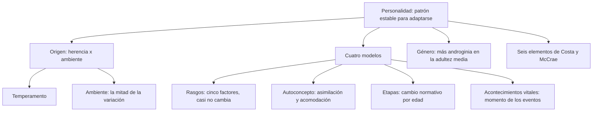
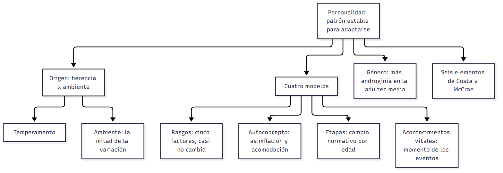

# C21 — Personalidad · Ficha de repaso

> **Idea-fuerza:** La personalidad es un patrón distintivo y relativamente estable de pensar, sentir y actuar con el que cada persona se **adapta**; surge de la **interacción entre herencia (temperamento) y ambiente**. Cuatro modelos explican su desarrollo adulto: **rasgos** (casi no cambia), **autoconcepto** (equilibrio estabilidad-cambio), **etapas** (cambio normativo por edad) y **acontecimientos vitales** (cambio según el momento de los eventos). En la adultez media los roles de **género** tienden a ser más andróginos (Cátedra de Psicología Evolutiva, 2026g, diapositivas 3, 7, 12, 31; Papalia et al., 2009b, pp. 395, 398-400).

## Esqueletos de respuesta

**P1. Desarrollo de la personalidad.** 1) No está fijada al nacer: interacción herencia-ambiente. 2) Temperamento: disposición emocional de base genética (p. 398). 3) Gemelos: el ambiente explica la mitad de la variación (pp. 398-399). 4) Influencia mutua: el temperamento del niño cambia la crianza y viceversa (p. 399).

**P2. Cinco factores.** 1) Neuroticismo, extraversión, apertura, meticulosidad, amabilidad (p. 401). 2) Bajan N, E y apertura de los 18 a los 30; suben amabilidad y meticulosidad (p. 402). 3) Patrones similares entre culturas; efecto de cohorte en los estudios transversales; la gente cree que cambió más de lo que muestran las mediciones (pp. 402-405).

**P3. Whitbourne.** 1) Estilos de identidad. 2) Asimilación: la experiencia se ajusta al yo. 3) Acomodación: el yo se ajusta a la experiencia. 4) El exceso de asimilación vuelve ciego; el de acomodación, influenciable (p. 406).

**P4. Etapas vs. acontecimientos vitales.** Etapas: cambio normativo por edad (Erikson: generatividad vs. estancamiento); crítica: muestras de hombres blancos de clase media-alta nacidos en 1920-1930 (pp. 407-414). Acontecimientos: eventos normativos y no normativos; la crisis viene por lo inesperado, por el momento o por lo que nunca llega (pp. 415-416).

**P5. Género.** Aprendizaje social (observación, imitación, reforzamiento); cognitivo-evolutivas (cuatro etapas, hasta la trascendencia del rol); esquema de género (esquemas modificables pero resistentes); más androginia en la adultez media (pp. 419-421).

## No confundir

| X | Y | Criterio |
|---|---|---|
| Q-sort | Inventario | Ordenar tarjetas según cuánto describen / cuestionario sobre rasgos (diapositivas 4-5) |
| Temperamento | Personalidad | Disposición emocional de base genética / patrón más amplio, también moldeado por la experiencia (pp. 395, 398) |
| Cambio percibido | Cambio medido | Lo que la persona cree en retrospectiva (mayor) / lo que muestran las pruebas longitudinales (diapositiva 17) |
| Asimilación | Acomodación | La experiencia se ajusta al yo / el yo se ajusta a la experiencia (p. 406) |
| Modelo de etapas | Acontecimientos vitales | El cambio llega con la edad / con los eventos y su momento (pp. 407, 416) |
| Aprendizaje social | Cognitivo-evolutiva / esquema | Aprender del ambiente / construir activamente la noción de género / combina ambas (pp. 419-420) |
| Tendencias básicas | Adaptaciones específicas | Rasgos, salud, inteligencia (lo que menos cambia) / roles, hábitos, actitudes (p. 400) |

## Datos que conviene saber

- Eaves, Eysenck y Martin (1989): en gemelos, el ambiente explica **la mitad** de la variación de la personalidad (Papalia et al., 2009b, pp. 398-399).
- El temperamento a los 3-6 años y el estilo parental explicaron el optimismo o pesimismo **21 años** después (p. 399).
- Seis elementos de Costa y McCrae: tendencias básicas, influencias externas, adaptaciones específicas, autoconcepto, biografía objetiva y procesos dinámicos (p. 400).

## Referencias

Cátedra de Psicología Evolutiva. (2026g). *Desarrollo de la personalidad* [Diapositivas de clase, unidad 10]. Universidad Favaloro.

Papalia, D. E., Sterns, H. L., Feldman, R. D., & Camp, C. J. (2009b). Desarrollo de la personalidad. En *Desarrollo del adulto y vejez* (cap. 11, pp. 392-430). McGraw Hill Interamericana.

## Autoevaluación rápida

1. Definí personalidad y explicá qué es la adaptación.
2. ¿Qué diferencia el Q-sort de un inventario?
3. ¿Qué mostraron los estudios de gemelos sobre herencia y ambiente?
4. ¿Cuáles son los cinco factores y cómo cambian con la edad?
5. Asimilación y acomodación de identidad: ¿qué pasa con el exceso de cada una?
6. ¿Qué critica la cátedra a los modelos de etapas?
7. Dá un ejemplo de evento normativo «fuera de tiempo» y de uno que nunca ocurre.
8. Nombrá las cuatro etapas cognitivo-evolutivas del rol de género.
