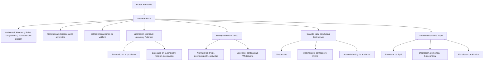
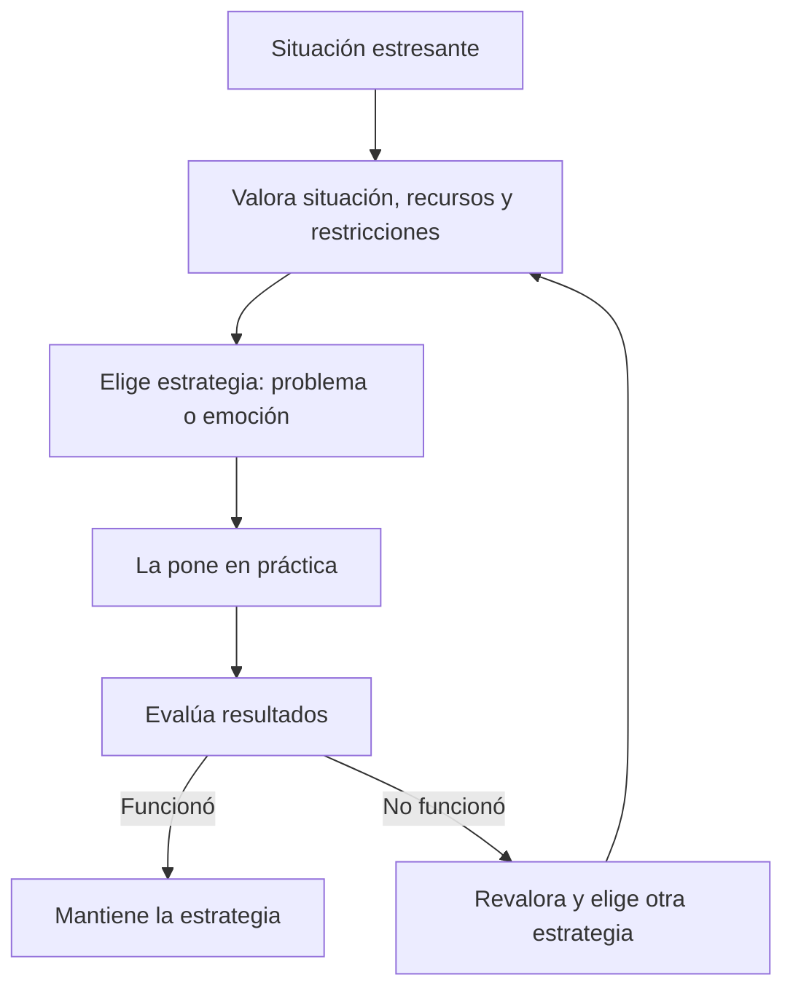
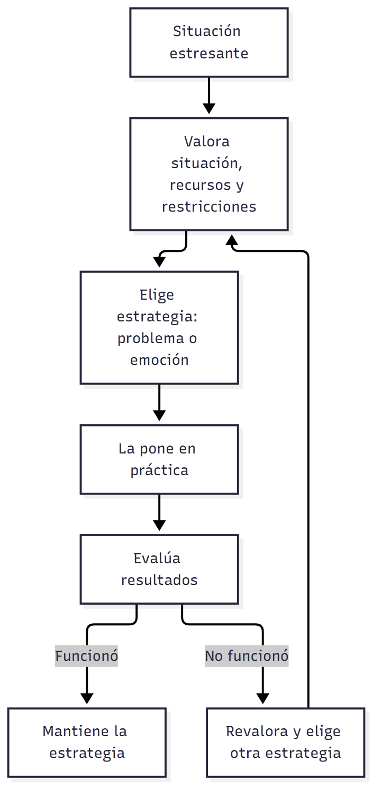

# C22 — Salud mental, afrontamiento y adaptación al envejecimiento

> **Fuentes:**
>
> - Papalia, D. E., Sterns, H. L., Feldman, R. D., & Camp, C. J. (2009b). Salud mental, afrontamiento y adaptación al envejecimiento. En *Desarrollo del adulto y vejez* (cap. 12, pp. 431-475). McGraw Hill Interamericana. [Bibliografía obligatoria de la unidad 10]
>
> **Materia:** Psicología Evolutiva, 2.º año, Universidad Favaloro (docente a cargo: Dra. Verónica A. Ramírez). Unidad 10, clase 22 (cronograma: 20/10/2026). Examen: 4.º parcial, 03/11/2026.

> **Aviso sobre las fuentes:** (1) Las páginas son las **impresas** del libro (431-475). (2) Esta clase **todavía no se dictó** (20/10/2026): no hay diapositivas ni apuntes, así que la guía sale solo del capítulo 12; el programa la anuncia como «afrontamiento de los cambios en el desarrollo, estilos de afrontamiento, comportamientos destructivos y efectos en la salud». Cuando tengas la presentación de la cátedra, contrastá qué partes enfatiza (por ejemplo, si prioriza los modelos de afrontamiento sobre los trastornos mentales). (3) Las cifras son de EE. UU. de los años 1980-2005. (4) El capítulo toca temas sensibles (violencia, abuso, depresión, suicidio, demencia): la guía los resume como contenido de estudio; si algún tema te resulta difícil, estudialo en tandas cortas.

> **Idea-fuerza:** La **salud mental** es «hacer lo mejor que uno puede con lo que tiene» (Kivnick, 1993): desarrollar fortalezas y usar recursos para afrontar el estrés, que es inevitable. Los **modelos de afrontamiento** (ambientales, conductuales, de estilos y, sobre todo, el de **valoración cognitiva** de Lazarus) explican cómo se afronta: el afrontamiento es un **proceso dinámico**, centrado en el problema o en la emoción. Para el **envejecimiento exitoso** hay modelos normativos (Peck, desvinculación vs. actividad) y de equilibrio (continuidad de Atchley; estilos de identidad de Whitbourne). No todos afrontan con éxito: aparecen **conductas destructivas** (abuso de sustancias, violencia del compañero íntimo, abuso infantil y de ancianos) y trastornos mentales (depresión, demencia, hipocondría), que en la vejez suelen subdiagnosticarse y se pueden tratar (Papalia et al., 2009b, pp. 433, 435, 438, 444-449, 461-475).

## Hilo conductor: cómo se conectan los temas de esta guía

El capítulo empieza con **Arthur Ashe**, el tenista que a los 36 años sufrió un ataque cardíaco, tuvo que retirarse, se contagió de VIH por una transfusión, y encaró la adversidad «como a un oponente en la cancha»: con gracia, determinación y frialdad ante el fuego, convirtiendo la adversidad en oportunidad. Su historia plantea la pregunta: **¿cómo afrontan los adultos el estrés y los cambios, qué hace que algunos lo logren y otros no, y qué pasa cuando fracasa el afrontamiento?**

La guía responde en cuatro tiempos. **Primero** (sección 1), qué es la **salud mental** y cuán frecuentes son los trastornos. **Segundo** (sección 2), los **modelos de afrontamiento**: del más mecánico (ambiental: eventos y unidades de cambio de vida; congruencia; competencia-presión) al conductual (desesperanza aprendida), al de los **estilos** (mecanismos adaptativos de Vaillant) y al **modelo de valoración cognitiva** (Lazarus y Folkman: afrontamiento enfocado en el problema o en la emoción; la religión como estrategia). **Tercero** (sección 3), cómo se **afronta el envejecimiento mismo**: «envejecimiento exitoso» (normativo: Peck, desvinculación vs. actividad; de equilibrio: continuidad, Whitbourne; visiones populares). **Cuarto** (secciones 4 y 5), cuando el afrontamiento falla: los **patrones destructivos** (sustancias, violencia, abuso) y la **salud mental en la vejez** desde el ciclo de vida (bienestar de Ryff, depresión, demencia, hipocondría, y la valoración de **fortalezas** de Kivnick). El capítulo cierra con la pregunta que abre el capítulo 13: la actitud hacia la propia muerte como tema crucial de la salud mental (Papalia et al., 2009b, p. 473).

> 🎯 **Para el parcial:** cuando te pidan «afrontamiento», decí siempre: (1) qué modelo (ambiental, conductual, estilos, valoración cognitiva), (2) si es **centrado en el problema o en la emoción**, (3) un ejemplo (Ashe, la religión, la «posesión» malaya), y (4) que **no hay estrategia buena o mala en sí**: depende del contexto.

**En una sola oración:** afrontar es un proceso dinámico de valorar la situación y elegir estrategias centradas en el problema o en la emoción, y el envejecimiento exitoso depende más del equilibrio entre continuidad y cambio y del uso de las propias fortalezas que de un «estándar» único.

## 0. Hoja de ruta

1. **Salud mental** (Papalia et al., 2009b, pp. 431-434).
2. **Modelos de afrontamiento** (pp. 435-443).
3. **«Envejecimiento exitoso»** (pp. 444-449).
4. **Patrones del comportamiento destructivo** (pp. 450-460).
5. **Salud mental en la vejez** (pp. 461-473).
6. **Para rendir**.

## 🎯 Lo que entra sí o sí

1. **Salud mental** (Kivnick) y **satisfacción de vida** (pp. 433-434).
2. **Cuatro modelos de afrontamiento**: ambiental (Holmes y Rahe; congruencia; competencia-presión), conductual (desesperanza aprendida), estilos (mecanismos de Vaillant) y **valoración cognitiva** (Lazarus) (pp. 435-440).
3. **Afrontamiento enfocado en el problema vs. en la emoción**; religión como estrategia (pp. 439-443).
4. **Envejecimiento exitoso**: MacArthur (tres componentes), **Peck**, **desvinculación vs. actividad**, **continuidad** (Atchley), **Whitbourne** (pp. 444-449).
5. **Abuso y dependencia de sustancias**; alcohol; efectos de cohorte (pp. 450-454).
6. **Violencia del compañero íntimo**, **abuso infantil** y **abuso de ancianos** (pp. 454-460).
7. **Seis dimensiones del bienestar** de Ryff (tabla 12.5) (pp. 462-463).
8. **Depresión** (criterios, subdiagnóstico, tratamiento), **demencia** (tipos), **hipocondría** (pp. 465-471).
9. **Valoración de fortalezas** (Kivnick; Erikson) (pp. 471-473).

---

## 1. Salud mental

### 1.1 Respuesta modelo (para escribir en el parcial)

> **Esqueleto de la respuesta:**
> 1. **Tesis:** salud mental = intentar vivir de manera significativa con los recursos y apoyos disponibles.
> 2. **Definición** (Kivnick, 1993): «hacer lo mejor que uno puede con lo que tiene» (Papalia et al., 2009b, p. 433).
> 3. **Componentes:** autoimagen, integración de roles, autodesarrollo, compromiso con algo más allá de uno mismo; satisfacción de vida o moral (p. 433).
> 4. **Trastornos:** casi la mitad de los adultos estadounidenses tuvo uno; menos de 40 % busca tratamiento (pp. 433-434).
> 5. **Ejemplo:** Arthur Ashe.

La salud mental es el intento de vivir de manera significativa en circunstancias específicas, con un conjunto de recursos y apoyos: «hacer lo mejor que uno puede con lo que tiene» (Kivnick). Implica desarrollar fortalezas internas, usar recursos externos para compensar déficits, esforzarse por el autodesarrollo (prosperar, no solo sobrevivir) y comprometerse con algo más allá de uno mismo (familia, comunidad, religión, una causa). Se vincula con la satisfacción de vida (moral). Casi la mitad de los adultos estadounidenses tuvo un trastorno mental, sobre todo depresión severa, y menos del 40 % busca tratamiento (Papalia et al., 2009b, pp. 433-434).

> ⚠ **No confundir:** *salud mental* (positiva, proceso de desarrollo) con *ausencia de trastorno*; y *satisfacción de vida/moral* (juicio de la persona sobre su calidad de vida; la elevan la autoimagen favorable, la autoestima, la autonomía y el sentido de dominio) con *salud física* (Ashe tuvo muy buena salud mental con su salud física deteriorada) (p. 433).

### 1.2 Desarrollo ampliado

**Arthur Ashe** (pp. 431-433). Campeón de tenis afroamericano, nacido en el Richmond segregado de Virginia; su padre le enseñó a mantener la compostura, comportarse mejor que sus opresores y a canalizar su agresividad en el tenis, que usó para combatir los prejuicios raciales (le negaron dos veces la visa para jugar en Sudáfrica; en 1973-75 compitió e insistió en que no hubiera asientos segregados). En **1979**, a los **36 años**, tras ganar el abierto de EE. UU., el de Australia y Wimbledon, sufrió el primer ataque cardíaco (cirugía de cuádruple bypass) y debió retirarse; leyó un libro de Daniel Levinson, hizo un breve período de psicoterapia y se convirtió durante cinco años en capitán del equipo de Copa Davis (advirtió a McEnroe que perdería el partido si tenía otra explosión; aprendió a admirar su forma diferente de manejar emociones). En 1983 sufrió una doble operación de bypass. Fue arrestado en una protesta frente a la embajada sudafricana (1984). En **1988** despertó sin poder mover el brazo derecho: la cirugía cerebral reveló una infección parasitaria ligada al **VIH** (contagio por transfusión en su cirugía cardíaca cinco años antes) y que el virus había progresado a **SIDA**; no se rindió ni entró en pánico y decidió **guardar silencio** sobre la enfermedad. En 1992, ante la inminente revelación por *USA Today*, se presentó él primero y se convirtió en líder del movimiento de investigación sobre el SIDA (fundación, campaña de 5 millones de dólares). Murió en **1993** a los 49 años: «Soy un hombre afortunado, bendecido. Aparte del SIDA y las enfermedades del corazón, no tengo problemas». Afrontaba los problemas como a un oponente en la cancha: «con gracia, determinación y frialdad ante el fuego»; convirtió la adversidad en oportunidad (p. 433).

**Salud mental** (p. 433). Definición de Kivnick (1993, p. 15, citado en Papalia et al., 2009b, p. 433): «intento por vivir de manera significativa, en una serie de circunstancias sociales y ambientales particulares, contando con un conjunto específico de recursos y apoyos»; es decir, «**hacer lo mejor que uno puede con lo que tiene**». Implica desarrollar **fortalezas internas** y utilizar **recursos externos** para compensar debilidades y déficits; los esfuerzos de autodesarrollo (prosperar en vez de sólo sobrevivir) son signos de personalidad sana (Butler et al., 1991; Sherman, 1993). Puede incluir cómo las personas se ven a sí mismas, cómo integran roles y aspectos del yo (recuadro 12.1) y si luchan por su desarrollo; también la **identificación y el compromiso con algo más allá de uno mismo**: familia, comunidad, nación, cultura, religión o una causa (la lucha contra el racismo o el SIDA, en el caso de Ashe) (Jahoda, 1958). **Satisfacción de vida** (moral): cómo una persona juzga la calidad de su vida (Schulz, 1985); la elevan una autoimagen favorable, alta autoestima, autonomía y sentido de dominio de alguna actividad (Sherman, 1993).

**Trastornos mentales** (pp. 433-434). **Casi la mitad** de los adultos estadounidenses ha experimentado un trastorno mental moderado o severo en alguna época de su vida: el más común es la **depresión severa**, seguido de la dependencia del alcohol y las fobias (Kessler et al., 1994). Los habitantes de **zonas urbanas de bajos ingresos y con poca educación** son más susceptibles. **Género:** los hombres abusan más de drogas o tienen comportamientos antisociales; las mujeres, ansiedad y depresión (Robins et al., 1984). **Edad:** los adultos jóvenes, problemas emocionales, ansiedad y abuso de sustancias; los ancianos, especialmente hombres, **deterioro cognitivo severo**. Tal vez por el estigma, **menos del 40 %** de los afectados busca tratamiento, aunque muchos se las arreglan sin ayuda profesional (p. 434).

**Recuadro 12.1: empleo y roles familiares y bienestar psicológico de los varones** (p. 434). Tradicionalmente la salud mental de las mujeres se valoró respecto de la familia y la de los hombres a partir del trabajo. **Barnett, Marshall y Pleck (1992)**: **300 esposos** trabajadores de 25 a 40 años, de parejas de dos proveedores, evaluaron sus roles laboral, marital y paterno (recompensas y preocupaciones; «calidad» del rol = recompensas − preocupaciones) y se valoró su ansiedad y depresión. Hallazgo: **la creencia de que el trabajo es el principal determinante de la salud mental de los hombres es falsa**: los roles familiares son igualmente importantes y están relacionados; las buenas relaciones con esposa e hijos pueden compensar una pobre experiencia laboral; si ambos roles son insatisfactorios, hay estrés. **Diferencia de género:** para las mujeres trabajadoras, ser madre contrarresta las preocupaciones laborales; para los hombres lo relevante **no es ser padre sino cuán gratificante resulta el rol paterno**.

---

## 2. Modelos de afrontamiento

### 2.1 Respuesta modelo (para escribir en el parcial)

> **Esqueleto de la respuesta:**
> 1. **Tesis:** el afrontamiento es el pensamiento o comportamiento adaptativo para reducir el estrés; los modelos difieren en cuánto rol activo dan a la persona.
> 2. **Ambiental:** el ambiente determina (Holmes y Rahe; congruencia; competencia-presión) (Papalia et al., 2009b, pp. 435-436).
> 3. **Conductual:** adaptaciones aprendidas; desesperanza aprendida (p. 437).
> 4. **Estilos:** mecanismos de Vaillant (maduro, neurótico, inmaduro, psicótico) (p. 437).
> 5. **Valoración cognitiva** (Lazarus): proceso dinámico, enfocado en el problema o en la emoción (pp. 438-439).
> 6. **Cierre:** ninguna estrategia es buena o mala en sí; depende del contexto (p. 439).

El afrontamiento es el pensamiento o comportamiento adaptativo dirigido a reducir o aliviar el estrés. Los modelos ambientales lo explican por el tamaño y frecuencia de las demandas (unidades de cambio de vida); los conductuales, por adaptaciones aprendidas, incluida la desesperanza aprendida; los de estilos, por mecanismos más o menos maduros (Vaillant). Lazarus y Folkman proponen un modelo de valoración cognitiva: el afrontamiento es un proceso dinámico en que la persona valora la situación y sus recursos y elige entre estrategias enfocadas en el problema o en la emoción, revalorando constantemente. Ninguna es mala en sí: la efectividad depende del contexto (Papalia et al., 2009b, pp. 435-439).

> ⚠ **No confundir:** *afrontamiento enfocado en el problema* (eliminar, gestionar o mejorar lo que causa estrés; predomina si se ve posible un cambio realista) con *enfocado en la emoción* o *paliativo* (sentirse mejor; manejar la respuesta emocional; predomina si se concluye que poco puede hacerse) (p. 439); y *afrontar* (esfuerzo ante una exigencia excesiva) con *conducta adaptativa automatizada* (frenar ante una luz roja) (p. 438).

### 2.2 Desarrollo ampliado

**Qué es afrontar** (p. 435). «La libertad completa del estrés es la muerte» (Selye, 1980, p. 128, citado en Papalia et al., 2009b, p. 435). **Afrontamiento:** pensamiento adaptativo o comportamiento dirigido a **reducir o aliviar el estrés** que surge de condiciones dolorosas, amenazantes o desafiantes; la forma de afrontar es un aspecto importante de la salud mental. Se ven tres enfoques tradicionales (ambiental, conductual, estilos) y luego el de la valoración cognitiva.

**Modelos ambientales** (pp. 435-436). Enfoque cuantitativo: **Holmes y Rahe (1976)** preguntaron a **5 000 pacientes hospitalizados** por los eventos relevantes que precedieron sus enfermedades (negativos y positivos) y cuánto ajuste requirió cada uno: asignaron **unidades de cambio de vida (LCU)** a cada evento (tabla 4.3, cap. 4). Aproximadamente **la mitad** de quienes obtuvieron entre **150 y 300 LCU** al año y casi **70 %** de quienes tenían **300 o más** enfermaron dentro de los siguientes 1 o 2 años: entre más cambios importantes, más difícil afrontarlos. Es un modelo esencialmente **mecanicista**: los seres humanos reaccionan antes que actuar; el tamaño y la frecuencia de las demandas determinan el afrontamiento (como una maquinaria sobrecargada). **Defectos:** (1) no considera **cómo el individuo interpreta** un evento; (2) el **momento** en que ocurre (cap. 11); (3) el estrés puede provenir de la **falta de cambio** (aburrimiento, relaciones poco gratificantes); (4) muchos estudios sugieren que la salud es más afectada por **molestias y tensiones cotidianas** que por eventos aislados graves (Lazarus, 1981; Pearlin et al., 1981); (5) **ignora las diferencias individuales**.
- **Modelo de la congruencia** (Kahana, 1982): así como las necesidades de las personas son distintas, los ambientes difieren en satisfacerlas; el estrés o la satisfacción dependen del **ajuste (congruencia)** persona-ambiente (internar a un anciano con fuerte necesidad de independencia en un asilo aumenta el estrés).
- **Modelo de competencia-presión ambiental** (Lawton y Nahemow, 1973; Lawton, 1982): contrasta las demandas del ambiente (**presión ambiental**) con la **competencia** del individuo (habilidad para satisfacer demandas) (figura 12.1): si presión y competencia son relativamente altas o bajas, hay comodidad (**nivel de adaptación normal**); con presión **moderada** se llega al **máximo potencial**; con presión muy baja o muy alta se siente aburrimiento o abrumamiento. **Envejecimiento:** si aumenta la presión (vecindario inseguro) o disminuye la competencia (ya no puede conducir en los suburbios), la persona cae por debajo del nivel de adaptación y siente estrés; hay que reducir las demandas o aumentar la competencia. Ambos modelos explican por qué situaciones distintas estresan distinto, pero **no dicen cómo se afronta**.

**Modelos conductuales** (p. 437). Dan al individuo un rol algo más activo; basados en estudios con animales; el afrontamiento es **adaptaciones aprendidas** a estresores ambientales (condicionamiento clásico u operante) que reducen el estrés percibido. Ante un enemigo o estresor hay **tres opciones**: **huir** a un lugar seguro, **pelear** e intentar dominar la situación o **permanecer firme** y aguantar. Cuando el escape es imposible y los intentos de dominar fallan o son castigados, los organismos se adaptan mediante la **desesperanza aprendida**: aprenden a vivir con una situación extremadamente estresante y dejan de intentar cambiarla (Evans y Stecker, 2004; Ursin, 1980); se observa en **cónyuges golpeados que siguen con sus compañeros** o en ciudadanos que no votan porque creen que su voto no significa nada.

**Modelos de estilos de afrontamiento** (pp. 437-438). Tradición psicoanalítica; se enfoca en pensamientos y actitudes más que en la conducta externa; el afrontamiento es una forma de **resolución de problemas** y los estilos, como los rasgos de personalidad, tienden a ser **bastante estables**; se los clasifica por su efectividad. **Vaillant (1977)**, estudio Grant (cap. 11): cuatro tipos de **mecanismos adaptativos**: (1) **maduro** (usar el humor o ayudar a otros), (2) **neurótico** (reprimir la ansiedad o decir lo opuesto a lo que se siente), (3) **inmaduro** (fantasear o experimentar achaques o dolores imaginarios), (4) **psicótico** (distorsionar o negar la realidad). Los hombres con mecanismos **maduros** fueron más felices, mental y físicamente más sanos, tuvieron más satisfacción en el trabajo, mejores amistades, ganaron más dinero y parecían mejor ajustados; en la adultez media los mejor adaptados tuvieron **cuatro veces más probabilidad** de afrontar de forma «madura» (Vaillant, 1989); a los 65 quienes usaron defensas maduras (manejar problemas sin culpa, amargura o pasividad) mostraron la adaptación más sana (Vaillant y Vaillant, 1990). **Críticas de Lazarus** (Lazarus, 2003; Lazarus y Folkman, 1984): (1) los estilos pueden **no capturar la multidimensionalidad** del comportamiento (un hombre que enfrenta un despido, la esposa con cáncer de mama, un hijo que sale del armario y el cuidado de su madre no afronta igual las cuatro situaciones); (2) **no distinguen entre afrontamiento y otras conductas adaptativas automáticas** (frenar ante una luz roja vs. derrapar en hielo); (3) **confunden el proceso con el producto**: el afrontamiento es el proceso de la lucha (gestión), no solo el éxito.

**Modelo de la valoración cognitiva** (Lazarus, 2003; Lazarus y Folkman, 1984) (pp. 438-439). El afrontamiento es un **proceso evolutivo (dinámico)** que ocurre solo cuando la persona percibe una exigencia excesiva o que supera sus recursos y le demanda un esfuerzo inusual. Modelo **contextual**: las personas eligen las estrategias mediante una **valoración cognitiva** de la situación; el afrontamiento incluye **cualquier cosa que piense o haga para adaptarse al estrés, funcione o no**; como la situación cambia, es **dinámico, no estático**: se requiere una **revaloración constante** de la relación persona-ambiente (figura 12.2: valora la situación y sus recursos personales, restricciones y amenaza → elige la estrategia → la pone en práctica → evalúa los resultados: si funcionó, mantiene la estrategia y la usa en situaciones similares; si no, revalora la situación y elige una nueva). Ashe revaloró y cambió estrategias varias veces. La **elección y efectividad** dependen de los **recursos personales** (salud, energía, creencias sobre el control personal o el sobrenatural, compromisos y motivaciones, habilidades sociales y de resolución de problemas, apoyo social, recursos materiales) y de las **restricciones personales** (miedo al fracaso, actitudes que reflejan normas sociales como roles de género) y **ambientales** (demandas que compiten, instituciones que frustran el afrontamiento), y de cuán grande parezca la amenaza.
- **Dos modos:** **enfocado en el problema** (eliminar, gestionar o mejorar la condición estresante; predomina cuando se ve posible un cambio realista) y **enfocado en la emoción**, a veces **paliativo** (sentirse mejor; manejar la respuesta emocional para aliviar el impacto físico o psicológico; predomina cuando se concluye que **poco o nada** se puede hacer): incluye desviar la atención o **reinterpretar** (rendirse consciente o inconscientemente, pretender que no existe). Cuál predomina depende de la situación, la persona y las opciones (Lazarus, 2003; Monat y Lazarus, 1985). Las estrategias centradas en la emoción suelen puntuar bajo en las jerarquías de estilos (negar es aplazar), pero el modelo **no las ve como inherentemente buenas o malas**: la **negación** puede ser dañina (no ver a un médico ante dolor en el pecho) o útil: Ashe: «una negación buena se refiere a rehusarse a vivir con la idea de la muerte» (Ashe y Rampersad, 1993, pp. 327-328, citado en Papalia et al., 2009b, p. 439): aceptar la muerte inminente puede permitir a un enfermo terminal «caminar con calma por la vida el tiempo que le resta».
- **Los ancianos usan más estrategias enfocadas en la emoción** que los jóvenes (Folkman et al., 1987): ¿es porque son menos capaces de enfocarse en el problema o más **selectivos** respecto de cuándo hacerlo? **Blanchard-Fields, Jahnke y Camp (1995)**: **70** adolescentes, **69** adultos jóvenes, **74** adultos medios y **74** ancianos escribieron ensayos sobre cómo resolver cada uno de **quince** problemas: **sin importar la edad**, recomendaron con más frecuencia estrategias enfocadas en el problema (sobre todo si no eran muy emocionales: devolver mercancía defectuosa); las diferencias aparecieron en problemas **muy emocionales** (mudarse a una nueva ciudad, cuidar a un padre anciano), donde los ancianos eligieron más **estrategias reguladoras de la emoción**: con la edad se puede ser **más capaz de controlar las emociones** cuando la situación lo requiere, y ese estilo puede ser adaptativo (p. 441).

**Recuadro 12.2: afrontamiento del cambio económico en la Malasia rural** (p. 440). Desde 1970, corporaciones japonesas, europeas y estadounidenses instalaron fábricas (alimentos, ropa, electrónica) en Malasia; Ong (1987): mujeres campesinas jóvenes, pobres y solteras ensamblan componentes electrónicos con jerarquía de etnia y género (hombres japoneses arriba; supervisores chinos o malayos; obreras malayas abajo); trabajo arduo, rutinas rígidas, cuotas, supervisión, bajos salarios, sin sindicatos. Respuesta común: **«la posesión por espíritus»** (primero una trabajadora, luego otra ven «espíritus» desplazados que vienen por venganza porque la fábrica se construyó sobre un cementerio tradicional; sollozan, ríen histéricamente, gritan y maldicen; cien o más pueden verse afectadas a la vez; los jefes llaman sanadores rituales). Se puede ver como **protesta inconsciente o simbólica** contra la disciplina de la fábrica y el control masculino, una rebelión que el jefe no puede detener fácilmente porque es aceptable en la sociedad malaya; **como no mejora las condiciones laborales, es una estrategia enfocada en la emoción, no en el problema** y puede ayudar a mantener el statu quo al dar una evasión socialmente aceptada.

**Religión y afrontamiento** (recuadro 12.3, tabla 12.1; pp. 441-443). Para muchas personas, especialmente las ancianas, el comportamiento religioso parece ser una estrategia efectiva. Posibles explicaciones: apoyo social, estímulo de un estilo de vida saludable, percepción de control por la oración, estados emocionales positivos, reducción del estrés, fe como forma de interpretar la mala fortuna (Seybold y Hill, 2001). La evidencia apunta a una relación positiva religión/espiritualidad-salud pero con **debilidades metodológicas** y definiciones imprecisas. Una revisión sólida encontró una **reducción de 25 % del riesgo de mortalidad** entre adultos sanos que asistían semanalmente a servicios religiosos; protege contra enfermedades cardiovasculares (por el estilo de vida), pero no hay evidencia de que detenga el cáncer o mejore la recuperación de enfermedades agudas o proteja contra la discapacidad (Powell et al., 2003); correlaciones positivas con salud, bienestar y satisfacción marital, y negativas con suicidio, delincuencia y uso de drogas y alcohol. Estudio con **223 ancianos británicos**: las creencias espirituales predicen el bienestar y moderan el impacto negativo de la debilidad. **Koenig, George y Siegler (1988):** **100** hombres y mujeres blancos y cultos de **55 a 80 años** (90 % protestante) describieron los peores eventos de su vida: **289** eventos estresantes y **556** estrategias; **tabla 12.1** (orden): **religión 97 (17,4 %)**, **mantenerse ocupado 84 (15,1 %)**, **aceptarlo 63 (11,3 %)**, **apoyo de familia o amigos 62 (11,1 %)**, ayuda profesional 34 (6,1 %), actitud positiva 31 (5,6 %), vivir un día a la vez 29 (5,2 %), involucrarse en actividades sociales, planear y preparar con anticipación, etc. La **religión** fue citada por **58 %** de las mujeres y **32 %** de los hombres; casi tres cuartos de esas estrategias fueron **confiar en Dios, rezar y obtener ayuda y fuerza de Dios**; otras fuentes: amigos y actividades de la iglesia, el ministro, la Biblia. **Aceptación**: la «oración de la serenidad» («…serenidad para aceptar las cosas que no puedo cambiar, el valor para cambiar las que puedo y la sabiduría para entender la diferencia»): pensar el problema y hacer lo posible, luego aceptar; pocos acudieron a un profesional (cuatro veces más probable que fuera un médico personal que un profesional de salud mental). **836 ancianos** (Koenig, Kvale y Ferrel, 1988): la moral se asoció con tres tipos de actividad religiosa: **organizada** (ir a la iglesia), **informal** (rezar, leer la Biblia) y **espiritual** (compromiso cognitivo personal con creencias); los más religiosos tenían más moral, mejor actitud hacia el envejecimiento y menos soledad (mujeres y mayores de 75 con correlaciones más fuertes). **3 050 ancianos mexicoestadounidenses**: quienes iban a la iglesia semanalmente tuvieron **32 %** menos riesgo de mortalidad (Hill et al., 2005). Los **ancianos afroamericanos** tienden a estar más involucrados en la actividad religiosa y ésta se relaciona estrechamente con la satisfacción de vida (la iglesia ayuda a confrontar la injusticia racial); la actividad más común es la oración personal. Como la mayor parte de la investigación es **transversal**, volverse hacia la religión en la vejez puede ser un **efecto de cohorte**, aunque también podría deberse a pensar más en el sentido de la vida y la muerte.

> 🔑 **Punto clave:** el modelo de valoración cognitiva es el más aceptado: **proceso**, no estilo; **contextual**; ni problema ni emoción es mejor «en general».

---

## 3. «Envejecimiento exitoso»

### 3.1 Respuesta modelo (para escribir en el parcial)

> **Esqueleto de la respuesta:**
> 1. **Tesis:** el concepto de envejecimiento exitoso cambió el foco de la pérdida hacia los factores modificables, pero tiene críticas.
> 2. **Definición MacArthur:** evitar enfermedad/discapacidad; mantener funcionamiento físico y cognitivo; involucramiento activo (Papalia et al., 2009b, p. 444).
> 3. **Modelos normativos:** Peck (7 ajustes), desvinculación vs. actividad (pp. 445-447).
> 4. **Modelos de equilibrio:** continuidad (Atchley), Whitbourne (pp. 447-449).
> 5. **Críticas:** puede cargar a los ancianos y «culpar a las víctimas» (pp. 444-445).

El envejecimiento exitoso es un concepto que desplazó la idea de pérdida inevitable por la de factores modificables. El grupo MacArthur (Rowe y Kahn) lo definió por tres componentes: evitar la enfermedad y la discapacidad, mantener el funcionamiento físico y cognitivo, y el involucramiento activo en lo social y productivo. Los modelos normativos (Peck: siete ajustes; desvinculación vs. actividad) describen tareas o roles típicos; los de equilibrio (continuidad de Atchley; estilos de identidad de Whitbourne) sostienen que lo adecuado es un equilibrio entre estabilidad y cambio que varía por persona. Se lo critica porque puede cargar a los ancianos con estándares inalcanzables y culpar a las víctimas (Papalia et al., 2009b, pp. 444-449).

> ⚠ **No confundir:** *teoría de la desvinculación* (el declive físico lleva a un retiro gradual universal e inevitable de los roles) con *teoría de la actividad* (cuanto más activos, mejor envejecen) y con *teoría de la continuidad* (se busca un equilibrio entre continuidad y cambio; la actividad importa en tanto continúa el estilo de vida previo) (pp. 446-448).

### 3.2 Desarrollo ampliado

**Concepto y críticas** (pp. 444-445). Un lector indignado: «¿Nuestra sociedad se encuentra tan orientada al logro que ahora es posible fracasar al envejecer?» (King, 1993, p. 14, citado en Papalia et al., 2009b, p. 444). El **envejecimiento exitoso u óptimo**, en contraste con la antigua idea del envejecimiento como pérdida y deterioro inevitables, es un gran cambio de enfoque gerontológico en respuesta al creciente número de ancianos activos y saludables; como los **factores modificables** juegan un papel importante, algunas personas pueden envejecer más exitosamente que otras (Rowe y Kahn, 1998). El grupo de la **MacArthur Foundation Research Network on Successful Aging** (Rowe y Kahn) identificó **tres componentes**: (1) **evitar la enfermedad o la discapacidad** relacionadas con la enfermedad; (2) **mantener un alto funcionamiento físico y cognitivo**; (3) **involucramiento activo y sostenido en actividades sociales y productivas** (con paga o sin ella, con valor social); quienes envejecen exitosamente tienden a tener **apoyo social** emocional y material, y mientras permanezcan activos y productivos no se piensan a sí mismos como ancianos. Otra aproximación es la **experiencia subjetiva** (grado en que logran metas y están satisfechos); un modelo enfatiza el **control** (Schulz y Heckhausen, 1996): las personas reportaron más control sobre su trabajo, finanzas y matrimonios con la edad, y menos sobre sus vidas sexuales y la relación con los hijos (Lachman y Weaver, 1998); las personas viven más si tienen sentido de control sobre el rol que más les importa (Krause y Shaw, 2000). **Críticas** (Holstein y Minkler, 2003): estos términos pueden **cargar, más que liberar**, a los ancianos al presionarlos a cumplir estándares que no pueden o no quieren; el concepto presta poca atención a las **restricciones** (no todos tienen buenos genes, educación y circunstancias favorables; los «ya marginados» tienen más probabilidad de «toparse con el lado equivocado de la división»); etiquetar como exitosos o no puede «**culpar a las víctimas**», llevar a estrategias de autoderrota y a menospreciar la vejez en sí y negar lo que no se puede cambiar.

**Modelos normativos** (pp. 445-447). Para los teóricos normativos, los adultos envejecen exitosamente cuando completan las **tareas psicológicas normales de cada período** de manera emocionalmente saludable: Erikson (generatividad e integridad); Jung y Levinson (equilibrar los lados masculino y femenino y explorar la vida interior). Tres modelos clásicos se enfocan en la adaptación al envejecimiento:
1. **Peck (1955)**: amplía a Erikson; **siete ajustes** en el desarrollo psicológico para una adaptación sana: **cuatro en la adultez media** (un cambio de las proezas físicas a la flexibilidad mental y emocional): (a) **valorar la sabiduría frente a la fuerza física** (la sabiduría = hacer las mejores elecciones, depende de un amplio rango de experiencias); (b) **socializar frente a sexualizar** en las relaciones humanas (valorar a hombres y mujeres como individuos, amigos y compañeros y no principalmente objetos sexuales); (c) **flexibilidad emocional frente a empobrecimiento emocional** (desplazar la carga emocional cuando los hijos crecen y los padres, cónyuges y amigos mueren); (d) **flexibilidad mental frente a rigidez mental** (seguir buscando nuevas respuestas). **Tres en la vejez** (más allá de las preocupaciones por el trabajo, el bienestar físico y la mera existencia): (e) **autodefinición más amplia frente a preocupación por los roles en el trabajo** (redefinir la propia valía al jubilarse); (f) **trascendencia del cuerpo frente a preocupación por el cuerpo** (enfocarse en relaciones y actividades que no demanden salud perfecta); (g) **trascendencia del yo frente a preocupación por el yo** (probablemente la adaptación más difícil y crucial: aceptar la certeza de la muerte; reconocer el legado: hijos criados, contribuciones, relaciones; seguir contribuyendo al bienestar de otros).
2. **Teoría de la desvinculación** (Cumming y Henry, 1961): el envejecimiento trae una **reducción gradual del involucramiento social** y mayor preocupación por el yo; la desvinculación sería una **condición universal**: el declive físico lleva a un retiro inevitable y gradual de los roles sociales y, finalmente, a la muerte. Los hallazgos empíricos que la apoyaron «desaparecieron en su mayor parte» (Achenbaum y Bengtson, 1994, p. 756, citado en Papalia et al., 2009b, p. 446); hoy se la considera **defectuosa**. Gutmann (1974, 1977, 1992): la desvinculación solo ocurre en **sociedades en que los ancianos no tienen roles** para su etapa de vida; en culturas tradicionales como los **druze** la «desvinculación» es una **transición entre roles** adecuados y bien establecidos (ver C21).
3. **Teoría de la actividad** (Neugarten, Havighurst y Tobin, 1968): los individuos con **roles sociales de alta actividad** mostraban alta satisfacción (y también los desvinculados); la actividad continua es crucial; los roles de un adulto son la fuente principal de satisfacción: **mientras mayor la pérdida de roles (jubilación, viudez, distancia de los hijos, debilidad) menos satisfecha**; los que envejecen exitosamente mantienen tantas actividades como pueden y **sustituyen los roles perdidos**. **Cuatro estilos de envejecimiento** (Neugarten et al., 1968): (1) **integradas** (funcionan bien, vida interior rica, cognición intacta, alta satisfacción; incluye tanto a las de alta actividad como a las desvinculadas); (2) **acorazadas-defensivas** (orientadas al logro, competitivas, fuertemente controladas); (3) **pasivas-dependientes** (apáticas o buscan depender de otros); (4) **no integradas** (desorganizadas, poco control emocional, pobre funcionamiento cognitivo y psicológico, problemas de afrontamiento). **Evidencia mixta:** la actividad en sí tiene poca relación con la satisfacción (Lemon et al., 1972); el **tipo** de actividad importa: las actividades informales con amigos y familiares son más satisfactorias que las formales grupales o solitarias (Longino y Kart, 1982); pero la actitud de la persona se afecta poco por cualquier tipo de actividad (Okun et al., 1984); en **508** ancianos mexicoestadounidenses y anglos, seguidos ocho años, que murieran antes o después no se relacionó con cuán activos habían sido tras controlar edad, salud y género (Lee y Markides, 1990): la teoría de la actividad no se descarta pero algunos la consideran **simplista**.

**Modelos de equilibrio** (pp. 447-449). El envejecimiento, sobre todo en sociedades desarrolladas, perdió parte de su carácter normativo (avances en salud, variaciones de la jubilación). Dos modelos recientes enfatizan la **interacción individuo-ambiente** y el «envejecimiento exitoso» como **equilibrio entre estabilidad y cambio**, que **puede no ser el mismo para todos**:
- **Teoría de la continuidad (Atchley, 1989)**: quienes envejecen exitosamente mantienen **continuidad o conexión con el pasado**, en estructuras **internas** (conocimiento, autoestima, sentido de historia personal: la «integridad del yo» de Erikson) y **externas** (roles, relaciones, actividades, fuentes de apoyo social, ambiente físico). Se busca un **equilibrio satisfactorio entre continuidad y cambio**: demasiados cambios hacen la vida impredecible; pocos, desabrida; hay un impulso interno por la consistencia, reforzado socialmente. Por eso la **actividad es relevante en tanto continuación del estilo de vida previo**: quienes siempre fueron activos pueden querer seguirlo siendo; otros pueden ser más felices «en la mecedora»; muchos jubilados prefieren actividades similares a las que disfrutaban (cap. 8). Ante cambios físicos o cognitivos, la adaptación depende de **apoyos** (familia, amigos, instituciones) que compensen pérdidas y minimicen la discontinuidad (tendencia a mantener a los ancianos fuera de las instituciones; cap. 10). Ayuda a explicar por qué, contrario a la creencia, los **homosexuales** tienden a adaptarse al envejecimiento con relativa facilidad: tienen práctica en lidiar con estigmas y su orientación los hace sentirse cómodos con roles andróginos flexibles (Berger y Kelly, 1986); los mejor adaptados están muy satisfechos con su orientación y pasaron antes por un período de experimentación (Adelman, 1991).
- **Whitbourne: estilos de identidad y adaptaciones al envejecimiento** (cap. 11): las personas enfrentan el envejecimiento como enfrentaron retos anteriores; los cambios físicos, mentales y emocionales pueden desestabilizar el autoconcepto y deben **asimilarse, acomodarse o ambos**; el estilo de identidad determina la adaptación: **predominio de asimilación** (autoimagen juvenil positiva, niegan cambios negativos y no toman medidas para compensar pérdidas); **predominio de acomodación** (se ven prematuramente como ancianos, más seguros en sus definiciones, pero se preocupan en exceso por los síntomas); **estilo equilibrado** (ajuste más realista: toman iniciativas para controlar lo que se puede y aceptan lo que no).
- **Balance** (p. 449): hoy los modelos de equilibrio (especialmente la continuidad) son más atractivos que los normativos; las teorías deberán sostenerse según con cuánta precisión describan el comportamiento «normal»; quizá no surja una gran teoría universal, porque el envejecimiento exitoso puede ser distinto para cada sociedad, cohorte e individuo.

**Visiones populares** (Ryff, 1989) (p. 449). Adultos de edad media y mayores definieron el envejecimiento exitoso **principalmente en términos de relaciones** (cuidar y salir con otros), a diferencia de los teóricos (autoconocimiento y autoaceptación). Diferencias entre grupos: los de edad media estaban más infelices por **problemas familiares** y querían cambiar aspectos de sí mismos o lograr más en estudios o carrera; los ancianos, con frecuencia, **no estaban infelices con nada** y no cambiarían nada excepto la salud: la adultez media se preocupa por el **desarrollo continuo** y la vejez por la **aceptación** (nos remite a Erikson y Peck).

---

## 4. Patrones del comportamiento destructivo

### 4.1 Respuesta modelo (para escribir en el parcial)

> **Esqueleto de la respuesta:**
> 1. **Tesis:** los patrones destructivos (hacia uno mismo o los demás) no son solo asuntos privados: dañan a los otros y se transmiten a generaciones futuras.
> 2. **Sustancias:** abuso (patrón mal adaptado; 12 meses) y dependencia (tres criterios) (Papalia et al., 2009b, p. 450).
> 3. **Alcohol:** el problema más común en la vejez; subestimado; mitos (pp. 452-454).
> 4. **Violencia del compañero íntimo:** definiciones, víctimas, por qué permanecen (pp. 454-456).
> 5. **Abuso infantil y de ancianos:** quiénes abusan, factores (pp. 457-460).
> 6. **Cohorte:** los hábitos con sustancias se fijan en la adultez joven y dependen de la cohorte (p. 451).

Los comportamientos destructivos, dirigidos contra uno mismo o contra los demás, no son asuntos íntimos: dañan a quienes rodean a la persona y se repiten en las generaciones. Abarcan los trastornos por uso de sustancias (abuso: uso dañino con consecuencias en roles, riesgos, problemas legales o sociales; dependencia: tolerancia, abstinencia, pérdida de control y otros criterios), con el alcohol como problema principal en la vejez y a menudo subestimado; la violencia del compañero íntimo (física, sexual, amenazas, abuso psicológico y acecho), y el abuso infantil y de ancianos, que suelen ocurrir en la familia (Papalia et al., 2009b, pp. 450-460).

> ⚠ **No confundir:** *abuso de sustancias* (patrón mal adaptado con consecuencias) con *dependencia* (tolerancia creciente, abstinencia, pérdida de control; tres o más criterios) (p. 450); *abuso* (acción dañina) con *negligencia* (fracaso para satisfacer las necesidades básicas de un dependiente) (p. 457).

### 4.2 Desarrollo ampliado

**Por qué importa** (p. 450). Caso de O. J. y Nicole Simpson: los oficiales se retiraron porque era «asunto privado». Pero quienes abusan del alcohol o las drogas se lastiman a sí mismos y a quienes los rodean y con frecuencia causan **daño irreparable a sus hijos**; los abusadores de pareja, los que abusan de ancianos y los débiles contribuyen a un clima en el que la seguridad y la dignidad de todos están en peligro; las víctimas de abuso con frecuencia se vuelven abusadores.

**Trastornos por uso de sustancias** (pp. 450-454). **Abuso de sustancias**: uso dañino de alcohol u otras drogas; **patrón de comportamiento mal adaptado** con uno o más de los siguientes criterios durante **doce meses**: fracaso para satisfacer obligaciones de rol, uso en situaciones peligrosas, problemas legales o problemas sociales/interpersonales (DSM-IV). **Dependencia o adicción** (fisiológica, psicológica o ambas): **tres** de los criterios: **tolerancia creciente**, **síntomas de abstinencia**, ingesta de más cantidad o por más tiempo, querer pero no poder suprimir o controlar el uso, gastar mucho tiempo en obtener o recuperarse, dejar actividades importantes, continuar a pesar de problemas físicos o psicológicos (APA, 1994). Tienden a presentarse en las **familias** y pueden resultar de una combinación de factores genéticos, personalidad vulnerable e influencias ambientales (Irons, 1994). **Extensión en los ancianos con frecuencia se subestima:** muchos viven solos o con pocos contactos, los miembros de la familia en ocasiones ignoran o encubren la evidencia; incluso en hospitales no se reconocen, reportan ni remiten, por la creencia equívoca de que no son problemas de los ancianos o que no se puede hacer mucho (Atkinson et al., 1992). **Tabla 12.2, factores de riesgo en el anciano:** *demográficos* (género masculino: alcohol y sustancias ilícitas; femenino: sedantes-hipnóticos); *relacionados con la sustancia* (abuso previo, historia familiar de alcoholismo, mayor sensibilidad biológica a la droga); *enfermedad médica asociada con el envejecimiento* (pérdida cognitiva, enfermedad cardiovascular, trastornos metabólicos); *inducidos médicamente* (dependencia a medicamentos de prescripción, interacciones droga-droga y alcohol-droga, cuidador que usa en exceso el medicamento, médico que aconseja o permite alcohol); *psicosociales* (pérdidas y otros estresores, ocio y dinero, aislamiento social, colusión familiar); *psiquiátricos* (depresión, demencia, síntomas subjetivos de enfermedad crónica) (p. 451).
- **Efectos de cohorte** (p. 451): el uso de sustancias tiene que ver menos con la edad que con la **cohorte y el contexto**: los hábitos y actitudes hacia ellas se establecen en la **adultez temprana**. Quienes crecieron en los años sesenta (uso de marihuana en su apogeo) tienen mucha más probabilidad de usar drogas hoy que sus padres; la **Prohibición** (1920-1933) generó actitudes distintas hacia la bebida. En un estudio longitudinal, la mayoría de quienes comenzaron a probar una droga en la adolescencia la seguían usando a los 24-25 (Kandel et al., 1986). Los **«baby boomers»** (p. 452): se predice que hacia el 2020 el número de mayores de 50 que necesitarán tratamiento por abuso de sustancias aumentará de **1,7 a 4,4 millones** (Gfroerer et al., 2003); **56 %** ha probado alguna droga ilícita (vs. 26 % de generaciones anteriores); comenzaron antes; tasas más altas de consumo de drogas ilícitas y abuso de alcohol; el alcohol explica el 74 % de las admisiones a tratamiento de personas de 55 años o más (SAMHSA, 2004).
- **Alcohol** (pp. 452-454): «principal problema de salud mental del siglo» (Horton y Fogelman, 1991); **11 millones** de estadounidenses abusan o son adictos; alcohol en **50 %** de los homicidios y **40 %** de violaciones y accidentes automovilísticos; es el trastorno mental más diagnosticado en hombres de 18 a 64 años y el tercero en varones de 65+ (después de los afectivos y otros abusos de sustancias); problema líder de salud mental entre nativos americanos. Los ancianos abusan menos del alcohol que otros grupos etarios, pero **los problemas con sustancias más comunes en la vejez involucran el alcohol**; se estima que ~**uno de cada diez** ancianos de la comunidad y **uno de cada cinco** en asilos son alcohólicos (hasta 60 % en ancianos institucionalizados); los varones tienen de **dos a seis veces** más probabilidad que las mujeres; más frecuente quizá en afroamericanos. **Dos tercios** de los ancianos alcohólicos comenzaron a beber antes o durante sus veinte (patrón adictivo de por vida); otros se iniciaron después de los 50, en respuesta a estresores (duelo, jubilación, soledad, enfermedad, dolor). Contrario a una creencia muy arraigada, los ancianos alcohólicos **responden adecuadamente al tratamiento**, a veces mejor que los jóvenes. **Tabla 12.3 (creencias, cierto o falso):** «es más fácil detectar un problema con alcohol en un anciano»: **falso** (se oculta; beben solos); «los medicamentos reducen los efectos del alcohol»: **falso** (los intensifican); «las mujeres son más reservadas»: **cierto** (más estigma); «el sistema nervioso central del anciano es muy sensible»: **cierto** (puede confundirse con demencia); «los signos se detectan con facilidad»: **falso**; «los ancianos admiten más fácilmente»: **falso** (negación); «los problemas con alcohol aumentan el suicidio»: **cierto** (varones blancos viviendo solos); «el alcohol es un estimulante»: **falso** (es depresivo); «una persona debe querer dejarlo antes de ayudarla»: **falso**; «la misma cantidad de alcohol tiene mayor efecto»: **cierto** (se metaboliza y excreta más lento). El consumo menor de los ancianos en estudios transversales puede ser un **efecto de cohorte** (generación de la Prohibición); dos estudios longitudinales no hallaron cambios dentro de grupos de edad: es probable que las futuras generaciones de ancianos mantengan su alto consumo. La adicción afecta a toda la familia y se asocia con violencia doméstica y conflictos familiares.

**Violencia del compañero íntimo (VCI)** (pp. 454-456). Casos de Nicole Simpson y de Lorena Bobbitt. **VCI**: violencia contra un cónyuge, ex cónyuge o compañero íntimo; incluye **violencia física** (uso intencional de fuerza física con posibilidad de causar muerte, discapacidad, lesión o daño), **violencia sexual**, **amenazas de violencia física o sexual**, **abuso psicológico o emocional** y **acecho** (comportamiento repetido que lleva a la víctima a sentir un alto nivel de miedo) (CDC, 2004). ~**un millón** de incidencias por año, de las cuales solo ~la mitad se reporta (vergüenza o temor a represalias); en 1998, ~**1 830** muertes por VCI, **1 300** de mujeres; las víctimas más probables: mujeres **jóvenes (18-24), pobres, poco educadas, afroamericanas y divorciadas o separadas**; ocurre en parejas hetero y homosexuales; las tasas contra mujeres bajaron **21 %** desde 1993 pero ellas son **85 %** de las víctimas; casi la mitad sufre lesiones físicas y solo **cuatro de cada diez** reciben tratamiento médico; el abuso comienza con empujones o bofetadas y escala; en los homicidios por compañero íntimo, **44 %** de las víctimas visitó una sala de urgencias por el abuso en los dos años previos; **91 %** de las víctimas de intento de asesinato o de asesinato consumado reportó haber sido abofeteada el año previo.
- **Abusadores y víctimas** (p. 455): los hombres que abusan tienden a ser **socialmente aislados, de baja autoestima, sexualmente inadaptados y excesivamente celosos**; minimizan o niegan la frecuencia e intensidad de su violencia y culpan a la mujer; el maltrato es más frecuente con un **marido dominante** y menos en matrimonios equitativos; un marido frustrado puede ver el golpear como la única forma de ejercer poder. **¿Por qué se quedan las mujeres?** baja autoestima («merecen» ser golpeadas), minimizan, lo atribuyen al alcohol, la frustración o el estrés, o lo interpretan como signo de amor o masculinidad; hasta **un cuarto** de las mujeres y **un tercio** de los hombres con cónyuges agresivos no se consideran infelizmente casados (O'Leary et al., 1989); **dependencia financiera** y sin empleo ni adónde ir; temor a partir; ridículo, críticas, amenazas y manipulación psicológica minan su autoconfianza; los abusadores las **aíslan**; si intentan terminar o llamar a la policía reciben más abuso (Geller, 1992). Las tasas son más altas entre los afroamericanos, con más **violencia mutua** (las mujeres afroamericanas históricamente contribuyeron al bienestar financiero del hogar y toleran menos relaciones violentas sin vengarse). Las mujeres del sur de Asia e hispanas reportan menos y usan menos servicios por **normas culturales** (roles de «buena esposa y madre», lealtad familiar, estigma del divorcio, temor a parecer «occidentalizadas», respeto y honor).
- **Respuestas** (p. 456): ley estadounidense de violencia contra las mujeres (1994: penas más severas, fondos para refugios, línea telefónica nacional, educación de jueces); los refugios deben ofrecer oportunidades de empleo y educación; los profesionales de la salud deben preguntar por lesiones sospechosas; los abusadores que reconocen su problema y buscan ayuda tienen más probabilidad de cambiar; el **arresto** reduce la reincidencia (Sherman y Berk, 1984); los más resistentes y menos receptivos son los más proclives a convertirse en asesinos. **Ancianas abusadas** (p. 456): ~**1,4 millones** de mujeres de 45 a 64 años y ~**500 mil** de 65+ son abusadas por su marido o compañero (Older Women's League, 1994); en 2 mil ancianos de Boston, 58 % de las mujeres víctimas acusaron a sus cónyuges (Pillemer y Finkelhor, 1988). Causas: un conflicto de toda la vida que se vuelve más virulento cuando se altera el equilibrio (el hombre jubilado que siente pérdida de hombría; quien fue abusivo con subordinados; la enfermedad de la mujer y el estrés del cuidado); presiones para que la esposa anciana se quede: normas de su época (no se hablaba del abuso; había que mantener el matrimonio), costo económico y psicológico de dejar el hogar y las relaciones, falta de educación y habilidades para independizarse (Rhodes y McKenzie, 1998).

**Abuso infantil y negligencia** (pp. 457-458). Abuso de pareja y abuso infantil suelen ir de la mano (en la mitad de las familias en que las mujeres son golpeadas, los hijos también). **Abuso infantil**: maltrato de un hijo que involucra lesión física; **negligencia**: fracaso para satisfacer las necesidades básicas de un dependiente. Desde 1993 las tasas reportadas bajaron casi **20 %**; en 2002 se confirmaron unos **896 mil** casos (el número real es mucho mayor); ~**1 400** niños murieron por abuso o negligencia (**38 %** por negligencia, **30 %** por abuso físico y **29 %** por más de un tipo); **76 %** de las muertes en niños de **tres años o menos**; en ~**8 de cada 10** casos los perpetradores son **los padres, por lo general la madre** (USDHHS, 2004). Es **síntoma de perturbación extrema en la crianza**, agravada por pobreza, falta de educación, alcoholismo, depresión o comportamiento antisocial; hay más niños maltratados en familias **grandes, pobres o de un solo padre** bajo estrés, pero la mayoría de los padres de bajos ingresos no descuida; el abuso físico tiene poco que ver con las características del niño y más con el **ambiente doméstico** (estudio de gemelos; Jaffee et al., 2004); suele comenzar cuando un padre ansioso, deprimido u hostil intenta controlar físicamente a un niño y pierde el autocontrol; hogares desorganizados y con más eventos estresantes. Los **padres negligentes** se distancian, son críticos o no se comunican; muchas madres fueron desatendidas de niñas y están deprimidas o desamparadas; atmósfera caótica; falta de alguien a quien recurrir; el **abuso de sustancias** está involucrado en al menos un tercio de los casos. Puede seguir el **asesinato** (Departamento de Justicia: el asesino de un niño es con frecuencia el novio de la madre; a veces la madre está demasiado intimidada para proteger al hijo). **Vecindarios** (Garbarino y Kostelny, 1993): en un vecindario del centro de Chicago, la muerte por maltrato era casi el doble que en otro similar: el de alto abuso, con criminalidad rampante y servicios lúgubres; el de bajo abuso, **redes de apoyo social robustas**, servicios bien ubicados y líderes políticos fuertes. **Factores culturales:** la **violencia social** y el **castigo físico** de los niños; en países con poco crimen violento y donde los niños rara vez son golpeados (Japón, China, Tahití), el abuso infantil es raro; en EE. UU. más de nueve de diez padres de preescolares y casi la mitad de los padres de escolares reportan usar el castigo físico (Straus y Stewart, 1999).

**Abuso de los ancianos** (pp. 458-460). Escenario: una mujer de edad media deja a una anciana confundida en la sala de urgencias y se va sin identificación («botar»). **Abuso en ancianos**: maltrato o negligencia de los ancianos dependientes o violación de sus derechos personales. Se estima **2,1 millones** de incidentes por año (APA, 2005), pero solo **uno de cada catorce** se reporta (principalmente por médicos y otros profesionales). Contrario a la creencia popular, **la mayor parte no ocurre en instituciones**; es más frecuente en ancianos **frágiles y vulnerables que viven con sus cónyuges o hijos adultos**; en **90 %** de los casos el abusador es un **miembro de la familia** y en dos tercios el cónyuge o hijo adulto (Administration on Aging, 2005). **Tipos:** **negligencia** (casi 50 %), **abuso psicológico** (~35 %), **explotación financiera** (30 %), **abuso físico** (25 %). Más frecuente si el anciano sufre **demencia, depresión**, otro deterioro mental, discapacidad o enfermedad física; las ancianas tienen más probabilidad de sufrirlo. Las víctimas reportadas son en su mayoría blancas; en minorías es difícil de estudiar (distintas concepciones; menos reporte); culturas china y japonesa: cuidado como responsabilidad familiar que las generaciones jóvenes asumen menos (en un estudio con ancianos chinos, el abuso verbal fue el más común; en Japón, la negligencia, con frecuencia por una nuera cuidadora). **Causas:** historia de violencia, cuidador que usa la violencia para resolver problemas, **estrés del cuidador**, abuso de sustancias, estrés financiero, falta de conocimientos o habilidades del cuidador, enfermedad mental o emocional, sentirse atrapado y desamparado; la causa más común es un **cambio en la situación familiar** (sumar un dependiente anciano al hogar es fuente de estrés y carga financiera). Debe verse como un tipo de **violencia doméstica**: tanto la víctima como el abusador necesitan tratamiento (Hooyman et al., 1982; Pillemer y Finkelhor, 1988); asesoría, apoyo social, grupos de autoayuda; la negligencia de cuidadores familiares por lo general no es intencional (no saben cómo cuidar o tienen mala salud); la mayoría de los casos de abuso físico puede resolverse mediante asesorías y servicios necesarios. **Tabla 12.4, signos:** *abuso físico* (empujar, golpear, pellizcar, alimentación forzada, restricciones inadecuadas, uso inapropiado de medicamentos); *negligencia física* (no satisfacer necesidades: alimento, bebida, anteojos, audífonos); *abuso psicológico* (angustia mediante recriminaciones, intimidación, castigo, aislamiento); *negligencia psicológica* (no proveer estimulación social, aislamiento prolongado, tratamiento de silencio); *abuso financiero* (robar dinero o pertenencias, firma coercitiva de contratos, uso ilegal de fondos); *negligencia financiera*; *violación de derechos personales* (negar privacidad y decisión, desalojo forzoso o ingreso forzado a un asilo); *abuso sexual*; *autonegligencia*; *abandono* (p. 460).

---

## 5. Salud mental en la vejez: un enfoque del ciclo de vida

### 5.1 Respuesta modelo (para escribir en el parcial)

> **Esqueleto de la respuesta:**
> 1. **Tesis:** el deterioro de la salud mental no es típico de la vejez; la mayoría goza de buena salud mental y los trastornos pueden tratarse.
> 2. **Datos:** casi 20 % de los de 55+ tiene un trastorno mental; menos común que en adultos jóvenes salvo en asilos (Papalia et al., 2009b, p. 461).
> 3. **Ciclo de vida:** multidireccionalidad, contexto, causas múltiples, plasticidad (p. 461).
> 4. **Bienestar (Ryff):** seis dimensiones (pp. 462-463).
> 5. **Trastornos:** depresión (subdiagnosticada), demencia, hipocondría (pp. 465-471).
> 6. **Fortalezas:** Kivnick (pp. 471-473).

Contrario al estereotipo, el deterioro de la salud mental no es típico de la vejez: la mayoría de los ancianos goza de buena salud mental (casi 20 % de los de 55 años o más tiene un trastorno mental, menos común que en adultos jóvenes salvo en residentes de asilos). La perspectiva del ciclo de vida destaca la multidireccionalidad, el contexto, las causas múltiples y la plasticidad (los ancianos responden al tratamiento). Ryff mide el bienestar con seis dimensiones (autoaceptación, relaciones positivas, autonomía, dominio del ambiente, propósito en la vida y crecimiento personal). La depresión se subdiagnostica; la demencia aumenta con la edad; la hipocondría puede comenzar a cualquier edad. Conviene valorar las fortalezas de vida de los mayores (Papalia et al., 2009b, pp. 461-473).

> ⚠ **No confundir:** *depresión* (trastorno del ánimo, a veces con pérdidas cognitivas: pseudodemencia) con *demencia* (múltiples déficits cognitivos, incluido el deterioro de la memoria; tabla 12.6) y con *hipocondría* (preocupación por una enfermedad grave basada en la mala interpretación de síntomas corporales; ≥ 6 meses) (pp. 465-471).

### 5.2 Desarrollo ampliado

**Perspectiva del ciclo de vida** (p. 461). El deterioro de la salud mental **no es típico** de la vejez: la mayoría goza de buena salud mental, pero casi **20 %** de quienes tienen 55 años o más experimenta trastornos mentales que no son parte del envejecimiento normal; **la enfermedad mental es menos común entre los ancianos que entre los adultos más jóvenes** (EE. UU.: menos del 14 % de las ancianas y del 11 % de los ancianos); en los **asilos**, de **43 a 60 %** (Gatz y Smyer, 1992). Características del enfoque de Baltes: **multidireccionalidad** (hacia el crecimiento y el declive); los adultos se vuelven **más diferentes que parecidos** con la edad; **contexto y causas múltiples**: los trastornos mentales con frecuencia tienen **etiología física** (artritis → depresión si no se mantiene el contacto social; quien disfruta crucigramas y ya no puede escribir sin dolor necesita nuevas fuentes de estimulación; quien tuvo un infarto puede temer reanudar la actividad sexual); la **personalidad** (alto neuroticismo → vulnerable; patrones comunes con la edad como la interioridad pueden perturbar si se llevan a los extremos); dónde y con quién se vive; **plasticidad**: contra la creencia de Freud de que los ancianos son demasiado rígidos y con poco tiempo para la terapia (Whitbourne, 1989), **los adultos mayores pueden responder exitosamente al tratamiento**.

**Salud mental y satisfacción con la vida** (pp. 461-463). Influyen salud física, ajuste psicológico, estatus socioeconómico, eventos de vida y apoyo social (Wykle y Musil, 1993); un **sentido de autocontrol es vital** (Lachman, 1986). **Múltiples dimensiones del bienestar** (**Ryff**, Keyes y Ryff, 1999; modelo multifactorial a partir de Erikson hasta Maslow; escala de autorreporte). **Tabla 12.5, seis dimensiones:**
1. **Autoaceptación**: actitud positiva hacia el yo; aceptan múltiples aspectos (buenos y malos); satisfechos con la vida pasada. *(Baja: insatisfechos, decepcionados, desean ser diferentes.)*
2. **Relaciones positivas con otros**: relaciones cálidas, satisfactorias y confiables; empatía, intimidad; comprenden el dar y recibir. *(Baja: pocas relaciones, aislados, frustrados.)*
3. **Autonomía**: autodeterminados e independientes; resisten presiones sociales; regulan su conducta desde el interior. *(Baja: se preocupan por expectativas y evaluaciones de otros.)*
4. **Dominio del ambiente**: sentido de dominio y competencia para gestionar el ambiente; aprovechan oportunidades; eligen o crean contextos adecuados. *(Baja: dificultad para manejar asuntos cotidianos; sin control sobre el mundo exterior.)*
5. **Propósito en la vida**: metas y sentido de dirección; sentido de significado en el presente y en el pasado. *(Baja: sin significado, pocas metas.)*
6. **Crecimiento personal**: sentimiento de desarrollo continuo; abiertos a nuevas experiencias; ven una mejora con el tiempo. *(Baja: estancamiento, aburrimiento.)*
Estudios transversales con la escala de Ryff (Ryff y Singer, 1998): la **adultez media** es un período de salud mental generalmente positivo; los adultos medios tienen más bienestar que los mayores y los más jóvenes en algunas áreas: más **autónomos** que los jóvenes pero menos decididos y enfocados en el crecimiento personal (las dimensiones orientadas al futuro —propósito en la vida y crecimiento personal— descienden más en la adultez media y tardía); el **dominio del ambiente** aumentó desde la adultez joven hasta la media; la **autoaceptación** fue relativamente estable en todos los grupos. Al ser transversal, no se sabe si las diferencias se deben a maduración, envejecimiento o cohorte. **Género y clase:** el bienestar de hombres y mujeres fue muy similar, pero las mujeres tuvieron **relaciones sociales más positivas**; mayor bienestar con más educación y mejores empleos; el trabajo asalariado también es fuente de bienestar para las mujeres (independencia y competencia); muchas mujeres de edad media prosperan en múltiples roles.

**Trastornos mentales en la vejez** (pp. 462-465). La salud mental tiende a **mejorar** con la edad: solo **6 %** de los ancianos estadounidenses reporta aflicción mental frecuente (Moore et al., 2004); los trastornos que ocurren pueden causar deterioro funcional y declive cognitivo. **La enfermedad, las pérdidas sociales importantes y las características de personalidad duraderas** son más relevantes que la edad *per se* como causas de la depresión u otras enfermedades. **Psicopatología** en los adultos mayores (Smyer y Qualls, 1999): se dice que aparece cuando el anciano expresa aflicción, perturba a los demás, es incompetente y muestra **un cambio en su estado previo**, en especial rápido y evidente; cuando las causas se originan en el individuo y no en sus circunstancias; cuando los eventos se juzgan mal adaptados; y cuando hay un tratamiento disponible. **Adaptación** = proceso de satisfacer las necesidades biológicas, psicológicas y sociales en un ambiente cambiante; la **patología** resulta del fracaso de adaptarse. La salud emocional en la vejez implica una adaptación exitosa a **las pérdidas** (cónyuge, relaciones y roles, empleo, hogar, ingresos, movilidad, salud, oportunidades de un trabajo significativo): una respuesta positiva sustituye pérdidas con nuevas relaciones y roles o reentrenamiento; a veces, aprender a desempeñarse con menos recursos (Butler et al., 1998). Muchos ancianos y sus familias creen equivocadamente que no se puede hacer nada: unas **cien** condiciones (~**15 %** de los casos de demencia) son **curables o reversibles** (intoxicación con drogas, infecciones, mala nutrición, depresión, delirio, trastornos metabólicos o tiroideos, anemia, alcoholismo, problemas emocionales, lesiones menores en la cabeza); pero muchos, sobre todo de **minorías** y **áreas rurales**, no obtienen ayuda (desconocen que es tratable, orgullo o temor, costo, falta de servicios). Cerca de **18 %** de los ancianos no institucionalizados requiere servicios psiquiátricos, pero solo ~**5 %** los obtiene (Burns y Taub, 1990). Los mismos trastornos que afectan a los jóvenes pueden atacar a los ancianos, salvo la **esquizofrenia**, que rara vez inicia en la vejez. Los tres que popularmente se creen más comunes: **depresión, demencia e hipocondría**; solo la **demencia** parece ser cierta.

**Depresión** (pp. 465-468). Ejemplos: Art Buchwald (dos veces a punto de suicidarse) y Barbara Bush (episodio de seis meses en 1976). Estar «triste» ocasionalmente no es depresión clínica. **Episodio depresivo agudo:** al menos **dos semanas** con extrema tristeza o pérdida de interés o placer **más cuatro síntomas**: cambios de peso o apetito, insomnio, agitación, fatiga, sentimientos de minusvalía o culpa, dificultad para pensar y concentrarse y pensamientos de muerte o suicidio; no debidos a abuso de drogas, medicamentos o enfermedad; con aflicción o deterioro funcional (APA, 1994); otras formas: severas pero transitorias, continuas o crónicas moderadas. **15 a 17 %** de los estadounidenses (dos tercios mujeres) la ha experimentado; **9,5 %** en un año (NIMH, 2003); **50 a 65 %** de las personas deprimidas, incluido un número desproporcionado de ancianos, **no reciben tratamiento** (creencia errónea de que es debilidad o que pasará sola); en **uno de cada cinco** casos se vuelve crónica y puede conducir al suicidio.
- **Diagnóstico en ancianos** (p. 466): los ancianos muestran más síntomas de perturbaciones del ánimo, pero **menos probabilidad de ser diagnosticados**; solo un 2 a 30 % de los no institucionalizados tiene algunos síntomas y del 8 al 15 % cumple los criterios (8 a 20 % según el U.S. Department of Health and Human Services, 1999); la depresión menor o subsíndrome deteriora el funcionamiento de forma similar. **Por qué se subdiagnostica:** los médicos atribuyen los síntomas a enfermedades físicas o al envejecimiento normal (los síntomas se traslapan con cambios del envejecimiento: pensamientos sobre la muerte, cambios en el deseo sexual, sueño y energía reducida); la depresión acompaña a Parkinson, apoplejía, trastornos tiroideos y deficiencias vitamínicas; los ancianos **dicen menos que están deprimidos** y expresan quejas físicas; en minorías raciales y étnicas los criterios estándar pueden no detectar casos. **Suicidio**: tasas altas entre los ancianos, sobre todo hombres blancos y con padecimientos físicos; en 1988, **21 %** de los suicidios los cometieron ancianos, que eran el 12,4 % de la población; los médicos con frecuencia no identifican a los pacientes suicidas (se quejan de síntomas físicos, hablan menos de intenciones). **Género:** las ancianas casi el doble de probabilidad según estudios epidemiológicos; otras fuentes dicen que se emparejan después de los 65 (las mujeres consultan más al médico).
- **Causas** (p. 467): varias actuando en conjunto: predisposición genética (desequilibrio biológico), estilo de vida no saludable y falta de ejercicio, eventos estresantes o soledad; en el primer año tras la muerte del cónyuge, **10 a 20 %** de los viudos sufre depresión clínica; **casi la mitad** de los cuidadores de pacientes con Alzheimer; una **red social bien establecida** ayuda; **efecto colateral de medicamentos** (tranquilizantes, sedantes, píldoras para dormir, antihipertensivos, con exceso de alcohol); polifarmacia y automedicación; cambios de metabolismo con la edad (una dosis correcta a los 40 puede ser sobredosis a los 80).
- **Tratamiento** (pp. 467-468): **antidepresivos** (restauran el equilibrio de neurotransmisores; efectos colaterales de 2 a 3 veces más probables en ancianos; responden bien pero más lentamente: hasta **doce semanas** vs. 3 a 6 en jóvenes; más incumplimiento y recaídas si no se supervisa); **terapia electroconvulsiva (TEC)** para depresión severa o riesgo suicida (más rápida; menos efectos pero más severos: confusión, caídas, problemas cardiovasculares y respiratorios); **psicoterapias**: **cognitiva** (corregir el pensamiento negativo) y **conductista** (reforzamiento), efectivas combinadas con mínimas modificaciones (suponen que las personas pueden aprender y cambiar a cualquier edad; el paciente tiene un papel activo); **terapia interpersonal** (16 semanas; cuatro conflictos: pena no resuelta, disputas interpersonales, transiciones de roles o déficits interpersonales; efectiva con enfermedad médica); **terapia dinámica breve** (alianza operativa genuina; adaptar al nivel de maduración, cohorte y contexto social del anciano); **musicoterapia** (aprender a reducir el estrés escuchando música; efectiva y de bajo costo, incluso a domicilio).

**Demencia** (pp. 468-470). **Demencia**: desarrollo de **múltiples déficits cognitivos, incluido el deterioro de la memoria**; no es una enfermedad sino una docena o más con síntomas similares y causas diferentes. Pierden la habilidad de aprender o recordar, más deterioro en al menos una de: habla y escritura, actividades motoras, reconocimiento de objetos y personas, planificación y monitoreo del propio comportamiento (lóbulos frontales); lo bastante severo para causar problemas en el trabajo, las actividades diarias o las relaciones; pobreza de juicio, violencia, caídas, descuido personal, acusar a la familia de robar; con frecuencia **no** son completamente irreales ni inconscientes de su condición. Es **rara incluso en la vejez** (excepto la causada por VIH) pero más probable en la vida tardía: **las tasas se duplican aproximadamente cada cinco años después de los 75**, desde ~**2 %** (75-79) a casi **8,5 %** (85-89) (Paykel et al., 1994); la **demencia mínima** sube de ~3 % a los 75 a ~**30 %** después de los 90. Hoy el diagnóstico se basa en la presencia de los déficits, empeoren o no; si se puede detener o revertir depende de la causa y del momento y la eficacia del tratamiento.
- **Tipos:** **enfermedad de Alzheimer** (la más común; inicio gradual, progresiva y degenerativa; cap. 4); **demencia vascular** (antes multiinfarto; segunda en frecuencia: pequeñas apoplejías u otras enfermedades vasculares como la arteriosclerosis; anormalidades de presión arterial; más prevalente en varones; cambios rápidos más que progresión lenta; patrón según áreas afectadas; tratamiento: control de hipertensión y reducción del riesgo de apoplejía); **demencia mixta** (Alzheimer + vascular, del 9 al 39 % de los casos, difícil de diagnosticar); **demencia con cuerpos de Lewy (DLB)** (depósitos con neuronas dañadas; 15 a 25 % de los casos; alucinaciones visuales, fluctuación del funcionamiento cognitivo y síntomas de Parkinson; se requieren dos para el diagnóstico); **enfermedad de Parkinson** (trastorno neurológico lento: temblor, rigidez, movimientos lentos, postura inestable; entre **20 y 60 %** sufren demencia y muchos depresión; fármacos que aumentan la dopamina).
- **Factores protectores y de riesgo:** **educación** y **empleo desafiante** protegen (Mortimer et al., 2002); el deterioro cognitivo es más probable con mala salud física (apoplejías, diabetes); el riesgo se reduce con **caminar o actividad física regular** (van Gelder et al., 2004), posiblemente con complementos nutricionales; en un estudio, mujeres ancianas que bebieron cantidades moderadas de alcohol cada día tuvieron un riesgo **40 % menor** de deterioro cognitivo o demencia (Espeland et al., 2005); un estudio longitudinal con **354** adultos de 50+ halló que quienes tenían grandes redes sociales, contacto social frecuente o apoyo emocional tuvieron **menos deterioro** durante doce años (Holtzman et al., 2004).
- **Pseudodemencia o demencia transitoria** (p. 470): el deterioro cognitivo debido a una **depresión severa** (fallas de memoria, dificultad para pensar y concentrarse; la falta de estimulación, el estrés y los problemas físicos contribuyen); a veces mejoran un tiempo y luego recaen; en algunos estudios longitudinales la demencia asociada con la depresión evolucionó en demencia degenerativa irreversible. **Tabla 12.6 (cómo diferenciar Alzheimer de demencia de la depresión)**: *duración de síntomas al consultar*: larga (Alzheimer) vs. corta (depresión); *historia psiquiátrica previa*: rara vs. común; *progresión*: lenta vs. rápida; *queja del paciente*: variable vs. abundante; *reacción emocional*: variable vs. aflicción marcada; *valoración de los logros*: variable vs. minimizada; *comportamiento congruente con las deficiencias*: común vs. raro; *engaño*: independiente del estado de ánimo vs. congruente con el estado de ánimo; *trastorno del ánimo*: responde al ambiente vs. persistente.

**Hipocondría** (p. 471). Preocupación por el miedo de padecer, o la idea de que se tiene, una **enfermedad seria** a partir de la **mala interpretación** de signos o síntomas corporales (APA, 1994); persiste aunque se le asegure que es injustificada; debe durar **al menos seis meses**, no estar limitada a preocupaciones sobre la apariencia y causar significativos problemas en la vida cotidiana (permanecer en casa en vez de trabajar o evitar reuniones). Importan los **factores culturales** (la opinión de un sanador tradicional). **No es más común en los ancianos**: puede iniciar a cualquier edad (más frecuente en la adultez joven); es una condición crónica que se vuelve parte de la **estructura de la personalidad** (los ancianos actúan como lo hicieron durante años); más probable en quienes tuvieron enfermedades serias (propias o de familiares) de niños o estrés psicosocial severo (pérdida); a veces acompaña a ansiedad y depresión.

**Valoración de fortalezas** (pp. 471-473). «En lugar de pensar en la vejez principalmente en términos de compensación de deficiencias, debemos aprender a pensarla también en términos de maximizar los recursos humanos» (Kivnick, 1993, p. 13, citado en Papalia et al., 2009b, p. 471). Ejemplos: una mujer de 92 años, descendiente de esclavos, con artritis casi incapacitante, que conserva su empleo clerical y está activa en su iglesia. Para **Helen Q. Kivnick** (colaboradora de Erikson), la respuesta está en la dinámica y la fortaleza del espíritu humano: a los ancianos hay que ayudarlos a **identificar, utilizar y construir sobre las fortalezas únicas** desplegadas en su vida, no solo remediar problemas; son recursos para ellos y para la sociedad. Creó una **guía de entrevista de fortalezas de vida** a partir de las ocho crisis de Erikson (**tabla 12.7**), que pueden usar gestores de cuidado y familiares; ayuda a los mayores a reflexionar y a los jóvenes a anticipar la vejez. Ejemplos de preguntas: *confianza vs. desconfianza*: «¿Qué le da esperanza en la vida?»; *autonomía vs. vergüenza y duda*: «¿En qué aspectos considera importante mantenerse a cargo?»; *iniciativa vs. culpa*: «¿Qué cosas que realizó la hacen sentirse más orgulloso?»; *aplicación vs. inferioridad*: «¿En qué ha trabajado arduamente?»; *identidad vs. confusión*: «¿Qué dicen las personas de usted? ¿Qué le gustaría que dijeran?»; *intimidad vs. aislamiento*: «¿Con quién cuenta en estos días? ¿Quién cuenta con usted?»; *generatividad vs. egocentrismo*: «¿Cómo muestra su cariño?»; *integridad vs. desesperación*: «¿Qué estrategias usa para enfrentar los miedos? ¿Tiene miedo de morir?». Tres cuestiones fundamentales subyacen: ¿qué de su vida es por lo que más vale la pena vivir?, ¿qué lo hace sentir más como usted mismo?, ¿qué lo hace sentir más vivo? **Cierre:** muchos adultos jóvenes (y algunos ancianos) nunca abordaron las preguntas sobre su **actitud hacia la propia muerte**, reflejo de cómo la sociedad estadounidense la rechaza; confrontar la muerte debe ser crucial para la salud mental (el capítulo 13) (p. 473).

---

## 6. Para rendir: preguntas y respuestas modelo

Formato del 3.er parcial de la cátedra (se asume igual para el 4.º): opción múltiple con justificación (máx. 4 renglones), verdadero/falso con justificación (máx. 4) y una pregunta abierta (máx. 7 renglones, unas 90-110 palabras).

### 6.1 Opción múltiple (justificar en 4 renglones)

**1) En el modelo de valoración cognitiva de Lazarus, el afrontamiento enfocado en la emoción:**
A. Busca eliminar la fuente del estrés. B. Busca manejar la respuesta emocional para aliviar el impacto del estrés. C. Es siempre inmaduro. D. Solo lo usan los ancianos.

*Respuesta: B.* Predomina cuando se concluye que poco puede hacerse; no es buena o mala en sí (Papalia et al., 2009b, p. 439). *(Fuente: C22_Afrontamiento_Guia.md, §2.2)*

**2) La «desesperanza aprendida» se observa cuando:**
A. Se resuelve el problema. B. Ante un estresor inevitable y tras fracasar o ser castigados los intentos, se deja de intentar cambiar la situación. C. Se huye. D. Se pelea.

*Respuesta: B.* Ejemplos: cónyuges golpeados que siguen con sus compañeros; ciudadanos que no votan (p. 437).

**3) Según la teoría de la continuidad de Atchley:**
A. El envejecimiento exitoso exige abandonar el pasado. B. La actividad es relevante por sí misma. C. Los adultos mayores buscan un equilibrio entre continuidad y cambio. D. Los ancianos se desvinculan inevitablemente.

*Respuesta: C.* La actividad importa en la medida en que continúa el estilo de vida previo; A es lo opuesto; B es la teoría de la actividad; D, la desvinculación (pp. 447-448).

**4) ¿Cuál es el trastorno mental que, contra el estereotipo, SÍ es más probable en la vejez?**
A. Depresión. B. Hipocondría. C. Demencia. D. Esquizofrenia.

*Respuesta: C.* La demencia es rara pero más probable en la vida tardía (tasas duplicadas cada cinco años después de los 75); la depresión y la hipocondría no son más comunes, y la esquizofrenia rara vez inicia en la vejez (pp. 465, 468-469, 471).

### 6.2 Verdadero o falso (justificar en 4 renglones)

**5) Para el modelo ambiental, la reacción al estrés depende de cómo la persona interpreta el evento.** *Falso.* Es un modelo mecanicista: el tamaño y la frecuencia de las demandas determinan el afrontamiento; justamente no considera la interpretación (esa es la crítica) (Papalia et al., 2009b, pp. 435-436).

**6) La teoría de la desvinculación ha sido plenamente confirmada.** *Falso.* Los hallazgos que la apoyaron «desaparecieron en su mayor parte»; se la considera defectuosa, y Gutmann dice que la desvinculación solo ocurre donde los ancianos no tienen roles (p. 446).

**7) Los ancianos tienen más probabilidad de ser diagnosticados con depresión que los adultos más jóvenes.** *Falso.* Tienen más síntomas pero menos probabilidad de ser diagnosticados: los médicos atribuyen los síntomas a enfermedades físicas o al envejecimiento, y los ancianos dicen menos que están deprimidos (p. 466).

**8) La mayor parte del abuso de ancianos ocurre en las instituciones.** *Falso.* Ocurre sobre todo en el hogar: en 90 % de los casos el abusador es un familiar, con frecuencia el cónyuge o un hijo adulto (p. 458).

### 6.3 Preguntas abiertas (máx. 7 renglones)

**9) Compará los modelos de afrontamiento ambiental y de valoración cognitiva.**

> **Esqueleto de la respuesta:**
> 1. **Tesis:** el ambiental es mecanicista; el de valoración cognitiva, contextual y dinámico.
> 2. **Ambiental:** unidades de cambio de vida; la persona reacciona; defectos (Papalia et al., 2009b, pp. 435-436).
> 3. **Valoración cognitiva:** la persona valora la situación y sus recursos, elige la estrategia y la revalora (p. 438).
> 4. **Estrategias:** enfocadas en el problema o en la emoción; ninguna es mala en sí (p. 439).
> 5. **Ejemplo:** Ashe.

*Respuesta modelo (≈ 7 renglones):* El modelo ambiental (Holmes y Rahe) es mecanicista: el tamaño y la frecuencia de los cambios (unidades de cambio de vida) determinan el afrontamiento, y por eso ignora cómo la persona interpreta el evento y sus diferencias individuales. El de valoración cognitiva (Lazarus y Folkman) es contextual y dinámico: la persona valora la situación, sus recursos y restricciones, elige una estrategia (enfocada en el problema o en la emoción), la evalúa y, si no funciona, revalora; ninguna estrategia es buena o mala en sí. Arthur Ashe cambió de estrategias varias veces ante sus enfermedades (Papalia et al., 2009b, pp. 435-439).

**10) Explicá la teoría de la actividad y la de la continuidad, con sus críticas.**

> **Esqueleto de la respuesta:**
> 1. **Tesis:** ambas se oponen a la desvinculación; la continuidad matiza a la actividad.
> 2. **Actividad:** más actividad, mejor envejecimiento; sustituir los roles perdidos (Neugarten) (Papalia et al., 2009b, p. 447).
> 3. **Evidencia mixta:** el tipo de actividad importa (informales); simplista (p. 447).
> 4. **Continuidad:** equilibrio entre continuidad y cambio (Atchley); actividad como continuación del estilo previo (pp. 447-448).
> 5. **Cierre:** el envejecimiento exitoso difiere por persona.

*Respuesta modelo (≈ 7 renglones):* La teoría de la actividad (Neugarten) sostiene que cuanto más activas permanecen las personas, mejor envejecen, y que se deben sustituir los roles perdidos; la evidencia es mixta (importa el tipo de actividad: las informales con amigos y familia; la actividad no predijo la mortalidad), por lo que algunos la ven simplista. La teoría de la continuidad (Atchley) afirma que los ancianos buscan un equilibrio entre continuidad y cambio en sus estructuras internas y externas; la actividad importa en tanto continúa el estilo de vida previo, así que algunos son más felices «en la mecedora». El envejecimiento exitoso es distinto para cada persona (Papalia et al., 2009b, pp. 447-448).

**11) ¿Por qué la depresión suele ser subdiagnosticada en los ancianos y cómo se trata?**

> **Esqueleto de la respuesta:**
> 1. **Tesis:** los ancianos tienen síntomas pero menos diagnóstico.
> 2. **Razones:** atribución a enfermedades físicas o envejecimiento; menos reconocimiento propio; quejas físicas; criterios estándar (Papalia et al., 2009b, p. 466).
> 3. **Consecuencias:** suicidio frecuente (p. 466).
> 4. **Tratamiento:** antidepresivos (más lentos), TEC, terapias cognitiva, conductista, interpersonal, dinámica breve, musicoterapia (pp. 467-468).

*Respuesta modelo (≈ 7 renglones):* Los ancianos muestran más síntomas depresivos pero son menos diagnosticados: los médicos los atribuyen a enfermedades físicas o al envejecimiento normal (se traslapan con cambios del sueño, la energía y el deseo sexual), los ancianos dicen menos que están deprimidos y expresan quejas físicas, y los criterios estándar pueden fallar; la consecuencia son tasas altas de suicidio. Se trata con antidepresivos (respuesta más lenta), terapia electroconvulsiva en casos severos y psicoterapias (cognitiva, conductista, interpersonal, dinámica breve) y musicoterapia; los ancianos responden bien (Papalia et al., 2009b, pp. 466-468).

**12) Explicá el modelo de bienestar de Ryff y la propuesta de valoración de fortalezas de Kivnick.** (Respuestas en 5.2.)

---

## Diagrama

## Tabla de distinciones

| Concepto | Qué es | Se confunde con | Criterio que los distingue (cita APA) |
|---|---|---|---|
| Afrontamiento / conducta adaptativa automática | Esfuerzo ante exigencia excesiva / respuesta aprendida sin esfuerzo | — | (Papalia et al., 2009b, p. 438) |
| Enfocado en el problema / en la emoción | Cambiar la situación / manejar la respuesta emocional | — | (p. 439) |
| Modelo de congruencia / competencia-presión | Ajuste persona-ambiente / demandas vs. habilidades | — | (p. 436) |
| Desvinculación / actividad / continuidad | Retiro universal / más actividad es mejor / equilibrio continuidad-cambio | — | (pp. 446-448) |
| Asimilación / acomodación de identidad | Continuidad / cambio | — | (p. 449) |
| Abuso / dependencia de sustancias | Patrón mal adaptado / tolerancia, abstinencia, control perdido | — | (p. 450) |
| Abuso / negligencia | Daño activo / fracaso en satisfacer necesidades | — | (p. 457) |
| Depresión / demencia / pseudodemencia | Trastorno del ánimo / déficits cognitivos / deterioro cognitivo por depresión | — | (pp. 465, 468, 470) |
| Alzheimer / vascular / cuerpos de Lewy | Progresiva-degenerativa / pequeñas apoplejías / alucinaciones y fluctuación | — | (p. 469) |
| Hipocondría | Preocupación por enfermedad grave por mala interpretación de síntomas | Achaques reales | (p. 471) |

## 🚩 Errores típicos y trampas de examen

- Decir que el afrontamiento enfocado en la emoción es «peor» o inmaduro: depende del contexto (p. 439).
- Confundir el modelo ambiental (mecanicista) con el de valoración cognitiva (contextual).
- Describir la desvinculación como confirmada o universal.
- Pensar que los ancianos son más hipocondríacos, deprimidos o con más trastornos mentales que los adultos jóvenes: salvo la demencia, no es así (p. 461).
- Subestimar el abuso de sustancias (sobre todo alcohol) en los ancianos (p. 450).
- Decir que el abuso de ancianos ocurre en asilos y no en el hogar (p. 458).
- Atribuir la violencia del compañero a «asuntos privados» o a culpa de la víctima.
- Confundir depresión con demencia (tabla 12.6).

## Articulación con el resto de la materia

| Viene de / va hacia | Cómo se conecta |
|---|---|
| Unidad 8 (estrés, salud y envejecimiento; `C16_AdultezYEnvejecimiento_Guia.md`) | Unidades de cambio de vida; Alzheimer y Parkinson (cap. 4) |
| Clase 19 (`C19_EducacionTrabajoOcioYJubilacion_Guia.md`) | Estrés laboral, desempleo y jubilación como fuentes de estrés que se afrontan |
| Clase 20 (`C20_IntimidadYRelacionesFamiliares_Guia.md`) | Estrés del cuidador, divorcio, abuso; apoyo social |
| Clase 21 (`C21_Personalidad_Guia.md`) | Vaillant y los mecanismos de defensa; Whitbourne; la adaptación como función de la personalidad; Erikson |
| Clase 17 (`C17_Memoria_Guia.md`) | Demencia, recuperación espaciada (cap. 5) |
| Clase 23 (muerte y duelo) | Actitudes hacia la propia muerte; suicidio (cap. 13) |

## Glosario

| Término | Definición breve (cita APA) |
|---|---|
| **Salud mental** | Intento de vivir de manera significativa con los recursos y apoyos disponibles (Kivnick) (Papalia et al., 2009b, p. 433) |
| **Satisfacción de vida (moral)** | Cómo una persona juzga la calidad de su vida (p. 433) |
| **Afrontamiento** | Pensamiento o conducta adaptativa para reducir el estrés (p. 435) |
| **Modelo ambiental** | El tamaño y frecuencia de las demandas determinan el afrontamiento (p. 435) |
| **Modelo de congruencia / competencia-presión** | Ajuste persona-ambiente / demanda vs. habilidad (p. 436) |
| **Desesperanza aprendida** | Dejar de intentar cambiar una situación estresante inevitable (p. 437) |
| **Mecanismos adaptativos** | Maduro, neurótico, inmaduro, psicótico (Vaillant) (p. 437) |
| **Modelo de valoración cognitiva** | El afrontamiento es un proceso de valoración y revaloración (p. 438) |
| **Afrontamiento enfocado en el problema / en la emoción** | Cambiar la situación / sentirse mejor (p. 439) |
| **Envejecimiento exitoso** | Evitar enfermedad, mantener funcionamiento, involucrarse (p. 444) |
| **Ajustes de Peck** | Siete ajustes de la adultez media y tardía (p. 445) |
| **Teoría de la desvinculación / de la actividad / de la continuidad** | Ver sección 3 (pp. 446-447) |
| **Abuso de sustancias / dependencia** | Ver sección 4 (p. 450) |
| **Violencia del compañero íntimo (VCI)** | Violencia física, sexual, amenazas, abuso psicológico y acecho (p. 454) |
| **Negligencia / abuso infantil** | Fracaso en satisfacer necesidades / maltrato con lesión física (p. 457) |
| **Abuso en ancianos** | Maltrato o negligencia de ancianos dependientes o violación de sus derechos (p. 458) |
| **Episodio depresivo agudo** | ≥ 2 semanas con tristeza o pérdida de interés y otros cuatro síntomas (p. 465) |
| **Demencia** | Múltiples déficits cognitivos, incluido el deterioro de la memoria (p. 468) |
| **Pseudodemencia** | Deterioro cognitivo debido a una depresión severa (p. 470) |
| **Hipocondría** | Preocupación por una enfermedad grave por mala interpretación de síntomas (p. 471) |
| **Fortalezas de vida** | Recursos únicos desarrollados en el curso de la vida (Kivnick) (p. 471) |

## Autoevaluación (sin mirar la guía)

1. ¿Cómo define Kivnick la salud mental? ¿Qué mostró el estudio de los 300 esposos (recuadro 12.1)?
2. Explicá el modelo ambiental (LCU), sus cinco defectos y los modelos de congruencia y de competencia-presión.
3. ¿Qué es la desesperanza aprendida? Dá dos ejemplos.
4. ¿Cuáles son los cuatro mecanismos adaptativos de Vaillant y qué halló en el estudio Grant?
5. Describí el modelo de valoración cognitiva y la figura 12.2.
6. Diferenciá afrontamiento enfocado en el problema y en la emoción; dá el ejemplo de la «posesión» en Malasia y de la religión (tabla 12.1).
7. ¿Qué diferencias de edad hallaron Blanchard-Fields, Jahnke y Camp en el afrontamiento?
8. Los tres componentes del envejecimiento exitoso (MacArthur) y las críticas al concepto.
9. Los siete ajustes de Peck.
10. Desvinculación vs. actividad: ¿qué hallaron Neugarten y colaboradores (cuatro estilos)? ¿Qué dice la evidencia?
11. Teoría de la continuidad (Atchley) y estilos de identidad (Whitbourne).
12. Abuso y dependencia de sustancias: criterios, efecto de cohorte, alcohol en la vejez, mitos de la tabla 12.3.
13. Violencia del compañero íntimo: definición, víctimas, por qué las mujeres permanecen.
14. Abuso infantil y negligencia: factores y datos clave; abuso de ancianos: tipos y causas.
15. Las seis dimensiones del bienestar de Ryff.
16. Depresión en ancianos: diagnóstico, causas y tratamiento.
17. Tipos de demencia, factores protectores y diferencias entre Alzheimer y demencia depresiva.
18. Hipocondría: criterios y mitos. ¿Qué propone Kivnick sobre las fortalezas?

## Referencias

Papalia, D. E., Sterns, H. L., Feldman, R. D., & Camp, C. J. (2009b). Salud mental, afrontamiento y adaptación al envejecimiento. En *Desarrollo del adulto y vejez* (cap. 12, pp. 431-475). McGraw Hill Interamericana.
