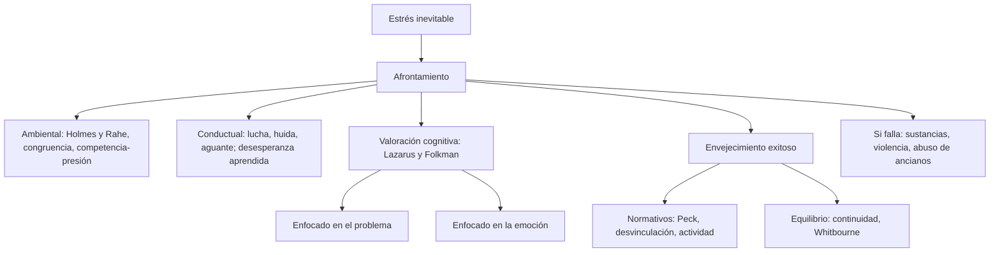
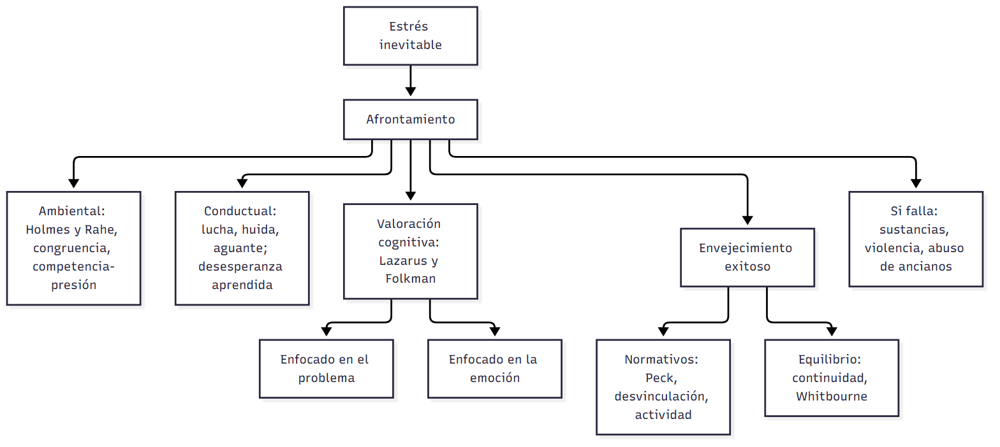

# C22 — Salud mental, afrontamiento y adaptación · Ficha de repaso

> **Idea-fuerza:** La **salud mental** es vivir con sentido usando los recursos disponibles, y **no se deteriora típicamente en la vejez**. **Afrontar** es pensar o actuar para reducir el estrés; la cátedra presenta tres enfoques: **ambiental**, **conductual** y **valoración cognitiva** (problema o emoción; ninguna estrategia es mala en sí). El **envejecimiento exitoso** se explica con modelos **normativos** (Peck, desvinculación, actividad) y de **equilibrio** (continuidad, Whitbourne). Cuando el afrontamiento falla aparecen **comportamientos destructivos** (Cátedra de Psicología Evolutiva, 2026h, diapositivas 4-8, 25; Papalia et al., 2009b, pp. 433-449, 461).

## Esqueletos de respuesta

**P1. Salud mental en la vejez.** 1) Definición: vivir con sentido con recursos y apoyos (Kivnick, citado en p. 433). 2) Contra el estereotipo: menos enfermedad mental que en los jóvenes; tiende a mejorar (p. 461). 3) Factores: salud física, ajuste psicológico, nivel socioeconómico, eventos vitales, apoyo social (pp. 461-462).

**P2. Modelos de afrontamiento.** 1) Ambiental: LCU de Holmes y Rahe (mitad de 150-300 y 70 % de más de 300 enfermaron); críticas: interpretación, momento, falta de cambio, tensiones cotidianas; congruencia y competencia-presión (pp. 435-436). 2) Conductual: condicionamiento; lucha, huida o aguante; desesperanza aprendida (p. 437). 3) Valoración cognitiva (§P3).

**P3. Valoración cognitiva.** 1) Proceso dinámico ante una exigencia que supera los recursos (p. 438). 2) Recursos y restricciones personales y ambientales (p. 438). 3) Problema vs. emoción (p. 439). 4) Ninguna es mala en sí; los mayores regulan mejor la emoción; religión 17,4 % (pp. 439-442).

**P4. Envejecimiento exitoso.** 1) MacArthur: evitar la enfermedad, mantener el funcionamiento, involucrarse (p. 444). 2) Críticas: presión, estilos de vida, genética, escolaridad, nivel socioeconómico (pp. 444-445). 3) Normativos: Peck (siete ajustes), desvinculación, actividad (pp. 445-447). 4) Equilibrio: continuidad (Atchley), Whitbourne (pp. 447-449).

**P5. Comportamientos destructivos.** Sustancias (subestimadas en los ancianos); violencia del compañero íntimo (normas de otra época, falta de independencia económica); abuso de ancianos (negligencia la más común; más vulnerables mujeres, personas con demencia, depresión o discapacidad) (pp. 450-458).

## No confundir

| X | Y | Criterio |
|---|---|---|
| Modelo ambiental | Valoración cognitiva | Cuentan las demandas / cuenta cómo la persona interpreta la situación (pp. 435-438) |
| Congruencia | Competencia-presión | Ajuste persona-ambiente / demandas frente a habilidades (diapositiva 11) |
| Enfocado en el problema | Enfocado en la emoción | Cambiar la situación / manejar la respuesta emocional (p. 439) |
| Desvinculación | Actividad / continuidad | Retiro gradual de roles / más actividad, mejor / la actividad importa si continúa el estilo previo (pp. 446-448) |
| Modelos normativos | Modelos de equilibrio | Cumplir las tareas de cada etapa / equilibrio entre continuidad y cambio, distinto en cada persona (pp. 445-449) |
| Abuso | Negligencia | Daño activo / no atender necesidades (la forma más común) (pp. 457-458) |

## Datos que conviene saber

- Holmes y Rahe: 5.000 pacientes; enfermó la mitad de quienes tenían 150-300 LCU y el 70 % de quienes superaban 300 (Papalia et al., 2009b, pp. 435-436).
- Estrategias de los mayores: religión 17,4 %, mantenerse ocupado 15,1 %, aceptación 11,3 %, apoyo familiar o de amistades 11,1 % (pp. 441-442).
- Siete ajustes de Peck: cuatro en la adultez media y tres en la vejez (p. 445).

## Referencias

Cátedra de Psicología Evolutiva. (2026h). *Salud mental, afrontamiento y adaptación al envejecimiento* [Diapositivas de clase, unidad 10]. Universidad Favaloro.

Papalia, D. E., Sterns, H. L., Feldman, R. D., & Camp, C. J. (2009b). Salud mental, afrontamiento y adaptación al envejecimiento. En *Desarrollo del adulto y vejez* (cap. 12, pp. 431-475). McGraw Hill Interamericana.

## Autoevaluación rápida

1. ¿Por qué decimos que el deterioro de la salud mental no es típico de la vejez?
2. ¿Qué hallaron Holmes y Rahe y qué críticas recibe su modelo?
3. ¿Qué es la desesperanza aprendida?
4. ¿Qué recursos y restricciones influyen en el afrontamiento según Lazarus y Folkman?
5. ¿Qué modo de afrontamiento usarías ante la pérdida de la audición? ¿Y ante el fallecimiento del cónyuge?
6. Los tres componentes del envejecimiento exitoso y dos críticas.
7. Diferenciá desvinculación, actividad y continuidad.
8. ¿Cuál es la forma más común de abuso de ancianos y quiénes son más vulnerables?
