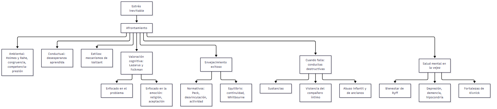

# C22 — Afrontamiento y salud mental · Ficha de repaso

> **Idea-fuerza:** La **salud mental** es «hacer lo mejor que uno puede con lo que tiene» (Kivnick): usar fortalezas y recursos para afrontar el estrés. Los **modelos de afrontamiento** (ambiental, conductual, de estilos y, sobre todo, el de **valoración cognitiva** de Lazarus) explican cómo se afronta: es un proceso dinámico, centrado en el problema o en la emoción. El **envejecimiento exitoso** se explica con modelos normativos (Peck, desvinculación, actividad) y de equilibrio (continuidad, Whitbourne). Cuando el afrontamiento falla: conductas destructivas y trastornos como depresión y demencia (Papalia et al., 2009b, pp. 433, 435, 438, 444-449, 461-475).

## Esqueletos de respuesta

**P1. Modelos de afrontamiento.** 1) Ambiental: unidades de cambio de vida (Holmes y Rahe), congruencia, competencia-presión (pp. 435-436). 2) Conductual: desesperanza aprendida (p. 437). 3) Estilos: mecanismos de Vaillant (maduro, neurótico, inmaduro, psicótico) (p. 437). 4) Valoración cognitiva (Lazarus): valorar, elegir, evaluar y revalorar (pp. 438-439). 5) Ninguna estrategia es mala en sí.

**P2. Problema vs. emoción.** Problema: eliminar o gestionar lo que estresa (cuando se ve posible un cambio); emoción: manejar la respuesta emocional (cuando poco puede hacerse); los ancianos usan más las centradas en la emoción, y pueden ser más selectivos (pp. 439-441). Ejemplos: la «posesión» en Malasia, la religión.

**P3. Envejecimiento exitoso.** MacArthur: evitar enfermedad y discapacidad, mantener el funcionamiento, involucrarse activamente (p. 444); críticas: puede cargar y «culpar a las víctimas» (pp. 444-445). Peck: siete ajustes. Desvinculación vs. actividad vs. continuidad (Atchley); estilos de identidad de Whitbourne (pp. 445-449).

**P4. Conductas destructivas.** Abuso y dependencia de sustancias (alcohol, efectos de cohorte); violencia del compañero íntimo; abuso infantil y de ancianos (pp. 450-460).

**P5. Salud mental en la vejez.** La mayoría goza de buena salud mental; ciclo de vida (multidireccionalidad, plasticidad); seis dimensiones de Ryff; depresión (subdiagnosticada, tratable), demencia, hipocondría; fortalezas de Kivnick (pp. 461-473).

## No confundir

| X | Y | Criterio |
|---|---|---|
| Enfocado en el problema | Enfocado en la emoción | Cambiar la situación / manejar la respuesta emocional (p. 439) |
| Afrontamiento | Conducta adaptativa automática | Esfuerzo ante exigencia excesiva / respuesta aprendida (p. 438) |
| Modelo ambiental | Valoración cognitiva | Mecanicista / contextual y dinámico (pp. 435-438) |
| Desvinculación | Actividad / continuidad | Retiro universal / más actividad es mejor / equilibrio continuidad-cambio (pp. 446-448) |
| Abuso de sustancias | Dependencia | Patrón mal adaptado / tolerancia, abstinencia, control perdido (p. 450) |
| Abuso | Negligencia | Daño activo / fracaso en satisfacer necesidades (p. 457) |
| Depresión | Demencia / pseudodemencia | Trastorno del ánimo / múltiples déficits cognitivos / deterioro cognitivo por depresión (pp. 465-470) |

## Citas y datos que conviene saber

- Kivnick: salud mental = «hacer lo mejor que uno puede con lo que tiene» (Kivnick, 1993, p. 15, citado en Papalia et al., 2009b, p. 433).
- Koenig et al. (1988): la **religión** fue la estrategia más citada (17,4 %) (Papalia et al., 2009b, tabla 12.1, pp. 441-442).
- Abuso de ancianos: **90 %** de los abusadores son familiares (p. 458). Depresión: subdiagnosticada en ancianos (p. 466).

## Referencias

Papalia, D. E., Sterns, H. L., Feldman, R. D., & Camp, C. J. (2009b). *Desarrollo del adulto y vejez*. McGraw Hill Interamericana.

## Autoevaluación rápida

1. ¿Cómo define Kivnick la salud mental?
2. Los cuatro modelos de afrontamiento en una oración cada uno.
3. Diferenciá afrontamiento enfocado en el problema y en la emoción.
4. Desvinculación, actividad y continuidad: ¿qué dice cada una?
5. ¿Por qué se subdiagnostica la depresión en los ancianos?
6. Seis dimensiones del bienestar de Ryff.
7. ¿Qué propone Kivnick con la valoración de fortalezas?
