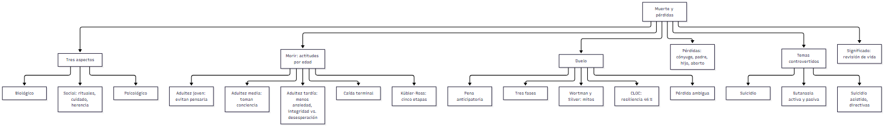
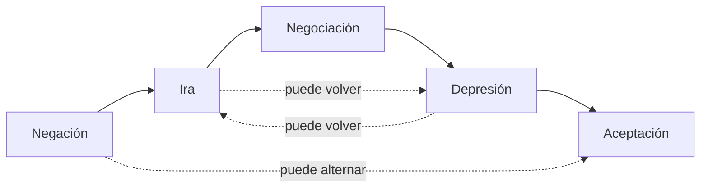
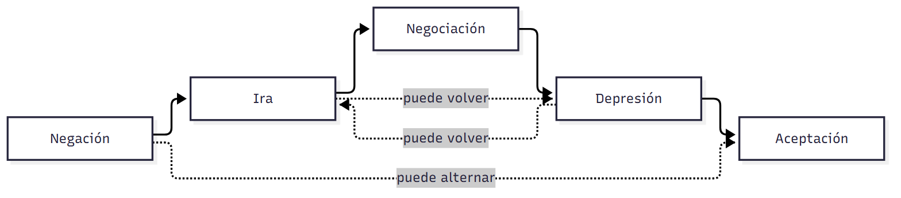
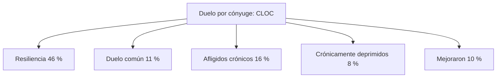
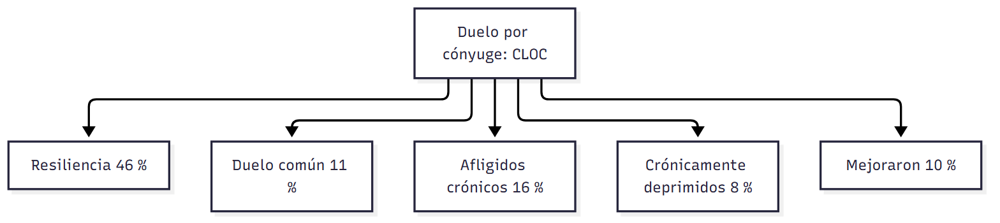

# C23 — Lidiar con la muerte y las pérdidas

> **Fuentes:**
>
> - Papalia, D. E., Sterns, H. L., Feldman, R. D., & Camp, C. J. (2009b). Lidiar con la muerte y las pérdidas. En *Desarrollo del adulto y vejez* (cap. 13, pp. 476-521). McGraw Hill Interamericana. [Bibliografía obligatoria de la unidad 10]
>
> **Materia:** Psicología Evolutiva, 2.º año, Universidad Favaloro (docente a cargo: Dra. Verónica A. Ramírez). Unidad 10, clase 23. Examen: 4.º parcial, 03/11/2026.

> **Aviso sobre las fuentes:** (1) Las páginas son las **impresas** del libro (477-521). (2) Esta clase **todavía no se dictó**: no hay diapositivas ni apuntes, así que la guía sale solo del capítulo 13; cuando tengas la presentación de la cátedra, contrastá qué partes enfatiza (por ejemplo, si prioriza las etapas de Kübler-Ross, el duelo o los temas controvertidos). (3) Las cifras y la legislación son de **EE. UU. y Europa, hasta 2006**; la guía las presenta como datos del libro, no como estado actual (la legislación sobre ayuda para morir cambió en varios países). (4) El capítulo trata temas sensibles (muerte, duelo, suicidio, eutanasia); la guía los resume como contenido de estudio. (5) El texto extraído del PDF tiene algunos pasajes ilegibles (cuadros de la tabla 13.2); donde un dato quedó dudoso, se indica o se omite. (6) El resumen del libro (p. 520) dice que el suicidio es la «novena» causa de muerte en EE. UU., mientras que el cuerpo del texto (p. 507) dice «onceava»: confirmá en tu libro y usá la del cuerpo del texto.

> **Idea-fuerza:** La muerte tiene tres aspectos interrelacionados —**biológico, social y psicológico**— y su significado depende de la **cultura y la cohorte**. En la sociedad actual hay tendencia a **negarla**, pero resurge el interés por afrontarla (tanatología, educación para la muerte, cuidado de **hospicio**). **Kübler-Ross** describió cinco «etapas» del morir (negación, ira, negociación, depresión, aceptación) que **no son universales ni secuenciales**. El **duelo** (pérdida y ajuste), la **pena** (emoción) y el **luto** (conducta cultural) no siguen un único patrón: el estudio **CLOC** mostró que lo más frecuente es la **resiliencia**. Las pérdidas del cónyuge, de un padre y de un hijo tienen efectos distintos; el **suicidio** y la **ayuda para morir** (eutanasia, suicidio asistido) son temas controvertidos; y **encontrar sentido** (revisión de vida, integridad de Erikson) reduce el miedo a morir (Papalia et al., 2009b, pp. 478-479, 487, 495-496, 516-519).

## Hilo conductor: cómo se conectan los temas de esta guía

El capítulo abre con **Louisa May Alcott**: la muerte de su hermana Lizzie, relatada en *Mujercitas* como la muerte de Beth, ocurrió en casa, rodeada por la familia durante un año. Esa muerte «a los ojos» enseñó que **morir es parte del vivir** y que confrontar el final puede dar un significado más profundo a toda la experiencia vital; es una experiencia común en el siglo XIX y en muchas culturas rurales actuales, pero **menos común hoy en la sociedad estadounidense** (Papalia et al., 2009b, pp. 477-478). La pregunta del capítulo es: **¿cómo se vive, se afronta y se da sentido a la muerte —propia y ajena— según la edad, la cultura y la historia?**

La guía responde en seis tiempos. **Primero** (sección 1), cómo **cambiaron** las perspectivas sobre la muerte («revolución en la mortalidad»), los tres aspectos de la muerte, la tanatología y el **hospicio**. **Segundo** (sección 2), las **actitudes ante la muerte** según la edad, la **caída terminal** y las **etapas de Kübler-Ross** con sus críticas. **Tercero** (sección 3), **confrontar las pérdidas**: duelo/pena/luto, costumbres culturales, pena anticipatoria, modelo de tres fases, los cinco mitos de Wortman y Silver, la **pérdida ambigua** y el estudio **CLOC**. **Cuarto** (sección 4), las pérdidas concretas: **cónyuge, padre, hijo, aborto espontáneo**. **Quinto** (sección 5), los **temas controvertidos**: suicidio, eutanasia y suicidio asistido. **Sexto** (sección 6), **encontrar significado**: revisión de vida, miedo a la muerte y el desarrollo como proceso de toda la vida (cierra con Erikson, Peck y Kivnick de la clase 22).

> 🎯 **Para el parcial:** cuando te pidan «duelo», diferenciá siempre **duelo / pena / luto**; cuando te pidan «Kübler-Ross», agregá **siempre** que las etapas no son universales ni ordenadas y que no deben usarse como criterio de «buen morir»; y cuando te pidan «patrones de pena», nombrá el hallazgo **sorprendente**: la mayoría de los ancianos viudos es **resiliente**, no «se derrumba».

**En una sola oración:** la muerte es biológica, social y psicológica; cada cultura y cada persona la afronta de manera distinta (no hay etapas universales ni un único modo «sano» de penar), y encontrar un sentido —mediante la revisión de vida— ayuda a vivir hasta el final.

## 0. Hoja de ruta

1. **Perspectivas cambiantes acerca de la muerte** (Papalia et al., 2009b, pp. 477-482).
2. **Confrontar la muerte**: actitudes, caída terminal, Kübler-Ross (pp. 482-489).
3. **Confrontar las pérdidas**: duelo, formas y patrones de la pena (pp. 487-497).
4. **Sobrevivir a un cónyuge, perder a un padre, a un hijo; duelo por aborto** (pp. 497-505).
5. **Temas controvertidos**: suicidio, eutanasia, suicidio asistido (pp. 505-516).
6. **Encontrar significado y propósito** (pp. 516-519).
7. **Para rendir**.

## 🎯 Lo que entra sí o sí

1. **Tres aspectos de la muerte** (biológico, social, psicológico) y la «revolución en la mortalidad» (pp. 478-480).
2. **Tanatología, educación para la muerte, cuidado de hospicio** y cuidado paliativo (pp. 481-482).
3. **Actitudes ante la muerte por edad**; **caída terminal** (pp. 483-486).
4. **Las cinco etapas de Kübler-Ross** y sus críticas (pp. 487-489).
5. **Duelo, pena, luto** (p. 487); **pena anticipatoria** (p. 492).
6. **Modelo de tres fases**; **cinco mitos** (Wortman y Silver); **tres patrones**; **pérdida ambigua** (Boss); **estudio CLOC** (pp. 492-497).
7. **Viudez**: ajustes, salud, segundas nupcias; **pérdida de un padre**; **de un hijo** (pp. 497-505).
8. **Suicidio**: datos, factores de riesgo, señales de advertencia (pp. 506-509).
9. **Eutanasia activa y pasiva, suicidio asistido, directivas médicas**; argumentos a favor y en contra; Oregon, Holanda (pp. 509-516).
10. **Revisión de vida**, tipos de reminiscencia, miedo a la muerte (pp. 516-519).

---

## 1. Perspectivas cambiantes acerca de la muerte

### 1.1 Respuesta modelo (para escribir en el parcial)

> **Esqueleto de la respuesta:**
> 1. **Tesis:** la muerte tiene aspectos biológico, social y psicológico, y la forma de vivirla cambió históricamente.
> 2. **Historia:** antes, mortalidad alta y muerte cotidiana; hoy «revolución en la mortalidad» y muerte concentrada en los ancianos y fuera del hogar (Papalia et al., 2009b, pp. 478-479).
> 3. **Tres aspectos:** biológico (cese de procesos corporales), social (rituales, cuidado, herencia), psicológico (sentimientos) (pp. 479-480).
> 4. **Hoy:** tanatología, educación para la muerte, hospicio (pp. 481-482).

Antes de los tiempos modernos morían unas cincuenta personas por cada mil al año, y más de un tercio de los bebés moría en la infancia: la muerte era un acontecimiento normal y esperado. La «revolución en la mortalidad» (avances médicos, mejor salud pública) hizo que hoy casi tres cuartas partes de las muertes en EE. UU. ocurran en mayores de 65 años; la muerte se volvió «invisible y abstracta» y se trasladó a hospitales y asilos. Hay tres aspectos interrelacionados: biológico (suspensión de procesos corporales; más complejo por la tecnología médica), social (actitudes, cuidado, rituales de duelo, herencia) y psicológico (cómo se siente cada persona con su muerte y la de sus seres queridos). Hoy resurge el interés por afrontarla de manera abierta: tanatología, educación para la muerte y cuidado de hospicio (Papalia et al., 2009b, pp. 478-482).

> ⚠ **No confundir:** *tanatología* (estudio de la muerte y el proceso de morir, «el estudio de la vida con la muerte en ella») con *educación para la muerte* (programas para enseñar a lidiar con ella); y *cuidado de hospicio* (atención centrada en la familia del enfermo terminal, con foco en aliviar el dolor y la calidad de vida) con el *cuidado hospitalario* tradicional (orientado a curar) (pp. 481-482).

### 1.2 Desarrollo ampliado

**Punto de partida: Louisa May Alcott** (pp. 477-478). En *Mujercitas*, ante la enfermedad terminal de Beth, «la familia aceptó lo inevitable e intentó apoyarla con alegría»: le reservaron la habitación más agradable con lo que más amaba; Jo la acompañó todo el tiempo (como Alcott con su hermana Lizzie); Beth murió serenamente. La biografía de Alcott muestra que la secuencia se acerca «increíblemente a la realidad». Las actitudes ante la muerte se modelan con el tiempo y el contexto: esa experiencia era común en el siglo XIX y en muchas culturas rurales contemporáneas, y menos en EE. UU. actual. «El sombrío hecho biológico de la muerte, entonces, no lo es todo»: su significado e impacto dependen de lo que las personas sienten y hacen, y cómo su cultura lidia con ella (p. 478).

**La «revolución en la mortalidad»** (pp. 478-479). Antes de la modernidad, ~50 de cada mil morían por año (hasta 40 % en plagas o desastres); más de un tercio de los bebés moría en la infancia y la mitad de los niños antes de los nueve años (Lofland, 1986). Los avances médicos y una población más consciente de la salud produjeron una «revolución en la mortalidad»: hay menor riesgo de morir en el parto, los infantes sobreviven más, los adultos jóvenes llegan a la vejez y los ancianos superan enfermedades antes fatales. A principios del siglo XX las causas principales eran neumonía, influenza, tuberculosis y diarrea; hoy **casi tres cuartos de las muertes en EE. UU. ocurren en mayores de 65** (NCHS, 2004). Los ancianos padecen enfermedades crónicas por periodos más largos, por intervenciones médicas que prolongan la existencia (Stillion, 2005). Con la muerte más frecuente en la vejez, se vuelve «**invisible y abstracta**» (Fulton y Owen, 1987-1988, p. 380, citado en Papalia et al., 2009b, p. 479): la generación *baby boom* urbana fue la primera en llegar a la adultez con solo **5 %** de probabilidad de haber vivido la muerte de alguien de la familia inmediata. Cuidar al moribundo y preparar el cuerpo, antes tareas familiares, pasaron a profesionales; **más de dos de cada tres muertes ocurrían fuera del hogar**. Hoy la violencia, el abuso de drogas, la pobreza y sobre todo el **SIDA** hacen difícil negar la muerte, y por el costo del cuidado hospitalario más muertes ocurren en casa (Techner, 1994).

**Tres aspectos de la muerte** (pp. 479-481).
- **Biológico:** la muerte se considera la suspensión de los procesos corporales (se declara cuando cesan la respiración y el latido o toda la actividad eléctrica del cerebro). Los criterios se complicaron con la tecnología (personas en coma profundo mantenidas por años; una persona cuyo cerebro dejó de funcionar completamente está muerta por definición aunque se la mantenga con dispositivos): hay dilemas sobre cuándo retirar respiradores y tubos de alimentación y a quién corresponde decidir; muchos conflictos terminan en la corte (p. 479).
- **Social:** actitudes hacia la muerte, el cuidado del moribundo, dónde ocurre, los esfuerzos por posponerla o anticiparla, la última voluntad, las costumbres y rituales de duelo y la transferencia de posesiones y roles. Ejemplos: en la sociedad **malaya** la muerte es una transición gradual (entierro provisional; ritos hasta que el cadáver se descompone y el alma es admitida en el reino espiritual); el *Libro de los muertos* egipcio; los héroes griegos eran quemados en público; la cremación es común en India y Nepal, y está prohibida por la ley judía ortodoxa; en **Japón** se mantiene un altar a los ancestros; en **Gambia** el muerto sigue siendo parte de la comunidad; los **hopi** intentan olvidar al muerto; los **musulmanes de Egipto** expresan profunda tristeza y los de **Bali** se alientan a reír y regocijarse (Stroebe et al., 1992) (pp. 480-481). Muchas costumbres derivan de creencias antiguas (el embalsamamiento, de la momificación egipcia y china; no dejar solo al moribundo en la tradición judía).
- **Psicológico:** cómo se sienten las personas ante su muerte y la de sus allegados. Los **rituales** dan algo importante para hacer cuando de otro modo se sentirían desamparados; la vigilia judía alivia la culpa; en el funeral judío ortodoxo el ataúd sencillo cerrado ayuda a confrontar la realidad, y durante la semana de **shiva** los dolientes hablan del fallecido (p. 480-481). En contraste, en EE. UU. contemporáneo predominan la **evitación o negación** (aislamiento en hospitales o asilos, no hablar con el moribundo, no visitarlo) (p. 481).

**Tanatología y educación para la muerte** (p. 481). **Tanatología**: estudio de la muerte y el proceso de morir, o «el estudio de la vida con la muerte en ella» (Kastenbaum, 1993, p. 76, citado en Papalia et al., 2009b, p. 481). La **educación para la muerte** ofrece programas a estudiantes, trabajadores sociales, médicos, enfermeras y otros profesionales; metas: apaciguar ansiedades, ayudar a desarrollar un sistema propio de creencias, ver la muerte como un fin natural, enseñar formas humanas de tratar al moribundo, dar una visión realista de las obligaciones de los trabajadores de salud, explicar la dinámica de la pena, ayudar a suicidas y a quienes los rodean y a decidir sobre servicios funerarios (Leviton, 1977, citado en Papalia et al., 2009b, p. 481).

**Cuidado de hospicio** (pp. 481-482). Atención cálida, personal y centrada en la familia, enfocada en el **cuidado paliativo** (aliviar el dolor, controlar síntomas, calidad de vida); puede darse en un hospital, institución u hogar. El movimiento comenzó en **Londres en 1968**, como respuesta a la necesidad de instalaciones especializadas: el hospital típico está hecho para curar, así que los moribundos reciben pruebas y tratamientos inútiles, menos atención y reglas irrelevantes, y el cuidado es costoso. Hay ~**3 000** programas que atienden ~**950 mil** personas (casi la mitad con cáncer; también cardiopatías, demencia, enfermedad pulmonar, renal o hepática); es costeable y cubierto por Medicare y Medicaid. Filosofía de **Cicely Saunders**: «Tú importas hasta el último momento de tu vida, y nosotros haremos todo lo que podamos, no sólo para ayudarte a morir en paz, sino para que vivas hasta que mueras» (National Hospice Organization, s. f., p. 6, citado en Papalia et al., 2009b, p. 482). Equipo interdisciplinario: médicos, enfermeras, trabajadores sociales, psicólogos, clérigos, amigos y voluntarios. **Dignidad:** Chochinov y colaboradores (2002) entrevistaron a **50 pacientes canadienses** con cáncer terminal avanzado: el cuidado que preserva la dignidad depende no solo de cómo son tratados, sino de **cómo saben que son vistos**: «cuando los pacientes moribundos se ven, y saben que son vistos, como merecedores de honor y estima por quienes los cuidan, es más probable que mantengan la dignidad» (Chochinov, 2002, p. 2259, citado en Papalia et al., 2009b, p. 482).

**Cada muerte es diferente** (p. 482). El modelo de ocurrencia de los acontecimientos de vida (cap. 11) sugiere que la muerte no significa lo mismo para un hombre de 85 años con artritis, una mujer de 56 en la cima de su carrera, una niña con leucemia o un joven de 20 que muere por una sobredosis; ni para un brahmán de la India que para un indigente de Nueva York. La **cohorte** también importa: los ancianos japoneses de la primera generación aceptan lo inevitable (enseñanzas budistas), mientras los japoneses americanos de tercera generación muestran menos aceptación, porque crecieron con la creencia estadounidense en la habilidad para controlar el propio destino (Kalish y Reynolds, 1976, citado en Papalia et al., 2009b, p. 482).

---

## 2. Confrontar la muerte: actitudes, caída terminal y etapas de Kübler-Ross

### 2.1 Respuesta modelo (para escribir en el parcial)

> **Esqueleto de la respuesta:**
> 1. **Tesis:** las actitudes ante la muerte cambian con la edad y la proximidad de la muerte, y las etapas de Kübler-Ross son útiles pero no universales.
> 2. **Edades:** adultos jóvenes evitan pensarla; adultos medios toman conciencia; ancianos, menos ansiosos (Papalia et al., 2009b, pp. 483-484).
> 3. **Caída terminal:** declive cognitivo y de personalidad cercano a la muerte (p. 485).
> 4. **Kübler-Ross:** cinco etapas (p. 487).
> 5. **Críticas:** no son etapas verdaderas; no secuenciales; no criterio de «buen morir» (p. 487).

Los adultos jóvenes evitan pensar en su muerte (y quienes se enferman gravemente se frustran e irritan); en la adultez media la mayoría toma conciencia de que va a morir y cambia la percepción del tiempo («cuántos años me quedan»); los ancianos están menos ansiosos que los adultos medios, usan más estrategias centradas en la emoción y enfrentan la crisis de integridad frente a desesperación de Erikson. Cerca de la muerte aparece la caída terminal, un declive cognitivo (y cambios de personalidad) que predice la muerte hasta once años después. Kübler-Ross, a partir de unos 500 enfermos terminales, propuso cinco etapas (negación, ira, negociación, depresión y aceptación); se la critica porque no son verdaderas etapas, las personas no siguen la secuencia y no hay un único «buen morir» (Papalia et al., 2009b, pp. 483-489).

> ⚠ **No confundir:** *las etapas de Kübler-Ross* (descripción de emociones frecuentes) con *una teoría organicista de etapas* (secuencia ordenada, universal e inevitable): los críticos advierten que algunos profesionales creen que son inevitables y sienten que fallaron si no llevan al paciente a la «aceptación»; para algunos, la negación o la ira pueden ser formas más saludables de enfrentar la muerte (p. 487).

### 2.2 Desarrollo ampliado

**Actitudes por edad** (pp. 483-485).
- **Adultez joven:** la mayoría evita pensar en la muerte; entienden en abstracto que ocurre, pero los adolescentes están influidos por la **fábula personal** (Elkind, 1984, citado en Papalia et al., 2009b, p. 483), creencia egocéntrica de ser únicos y no sujetos a las reglas naturales. Se desvanece con las responsabilidades laborales y familiares, pero a los adultos jóvenes no les gusta pensar que les puede ocurrir (Kastenbaum, 1977). Quienes recién terminaron su formación y se embarcan en carrera, matrimonio o paternidad, si enferman o se lesionan, se sienten **más intensamente sensibles a la muerte inminente que en cualquier otro periodo**: están frustrados («trabajaron terriblemente duro... para nada»), su frustración se convierte en **ira**, y los hace pacientes de hospital problemáticos (Pattison, 1977) (p. 483).
- **Adultez media:** es cuando la mayoría **se da cuenta de que va a morir**: leen obituarios, ven nombres conocidos, el cuerpo envía señales, y tras la muerte de ambos padres hay conciencia de ser la «generación más vieja» (Scharlach y Fredriksen, 1993). Perciben el tiempo de otra manera: antes pensaban en cuántos años habían vivido, ahora en **cuántos les quedan** (Neugarten, 1967). Esa conciencia puede ser ímpetu para un reto: el organizador comunitario **Saul Alinsky**, tras una grave enfermedad, decidió que antes de morir haría algo que marcara una diferencia. Lleva a analizar carreras, matrimonios, relaciones con los hijos, amistades, valores y uso del tiempo (cf. recuadro 11.2) (pp. 483-484).
- **Adultez tardía:** en general están **menos ansiosos** que los adultos medios (Bengtson, Cuellar y Ragan, 1975, citado en Papalia et al., 2009b, p. 484), usan más estrategias **centradas en la emoción** (véase C22) y, con la pérdida de amigos y parientes, reorganizan gradualmente sus pensamientos para aceptar su mortalidad. Las pérdidas físicas pueden disminuir el placer de vivir: en un estudio con **414 pacientes hospitalizados** de 80 y 90 años, cuando se les preguntó cuánto esperarían para una excelente salud, cerca de **dos de cada tres** no quiso darse más de un mes de vida (Tsevat et al., 1998). Según **Erikson**, enfrentan la crisis de **integridad frente a desesperación**: quienes la resolvieron logran una sabiduría que les permite aceptar lo que hicieron con su vida y su muerte inminente; los ajustes de Peck para la vejez (C22) ayudan; quienes sienten que sus vidas fueron significativas son más capaces de enfrentarla. Hay sentimientos complejos: **Rita Duskin** (82 años, madre de uno de los autores), antes de morir, escribió «Me rehúso a creer que soy una pieza de polvo...» (p. 485): reconocer la muerte puede asociarse con una afirmación de lo preciosa que es la vida.

**Cambios físicos y psicológicos: caída terminal** (pp. 485-486). Los cambios psicológicos pueden comenzar antes de los signos fisiológicos. La **caída terminal** (Kleemeier, 1962; Riegel y Riegel, 1972, citados en Papalia et al., 2009b, p. 485): declive del funcionamiento intelectual poco antes de morir; se halló en estudios longitudinales de varios países, no solo en los muy ancianos sino en adultos de un amplio rango de edades, **sin importar** el estatus de salud aparente, género, nivel socioeconómico o causa de muerte (Rabbitt et al., 2002; Small et al., 2003). Los declives terminales predicen la muerte **hasta once años después**; un declive en la **habilidad verbal** (normalmente la menos afectada por la edad) puede ser un indicador especialmente relevante. Un estudio inglés con **3 572** adultos de 49 a 93 años sugiere que la **depresión** (con efectos negativos sobre la función cerebral) puede ayudar a explicar la caída terminal. Se atribuye a veces a afecciones crónicas que agotan la energía mental y la motivación; afecta habilidades poco dañadas por la edad (vocabulario) y se observa también en quienes mueren jóvenes (Berg, 1996). **Siegler, McCarty y Logue (1982)** (estudio longitudinal Duke): quienes murieron al año siguiente de la prueba tuvieron peores calificaciones en inteligencia (WAIS verbal y de ejecución) y memoria verbal y visual que quienes murieron 8-13 años después y que quienes vivieron 14 años o más (figura 13.1). **Cambios de personalidad** (Lieberman y Coplan, 1970): en 80 personas de 65 a 91 años, quienes murieron al año fueron menos introspectivos y más dóciles; quienes afrontaban una crisis y estaban cerca de morir tuvieron más miedo y preocupación por la muerte que quienes afrontaban crisis similares sin estar cerca de morir; pero quienes tenían vidas estables no mostraron miedo especial. Sugiere una **relación psicosomática**; no puede ser el efecto de un solo episodio de enfermedad, pues quienes se recuperaron de enfermedades agudas no mostraron el mismo declive (p. 486).

**Kübler-Ross: etapas del proceso de morir** (pp. 487-489). **Elisabeth Kübler-Ross**, psiquiatra, inspiró el interés actual por la psicología de la muerte; notó que la mayoría de los pacientes agradece hablar abiertamente de su condición y que son conscientes de la cercanía de la muerte aun sin saber qué tan enfermos están. Tras hablar con unos **500 pacientes** enfermos terminales (1969, 1970) propuso **cinco etapas** para la aceptación de la muerte (tabla 13.1):
1. **Negación:** conmoción y rechazo («¡Esto no puede pasarme a mí!»); si quienes rodean al paciente también niegan, se siente abandonado y aislado; se da esperanza y se asegura que no se lo abandonará. *Ejemplo:* la señora K., 28 años, madre de dos niños, con enfermedad hepática terminal, tras visitar a un curandero dijo «Fui curada».
2. **Ira:** «¿Por qué yo?»; envidia de los jóvenes y sanos (en realidad no están enojados con ellos sino con la juventud y la salud que no tienen); necesitan expresar su rabia. *Ejemplo:* el señor O., hombre de negocios controlador, se enojó cuando la enfermedad de Hodgkin le quitó el control; mejoró cuando lo consultaron sobre horarios de visitas y procedimientos.
3. **Negociación:** «Sí, me pasa a mí, pero...»; intento de negociar tiempo (rogar a Dios que me deje vivir hasta la graduación de mi hija, etc.); reconoce que el tiempo es limitado. *Ejemplo:* una mujer con gran dolor que quería asistir a la boda de su hijo, con autohipnosis controló el dolor, asistió y después dijo «¡Ahora no olvide que tengo otro hijo!».
4. **Depresión:** necesitan llorar y apenarse por la pérdida de su propia vida; superan la depresión mucho más rápido que si se sienten presionados a ocultar su tristeza. *Ejemplo:* el señor H., que disfrutaba actividades de la iglesia y no podía seguir haciéndolas.
5. **Aceptación:** «Mi hora está muy cerca ya, y está bien»; no necesariamente feliz, pero quienes trabajaron ansiedades y asuntos pendientes terminan en paz. *Ejemplo:* la señora W., 58 años, con cáncer abdominal, que se sentía lista para morir pero no podía hacerlo hasta que su marido aceptara dejarla ir.
Kübler-Ross propuso una progresión similar para quienes enfrentan un luto inminente (1975). **Recuadro 13.1 (contexto multicultural): posponer la muerte** (p. 490): Thomas Jefferson murió el 4 de julio, aniversario de la independencia («¿Es el cuatro?»). Phillips y King (1988): en California, la mortalidad por causas naturales fue **más baja justo antes y más alta justo después de la pascua judía** (el «efecto pascua» fue más fuerte en hombres judíos, que conducen el seder, y no apareció en afroamericanos, asiáticos o niños judíos). Phillips y Smith (1990): lo mismo con el **festival chino de la cosecha de la Luna**, solo entre las **mujeres chinas mayores de 75** (para quienes la fiesta significa más). Israel (Anson y Anson, 1997, 2001): patrones en festividades musulmanas distintos para hombres y mujeres, y descenso de la mortalidad en el sabbath. Explicación probable: procesos psicosomáticos permiten **posponer la muerte hasta una ocasión significativa**; no el estrés o el comer en exceso, que no explicarían las tasas más bajas previas (p. 491).
**Críticas** (p. 487): (1) no son **verdaderas etapas** como en las teorías organicistas (no todas las personas pasan por las cinco ni en el mismo orden; puede ir de ida y vuelta entre ira y depresión, o sentir ambas a la vez); (2) los moribundos muestran «una mezcla de reacciones conflictivas o alternadas» afectadas por edad, sexo, raza, etnia, escenario social y personalidad (Butler y Lewis, 1982, p. 370, citado en Papalia et al., 2009b, p. 487); (3) algunos profesionales suponen que son **inevitables y universales** y sienten que fallan si no llevan al paciente a la «aceptación» (Leviton, 1977, p. 259, citado en Papalia et al., 2009b, p. 487); (4) para algunas personas, la negación o la ira puede ser una forma más saludable que la aceptación calmada. Conclusión: útil para comprender, pero **no un modelo o criterio para un «buen morir»**.

---

## 3. Confrontar las pérdidas: duelo, pena y luto

### 3.1 Respuesta modelo (para escribir en el parcial)

> **Esqueleto de la respuesta:**
> 1. **Tesis:** el duelo no sigue un único patrón; la investigación reciente cuestionó el modelo tradicional.
> 2. **Definiciones:** duelo, pena, luto (Papalia et al., 2009b, p. 487).
> 3. **Modelo de tres fases:** conmoción, preocupación por la memoria, resolución (pp. 492-493).
> 4. **Wortman y Silver:** cinco mitos y tres patrones (pp. 493-495).
> 5. **CLOC:** la resiliencia es el patrón más frecuente (46 %) (pp. 495-496).
> 6. **Terapia de duelo:** a veces ineficaz o dañina (pp. 496-497).

Duelo es la pérdida de un ser cercano y el proceso de ajuste posterior; pena es la respuesta emocional de las primeras fases; luto es el comportamiento culturalmente aceptado del doliente y la comunidad. El patrón tradicional de tres fases (conmoción e incredulidad, preocupación por la memoria de la persona muerta y resolución) fue cuestionado: Wortman y Silver mostraron que cinco creencias comunes sobre el duelo son más mito que realidad (todos se deprimen, hay que «trabajar» la pérdida, el dolor termina pronto, etc.) y hallaron tres patrones de duelo. El estudio CLOC encontró que el duelo común clásico fue raro (11 %) y que lo más frecuente fue la resiliencia (46 %); por eso la terapia de duelo no es necesaria para todos y a veces resulta ineficaz o dañina (Papalia et al., 2009b, pp. 487, 492-497).

> ⚠ **No confundir:** *duelo* (pérdida y ajuste posterior), *pena* (respuesta emocional, universal pero con contexto cultural) y *luto* (comportamiento culturalmente aceptado: velorio irlandés, etc.) (p. 487); *pena anticipatoria* (síntomas de pesar mientras la persona sigue viva) con *duelo ausente o demorado* (falta de aflicción obvia que supuestamente llevaría a un estallido: el estudio CLOC no halló evidencia clara de este patrón) (pp. 492, 495-496).

### 3.2 Desarrollo ampliado

**Definiciones** (p. 487). **Duelo:** pérdida de un ser cercano, y el proceso de ajuste posterior; puede afectar prácticamente todos los aspectos de la vida del sobreviviente y comenzar con un **cambio de estatus y roles** (de esposa a viuda, de hijo a huérfano). **Pena (aflicción):** la respuesta emocional de las primeras fases del duelo; puede tomar muchas formas, de la ira a un sentimiento de vacío. Duelo y pena son experiencias universales, pero tienen contexto cultural. **Luto:** no los sentimientos sino el **comportamiento**; las formas, por lo general aceptadas culturalmente, en que el doliente y la comunidad actúan mientras se ajustan a una muerte (el velorio irlandés de toda la noche, etc.).

**Costumbres culturales** (pp. 490, 492). Las culturas tradicionales ayudan con costumbres de significado bien comprendido que dan un «anclaje de seguridad» en la turbulencia de la pérdida. Ejemplos: Japón (altar a los ancestros, se les habla y ofrece comida o cigarrillos); Gambia (en *Raíces* de Alex Haley, el muerto sigue siendo parte de la comunidad); **hopi** (intentan olvidar al muerto rápidamente, creen que la muerte trae contaminación y se debe temer a los espíritus, no conservan fotografías); musulmanes de Egipto (tristeza profunda) y de Bali (reír y regocijarse); en **México** jóvenes y ancianos se sientan en las tumbas y velan toda la noche el Día de Muertos (limpian las tumbas, las adornan con flores y velas, ofrecen los alimentos favoritos). **No hay una «mejor» forma** de enfrentar la pérdida: lo que funciona en una cultura puede no ser útil en otra; los consejeros deben tomar en cuenta tradiciones étnicas y diferencias individuales (Kastenbaum, 1999, citado en Papalia et al., 2009b, p. 491).

**Formas y patrones de la pena** (p. 492). La pena es muy personal; la investigación reciente desafía la noción de un solo patrón y horario «normales»: una viuda que habla con su marido fallecido antes se consideraba perturbada; hoy se reconoce como **común y útil** (Lund, 1993b). Algunos se recuperan rápido; otros nunca lo superan por completo.

**Pena anticipatoria** (p. 492). Síntomas de pesar experimentados mientras la persona **todavía sigue viva** (familia y amigos de alguien enfermo hace mucho). Puede ayudar a manejar la muerte real más fácilmente (psicológicamente y en términos prácticos: discutir pensiones y seguros); las viudas que esperaban la pérdida pudieron presentar mejor ajuste, aunque es posible que se sientan menos afligidas (O'Bryant, 1990-1991). Sin embargo, otras viudas ancianas que «ensayaron» la viudez al pensar y hablar del futuro **no estuvieron mejor ni peor ajustadas** que las mujeres cuyos esposos murieron inesperadamente (Hill, Thompson y Gallagher, 1988).

**Modelo de tres fases** (pp. 492-493). El patrón más común: se rompe gradualmente el lazo con la persona muerta, se reajusta a la vida sin ella y se desarrollan nuevos intereses y relaciones (Brown y Stoudemire, 1983; Schulz, 1978).
1. **Conmoción e incredulidad:** varias semanas, especialmente después de una muerte súbita; los sobrevivientes se sienten perdidos y confundidos; la conmoción protege de reacciones más intensas; pérdida de aliento, presión en pecho o garganta, náusea, vacío abdominal; luego, tristeza abrumadora y llanto frecuente.
2. **Preocupación por la memoria de la persona muerta:** seis meses o más; no puede aceptarla todavía; llanto, insomnio, fatiga, pérdida de apetito; revive la muerte; sentimiento de presencia (escucha la voz, ve el rostro, sueña); disminuye con el tiempo, aunque puede reaparecer en aniversarios.
3. **Resolución:** renueva el interés en las actividades cotidianas; los recuerdos mezclan cariño con tristeza en vez de dolor agudo; un viudo extraña a su esposa pero comprende que la vida debe seguir.

**Diversas reacciones ante la pérdida** (pp. 493-495). El dolor no siempre sigue una línea recta: puede ser una sucesión de altibajos que se aminoran pero no se eliminan por completo (Lund, 1993b). La reina Victoria vistió de negro 40 años; otros no elaboran el duelo. **Wortman y Silver (1989)** revisaron estudios de pérdidas mayores (muerte de un ser amado; pérdida de movilidad por lesión en la columna) y mostraron que **cinco creencias comunes son más mito que realidad**:
1. «Todo el que sufre una pérdida severa estará perturbado y deprimido» → **falso**: de 3 semanas a 2 años después, solo **15 a 35 %** de viudas, viudos y víctimas de lesión medular mostraron depresión.
2. «Quienes no muestran aflicción tendrán problemas más tarde» → **no necesariamente**; de hecho quienes estuvieron **más perturbados** al principio tuvieron más probabilidad de mayores problemas hasta dos años después.
3. «Hay que **trabajar** la pérdida enfocándose en ella y dándole sentido» → no todos lo necesitan o se benefician; el trabajo de duelo más intenso se asoció con más problemas.
4. «La aflicción intensa llegará a su fin en poco tiempo» → no todos regresan a la normalidad rápidamente; ej.: padres de hijos asesinados por conductores ebrios funcionaron pobremente hasta siete años; también hay viudos y viudas que muestran ansiedad de moderada a severa hasta cuatro años después de la muerte, en especial si fue súbita (la proporción exacta no se lee en la copia extraída del PDF: confirmala en tu libro, p. 494).
5. «Eventualmente aceptarán la pérdida, intelectual y emocionalmente» → no siempre (padres y cónyuges de personas muertas en accidentes automovilísticos mantienen recuerdos dolorosos por años; la aceptación es difícil si la pérdida es **ambigua**).
Hallaron **tres patrones principales**: el **esperado** (de aflicción alta a baja), el **ausente** (el doliente no experimenta aflicción intensa inmediatamente ni más tarde) y el **prolongado** (permanece afligido largo tiempo).

**Recuadro 13.2: pérdidas ambiguas** (pp. 494-495). Ejemplos: la esposa de un hombre desaparecido en el World Trade Center (11/9/2001), los sobrevivientes del tsunami de 2004, familiares de pasajeros de aviones derribados décadas atrás, una mujer cuyo padre se suicidó y no vio el cuerpo. **Pauline Boss** (1999, 2002, 2004): **pérdida ambigua** = situación en que la pérdida no está claramente definida y por tanto es confusa y difícil de resolver; **no es un trastorno psicológico sino de relación**, en que la pena queda «congelada» y la resolución no puede ocurrir; es una fuente de estrés debilitante: se niega el cierre ritual y emocional, las personas se inmovilizan y no reorganizan roles; el apoyo de amigos y familia puede extinguirse. «Las personas ansían un cuerpo [...] porque, paradójicamente, tener el cuerpo les permite deshacerse de él» (Boss, 2002, p. 15, citado en Papalia et al., 2009b, p. 494); ver el cadáver da «certidumbre cognitiva de la muerte». **Nombrar** la situación alivia la angustia. También se aplica cuando el ser amado está **físicamente presente pero psicológicamente ausente** (Alzheimer, adicción a drogas, enfermedades mentales crónicas). Quienes toleran mejor la pérdida ambigua: (1) son profundamente espirituales y tienen fe en lo desconocido; (2) optimistas; (3) pueden sostener **dos ideas opuestas** («necesito reorganizar mi vida pero mantengo viva la esperanza»); (4) crecieron en una familia o cultura donde el dominio y el control eran menos relevantes que aprender a vivir con lo que se es. Algunas culturas nativas americanas tienen rituales (una mujer Anishinabe hizo un «funeral» a su madre con demencia); en Nueva York se ofrecieron certificados de supuesta muerte y una urna de cenizas de la zona cero (algunos los aceptaron, otros prefirieron esperar pruebas). **Terapia:** ayudar a «comprender, enfrentar y seguir después de la pérdida, incluso si permanece sin aclararse» (Boss, 1999, p. 7, citado en Papalia et al., 2009b, p. 495); contar historias, reconstruir rituales; las etapas clásicas del duelo no se aplican y presionar por el cierre ocasiona resistencia.

**Estudio CLOC (Vidas cambiantes de las parejas ancianas)** (pp. 495-496). Boerner, Wortman y Bonanno (2005) y Bonanno et al. (2002, 2004): entrevistaron a **1 532 ancianos casados** y luego hicieron seguimiento a **185** (161 mujeres, 24 hombres) cuyos cónyuges habían muerto, a los **seis meses** y **cuatro años** de la pérdida. Resultados:
- **Duelo común** (depresión inmediata que persiste, como en el modelo clásico de tres etapas): **sorprendentemente raro, 11 %**.
- **No hubo evidencia clara de duelo ausente o demorado** (falta de aflicción obvia que daría un estallido después).
- **Resiliencia: el patrón más prevaleciente, 46 %**: bajo nivel de aflicción que disminuye gradualmente; aceptan la muerte como proceso natural; pasan poco tiempo pensando y hablando o buscando significado, aunque la mayoría tuvo anhelo y dolencias emocionales los primeros seis meses. Desafía la suposición de que «estar bien» tras una pérdida es causa de preocupación: es una respuesta normal para muchos ancianos (Boerner et al., 2005, p. P72, citado en Papalia et al., 2009b, p. 496).
- **Afligidos crónicos: 16 %** (se deprimen tras la pérdida; excesivamente dependientes de sus cónyuges; más probabilidad de seguir pensando y buscando significado, pero «terminaron con ello» hacia los 48 meses).
- **Crónicamente deprimidos: 8 %** (deprimidos de antemano y más deprimidos después; no se recuperan a los 48 meses): los candidatos más probables para tratamiento.
- **Mejoraron durante el duelo: 10 %** (alta depresión antes de la pérdida; la muerte fue el final de un estresor crónico: matrimonios negativos o ambivalentes y cónyuges seriamente enfermos).
Implicación: puede ser innecesario e incluso dañino urgir a los dolientes a «trabajar» una pérdida o esperar un patrón fijo de reacciones emocionales, así como esperar que todos los moribundos pasen por las etapas de Kübler-Ross.

**Terapia de duelo** (pp. 496-497). La mayoría de los dolientes se recupera con ayuda de familiares y amigos; para algunos está indicada la terapia de duelo (ayudar a expresar tristeza, culpa, hostilidad e ira; revisar la relación con el fallecido; integrar la muerte en la vida). Con frecuencia los estudios la hallan **ineficaz** o, en una proporción perturbadora de casos (**38 %** según un estudio, Fortner, Neimeyer, Anderson y Berman, reportado en Neimeyer, 2000), **dañina**. Hay que reevaluar las suposiciones típicas (que la «ausencia de pena» es un problema; que la pérdida es uno de los eventos más estresantes). **Los afligidos crónicos** tienen más probabilidad de beneficiarse (reconocer lo central de su pérdida, construir autoestima, reestructurar su vida); a los **crónicamente deprimidos** se los ayuda más enfocándose en sus problemas emocionales actuales y las tensiones cotidianas de la viudez, y a veces con antidepresivos (Boerner et al., 2005, citado en Papalia et al., 2009b, p. 497).

---

## 4. Sobrevivir a un cónyuge; perder a un padre o a un hijo

### 4.1 Respuesta modelo (para escribir en el parcial)

> **Esqueleto de la respuesta:**
> 1. **Tesis:** cada pérdida (cónyuge, padre, hijo) tiene un impacto distinto según el momento del ciclo vital y si es normativa.
> 2. **Cónyuge:** pérdida del rol y de la compañía, cambios sociales y económicos, riesgo para la salud, recuperación con apoyo social (Papalia et al., 2009b, pp. 497-500).
> 3. **Padre:** efecto de maduración en la adultez media; cambios en el yo y las relaciones (pp. 500-503).
> 4. **Hijo:** pérdida no normativa, la más difícil; riesgo para el matrimonio y la salud (pp. 503-505).

La viudez exige ajustes emocionales, prácticos, sociales y económicos (el ingreso familiar cae 44 % en promedio) y puede afectar la salud; las mujeres enviudan más y más jóvenes; los ancianos se ajustan algo mejor que los jóvenes y los viudos se vuelven a casar más que las viudas. La muerte de un padre, frecuente en la adultez media, puede ser una experiencia de maduración (más autonomía y responsabilidad, mayor conciencia de la mortalidad, cambios en las relaciones) aunque produce duelo prolongado en una parte de los hijos. La muerte de un hijo es especialmente difícil por ser no normativa (no hay palabra para el padre que pierde a un hijo) y puede debilitar el matrimonio y afectar la salud de los padres (Papalia et al., 2009b, pp. 497-505).

> ⚠ **No confundir:** *efecto de la edad en la viudez*: el duelo no es más fácil o difícil por la edad en sí; los jóvenes parecen peor ajustados porque estuvieron más recientemente en duelo; lo que ayuda es la experiencia en enfrentar pérdidas y las habilidades de afrontamiento (p. 499).

### 4.2 Desarrollo ampliado

**Viudez** (pp. 497-500). Según la clasificación clásica de eventos estresantes, la **muerte de un cónyuge** requiere el mayor ajuste (tabla 4.3, cap. 4). Las mujeres viven más y suelen ser más jóvenes que sus maridos: **un tercio** de las mujeres pierde al marido hacia los 65 años y los hombres recién pierden a sus esposas hacia los 75 (Atchley, 1997).
- **Ajustes** (p. 497): vacío emocional (amante, confidente, amigo y compañía); incluso en un mal matrimonio duele por perder el **rol de cónyuge**, especialmente para una mujer que estructuró su vida en torno a cuidar al marido (Lucas et al., 2003; Marks y Lambert, 1988; Saunders, 1981). La **calidad de la relación** influye: en el estudio CLOC, los viudos muy **dependientes** de sus cónyuges se volvieron más ansiosos y los extrañaron más a los seis meses; también quienes fueron muy cercanos extrañaron más (Carr et al., 2000).
- **Vida social** (p. 498): amigos y familia acuden al principio y luego retoman sus vidas; los amigos casados pueden evitar a la persona viuda; los viudos sienten que «estorban» con las parejas. Aun así, ven a los amigos con más frecuencia que los casados; hacen nuevas amistades pero gran parte de sus amigos son los antiguos. Los viudos buscan compañía de mujeres; las viudas traban amistad con otras viudas y tienen dificultades para establecer relaciones con hombres.
- **Economía** (p. 498): el ingreso familiar **cae 44 %** en promedio tras la muerte del cónyuge (Healy, 1983; Hungerford, 2001); la viuda se priva del ingreso del marido; el viudo tiene que contratar servicios que daba la esposa; si ambos trabajaban, la pérdida de un ingreso es un golpe fuerte.
- **Salud** (p. 498): en un estudio finlandés de gran escala, los varones que perdieron a sus esposas tuvieron **21 % más probabilidad de morir** en los cinco años siguientes que los casados, y las mujeres viudas **10 %** más (Martikainen y Valkonen, 1996). Hipótesis: pérdida del «escudo» protector del compañerismo (Ray, 2004) y, según CLOC, una razón práctica: ya no hay quien recuerde tomar las píldoras o cumplir la dieta (Williams, 2004). Las personas viudas muestran **tasas más altas de enfermedad mental**, en especial depresión, que las casadas (Balkwell, 1981); los viudos son más vulnerables a la depresión (menos relaciones íntimas alternativas); en las mujeres influye la restricción económica y en los hombres el estrés de manejar una casa (Umberson et al., 1992).
- **Recuperación** (pp. 498-499): la mayoría reconstruye su vida; la soledad y la tristeza dan lugar a la confianza en manejarse solos. Se ajustan mejor quienes se mantienen ocupados, toman nuevos roles (trabajo asalariado o voluntario), ven con frecuencia a los amigos (los ayuda más que visitar a los hijos) y participan en grupos de apoyo para viudos. El **apoyo social** (poder expresar sentimientos sin consejo no solicitado) es especialmente relevante en los primeros meses; la calidad de las relaciones importa más que la frecuencia. La pérdida puede ser un **catalizador para la introspección y el crecimiento**, sobre todo para las mujeres (descubrir aspectos escondidos, regresar a la escuela o encontrar un empleo) (Lieberman, 1996).
- **Edad** (p. 499): muchos estudios hallan a los ancianos mejor ajustados que los adultos jóvenes (la pérdida es más traumática cuando es menos esperada, DiGiulio, 1992); pero un estudio que controló el tiempo de viudez halló que **la edad al enviudar tiene poco efecto** sobre la moral a largo plazo; los viudos ancianos tienen una moral algo más alta, quizás por mayor disponibilidad de compañía de pares (Balkwell, 1985). A corto plazo, las viudas más jóvenes presentan más problemas psicológicos (abrumadas por la responsabilidad total, estándar de vida reducido, resentimiento y culpa hacia los hijos; Parkes y Weiss, 1983; DiGiulio, 1992); y la salud física se afecta más cuando la pérdida ocurre en la adultez media. En general la edad no es un factor principal; **lo son las habilidades para enfrentarlo** (Lund, 1993b).
- **Segundas nupcias** (pp. 499-500): los viudos ancianos se vuelven a casar más que las viudas (cuatro veces más probabilidad, porque hay más mujeres disponibles); los hombres sienten más necesidad; las mujeres pueden manejar su hogar y son reticentes a ceder la pensión de sobreviviente, la libertad de vivir solas o a cuidar nuevamente a un marido débil. En CLOC, ni viudas ni viudos buscan pareja si tienen amigos cercanos que los apoyen: el principal beneficio de muchos matrimonios tardíos es la **compañía** (Carr, 2004). En un estudio de **24 parejas** que se casaron de nuevo a los 60 o más (Vinick, 1978) los hombres mencionaron compañía y alivio a la soledad, las mujeres sentimientos hacia el nuevo esposo; casi todos eran felices, con matrimonios más tranquilos («vivir y dejar vivir»).

**Pérdida de un padre** (pp. 500-503). Se estudia menos que la viudez, pero puede ser difícil: implica la pérdida de «la más larga e importante de las relaciones», el trauma de la ruptura del hogar de origen y la pérdida del «**amortiguador**» entre uno mismo y la muerte (Dainoff, 1989, p. 64, citado en Papalia et al., 2009b, p. 500). Con la mayor expectativa de vida, hoy ocurre sobre todo en la **adultez media** (Aldwin y Levenson, 2001); la muerte de ambos padres en la adultez joven es no normativa y puede afectar la salud (Marks, Bumpass y Jun, 2004). Una encuesta de **220 hijos adultos** halló que **uno de cada cuatro** aún sufría problemas sociales y emocionales de 1 a 5 años después (Scharlach, 1991); entrevistas con **83 voluntarios** de 35 a 60 años mostraron aflicción persistente (tristeza, llanto, depresión, pensamientos suicidas), especialmente tras la pérdida de la madre, y cerca de la **mitad** reportó reacciones físicas continuas (Scharlach y Fredriksen, 1993). La aflicción psicológica aparece rápido y los problemas de salud pueden mostrarse mucho después (Umberson y Chen, 1994).
- **Experiencia de maduración:** desde una perspectiva organicista, la muerte de un padre empuja a resolver conflictos de desarrollo de la adultez media: un sentido del yo más fuerte y de elección personal, mayor responsabilidad, compromiso y vinculación con otros y conciencia más realista de la propia mortalidad (Moss y Moss, 1989; Scharlach y Fredriksen, 1993). Es «evidencia de la potencial relevancia de la muerte de los padres como un evento significativo del desarrollo en la adultez media» (Scharlach y Fredriksen, 1993, p. 317, citado en Papalia et al., 2009b, p. 501).
- **Cambios en el yo** (pp. 501-503; tabla 13.2): muchos se sienten más asertivos, autónomos, seguros y responsables (más maduros); pueden aceptar y perdonar las fallas del padre; revisar sus vidas y metas (cambiar de empleo, regresar a la escuela, jubilarse); dan más importancia a las relaciones personales, los placeres simples y la felicidad, y menos a las posesiones. Algunos tienen una oleada de creatividad (Lynn Redgrave escribió y representó *Shakespeare for My Father*); otros, especialmente cuya identidad se entremezcló con la del padre, se desesperan. Aumenta la **conciencia de la propia mortalidad** (puede traer aceptación menos ansiosa o mayor miedo, sentimientos de vejez), y las personas se preparan concretamente (arreglos funerarios, testamento); la edad del padre al morir es significativa para el propio ciclo de vida (alguien organizó una fiesta por haber vivido más que su padre; otro hace ejercicio para «no morir como mi padre»).
- **Cambios en las relaciones** (p. 503): más intimidad o conflicto; el hijo adulto asume más responsabilidad por el padre sobreviviente y por mantener unida a la familia; los hermanos pueden unirse o distanciarse; si cuidó al padre, queda libre para dedicar tiempo a otras relaciones; la muerte del último progenitor da un sentido de mortalidad más agudo (ya no hay generación mayor); algunos se reconcilian con vivos mientras hay tiempo. El lazo con el padre «termina una vida pero no una relación» (Anderson, 1980, p. 110, citado en Papalia et al., 2009b, p. 503).

**Pérdida de un hijo** (pp. 503-505). El rey David lloró a Absalón. No hay en español palabra para un padre que pierde a un hijo (viudo, huérfano): quien pierde un hijo es privado incluso de una identidad. Antes era más común enterrar a un hijo; hoy, con la mortalidad infantil baja (**8,5 muertes por mil nacidos vivos** en EE. UU.) la muerte de un hijo es una **conmoción cruel, no natural, un evento intempestivo** que no debería haber ocurrido (Raphael, 1983). Los padres pueden sentir que fracasaron, y es difícil dejarlo ir. Si el matrimonio es fuerte, puede acercarse; pero la pérdida puede **debilitar o destruir** el matrimonio (culpa mutua, distintos modos de penar; divorcio incluso años después; Brandt, 1989). Los padres, **especialmente las madres**, tienen mayor riesgo de ser **hospitalizados por enfermedad mental** (Li et al., 2005), y el estrés puede acelerar su muerte (Li et al., 2003). **Hablar de la muerte inminente con el hijo:** en 2001, un equipo sueco entrevistó a **449** padres que habían perdido un hijo por cáncer 4 a 9 años antes: ~**un tercio** habló con su hijo de su muerte inminente y **ninguno se arrepintió**, mientras que **27 %** de quienes no lo hicieron sí se arrepintió; quienes tuvieron más probabilidad de arrepentirse sintieron que el hijo sabía que moría pero no hablaron del tema, y muchos de ellos seguían con depresión y ansiedad (Kreicbergs et al., 2004). Ayuda sumergirse en el trabajo, intereses y otras relaciones o unirse a grupos de padres en duelo; **recordar al hijo** de forma significativa puede ser lo que los padres necesitan (Elizabeth Glaser fundó una organización contra el SIDA pediátrico tras la muerte de su hija Ariel; la fundación recaudó más de 30 millones de dólares).

**Luto por un aborto espontáneo** (p. 505). En un templo budista de Tokio se ofrecen estatuas y juguetes a **Jizo**, que vigila a los fetos abortados; el ritual de **mizuko kuyo** («hijo de agua») es un rito de disculpa y remembranza (Orenstein, 2002). En el mundo hispánico no existe una palabra especial para el feto abortado ni un ritual de duelo; familiares, amigos y profesionales tienden a evitar hablar de tales pérdidas porque se consideran insignificantes frente a la pérdida de un hijo vivo (Van, 2001): la pena puede ser más grave sin apoyo social. La experiencia es única; las diferencias entre cómo sufren hombres y mujeres pueden ser fuente de tensión en la pareja (Caelli et al., 2002).

---

## 5. Temas controvertidos: suicidio, eutanasia y suicidio asistido

### 5.1 Respuesta modelo (para escribir en el parcial)

> **Esqueleto de la respuesta:**
> 1. **Tesis:** suicidio y ayuda para morir ponen en conflicto el «derecho a morir» con la protección de la vida.
> 2. **Suicidio:** tasas más altas en hombres blancos mayores; asociado con depresión y enfermedad; señales de advertencia (Papalia et al., 2009b, pp. 506-509).
> 3. **Eutanasia:** activa vs. pasiva; suicidio asistido (p. 509).
> 4. **Directivas médicas:** testamento en vida, poder notarial (pp. 510-511).
> 5. **Argumentos a favor y en contra** (pp. 512-513).
> 6. **Legislación y cultura:** Oregon, Holanda y diferencias culturales (pp. 513-516).

El suicidio es más frecuente en hombres, aumenta con la edad (la mayor tasa corresponde a los hombres blancos mayores de 85) y se asocia con depresión, enfermedad física, aislamiento y abuso de sustancias; ocho de cada diez suicidas dan señales de advertencia. La eutanasia activa (acción deliberada para terminar con una vida) es por lo general ilegal; la pasiva (retirar tratamiento que prolonga la vida), en ciertas circunstancias, no lo es; en el suicidio asistido, un médico u otro ayuda y el paciente realiza la acción. Los argumentos a favor se basan en autonomía y dignidad; los contrarios, en que quitar una vida es incorrecto, en la protección de los vulnerables y en el «terreno resbaloso». Oregon legalizó el suicidio asistido (1994) y Holanda (2001) y Bélgica (2002) la eutanasia voluntaria; hay diferencias culturales y la discusión llevó a mejorar el cuidado paliativo (Papalia et al., 2009b, pp. 505-516).

> ⚠ **No confundir:** *eutanasia pasiva* (retirar o no iniciar tratamiento: medicamentos, soportes de vida, tubos de alimentación), *eutanasia activa* (acción deliberada para acabar con una vida, p. ej., inyección letal) y *suicidio asistido* (el paciente realiza la acción con ayuda de un médico u otro); y *directiva médica* (instrucciones por escrito) con *testamento en vida* (un tipo de directiva) y *poder notarial duradero* (designa a otra persona para decidir) (pp. 509-511).

### 5.2 Desarrollo ampliado

**Suicidio: datos** (pp. 506-507). Caso de Bantcho Bantchevsky, 82 años, quien se arrojó desde un palco de la Metropolitan Opera tras deprimirse por el deterioro de su salud. En la mayoría de las naciones las tasas de suicidio **aumentan con la edad** y son **más altas en varones** (Kinsella y Velkoff, 2001). La mayor tasa corresponde a los **hombres blancos mayores de 50**, que representan el **30 %** de los suicidios; el riesgo sube con la edad, en particular entre hombres de **85 años y más** (NCHS, 2004). Los ancianos tienen más probabilidad de estar deprimidos y aislados, y si lo intentan, es más probable que lo logren (CDC, 2002b); los hombres divorciados y viudos tienen tasas altas a todas las edades; en ancianos se asocia con enfermedad física, conflicto familiar y problemas financieros. **Más mujeres intentan, pero los hombres tienen cuatro veces más probabilidad de consumarlo**, porque usan métodos más confiables (armas de fuego, ~**60 %** de los suicidios) mientras que las mujeres suelen elegir veneno. Los hombres blancos y nativos americanos tienen las tasas más altas (el doble que hispanoamericanos, afroamericanos o asiáticoamericanos); los ancianos afroamericanos tienen un tercio de la probabilidad de los blancos, quizá por el compromiso religioso y la costumbre de enfrentar golpes duros. Una historia familiar de suicidio eleva el riesgo (posible vulnerabilidad hereditaria vinculada con baja actividad de **serotonina** en la corteza prefrontal). En EE. UU. las tasas declinaron a fines de los noventa tras un aumento de 25 % de 1981 a 1997; en 2003 hubo más de 30 mil suicidios, la **onceava** causa de muerte y la tercera entre los 15 a 24 años; tasa de **10,5** por 100 mil, menor que en muchos países industrializados; a nivel mundial, la treceava causa de muerte (WHO, 2003). **Tabla 13.3** (tasas por 100 000, año más reciente hasta octubre de 2000): entre hombres, Rusia 66,4 (1997), Hungría 51,1 (1998), Finlandia 38,7; EE. UU. 18,7 (1997); **Argentina 9,9 en hombres y 3,0 en mujeres (1996)**; China es el único país con tasa mayor en mujeres (17,9) que en hombres (14,3) (1994) (p. 508).

**Factores de riesgo y señales de advertencia** (pp. 507-509). Casi **nueve de cada diez** suicidas tienen depresión u otro trastorno mental o abusan de sustancias (NIMH). Otros factores: ser divorciado, viudo o desempleado; parientes con intento o suicidio; tratamiento psiquiátrico previo; eventos de vida estresantes; esquizofrenia, abuso de sustancias, ataques de pánico; poseer un arma en casa; **rasgos de personalidad**: dependencia, desamparo, desesperanza, incapacidad para aceptar ayuda, dificultad para formar relaciones cercanas, pobre resolución de problemas bajo estrés, ansiedad o irritabilidad extremas, antisocialidad. Las estadísticas **subestiman** el fenómeno (muchos casos no se reportan: «accidentes» de tráfico y sobredosis); entre 20 y 60 % de quienes se suicidan lo intentaron antes y casi 10 % de quienes lo intentaron lo lograrán dentro de diez años. **Señales de advertencia:** **ocho de cada diez** dan señales: alejarse de familia y amigos, hablar de la muerte o del suicidio, deshacerse de posesiones preciadas, abusar de drogas o alcohol, cambios de personalidad (ira inusual, aburrimiento, apatía), signos de depresión (dificultad para concentrarse, pérdida de autoestima, desamparo, desesperanza, ansiedad extrema). Muchos suicidios son **impulsivos**: si no hay un medio conveniente, puede diferirse y dar tiempo a pedir ayuda. Psicoterapia, medicación o más contacto social ayudan. Los sobrevivientes son «otras víctimas del suicida»: se culpan por no haber reconocido las señales y, por el estigma, luchan solos. **Casos culturales:** una pareja israelí de 83 y 82 años que se mató para evitar deterioro y «romper el tabú»; en la sociedad **inuit** tradicional no hay tal tabú (un anciano que ya no es útil puede pedir a sus hijos que lo ayuden a estrangularse; una anciana puede pedir que la dejen en el camino) (p. 509).

**Eutanasia y suicidio asistido: definiciones** (p. 509). **Eutanasia** («buena muerte», a veces «asesinato por compasión»): acción deliberada para acabar con una vida, o permitir que un enfermo terminal muera con dignidad. **Eutanasia activa:** acción deliberada para terminar con una vida (el caso del hombre de 79 años que mató a su esposa con Alzheimer avanzado; el gran jurado rechazó acusarlo). **Eutanasia pasiva:** retirar o descontinuar deliberadamente el tratamiento que prolonga la vida (medicamentos, soporte de vida, tubos de alimentación). La activa suele ser ilegal; la pasiva, en algunas circunstancias y ciertos lugares, no. **Suicidio asistido:** un médico o alguien más ayuda a morir a una persona (cuando interviene un especialista de salud, «auxilio médico para morir»); en la eutanasia activa voluntaria otro administra la inyección, en el suicidio asistido **la persona realiza la acción real** (p. 512). Todas son formas de «ayuda para morir» o «muerte acelerada».

**Actitudes y directivas médicas** (pp. 510-511). La comisión presidencial (Schmerck, 1983) propuso permitir a pacientes competentes (o sus familias) detener el tratamiento que mantiene vivos a enfermos sin esperanza, y a los médicos dar drogas que puedan acortar la vida si el fin es aliviar el dolor, pero **prohibir terminar intencionalmente con una vida**; en una encuesta Harris de 1994, **70 %** permitiría a los médicos acatar los deseos de un moribundo con dolor severo que pida terminar con su vida (Taylor, 1995). La corte suprema de EE. UU. sostiene que una persona con deseos claramente conocidos tiene un **derecho constitucional a descontinuar un tratamiento sustentador de vida** (*Cruzan v. Director, Missouri Department of Health*, 1990). **Estado vegetativo persistente:** técnicamente vivo, sin conciencia y con funcionamiento cerebral rudimentario. Una encuesta de 1 400 médicos y enfermeras en cinco hospitales halló que casi la mitad (y 70 % de los residentes) prolongaba el soporte de vida a terminales sabiendo que no lo querían (Solomon, 1993). **Directiva médica:** documento que contiene instrucciones sobre cuándo y cómo descontinuar el cuidado inútil; los 50 estados la han legalizado. Tipos: **testamento en vida** (circunstancias de suspensión del tratamiento, medidas extraordinarias, control del dolor, donación de órganos; solo aplica a pacientes terminales, no a quienes pueden vivir años con dolor severo, en coma o en estado vegetativo) y **poder notarial duradero** (designa a otra persona para decidir si el paciente queda incapacitado), o poder notarial médico específico. **Caso Terri Schiavo:** mujer joven en estado vegetativo persistente sin directiva escrita; siete años de batalla legal, intervención del Congreso; la autopsia reveló atrofia cerebral a casi la mitad de su capacidad (Annas, 2005). Aun con directivas, muchos pacientes reciben tratamientos infructuosos (estudio SUPPORT, ~9 mil pacientes: los médicos frecuentemente desconocían las órdenes de no resucitar); hoy muchos hospitales tienen **comités éticos** y a veces asesores éticos; un estudio con 551 pacientes en cuidados intensivos sugiere que la asesoría ética ayuda a resolver conflictos (Schneiderman et al., 2003).

**Suicidio asistido: pros y contras** (pp. 511-513). **Jack Kevorkian** (Michigan) diseñó una máquina para ayudar a pacientes terminales a suicidarse; auxilió al menos 21 muertes; en 1998 CBS difundió un video en el que administraba una inyección letal a un hombre con enfermedad de Lou Gehrig, y fue condenado por asesinato en segundo grado. 58 % de quienes lo conocían lo apoyaba (Taylor, 1995). La AMA se opone al auxilio médico para morir (contrario al juramento de «no hacer daño»); se permite dar drogas que puedan acortar la vida si el propósito es aliviar el dolor.
- **A favor** (APA, 2001): *éticos* — autonomía y autodeterminación (derecho a controlar la calidad de la vida y el momento y la naturaleza de la muerte), dignidad; *médicos* — el profesional debe tomar todas las medidas para aliviar el sufrimiento y el paciente es quien da el paso real; *legales* — regular lo que ya ocurre por compasión, con garantías contra el abuso. Algunos estudiosos van más allá: legalizar toda eutanasia voluntaria con garantías contra la involuntaria; el tema clave es **cómo se decide**, no cómo ocurre; sin diferencia de principio entre desconectar un respirador y una inyección letal.
- **En contra:** *éticos* — quitar una vida, incluso con consentimiento, está mal; protección de los desventajados (la autonomía está limitada por pobreza, discapacidad o pertenencia a un grupo estigmatizado; presión sutil para contener costos; pacientes que interiorizan la preocupación de gastar los recursos de la familia); *médicos* — mal diagnóstico, nuevos tratamientos, prognosis incorrecta, incompatibilidad con el papel de sanador; *legales* — coercitividad de las garantías, juicios si la familia no está de acuerdo. **Terreno resbaloso:** como las píldoras no siempre funcionan, el suicidio asistido llevaría a la eutanasia activa voluntaria y luego a la **involuntaria** (personas con discapacidades); quienes desean morir suelen deprimirse temporalmente y pueden cambiar de parecer con tratamiento o cuidado paliativo.

**Legalización y experiencia** (pp. 513-515). *Australia* (Territorios del Norte, 1996): primera persona en morir legalmente por suicidio asistido; la ley fue revocada en 1997. *EE. UU.:* desde 1997 la corte suprema dejó la decisión a los estados; **Oregon** es el único estado con la **Ley de Muerte con Dignidad** (voto de 1994): pacientes mentalmente competentes a quienes dos médicos informan que les quedan **menos de seis meses** pueden solicitar una prescripción letal con garantías; sobrevivió a retos judiciales (2002; *Gonzales v. Oregon*, 2006, seis a tres). En siete años, **238** pacientes terminales se quitaron la vida (37 en 2004). Tras dos años, los médicos concedieron ~una sexta parte de **221** peticiones y casi la mitad de esos pacientes cambió su parecer; quienes recibieron intervenciones paliativas (control del dolor, hospicio) tuvieron más probabilidad de cambiar de opinión (Ganzini et al., 2000). Quienes usaron la prescripción estaban más preocupados por la **pérdida de autonomía o del control de las funciones corporales** que por el dolor o el dinero. La eutanasia activa es ilegal en EE. UU., pero **Holanda la legalizó en 2001** (pacientes con sufrimiento continuo, insoportable e incurable) y **Bélgica en 2002**; antes, en Holanda los médicos evitaban el proceso judicial bajo estrictas condiciones de reporte; en 1995, **2,5 %** de las muertes holandesas resultaron de eutanasia o suicidio asistido; poca evidencia de «terreno resbaloso» según Angell (1996), mientras críticos estadounidenses (Hendin et al., 1997) afirman lo contrario.

**Diferencias culturales** (pp. 514-516). **3 de cada 4** estadounidenses en una encuesta Gallup de 2005 favorecían la eutanasia para un paciente con enfermedad incurable que desea morir. Una encuesta de 1 902 médicos: de quienes recibieron peticiones de ayuda para suicidarse (18 %) o inyecciones letales (11 %), casi 7 % aceptó al menos una vez (Meier et al., 1998). En el Reino Unido, 80 % de los geriatras pero solo 52 % de los de cuidado intensivo consideraron que la eutanasia voluntaria activa nunca estaba justificada. En **seis países europeos** (Bosshard et al., 2005), la frecuencia con que se retira o se rehúsa tratamiento varió de **41 %** de las muertes en Suiza a **6 %** en Italia; las formas activas predominaron en Holanda y Bélgica. **Recién nacidos:** privar o retirar el tratamiento a recién nacidos sin posibilidad de supervivencia es práctica aceptada, con diferencias entre países; en Holanda (lineamientos de 2002, Groninen) se han reportado casos sin persecución penal. Efecto positivo de la controversia: mayor atención al **cuidado paliativo** y al estado mental de los pacientes; una petición de ayuda para morir da la posibilidad de **explorar sus razones**; la voluntad de vivir fluctúa (Chochinov et al., 1999); a veces una consulta psiquiátrica descubre una perturbación subyacente (Muskin, 1998). **Diversidad cultural:** la planeación de la muerte es inconsistente con los valores **navajo** tradicionales (evitan el pensamiento negativo); las familias **chinas** pueden proteger al moribundo del conocimiento de su muerte; inmigrantes **mexicanos y coreanos** creen menos en la autonomía individual; **afroamericanos e hispanoamericanos** tienen más probabilidad que los europeoamericanos de preferir tratamiento sustentador de vida sin importar el estado de la enfermedad (APA Working Group on Assisted Suicide, 2005). Los conflictos serán más apremiantes conforme la población envejezca.

---

## 6. Encontrar significado y propósito en la vida y la muerte

### 6.1 Respuesta modelo (para escribir en el parcial)

> **Esqueleto de la respuesta:**
> 1. **Tesis:** confrontar la muerte puede dar sentido a la vida; la revisión de vida es el mecanismo central.
> 2. **Revisión de vida:** proceso de reminiscencia que mejora la integridad del yo (Erikson) (Papalia et al., 2009b, p. 517).
> 3. **Tipos de reminiscencia:** placer, autocomprensión; (integradoras, instrumentales vs. evasivas, obsesivas) (p. 517).
> 4. **Miedo a la muerte:** menor con más propósito (Durlak) (p. 519).
> 5. **Cierre:** el desarrollo es un proceso de toda la vida; incluso morir puede ser una experiencia del desarrollo (p. 519).

La revisión de vida —proceso de reminiscencia, a menudo en la vejez— permite a las personas reexaminar sus valores, completar tareas sin terminar (reconciliaciones) y alcanzar la integridad del yo de Erikson. No todo recuerdo ayuda: la reminiscencia para el placer mejora el ánimo; la de autocomprensión se asocia con la mayor integridad; los recuerdos solo placenteros dan buen ánimo pero menos integridad, y los obsesivos pueden requerir tratamiento. Quienes encuentran más propósito en la vida tienen menos miedo de morir, y la conciencia de la muerte puede dar una última oportunidad de crecer: incluso morir puede ser una experiencia del desarrollo (Papalia et al., 2009b, pp. 516-519).

> ⚠ **No confundir:** *reminiscencias integradoras e instrumentales* (aceptar la vida, resolver conflictos, usar estrategias que funcionaron) con *evasivas* (glorificar el pasado sobre el presente) y *obsesivas* (culpa, amargura, desesperación) (Wong y Watt) (p. 517).

### 6.2 Desarrollo ampliado

**Revisión de vida** (pp. 516-518). Para la mayoría la muerte llega en un momento y forma que no es su elección; al acercarse el fin, las personas miran en retrospectiva qué hicieron de sí mismas y se preguntan por el propósito de la vida. Ficción: el doctor de *Fresas salvajes* (Bergman), Scrooge en *Cuento de navidad* (Dickens) y el burócrata de *Ikiru* de Kurosawa (que deja un legado con un parque infantil) convierten su tiempo restante en algo más propositivo. La **revisión de vida**, un proceso de reminiscencia que comúnmente ocurre en la vejez, puede mejorar la **integridad del yo** (la tarea final de Erikson) y permite reexaminar valores, ver las experiencias bajo una nueva luz, completar tareas sin terminar y lograr cierre (p. 517). **Tipos de reminiscencia** (Sherman, 1991, 1993; Sherman y Peak, 1991):
- **Para el placer** (el tipo más frecuente): mejora el estado de ánimo y la autoimagen.
- **Para autocomprensión** (casi 1 de cada 4 ancianos): ayuda a resolver problemas pasados y a encontrar significado; quienes usan la reminiscencia para la autocomprensión muestran la **mayor integridad del yo** y salud mental positiva.
- **Para resolver problemas presentes y hacer frente a las pérdidas:** predomina en casi uno de cada diez ancianos.
- Quienes se involucran activamente en una revisión de vida pueden experimentar temporalmente una moral más baja; quienes excluyen todo menos los recuerdos placenteros tienen buen ánimo pero **menos integridad**; y quienes recuerdan solo los hechos negativos y están obsesionados con el arrepentimiento, la desesperanza y el miedo a morir, desde la perspectiva de Erikson se rindieron ante la **desesperación** y pueden necesitar tratamiento (Sherman, 1993; Walasky et al., 1983-1984).
- **Wong y Watt (1991):** quienes «envejecen exitosamente» tienen reminiscencias más **integradoras** (aceptar la vida, resolver conflictos antiguos, reconciliar la versión idealizada del pasado con la realidad) e **instrumentales** (extraer estrategias que funcionaron para los problemas actuales) y menos **evasivas** (glorifican el pasado sobre el presente) u **obsesivas** (culpa, amargura, desesperación).
- La **terapia de revisión de vida** (Butler, 1961; Lewis y Butler, 1974) enfoca el proceso natural de revisión y lo hace más consciente y propositivo. **Recuadro 13.3 (El arte de envejecer):** métodos para evocar recuerdos: escribir o grabar **autobiografías** (qué se omite también es significativo); **peregrinajes** a escenarios de la infancia; **reuniones**; construcción de una **genealogía**; libros de recortes, álbumes y cartas antiguas; enfoque en la **identidad étnica**; **resumen de la obra de una vida** (pp. 517-518).

**Superar el miedo a la muerte** (p. 519). *La muerte de Iván Ilich* (Tolstoy): el tormento mental supera al físico; en el último minuto, una revelación espiritual y la preocupación por su familia le dan un momento de integridad y vencen su miedo. La ciencia social lo confirma: **Durlak (1973)**, con **339 mujeres** (edad promedio 76), halló que quienes vieron **más propósito en la vida** tuvieron **menos miedo de morir**. Kübler-Ross (1975, p. 164, citado en Papalia et al., 2009b, p. 519): «No hay necesidad de temer a la muerte»; la **negación de la muerte** es en parte responsable del «vacío existencial»; cuando se comprende que cada día puede ser el último, se aprovecha para crecer, «convertirte más en quien realmente eres» y alcanzar a otros. La conciencia de la muerte inminente puede dar a los adultos una última oportunidad para expresar sus mejores cualidades.

**Desarrollo: un proceso de toda la vida** (p. 519). **Renoir**, a fines de sus setenta, con artritis incapacitante y en silla de ruedas, ataba el pincel a la mano y siguió pintando; poco antes de morir bosquejó anémonas y dijo «Creo que comienzo a entender algo acerca de ellas». «Incluso morir puede ser una experiencia del desarrollo»: «hay cosas por ganar, por lograr en la muerte: el tiempo con y para quienes están cerca, el lograr un sentido final y voluntad para dejarse ir» (Weinberg, 1999, citado en Papalia et al., 2009b, p. 519), el tipo de «buena muerte» de *Mujercitas*. La **tensión entre posibilidades virtualmente infinitas para crecer y un tiempo finito** define la vida humana, particularmente la adultez tardía; al elegir qué posibilidades seguir, cada persona contribuye a la «historia sin fin» del desarrollo adulto.

---

## 7. Para rendir: preguntas y respuestas modelo

Formato del 3.er parcial de la cátedra (se asume igual para el 4.º): opción múltiple con justificación (máx. 4 renglones), verdadero/falso con justificación (máx. 4) y una pregunta abierta (máx. 7 renglones, unas 90-110 palabras).

### 7.1 Opción múltiple (justificar en 4 renglones)

**1) Según el estudio CLOC con ancianos viudos, el patrón de duelo más frecuente fue:**
A. El duelo común (depresión inmediata que persiste). B. El duelo demorado. C. La resiliencia. D. El duelo crónico.

*Respuesta: C.* La resiliencia (46 %) fue con mucho el patrón más frecuente; el duelo común fue sorprendentemente raro (11 %) y no hubo evidencia clara de duelo demorado (Papalia et al., 2009b, pp. 495-496). *(Fuente: C23_MuerteYDuelo_Guia.md, §3.2)*

**2) El *luto* se refiere a:**
A. Los sentimientos del doliente. B. El proceso de ajuste tras la pérdida. C. El comportamiento culturalmente aceptado del doliente y la comunidad. D. Los síntomas de pesar antes de la muerte.

*Respuesta: C.* A es la pena; B, el duelo; D, la pena anticipatoria (p. 487, 492).

**3) La eutanasia pasiva consiste en:**
A. Administrar una inyección letal. B. Retirar o descontinuar deliberadamente un tratamiento que prolonga la vida de un enfermo terminal. C. Que el paciente realice la acción con ayuda de un médico. D. Un testamento en vida.

*Respuesta: B.* A es la activa; C, el suicidio asistido; D, un tipo de directiva médica (pp. 509-510).

**4) ¿Cuál de las siguientes afirmaciones sobre las etapas de Kübler-Ross es correcta?**
A. Son etapas universales y secuenciales. B. Son emociones frecuentes, pero no todos pasan por las cinco ni en ese orden. C. Describen el duelo de los sobrevivientes únicamente. D. Fueron confirmadas por estudios longitudinales.

*Respuesta: B.* Fue la crítica central: no son verdaderas etapas organicistas y no deben usarse como criterio de «buen morir» (p. 487).

### 7.2 Verdadero o falso (justificar en 4 renglones)

**5) Para una buena adaptación, todo doliente debe «trabajar» su pérdida enfocándose en ella.** *Falso.* Wortman y Silver mostraron que no todos lo necesitan o se benefician; el trabajo de duelo más intenso se asoció con más problemas (Papalia et al., 2009b, pp. 493-494).

**6) La terapia de duelo es siempre beneficiosa.** *Falso.* Muchos estudios la hallan ineficaz y en una proporción perturbadora de casos (38 % en un estudio) incluso dañina; los afligidos crónicos tienen más probabilidad de beneficiarse (pp. 496-497).

**7) Los hombres intentan suicidarse más que las mujeres, pero ellas lo consuman con más frecuencia.** *Falso.* Más mujeres intentan, pero los hombres tienen cuatro veces más probabilidad de consumarlo (métodos más letales, como armas de fuego) (p. 506).

**8) La pérdida ambigua es un trastorno psicológico.** *Falso.* Según Boss, no es un trastorno psicológico sino de relación, en que la pena queda «congelada» por falta de confirmación de la muerte (p. 494).

### 7.3 Preguntas abiertas (máx. 7 renglones)

**9) Explicá las etapas de Kübler-Ross y las críticas que recibió.**

> **Esqueleto de la respuesta:**
> 1. **Tesis:** cinco reacciones frecuentes ante la muerte cercana, no un modelo universal.
> 2. **Etapas:** negación, ira, negociación, depresión, aceptación (Papalia et al., 2009b, p. 487).
> 3. **Base:** ~500 pacientes terminales (p. 487).
> 4. **Críticas:** no son verdaderas etapas; variación individual y cultural; no criterio de «buen morir» (p. 487).

*Respuesta modelo (≈ 7 renglones):* Kübler-Ross, a partir de unos 500 enfermos terminales, describió cinco etapas en la aceptación de la muerte: negación, ira («¿por qué yo?»), negociación por tiempo extra, depresión y aceptación. Se la critica porque no son verdaderas etapas como en las teorías organicistas: no todas las personas pasan por las cinco ni en ese orden, pueden oscilar entre ira y depresión o sentir ambas, y las reacciones varían con la edad, el sexo, la cultura y la personalidad. Además, algunos profesionales las toman como inevitables y universales; para algunas personas, la negación o la ira es más saludable que la aceptación, por lo que no deben usarse como criterio de «buen morir» (Papalia et al., 2009b, p. 487).

**10) Compará el modelo tradicional de tres fases del duelo con los hallazgos de Wortman y Silver y del estudio CLOC.**

> **Esqueleto de la respuesta:**
> 1. **Tesis:** el modelo tradicional describe un patrón posible, pero no el único ni el más frecuente.
> 2. **Modelo de tres fases:** conmoción e incredulidad, preocupación por la memoria, resolución (Papalia et al., 2009b, pp. 492-493).
> 3. **Wortman y Silver:** cinco mitos; tres patrones (pp. 493-494).
> 4. **CLOC:** resiliencia 46 %; duelo común 11 % (pp. 495-496).
> 5. **Implicación:** no urgir a «trabajar» la pérdida (p. 496).

*Respuesta modelo (≈ 7 renglones):* El modelo tradicional propone tres fases —conmoción e incredulidad, preocupación por la memoria del fallecido y resolución—. Wortman y Silver mostraron que cinco creencias asociadas son mitos (que todos se deprimen, que hay que «trabajar» la pérdida, que el dolor termina pronto) y hallaron tres patrones: esperado, ausente y prolongado. El estudio CLOC con ancianos viudos halló que el duelo común fue raro (11 %) y que lo más frecuente fue la resiliencia (46 %), además de afligidos crónicos (16 %), crónicamente deprimidos (8 %) y mejorados (10 %). Por eso puede ser innecesario e incluso dañino urgir a todos a trabajar la pérdida (Papalia et al., 2009b, pp. 492-496).

**11) Describí los argumentos a favor y en contra del suicidio asistido.**

> **Esqueleto de la respuesta:**
> 1. **Tesis:** el debate opone autonomía a protección de los vulnerables.
> 2. **A favor:** autonomía, dignidad, alivio del sufrimiento, regulación (Papalia et al., 2009b, p. 512).
> 3. **En contra:** quitar una vida está mal; presión sobre los desventajados; mal diagnóstico; terreno resbaloso (p. 513).
> 4. **Experiencia:** Oregon y Holanda; mejor cuidado paliativo (pp. 514, 516).

*Respuesta modelo (≈ 7 renglones):* A favor se invoca la autonomía y la autodeterminación (controlar la calidad de la propia vida y el momento de la muerte), la dignidad, la obligación del profesional de aliviar el sufrimiento y la conveniencia de regular prácticas que ya ocurren. En contra, la idea de que quitar una vida, aun con consentimiento, está mal; el riesgo de presionar sutilmente a pobres, discapacitados o estigmatizados; la posibilidad de mal diagnóstico o de nuevos tratamientos; y el «terreno resbaloso» hacia la eutanasia involuntaria. Oregon lo legalizó (1994) y Holanda legalizó la eutanasia voluntaria (2001); la controversia impulsó el cuidado paliativo (Papalia et al., 2009b, pp. 512-514, 516).

**12) ¿Qué significa «encontrar sentido» ante la muerte? (revisión de vida, tipos de reminiscencia, miedo a la muerte).** (Respuesta en §6.)

---

## Diagramas

```mermaid
graph TD
    M[Muerte y pérdidas] --> A[Tres aspectos]
    A --> A1[Biológico]
    A --> A2[Social: rituales, cuidado, herencia]
    A --> A3[Psicológico]
    M --> B[Morir: actitudes por edad]
    B --> B1[Adultez joven: evitan pensarla]
    B --> B2[Adultez media: toman conciencia]
    B --> B3[Adultez tardía: menos ansiedad, integridad vs. desesperación]
    B --> B4[Caída terminal]
    B --> B5[Kübler-Ross: cinco etapas]
    M --> C[Duelo]
    C --> C1[Pena anticipatoria]
    C --> C2[Tres fases]
    C --> C3[Wortman y Silver: mitos]
    C --> C4[CLOC: resiliencia 46 %]
    C --> C5[Pérdida ambigua]
    M --> D[Pérdidas: cónyuge, padre, hijo, aborto]
    M --> E[Temas controvertidos]
    E --> E1[Suicidio]
    E --> E2[Eutanasia activa y pasiva]
    E --> E3[Suicidio asistido, directivas]
    M --> F[Significado: revisión de vida]
```

## Tabla de distinciones

| Concepto | Qué es | Se confunde con | Criterio que los distingue (cita APA) |
|---|---|---|---|
| Duelo / pena / luto | Pérdida y ajuste / respuesta emocional / conducta culturalmente aceptada | — | (Papalia et al., 2009b, p. 487) |
| Pena anticipatoria | Pesar antes de la muerte, con la persona viva | Duelo ausente o demorado | (p. 492) |
| Tanatología / educación para la muerte | Estudio de la muerte / programas para afrontarla | — | (p. 481) |
| Hospicio / cuidado hospitalario | Paliativo centrado en la familia / orientado a curar | — | (pp. 481-482) |
| Eutanasia activa / pasiva / suicidio asistido | Acción deliberada / retirar tratamiento / el paciente realiza la acción | — | (pp. 509, 512) |
| Testamento en vida / poder notarial duradero | Instrucciones específicas / designa quién decide | — | (pp. 510-511) |
| Resiliencia / duelo crónico / depresión crónica | Aflicción baja que disminuye / depresión tras la pérdida / depresión previa y posterior | — | (p. 496) |
| Pérdida ambigua | Pérdida no definida (sin cuerpo o presencia psicológicamente ausente) | Trastorno psicológico | (p. 494) |
| Reminiscencia integradora-instrumental / evasiva-obsesiva | Resuelve y usa estrategias / glorifica o rumia culpa | — | (p. 517) |

## 🚩 Errores típicos y trampas de examen

- Presentar las etapas de Kübler-Ross como universales, invariables o criterio de «buen morir» (p. 487).
- Decir que el duelo «normal» es deprimirse y luego «recuperarse»: lo más frecuente es la resiliencia (46 %) (pp. 495-496).
- Confundir duelo, pena y luto (p. 487).
- Sostener que quien no muestra aflicción tendrá problemas más tarde (p. 493).
- Decir que la terapia de duelo es siempre útil (pp. 496-497).
- Confundir eutanasia activa, pasiva y suicidio asistido (p. 509).
- Decir que las mujeres consuman más suicidios (los hombres, cuatro veces más) (p. 506).
- Pensar que la viudez es más fácil o difícil «por la edad»: lo importante son las habilidades de afrontamiento (p. 499).
- Afirmar que los ancianos temen más a la muerte que los adultos medios (p. 484).

## Articulación con el resto de la materia

| Viene de / va hacia | Cómo se conecta |
|---|---|
| Clase 22 (`C22_Afrontamiento_Guia.md`) | Estrategias centradas en la emoción, depresión en ancianos, suicidio, desvinculación, Peck (trascendencia del yo) |
| Clase 21 (`C21_Personalidad_Guia.md`) | Erikson (integridad vs. desesperación), Vaillant, Whitbourne |
| Clase 20 (`C20_IntimidadYRelacionesFamiliares_Guia.md`) | Viudez, relaciones familiares, cuidado de un padre anciano |
| Clase 17 (`C17_Memoria_Guia.md`) | Caída terminal y rendimiento cognitivo |
| Unidad 8 (estrés y envejecimiento; `C16_AdultezYEnvejecimiento_Guia.md`) | Muerte del cónyuge como evento de vida más estresante (tabla 4.3) |

## Glosario

| Término | Definición breve (cita APA) |
|---|---|
| **Tanatología** | Estudio de la muerte y el proceso de morir (Papalia et al., 2009b, p. 481) |
| **Educación para la muerte** | Programas para enseñar a lidiar con la muerte (p. 481) |
| **Cuidado de hospicio** | Atención paliativa centrada en la familia del enfermo terminal (p. 481) |
| **Cuidado paliativo** | Alivio del dolor, control de síntomas y calidad de vida (p. 482) |
| **Caída terminal** | Declive intelectual poco antes de la muerte (p. 485) |
| **Etapas de Kübler-Ross** | Negación, ira, negociación, depresión, aceptación (p. 487) |
| **Duelo** | Pérdida de un ser cercano y ajuste posterior (p. 487) |
| **Pena** | Respuesta emocional de las primeras fases del duelo (p. 487) |
| **Luto** | Conducta culturalmente aceptada tras una muerte (p. 487) |
| **Pena anticipatoria** | Síntomas de pesar mientras la persona sigue viva (p. 492) |
| **Trabajo de duelo** | Enfocarse en la pérdida y darle sentido (p. 492) |
| **Pérdida ambigua** | Pérdida no claramente definida (Boss) (p. 494) |
| **Terapia de duelo** | Tratamiento para auxiliar al doliente a enfrentar su pérdida (p. 496) |
| **Eutanasia activa** | Acción deliberada para terminar con una vida (p. 509) |
| **Eutanasia pasiva** | Retirar tratamiento que prolonga la vida (p. 509) |
| **Suicidio asistido** | Ayuda de un médico u otro para morir (p. 509) |
| **Estado vegetativo persistente** | Vivo, sin conciencia, con funcionamiento cerebral rudimentario (p. 510) |
| **Directiva médica / testamento en vida / poder notarial duradero** | Instrucciones anticipadas / tipo de directiva / designación de decisor (pp. 510-511) |
| **Revisión de vida** | Proceso de reminiscencia que ayuda a lograr integridad del yo (p. 517) |

## Autoevaluación (sin mirar la guía)

1. ¿Qué cambió con la «revolución en la mortalidad»? ¿Qué tres aspectos tiene la muerte?
2. ¿Qué son la tanatología, la educación para la muerte y el hospicio? Datos del hospicio.
3. Actitudes ante la muerte en la adultez joven, media y tardía. ¿Qué dice Erikson?
4. ¿Qué es la caída terminal? ¿Qué hallaron Siegler y Lieberman y Coplan?
5. Las cinco etapas de Kübler-Ross con un ejemplo de cada una y las críticas.
6. Diferencias entre duelo, pena y luto. ¿Qué es la pena anticipatoria?
7. Las tres fases del duelo tradicional.
8. Los cinco mitos de Wortman y Silver y los tres patrones.
9. ¿Qué es la pérdida ambigua? ¿Quiénes la toleran mejor?
10. Estudio CLOC: muestra, patrones y porcentajes.
11. Terapia de duelo: ¿a quién ayuda y a quién puede dañar?
12. Viudez: ajustes emocionales, sociales, económicos y de salud; edad y segundas nupcias.
13. Pérdida de un padre: impacto en el yo y en las relaciones.
14. Pérdida de un hijo y duelo por aborto espontáneo.
15. Suicidio: datos por sexo, edad y grupo; factores de riesgo; señales de advertencia.
16. Eutanasia activa/pasiva, suicidio asistido, directivas médicas: argumentos a favor y en contra, Oregon y Holanda.
17. Revisión de vida y tipos de reminiscencia; miedo a la muerte y propósito en la vida.

## Referencias

Papalia, D. E., Sterns, H. L., Feldman, R. D., & Camp, C. J. (2009b). Lidiar con la muerte y las pérdidas. En *Desarrollo del adulto y vejez* (cap. 13, pp. 476-521). McGraw Hill Interamericana.
