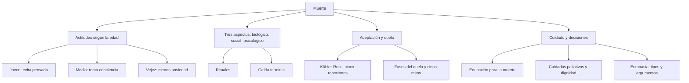
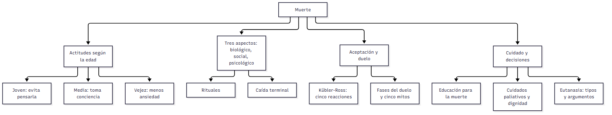

# C23 — Actitudes y creencias frente a la muerte · Ficha de repaso

> **Idea-fuerza:** Las actitudes ante la muerte se modelan con el **tiempo, el contexto y la cultura**, y cambian con la edad (los jóvenes la evitan, los medios toman conciencia, los mayores se angustian menos). La muerte tiene aspectos **biológico, social y psicológico**, y los **rituales** ayudan a afrontar la pérdida. Hay una **caída terminal** antes de morir. **Kübler-Ross** describe cinco reacciones ante la muerte cercana, no universales; el **duelo** tampoco lo es (cinco mitos). **Educación para la muerte**, **cuidados paliativos** y **eutanasia** completan la clase (Cátedra de Psicología Evolutiva, 2026i, diapositivas 3, 5-8, 10-12, 16-24; Papalia et al., 2009b, pp. 478-487).

## Esqueletos de respuesta

**P1. Actitudes según la edad.** 1) Joven: evita pensarla; fábula personal (p. 483). 2) Media: toma conciencia; cuántos años me quedan; reanalizar la vida (pp. 483-484). 3) Vejez: menos ansiedad; estrategias centradas en la emoción; integridad vs. desesperación (p. 484).

**P2. Aspectos de la muerte y rituales.** Biológico: cesan la respiración y el latido o la actividad cerebral (p. 479). Social: actitudes y cuidado, dónde ocurre, voluntad del difunto, rituales, herencia (pp. 479-481). Psicológico: sentimientos ante la propia muerte y la ajena; los rituales dan algo que hacer, permiten interactuar con el fallecido y afirman a la comunidad (p. 480).

**P3. Caída terminal.** Súbito descenso intelectual poco antes de morir; sin importar salud, nivel socioeconómico, género ni causa; afecta incluso el vocabulario; puede predecir la muerte en pocos años (p. 485).

**P4. Kübler-Ross.** Cinco reacciones (negación, ira, negociación, depresión, aceptación) en ~500 pacientes; críticas: no son verdaderas etapas, no secuenciales, no criterio de «buen morir» (p. 487).

**P5. Duelo.** Fases: conmoción e incredulidad, preocupación por la memoria, resolución (pp. 492-493). Cinco creencias que son más mito que realidad: todos se deprimen, quien no muestra aflicción tendrá problemas, hay que «trabajar» la pérdida, el dolor termina pronto, siempre se acepta (pp. 493-494).

**P6. Paliativos y dignidad.** Atención paliativa: alivio del dolor, control de síntomas y calidad de vida; morir en paz y con dignidad (pp. 481-482). La dignidad depende de cómo son tratados y de cómo son vistos los pacientes (Chochinov; p. 482).

**P7. Eutanasia.** Tipos: voluntaria o no voluntaria; activa o pasiva (diapositiva 22). A favor: autonomía y dignidad, aliviar el sufrimiento, regular lo que ya ocurre (p. 512). En contra: quitar una vida está mal, presión sobre los desventajados, mal diagnóstico, coerción y juicios (p. 513).

## No confundir

| X | Y | Criterio |
|---|---|---|
| Fábula personal | Conciencia de la mortalidad | «A mí no me pasa» (jóvenes) / «me van a quedar pocos años» (adultez media) (pp. 483-484) |
| Muerte biológica | Social / psicológica | Cese de procesos corporales / rituales, cuidado y herencia / sentimientos (pp. 479-480) |
| Caída terminal | Declive cognitivo normal | Descenso súbito poco antes de morir, aun en vocabulario / gradual y selectivo (p. 485) |
| Etapas de Kübler-Ross | Fases del duelo | Reacciones ante la propia muerte cercana / proceso de los sobrevivientes (pp. 487, 492-493) |
| Eutanasia voluntaria / no voluntaria | Activa / pasiva | Si se conoce la voluntad del paciente / si se actúa o se omite el tratamiento (diapositiva 22) |
| Cuidado paliativo | Eutanasia | Alivia y acompaña sin acelerar la muerte / apresura o causa la muerte (diapositivas 19, 22) |

## Datos que conviene saber

- *Baby boomers*: primera generación con solo **5 %** de probabilidad de haber vivido una muerte cercana (Cátedra de Psicología Evolutiva, 2026i, diapositiva 3).
- Chochinov: pregunta a **50 pacientes terminales** en cuidados paliativos (Papalia et al., 2009b, p. 482).
- Objetivos de la educación para la muerte: apaciguar ansiedades, desarrollar creencias propias, ver la muerte como fin natural, tratar humanamente al moribundo, ayudar con el duelo y los servicios funerarios (p. 481).

## Referencias

Cátedra de Psicología Evolutiva. (2026i). *Actitudes y creencias frente a la muerte* [Diapositivas de clase, unidad 10]. Universidad Favaloro.

Papalia, D. E., Sterns, H. L., Feldman, R. D., & Camp, C. J. (2009b). Lidiar con la muerte y las pérdidas. En *Desarrollo del adulto y vejez* (cap. 13, pp. 476-521). McGraw Hill Interamericana.

## Autoevaluación rápida

1. ¿Qué actitud hacia la muerte predomina en cada etapa adulta?
2. ¿Qué es la fábula personal y cuándo desaparece?
3. Los tres aspectos de la muerte y las tres funciones de los rituales.
4. ¿Qué es la caída terminal y qué habilidades afecta?
5. Las cinco reacciones de Kübler-Ross y dos críticas.
6. Fases del duelo y las cinco creencias que son mito.
7. ¿Qué es un cuidado paliativo y qué mostró Chochinov sobre la dignidad?
8. Eutanasia: tipos y dos argumentos a favor y dos en contra.
