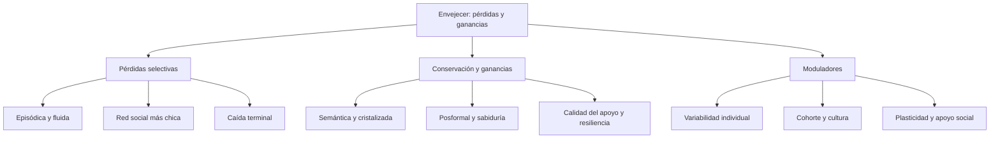

# Transversal — Pérdidas y ganancias en la adultez (clases 17 a 23)

> **Idea-fuerza:** En todas las clases del 4.º parcial se repite la misma pregunta: **¿qué declina, qué se conserva y qué mejora con la edad, y por qué?** La respuesta tiene siempre la misma forma: **no hay declive general**; hay **pérdidas selectivas** (sobre todo las que dependen de la biología y de tareas costosas: memoria episódica, inteligencia fluida, velocidad) y **ganancias o conservación** (las que dependen de la experiencia y el conocimiento: memoria semántica, inteligencia cristalizada, pensamiento posformal, sabiduría, regulación emocional), con **gran variabilidad individual**, efectos de **cohorte y cultura** y **plasticidad** (Papalia et al., 2009b, pp. 168-169, 217-218, 428, 461).

> **Aviso sobre las fuentes:** este cuadro sale **solo de las guías** de las clases 17 a 23 de esta carpeta (que a su vez citan a Papalia et al., 2009b); no agrega contenido nuevo. Las clases 21 a 23 todavía no se dictaron: contrastá con las diapositivas de la cátedra cuando las tengas.

## Cuadro integrador (parte 1: clases 17 a 20)

| Eje | C17 Memoria | C18 Inteligencia | C19 Trabajo, educación y jubilación | C20 Intimidad y familia |
|---|---|---|---|---|
| **Qué declina** | Memoria episódica; tareas que exigen organizar y elaborar (pp. 163, 161) → C17 §3 | Inteligencia fluida / mecánica, en la vejez tardía (pp. 209-211) → C18 §3.2 | Participación en el empleo formal tras la jubilación (pp. 292-293) → C19 §5 | Tamaño de la red social (p. 314) → C20 §1 |
| **Qué se conserva o mejora** | Sensorial, motora, semántica, condicionamiento (pp. 165-168) | Cristalizada / pragmática; pensamiento posformal (pp. 209-213, 238) | Identidad vocacional, adaptabilidad; el ocio complejo sigue al trabajo complejo (pp. 281, 292) | Calidad del apoyo; satisfacción marital (curva en U) (pp. 314-315, 350) |
| **Por qué** | Hipocampo y lóbulos frontales; atención y motivación (pp. 161, 172-173) | Biología (fluida) vs. cultura y experiencia (cristalizada) (pp. 209-210) | Estructura de vida: diferenciada vs. integrada por edades (pp. 271-272) | Selectividad socioemocional: priorizar lo emocional (pp. 314-315) |
| **Variabilidad, cohorte y cultura** | Estudios transversales: efecto de cohorte (p. 156); cultura (pp. 174-175) | Un tercio de los mayores de 70 supera al adulto joven promedio; Seattle (pp. 212-216) | Desigualdades de género, minorías y edad en el trabajo; desempleo (pp. 284-290) | Familia extensa vs. nuclear; cohortes y estilos de vida (pp. 322, 357) |
| **Plasticidad / intervención** | Recursos mnemotécnicos (E-I-E-I-O), pistas (pp. 183-186) | ADEPT y Seattle: el entrenamiento mejora incluso lo fluido (pp. 216-217) | Aprendizaje durante toda la vida; planificar la jubilación (pp. 272-278, 300) | Apoyo comunitario al cuidador (pp. 386-388) |

## Cuadro integrador (parte 2: clases 21 a 23)

| Eje | C21 Personalidad | C22 Afrontamiento y salud mental | C23 Muerte y duelo |
|---|---|---|---|
| **Qué declina** | Neuroticismo, extraversión y apertura bajan un poco (p. 402) → C21 §2.3 | Participación y roles sociales (según la desvinculación, con evidencia débil) (pp. 446-447) → C22 §3 | Funcionamiento cognitivo cerca de la muerte (caída terminal) (p. 485) → C23 §2 |
| **Qué se conserva o mejora** | Rasgos básicos tras los 30; amabilidad y meticulosidad suben; flexibilidad de género (pp. 401-402, 420) | La mayoría goza de buena salud mental; afrontamiento centrado en la emoción más selectivo (pp. 441, 461) | Menor ansiedad ante la muerte en los mayores; resiliencia ante el duelo (pp. 484, 496) |
| **Por qué** | Rasgos heredados + experiencia; equilibrio asimilación-acomodación (pp. 398-399, 406) | Valoración cognitiva de la situación y los recursos (p. 438); continuidad (Atchley) (p. 447) | Integridad vs. desesperación (Erikson); revisión de vida (pp. 484, 517) |
| **Variabilidad, cohorte y cultura** | Estudios Mills: sesgo masculino de las etapas; cohorte (pp. 413-415, 425) | Efectos de cohorte en sustancias y religión; cultura en la violencia y el abuso (pp. 451, 455) | Rituales de luto; cohorte (japoneses americanos); no hay una «mejor» forma de penar (pp. 482, 491) |
| **Plasticidad / intervención** | Whitbourne: estilo equilibrado; Helson: cambio hasta los 50 (pp. 406, 425-427) | Depresión y demencia tratables; fortalezas de Kivnick (pp. 467-468, 471-473) | Terapia de duelo para quienes la necesitan; hospicio; revisión de vida (pp. 496-497, 481-482, 517) |

## Un eje explicado de punta a punta: qué se pierde y qué se gana

**Memoria (C17).** Se resiente lo episódico y lo que exige esfuerzo; se conserva lo sensorial, lo motor y lo semántico; el olvido puede ser adaptativo (Papalia et al., 2009b, pp. 168-169, 188-189). **Inteligencia (C18).** Declinan las capacidades fluidas o mecánicas, mejoran o se mantienen las cristalizadas o pragmáticas; Baltes propone la optimización selectiva con compensación (pp. 209-213). **Pensamiento y sabiduría (C18).** El pensamiento maduro (posformal) y la sabiduría dependen de la experiencia, no solo de la edad (pp. 238, 250-254). **Trabajo y jubilación (C19).** La pérdida del rol laboral se compensa con otros roles y con el ocio; el bienestar depende del control de la decisión (pp. 292-306). **Vínculos (C20).** La red se achica pero se conserva su calidad (convoy y selectividad) (pp. 314-315). **Personalidad (C21).** Estabilidad de los rasgos y cambios normativos, de eventos y de autoconcepto (pp. 400-417). **Afrontamiento (C22).** El envejecimiento exitoso es un equilibrio continuidad-cambio; la salud mental se apoya en fortalezas (pp. 447-449, 471-473). **Muerte (C23).** La muerte propia y ajena se afronta con distintos patrones; el sentido de la vida reduce el miedo (pp. 495-496, 519).

## No confundir (transversal)

| Par | Criterio que los distingue | Dónde está |
|---|---|---|
| Fluida / cristalizada (Horn y Cattell) | Información novedosa y biología / conocimiento acumulado y cultura | C18 §3.2 (pp. 209-210) |
| Mecánica / pragmática (Baltes) | Parientes de las anteriores, pero con compensación y plasticidad | C18 §3.2 (pp. 211-213) |
| Episódica / semántica | «Yo recuerdo» (se debilita) / «yo sé» (se conserva) | C17 §3.4 (pp. 163-164) |
| Convoy / selectividad socioemocional | Quiénes nos acompañan / por qué elegimos | C20 §1 (pp. 314-315) |
| Desvinculación / actividad / continuidad | Retiro universal / más actividad / equilibrio continuidad-cambio | C22 §3 (pp. 446-448) |
| Asimilación / acomodación de identidad | Mantener la autoimagen / cambiarla (el exceso de cualquiera es poco saludable) | C21 §2.4 y C22 §3 (pp. 406, 449) |
| Enfocado en el problema / en la emoción | Cambiar la situación / manejar la emoción (ninguno es bueno en sí) | C22 §2 (p. 439) |
| Pena / duelo / luto | Emoción / pérdida y ajuste / conducta culturalmente aceptada | C23 §3 (p. 487) |
| Evento normativo / no normativo; reloj social | Esperado / inesperado; en tiempo o fuera de tiempo | C21 §2.6 (p. 416) |
| Efecto de cohorte / efecto de la edad | Generación / maduración o envejecimiento (estudios transversales confunden ambos) | C17 §2 (p. 156); C18 §3.3 (pp. 215-216) |

## Preguntas integradoras

**I1. «No hay declive general con la edad». Argumentá con ejemplos de tres clases.**

> **Esqueleto de la respuesta:**
> 1. **Tesis:** el cambio es multidimensional y multidireccional (Baltes).
> 2. **Memoria (C17):** declina la episódica, se conserva la semántica (Papalia et al., 2009b, pp. 163-168).
> 3. **Inteligencia (C18):** declina la fluida, se mantiene la cristalizada (pp. 209-210).
> 4. **Un tercer ejemplo:** convoy y selectividad (C20) o resiliencia ante el duelo (C23) (pp. 314-315, 496).
> 5. **Cierre:** variabilidad individual, cohorte y plasticidad.

*Respuesta modelo (≈ 7 renglones):* Con la edad no hay declive general sino cambios en distintas direcciones. En la memoria, declina la episódica (con déficit para recordar el origen) pero se conservan la sensorial, la motora y la semántica (pp. 163-168). En la inteligencia, declinan las capacidades fluidas o mecánicas, mientras que las cristalizadas o pragmáticas se mantienen o mejoran (pp. 209-213). En las relaciones, la red se reduce pero se conserva la calidad del apoyo porque los mayores priorizan lo emocional (pp. 314-315). Además, hay gran variabilidad individual, efectos de cohorte y plasticidad: el entrenamiento mejora incluso lo fluido (pp. 216-217) (Papalia et al., 2009b).

**I2. Compará el modelo de continuidad (C22) con la teoría de la selectividad socioemocional (C20) y el equilibrio de asimilación-acomodación (C21).**

> **Esqueleto de la respuesta:**
> 1. **Tesis:** los tres son modelos de equilibrio, no de declive.
> 2. **Continuidad (Atchley):** equilibrio entre continuidad y cambio en estructuras internas y externas (Papalia et al., 2009b, p. 447).
> 3. **Selectividad (Carstensen):** priorizar lo emocional al percibir poco tiempo (pp. 314-315).
> 4. **Whitbourne:** asimilar y acomodar la identidad; estilo equilibrado (pp. 406, 449).
> 5. **Cierre:** en los tres, la persona regula activamente su desarrollo.

*Respuesta modelo (≈ 7 renglones):* Los tres modelos ven el envejecimiento como un equilibrio activo y no como declive. Atchley propone que los mayores buscan mantener continuidad con su pasado (estructuras internas y externas) con un grado satisfactorio de cambio (p. 447). La selectividad socioemocional (Carstensen) sostiene que, al percibir que queda poco tiempo, se eligen vínculos emocionalmente gratificantes y se reduce la red (pp. 314-315). Whitbourne describe cómo se equilibran asimilación y acomodación para sostener la identidad; el estilo equilibrado es el más adaptativo (pp. 406, 449). En los tres, la persona regula su propio desarrollo (Papalia et al., 2009b).

**I3. ¿Cómo se afronta la pérdida a lo largo de la adultez? Relacioná el afrontamiento (C22), el duelo (C23) y la personalidad (C21).**

> **Esqueleto de la respuesta:**
> 1. **Tesis:** afrontar es un proceso de valoración y revaloración; el duelo muestra que no hay un solo modo sano.
> 2. **Lazarus:** problema vs. emoción; ninguna es mala en sí (Papalia et al., 2009b, pp. 438-439).
> 3. **Duelo:** resiliencia 46 % en el estudio CLOC; los mitos de Wortman y Silver (pp. 493-496).
> 4. **Personalidad:** Vaillant y los mecanismos de defensa; las personas con práctica en perder afrontan mejor (pp. 437, 499).
> 5. **Cierre:** apoyo social y sentido de vida.

*Respuesta modelo (≈ 7 renglones):* Para Lazarus el afrontamiento es un proceso dinámico de valoración de la situación y los recursos, que puede enfocarse en el problema o en la emoción; ninguna estrategia es mala en sí (pp. 438-439). El duelo ilustra esa variedad: el estudio CLOC halló que lo más frecuente en viudos mayores es la resiliencia (46 %) y que el duelo «clásico» es raro (11 %), y Wortman y Silver mostraron que no todos necesitan «trabajar» la pérdida (pp. 493-496). La personalidad interviene: los mecanismos maduros de Vaillant se asocian con mejor ajuste (p. 437), y quienes tienen práctica en enfrentar pérdidas lo hacen mejor (p. 499) (Papalia et al., 2009b).

## Diagrama

## Referencias

Papalia, D. E., Sterns, H. L., Feldman, R. D., & Camp, C. J. (2009b). *Desarrollo del adulto y vejez*. McGraw Hill Interamericana.
