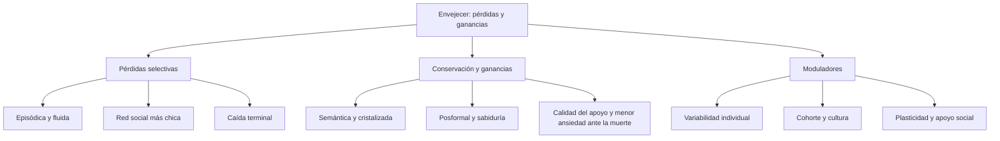
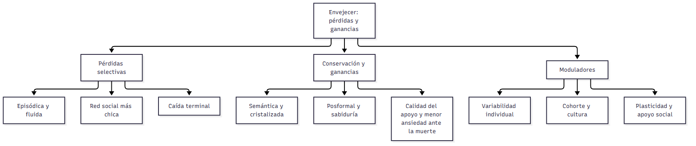

# Transversal — Pérdidas y ganancias en la adultez (clases 17 a 23)

> **Idea-fuerza:** En todas las clases del 4.º parcial se repite la misma pregunta: **¿qué declina, qué se conserva y qué mejora con la edad, y por qué?** La respuesta tiene siempre la misma forma: **no hay declive general**; hay **pérdidas selectivas** (sobre todo las que dependen de la biología y de tareas costosas: memoria episódica, inteligencia fluida, velocidad) y **ganancias o conservación** (las que dependen de la experiencia y el conocimiento: memoria semántica, inteligencia cristalizada, pensamiento posformal, sabiduría, regulación emocional), con **gran variabilidad individual**, efectos de **cohorte y cultura** y **plasticidad** (Papalia et al., 2009b, pp. 168-169, 217-218, 428, 461).

> **Aviso sobre las fuentes:** este cuadro sale **solo de las guías** de las clases 17 a 23 de esta carpeta (que a su vez citan a Papalia et al., 2009b); no agrega contenido nuevo. Las referencias «→ C17 §3» a «→ C20 §1» y las de «Dónde está» de esas clases remiten a las guías extendidas (`_Guia.md`). **Las columnas de C21, C22 y C23 se actualizaron con las diapositivas de la cátedra** y remiten a las versiones de cursada (`_Cursada_Guia.md`).

## Cuadro integrador (parte 1: clases 17 a 20)

| Eje | C17 Memoria | C18 Inteligencia | C19 Trabajo, educación y jubilación | C20 Intimidad y familia |
|---|---|---|---|---|
| **Qué declina** | Memoria episódica; tareas que exigen organizar y elaborar (pp. 163, 161) → C17 §3 | Inteligencia fluida / mecánica, en la vejez tardía (pp. 209-211) → C18 §3.2 | Participación en el empleo formal tras la jubilación (pp. 292-293) → C19 §5 | Tamaño de la red social (p. 314) → C20 §1 |
| **Qué se conserva o mejora** | Sensorial, motora, semántica, condicionamiento (pp. 165-168) | Cristalizada / pragmática; pensamiento posformal (pp. 209-213, 238) | Identidad vocacional, adaptabilidad; el ocio complejo sigue al trabajo complejo (pp. 281, 292) | Calidad del apoyo; satisfacción marital (curva en U) (pp. 314-315, 350) |
| **Por qué** | Hipocampo y lóbulos frontales; atención y motivación (pp. 161, 172-173) | Biología (fluida) vs. cultura y experiencia (cristalizada) (pp. 209-210) | Estructura de vida: diferenciada vs. integrada por edades (pp. 271-272) | Selectividad socioemocional: priorizar lo emocional (pp. 314-315) |
| **Variabilidad, cohorte y cultura** | Estudios transversales: efecto de cohorte (p. 156); cultura (pp. 174-175) | Un tercio de los mayores de 70 supera al adulto joven promedio; Seattle (pp. 212-216) | Desigualdades de género, minorías y edad en el trabajo; desempleo (pp. 284-290) | Familia extensa vs. nuclear; cohortes y estilos de vida (pp. 322, 357) |
| **Plasticidad / intervención** | Recursos mnemotécnicos (E-I-E-I-O), pistas (pp. 183-186) | ADEPT y Seattle: el entrenamiento mejora incluso lo fluido (pp. 216-217) | Aprendizaje durante toda la vida; planificar la jubilación (pp. 272-278, 300) | Apoyo comunitario al cuidador (pp. 386-388) |

## Cuadro integrador (parte 2: clases 21 a 23, según las diapositivas)

| Eje | C21 Personalidad | C22 Afrontamiento y salud mental | C23 Muerte y duelo |
|---|---|---|---|
| **Qué declina** | Neuroticismo, extraversión y apertura bajan de los 18 a los 30 años (p. 402) → C21 cursada §3 | Participación y roles sociales (según la desvinculación, con evidencia débil) (pp. 446-447) → C22 cursada §4 | Funcionamiento intelectual poco antes de morir (caída terminal), incluso en habilidades poco afectadas por la edad como el vocabulario (p. 485) → C23 cursada §4 |
| **Qué se conserva o mejora** | Rasgos básicos muy estables; amabilidad y meticulosidad suben lentamente; los roles de género se vuelven más flexibles (andróginos) en la adultez media (pp. 401-402, 420-421) | La mayoría goza de buena salud mental; los mayores regulan mejor la emoción (pp. 441, 461) | Menor ansiedad ante la muerte en los mayores, que reorganizan sus pensamientos para aceptar su mortalidad (p. 484) |
| **Por qué** | Herencia (temperamento) + ambiente, que explica la mitad de la variación; equilibrio entre asimilación y acomodación de identidad (pp. 398-399, 406) | Valoración cognitiva de la situación y los recursos (p. 438); continuidad con el pasado (Atchley) (p. 447) | Integridad vs. desesperación (Erikson); pérdida de amigos y parientes; estrategias centradas en la emoción (p. 484) |
| **Variabilidad, cohorte y cultura** | Patrones de rasgos similares entre culturas; las diferencias de edad en estudios transversales pueden ser de cohorte; la gente percibe más cambio del que miden las pruebas (pp. 402-405) | El envejecimiento exitoso no contempla estilos de vida, genética, escolaridad ni nivel socioeconómico; la religión es una estrategia frecuente en los mayores (pp. 441-445) | La muerte se vive según el tiempo, el contexto y la cultura (rituales distintos); el duelo no es universal: cinco creencias que son mito (pp. 478-481, 493-494) |
| **Plasticidad / intervención** | Whitbourne: un estilo de identidad equilibrado; el autoconcepto se revisa con la experiencia (p. 406) | Sustituir roles perdidos (actividad); estrategias de los mayores: religión, mantenerse ocupado, apoyo familiar (pp. 441-442, 447) | Educación para la muerte, cuidados paliativos y dignidad del paciente (pp. 481-482) |

## Un eje explicado de punta a punta: qué se pierde y qué se gana

**Memoria (C17).** Se resiente lo episódico y lo que exige esfuerzo; se conserva lo sensorial, lo motor y lo semántico; el olvido puede ser adaptativo (Papalia et al., 2009b, pp. 168-169, 188-189). **Inteligencia (C18).** Declinan las capacidades fluidas o mecánicas, mejoran o se mantienen las cristalizadas o pragmáticas; Baltes propone la optimización selectiva con compensación (pp. 209-213). **Pensamiento y sabiduría (C18).** El pensamiento maduro (posformal) y la sabiduría dependen de la experiencia, no solo de la edad (pp. 238, 250-254). **Trabajo y jubilación (C19).** La pérdida del rol laboral se compensa con otros roles y con el ocio; el bienestar depende del control de la decisión (pp. 292-306). **Vínculos (C20).** La red se achica pero se conserva su calidad (convoy y selectividad) (pp. 314-315). **Personalidad (C21).** Estabilidad de los rasgos y cambios normativos, de eventos y de autoconcepto (pp. 400-417). **Afrontamiento (C22).** El envejecimiento exitoso es un equilibrio entre continuidad y cambio (Atchley, Whitbourne) y los mayores regulan mejor la emoción (pp. 441, 447-449). **Muerte (C23).** Las actitudes ante la muerte cambian con la edad y los mayores sienten menos ansiedad; el duelo no es universal y la dignidad del paciente se cuida con paliativos (pp. 484, 493-494, 481-482).

## No confundir (transversal)

| Par | Criterio que los distingue | Dónde está |
|---|---|---|
| Fluida / cristalizada (Horn y Cattell) | Información novedosa y biología / conocimiento acumulado y cultura | C18 §3.2 (pp. 209-210) |
| Mecánica / pragmática (Baltes) | Parientes de las anteriores, pero con compensación y plasticidad | C18 §3.2 (pp. 211-213) |
| Episódica / semántica | «Yo recuerdo» (se debilita) / «yo sé» (se conserva) | C17 §3.4 (pp. 163-164) |
| Convoy / selectividad socioemocional | Quiénes nos acompañan / por qué elegimos | C20 §1 (pp. 314-315) |
| Desvinculación / actividad / continuidad | Retiro universal / más actividad / equilibrio continuidad-cambio | C22 cursada §4 (pp. 446-448) |
| Asimilación / acomodación de identidad | Mantener la autoimagen / cambiarla (el exceso de cualquiera es poco saludable) | C21 cursada §4 y C22 cursada §4 (pp. 406, 449) |
| Enfocado en el problema / en la emoción | Cambiar la situación / manejar la emoción (ninguno es bueno en sí) | C22 cursada §3 (p. 439) |
| Etapas de Kübler-Ross / fases del duelo | Reacciones ante la propia muerte cercana / proceso de los sobrevivientes (conmoción, preocupación por la memoria, resolución) | C23 cursada §6 (pp. 487, 492-493) |
| Eutanasia voluntaria o no voluntaria / activa o pasiva | Si se conoce la voluntad del paciente / si se actúa o se omite el tratamiento (dos ejes distintos) | C23 cursada §8 (p. 509; diapositiva 22) |
| Evento normativo / no normativo; reloj social | Esperado / inesperado; en tiempo o fuera de tiempo | C21 cursada §6 (p. 416) |
| Efecto de cohorte / efecto de la edad | Generación / maduración o envejecimiento (estudios transversales confunden ambos) | C17 §2 (p. 156); C18 §3.3 (pp. 215-216) |

## Preguntas integradoras

**I1. «No hay declive general con la edad». Argumentá con ejemplos de tres clases.**

> **Esqueleto de la respuesta:**
> 1. **Tesis:** el cambio es multidimensional y multidireccional (Baltes).
> 2. **Memoria (C17):** declina la episódica, se conserva la semántica (Papalia et al., 2009b, pp. 163-168).
> 3. **Inteligencia (C18):** declina la fluida, se mantiene la cristalizada (pp. 209-210).
> 4. **Un tercer ejemplo:** convoy y selectividad (C20) o la menor ansiedad de los mayores ante la muerte (C23) (pp. 314-315, 484).
> 5. **Cierre:** variabilidad individual, cohorte y plasticidad.

*Respuesta modelo (≈ 7 renglones):* Con la edad no hay declive general sino cambios en distintas direcciones. En la memoria, declina la episódica (con déficit para recordar el origen) pero se conservan la sensorial, la motora y la semántica (pp. 163-168). En la inteligencia, declinan las capacidades fluidas o mecánicas, mientras que las cristalizadas o pragmáticas se mantienen o mejoran (pp. 209-213). En las relaciones, la red se reduce pero se conserva la calidad del apoyo porque los mayores priorizan lo emocional (pp. 314-315). Además, hay gran variabilidad individual, efectos de cohorte y plasticidad: el entrenamiento mejora incluso lo fluido (pp. 216-217) (Papalia et al., 2009b).

**I2. Compará el modelo de continuidad (C22) con la teoría de la selectividad socioemocional (C20) y el equilibrio de asimilación-acomodación (C21).**

> **Esqueleto de la respuesta:**
> 1. **Tesis:** los tres son modelos de equilibrio, no de declive.
> 2. **Continuidad (Atchley):** equilibrio entre continuidad y cambio en estructuras internas y externas (Papalia et al., 2009b, p. 447).
> 3. **Selectividad (Carstensen):** priorizar lo emocional al percibir poco tiempo (pp. 314-315).
> 4. **Whitbourne:** asimilar y acomodar la identidad; estilo equilibrado (pp. 406, 449).
> 5. **Cierre:** en los tres, la persona regula activamente su desarrollo.

*Respuesta modelo (≈ 7 renglones):* Los tres modelos ven el envejecimiento como un equilibrio activo y no como declive. Atchley propone que los mayores buscan mantener continuidad con su pasado (estructuras internas y externas) con un grado satisfactorio de cambio (p. 447). La selectividad socioemocional (Carstensen) sostiene que, al percibir que queda poco tiempo, se eligen vínculos emocionalmente gratificantes y se reduce la red (pp. 314-315). Whitbourne describe cómo se equilibran asimilación y acomodación para sostener la identidad; el estilo equilibrado es el más adaptativo (pp. 406, 449). En los tres, la persona regula su propio desarrollo (Papalia et al., 2009b).

**I3. ¿Cómo se afronta la pérdida a lo largo de la adultez? Relacioná el afrontamiento (C22), el duelo (C23) y la personalidad (C21).**

> **Esqueleto de la respuesta:**
> 1. **Tesis:** afrontar es un proceso de valoración y revaloración; el duelo muestra que no hay un solo modo sano.
> 2. **Lazarus:** problema vs. emoción; ninguna es mala en sí (Papalia et al., 2009b, pp. 438-439).
> 3. **Duelo:** tres fases clásicas y cinco creencias que son más mito que realidad (Wortman y Silver) (pp. 492-494).
> 4. **Personalidad:** el autoconcepto equilibra asimilar y acomodar la experiencia nueva (Whitbourne) (p. 406).
> 5. **Cierre:** apoyo social y estrategias de los mayores (religión, mantenerse ocupado, apoyo familiar) (pp. 441-442).

*Respuesta modelo (≈ 7 renglones):* Para Lazarus el afrontamiento es un proceso dinámico de valoración de la situación y los recursos, que puede enfocarse en el problema o en la emoción; ninguna estrategia es mala en sí (pp. 438-439). El duelo ilustra esa variedad: junto a las tres fases clásicas (conmoción, preocupación por la memoria, resolución), Wortman y Silver mostraron que no todos se deprimen, que no todos necesitan «trabajar» la pérdida y que el dolor no siempre termina pronto ni termina en aceptación (pp. 492-494). La personalidad interviene: según Whitbourne, el autoconcepto se mantiene equilibrando la asimilación y la acomodación de lo que trae la experiencia nueva (p. 406); y los mayores se apoyan en la religión, en mantenerse ocupados y en la familia (pp. 441-442) (Papalia et al., 2009b).

## Diagrama

## Referencias

Papalia, D. E., Sterns, H. L., Feldman, R. D., & Camp, C. J. (2009b). *Desarrollo del adulto y vejez*. McGraw Hill Interamericana.
