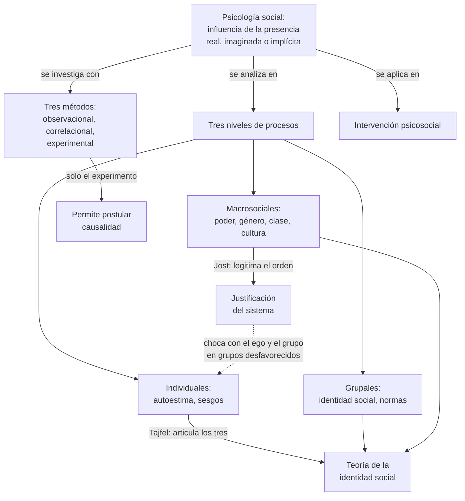
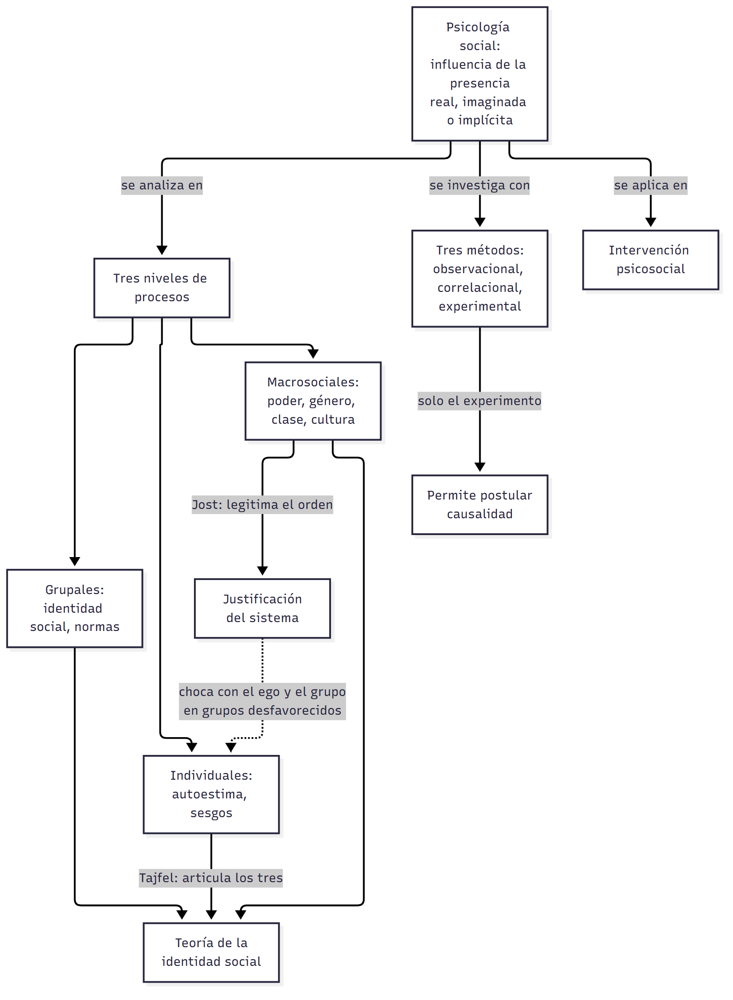
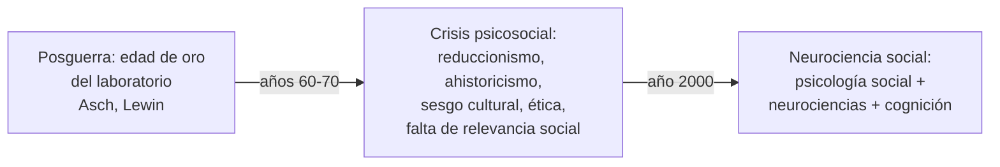
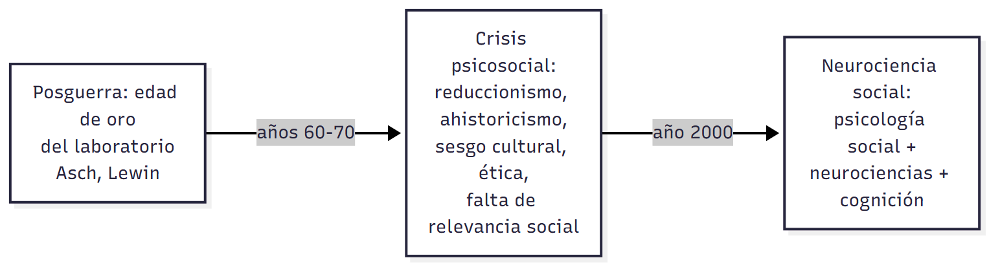
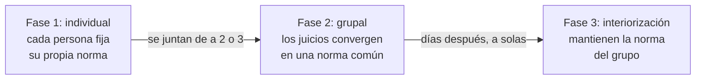
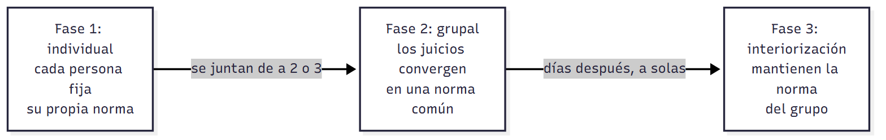

# C01 — Introducción a la psicología social · Versión de cursada

> **Fuentes:**
>
> - Cátedra de Psicología Social. (2026a). *Introducción a la psicología social* [Diapositivas de clase, clase 1]. Universidad Favaloro.
> - Morales, J. F., & Moya, M. (2007). Definición de Psicología social. En J. F. Morales, M. Moya, E. Gaviria, & I. Cuadrado (Coords.), *Psicología social* (3.ª ed., cap. 1). McGraw-Hill.

> **Aviso sobre las fuentes:** **versión de cursada** (protocolo A): lo que se dio en la clase del 06/08 y lo que pide la unidad 1 del programa. Sigue el orden de las diapositivas. Las páginas de Morales y Moya son las del PDF de la cátedra (la página impresa es dos números mayor). Las escuelas de la historia (neoconductismo, Gestalt, Escuela de Chicago), los experimentos de Triplett y de Sherif y los tres métodos están **solo en las diapositivas**: el capítulo no los desarrolla. Quedan afuera, y están en el capítulo: el listado de publicaciones pioneras (pp. 2-3) y el detalle de cada interconexión de Stangor y Jost (pp. 22-25).

> **Idea-fuerza:** La psicología social estudia cómo lo que pensamos, sentimos y hacemos resulta influido por la presencia **real, imaginada o implícita** de otras personas. Su concepto clave es la **influencia**. Un análisis maduro articula tres niveles de procesos, **individuales, grupales y macrosociales**, y entiende a la persona como un sujeto **activo**, capaz de cambiar su contexto (Cátedra de Psicología Social, 2026a, diapositivas 6, 7 y 20; Morales y Moya, 2007, p. 4).

## Mapa: qué pide el programa y qué se dio en clase

| Tema | Programa | Clase | Sección |
|---|---|---|---|
| Definición y objeto de estudio | ✔ | ✔ | §1 |
| Tres niveles de procesos; etnofaulismos | — | ✔ | §2 |
| Contexto histórico y evolución de la disciplina | ✔ | ✔ | §3 |
| Primeros experimentos: Triplett y Sherif | ✔ | ✔ | §4 |
| Identidad social y justificación del sistema | — | ✔ | §5 |
| Estructuras macrosociales y nueve interconexiones | — | ✔ | §6 |
| Métodos de investigación | ✔ | ✔ | §7 |
| Aplicación e intervención | ✔ | ✔ | §8 |
| Perspectiva multicultural | ✔ | ✔ | §6 (cultura) |
| Factores biológicos y perspectiva evolucionista | ✔ | en C08 | §3 y C08 |
| Papel de la teoría en la psicología social | ✔ | — | Solo mencionado en el programa |

---

## 1. Qué es la psicología social

La definición que adopta la cátedra es la de **Gordon W. Allport** (1935, y mantenida en 1954 y 1968): el «intento de comprender y explicar cómo el pensamiento, el sentimiento y la conducta de las personas individuales resultan influidos por la presencia real, imaginada o implícita de otras personas» (Morales y Moya, 2007, p. 4).

Conviene descomponerla, porque de ahí salen casi todas las preguntas:

- **Qué se estudia:** el pensamiento, el sentimiento y la conducta de **personas individuales**. La psicología social no estudia a la sociedad en abstracto.
- **Cuál es el nexo:** la **influencia** de los otros sobre la persona. Es el concepto clave: los procesos psicológicos no ocurren en un vacío social (Morales y Moya, 2007, p. 4).
- **Qué significa «presencia»:** no hace falta que el otro esté físicamente. Puede estar **imaginado** o **implícito**, como cuando una norma guía lo que hacemos a solas.

La disciplina busca explicar científicamente fenómenos como la conformidad, la obediencia, los prejuicios, las actitudes y la agresión (Cátedra de Psicología Social, 2026a, diapositiva 6). Como marca de nacimiento se suele tomar **1908**, cuando aparece por primera vez el título *Psicología social* en dos obras, de McDougall y de Ross (Morales y Moya, 2007, p. 2).

> 🔑 **Punto clave:** en la definición de Allport el concepto central es **influencia**, y la presencia del otro puede ser real, imaginada o implícita.

## 2. Tres niveles de procesos

La conducta social se articula en tres niveles (Cátedra de Psicología Social, 2026a, diapositiva 7):

| Nivel | Dónde se ubica | Ejemplos |
|---|---|---|
| **Individual** | La persona: cómo procesa la información social | Autoestima, sesgos de atribución |
| **Grupal** | La persona actúa como miembro de un grupo | Identidad social, normas y valores compartidos, pensamiento grupal |
| **Macrosocial** | Estructuras globales de la sociedad | Poder y estatus, dominancia de género, clases sociales, cultura |

**Un ejemplo que usa los tres: los etnofaulismos.** Son los términos despectivos con los que los miembros de un grupo se refieren a exogrupos étnicos, sobre todo inmigrantes; el término es de Roback (1944). Son representaciones cognitivas: muestran cómo piensa la sociedad de acogida a esos grupos (Morales y Moya, 2007, p. 4). Mullen y colaboradores los estudian con dos variables:

- **Complejidad:** cuántos tipos de etnofaulismos hay para un grupo (rasgos físicos, de personalidad, nombres personales, hábitos de alimentación, nombres de grupo, misceláneo). Menos tipos reflejan una imagen más simple y homogénea (Morales y Moya, 2007, p. 5).
- **Valencia:** cuán favorable o desfavorable es el término.

Analizaron 19 grupos de inmigrantes en Estados Unidos. Los grupos más pequeños, menos familiares y más «extranjeros» reciben etnofaulismos menos complejos y más negativos (Morales y Moya, 2007, p. 5). A su vez, eso predice **exclusión directa**, en cuotas de inmigración más restrictivas (betas de .45 para complejidad y .31 para valencia) y menores tasas de naturalización (.35 y .20), y **exclusión indirecta**, en la forma sesgada en que esos grupos aparecen en los libros infantiles (Morales y Moya, 2007, p. 6).

El estudio encaja en la definición de Allport: la presencia de otras personas, representada simbólicamente en los etnofaulismos, influye en la conducta de exclusión. Y muestra los tres niveles a la vez: cognición y emoción individuales junto con leyes e instituciones (Morales y Moya, 2007, pp. 6-7).

## 3. Cómo se consolidó la disciplina

**La consolidación se logró con un enfoque plural** (Cátedra de Psicología Social, 2026a, diapositiva 9):

- **Neoconductismo:** Clark Hull agrega variables intermedias entre estímulo y respuesta. En psicología social el esquema pasa de E-R a **E-O-R**, e incorpora procesos cognitivos no observables.
- **Floyd Allport:** en los años veinte publica trabajos pioneros de investigación experimental e impulsa la metodología científica rigurosa.
- **Gestalt:** entiende la experiencia mental como un todo. **Kurt Lewin** la introduce en los años treinta, con el espacio de vida grupal.
- **Escuela de Chicago** (1890): orientación plural y empírica, cuantitativa y cualitativa. **George Mead** promueve aplicar el conocimiento a problemas reales.

**La evolución** se ordena en tres pasos (Cátedra de Psicología Social, 2026a, diapositiva 10):

Lo que cuestionó la **crisis** fue tanto la teoría como el método: el reduccionismo psicológico, el ahistoricismo, el sesgo cultural, la ética de los experimentos de laboratorio y su falta de relevancia social. → La neurociencia social se desarrolla en `C08_NeurocienciaSocialYAltruismo_Cursada_Guia.md`.

## 4. Dos experimentos fundadores

**Triplett (1898): facilitación social.** Parte de una observación: los ciclistas rendían más cuando competían con otros que contrarreloj. Con **40 niños** diseña el primer experimento controlado de la disciplina: enrollar un carrete de pesca lo más rápido posible, solos o de a dos en la misma sala, en forma coactiva y sin competir formalmente. Cerca de la mitad aumentó su velocidad (**facilitación social**); algunos rindieron igual o peor (**inhibición social**), por sobreestimulación o nerviosismo. Conclusión: hasta el rendimiento motor más básico es sensible, de manera sistemática y medible, a la presencia de otros (Cátedra de Psicología Social, 2026a, diapositiva 11).

**Sherif (1935): formación de normas grupales.** Aprovecha el **efecto autocinético**: en una habitación oscura, un punto de luz fijo parece moverse (Cátedra de Psicología Social, 2026a, diapositiva 12).

Muestra que, ante la **incertidumbre**, construimos marcos de referencia comunes, y que la norma sigue activa aunque el grupo ya no esté: un ejemplo directo de presencia implícita.

> ⚠ **No confundir:** Triplett estudia cómo la mera **presencia** de otros cambia el **rendimiento**. Sherif estudia cómo el grupo crea una **norma** cuando la situación es **ambigua**. → Asch, en cambio, plantea una situación sin ambigüedad: `C06_InfluenciaSocialConformidadYCondescendencia_Cursada_Guia.md`.

## 5. Dos teorías que articulan los niveles

### Identidad social (Tajfel, 1972)

La identidad social está ligada al conocimiento de la pertenencia a ciertos grupos y al significado emocional y evaluativo de esa pertenencia. Es la parte del autoconcepto que surge de formar parte de categorías sociales (Morales y Moya, 2007, p. 8). Se distingue de la **identidad personal**, basada en rasgos únicos: entre ambas hay antagonismo, porque cuando se enfatiza una es a expensas de la otra (Morales y Moya, 2007, p. 9).

La teoría articula los tres niveles (Morales y Moya, 2007, p. 8):

- **Individual:** motivación por autoevaluarse positivamente, más la importancia que el grupo tiene para la persona. Juntas llevan a buscar una evaluación positiva del grupo.
- **Grupal:** la **comparación** con otros grupos, que busca la **distintividad social positiva**.
- **Macrosocial:** el contexto histórico y socioeconómico determina qué grupos tienen más prestigio.

**Estrategias de los grupos de bajo estatus.** Dependen de las creencias sobre las fronteras grupales y sobre el estatus (Morales y Moya, 2007, p. 10):

| Estrategia | Qué hace la persona | Fronteras | Estatus percibido |
|---|---|---|---|
| **Movilidad individual** | Intenta pasarse sola a un grupo mejor valorado | Permeables | Seguro: estable y legítimo |
| **Creatividad social** | Redefine la comparación y busca cualidades valoradas (por ejemplo, «amigables» en vez de «productivos») | Impermeables | Seguro: estable y legítimo |
| **Competición** | Desafía colectivamente el statu quo | Impermeables (diapositiva 14) | Inseguro: inestable y/o ilegítimo, con fuerte identificación |

### Justificación del sistema (Jost y Banaji, 1994)

Las personas prefieren creer que el sistema en el que viven es justo, legítimo y justificable, incluso cuando genera desigualdad (Morales y Moya, 2007, p. 10). Los estereotipos funcionan entonces como herramientas ideológicas. En el estudio sobre estadounidenses del Norte y del Sur, los del Norte se estereotipaban como competitivos y eficientes, y los del Sur como amigables (Morales y Moya, 2007, p. 12); pensar en esos rasgos aumenta la legitimidad percibida de la jerarquía (Cátedra de Psicología Social, 2026a, diapositiva 15).

Hay tres motivos: justificar el **ego**, justificar el **grupo** y justificar el **sistema**. En los grupos privilegiados los tres cooperan. En los **desfavorecidos** el tercero contradice a los otros dos, y eso lleva a interiorizar la inferioridad o a vivir en ambivalencia (Cátedra de Psicología Social, 2026a, diapositiva 15).

> ⚠ **No confundir:** la identidad social explica por qué buscamos valorar **nuestro grupo**. La justificación del sistema explica por qué incluso los perjudicados pueden defender **el orden que los perjudica**.

## 6. Las estructuras macrosociales y las nueve interconexiones

Tres estructuras modulan los procesos psicosociales (Cátedra de Psicología Social, 2026a, diapositiva 16):

- **Género:** el **sexismo ambivalente** combina un sexismo hostil con uno benevolente, paternalista y protector (Morales y Moya, 2007, p. 15). La teoría del **grupo enmudecido** sostiene que el lenguaje, ideado por el grupo dominante, limita la expresión de las mujeres (Morales y Moya, 2007, p. 17).
- **Clase social:** el huracán Katrina mostró que «la clase social importa» (Morales y Moya, 2007, p. 18). En estudiantes latinos de bajo estatus con alta identificación grupal, creer en un mundo justo correlacionó negativamente con el bienestar (Morales y Moya, 2007, p. 18).
- **Cultura:** el caso de Chan Chi Lok y la señora Robertson ilustra cómo normas invisibles, como la puntualidad anglosajona frente a la cortesía y los deberes familiares, generan incomprensión (Morales y Moya, 2007, p. 19).

**Stangor y Jost (1997)** distinguen **nueve interconexiones**: individuo, grupo y sistema social pueden influir cada uno sobre los procesos individuales, grupales y macrosociales (Morales y Moya, 2007, p. 22). Por ejemplo: el individuo sobre el individuo (el autoensalzamiento genera un sesgo atributivo), el grupo sobre el individuo (incorporarse a un grupo amolda las creencias) y el sistema sobre el grupo (la clase trabajadora rechaza políticas redistributivas) (Cátedra de Psicología Social, 2026a, diapositiva 17).

## 7. Tres métodos

| Método | Pregunta | Técnica | Herramientas | Límite |
|---|---|---|---|---|
| **Observacional** | ¿Cómo es el fenómeno? | Observar y registrar sistemáticamente | Etnografía, archivo, confiabilidad interjueces | Describe: no predice ni explica causalidad |
| **Correlacional** | ¿Conocer X permite predecir Y? | Medir variables y su asociación | Encuestas con muestras amplias y aleatorias | Correlación no es causalidad |
| **Experimental** | ¿X causa Y? | Manipular la variable independiente y medir la dependiente | Asignación aleatoria y control de variables extrañas | Único método apto para postular causalidad |

(Cátedra de Psicología Social, 2026a, diapositiva 18)

> ⚠ **No confundir:** la **asignación aleatoria** (a condiciones de un experimento) neutraliza diferencias individuales. La **muestra aleatoria** (de una encuesta) busca representatividad.

## 8. Aplicación y cierre

La disciplina también interviene. Las **áreas tradicionales** son la hostilidad intergrupal, el prejuicio y la ayuda; las **actuales**, el medio ambiente, el género y las redes sociales; los **ámbitos profesionales**, la publicidad, las organizaciones y la mediación de conflictos. Sus funciones son la intervención directa, la prevención y gestión, y la formación y psicoeducación (Cátedra de Psicología Social, 2026a, diapositiva 19). → Se retoma en `C12_IntervencionesYNivelesDeAnalisis_Cursada_Guia.md`.

La clase cierra con dos ideas: un análisis riguroso exige **interconectar** variables individuales, grupales y macrosociales, y la persona es un **sujeto activo y agéntico**, capaz de modificar su conducta y las instituciones que habita (Cátedra de Psicología Social, 2026a, diapositiva 20).

## Para rendir (formato mixto)

**1) Opción múltiple.** En la definición de Allport, la presencia de otros puede ser: (a) solo real; (b) real o imaginada, pero no implícita; (c) **real, imaginada o implícita**; (d) solo grupal. — *Respuesta: c* (Morales y Moya, 2007, p. 4).

**2) Opción múltiple.** Un grupo de bajo estatus percibe su posición como estable y legítima y cree que no se puede salir de él. Lo esperable es: (a) movilidad individual; (b) **creatividad social**; (c) competición; (d) justificación del ego. — *Respuesta: b.* Fronteras impermeables y estatus seguro (Morales y Moya, 2007, p. 10).

**3) Verdadero o falso.** «En el experimento de Sherif, la norma grupal desaparece cuando la persona vuelve a responder sola.» — *Falso.* En la fase 3 se mantiene: fue interiorizada (Cátedra de Psicología Social, 2026a, diapositiva 12).

**4) Verdadero o falso.** «Una correlación alta entre dos variables permite afirmar cuál es la causa.» — *Falso.* Solo el método experimental permite postular causalidad (Cátedra de Psicología Social, 2026a, diapositiva 18).

**5) Pregunta abierta.** *Explicá por qué la teoría de la identidad social articula los tres niveles de procesos.*

> **Esqueleto de la respuesta:** (1) Definí identidad social (Tajfel, 1972). (2) Individual: autoevaluación positiva e importancia del grupo. (3) Grupal: comparación y distintividad positiva. (4) Macrosocial: el contexto define el prestigio de cada grupo. (5) Cierre: por eso no se explica desde un solo nivel (Morales y Moya, 2007, p. 8).

## Referencias

Cátedra de Psicología Social. (2026a). *Introducción a la psicología social* [Diapositivas de clase, clase 1]. Universidad Favaloro.

Morales, J. F., & Moya, M. (2007). Definición de Psicología social. En J. F. Morales, M. Moya, E. Gaviria, & I. Cuadrado (Coords.), *Psicología social* (3.ª ed., cap. 1). McGraw-Hill.
