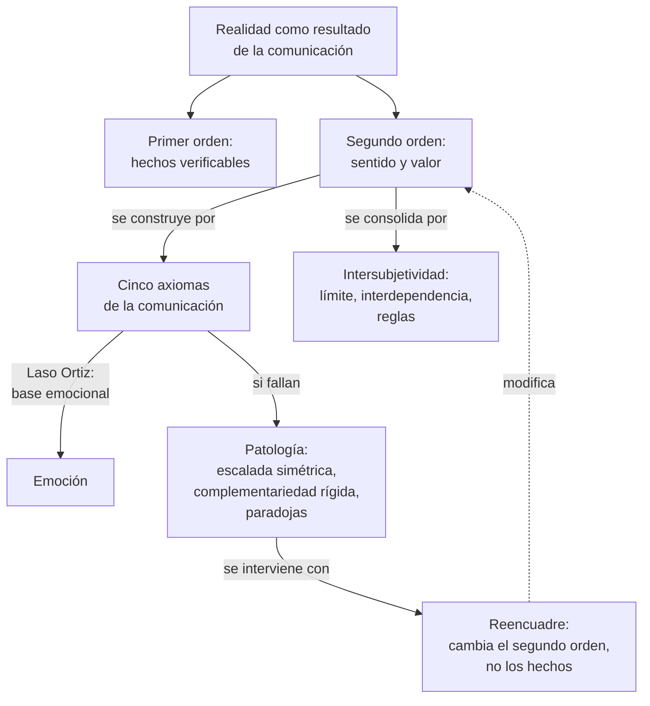
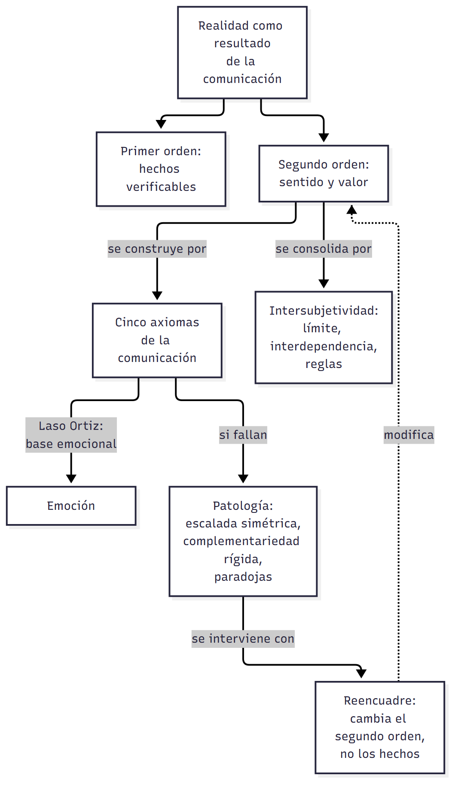
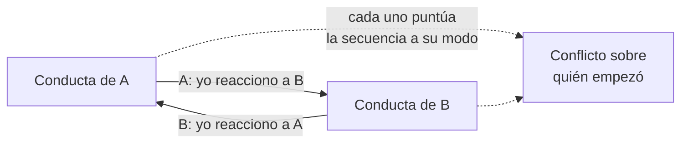
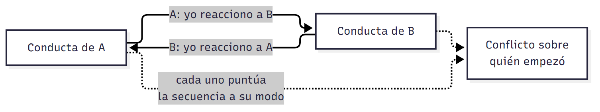

# C02 — Construcción social de la realidad · Versión de cursada

> **Fuentes:**
>
> - Cátedra de Psicología Social. (2026b). *Construcción social de la realidad* [Diapositivas de clase, clase 2]. Universidad Favaloro.
> - Laso Ortiz, E. (2015). Cinco axiomas de la emoción humana: una clave emocional para la terapia familiar. *Revista de Psicoterapia, 26*(100), 143-158.
> - Watzlawick, P. (1979). *¿Es real la realidad? Confusión, desinformación, comunicación* (M. Villanueva, Trad.). Herder.

> **Aviso sobre las fuentes:** **versión de cursada** (protocolo A): lo que se dio en la clase del 13/08 y lo que pide la unidad 2 del programa. Sigue el orden de las diapositivas, y suma los apuntes de clase. Las páginas citadas son las de los PDF de la cátedra: en Laso Ortiz, la página impresa es 142 números mayor; el PDF de Watzlawick es una versión electrónica con otra paginación que el libro. El programa cita a Laso Ortiz como «Ortiz, 2015» y con pp. 147-162; se usan los datos del artículo. El **reencuadre** está en las diapositivas: los dos textos asignados casi no lo desarrollan. Queda afuera, y está en el libro de Watzlawick: los casos de la primera parte (Hans el inteligente, los experimentos de no contingencia) y la tercera parte sobre la comunicación con extraterrestres.

> **Idea-fuerza:** La realidad en la que vivimos no es un reflejo de verdades objetivas: es en gran medida **resultado de la comunicación**. Watzlawick separa una **realidad de primer orden** (hechos físicos verificables) de una de **segundo orden** (el sentido que les atribuimos). La pragmática muestra que comunicar es influir, y Laso Ortiz actualiza los cinco axiomas al sostener que debajo de ellos está la **emoción** (Cátedra de Psicología Social, 2026b, diapositivas 2-4).

## Mapa: qué pide el programa y qué se dio en clase

| Tema | Programa | Clase | Sección |
|---|---|---|---|
| Enfoque constructivista de Watzlawick; sesgo de autoconfirmación | ✔ | ✔ | §1 |
| Realidad de primer y de segundo orden | ✔ | ✔ | §2 |
| Pragmática y axiomas de la comunicación | ✔ | ✔ | §3 |
| La interacción como sistema | ✔ | ✔ | §4 |
| Comunicación patológica | ✔ | ✔ | §5 |
| Construcción de la intersubjetividad | ✔ | ✔ | §6 |
| Comunicación paradójica | ✔ | ✔ | §7 |
| Reestructuración cognitiva: reencuadre | ✔ | ✔ | §8 |

---

## 1. La realidad como resultado de la comunicación

La clase parte de desarmar una ilusión: que la realidad refleja verdades objetivas y eternas. Nuestras percepciones cotidianas son andamios subjetivos construidos en la interacción (Cátedra de Psicología Social, 2026b, diapositiva 2). Dos ideas sostienen esa tesis:

- **Sesgo de autoconfirmación:** tenemos un impulso a buscar orden en el caos, y con frecuencia distorsionamos los hechos para sostener nuestras teorías, en lugar de ajustar las teorías a los hechos.
- **Pragmática:** la comunicación no es solo transmisión de datos. Es el mecanismo por el que las personas influimos unas sobre otras en conductas, estados de ánimo y mundos subjetivos.

## 2. Las dos realidades

| | Primer orden | Segundo orden |
|---|---|---|
| **Qué es** | Propiedades físicas y objetivamente constatables | Sentido, valor, significado y motivo atribuidos |
| **Cómo se sostiene** | Consenso perceptivo y pruebas experimentales repetibles | Construcción intersubjetiva: sin criterios objetivos, depende del marco cultural |
| **Oro** | Densidad, maleabilidad, punto de fusión | Valor económico fijado en la City de Londres; símbolo de estatus |
| **Rescate** | Un hombre se tira al agua a salvar a alguien | Lo atribuimos a amor al prójimo, a fama o a que el rescatado es millonario |

(Cátedra de Psicología Social, 2026b, diapositiva 3; Watzlawick, 1979, p. 47)

Watzlawick subraya que en el segundo orden no tiene sentido discutir qué es «realmente» real. El problema aparece cuando perdemos de vista la diferencia y suponemos que la realidad es tal como la vemos, y que quien la ve de otra manera es malicioso o está loco. Para el autor, lo verdaderamente ilusorio es suponer que hay una realidad «real» de segundo orden que los «normales» conocen mejor (Watzlawick, 1979, p. 47).

> ⚠ **No confundir:** el constructivismo de Watzlawick **no** niega los hechos físicos. Lo que sostiene es que el **sentido** de esos hechos se construye en la comunicación.

## 3. Los cinco axiomas y su actualización emocional

Los axiomas de la comunicación son la base de la terapia relacional. Laso Ortiz sostiene que se derivan de la estructura emocional humana, y eso permite intervenciones más directas (Cátedra de Psicología Social, 2026b, diapositiva 4; Laso Ortiz, 2015, p. 1).

| Axioma | Formulación clásica | Actualización de Laso Ortiz |
|---|---|---|
| **1** | **No es posible no comunicar:** la conducta no tiene opuesto; se comunica aun sin intención | **No es posible no resonar:** emulamos involuntariamente al otro (neuronas espejo, empatía, contagio emocional) |
| **2** | **Contenido y relación:** la relación clasifica al contenido (metacomunicación) | Las **emociones** son el sistema de categorías que clasifica el mensaje |
| **3** | **Puntuación de las secuencias:** cada persona ordena la interacción según su historia | El **afecto** es la raíz de la puntuación: la emoción guía a la cognición |
| **4** | **Digital y analógico:** verbal y arbitrario frente a no verbal e imitativo | Lo analógico es análogo del **sustrato emocional** (modelo PAD) |
| **5** | **Simetría y complementariedad:** relación basada en la igualdad o en la diferencia | Ejes de **agencia** y **comunión** |

**Axioma 1.** El pasajero absorto en su libro y el cónyuge abstraído en la televisión comunican rechazo a interactuar. La actualización agrega el cimiento biológico: la imposibilidad de permanecer impasibles ante el otro (Cátedra de Psicología Social, 2026b, diapositiva 5; Laso Ortiz, 2015, pp. 3-5).

**Axioma 2.** Laso Ortiz plantea una pregunta que quedó abierta: si la metacomunicación clasifica el contenido, ¿con qué categorías lo hace? Responde que con las emociones, porque la emoción es una atribución automática de significado que ubica la situación en un escenario prototípico evolutivo y dispara una estrategia (Laso Ortiz, 2015, p. 6). Las cuatro emociones básicas son (Cátedra de Psicología Social, 2026b, diapositiva 6):

| Emoción | Escenario | Efecto |
|---|---|---|
| Alegría | Recurso ganado | Expande y flexibiliza |
| Tristeza | Pérdida de recurso o vínculo | Contrae |
| Miedo | Amenaza al control | Repliegue o parálisis |
| Ira | Invasión a intereses vitales | Tensión y ataque |

**Axioma 3.** La clasificación afectiva tácita precede a la puntuación cognitiva. Por eso el cambio clínico duradero exige reconectar con las emociones primarias y no solo cambiar el pensamiento superficial (Cátedra de Psicología Social, 2026b, diapositiva 7; Laso Ortiz, 2015, pp. 8-9).

**Axioma 4.** El lenguaje **digital** tiene sintaxis lógica y negación, pero poca semántica relacional. El **analógico** tiene semántica rica para la relación, pero carece de sintaxis y de negación inequívoca. Traducir entre ambos es foco de patologías. El modelo PAD describe las emociones por valencia, intensidad y dominancia (Laso Ortiz, 2015, p. 12), que se encarnan en indicadores somáticos: cercanía-distancia (valencia), tono de voz (intensidad) y expansión-retracción (dominancia) (Cátedra de Psicología Social, 2026b, diapositiva 9).

**Axioma 5.** En la **simetría** una conducta incita otra parecida y las partes comparten estatus. En la **complementariedad** las conductas encajan: alguien está arriba (*one-up*) y otro abajo (*one-down*) (Laso Ortiz, 2015, p. 13). El modelo circumplejo interpersonal suma dos clases de necesidades: **agencia** (control, dominancia) y **comunión** (afecto, cercanía) (Laso Ortiz, 2015, p. 13). El conflicto de poder suele compensar un déficit de afecto (Cátedra de Psicología Social, 2026b, diapositiva 10).

> ⚠ **No confundir:** **contenido** es qué se dice. **Relación** es cómo debe entenderse, y clasifica al contenido. No es lo mismo que **digital y analógico**, aunque el contenido viaja sobre todo por lo digital y la relación por lo analógico.

## 4. La interacción como sistema

La **causalidad circular** supera la lineal: en los sistemas humanos, cada efecto retroalimenta su propia causa. Para evitar el caos relacional organizamos la secuencia de eventos, y el conflicto surge porque cada persona ve su conducta solo como **reacción** a la del otro (Cátedra de Psicología Social, 2026b, diapositiva 8).

## 5. Comunicación patológica

Las patologías relacionales surgen en los dos ejes del axioma 5 (Cátedra de Psicología Social, 2026b, diapositiva 11):

| | Escalada simétrica | Complementariedad rígida |
|---|---|---|
| **Qué ocurre** | Competencia sin límites donde nadie cede | El sistema se petrifica en una desigualdad crónica |
| **Eje** | Agencia: control, dominancia, estatus | Comunión: afecto, unión, cercanía |
| **Origen emocional** | Ira o miedo ante una amenaza | Déficits emocionales que el poder compensa |
| **Consecuencia** | Competencia destructiva | Quien está abajo queda desautorizado en su autonomía |

Laso Ortiz retoma a Linares: «somos primariamente amorosos y secundariamente maltratantes» (Laso Ortiz, 2015, p. 13).

## 6. Las bases de la intersubjetividad

Tres procesos consolidan el mundo compartido (Cátedra de Psicología Social, 2026b, diapositiva 12):

1. **Efecto limitador:** todo comportamiento en presencia de otro reduce las posibilidades relacionales previas e introduce un precedente (Watzlawick, 1979, p. 34).
2. **Interdependencia cognitiva:** cuando dos personas deben coordinar sin comunicarse, recurren a una cadena de proyecciones, «lo que yo pienso que él piensa que yo pienso» (Watzlawick, 1979, p. 36). Es coordinación en la desinformación: por ejemplo, decidir dónde encontrarse sin poder hablar.
3. **Formación de reglas:** la intersubjetividad se consolida en acuerdos tácitos, sin contrato verbal. Si un retraso en la primera cita no se menciona, nace la regla de que llegar tarde está permitido (Watzlawick, 1979, p. 34).

## 7. Las paradojas de la comunicación

| | Espontaneidad impuesta | Doble vínculo |
|---|---|---|
| **Qué es** | Exigir una conducta espontánea, que deja de serlo al ser pedida | Dos mensajes incompatibles en distintos niveles, en una relación de alta intensidad vital |
| **Ejemplo** | «¡No seas tan apagado!»; «regalame flores» | Digital: «te amo, sé independiente». Analógico: rechazo y control rígido |
| **Salida** | Las dos respuestas son inaceptables | No se permite metacomunicar ni escapar del campo |

(Cátedra de Psicología Social, 2026b, diapositiva 13; Watzlawick, 1979, pp. 12-13)

La exposición crónica bloquea acción, pensamiento y sentimiento. La cátedra señala tres efectos clínicos: **esquizofrenia** (el sujeto desconfía de sus sentidos y busca significados desviados), **depresión** (se culpa al niño por estar triste: «deberías ser feliz por todo lo que hacemos por ti») y **desamparo moral** (normas incompatibles, como honestidad y ganar dinero a toda costa). Son claves para entender el trastorno sin una lente patologizante individual (Cátedra de Psicología Social, 2026b, diapositiva 13).

## 8. El reencuadre

**Reestructurar** es cambiar el marco conceptual o valorativo (segundo orden) con que se vive una situación, **sin alterar los hechos** (primer orden). Al poner la conducta en otra categoría cambia su significado, se desbloquea el síntoma y el sistema deja de aplicar «más de lo mismo». Ejemplo: la maestra dice «X es insoportable, pregunta todo»; el reencuadre responde «tenés un alumno motivado, curioso» (Cátedra de Psicología Social, 2026b, diapositiva 14).

> 🔑 **Punto clave:** el reencuadre es la aplicación clínica de la distinción entre las dos realidades.

## Para rendir (formato mixto)

**1) Opción múltiple.** El valor económico del oro pertenece a: (a) la realidad de primer orden; (b) **la realidad de segundo orden**; (c) el lenguaje digital; (d) el efecto limitador. — *Respuesta: b* (Cátedra de Psicología Social, 2026b, diapositiva 3).

**2) Opción múltiple.** «¡Sé más espontáneo!» es un ejemplo de: (a) escalada simétrica; (b) complementariedad rígida; (c) **espontaneidad impuesta**; (d) reencuadre. — *Respuesta: c* (Watzlawick, 1979, p. 12).

**3) Verdadero o falso.** «Según Laso Ortiz, la cognición precede a la emoción en la puntuación de las secuencias.» — *Falso.* La clasificación afectiva tácita precede y determina a la cognición (Cátedra de Psicología Social, 2026b, diapositiva 7).

**4) Verdadero o falso.** «El reencuadre modifica los hechos objetivos de una situación.» — *Falso.* Cambia el marco de segundo orden sin alterar los hechos (Cátedra de Psicología Social, 2026b, diapositiva 14).

**5) Pregunta abierta.** *Explicá qué agrega Laso Ortiz a los axiomas clásicos, con dos ejemplos.*

> **Esqueleto de la respuesta:** (1) Tesis: los axiomas se derivan de la estructura emocional. (2) Axioma 1: de no comunicar a no resonar (neuronas espejo, contagio). (3) Axioma 2: las emociones son las categorías que clasifican el mensaje. (4) Consecuencia: intervenciones más directas sobre las emociones (Laso Ortiz, 2015, pp. 3-6).

## Referencias

Cátedra de Psicología Social. (2026b). *Construcción social de la realidad* [Diapositivas de clase, clase 2]. Universidad Favaloro.

Laso Ortiz, E. (2015). Cinco axiomas de la emoción humana: una clave emocional para la terapia familiar. *Revista de Psicoterapia, 26*(100), 143-158.

Watzlawick, P. (1979). *¿Es real la realidad? Confusión, desinformación, comunicación* (M. Villanueva, Trad.). Herder.
