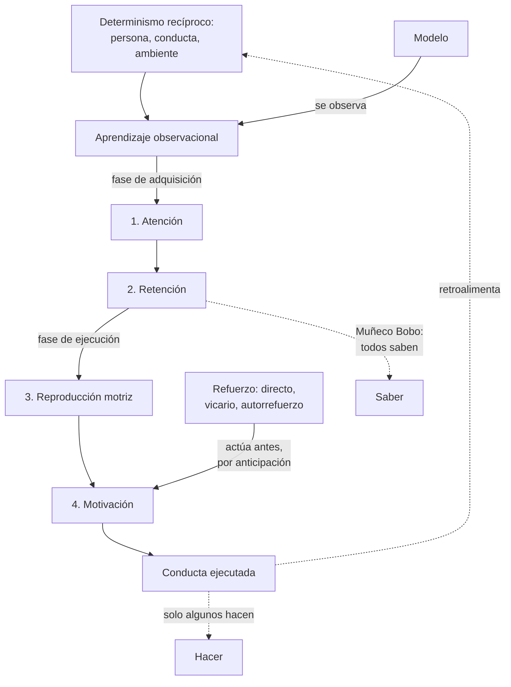
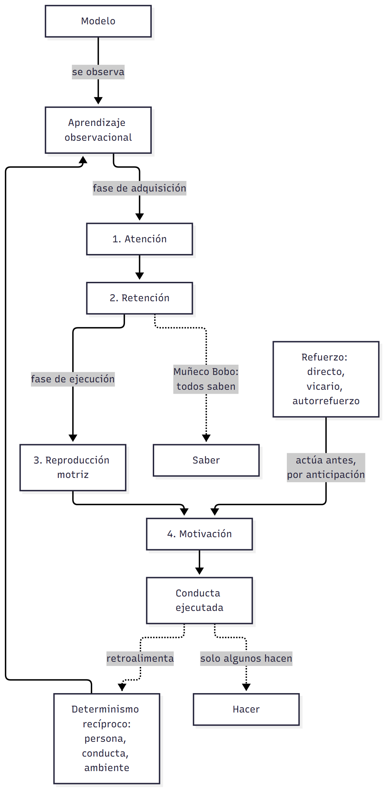
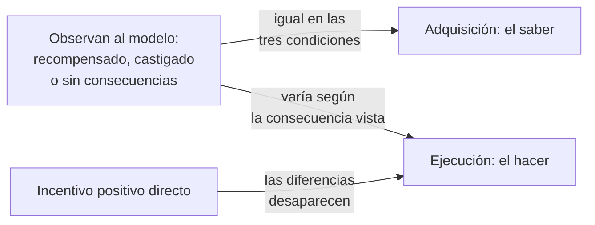
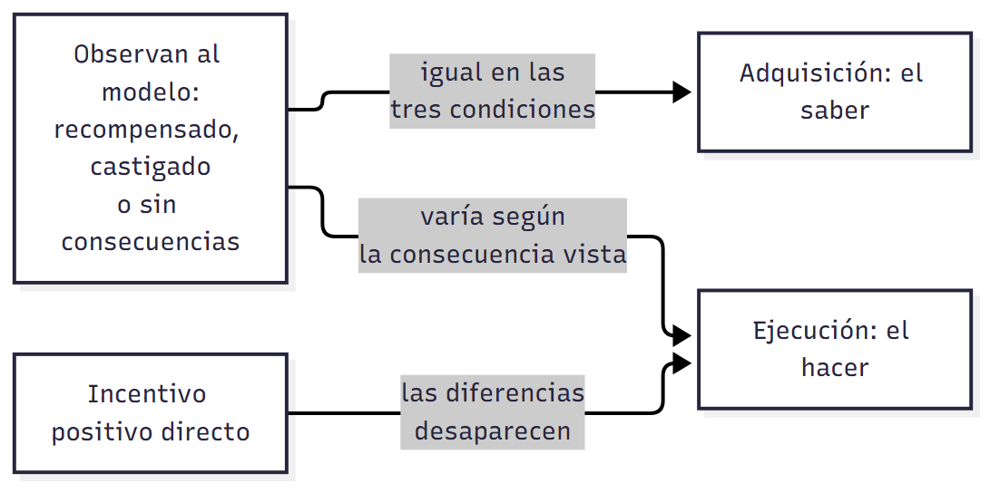

# C03 — Aprendizaje social · Versión de cursada

> **Fuentes:**
>
> - Bandura, A., & Walters, R. H. (1993). *Aprendizaje social y desarrollo de la personalidad* (caps. 1 y 2). Alianza. (Obra original publicada en 1963)
> - Baron, R. A., & Byrne, D. (2005). Actitudes: evaluar el mundo social. En *Psicología social* (10.ª ed., cap. 4). Pearson Educación.
> - Cátedra de Psicología Social. (2026c). *Teoría del aprendizaje social y formación de actitudes* [Diapositivas de clase, clase 3]. Universidad Favaloro.
> - Marín Sánchez, M., & Troyano Rodríguez, Y. (2014). El aprendizaje de modelos sociales. Consecuencias del aprendizaje social. En *Introducción a la psicología social* (cap. 7). Pirámide.

> **Aviso sobre las fuentes:** **versión de cursada** (protocolo A): lo que se dio en la clase del 20/08 y lo que pide la unidad 3. Los crudos de estos textos no tienen marcas de página: se cita por apartado. El programa nombra el capítulo como «Pecino y Sánchez, 2014», y las diapositivas como «Marín y Troyano, 2012»; acá se cita con los autores que figuran en el capítulo. Las diapositivas son imágenes: su texto se revisó sobre la imagen. La parte de **actitudes y disonancia** de esta presentación se desarrolla en `C05_CreenciasYActitudes_Cursada_Guia.md`. Para el detalle de los textos, ver las guías extendidas `U03_AprendizajeSocial_Guia.md`, `U03_Bandura_Guia.md` y `U03_Pecino_Guia.md`.

> **Idea-fuerza:** Aprendemos gran parte de la conducta **observando modelos**, sin ensayo ni refuerzo directo. La teoría separa **adquirir** de **ejecutar**: la observación alcanza para saber hacer algo, pero las consecuencias, propias o ajenas, regulan si se hace. Persona, conducta y ambiente se determinan **recíprocamente** (Cátedra de Psicología Social, 2026c, diapositivas 2, 3 y 17).

## Mapa: qué pide el programa y qué se dio en clase

| Tema | Programa | Clase | Sección |
|---|---|---|---|
| Teoría del aprendizaje social de Bandura | ✔ | ✔ | §1 |
| Determinismo recíproco | ✔ | ✔ | §1 |
| Imitación | ✔ | ✔ | §3 |
| Aprendizaje por observación: funciones y procesos | ✔ | ✔ | §2, §4, §5 |
| Tipos de reforzamiento | ✔ | ✔ | §6 |
| Efectos del modelado, autorregulación | — | ✔ | §7 |
| Modelado como psicoterapia | ✔ | ✔ | §8 |
| Experimentos de aprendizaje de la agresión | ✔ | ✔ | §9 |
| Formación de actitudes por aprendizaje social | — | ✔ | §10 y C05 |

---

## 1. Un nuevo paradigma

La teoría se presenta como superadora de dos modelos unidireccionales (Cátedra de Psicología Social, 2026c, diapositiva 2):

- **Psicoanálisis:** la conducta sale de instintos internos.
- **Conductismo radical:** un sujeto puramente reactivo a estímulos externos.

Frente a ellos, el **determinismo recíproco** plantea una causalidad triádica: **persona, conducta y ambiente** se moldean mutuamente. Para el aprendizaje social, la conducta no está dirigida ni por instancias instintivas ni solo por fuerzas ambientales: hay una interacción continua entre la conducta y las condiciones que la controlan (Marín Sánchez y Troyano Rodríguez, 2014, apartado «Procesos internos derivados de la observación social»). En clase se remarcó que no alcanza con premiar o castigar para que una conducta ocurra o no: se suma el aprendizaje por observación (F. Mendez Casariego, apuntes de clase, 20 de agosto de 2026).

Esa interacción descansa en tres procesos (Marín Sánchez y Troyano Rodríguez, 2014, apartado «Procesos internos derivados de la observación social»):

- **Vicarios:** aprender de la experiencia de otros.
- **Simbólicos:** representar internamente la conducta y prever consecuencias.
- **Autorreguladores:** generar influencias que regulen la propia conducta.

## 2. Moldeamiento y modelado

| | Moldeamiento | Modelado |
|---|---|---|
| **Autor** | Skinner (1953) | Bandura y Walters (1963) |
| **Cómo se aprende** | Aproximaciones sucesivas, gradualmente | Adquisición **in toto** de pautas complejas |
| **Ensayo y refuerzo** | Recompensa cada aproximación | Sin ensayo, error ni ejecución previa |
| **Metáfora** | El escultor y la arcilla | La fotografía cognitiva |

(Cátedra de Psicología Social, 2026c, diapositiva 3)

Bandura y Walters dudan de que muchas conductas pudieran adquirirse solo por condicionamiento operante (1963/1993, apartado «La adquisición de respuestas nuevas mediante aprendizaje observacional»). Sería muy improbable, por ejemplo, que un niño aprendiera a hablar sin haber oído hablar (Marín Sánchez y Troyano Rodríguez, 2014, apartado 6).

## 3. Imitación e identificación

Bandura y Walters **unifican** ambos conceptos: son el mismo fenómeno conductual. Y discuten otras explicaciones (Cátedra de Psicología Social, 2026c, diapositiva 4):

- **Miller y Dollard (1941):** la imitación sería condicionamiento operante. Exigen un sujeto motivado, una meta, respuestas parecidas a las del modelo y refuerzo positivo (Marín Sánchez y Troyano Rodríguez, 2014, apartado 6). En sus experimentos, sin embargo, no se aprendían conductas nuevas.
- **Mowrer:** la explicación por feedback propioceptivo no alcanza.
- **Anna Freud:** identificación por miedo al castigo. Para la cátedra, un modelo se asimila sobre todo porque muestra **éxito y poder social o recompensante**, no por miedo.

## 4. El aprendizaje vicario

El **aprendizaje vicario** es la adquisición por observación, sin experimentación directa. La explicación pasó del refuerzo secundario y la empatía (Mowrer) a la formulación de Bandura: **la adquisición ocurre por contigüidad sensorial, y el refuerzo vicario regula la ejecución** (Cátedra de Psicología Social, 2026c, diapositiva 5).

**Experimento de Berger (1962).** Con la respuesta galvánica de la piel se comprobó que el observador adquiere respuestas de miedo aunque no reciba el castigo: basta ver que lo recibe el modelo (Bandura y Walters, 1963/1993, apartado «Efectos inhibitorios y desinhibitorios»).

> ⚠ **No confundir:** el **aprendizaje vicario** es lo que aprendemos por ser testigos de una situación. El **refuerzo vicario** es el premio o castigo que recibe la conducta de otro (F. Mendez Casariego, apuntes de clase, 20 de agosto de 2026).

## 5. Los cuatro subprocesos del aprendizaje observacional

| Fase | Proceso | Qué ocurre | De qué depende |
|---|---|---|---|
| **I** | **1. Atención** | Exponerse al modelo no basta: hay que atender a sus rasgos significativos | Experiencias asociativas, valor funcional de la conducta, atracción del modelo |
| **I** | **2. Retención** | Se guarda la conducta en forma simbólica | Sistemas de imágenes y verbal; repaso mental |
| **II** | **3. Reproducción motriz** | Las representaciones simbólicas guían la conducta externa | Habilidades facilitadoras, desarrollo físico, retroalimentación informativa |
| **II** | **4. Motivación** | El sujeto se siente incitado a ejecutar lo adquirido | Incentivo anticipado |

(Cátedra de Psicología Social, 2026c, diapositivas 12-13; Marín Sánchez y Troyano Rodríguez, 2014, apartado 7)

El código verbal facilita una retención rápida y prolongada, y la repetición mental favorece el recuerdo (Marín Sánchez y Troyano Rodríguez, 2014, apartado «El proceso de retención»). En la reproducción, un niño puede retener cómo se dispara una flecha y no poder hacerlo por falta de fuerza (apartado «La reproducción motriz»).

## 6. El refuerzo: funciones y tipos

Para esta teoría el refuerzo **no** actúa solo después de la respuesta. Opera **antes**, como anticipación cognitiva previa a la ejecución (Cátedra de Psicología Social, 2026c, diapositiva 14): facilita la atención, la organización y la repetición (Marín Sánchez y Troyano Rodríguez, 2014, apartado «El papel del refuerzo en el aprendizaje social»).

**Cuatro funciones** (Marín Sánchez y Troyano Rodríguez, 2014, apartado 5):

1. **Informativa:** el resultado de la conducta indica qué conviene hacer.
2. **Motivacional:** nos mueve la representación simbólica de los resultados, porque mientras actuamos todavía no los recibimos.
3. **Incentivadora:** la persona valora los refuerzos y actúa según cuán gratificantes sean.
4. **Fortalecedora:** consolida la respuesta.

**Tres tipos:** **directo** (consecuencias propias), **vicario** (consecuencias ajenas observadas) y **autorrefuerzo** (criterios internos autogenerados) (Cátedra de Psicología Social, 2026c, diapositiva 14).

## 7. Efectos del modelado y autorregulación

La observación tiene tres efectos (Cátedra de Psicología Social, 2026c, diapositiva 15; Bandura y Walters, 1963/1993, apartado «Efectos inhibitorios y desinhibitorios»):

| Efecto | Qué hace | Requiere conducta previa |
|---|---|---|
| **De modelado** | Aporta pautas nuevas | No |
| **Inhibitorio o desinhibitorio** | Frena o libera una conducta del repertorio | Sí |
| **De provocación o facilitación social** | Dispara conductas ya aprendidas y permitidas | Sí |

**Autorregulación.** Atribuir el resultado al **esfuerzo propio** aumenta el autocontrol y la autoeficacia; atribuirlo a **causas externas** genera apatía. Para sostener la automotivación son vitales la **especificidad** y la **proximidad temporal** de las metas (Cátedra de Psicología Social, 2026c, diapositiva 15; Marín Sánchez y Troyano Rodríguez, 2014, apartado «La motivación del factor cognitivo»).

## 8. El modelado como terapia

La teoría critica el **modelo médico** clásico, que entiende la conducta desviada como síntoma de una enfermedad subyacente y sostiene la **sustitución de síntomas** (Bandura y Walters, 1963/1993, cap. 1). La redefinición es esta (Cátedra de Psicología Social, 2026c, diapositiva 16):

- **Síntoma:** una pauta disfuncional aprendida que domina la jerarquía de respuestas.
- **Tratamiento:** extinguir conductas desadaptativas y modelar alternativas viables.
- **Técnica clave:** el juego de rol (*role-playing*), con retroalimentación instructiva en un marco seguro.

## 9. El Muñeco Bobo: saber y hacer

**Bandura, Ross y Ross (1961).** Niños de jardín de infantes vieron a un adulto agredir física y verbalmente a un gran muñeco inflable, o a un adulto no agresivo. Los primeros imitaron la agresión, incluso en ausencia del modelo (Bandura y Walters, 1963/1993, apartado «La adquisición de respuestas nuevas mediante aprendizaje observacional»). En 1963 compararon modelos reales, filmados y de dibujos animados (mismo apartado).

La cátedra destaca la **división crítica** entre tres condiciones: modelo **recompensado**, **castigado** y **sin consecuencias**. La ejecución varía según lo observado; pero al introducir un **incentivo positivo**, todos reproducen la conducta. Todos la habían adquirido por igual: las consecuencias regulan la ejecución (Cátedra de Psicología Social, 2026c, diapositiva 17).

> 🔑 **Punto clave:** el experimento **separa el saber del hacer**. Por eso refuerzo y aprendizaje no son lo mismo.

## 10. Formación de actitudes por aprendizaje social

La presentación aplica estas ideas a las actitudes, evaluaciones internas del mundo social (Cátedra de Psicología Social, 2026c, diapositivas 6-8; Baron y Byrne, 2005, apartado «Aprendizaje social»): el **condicionamiento clásico** (prejuicios por reacciones emocionales de los padres), el **subliminal** (señales bajo el umbral de la conciencia), el **instrumental** (alabanzas y recompensas) y la **observación**, donde los niños detectan la disonancia entre lo que se les dice y lo que se hace. Ante la ambigüedad, la **comparación social** (Festinger) nos lleva a calibrarnos con el grupo de referencia. → Sigue en `C05_CreenciasYActitudes_Cursada_Guia.md`.

## Para rendir (formato mixto)

**1) Opción múltiple.** Un adolescente ve que sancionan a un compañero por copiarse y deja de hacerlo. Es un efecto: (a) de modelado; (b) **inhibitorio**; (c) de facilitación social; (d) de autorrefuerzo. — *Respuesta: b.* Frena una conducta del repertorio (Bandura y Walters, 1963/1993, apartado «Efectos inhibitorios y desinhibitorios»).

**2) Opción múltiple.** La fase de adquisición incluye: (a) **atención y retención**; (b) retención y reproducción; (c) reproducción y motivación; (d) atención y motivación. — *Respuesta: a* (Cátedra de Psicología Social, 2026c, diapositiva 12).

**3) Verdadero o falso.** «Para Bandura, el refuerzo es necesario para adquirir una conducta observada.» — *Falso.* La adquisición ocurre por contigüidad sensorial; el refuerzo regula la ejecución (Cátedra de Psicología Social, 2026c, diapositiva 5).

**4) Verdadero o falso.** «El refuerzo vicario es el premio que recibe el observador.» — *Falso.* Es la consecuencia que recibe el modelo (F. Mendez Casariego, apuntes de clase, 20 de agosto de 2026).

**5) Pregunta abierta.** *¿Qué demuestra el experimento del Muñeco Bobo sobre la relación entre aprendizaje y ejecución?*

> **Esqueleto de la respuesta:** (1) Diseño: tres condiciones de consecuencias al modelo. (2) Resultado: la ejecución varía. (3) Incentivo positivo: todos reproducen. (4) Conclusión: la adquisición es igual y las consecuencias regulan la ejecución. (5) Articulación: contra el conductismo, el refuerzo no es condición para aprender (Cátedra de Psicología Social, 2026c, diapositiva 17).

## Referencias

Bandura, A., & Walters, R. H. (1993). *Aprendizaje social y desarrollo de la personalidad* (caps. 1 y 2). Alianza. (Obra original publicada en 1963)

Baron, R. A., & Byrne, D. (2005). Actitudes: evaluar el mundo social. En *Psicología social* (10.ª ed., cap. 4). Pearson Educación.

Cátedra de Psicología Social. (2026c). *Teoría del aprendizaje social y formación de actitudes* [Diapositivas de clase, clase 3]. Universidad Favaloro.

Marín Sánchez, M., & Troyano Rodríguez, Y. (2014). El aprendizaje de modelos sociales. Consecuencias del aprendizaje social. En *Introducción a la psicología social* (cap. 7). Pirámide.
