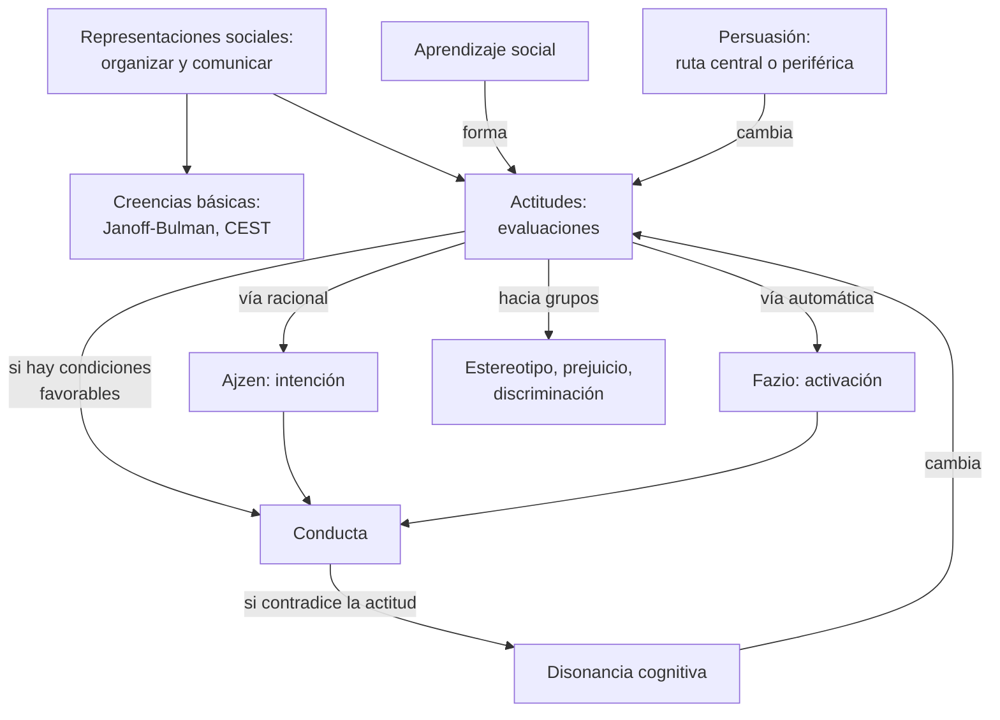
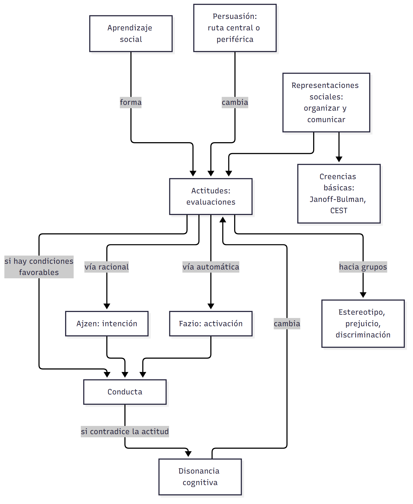
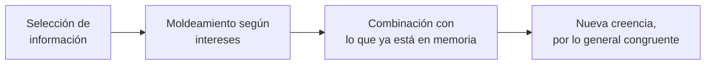
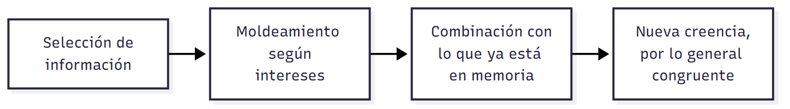
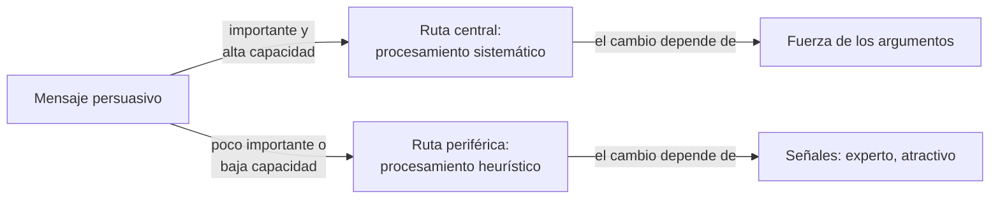
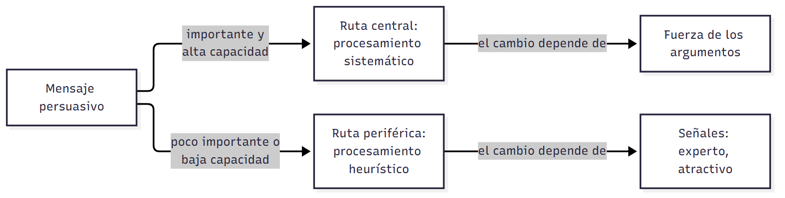

# C05 — Creencias y actitudes · Versión de cursada

> **Fuentes:**
>
> - Baron, R. A., & Byrne, D. (2005). Actitudes: evaluar el mundo social. En *Psicología social* (10.ª ed., cap. 4). Pearson Educación.
> - Cátedra de Psicología Social. (2026d). *Creencias y actitudes* [Diapositivas de clase, unidad 4]. Universidad Favaloro.
> - Páez, D., Morales, J. F., & Fernández, I. (2007). Las creencias básicas sobre el mundo social y el yo. En J. F. Morales, M. Moya, E. Gaviria, & I. Cuadrado (Coords.), *Psicología social* (3.ª ed., cap. 7). McGraw-Hill.

> **Aviso sobre las fuentes:** **versión de cursada** (protocolo A): lo que se dio en la clase del 03/09 y lo que pide la unidad 4. Los crudos de estos dos textos no tienen marcas de página: se cita por apartado. Las diapositivas 47 a 56 son consignas de un trabajo práctico y quedan afuera. Las diapositivas citan el capítulo como «Morales, 2007»: sus autores son Páez, Morales y Fernández. Estereotipos, prejuicio y discriminación (diapositivas 43-45) vienen de otro capítulo que no está en Drive: el cronograma nombra Morales cap. 8, que falta. El programa incluye a Moscovici (1984), Searle (1997) y Stangor et al. (2017) como complementarios y tampoco están: se usa solo lo que dicen las diapositivas. Queda afuera, y está en el capítulo de Páez: los estudios de la Encuesta Mundial de Valores, los datos sobre apego y la reconstrucción de creencias tras un trauma.

> **Idea-fuerza:** Las **creencias** son supuestos básicos que tomamos por fiables para planificar y actuar: buscan sentido y congruencia antes que verdad. Las **actitudes** son evaluaciones del mundo social que se aprenden socialmente, cumplen funciones y predicen la conducta solo bajo ciertas condiciones. Se pueden cambiar por **persuasión** y por **disonancia cognitiva** (Cátedra de Psicología Social, 2026d, diapositivas 6, 17, 25, 32 y 37).

## Mapa: qué pide el programa y qué se dio en clase

| Tema | Programa | Clase | Sección |
|---|---|---|---|
| Actitudes como dimensión de las representaciones sociales | ✔ | ✔ | §1 |
| Creencias sobre el mundo social e integración social | ✔ | ✔ | §2 |
| Creencias sobre el sentido, el azar y la justicia | ✔ | ✔ | §2 |
| Sistemas de creencias | ✔ | ✔ | §3 |
| Formación de actitudes y creencias | ✔ | ✔ | §4 |
| Relación entre actitudes y comportamientos | ✔ | ✔ | §5 |
| Persuasión | ✔ | ✔ | §6 |
| Disonancia cognitiva | ✔ | ✔ | §7 |
| Estereotipos, prejuicio y discriminación | — | ✔ | §8 |

---

## 1. Representaciones sociales

La clase abre con Searle: hay cosas que existen solo porque creemos que existen (Cátedra de Psicología Social, 2026d, diapositiva 3). Durkheim hablaba de **representaciones colectivas**, formas de pensamiento compartidas para dar sentido al mundo. **Moscovici (1961)** propone la teoría de las **representaciones sociales**: sistemas de valores, ideas y prácticas que surgen en la vida cotidiana, con dos funciones, **organización y comunicación** (Cátedra de Psicología Social, 2026d, diapositiva 5).

## 2. Creencias básicas

**Parkes (1975)** habla del **mundo de los supuestos**: un repertorio de creencias sobre el mundo y el yo que la persona considera fiables, mantiene con firmeza y usa para planificar y actuar. Cuando ocurre una transición importante, como la muerte del cónyuge, hay que construir uno nuevo (Páez et al., 2007, apartado «El mundo de los supuestos de Parkes»).

**Alcock (1995)** describe al ser humano como **máquina de creencias**. Su sistema se desarrolló para la supervivencia, y su preocupación principal no es que las creencias sean verídicas (Páez et al., 2007, apartado «La máquina de creencias»):

**Janoff-Bulman (1992)** ordena tres conjuntos (Páez et al., 2007, apartado 7.2):

| Conjunto | Contenido | Ideas asociadas |
|---|---|---|
| **Benevolencia** | El mundo es bueno y se puede confiar en los otros | Optimismo ilusorio, ilusión de invulnerabilidad, apego seguro |
| **Sentido del mundo** | **Control** (sobrevaloramos nuestra capacidad), **azar** (las cosas no ocurren por azar) y **justicia** (cada cual recibe lo que merece) | Necesidad de estabilidad y congruencia |
| **Dignidad del yo** | El yo es merecedor de respeto | Autoestima, eficacia |

**Corsini (2004)** suma las creencias sobre la **integración social**: participar en redes donde se recibe respeto y amor. Están en la misma categoría que las creencias culturales compartidas. La **teoría del manejo del terror existencial** sostiene que esas creencias ayudan a afrontar la ansiedad ante la muerte (Páez et al., 2007, apartado «Creencias acerca de la integración social»).

Estas creencias responden a la necesidad de un sistema estable, de asimilar la novedad y de garantizar la congruencia (Páez et al., 2007, apartado «Creencias sobre el sentido del mundo»). En clase se discutió ese punto: hay un límite en la idea de que el pensamiento tiende siempre al equilibrio, porque puede desequilibrarse y reajustarse según la predisposición (F. Mendez Casariego, apuntes de clase, 3 de septiembre de 2026).

**Impacto de los hechos traumáticos.** Llevan a una visión menos optimista, a creer que el mundo carece de sentido y es injusto, a descreer de la bondad, y generan aislamiento, menor dignidad del yo y desesperanza (Cátedra de Psicología Social, 2026d, diapositiva 15; Páez et al., 2007, apartado 7.4).

## 3. Dos sistemas de creencias: el modelo CEST

**Epstein (1994)** postula que construimos automáticamente «teorías de la realidad» (Páez et al., 2007, apartado 7.3):

| | Sistema experiencial | Sistema racional |
|---|---|---|
| **Base** | Unido a las emociones; busca placer y evita dolor | Evolucionado; lógica y evidencia |
| **Procesamiento** | Automático, holístico, sin esfuerzo | Intencional y abstracto |
| **Creencias** | Implícitas | Explícitas |
| **Modo** | Pasivo | Activo |

> ⚠ **No confundir:** las creencias del sistema racional cambian más rápido, con evidencia. Las del experiencial vienen de experiencias emocionalmente significativas.

## 4. Las actitudes: qué son y cómo se forman

Las **actitudes** son evaluaciones de cualquier aspecto del mundo social (Baron y Byrne, 2005, apartado inicial). Pueden ser **ambivalentes**, con aspectos positivos y negativos a la vez; las uniformes son más difíciles de cambiar (Cátedra de Psicología Social, 2026d, diapositiva 18). Importan porque evaluar parece el primer paso para dar sentido al mundo social y porque influyen en el pensamiento aunque no siempre se vean en la conducta (diapositiva 19).

**Se forman por aprendizaje social** (Cátedra de Psicología Social, 2026d, diapositiva 22):

| Vía | Mecanismo | Ejemplo |
|---|---|---|
| **Condicionamiento clásico** | Asociación entre estímulos | Un niño ve a su madre mostrar desagrado ante un grupo étnico |
| **Condicionamiento instrumental** | Se premia la respuesta esperada | Sostener los puntos de vista «correctos» |
| **Aprendizaje observacional** | Ejemplo de otros | Imitan lo que los padres hacen, no lo que dicen: «no fumes» |
| **Comparación social** | Si otros piensan igual, debe ser correcto | Calibrarse con el grupo de referencia |

**Funciones** (Cátedra de Psicología Social, 2026d, diapositiva 23): **cognitiva** (operan como esquemas), de **autoidentidad** (expresan valores), de **autoestima**, de **autodefensa** (protegen de información no deseada) y de **motivación** (causar buena impresión).

## 5. Actitudes y conducta

Las actitudes no siempre predicen la conducta. Depende de (Cátedra de Psicología Social, 2026d, diapositiva 25; Baron y Byrne, 2005, apartado «La relación entre actitud y comportamiento»):

- **La situación:** las restricciones situacionales impiden expresarlas.
- **El origen:** las formadas por **experiencia directa** se recuerdan mejor e impactan más.
- **La fuerza:** cuanto más fuerte, mayor impacto.
- **La especificidad:** para predecir si salís a correr, sirve más tu actitud hacia correr que hacia el ejercicio en general.

**Dos modelos:**

| | Acción razonada y conducta planeada | De la actitud a la conducta |
|---|---|---|
| **Autores** | Ajzen y Fishbein | Fazio (1989) |
| **Cuándo** | Con tiempo para decidir | Hay que actuar rápido |
| **Proceso** | Actitud hacia la conducta + **norma subjetiva** + **control conductual percibido** → intención → conducta | El evento activa la actitud y el conocimiento de las normas → definición del evento → conducta |
| **Ejemplo** | Orbell et al. (2001), uso de éxtasis | Alguien se cola en la fila |

(Cátedra de Psicología Social, 2026d, diapositivas 27-29)

La teoría de la **conducta planeada** es la que agrega el control conductual percibido. En el estudio de **Orbell et al. (2001)**, actitud, norma subjetiva y control percibido fueron predictores significativos de la **intención** de usar éxtasis (Cátedra de Psicología Social, 2026d, diapositiva 28).

## 6. Persuasión

**Enfoque tradicional** (Cátedra de Psicología Social, 2026d, diapositiva 31): son más persuasivos los comunicadores creíbles y atractivos (Hovland y Weiss, 1951), los mensajes que no parecen querer persuadir (Walster y Festinger, 1962), la audiencia distraída (Allyn y Festinger, 1961), hablar rápido (Miller et al., 1976) y activar emociones fuertes.

**Modelo de la probabilidad de elaboración** (Cátedra de Psicología Social, 2026d, diapositivas 32-33):

**Resistencia a la persuasión** (Cátedra de Psicología Social, 2026d, diapositivas 34-35): **reactancia** (protegemos nuestra libertad), **advertencia previa**, **evitación selectiva**, ignorar información incongruente y **asimilación sesgada**, que evalúa lo contrario como menos convincente.

## 7. Disonancia cognitiva

Es el estado desagradable que surge al notar que nuestras actitudes, o nuestras actitudes y nuestra conducta, son inconsistentes (Cátedra de Psicología Social, 2026d, diapositiva 37).

**Cómo se reduce** (Cátedra de Psicología Social, 2026d, diapositiva 38; Baron y Byrne, 2005, apartado «Disonancia cognitiva»):

- **Directas:** cambiar actitud o conducta, adquirir información nueva, **trivializar**.
- **Indirecta:** **autoafirmación** (Steele), restaurar la autoevaluación sin tocar la discrepancia (Cátedra de Psicología Social, 2026c, diapositiva 10).

**Condescendencia forzada: menos lleva a más.** Festinger y Carlsmith (1959) pidieron a participantes que dijeran que una tarea aburrida era interesante, por $1 o $20. Quienes recibieron **$1** mostraron más gusto por la tarea: sin excusa externa, tuvieron que convencerse. Con **$20**, el dinero justificaba el acto. Es decir, la tensión es mayor cuando hay **pocas razones**. La cátedra aclara que no funciona siempre (Cátedra de Psicología Social, 2026d, diapositivas 39-41).

**Hipocresía inducida.** La disonancia puede promover cambios beneficiosos. Stone et al. (1997) hicieron que las personas defendieran el sexo seguro. Quienes listaron sus **propias** razones para no practicarlo redujeron la disonancia por vía directa, comprando preservativos. Quienes pensaron en la gente en general eligieron la vía indirecta, donando a personas sin hogar (Cátedra de Psicología Social, 2026d, diapositiva 42; Baron y Byrne, 2005, apartado «La disonancia como una herramienta»).

> ⚠ **No confundir:** en la disonancia, **menos** recompensa produce **más** cambio de actitud. Con la lógica del refuerzo se esperaría lo contrario.

## 8. Estereotipos, prejuicio y discriminación

La **categorización social** agrupa personas y sostiene la identidad grupal. Los **estereotipos** son esquemas cognitivos con tres principios: ayudan a explicar la realidad, ahorran energía y son creencias compartidas sobre un grupo. La concepción tripartita los ordena por componente (Cátedra de Psicología Social, 2026d, diapositivas 43-45):

| Componente | Concepto |
|---|---|
| Cognitivo | Estereotipo |
| Afectivo | Prejuicio |
| Conductual | Discriminación |

## Para rendir (formato mixto)

**1) Opción múltiple.** La teoría de la conducta planeada agrega a la de acción razonada: (a) la norma subjetiva; (b) **el control conductual percibido**; (c) la actitud; (d) la activación automática. — *Respuesta: b* (Cátedra de Psicología Social, 2026d, diapositiva 27).

**2) Opción múltiple.** En Festinger y Carlsmith, el mayor cambio de actitud se dio en quienes: (a) **cobraron $1**; (b) cobraron $20; (c) no mintieron; (d) cobraron igual. — *Respuesta: a* (Cátedra de Psicología Social, 2026d, diapositiva 41).

**3) Verdadero o falso.** «En la ruta periférica, el cambio depende de la fuerza de los argumentos.» — *Falso.* Depende de señales heurísticas (Cátedra de Psicología Social, 2026d, diapositiva 33).

**4) Verdadero o falso.** «Para Alcock, la máquina de creencias se orienta sobre todo a la verdad.» — *Falso.* Genera creencias congruentes con las previas; garantizar la verdad no es su preocupación principal (Páez et al., 2007, apartado «La máquina de creencias»).

**5) Pregunta abierta.** *¿Por qué una actitud puede no predecir la conducta? Da dos condiciones y un modelo.*

> **Esqueleto de la respuesta:** (1) Las actitudes no siempre se reflejan en la conducta. (2) Restricciones situacionales. (3) Fuerza o especificidad. (4) Ajzen: la intención media, junto con norma y control percibido. (5) Ejemplo: Orbell et al. (2001) (Cátedra de Psicología Social, 2026d, diapositivas 25-28).

## Referencias

Baron, R. A., & Byrne, D. (2005). Actitudes: evaluar el mundo social. En *Psicología social* (10.ª ed., cap. 4). Pearson Educación.

Cátedra de Psicología Social. (2026c). *Teoría del aprendizaje social y formación de actitudes* [Diapositivas de clase, clase 3]. Universidad Favaloro.

Cátedra de Psicología Social. (2026d). *Creencias y actitudes* [Diapositivas de clase, unidad 4]. Universidad Favaloro.

Páez, D., Morales, J. F., & Fernández, I. (2007). Las creencias básicas sobre el mundo social y el yo. En J. F. Morales, M. Moya, E. Gaviria, & I. Cuadrado (Coords.), *Psicología social* (3.ª ed., cap. 7). McGraw-Hill.
