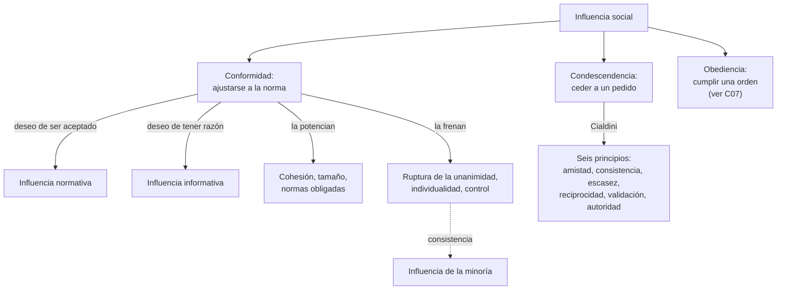
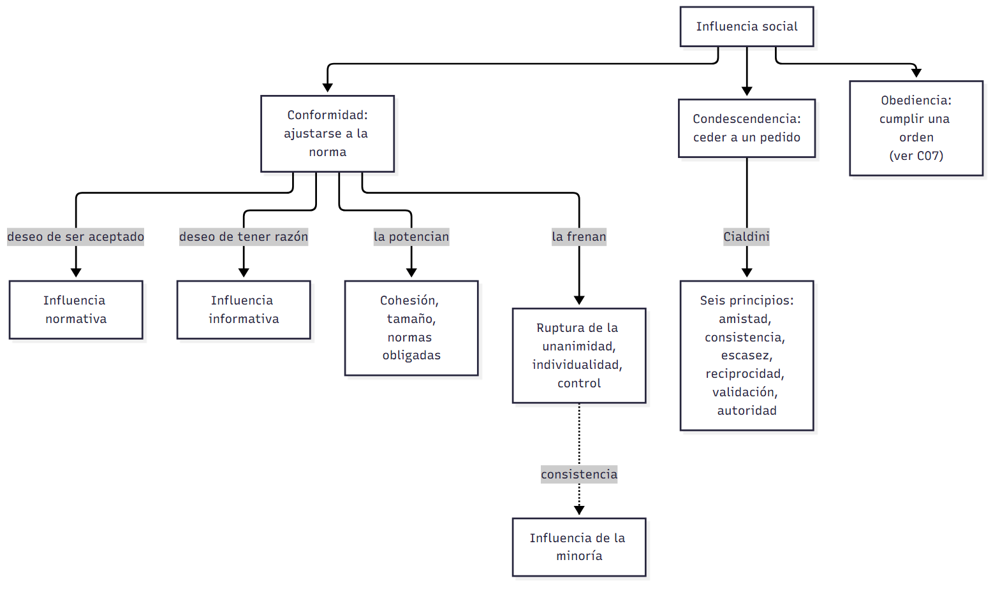
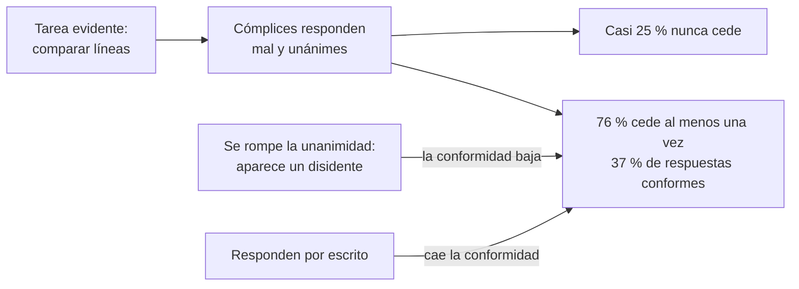
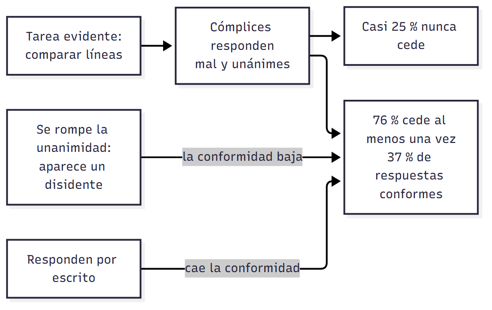

# C06 — Influencia social I: conformidad y condescendencia · Versión de cursada

> **Fuentes:**
>
> - Baron, R. A., & Byrne, D. (2005). Influencia social: cambiar el comportamiento de los demás. En *Psicología social* (10.ª ed., cap. 9). Pearson Educación.
> - Cátedra de Psicología Social. (2026e). *Influencia social* [Diapositivas de clase, introducción]. Universidad Favaloro.
> - Cátedra de Psicología Social. (2026f). *Influencia social: conformidad y obediencia. Parte 1* [Diapositivas de clase]. Universidad Favaloro.

> **Aviso sobre las fuentes:** **versión de cursada** (protocolo A): lo que se dio en la clase de influencia social 1 y lo que pide la unidad 5. Las páginas de Baron y Byrne son las del PDF de la cátedra (la página impresa es unos 356 números mayor). La diapositiva 10 de la parte 1 titula «normativa vs. descriptiva», pero desarrolla la influencia **normativa e informativa**: se sigue esa distinción, que es la de la diapositiva 3 de la introducción y la del libro. Obediencia y Stanford están en `C07_ObedienciaYPoderDeLaSituacion_Cursada_Guia.md`.

> **Idea-fuerza:** Influimos y somos influidos todo el tiempo. Cedemos a los demás por dos motivos: **ser aceptados** (influencia normativa) y **tener razón** (influencia informativa). Asch mostró que la presión del grupo alcanza incluso con una respuesta evidente, y que lo decisivo es la **unanimidad**. La **condescendencia**, en cambio, es ceder a un pedido directo, y se apoya en seis principios (Cátedra de Psicología Social, 2026e, diapositivas 2-3; 2026f, diapositivas 5, 6 y 16).

## Mapa: qué pide el programa y qué se dio en clase

| Tema | Programa | Clase | Sección |
|---|---|---|---|
| Definición; influencia normativa e informativa | ✔ | ✔ | §1 |
| Normas sociales: descriptivas y obligadas | ✔ | ✔ | §2 |
| Investigación de Asch | ✔ | ✔ | §3 |
| Factores que afectan la conformidad | ✔ | ✔ | §4 |
| Resistir la conformidad | ✔ | ✔ | §5 |
| Influencia de la minoría | ✔ | ✔ | §6 |
| Condescendencia: principios y tácticas | ✔ | ✔ | §7 |
| Diferencia entre conformidad y obediencia | ✔ | ✔ | §1 y C07 |

---

## 1. Qué es la influencia social

Es el esfuerzo, y las técnicas, de una o más personas para cambiar actitudes, creencias, percepciones y comportamientos de otras. No solo la recibimos: también la ejercemos (Cátedra de Psicología Social, 2026e, diapositiva 2).

| | Influencia **normativa** | Influencia **informativa** |
|---|---|---|
| **Deseo** | Ser **aceptados** | Ser **correctos** |
| **Mecanismo** | Adaptar la conducta a las expectativas; temor al rechazo | Usar a los demás como guía sobre el mundo social |
| **Ejemplo** | Evitar hacer el ridículo | Mirar qué hacen los demás en una situación incierta |

(Cátedra de Psicología Social, 2026e, diapositiva 3)

**Prueba experimental de la informativa.** Baron, Vandello y Brunsman (1996) pidieron identificar un dibujo. Era difícil si se mostraba 0,5 segundos y fácil si duraba 5. A la mitad le dijeron que el estudio era importante. Con importancia alta, la gente se conformaba más a los cómplices en la tarea difícil que en la fácil; con importancia baja, la dificultad no cambiaba nada (Cátedra de Psicología Social, 2026f, diapositiva 11; Baron y Byrne, 2005, p. 13).

> ⚠ **No confundir:** en la **conformidad** nadie ordena: hay una presión, a menudo implícita, de la norma. En la **condescendencia** alguien pide. En la **obediencia** alguien ordena (Baron y Byrne, 2005, p. 2).

## 2. Normas sociales

Son reglas, explícitas o tácitas, que indican cómo se espera que nos comportemos (Cátedra de Psicología Social, 2026e, diapositiva 4). Pueden estar escritas, como las leyes, o no, como no acercarse mucho a los desconocidos (Cátedra de Psicología Social, 2026f, diapositiva 2). La mayoría las obedece la mayor parte del tiempo: sin esa tendencia a la **conformidad**, habría caos social (2026f, diapositiva 3).

| | Normas **descriptivas** | Normas **obligadas** |
|---|---|---|
| **Qué indican** | Lo que la mayoría hace | Lo que se debe hacer |
| **Cómo influyen** | Informan qué es efectivo o adaptativo | Indican lo aprobado o desaprobado |
| **Efecto** | Menor | **Mayor:** desvían la atención de cómo actúa la gente a cómo debería actuar y activan la motivación por lo correcto |

(Cátedra de Psicología Social, 2026f, diapositiva 9)

## 3. La investigación de Asch

**Diseño.** Los participantes debían decir cuál de tres líneas coincidía con una línea patrón, una tarea sin ambigüedad. Había seis a ocho personas, y todas salvo una eran cómplices. En **12 de las 18** pruebas, las pruebas críticas, los cómplices daban unánimemente una respuesta errónea, y lo hacían antes que el participante (Baron y Byrne, 2005, p. 5).

**Resultados** (Baron y Byrne, 2005, pp. 5-6):

- El **76 %** siguió al grupo al menos una vez, y en total coincidieron con la respuesta falsa el **37 %** de las veces. En el grupo control, que respondió solo, el error fue del **5 %**.
- Casi el **25 %** nunca cedió. Otros siguieron casi siempre: «estoy equivocado, ellos están en lo cierto».

**Variantes** (Baron y Byrne, 2005, p. 6; Cátedra de Psicología Social, 2026f, diapositivas 6-7):

- El cómplice disidente daba la respuesta **correcta**, una **intermedia** o una **más incorrecta** que la mayoría. La conformidad bajó en las tres, y la reducción fue mayor en la más extrema.
- **Conclusión:** lo crucial es la **unanimidad**. Si se rompe, resistir es más fácil.
- Al responder **por escrito**, la conformidad cayó: podemos seguir normas sin cambiar nuestras convicciones.

> 🔑 **Punto clave:** Asch es un experimento paradigmático de **influencia normativa**: la respuesta correcta era evidente y aun así la gente cedió. → Sherif, en `C01_IntroduccionALaPsicologiaSocial_Cursada_Guia.md`, trabaja con una situación ambigua: ahí pesa la influencia informativa.

## 4. Factores que afectan la conformidad

- **Cohesión:** grado de atracción hacia un grupo. Si es alta, se amplifican las presiones; si es baja, ¿por qué cambiar para parecerse a quienes no nos agradan? (Cátedra de Psicología Social, 2026f, diapositiva 8).
- **Tamaño del grupo:** Asch encontró que la conformidad se estabilizaba con tres miembros, pero estudios posteriores la vieron crecer hasta ocho o más (Baron y Byrne, 2005, p. 7). Este factor está en el libro y no en las diapositivas.
- **Tipo de norma:** las obligadas pesan más que las descriptivas (§2).

## 5. Por qué a veces no seguimos a los demás

Adoptamos la mayoría de las normas, pero no todas (Cátedra de Psicología Social, 2026f, diapositivas 12-13):

- **Individualidad:** queremos parecernos a los demás sin perder identidad. La conformidad es más baja en las culturas individualistas que en las colectivistas.
- **Control:** a mayor necesidad de control personal, menor probabilidad de ceder.

Ceder o no depende de la fuerza relativa de todos estos motivos.

## 6. Influencia de la minoría

Las minorías también influyen, como muestran Galileo, Pasteur o Freud y, hoy, los ecologistas (Baron y Byrne, 2005, p. 19). Para lograrlo deben ser **consistentes** en su oposición, evitar parecer **rígidas y dogmáticas** y tener en cuenta el **contexto social** (Cátedra de Psicología Social, 2026f, diapositiva 14; Baron y Byrne, 2005, p. 19, citando a Moscovici, 1985).

**De mayoría a minoría (Prislin et al., 2000).** En grupos de cuatro, con tres cómplices, el participante empezaba en mayoría o en minoría y los cómplices cambiaban o no de postura. El **modelo es asimétrico**: perder la mayoría genera reacciones negativas intensas, y ganarla produce reacciones positivas menores. Por eso una minoría que se vuelve mayoría es vulnerable al comienzo (Cátedra de Psicología Social, 2026f, diapositiva 15; Baron y Byrne, 2005, pp. 19-20).

## 7. Condescendencia

Cialdini (1994) resume seis principios (Cátedra de Psicología Social, 2026f, diapositiva 16):

| Principio | Por qué funciona | Tácticas |
|---|---|---|
| **Amistad o simpatía** | Aceptamos más de quien nos agrada | **Congraciarse:** adulación, apariencia, claves no verbales, pequeños favores |
| **Compromiso o consistencia** | Actuamos en coherencia con lo previo | **Pie en la puerta:** pedido chico y luego uno mayor. **Amago (*low ball*):** oferta atractiva que después empeora |
| **Reciprocidad** | Nos sentimos en deuda | **Puerta en la cara:** pedido enorme rechazado y luego el real. **Esto no es todo:** se agrega un incentivo antes de que la persona responda |
| **Escasez** | Lo limitado parece más valioso | **Ponerlo difícil de conseguir**, **fecha límite** |
| **Validación social** | Imitamos a personas similares | Mostrar que otros lo hacen |
| **Autoridad** | Obedecemos a quien tiene poder legítimo | Ver C07 |

(Cátedra de Psicología Social, 2026f, diapositivas 17-21; Baron y Byrne, 2005, pp. 22-26)

El programa nombra otras dos tácticas: **picar la curiosidad**, donde un pedido inusual interrumpe la respuesta automática, y **poner a los demás de buen humor** antes de pedir (Baron y Byrne, 2005, pp. 27-28).

> ⚠ **No confundir:** **pie en la puerta** va de **chico a grande** y usa consistencia. **Puerta en la cara** va de **grande a chico** y usa reciprocidad. En el **amago**, la persona ya aceptó un trato y después se lo empeoran.

## Para rendir (formato mixto)

**1) Opción múltiple.** En el experimento de Asch, lo que más reduce la conformidad es: (a) el tamaño de la tarea; (b) **romper la unanimidad del grupo**; (c) aumentar el número de cómplices; (d) la ambigüedad del estímulo. — *Respuesta: b* (Cátedra de Psicología Social, 2026f, diapositiva 6).

**2) Opción múltiple.** Un vendedor pide $1.000 de donación, lo rechazan, y entonces pide $100. Usa: (a) pie en la puerta; (b) amago; (c) **puerta en la cara**; (d) esto no es todo. — *Respuesta: c.* Se basa en la reciprocidad (Cátedra de Psicología Social, 2026f, diapositiva 20).

**3) Verdadero o falso.** «Al responder en privado en el paradigma de Asch, la conformidad se mantuvo.» — *Falso.* Cayó: se pueden seguir normas sin cambiar convicciones (Cátedra de Psicología Social, 2026f, diapositiva 7).

**4) Verdadero o falso.** «Las normas obligadas tienen menos efecto que las descriptivas.» — *Falso.* Tienen mayor efecto (Cátedra de Psicología Social, 2026f, diapositiva 9).

**5) Pregunta abierta.** *Explicá la diferencia entre influencia normativa e informativa, con un experimento para cada una.*

> **Esqueleto de la respuesta:** (1) Normativa: deseo de aceptación. (2) Asch: tarea evidente y aun así se cede; por escrito baja. (3) Informativa: deseo de tener razón. (4) Baron et al. (1996): más conformidad cuando la tarea es difícil e importante. (5) Cierre: una opera por temor al rechazo, la otra por incertidumbre (Cátedra de Psicología Social, 2026e, diapositiva 3; 2026f, diapositivas 7 y 11).

## Referencias

Baron, R. A., & Byrne, D. (2005). Influencia social: cambiar el comportamiento de los demás. En *Psicología social* (10.ª ed., cap. 9). Pearson Educación.

Cátedra de Psicología Social. (2026e). *Influencia social* [Diapositivas de clase, introducción]. Universidad Favaloro.

Cátedra de Psicología Social. (2026f). *Influencia social: conformidad y obediencia. Parte 1* [Diapositivas de clase]. Universidad Favaloro.
