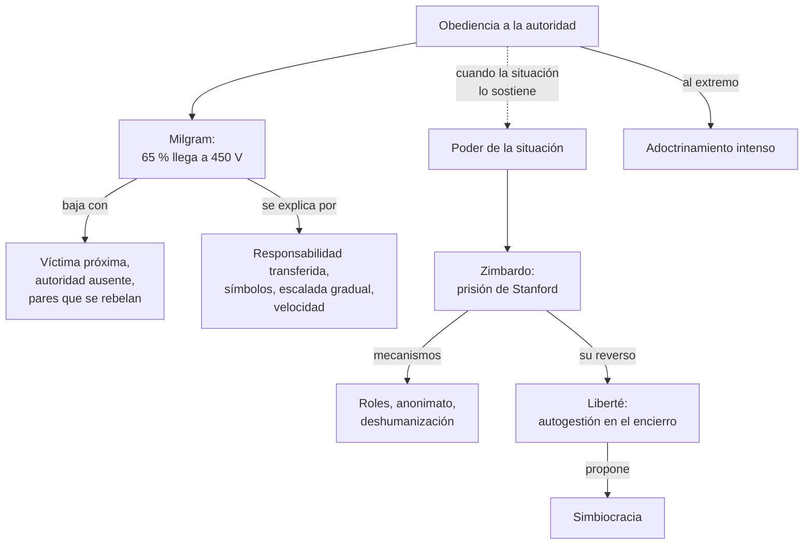
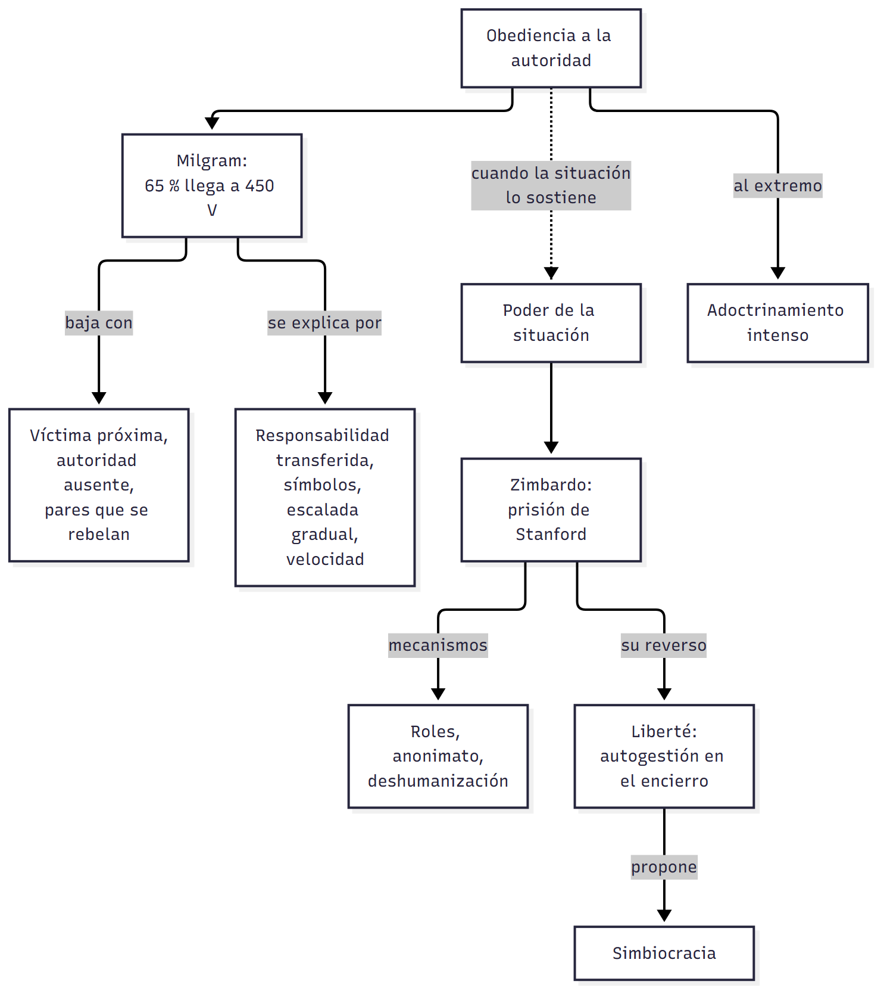
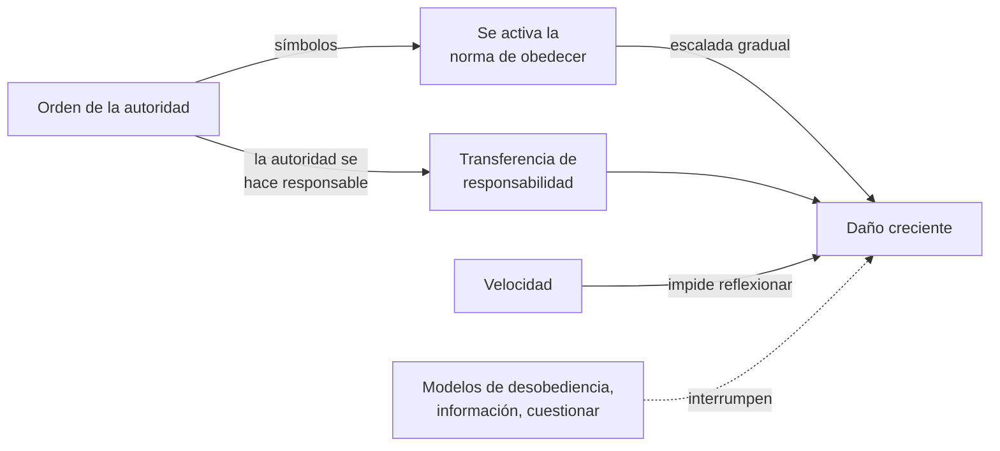
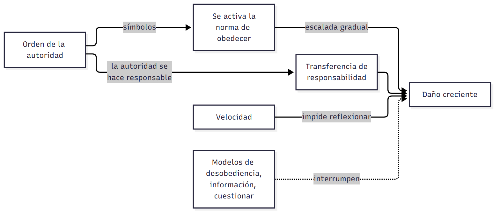
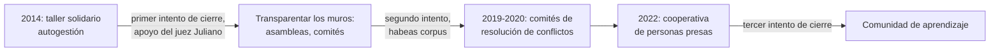
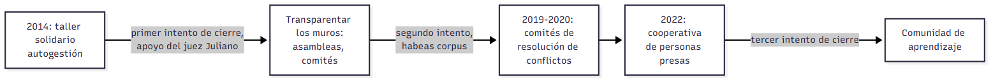

# C07 — Influencia social II: obediencia y poder de la situación · Versión de cursada

> **Fuentes:**
>
> - Baron, R. A., & Byrne, D. (2005). Influencia social: cambiar el comportamiento de los demás. En *Psicología social* (10.ª ed., cap. 9). Pearson Educación.
> - Cátedra de Psicología Social. (2026g). *Influencia social: obediencia a la autoridad. Parte II* [Diapositivas de clase]. Universidad Favaloro.
> - da Costa, S., Delfino, G., Murattori, M., Zubieta, E., García, L., Páez, D., Beramendi, M., & Sosa, F. (2021). Obedience to authority, cognitive and affective responses and leadership style in relation to a non-normative order: The Milgram experiment. *Revista de Psicología, 39*(2).
> - Dos Santos, M. (2015). *El experimento Stanford*. Revista Pensamiento Penal.
> - Perlo, C. L., Carmona Gallego, D., & Carlín, M. C. (2024). El encierro como contexto de aprendizaje: el caso Liberté, el revés del experimento Stanford. *Revista Crítica Penal y Poder, 26*.

> **Aviso sobre las fuentes:** **versión de cursada** (protocolo A): lo que se dio en la clase de influencia social 2 y lo que pide la unidad 6. Las páginas son las de los PDF de la cátedra. Las cifras de las variantes de Milgram salen de las diapositivas. El artículo de **da Costa et al.** está en la carpeta de la clase pero no se dio en las diapositivas: va en versión breve, en §4. Quedan afuera los complementarios del programa que no están en Drive (Canto Ortiz y Álvaro, Levine y Pavelchak, Miller, Zimbardo).

> **Idea-fuerza:** La obediencia es la forma más directa de influencia: alguien ordena y otros cumplen. **Milgram** mostró que personas comunes dañan a un desconocido si una autoridad se lo pide; **Zimbardo** mostró que una situación puede transformar a personas sanas. Son las **fuerzas situacionales**, más que la personalidad, las que explican esas conductas. **Liberté** es el reverso: en el encierro también puede surgir un orden que transforma (Cátedra de Psicología Social, 2026g, diapositivas 2, 4, 20 y 38).

## Mapa: qué pide el programa y qué se dio en clase

| Tema | Programa | Clase | Sección |
|---|---|---|---|
| Investigación de Milgram | ✔ | ✔ | §1 |
| Variables intervinientes y replicaciones | ✔ | ✔ | §2 |
| Obediencia destructiva | ✔ | ✔ | §3 |
| Críticas a Milgram | ✔ | parcial | §4 |
| Experimento de Stanford | ✔ | ✔ | §5 |
| Críticas y limitaciones de Stanford | ✔ | — | §6 (texto) |
| Caso Liberté | ✔ | ✔ | §7 |
| Adoctrinamiento intenso | ✔ | — | §8 (texto) |

---

## 1. El experimento de Milgram

Stanley Milgram, de la Universidad de Yale, parte de una preocupación: el nazismo y las atrocidades de la Segunda Guerra Mundial (Cátedra de Psicología Social, 2026g, diapositiva 2).

**Diseño** (Cátedra de Psicología Social, 2026g, diapositiva 3; Baron y Byrne, 2005, pp. 29-31):

- Se presenta como un estudio sobre memoria. Un sorteo arreglado hace que el participante real sea siempre **profesor** y un cómplice, **aprendiz**.
- El profesor lee pares de palabras y castiga cada error con descargas crecientes, en 30 interruptores de 15 a **450 voltios**. Las descargas no eran reales.
- Si dudaba, el **investigador** insistía con frases escalonadas: «por favor, continúe», «el experimento requiere que continúe», «es absolutamente esencial que continúe», «no tiene alternativa, debe continuar».

**Resultado:** el **65 %** obedeció hasta el final, aunque la víctima golpeara la pared a los 300 voltios y luego dejara de responder (Cátedra de Psicología Social, 2026g, diapositiva 4).

## 2. Variables intervinientes

| Variable | Condición | Obediencia |
|---|---|---|
| **Proximidad de la víctima** | Distanciamiento: en otra habitación, golpea el muro | 65 % |
| | Retroacción de la voz: se la oye suplicar | 63 % |
| | Proximidad: en la misma habitación | 40 % |
| **Autoridad** | Presente | 65 % |
| | Ausente: órdenes por teléfono | 21 % |
| | Institución sin prestigio: oficina, organismo ficticio | 48 % |
| **Grupo** | Dos pares se rebelan | 10 % |
| | El sujeto hace una tarea secundaria y otro aplica las descargas | 95 % |

(Cátedra de Psicología Social, 2026g, diapositivas 5-7)

> 🔑 **Punto clave:** los pares son la variable más poderosa: pueden bajar la obediencia al 10 % o subirla al 95 %. Además, la autoridad no necesita una institución prestigiosa para obtener obediencia.

→ El efecto de los pares que se rebelan recuerda al **disidente** de Asch: `C06_InfluenciaSocialConformidadYCondescendencia_Cursada_Guia.md`, §3.

## 3. Obediencia destructiva

**¿Por qué obedecemos órdenes que dañan a inocentes?** (Cátedra de Psicología Social, 2026g, diapositivas 9-10; Baron y Byrne, 2005, pp. 32-33)

1. **Transferencia de responsabilidad:** «solo seguía órdenes». En Milgram era explícita: el investigador se hacía responsable.
2. **Símbolos de autoridad:** uniformes, insignias y títulos recuerdan la norma de obedecer.
3. **Escalada gradual:** de lo inofensivo a lo dañino, como el pie en la puerta.
4. **Velocidad:** con órdenes rápidas no hay tiempo para reflexionar.

**¿Cómo resistir?** (Cátedra de Psicología Social, 2026g, diapositiva 11): responsabilizar a cada persona, mostrar modelos de desobediencia, cuestionar a la autoridad y estar informados sobre estos procesos.

## 4. Límites y replicaciones

**Ética.** Los participantes sufrieron tensión, y hoy un estudio así sería muy difícil de aprobar en Estados Unidos o en muchos otros países (Baron y Byrne, 2005, p. 32).

**Da Costa et al. (2021).** Con **315 cadetes militares** argentinos, plantearon escenarios inspirados en Milgram y en la masacre de My Lai, una orden contraria a las normas. La gran mayoría, el **81,5 %**, dijo que no dispararía (da Costa et al., 2021, pp. 1 y 10). El estudio trabaja sobre lo que las personas **dicen** que harían: no es una réplica conductual. Sus autores recuerdan que Milgram llamaba **estado agéntico** a sentirse instrumento de otro y no responsable de la orden (p. 4).

> ⚠ **No confundir:** en la **conformidad** nadie ordena y buscamos parecernos al grupo. En la **obediencia** hay una jerarquía y una orden explícita.

## 5. El experimento de la prisión de Stanford

**Diseño.** En agosto de 1971, Philip Zimbardo seleccionó **24 jóvenes** sanos y los dividió en **guardias** y **presos** (Dos Santos, 2015, pp. 1, 3-4).

| | Guardias | Prisioneros |
|---|---|---|
| **Atributos** | Uniforme, silbato, anteojos de sol (anonimato), porra | Detención sorpresa, ojos vendados, desnudados, vestido con número, cadena al tobillo |
| **Formación** | Ninguna: crean su propio código | |

(Cátedra de Psicología Social, 2026g, diapositiva 13)

**Desarrollo** (Cátedra de Psicología Social, 2026g, diapositivas 14-15):

1. Los guardias exploran el rol con recuentos a la madrugada y flexiones como castigo.
2. **Rebelión:** los guardias responden con violencia, con un extintor, desnudando a los presos y humillándolos.
3. **Estrategia psicológica:** las **celdas de privilegio** rompen la solidaridad entre los presos.

**Roles.** Hubo tres tipos de guardias: **duros pero justos**, **buenos** y **hostiles**, arbitrarios e imaginativos, que disfrutaban del poder. Entre los reclusos, el 90 % de las charlas giraba en torno a la prisión: el rol dominaba toda expresión individual (Cátedra de Psicología Social, 2026g, diapositivas 16-17).

**Identificación con el agresor.** Bettelheim usó este concepto para describir a presos de los campos nazis que interiorizaban el poder de sus opresores. La víctima percibe lo que el agresor desea y se identifica con él; ese autoengaño inhibe el afrontamiento y anula la compasión (Cátedra de Psicología Social, 2026g, diapositivas 18-19).

**Fin.** Debía durar 14 días y se canceló al sexto, tras la objeción de Christina Maslach (Dos Santos, 2015, p. 23).

**Conclusiones** (Cátedra de Psicología Social, 2026g, diapositivas 20-21):

- Jóvenes sanos sucumbieron a las **fuerzas situacionales**: roles, normas, anonimato, deshumanización, presión de conformidad e identidad colectiva.
- El poder de la situación crece en **entornos nuevos**, sin directrices previas. Allí la personalidad predice poco.

## 6. Críticas a Stanford

El experimento fue muy cuestionado por antiético y por violar derechos humanos. También se objetó la muestra: 24 personas estudiadas durante pocos días no permiten conclusiones generales (Dos Santos, 2015, pp. 23-24).

> ⚠ **No confundir:** **Milgram** estudia la **obediencia** a una orden explícita. **Zimbardo** estudia cómo un **rol y un contexto** cambian la conducta sin que nadie ordene cada acto.

## 7. Liberté: el revés de Stanford

**Liberté** surgió en 2014 como taller solidario en la Unidad Penal 15 de Batán, por iniciativa de una persona presa, para atender necesidades básicas y derechos vulnerados (Cátedra de Psicología Social, 2026g, diapositivas 22 y 24). Perlo et al. (2024) lo estudian con investigación-acción-participativa (p. 1).

**Interpretación.** En Stanford, cierto orden produce violencia y caos; en Liberté, del caos surge un **nuevo orden**, que amenaza al sistema porque este no quiere ceder control (Cátedra de Psicología Social, 2026g, diapositiva 38). La libertad se entiende como un ejercicio en contacto con otros (diapositiva 39). Las diapositivas informan **reincidencia 0** (diapositiva 37).

**Simbiocracia:** modo organizativo que prioriza la interdependencia y el poder de la trama colectiva, en vez del liderazgo individual. Se apoya en colaboración, confianza, respeto y reconocimiento mutuo, con una arquitectura horizontal (Cátedra de Psicología Social, 2026g, diapositiva 43).

## 8. Adoctrinamiento intenso

Es la influencia llevada al extremo por grupos como el Templo del Pueblo. Tiene cuatro estadios: **ablandamiento** (aislar y desorientar), **condescendencia** (actuar como miembro), **internalización** (aceptar las creencias) y **consolidación** (actos costosos que impiden volver) (Baron y Byrne, 2005, pp. 34-35).

## Para rendir (formato mixto)

**1) Opción múltiple.** En Milgram, la obediencia fue más baja cuando: (a) la víctima estaba en otra sala; (b) se oía la voz de la víctima; (c) **dos pares se rebelaron**; (d) la autoridad estaba presente. — *Respuesta: c.* 10 % (Cátedra de Psicología Social, 2026g, diapositiva 7).

**2) Opción múltiple.** Las celdas de privilegio en Stanford sirvieron para: (a) premiar a los guardias; (b) **romper la solidaridad entre los presos**; (c) cumplir la ética; (d) terminar el estudio. — *Respuesta: b* (Cátedra de Psicología Social, 2026g, diapositiva 15).

**3) Verdadero o falso.** «Una autoridad necesita representar a una institución prestigiosa para lograr obediencia.» — *Falso.* En oficinas de un organismo ficticio obedeció el 48 % (Cátedra de Psicología Social, 2026g, diapositiva 6).

**4) Verdadero o falso.** «El poder de la situación es mayor en entornos nuevos.» — *Verdadero.* No hay directrices previas para guiar la conducta (Cátedra de Psicología Social, 2026g, diapositiva 21).

**5) Pregunta abierta.** *Compará Stanford y Liberté como contextos de encierro.*

> **Esqueleto de la respuesta:** (1) Stanford: orden que produce violencia por roles y anonimato. (2) Liberté: autogestión y comunidad. (3) Tesis común: el contexto moldea la conducta. (4) Diferencia: en Liberté los actores transforman el contexto. (5) Cierre: se conecta con el sujeto activo de C01 (Cátedra de Psicología Social, 2026g, diapositivas 20 y 38).

## Referencias

Baron, R. A., & Byrne, D. (2005). Influencia social: cambiar el comportamiento de los demás. En *Psicología social* (10.ª ed., cap. 9). Pearson Educación.

Cátedra de Psicología Social. (2026g). *Influencia social: obediencia a la autoridad. Parte II* [Diapositivas de clase]. Universidad Favaloro.

da Costa, S., Delfino, G., Murattori, M., Zubieta, E., García, L., Páez, D., Beramendi, M., & Sosa, F. (2021). Obedience to authority, cognitive and affective responses and leadership style in relation to a non-normative order: The Milgram experiment. *Revista de Psicología, 39*(2).

Dos Santos, M. (2015). *El experimento Stanford*. Revista Pensamiento Penal.

Perlo, C. L., Carmona Gallego, D., & Carlín, M. C. (2024). El encierro como contexto de aprendizaje: el caso Liberté, el revés del experimento Stanford. *Revista Crítica Penal y Poder, 26*.
