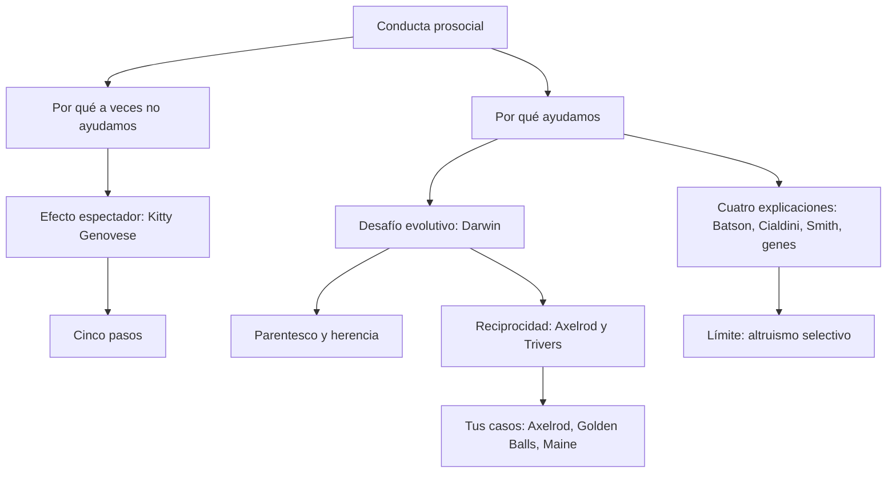
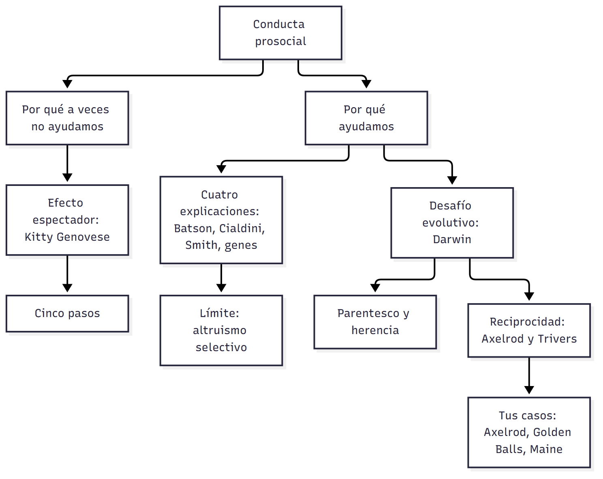
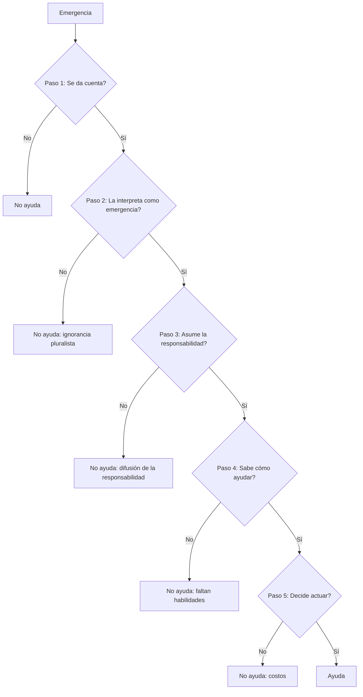
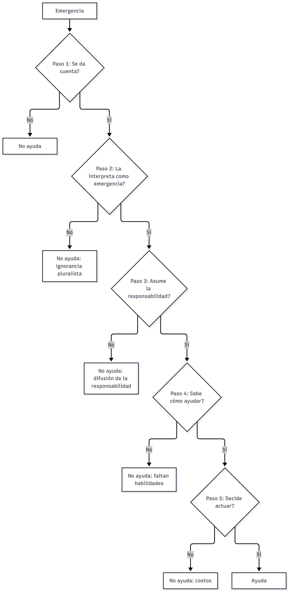

# C08 — Altruismo y conducta prosocial · Versión de cursada

> **Fuentes:**
>
> - Axelrod, R., & Hamilton, W. D. (1981). The evolution of cooperation. *Science, 211*(4489), 1390-1396. https://doi.org/10.1126/science.7466396
> - Baron, R. A., & Byrne, D. (2005). Conducta prosocial: ayudar a otros. En *Psicología social* (10.ª ed., cap. 10). Pearson Educación. [Solo lo que usa el guion]
> - Cátedra de Psicología Social. (2026i). *Altruismo* [Diapositivas de clase, clase 8]. Universidad Favaloro.
> - Rauen, F. J., & Belan, A. B. (2025). Nick and Ibrahim's prisoner's dilemma in *Split or Steal*: Relevance and goal conciliation in *Golden Balls*. *D.E.L.T.A., 41*(3), 1-22. https://doi.org/10.1590/1678-460X202541365621
> - van den Assem, M. J., van Dolder, D., & Thaler, R. H. (2012). Split or steal? Cooperative behavior when the stakes are large. *Management Science, 58*(1), 2-20. https://doi.org/10.1287/mnsc.1110.1413
> - Waring, T., & Acheson, J. (2018). Evidence of cultural group selection in territorial lobstering in Maine. *Sustainability Science, 13*(1), 21-34. https://doi.org/10.1007/s11625-017-0501-x
>
> **Materia:** Psicología Social, 2.º año. Clase 8, Dra. María Eugenia Tabernero. Para el final reducido oral del 10/12.

> **Aviso sobre las fuentes:** esta guía incluye **solo** lo que se dio en la clase de altruismo (diapositivas 4-37) y lo que está en el guion de tu exposición (`C08_AltruismoYConductaProsocial_Oral_Guia.md`). Del capítulo de Baron y Byrne entra únicamente lo que usa el guion: las cuatro explicaciones, el parentesco, la herencia de la empatía, el suricato y el altruismo selectivo. Las páginas son las del PDF de la cátedra. **Queda afuera**, aunque figura en el programa de la unidad 9: atracción y atribuciones, interés propio e hipocresía moral, estado emocional del espectador, empatía afectiva y cognitiva en detalle, personalidad altruista de Bierhoff, funciones del voluntariado, quién recibe ayuda y neurobiología del altruismo. Si la docente pregunta por algo de eso, la guía de desarrollo lo tiene.

> **Idea-fuerza:** la clase pregunta por qué ayudamos y por qué a veces no. La primera parte muestra que la **situación** puede frenar la ayuda (efecto espectador, cinco pasos); la segunda, que el altruismo es un **problema para la evolución**, que se resuelve con el parentesco y la **reciprocidad** (Axelrod, Trivers). Tus tres casos muestran qué pasa con la cooperación según haya o no futuro, reconocimiento y posibilidad de responder.

## Mapa: qué pide el programa, qué se dio en clase y qué usa el guion

| Tema | Origen | Sección |
|---|---|---|
| Definición de conducta prosocial y de altruismo | Clase y programa | 1 |
| Por qué ocurre: tensión interna y voluntariado funcional | Clase | 2 |
| Kitty Genovese y efecto espectador | Clase | 3 |
| Los cinco pasos para ayudar | Clase | 4 |
| Refuerzos y percepción social | Clase | 5 |
| Personalidad y socialización | Clase y programa (diferencias disposicionales) | 6 |
| Las cuatro explicaciones de por qué ayudamos | Programa, en el guion | 7 |
| Altruismo como desafío evolutivo, parentesco, herencia y ambiente | Clase, programa y guion | 8 |
| Axelrod y el altruismo recíproco | Clase, programa y guion | 9 |
| Golden Balls y la langosta de Maine | Guion (tus casos) | 10 |
| Altruismo selectivo | Guion | 11 |

## 1. Conducta prosocial y altruismo

**El marco de la clase.** La psicología social estudia la influencia de los grupos en el psiquismo individual, los comportamientos que surgen de la interacción (atracción, normas, agresión) y los grupos y sus dinámicas (liderazgo, normas, cohesión). Tiene una vertiente **psicológica**, que investiga cómo el psiquismo resulta de la relación con grupos como la familia, la escuela o los amigos, y una **sociológica**, que usa el saber psicológico para explicar problemas sociales (Cátedra de Psicología Social, 2026i, diapositivas 2-3). Las conductas prosociales son objeto de estudio de la psicología social.

La **conducta prosocial** es, para la clase, toda conducta social positiva, **con o sin motivación altruista** (Cátedra de Psicología Social, 2026i, diapositiva 6). Las diapositivas suman otras definiciones:

- **Roche (1991):** comportamientos que, **sin buscar una recompensa externa**, favorecen a otros según el criterio de esos otros y aumentan la probabilidad de una **reciprocidad positiva** (diapositiva 5).
- **Garaigordobil (2000):** «una conducta positiva que se realiza para beneficiar a otro» (diapositiva 5).
- **Vander Zanden (1990):** responder con simpatía, cooperación, ayuda, rescate, confortamiento o generosidad (diapositiva 6).
- **Marín Escobar (2010):** acciones de ayuda sin interés ni recompensa esperada; son **complejas** porque combinan elementos **cognitivos y afectivos** (diapositiva 7).
- **Sinónimos:** cooperación, altruismo, ayuda, conductas solidarias. El interés creció hacia los 2000, también por la necesidad de prevenir conductas agresivas (diapositiva 4).

El **altruismo**, en sentido biológico, es la conducta que beneficia a otro organismo **no emparentado** en aparente detrimento propio (diapositiva 31).

> **Esqueleto de la respuesta:** 1. Prosocial: toda conducta social positiva, con o sin motivo altruista (diap. 6). 2. Altruismo biológico: beneficia a un no pariente a costa propia (diap. 31). 3. Todo acto altruista es prosocial; no al revés. 4. El altruismo es un problema para la evolución (sección 8).

> ⚠ **No confundir:** «prosocial» describe el **efecto** (beneficia a otro); «altruista», el **motivo** y el **costo propio**.

## 2. Por qué ocurre: tensión interna y voluntariado funcional

- **Motivación:** es lo que lleva a una acción. La acción altruista puede deberse a una gran **tensión interna** de quien ayuda: en situaciones extremas, una persona puede renunciar a su propio instinto de supervivencia por otro. Siente una exaltación desagradable que la obliga a reducirla, y eso depende de su **implicación afectiva y física** (diapositiva 8).
- **Voluntariado funcional:** la conducta voluntaria satisface una motivación específica: sentirse mejor con uno mismo, lavar culpas, sentirse obligado (diapositiva 9).

> ⚠ **No confundir:** las dos ideas dicen que ayudar también **le sirve a quien ayuda**. Conectan con el modelo del alivio de un estado negativo (sección 7).

## 3. Kitty Genovese y el efecto espectador

En 1964, Kitty Genovese fue asesinada en Nueva York ante numerosos testigos que no intervinieron; la clase lo trabajó con dos videos (diapositivas 10-11). De ahí surgió el **efecto espectador**: a medida que aumenta el número de espectadores de una emergencia, **disminuye la probabilidad de una respuesta prosocial** (diapositiva 12).

**El experimento (Darley y Latané, 1968):** los participantes oían por interfono la grabación de un supuesto estudiante que sufría un ataque. Había tres condiciones: 2 personas (el participante y la víctima), 3 personas y 6 personas. Se midieron el **porcentaje** que ayudó y el **tiempo** hasta ofrecer ayuda (diapositiva 12). Resultados: solos, casi todos ayudaron y casi de inmediato; con 3 personas, la ayuda bajó notablemente; con 6, muy pocos hicieron algo, y los que creían que había más testigos tardaban mucho más, hasta varios minutos (diapositiva 13).

> **Esqueleto de la respuesta:** 1. Kitty Genovese y los testigos que no actuaron. 2. Definición del efecto espectador. 3. El experimento: grabación, 2, 3 o 6 personas, dos variables. 4. Resultado: más testigos, menos ayuda y más demora. 5. No es apatía: la responsabilidad se diluye (paso 3).

> ⚠ **No confundir:** el **efecto espectador** es el fenómeno; la **difusión de la responsabilidad** es una explicación (paso 3) y la **ignorancia pluralista**, otra (paso 2).

## 4. Los cinco pasos para ayudar ante una emergencia

| Paso | Qué hace falta | Qué lo frena | Ejemplo de la clase |
|---|---|---|---|
| 1. Darse cuenta | Notar lo que ocurre | Exceso de estímulos, preocupaciones personales | Seminaristas: ayudó el 63 % de los que tenían tiempo y el 10 % de los apurados |
| 2. Interpretar como emergencia | Reconocerla como grave | Ambigüedad, influencia social, **ignorancia pluralista**, miedo al ridículo | Humo en la habitación: avisó el 75 % de los que estaban solos y el 38 % de los que estaban con otros que no reaccionaban |
| 3. Asumir la responsabilidad | Sentir el deber de actuar | **Difusión de la responsabilidad**: «alguien más se encargará» | Solo, asumís el deber; con muchos, la obligación disminuye |
| 4. Saber cómo ayudar | Habilidades | No saber qué hacer | RCP, primeros auxilios, natación: los formados intervienen más |
| 5. Decidir actuar | Evaluar riesgos y beneficios | Temor al daño, vergüenza, riesgo de empeorar la situación | «Álgebra cognitiva» de costos |

Fuente: Cátedra de Psicología Social (2026i, diapositivas 14-18). Conclusión del paso 1: sin conciencia de la emergencia no hay ayuda posible (diapositiva 14).

> **Esqueleto de la respuesta:** los cinco pasos en orden, con un ejemplo en el 1 (seminaristas) y en el 2 (humo); ubicar la ignorancia pluralista en el 2 y la difusión en el 3; cierre: en cada paso, no hacer nada es lo más fácil.

> ⚠ **No confundir:** el **humo** es el ejemplo de la **ignorancia pluralista** (paso 2), no de la difusión de la responsabilidad.

## 5. Refuerzos y percepción social

- **Teoría de los refuerzos (Skinner, 1973):** si a una conducta le sigue una consecuencia que la refuerza, es más probable que se repita; buenas o malas, las conductas frecuentes están reforzadas y son difíciles de extinguir (diapositiva 19). Las conductas prosociales con **refuerzos explícitos** (frases, aprobación) se perpetúan; si no, desaparecen. Un grupo presente puede actuar como **estímulo discriminativo** que precipita la ayuda (diapositiva 20).
- **Percepción social:** percibimos e interpretamos los hechos sociales con esquemas que condicionan cómo actuamos (diapositiva 21). Cuatro variables: las características del **perceptor** (aprendizajes previos, percepción sesgada), las de la **persona percibida** (más transparente o más cerrada), la **relación** entre ambos (cercanía, vínculo) y el **contexto situacional** (diapositivas 22-24). Se actúa según la interpretación que se hace del hecho, que se configura con experiencias, refuerzos y condicionantes del ambiente (diapositiva 25).

> ⚠ **No confundir:** el grupo **frena** la ayuda en el efecto espectador, pero en la teoría de los refuerzos puede **precipitarla** como estímulo discriminativo. Depende de lo que el grupo haga y apruebe.

## 6. Personalidad y socialización

- **Personalidad:** estructura más o menos estable, con elementos afectivos, volitivos, motivacionales y cognitivos, que recibe influencias biológicas, sociales, culturales e históricas (diapositiva 26).
- **London (1970):** quienes ayudaban a judíos a escapar del nazismo compartían espíritu de aventura, el sentirse marginados en su sociedad, una estrecha identificación con un progenitor de firmes convicciones morales y empatía: se identificaban con quienes ayudaban (diapositiva 27).
- **Extensividad:** sentir empatía y responsabilidad por miembros de un grupo que no es el propio (diapositiva 28).
- **Predictores:** **no hay un rasgo** que prediga la conducta prosocial, porque influyen el contexto y la interacción. Las niñas son más prosociales que los varones, y la calidad del vínculo con la madre es un predictor; los chicos con mayor apego, también; en adultos argentinos, la extraversión (diapositiva 29).
- **Socialización:** medio por el que una estructura social induce a sus miembros a compartir sus normas. Las conductas altruistas pueden enseñarse, como las agresivas o la indiferencia, primero en la familia y luego en la escuela, en un equilibrio entre funciones nutritivas y normativas (Díaz Usandivaras, 2000, citado en diapositiva 30).

> **Esqueleto de la respuesta:** 1. Personalidad como estructura estable. 2. London y los rescatadores. 3. Extensividad. 4. No hay un rasgo único: predictores. 5. La socialización enseña la prosocialidad.

## 7. Por qué ayudamos: las cuatro explicaciones

Baron y Byrne (2005, p. 37) ordenan cuatro teorías: las tres primeras ponen el acento en la **emoción** de quien ayuda; la cuarta, en los **genes**. Es lo que desarrolla tu guion.

- **Empatía-altruismo (Batson):** algunos actos prosociales están motivados **solo** por el deseo de ayudar (p. 37). Un participante veía por televisión a una estudiante que recibía descargas y contaba un trauma infantil con la electricidad; podía tomar su lugar o terminar. Con **empatía baja** (víctima distinta), terminaban; con **empatía alta** (víctima parecida), **aceptaban las descargas** (Batson et al., 1983, y Toi y Batson, 1982, citados en Baron y Byrne, 2005, p. 38).
- **La crítica de Cialdini:** la empatía lleva a ayudar solo si hay **superposición entre uno y el otro**; si el otro es parte de mi autoconcepto, al ayudarlo me ayudo a mí. Batson respondió con evidencia de que esa unidad no es necesaria (p. 38).
- **Alivio de un estado negativo (Cialdini):** ayudamos para **dejar de sentirnos mal**, venga de donde venga el malestar; la empatía no es necesaria (pp. 39-40).
- **Alegría empática (Smith, Keating y Stotland):** ayudamos para sentir que **logramos algo**. Al aconsejar a una estudiante que pensaba dejar la universidad, la empatía sola no alcanzó: hacía falta saber que el consejo iba a tener efecto (p. 40).
- **Determinismo genético:** ayudamos, sin saberlo, a quien comparte nuestros genes (pp. 40-42). Ver sección 8.
- **Conclusión de los autores:** ayudamos por una **variedad de motivos**, en parte egoístas y en parte desinteresados (pp. 37 y 42).

> **Esqueleto de la respuesta:** 1. Cuatro teorías: tres emocionales y una genética. 2. Batson con el experimento de las descargas. 3. La crítica de Cialdini. 4. Alivio y alegría empática. 5. Genes. 6. Variedad de motivos.

> ⚠ **No confundir:** en Batson el fin es el **bienestar del otro**; en el alivio, **mi malestar**; en la alegría empática, **mi sentimiento de logro**. La alegría empática es de **Smith, Keating y Stotland**, no de Batson.

## 8. El altruismo como desafío evolutivo: parentesco, herencia y ambiente

- **El problema:** el altruismo no beneficia al individuo sino al grupo. **Darwin:** el individuo es egoísta y el grupo, altruista; si la competencia entre grupos es mayor que entre individuos, se seleccionan los grupos con más altruistas (diapositivas 31-32).
- **Parentesco:** cuanto mayor la similitud genética, más probable la ayuda, en varias especies (Ridley y Dawkins, 1981, citados en Baron y Byrne, 2005, p. 42). En decisiones hipotéticas, se ayuda más a **parientes cercanos** que a lejanos o no parientes, y más a parientes **jóvenes**: más a una pariente en edad de tener hijos que a una posmenopáusica (Burnstein et al., 1994, citados en Baron y Byrne, 2005, p. 42).
- **¿Hay un gen de la ayuda?** No: Buck y Ginsberg (1991) no lo encontraron; se heredan **capacidades** para comunicar emociones y formar vínculos (Baron y Byrne, 2005, p. 42). En más de 800 pares de gemelos y mellizos, la herencia explica alrededor de **un tercio** de la empatía afectiva y nada de la cognitiva; el resto depende del **ambiente** (Davis et al., 1994, citados en Baron y Byrne, 2005, p. 24).
- **El suricato:** el centinela parecía altruista, pero primero come y es el primero en ver al depredador y escapar. El entusiasmo por las explicaciones evolucionistas puede llevar a una **percepción selectiva** (Clutton-Brock et al., 1999, citados en Baron y Byrne, 2005, pp. 41-42).
- **Reciprocidad:** el parentesco no explica que ayudemos a extraños; eso lo explica el **altruismo recíproco** (sección 9).

> ⚠ **No confundir:** el **parentesco** explica la ayuda a **familiares**; la **reciprocidad**, la ayuda a **no parientes**.

## 9. Axelrod, Trivers y el altruismo recíproco

- **Juegos:** son modelos de situaciones de conflicto y cooperación. En el **dilema del prisionero**, dos detenidos incomunicados pueden callar (**lealtad**) o delatar al otro (**traición**) para reducir su pena (diapositiva 33). Si el otro coopera, me conviene traicionar; si traiciona, también; pero si los dos traicionamos, quedamos peor que cooperando. En **una sola jugada**, traicionar es la única estrategia estable (Axelrod y Hamilton, 1981, pp. 3-4).
- **El torneo de Axelrod:** dilema repetido de **200 jugadas**; compitieron **14** estrategias más una aleatoria. Ganó la más simple, **TIT FOR TAT**, de Anatol Rapoport; en la segunda ronda, con **62** estrategias, volvió a ganar (Axelrod y Hamilton, 1981, p. 5).
- **TIT FOR TAT** («toma y daca»): coopera en la primera jugada y después copia la jugada anterior del rival; responde una sola vez a la traición y vuelve a cooperar (diapositiva 34). Gana porque **nunca traiciona primero, responde y perdona** (Axelrod y Hamilton, 1981, p. 5).
- **Conclusión:** entre individuos interesados en su propio bienestar, la mejor jugada no es traicionar sino **cooperar**; la cooperación surge entre egoístas (diapositivas 34-35). Los individuos emparentados también comparten rasgos conductuales heredados, como jugar TIT FOR TAT (diapositiva 35).
- **Trivers (altruismo recíproco):** el costo del acto altruista se compensa con creces con la reciprocidad. La selección favorece a quienes cooperan selectivamente con los que cooperan, y castiga a los **tramposos**, siempre que se los pueda discriminar (diapositiva 36).
- **Condiciones en humanos:** larga expectativa de vida, la **«sombra del futuro»**; bajo promedio de dispersión; y grupos pequeños, estables y muy interdependientes (diapositiva 37). El traidor no tiene que poder perderse en un mar anónimo (Axelrod y Hamilton, 1981, p. 7).

> **Esqueleto de la respuesta:** 1. Dilema del prisionero: en una sola jugada conviene traicionar. 2. Torneo: 200 jugadas, gana TIT FOR TAT. 3. Sus tres rasgos. 4. Trivers: reciprocidad y tramposos. 5. Condiciones: sombra del futuro, poca dispersión, grupos estables. 6. No hace falta ser bueno para cooperar.

## 10. Tus casos: Golden Balls y la langosta de Maine

**Golden Balls: una sola jugada, sin futuro.**
- Dos finalistas eligen en secreto **dividir o robar** el pozo: si los dos dividen, mitad cada uno; si uno roba, se lleva todo; si los dos roban, nadie gana. Robar nunca da menos (van den Assem et al., 2012, pp. 2-3).
- En 287 episodios, cada jugador dividió el **53 %** de las veces; quien había recibido el voto del rival para echarlo cooperó menos: reciprocidad (van den Assem et al., 2012, p. 3).
- **Nick e Ibrahim** (£13.600): Nick anunció que iba a robar y prometió repartir después; Ibrahim terminó dividiendo, y **Nick también dividió**: £6.800 cada uno (Rauen y Belan, 2025, pp. 1, 5 y 10-15).
- **Lectura:** en una sola jugada, Axelrod predice traición. Nick **cambió la estructura** del juego: creó un compromiso por fuera y le pasó la decisión a Ibrahim. Fue prosocial, con un motivo más estratégico que empático.

**La langosta de Maine: todo el futuro.**
- La langosta es un **recurso común**: cada pescador gana pescando más, y el grupo pierde si todos lo hacen (Waring y Acheson, 2018, p. 2).
- **Bandas de puerto** de 8 a 50 barcos defienden territorios no oficiales: al intruso le cortan las trampas, aunque sea ilegal y arriesgado (p. 2). Es **cooperación costosa**: beneficia al grupo y le cuesta al individuo. Sancionan a quien saca langostas chicas o hembras con huevos (pp. 5-6).
- En los 70, cuatro islas se fijaron límites de trampas; en 1995, la ley creó **siete zonas** que adoptaron esas prácticas (pp. 3, 8 y 11).
- **Lectura:** se cumplen las condiciones de Axelrod y Trivers: vecinos estables que se reencuentran, se reconocen y pueden castigar. La **territorialidad** favorece la cooperación (Axelrod y Hamilton, 1981, p. 7), y prosperan las bandas que cooperan: selección entre grupos, como en Darwin (diapositiva 32).

| | Torneo de Axelrod | Golden Balls | Langosta de Maine |
|---|---|---|---|
| **¿Se vuelven a encontrar?** | Sí, 200 jugadas | No, una sola | Sí, toda la vida |
| **¿Pueden responder?** | Sí, en la jugada siguiente | No | Sí: cortan trampas y excluyen |
| **¿Qué sostiene la cooperación?** | Reciprocidad | Promesas, normas y estrategia | Normas, castigo y control del grupo |
| **¿Qué motivo predomina?** | Interés propio a largo plazo | Estrategia | Interés del grupo, con costo propio |

## 11. Un límite: el altruismo selectivo

Con recursos limitados para ayudar a un grupo, lo mejor es repartirlos de forma equitativa. Pero el **egoísmo** («primero yo») y la **empatía dirigida a un solo miembro** llevan al mismo resultado: el grupo queda desatendido y se pierde el **bien común**. Es mucho más fácil juntar ayuda para un niño con nombre y foto que para miles de niños desnutridos (Batson et al., 1999, citados en Baron y Byrne, 2005, p. 39). La empatía, que en Batson era la fuente del altruismo puro, no alcanza para un dilema social: lo que sostiene el recurso común de la langosta son reglas, control y sanción que valen para todos.

> ⚠ **No confundir:** el altruismo selectivo **se elogia** y el egoísmo **se desaprueba**, pero los dos amenazan el bien común.

## Para rendir (oral: preguntas probables con respuesta breve)

1. **¿Qué diferencia hay entre conducta prosocial y altruismo?** La prosocial es toda conducta social positiva, con o sin motivo altruista; el altruismo beneficia a otro no emparentado a costa propia. Todo acto altruista es prosocial, no al revés (sección 1).
2. **¿Qué es el efecto espectador y cómo se probó?** A más testigos, menos ayuda y más demora. Darley y Latané: grabación de un estudiante con un ataque, 2, 3 o 6 personas; solos, casi todos ayudaron enseguida (sección 3).
3. **¿Cuáles son los cinco pasos?** Darse cuenta, interpretar, asumir la responsabilidad, saber cómo ayudar y decidir; seminaristas en el 1 (63 % frente a 10 %) y humo en el 2 (75 % frente a 38 %) (sección 4).
4. **¿Qué es la ignorancia pluralista?** Ante la ambigüedad, cada uno mira a los demás, nadie reacciona y todos concluyen que no es grave: frena el paso 2 (sección 4).
5. **¿Qué aporta la teoría de los refuerzos?** Las conductas prosociales reforzadas se mantienen; el grupo puede funcionar como estímulo discriminativo que precipita la ayuda (sección 5).
6. **¿Hay una personalidad altruista?** London encontró rasgos comunes en rescatadores (aventura, marginación, un progenitor con firmes convicciones, empatía), pero no hay un rasgo único: influyen el contexto y la interacción (sección 6).
7. **¿Existe el altruismo puro?** Batson dice que sí (descargas); Cialdini, que la empatía funciona por superposición entre uno y el otro. Baron y Byrne: variedad de motivos (sección 7).
8. **¿Por qué el altruismo es un problema para la evolución y cómo se resuelve?** Porque cuesta al individuo. Darwin: selección entre grupos; parentesco (Burnstein); reciprocidad (Trivers) (secciones 8-9).
9. **¿La empatía es hereditaria?** En parte: un tercio de la empatía afectiva, nada de la cognitiva; no hay un gen de la ayuda (sección 8).
10. **¿Por qué gana TIT FOR TAT?** Nunca traiciona primero, responde y perdona; funciona si hay sombra del futuro (sección 9).
11. **¿Lo de Nick fue altruismo?** Prosocial seguro, altruista dudoso: una sola jugada, compromiso por fuera, motivo más estratégico (sección 10).
12. **¿Qué es el altruismo selectivo?** Empatía dirigida a uno que deja al grupo desatendido; el ejemplo del niño con nombre y foto (sección 11).

## Referencias

Axelrod, R., & Hamilton, W. D. (1981). The evolution of cooperation. *Science, 211*(4489), 1390-1396. https://doi.org/10.1126/science.7466396

Baron, R. A., & Byrne, D. (2005). Conducta prosocial: ayudar a otros. En *Psicología social* (10.ª ed., cap. 10). Pearson Educación.

Cátedra de Psicología Social. (2026i). *Altruismo* [Diapositivas de clase, clase 8]. Universidad Favaloro.

Rauen, F. J., & Belan, A. B. (2025). Nick and Ibrahim's prisoner's dilemma in *Split or Steal*: Relevance and goal conciliation in *Golden Balls*. *D.E.L.T.A., 41*(3), 1-22. https://doi.org/10.1590/1678-460X202541365621

van den Assem, M. J., van Dolder, D., & Thaler, R. H. (2012). Split or steal? Cooperative behavior when the stakes are large. *Management Science, 58*(1), 2-20. https://doi.org/10.1287/mnsc.1110.1413

Waring, T., & Acheson, J. (2018). Evidence of cultural group selection in territorial lobstering in Maine. *Sustainability Science, 13*(1), 21-34. https://doi.org/10.1007/s11625-017-0501-x
