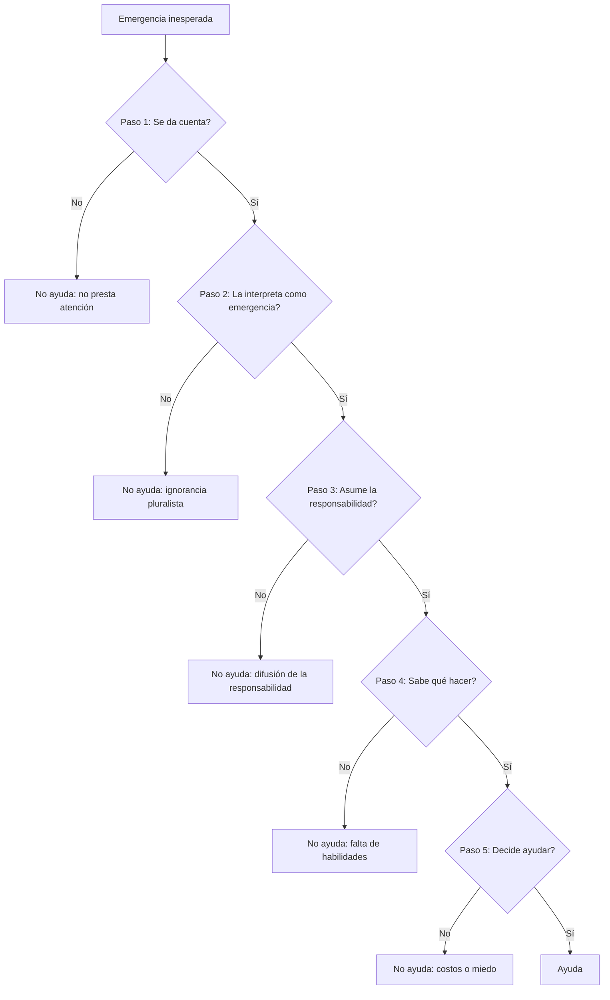
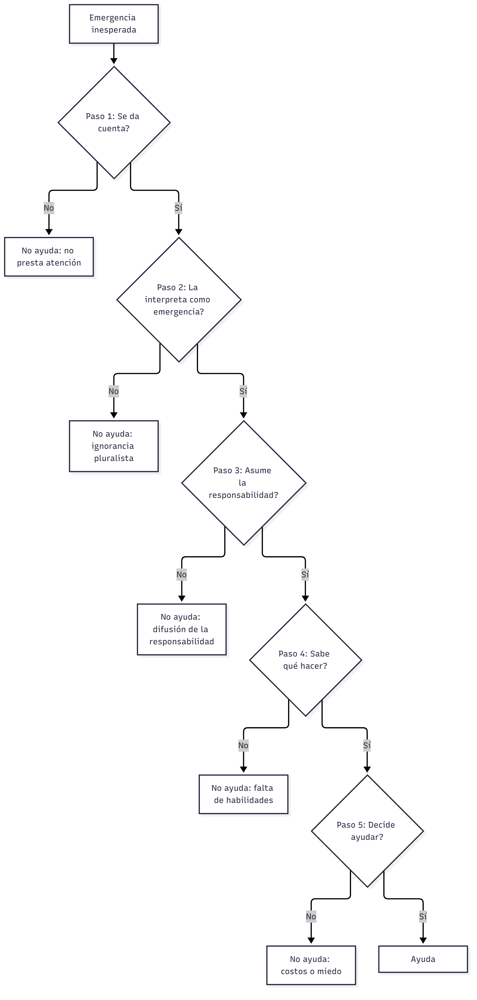
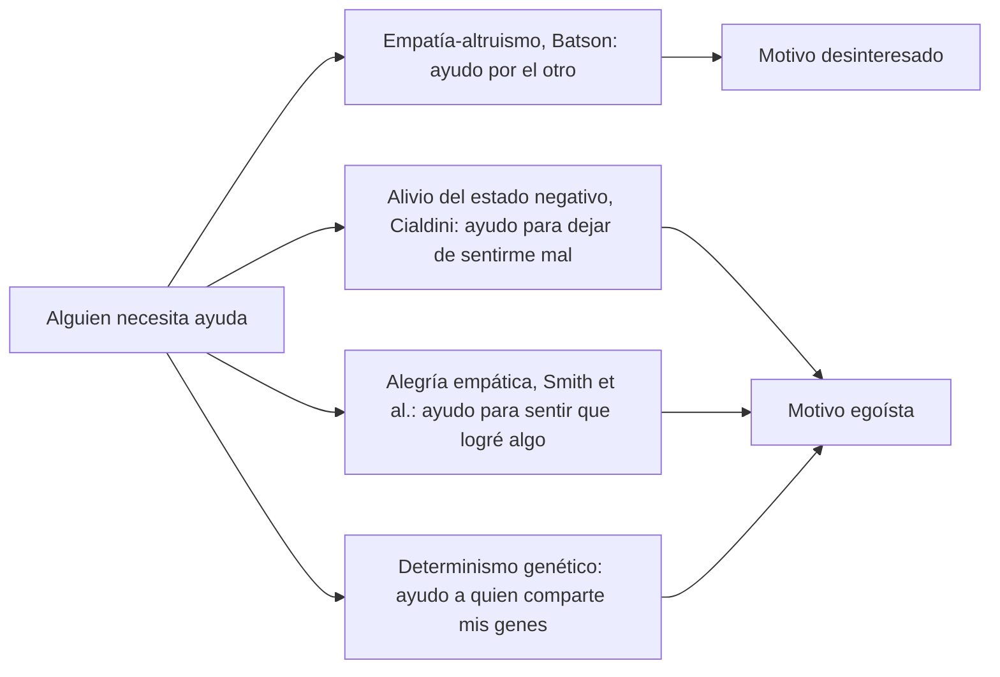
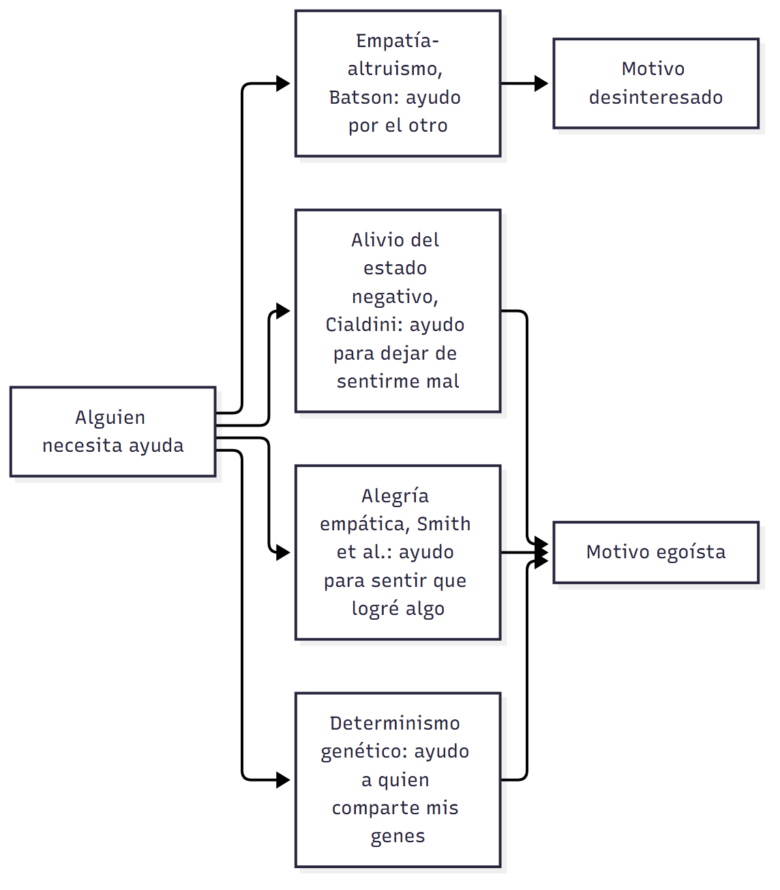
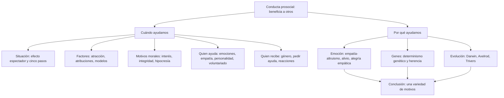
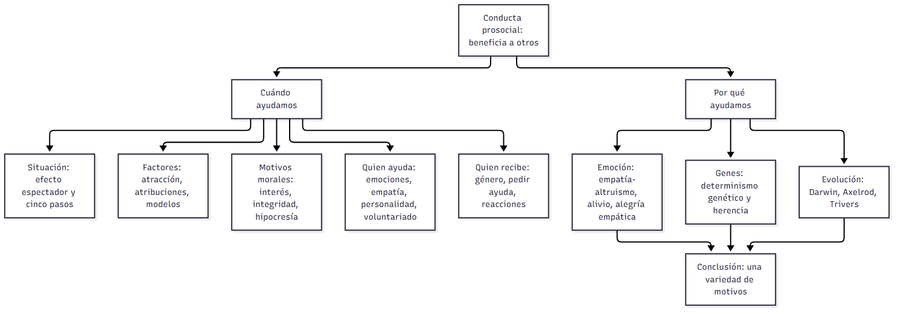

# Unidad 9 — Altruismo y conducta prosocial · Guía de desarrollo

> **Fuentes:**
>
> - Baron, R. A., & Byrne, D. (2005). Conducta prosocial: ayudar a otros. En *Psicología social* (10.ª ed., cap. 10, pp. 397-443). Pearson Educación. [Bibliografía obligatoria de la unidad 9]
> - Cátedra de Psicología Social. (2026h). *Neurociencia social* [Diapositivas de clase, clase 8]. Universidad Favaloro.
> - Cátedra de Psicología Social. (2026i). *Altruismo* [Diapositivas de clase, clase 8]. Universidad Favaloro.
> - Cátedra de Psicología Social. (2026n). *Información acerca del recuperatorio y el final* [Documento de cátedra]. Universidad Favaloro.
> - Grande-García, I. (2009). Neurociencia social: una breve introducción al estudio de las bases neurobiológicas de la conducta social. *Psicología y Ciencia Social, 11*(1-2). [Bibliografía de la unidad 7; se usa solo en la pregunta 11]
> - Universidad Favaloro. (2025). *Programa de Psicología Social* [Programa de la asignatura]. Unidad 9.
>
> **Materia:** Psicología Social, 2.º año, 2.º cuatrimestre de 2026. Docente a cargo de la clase 8: Dra. María Eugenia Tabernero. Para qué: el **final reducido oral** del 10/12, donde las preguntas son solo sobre el tema elegido.

> **Aviso sobre las fuentes:** las páginas de Baron y Byrne (2005) son las del **PDF de la cátedra** (p. 1 a 48). Para pasar a la página del libro, sumá 396 (p. 5 del PDF = p. 401 del libro). El PDF se pasó a texto con OCR y está a dos columnas; las cifras se controlaron contra el texto, pero las de los gráficos (figuras 10.2 y 10.4) no se leen bien: se usan solo las que el texto dice con palabras. Casi todos los estudios se conocen **a través de Baron y Byrne**: en el oral decí «Darley y Latané (1968), citados por Baron y Byrne». El programa pide **neurobiología del altruismo**, pero ni el capítulo 10 ni las diapositivas de altruismo la desarrollan: la pregunta 11 se arma con la base biológica de la empatía del capítulo y con la clase de neurociencia social, y lo dice. La bibliografía complementaria del programa (Escobar, 2010; Martínez, 2003; Midlarsky y Kahana, 2007; Phillips et al., 2010) **no está en el repositorio**; si la leés, sumala como plus para el «8 a 10» (bibliografía complementaria, creatividad y originalidad).

> **Idea-fuerza:** ayudar a un extraño no depende solo de ser «buena persona». Depende de la **situación** (cuántos miran, si es ambigua, si hay modelos), de **cómo la interpretamos** (atribuciones, atracción), del **estado emocional** y de **disposiciones** como la empatía. Y cuando ayudamos, los motivos se mezclan: unos egoístas (sentirse mejor, transmitir los genes) y otros desinteresados (la empatía de Batson). Baron y Byrne cierran así: ayudamos «por una variedad de motivos», y personas distintas en situaciones distintas ayudan por razones distintas (Baron y Byrne, 2005, p. 42).

## Hilo conductor: cómo se conectan los temas de esta guía

La unidad responde a dos preguntas que el capítulo separa con claridad: **¿cuándo ayudamos?** y **¿por qué ayudamos?** (Baron y Byrne, 2005, p. 36). La primera mira la situación, la persona que ayuda y la que recibe; la segunda, la motivación.

Todo empieza por una **definición** (pregunta 1): la conducta prosocial es cualquier acto que beneficia a otros; el altruismo, la preocupación desinteresada por el bienestar ajeno. La diferencia importa, porque el capítulo entero gira alrededor de si existe el altruismo puro.

El estudio científico arrancó con un fracaso de la ayuda: el asesinato de **Kitty Genovese** y el **efecto espectador** (pregunta 2). Darley y Latané propusieron que, con más testigos, la responsabilidad se diluye. De ahí salió el **modelo de los cinco pasos** (pregunta 3): darse cuenta, interpretar, asumir la responsabilidad, saber qué hacer y decidir. Cada paso es un lugar donde la ayuda se puede cortar. Sobre esos pasos actúan **factores situacionales** (pregunta 4): la atracción por la víctima, las atribuciones sobre su responsabilidad y los modelos prosociales. Y actúa un factor **motivacional y moral** (pregunta 5): interés propio, integridad moral o hipocresía moral.

Después el foco pasa a **quien ayuda**: su **estado emocional** (pregunta 6), que puede estimular o inhibir la ayuda según la situación, y sus **diferencias disposicionales** (pregunta 7): la empatía, con sus componentes afectivo y cognitivo, su herencia y su desarrollo, y la **personalidad altruista**. La ayuda que dura en el tiempo es el **voluntariado** (pregunta 8), que se explica por funciones distintas en cada persona. Del otro lado está **quien recibe ayuda** (pregunta 9): quién la recibe más, por qué conviene pedirla y por qué recibirla a veces cae mal.

La segunda gran pregunta, **por qué ayudamos**, tiene cuatro respuestas (pregunta 10): empatía-altruismo, alivio de un estado negativo, alegría empática y determinismo genético. Las tres primeras se apoyan en la emoción; la cuarta, en los genes. La pregunta 10 incluye el debate Batson-Cialdini y el **altruismo selectivo**. El **papel de la herencia y del ambiente** y el determinismo genético (pregunta 11) llevan a la base biológica de la empatía y a lo que la neurociencia social dice sobre ella. Por último, la clase presentó el altruismo como un **desafío para la evolución** y lo resolvió con el **altruismo recíproco** (pregunta 12): Darwin, Axelrod y Trivers, el puente con tus tres casos de la exposición.

El círculo se cierra en la conclusión de los autores: la situación decide **cuándo** ayudamos, y los motivos de **por qué** ayudamos se mezclan.

> 🎯 **Para el parcial:** en cualquier respuesta, ubicá el tema en una de las dos preguntas («esto explica **cuándo** ayudamos» o «esto explica **por qué**»). Y siempre que puedas, nombrá un experimento con su resultado: la cátedra anotó que el examen usa «algunos experimentos paradigmáticos como articuladores de lo teórico».

**En una sola oración:** ayudamos cuando la situación nos deja notar, interpretar, asumir y resolver la necesidad del otro, y lo hacemos por una mezcla de motivos egoístas y desinteresados que la psicología social no termina de separar.

## 0. Hoja de ruta

1. **Definiciones (Baron y Byrne, p. 3; diapositivas 4-7 y 31):** conducta prosocial y altruismo.
2. **Kitty Genovese y el efecto espectador (pp. 4-6; diapositivas 10-13):** difusión de la responsabilidad.
3. **Los cinco pasos (pp. 7-12; diapositivas 14-18):** seminaristas, humo, ignorancia pluralista.
4. **Factores situacionales (pp. 12-17):** atracción, atribuciones y modelos prosociales.
5. **Interés propio, integridad moral e hipocresía moral (pp. 17-19).**
6. **Estado emocional de quien ayuda (pp. 20-22).**
7. **Diferencias disposicionales: empatía y personalidad altruista (pp. 21-28; diapositivas 26-30).**
8. **Voluntariado (pp. 28-31; diapositiva 9).**
9. **Quién recibe ayuda y cómo responde (pp. 32-35).**
10. **Por qué ayudamos: las cuatro explicaciones (pp. 36-40).**
11. **Herencia, ambiente, determinismo genético y bases neurobiológicas (pp. 24 y 40-42; Grande-García, 2009).**
12. **El altruismo como desafío evolutivo y el altruismo recíproco (diapositivas 31-37).**

## 🎯 Lo que entra sí o sí

1. **Conducta prosocial ≠ altruismo:** la primera es cualquier acto que beneficia a otros; el segundo, la preocupación desinteresada por su bienestar. Quizás ninguna conducta sea puramente altruista (Baron y Byrne, 2005, p. 3).
2. **Efecto espectador y difusión de la responsabilidad:** a más testigos, menos probabilidad de ayuda y más demora (Darley y Latané, 1968, en Baron y Byrne, 2005, pp. 5-6).
3. **Los cinco pasos** de Latané y Darley (1970), con un experimento por paso: seminaristas apurados (10 % ayudó) y humo (75 % solos frente a 38 %) (Baron y Byrne, 2005, pp. 7-12).
4. **Ignorancia pluralista:** nadie sabe qué pasa, todos miran a los demás y nadie actúa (Baron y Byrne, 2005, p. 10).
5. **Interés propio, integridad moral e hipocresía moral**, con el experimento de la moneda (Batson et al., en Baron y Byrne, 2005, pp. 17-18).
6. **Empatía afectiva y cognitiva** y la **personalidad altruista** de Bierhoff et al. (1991): empatía, mundo justo, responsabilidad social, locus de control interno y bajo egocentrismo (Baron y Byrne, 2005, pp. 21-28).
7. **Las cuatro explicaciones de por qué ayudamos**, con el experimento de las descargas de Batson y la crítica de Cialdini (Baron y Byrne, 2005, pp. 36-40).
8. **Altruismo recíproco** (Trivers) y la evolución de la cooperación (Axelrod) (Cátedra de Psicología Social, 2026i, diapositivas 31-37).

---

## 1. ¿Qué es la conducta prosocial y qué es el altruismo?

**Textos:** (Baron y Byrne, 2005, pp. 2-3; Cátedra de Psicología Social, 2026i, diapositivas 4-8 y 31).

### 1.1 Respuesta modelo (para decir en el oral)

> **Esqueleto de la respuesta:**
> 1. **Tesis:** son conceptos cercanos, pero no iguales: todo acto altruista es prosocial, no todo acto prosocial es altruista.
> 2. **Conducta prosocial:** cualquier acto que beneficia a otros, en general sin beneficio directo y a veces con riesgo (Baron y Byrne, 2005, p. 3).
> 3. **Altruismo:** preocupación desinteresada por el bienestar de los demás (p. 3); en biología, beneficiar a otro organismo no emparentado a costa propia (diapositiva 31).
> 4. **Matiz:** quizás ninguna conducta sea puramente altruista; casi siempre hay un sacrificio y una satisfacción (pp. 2-3).
> 5. **Ejemplo:** el autor ayudando a una madre con su hijo en el aeropuerto (p. 2).
> 6. **Cierre:** por eso la unidad pregunta **cuándo** ayudamos y **por qué**.

La **conducta prosocial** es, según Baron y Byrne, cualquier acto que beneficia a otros. En general se habla de prosocial cuando la acción no trae un beneficio directo a quien la hace y puede implicar algún riesgo (Baron y Byrne, 2005, p. 3). En la clase se dio una definición más amplia: toda conducta social positiva, **con o sin motivación altruista** (Cátedra de Psicología Social, 2026i, diapositiva 6). El **altruismo** es más exigente: es la **preocupación desinteresada** por el bienestar de los demás (Baron y Byrne, 2005, p. 3). En sentido biológico, es la conducta que beneficia a otro organismo no emparentado en aparente detrimento propio, y por eso es un desafío para la teoría de la evolución (Cátedra de Psicología Social, 2026i, diapositiva 31). Entonces, todo acto altruista es prosocial, pero no todo acto prosocial es altruista: puedo ayudar esperando algo a cambio. Los autores advierten que quizás **ninguna conducta sea puramente altruista**: casi todo acto de ayuda mezcla un pequeño sacrificio con una satisfacción personal, tanto si es simple, como ayudar a una madre con su hijo asustado en un aeropuerto, como si es peligroso, como salvar a alguien que se ahoga (Baron y Byrne, 2005, pp. 2-3). Por eso la unidad estudia dos preguntas: cuándo ayudamos y por qué.

> ⚠ **No confundir:** el criterio es la **motivación**, no la conducta. La misma acción (donar sangre) puede ser prosocial sin ser altruista si se hace por una recompensa o para sentirse mejor.

### 1.2 Desarrollo ampliado

- **Las definiciones de la clase** (Cátedra de Psicología Social, 2026i, diapositivas 4-7):
  - Las conductas prosociales son objeto de la psicología social: ¿por qué ayudamos? ¿por qué somos altruistas? El interés creció hacia los 2000, en parte por la necesidad de programas de prevención de conductas agresivas. **Sinónimos** que se usan: cooperación, altruismo, ayuda, conductas solidarias.
  - **Roche (1991):** comportamientos que, **sin buscar una recompensa externa**, favorecen a otros según el criterio de esos otros, y aumentan la probabilidad de una **reciprocidad positiva** de calidad y solidaridad.
  - **Garaigordobil (2000):** «una conducta positiva que se realiza para beneficiar a otro».
  - **Vander Zanden (1990):** actos en beneficio de otros; responder con simpatía, condolencia, cooperación, ayuda, rescate, confortamiento y generosidad.
  - **Marín Escobar (2010):** acciones de ayuda sin que medie interés ni se espere recompensa. Son **conductas complejas** porque combinan elementos **cognitivos y afectivos** que se influyen entre sí.
- **Por qué ocurre (diapositiva 8):** la acción altruista puede deberse a una **tensión interna** de quien ayuda. En situaciones extremas, una persona puede renunciar a su propio instinto de supervivencia por otro: experimenta una exaltación desagradable que la obliga a reducirla, y eso depende de su **implicación afectiva y física**. Conecta con el modelo del alivio del estado negativo (pregunta 10).
- **Otras explicaciones que dio la clase** (diapositivas 19-25):
  - **Teoría de los refuerzos:** «cuando a un elemento concreto de conducta le sigue determinada consecuencia, es más probable que ocurra de nuevo» (Skinner, 1973, citado en Cátedra de Psicología Social, 2026i, diapositiva 19). Las conductas prosociales que reciben refuerzos explícitos (frases, aprobación) se perpetúan; si no, desaparecen. Un grupo presente puede funcionar como **estímulo discriminativo** que precipita la ayuda (diapositiva 20).
  - **Percepción social:** percibimos e interpretamos los hechos sociales con esquemas que dependen de cuatro variables: las características del **perceptor** (aprendizajes previos, sesgos), las de la **persona percibida** (más transparente o más cerrada), la **relación** entre ambos (cercanía, vínculo) y el **contexto**. Actuamos según la interpretación que hacemos del hecho (diapositivas 21-25). Conecta con el paso 2 y con las atribuciones (preguntas 3 y 4).
- **Riesgo:** la caricatura del Boy Scout que no quiere que su ayuda le traiga problemas legales ilustra que incluso una acción simple puede implicar riesgo (Baron y Byrne, 2005, p. 3).

> 🔑 **Punto clave:** «prosocial» describe el **efecto** (beneficia a otro); «altruista» describe el **motivo** (desinteresado).

---

## 2. Kitty Genovese y el efecto espectador: ¿por qué a veces nadie ayuda?

**Textos:** (Baron y Byrne, 2005, pp. 4-6; Cátedra de Psicología Social, 2026i, diapositivas 10-13).

### 2.1 Respuesta modelo

> **Esqueleto de la respuesta:**
> 1. **Tesis:** cuantos más espectadores hay, menos probable es que alguien ayude y más tarda la ayuda: es el efecto espectador.
> 2. **Origen:** el asesinato de Kitty Genovese, 1964, 38 testigos, nadie llamó a la policía (p. 4).
> 3. **Hipótesis:** difusión de la responsabilidad (Darley y Latané) (pp. 4-5).
> 4. **Experimento:** el supuesto ataque por interfono, con 1, 2 o 5 espectadores (pp. 5-6).
> 5. **Resultado:** a más espectadores, menos ayuda y más demora (p. 6).
> 6. **Cierre:** no es apatía: es la situación.

En marzo de 1964, Kitty Genovese fue apuñalada en Nueva York mientras volvía a su casa. El ataque duró 45 minutos y lo vieron u oyeron **38 testigos**; ninguno intervino ni llamó a la policía (Rosenthal, 1964, citado en Baron y Byrne, 2005, p. 4). Los medios lo explicaron por la apatía de la gran ciudad o por la violencia de la televisión. Darley y Latané propusieron otra cosa: que a los testigos **sí** les importaba, pero algo de la situación los hizo dudar. Su hipótesis fue la **difusión de la responsabilidad**: si hay un solo espectador, tiene toda la responsabilidad; si hay cien, cada uno tiene el 1 % (Baron y Byrne, 2005, pp. 4-5). Lo probaron en laboratorio (Darley y Latané, 1968): estudiantes hablaban por interfono sobre su adaptación a la universidad y, de repente, uno parecía tener un ataque y pedía ayuda. Era una grabación. Cada participante creía ser el único que lo oía, uno de dos o uno de cinco. Resultado: **a más espectadores, menor el porcentaje que ayudó y mayor la demora** (Baron y Byrne, 2005, pp. 5-6). En la clase se resumió así: solos, casi todos ayudaron y casi de inmediato; con más testigos, muy pocos, y tardando varios minutos (Cátedra de Psicología Social, 2026i, diapositiva 13). A ese fenómeno se lo llama **efecto espectador**. La conclusión es que no ayudar no prueba indiferencia: la situación inhibe.

> ⚠ **No confundir:** el **efecto espectador** es el **fenómeno** (a más testigos, menos ayuda). La **difusión de la responsabilidad** es **una de sus explicaciones**; la ignorancia pluralista (pregunta 3) es otra.

### 2.2 Desarrollo ampliado

- **Más ejemplos de no ayuda:** una mujer de mediana edad empujó su auto averiado hasta la banquina en hora pico y nadie se detuvo (Cotterell, 1997); una mujer herida en una autopista quedó tirada al lado de su auto mientras pasaban docenas de conductores (Drivers indifferent, 1998) (Baron y Byrne, 2005, pp. 4-5).
- **El contraste:** al mismo tiempo, alguien se tira de un puente de 45 metros para salvar a una desconocida que intentaba suicidarse (Fitzgerald, 1996), y otra persona devuelve 70.000 dólares que encontró (Hurewitz, 1998). Si la gente fuera simplemente apática, esos casos no existirían (Baron y Byrne, 2005, p. 4).
- **El diseño del experimento** (Baron y Byrne, 2005, pp. 5-6): los participantes eran estudiantes varones. Había dos engaños necesarios: la víctima era una grabación y los otros espectadores también. El estudiante contaba que a veces tenía ataques cuando se estresaba; después empezaba a asfixiarse, decía que iba a morir y que necesitaba ayuda, y se callaba. Como los experimentadores supuestamente se habían ido, la única forma de ayudar era salir del cubículo a buscarlo. Se midieron: (1) el **porcentaje** que intentó ayudar y (2) entre quienes ayudaron, el **tiempo** que tardaron.
- **En la diapositiva:** las condiciones se cuentan por personas en total (2, 3 y 6: el participante, la víctima y los demás espectadores) (Cátedra de Psicología Social, 2026i, diapositiva 12). Es el mismo diseño que el libro describe con 1, 2 y 5 espectadores.
- **Lo que vino después:** el propio Darley (1991) escribió que no podían prever cuánta investigación iba a disparar su experimento; surgieron preguntas como qué pasa si los espectadores son amigos o quién tiene más probabilidad de ayudar o de recibir ayuda (Baron y Byrne, 2005, p. 6).
- **El ejemplo del autor:** en el aeropuerto, él era el único espectador y por eso la responsabilidad era toda suya, y ayudó (Baron y Byrne, 2005, p. 5).

> 🔑 **Punto clave:** la pregunta cambió de «¿qué les pasa a estas personas?» a «¿qué tiene esta situación?».

---

## 3. Los cinco pasos para ayudar en una emergencia

**Textos:** (Baron y Byrne, 2005, pp. 7-12; Cátedra de Psicología Social, 2026i, diapositivas 14-18).

### 3.1 Respuesta modelo

> **Esqueleto de la respuesta:**
> 1. **Tesis:** Latané y Darley (1970) plantean cinco puntos de decisión; en cada uno, lo más fácil es no hacer nada.
> 2. **Paso 1, darse cuenta:** los seminaristas apurados (63 %, 45 %, 10 %) (p. 9).
> 3. **Paso 2, interpretar:** el humo (75 % solos, 38 % con otros); ignorancia pluralista (p. 10).
> 4. **Paso 3, asumir la responsabilidad:** difusión, roles y liderazgo (p. 11).
> 5. **Paso 4, saber qué hacer:** habilidades, la enfermera (p. 11).
> 6. **Paso 5, decidir:** «álgebra cognitiva» de costos y beneficios (p. 12).
> 7. **Cierre:** el modelo explica por qué tantas veces elegimos no ayudar.

Latané y Darley (1970) describieron la respuesta ante una emergencia como **cinco pasos**, cinco puntos de elección donde la decisión puede ir hacia la ayuda o hacia no hacer nada, que es siempre el camino más fácil (Baron y Byrne, 2005, pp. 7-8; figura 10.3). **Paso 1, darse cuenta.** Solemos estar pensando en otra cosa. Darley y Batson (1973) hicieron caminar a seminaristas hasta otro edificio para dar una charla; en el camino había un hombre caído, tosiendo y gimiendo. Ayudó el 63 % de los que tenían tiempo de sobra, el 45 % de los que iban a tiempo y solo el **10 % de los que estaban apurados**; el tema de la charla no influyó (p. 9). **Paso 2, interpretar que es una emergencia.** Ante la ambigüedad, preferimos una explicación tranquilizadora, y si los demás no reaccionan, los seguimos: es la **ignorancia pluralista**. En el experimento del humo, el 75 % de los que estaban solos avisó, frente al 38 % de los que estaban con otros dos (p. 10). **Paso 3, asumir la responsabilidad.** Si no hay un rol claro, la responsabilidad se difunde; tendemos a cargarla en quien tiene un rol de liderazgo (p. 11). **Paso 4, saber qué hacer.** Hay emergencias que requieren habilidades, como nadar o dar primeros auxilios (p. 11). **Paso 5, decidir ayudar.** Hacemos un «álgebra cognitiva» de costos y beneficios, y el miedo a las consecuencias puede frenarnos (p. 12). El modelo muestra que no ayudar es, muchas veces, el resultado de una cadena de decisiones razonables.

> ⚠ **No confundir:** el **paso 2** se corta por **ignorancia pluralista** (nadie sabe si es grave y todos se guían por los demás); el **paso 3**, por **difusión de la responsabilidad** (se sabe que es grave, pero «que lo haga otro»).

### 3.2 Desarrollo ampliado

**Paso 1: darse cuenta de la emergencia** (Baron y Byrne, 2005, pp. 7-10).
- Las emergencias no tienen horario; ignoramos muchos estímulos porque, si no, viviríamos en una sobrecarga de información. El autor cuenta que en un restaurante él y sus hijas hacían lo posible por no oír a la mesa de al lado; si hubieran estado planeando un atentado, no lo habrían notado (p. 7).
- **Seminaristas (Darley y Batson, 1973):** se eligieron personas que deberían tener una probabilidad alta de ayudar. Algunos daban una charla relacionada con la ayuda y otros no. Se crearon tres niveles de prisa (tiempo de sobra, justo a tiempo, retrasados). En el camino, un asistente caído en un portal tosía y gemía. Resultados: 63 %, 45 % y 10 %; muchos de los apurados ni lo miraron y pasaron por encima de él. El tema de la charla no tuvo efecto (pp. 7-9). Conclusión: quien está demasiado ocupado no se da cuenta ni siquiera de una emergencia obvia (p. 10). La clase lo resume: sin conciencia de la emergencia no hay ayuda posible; el exceso de estímulos y las preocupaciones personales reducen la atención (diapositiva 14).

**Paso 2: interpretar la emergencia como emergencia** (Baron y Byrne, 2005, pp. 10-11).
- Casi siempre es mejor suponer una explicación de rutina (Macrae y Milne, 1992). El autor vio desde un hotel de Chicago a un hombre corriendo con un maletín: podía ir tarde al trabajo o haber robado un banco; suponer lo primero era lo razonable (p. 10).
- Los vecinos de Kitty Genovese quizás no veían bien: podía parecer una pelea de pareja o dos personas que habían bebido (p. 10). Ante información ambigua, la mayoría acepta una interpretación tranquilizadora que no exige hacer nada (Wilson y Petruska, 1984).
- **Ignorancia pluralista:** como nadie está seguro de lo que pasa, cada uno se guía por los demás, y nadie responde. Influye el miedo a quedar en ridículo por una reacción exagerada frente a extraños; es la **comparación social** (p. 10).
- **Experimento del humo (Latané y Darley, 1968):** participantes llenando cuestionarios, solos o con otros dos; se bombeó humo por la ventilación. **Solos: 75 %** dejó lo que hacía y avisó. **Con otros dos: 38 %**, y aun cuando el humo no dejaba ver, **el 62 % no hizo nada**. «Parece ser que es mejor arriesgar tu vida que quedar en ridículo» (p. 10).
- **Lo que reduce la inhibición** (p. 11):
  - Si los espectadores son **amigos**, se comunican y el efecto espectador es mucho más débil (Rutkowski, Gruder y Romer, 1983).
  - En **ciudades pequeñas** se ayuda más a un extraño que en las grandes (Levine et al., 1994), en Estados Unidos y en Australia (Amato, 1983): la gente se conoce y se habla. En las grandes se va rápido, se evita el contacto visual y se presta atención a uno mismo, y eso traba los pasos 1 y 2 (McCauley, Coleman y Defusco, 1977; Walmsley y Lewis, 1989).
  - El **alcohol** reduce la ansiedad por la opinión ajena y aumenta la ayuda (Steele, Critchlow y Liu, 1985). Tres amigos tomando cerveza no se quedarían sentados en una habitación llena de humo.
- La clase agrega: la ambigüedad y la influencia social llevan a minimizar el problema (diapositiva 15).

**Paso 3: asumir que es tu responsabilidad** (Baron y Byrne, 2005, p. 11).
- A veces la responsabilidad es clara: bomberos para los incendios, policía para los crímenes, personal médico para las heridas. Si no lo es, se la asignamos a quien tiene un **rol de liderazgo** (Baumeister et al., 1988): el profesor en el aula, el conductor en el colectivo, el adulto frente a los chicos.
- Un espectador solo actúa más que uno en grupo porque no hay nadie más que pueda hacerse cargo; en un grupo sin líder hay difusión de la responsabilidad. La clase: «alguien más se encargará» (diapositiva 16).

**Paso 4: saber qué hacer** (Baron y Byrne, 2005, p. 11).
- Hay emergencias simples (ayudar a levantarse a alguien que se resbaló, llamar a la policía) y otras que requieren habilidades: solo podés salvar a alguien que se ahoga si sabés nadar. En un accidente, una **enfermera** asume más la responsabilidad que alguien sin formación médica (Cramer et al., 1988). La clase menciona RCP, primeros auxilios y natación (diapositiva 17).

**Paso 5: tomar la decisión de ayudar** (Baron y Byrne, 2005, p. 12).
- Pesan los costos posibles: caerse uno también en el hielo, que la persona enferma te vomite, o que la víctima sea un criminal que finge. **Ted Bundy** se hacía el lastimado para que mujeres jóvenes lo ayudaran a llegar a su auto y las secuestraba (Byrne, 2001).
- **Violencia doméstica:** los espectadores casi no intervienen cuando creen que una mujer es atacada por su pareja (Shotland y Straw, 1976) o que un niño es maltratado por un padre (Christy y Voigt, 1994); quien interviene suele provocar ira, e incluso la policía es cautelosa.
- La clase lista los inhibidores: temor al daño personal, vergüenza o juicio social, riesgo de empeorar la situación y el «álgebra cognitiva» de costos (Fritzsche, Finkelstein y Penner, 2000; diapositiva 18).

**«Ser un espectador sensible»** (Baron y Byrne, 2005, pp. 44-45). Los autores cierran el capítulo con dos consejos: **prestá atención** a lo que pasa alrededor y considerá varias interpretaciones (un chico que llora puede querer un caramelo o estar siendo maltratado), y **animate a hacer algo**: quedar como un tonto ofreciendo ayuda innecesaria es mejor que apartarse cuando alguien la necesita. El autor cuenta que en un cine nadie avisaba que la película no empezaba; él fue a avisar y la película comenzó. Si dejás que los espectadores pasivos guíen tu conducta, actuás tan insensatamente como ellos.

> 🔑 **Punto clave:** asociá un experimento a cada paso: **seminaristas** al 1, **humo** al 2, **interfono** (difusión) al 3, **enfermera** al 4 y **Ted Bundy** o la violencia doméstica al 5.

---

## 4. Factores situacionales: atracción, atribuciones y modelos prosociales

**Textos:** (Baron y Byrne, 2005, pp. 12-17).

### 4.1 Respuesta modelo

> **Esqueleto de la respuesta:**
> 1. **Tesis:** además de los cinco pasos, pesan tres factores: cuánto nos agrada la víctima, a qué atribuimos su problema y si vemos a otros ayudar.
> 2. **Atracción:** se ayuda más a quien es atractivo o similar; experimento del «número equivocado» (pp. 13-14).
> 3. **Atribuciones:** se ayuda menos si la víctima parece responsable de su desgracia (pp. 14-15).
> 4. **Modelos prosociales:** ver a otro ayudar aumenta la ayuda; Bryan y Test, y *Lassie* (pp. 15-16).
> 5. **Cierre:** la ayuda depende de cómo percibimos a la víctima y de lo que hacen los demás.

Más allá de los cinco pasos, Baron y Byrne destacan tres factores (2005, p. 12). El primero es la **atracción**: cualquier cosa que aumente cuánto nos agrada la víctima aumenta la ayuda (Clark et al., 1987). Se ayuda más a la víctima físicamente atractiva y a la **similar**. En el experimento del «número equivocado» (Shaw, Borough y Fink, 1994), un asistente llamado Mike decía tener una goma pinchada y pedía que alguien avisara a su pareja que iba a llegar tarde a su aniversario. Si la pareja era su novia, ayudó el 70 % de las mujeres y el 90 % de los hombres; si era su novio, el 35 % y el 30 % (pp. 13-14). El segundo factor son las **atribuciones**: si creemos que la víctima es responsable de su situación, como un hombre tirado con una botella de vino, ayudamos menos que si parece una víctima inocente de un accidente o un asalto (Weiner, 1980; p. 14). El tercero son los **modelos prosociales**: ver a alguien ayudar nos lleva a ayudar. Los conductores paraban más a ayudar a una mujer con una goma pinchada si antes habían visto a otro ayudar a alguien en la misma situación (Bryan y Test, 1967), y los niños que vieron un rescate en *Lassie* dedicaron más tiempo a consolar a unos cachorros (p. 16). La ayuda, entonces, depende también de cómo percibimos a quien la necesita y de lo que vemos hacer a los demás.

> ⚠ **No confundir:** la presencia de otros **inhibe** la ayuda si **no ayudan** (efecto espectador), pero la **estimula** si alguien **ayuda** (modelo prosocial) (Baron y Byrne, 2005, pp. 15-16).

### 4.2 Desarrollo ampliado

**Ayudar a quienes nos agradan** (Baron y Byrne, 2005, pp. 12-14).
- Si la víctima fuera un gran amigo, la ayuda sería mucho más probable. Caso extremo: un hombre acusado de homicidio involuntario por ayudar a morir a su esposa, tras 33 años de matrimonio, cuando ella tenía ELA (enfermedad de Lou Gehrig) y le pedía que la liberara de la parálisis y el deterioro; aceptó arriesgarse a 15 años de prisión (Thompson, 1998).
- Atractivo físico (Benson, Karabenick y Lerner, 1976) y similitud (Dovidio y Morris, 1975; Hayden, Jackson y Guydish, 1984).
- **Número equivocado:** Mike llamaba desde un teléfono público, decía haber gastado su última moneda en un número equivocado y pedía que llamaran a «Lisa» o a «Rick». El número que daba era de otro asistente, para controlar si la llamada se hacía. La conclusión: la actitud negativa hacia una orientación sexual distinta de la propia inhibe la conducta prosocial (pp. 13-14).

**Atribuciones sobre la responsabilidad de la víctima** (Baron y Byrne, 2005, pp. 14-15).
- La ayuda se retrae si «la víctima es la culpable» (Weiner, 1980), sobre todo en quien cree que la mayoría de las desgracias son controlables (Higgins y Shaw, 1999).
- Incluso personas muy religiosas se abstienen si atribuyen la responsabilidad a la víctima (Campbell, 1975). **Jackson y Esses (1997)**, en Canadá: fundamentalistas religiosos consideraron que homosexuales y madres solteras sin trabajo no debían recibir ayuda a menos que cambiaran su estilo de vida; a desconocidos descritos como canadienses o estudiantes los vieron sin culpa.
- Atribuimos más responsabilidad a quienes son **distintos**. En la violación, las mujeres se perciben similares a la víctima y los hombres, al acusado; cuanto más similar se siente la mujer a la víctima, menos la culpa; cuanto más similar se siente el hombre al acusado, más culpa a la víctima (Bell, Kuriloff y Lottes, 1994).
- **La víctima demasiado parecida amenaza:** si le pasa algo a alguien como yo, me puede pasar a mí. Por eso alivia que las víctimas sean «ellos» y no «nosotros»; percibirlas distintas (Drout y Gaertner, 1994) o culparlas devuelve la sensación de control (Murrell y Jones, 1993) y baja la ansiedad (Thornton, 1992).

**Modelos prosociales** (Baron y Byrne, 2005, pp. 15-17).
- Si otros donan, donamos más (Macauley, 1970); hasta las monedas ya puestas en la alcancía estimulan la donación. Las técnicas de condescendencia del capítulo 9 se aplican a las colectas.
- **Lassie** (Sprafkin, Liebert y Poulous, 1975): un grupo vio un episodio con un rescate, otro un episodio de *Lassie* sin tema prosocial y otro uno de *The Brady Bunch*. Después, jugando por un premio, pasaban cerca de cachorros hambrientos que gemían; los que vieron el rescate se detuvieron más tiempo a calmarlos, aunque perdieran el premio.
- Programas prosociales como *Barrio Sésamo* o *Barney* aumentan la conducta prosocial en preescolares (Forge y Phemister, 1987). En cambio, los videojuegos violentos como *Mortal Kombat* y *Street Fighter* la disminuyen (Anderson y Bushman, 2001). Sobre modelos no violentos pero indiferentes, como *Los Simpson* o *South Park*, todavía no hay investigación; la figura 10.7 pregunta si preferirías espectadores que tomen como modelo a Big Bird o a Bart Simpson (pp. 16-17).
- **El «punto de inclinación»:** entre las lecturas sugeridas, Gladwell (2000) propone que muchas personas no actúan hasta que cierta cantidad de otras lo hace primero, y que los cambios de conducta generalizados empiezan cuando unos pocos toman la iniciativa (Baron y Byrne, 2005, p. 46). Es la versión colectiva del modelo prosocial.

---

## 5. Interés propio, integridad moral e hipocresía moral

**Textos:** (Baron y Byrne, 2005, pp. 17-19).

### 5.1 Respuesta modelo

> **Esqueleto de la respuesta:**
> 1. **Tesis:** ante un dilema moral, las personas se guían por tres motivos: interés propio, integridad moral o hipocresía moral (Batson y Thompson, 2001).
> 2. **Definiciones** de los tres motivos (pp. 17-18).
> 3. **Experimento de la tarea y la rifa:** más del 90 % dice que lo justo es quedarse con la tarea aburrida, pero el 70-80 % elige la buena (p. 18).
> 4. **La moneda:** quienes la tiran se asignan la tarea buena en la misma proporción que quienes no (80-90 %): hacen trampa (p. 18).
> 5. **Cierre:** muchas veces no ayudamos no por no saber qué es lo correcto, sino porque el interés propio gana.

Batson y Thompson (2001) proponen que, frente a un dilema moral, pesan tres motivos. El **interés propio** o **egoísmo** es buscar lo que más satisface al individuo, sin pensar en el bien y el mal. La **integridad moral** es la motivación por ser moral de verdad, aunque cueste. La **hipocresía moral** es querer **parecer** moral evitando los costos de serlo (Baron y Byrne, 2005, pp. 17-18). Batson et al. (1997) lo pusieron a prueba: cada participante podía asignarse a sí mismo una tarea con boletos para una rifa o una tarea aburrida, y la otra le tocaba a otro participante. Más del 90 % dijo que lo moral era quedarse con la aburrida, pero entre el 70 y el 80 % se asignó la buena. En otra versión, se les sugirió tirar una moneda y se les dio una: de los que la tiraron, el mismo 80-90 % se asignó la tarea buena, cuando por azar debería haber sido la mitad. Muchos tiraron la moneda para **parecer** justos y la ignoraron si el resultado no les convenía: hipocresía moral. Cuando podían pedir que la tirara el experimentador, el 80 % lo prefirió, lo que facilitaba la integridad (p. 18). Si la tarea mala era recibir descargas, casi todos se asignaron la buena sin siquiera fingir. La conclusión es que a veces no ayudamos aunque sepamos qué es lo correcto.

> ⚠ **No confundir:** la **hipocresía moral** no es egoísmo a secas: el hipócrita **se preocupa por las apariencias**. El egoísta ni siquiera finge.

### 5.2 Desarrollo ampliado

- **Desvincularse de la moral:** podemos convencernos de que no hay razón para ayudar («no es mi responsabilidad», «es su culpa») (Bersoff, 1999) y desvincularnos de los estándares morales (Bandura, 1999). Además, sobreestimamos nuestras acciones morales: creemos que somos más generosos que los demás, una autoevaluación de «soy más santo que tú» (Epley y Dunning, 2000) (Baron y Byrne, 2005, p. 17).
- **Cuándo gana la integridad:** la decisión moral es más probable si la persona reflexiona sobre sus valores o recibe apoyo interno y externo; pero puede ser derrotada si el interés propio es muy fuerte (p. 17).
- **Las cuatro variantes del experimento** (p. 18):
  1. Tarea con rifa o tarea aburrida: más del 90 % dice que lo moral es la aburrida; el 70-80 % elige la buena; el 20-30 % hace lo correcto (Batson et al., 1997).
  2. Con la sugerencia de tirar la moneda (Batson, Thompson et al., 1999): casi todos están de acuerdo en que es lo justo; solo cerca de la mitad la tira; tanto los que la tiran como los que no se asignan la tarea buena en un 80-90 %.
  3. Con la opción de que la tire el experimentador (Batson, Tsang y Thompson, 2000): el 80 % de los que eligen la moneda prefiere que la tire el experimentador; así no hay tentación de hacer trampa.
  4. Con descargas eléctricas como tarea mala: casi todos se asignan la positiva sin fingir justicia.
- **Figura 10.8:** el interés propio lleva a la conducta que satisface las propias necesidades; la integridad moral, a la conducta moral y justa; cuando chocan, gana el más fuerte; la hipocresía moral lleva a parecer moral mientras se satisfacen las propias necesidades (p. 19).

> 🔑 **Punto clave:** este experimento muestra que el problema de la ayuda no es solo cognitivo (pasos) sino **motivacional**: sabemos qué es lo correcto y aun así no lo hacemos.

---

## 6. Ayudar como una función del estado emocional del espectador

**Textos:** (Baron y Byrne, 2005, pp. 20-22).

### 6.1 Respuesta modelo

> **Esqueleto de la respuesta:**
> 1. **Tesis:** el buen humor suele aumentar la ayuda y el malo, disminuirla, pero los dos pueden tener el efecto opuesto según la situación.
> 2. **Emociones positivas aumentan la ayuda:** comedia, moneda en el teléfono, día soleado, olores agradables (pp. 20-21).
> 3. **Pero la inhiben** si la emergencia es ambigua o ayudar es desagradable (p. 21).
> 4. **Emociones negativas la inhiben** si uno se centra en sus problemas (p. 21).
> 5. **Pero la aumentan** si ayudar haría sentir mejor, no son muy intensas, la emergencia es clara y la tarea es satisfactoria (p. 21).
> 6. **Cierre:** el efecto depende de la situación (figura 10.9).

El sentido común dice que de buen humor ayudamos más y de mal humor menos, y hay mucha evidencia a favor (Forgas, 1998), pero el efecto es más complejo (Baron y Byrne, 2005, p. 20). Las **emociones positivas** aumentan la ayuda a un desconocido: después de escuchar una comedia (Wilson, 1981), de encontrar una moneda en un teléfono público (Isen y Levin, 1972) o en un día de sol (Cunningham, 1979). También los **olores agradables**: una fragancia floral o de limón aumentó la disposición a ofrecerse como voluntario (Baron y Thomley, 1994), y el olor de una panadería aumentó conductas como recoger una birome o cambiar un billete (Baron, 1997) (pp. 20-21). Pero si la emergencia es **ambigua**, la persona feliz tiende a pensar que no es una emergencia para no arruinar su humor, y si ayudar es desagradable, como atender a alguien que vomitó, el buen humor también frena (Rosenhan, Salovey y Hargis, 1981; Isen, 1984). Las **emociones negativas** suelen inhibir la ayuda, porque centran la atención en los propios problemas (Amato, 1986). Pero si ayudar me haría sentir mejor, la aumentan (Cialdini, Kenrick y Bauman, 1982), sobre todo si no son muy intensas, la emergencia es clara y la tarea es interesante y no desagradable (p. 21). La conclusión es que el estado emocional estimula o inhibe la ayuda según la situación.

> ⚠ **No confundir:** «el mal humor aumenta la ayuda» no contradice «el mal humor la disminuye»: depende de si ayudar es una forma de **sentirse mejor**. Esa es la base del **modelo del alivio del estado negativo** (pregunta 10).

### 6.2 Desarrollo ampliado

- El efecto del estado emocional se complica por varios factores (Salovey, Mayer y Rosenhan, 1991; Baron y Byrne, 2005, p. 20).
- Los chicos aprenden que conviene pedir algo a los padres cuando están de buen humor; el efecto se extiende a la ayuda (p. 20).
- El buen humor da sensación de poder, incluido el poder de negarse a ayudar (p. 21).
- **Conclusión general sobre el humor positivo:** si la necesidad es clara y ayudar no tiene consecuencias negativas, lo aumenta; si ayudar puede arruinar el buen humor, lo disminuye (Isen, 1984; p. 21).
- **Humor negativo:** Amato (1986), Rogers et al. (1982) y Thompson, Cowan y Rosenhan (1980) muestran el efecto inhibidor; Berkowitz (1987) y Cunningham et al. (1990), las condiciones en que facilita (p. 21).

| Estado | Aumenta la ayuda si… | Disminuye la ayuda si… |
|---|---|---|
| **Positivo** | La necesidad no es ambigua y ayudar no trae consecuencias desagradables | La situación es ambigua o ayudar implica vergüenza, peligro o algo desagradable |
| **Negativo** | Ayudar es interesante o satisfactorio, la necesidad es clara y uno no se siente responsable de su malestar | Uno se centra en sus propias necesidades y preocupaciones |

Fuente: figura 10.9 (Baron y Byrne, 2005, p. 22).

---

## 7. Diferencias disposicionales: la empatía y la personalidad altruista

**Textos:** (Baron y Byrne, 2005, pp. 21-28; Cátedra de Psicología Social, 2026i, diapositivas 26-30).

### 7.1 Respuesta modelo

> **Esqueleto de la respuesta:**
> 1. **Tesis:** algunas personas ayudan más que otras, y el factor central es la empatía.
> 2. **Empatía:** respuesta afectiva y cognitiva al sufrimiento ajeno; afectiva (siento tu dolor) y cognitiva (entiendo tu dolor, tomo tu perspectiva) (pp. 21-22).
> 3. **Origen:** la afectiva aparece a los 12 meses y en otros primates; la herencia explica un tercio de la empatía afectiva y nada de la cognitiva (pp. 22 y 24).
> 4. **Desarrollo:** padres cálidos, que hablan de emociones; la ira como control la inhibe (pp. 24-25).
> 5. **Personalidad altruista:** empatía, mundo justo, responsabilidad social, locus de control interno y bajo egocentrismo (Bierhoff et al., 1991) (p. 28).
> 6. **Cierre:** no hay un rasgo único: la clase insiste en la interacción con el contexto (diapositiva 29).

Además de la situación, hay diferencias estables: algunas personas ayudan más que otras, por genética, aprendizaje o ambas (Baron y Byrne, 2005, p. 21). La disposición más estudiada es la **empatía**, una respuesta **afectiva y cognitiva** al malestar de otra persona (p. 21). En lo **afectivo**, la persona empática siente lo que siente el otro y expresa preocupación; en lo **cognitivo**, entiende lo que siente y por qué, es decir, **toma su perspectiva**: «yo siento tu dolor», pero también «yo entiendo tu dolor» (p. 22). El componente afectivo aparece en bebés de 12 meses y en otros primates; el cognitivo parece exclusivamente humano y se desarrolla después de la infancia (p. 22). En más de 800 pares de gemelos, la herencia explicó alrededor de **un tercio** de la empatía afectiva y nada de la cognitiva (Davis, Luce y Kraus, 1994; p. 24). El resto depende del ambiente: padres cálidos, que explican cómo nuestras conductas afectan a otros y hablan de emociones; y la ira como forma de control la inhibe (p. 25). Bierhoff, Klein y Kramp (1991) compararon a quienes dieron primeros auxilios en un accidente con quienes no hicieron nada, y encontraron cinco rasgos de la **personalidad altruista**: empatía, creencia en un mundo justo, responsabilidad social, locus de control interno y bajo egocentrismo (p. 28). La clase agrega que no hay **un** rasgo predictor: influyen el contexto y la interacción (Cátedra de Psicología Social, 2026i, diapositiva 29).

> ⚠ **No confundir:** la empatía **afectiva** (sentir con el otro) es en parte heredada y compartida con otros animales; la **cognitiva** (tomar su perspectiva) es humana, más tardía y depende del ambiente.

### 7.2 Desarrollo ampliado

**Consistencia en el tiempo.** Los niños prosociales en la primera infancia (cooperan, comparten, consuelan) se vuelven adolescentes que agradan a sus pares y sacan buenas notas (Caprara et al., 2000; Baron y Byrne, 2005, p. 21).

**Los componentes de la empatía** (pp. 21-23).
- Hay diferencias individuales en la conducta de ayuda que se explican por la empatía (Clary y Orenstein, 1991; Grusec, 1991); incluye componentes afectivos y cognitivos (Duan, 2000).
- **Afectivo:** sentir lo que el otro siente (Darley, 1993). Bebés de 12 meses sufren ante el sufrimiento ajeno (Brothers, 1990); también otros primates (Ungerer et al., 1990) y quizás perros y delfines (Azar, 1997). Nos ruborizamos cuando a otro le pasa algo embarazoso, como cantar desafinado en un video (Shearn et al., 1999). Los psicólogos evolucionistas lo leen como base biológica de la conducta prosocial. Incluye ser **solidario**: expresar preocupación e intentar aliviar el dolor; quienes tienen alta empatía están más motivados a ayudar a un amigo (Schlenker y Britt, 2001).
- **Cognitivo:** tomar la perspectiva, «ponerse en el lugar del otro» o, en la expresión de los pueblos originarios de Estados Unidos, «caminar una milla en mis mocasines» (p. 22).
- **Tres tipos de toma de perspectiva** (Batson, Early y Salvarani, 1997; Stotland, 1969; p. 23):
  1. **«Imagina al otro»:** cómo percibe el evento y cómo debe sentirse. Produce empatía relativamente pura, que motiva conducta altruista.
  2. **«Imagínate a ti mismo»:** cómo te sentirías vos en esa situación. Produce empatía, pero también malestar y motivos egoístas que pueden interferir con el altruismo.
  3. **Fantasía:** empatía con personajes de ficción, como los chicos que lloran cuando matan a la madre de Bambi.

**Por qué difieren las personas** (pp. 23-25).
- El rango va desde los muy empáticos hasta los sociópatas, indiferentes al estado emocional ajeno (p. 23).
- **Herencia:** Davis, Luce y Kraus (1994), más de 800 pares de gemelos y mellizos: la herencia subyace a los dos aspectos afectivos (malestar personal y preocupación solidaria), no a la empatía cognitiva; explica un tercio de la afectiva. Los factores externos explican la empatía cognitiva y dos tercios de la afectiva. Janet Strayer: nacemos con la capacidad biológica y cognitiva, y las experiencias deciden si ese potencial se bloquea o se vuelve parte del yo (p. 24).
- **Escuela:** 40 de los 50 estados de Estados Unidos tienen programas de **educación del carácter** (Lord, 2001); todavía no se sabe si tienen efectos duraderos (p. 24).
- **Padres:** pesan más que los medios. Robert Coles (1997), *La inteligencia moral de los niños*: la clave es enseñar a pensar en los demás; se aprende observando a los padres, y los años de la primaria son el momento crucial. Cita a Henry James: lo importante en la vida es «ser amable», tres veces (pp. 24-25).
- **Experiencias que estimulan la empatía:** la calidez de la madre; mensajes claros de ambos padres sobre cómo nuestras conductas afectan a otros; distinguir la culpa justificada de la injustificada; padres que hablan de emociones. La inhibe el uso de la **ira** como forma principal de control (Azar, 1997a). Gustavo Carlo (citado en Carpenter, 2001): los niños empáticos vienen de familias cálidas, razonan moralmente de forma sofisticada y regulan bien sus emociones (p. 25).
- **Género:** las mujeres expresan más empatía (Trobst, Collins y Embree, 1994). Entre los alemanes no judíos que rescataron judíos de los nazis, las mujeres superaban a los hombres dos a uno (Anderson, 1993) (p. 25).
- **Similitud:** sentimos más empatía por mamíferos tiernos que por reptiles o insectos, y por humanos parecidos (p. 25).
- **Catástrofes:** tornados en el estado de Nueva York generaron mucha ayuda de las comunidades cercanas; desastres peores en África, Asia o Sudamérica, solo un interés moderado. Pesa haber vivido un desastre similar (Batson, Sager et al., 1997): quienes vivieron un huracán son más sensibles a sus víctimas (Sattler, Adams y Watts, 1995) y los holandeses que vivieron inundaciones, a las de Bangladesh (den Ouden y Russell, 1997). Los conservadores atribuyen más responsabilidad a las víctimas de una inundación que los liberales (Skitka, 1999) (pp. 25-26).
- **El 11 de septiembre de 2001:** cuando la catástrofe es apremiante, esos factores dejan de importar. Hubo unos tres mil muertos y una ola de ayuda sin precedentes: policías, bomberos, médicos y religiosos arriesgaron y perdieron la vida (Piekarski, 2001), la gente hizo colas para donar sangre y ayudó a remover los escombros del World Trade Center. Se activaron las necesidades de afiliación y un sentimiento de unión con quienes se ayudaba. La solidaridad fue mundial: un turista estadounidense contó que en Nueva Zelanda la gente lloraba en la calle (Lynch, 2001). Todo esto, en la misma ciudad de Kitty Genovese (pp. 26-27).

**Más allá de la empatía** (pp. 26-27).
- La empatía y la motivación altruista se asocian con bienestar, motivación al logro, sociabilidad y emociones positivas, y negativamente con la agresividad (Krueger, Hicks y McGue, 2001; Menesini, 1997; Miller y Jansen-op-de-Haar, 1997) (p. 27).
- **Necesidad de aprobación:** quienes la tienen alta ayudan más cuando se los elogia (Deutsch y Lamberti, 1986).
- **Confianza interpersonal:** quienes confían ayudan más (Cadenhead y Richman, 1996).
- **Maquiavelismo** (desconfianza, cinismo, egocentrismo, manipulación): menos prosocialidad (McHoskey, 1999).
- La prosocialidad puede volverse parte del **esquema del self** (Froming, Nasby y McManus, 1998).

**La personalidad altruista** (Bierhoff, Klein y Kramp, 1991; p. 28). Compararon a espectadores de un accidente, igualados en género, edad y clase social: unos dieron primeros auxilios antes de que llegara la ambulancia y otros no. Los que ayudaron diferían en:
1. **Empatía:** más alta; se describían responsables, sociables, adaptables, tolerantes, autocontrolados y motivados a dar buena impresión.
2. **Creencia en un mundo justo:** el mundo es justo y predecible; las buenas acciones se premian; ayudar es lo correcto y quien ayuda se beneficia.
3. **Responsabilidad social:** cada uno debe hacer lo posible por ayudar a quien lo necesita.
4. **Locus de control interno:** uno puede elegir su conducta para maximizar los buenos resultados; los que no ayudan creen que todo depende de la suerte o del destino.
5. **Bajo egocentrismo:** no son egocéntricos, absortos en sí mismos ni competitivos.

Los mismos cinco rasgos aparecieron en europeos que rescataron judíos de los nazis en los años 40 (Oliner y Oliner, 1988). La figura 10.13 suma la generatividad, el autoesquema prosocial, la estabilidad emocional, la confianza, la necesidad de aprobación, la no agresividad y el no maquiavelismo (p. 31).

**Lo que agregó la clase** (Cátedra de Psicología Social, 2026i, diapositivas 26-30).
- **Personalidad:** estructura más o menos estable, afectiva, volitiva, motivacional y cognitiva, con influencias biológicas, sociales, culturales e históricas.
- **London (1970):** quienes ayudaban a judíos a escapar del nazismo tenían espíritu de aventura, se sentían marginados en su sociedad, se identificaban con un progenitor de firmes convicciones morales y sentían empatía. **Extensividad:** sentir empatía y responsabilidad por miembros de un grupo que no es el propio.
- **Predictores:** no hay un rasgo único; las niñas son más prosociales que los varones y la calidad del vínculo con la madre predice; más apego, más prosocialidad; en adultos argentinos, la extraversión.
- **Socialización:** las conductas altruistas se enseñan, como las agresivas o la indiferencia, primero en la familia y luego en la escuela, en un equilibrio entre funciones nutritivas y normativas (Díaz Usandivaras, 2000).

> 🔑 **Punto clave:** para el oral, la personalidad altruista se recita como **cinco rasgos de Bierhoff** con el estudio del accidente, y se cierra con la advertencia de la clase: **no hay un rasgo único**.

---

## 8. Voluntariado: motivación para la ayuda a largo plazo

**Textos:** (Baron y Byrne, 2005, pp. 28-31; Cátedra de Psicología Social, 2026i, diapositiva 9).

### 8.1 Respuesta modelo

> **Esqueleto de la respuesta:**
> 1. **Tesis:** el voluntariado es ayuda sostenida ante problemas crónicos, y cada persona lo hace por razones distintas.
> 2. **Los cinco pasos también se aplican** (pp. 28-29).
> 3. **Seis funciones** (Clary y Snyder, 1999): valores, comprensión, crecimiento, profesión, social y protectora (pp. 29-30).
> 4. **Retención:** la mitad abandona al año; se quedan más los que buscan desarrollo personal (p. 30).
> 5. **Disposiciones:** empatía, locus interno, generatividad (pp. 30-31).
> 6. **Cierre:** motivos egoístas y desinteresados conviven.

La ayuda en emergencias suele ser un hecho único y breve; el **voluntariado** responde a problemas **crónicos** y exige comprometer tiempo, habilidades o dinero durante mucho tiempo (Williamson y Schulz, 1995; Baron y Byrne, 2005, p. 28). Los cinco pasos también se aplican: darse cuenta del problema de las personas sin hogar, interpretarlo bien, asumir la responsabilidad, decidir qué hacer y hacerlo (pp. 28-29). Clary y Snyder (1999) identificaron **seis funciones**: expresar **valores** humanitarios, **comprender** el mundo, **crecer** psicológicamente, ganar experiencia para la **profesión**, fortalecer relaciones **sociales** y una función **protectora**, reducir culpas o escapar de los propios problemas. Dos voluntarios pueden hacer el mismo trabajo por razones distintas, y el reclutamiento funciona mejor si el mensaje coincide con la motivación de cada uno (Clary et al., 1998; pp. 29-30). Retenerlos es más difícil: la mitad abandona al año, y los que siguen dos años y medio están motivados por conocerse, aumentar su autoestima y crecer, motivos aparentemente egoístas, más que por el humanitarismo (p. 30). La clase lo llama **voluntariado funcional**: satisface una motivación específica, como sentirse mejor o lavar culpas (Cátedra de Psicología Social, 2026i, diapositiva 9). Los voluntarios tienen alta empatía, locus de control interno y, según McAdams, **generatividad**, el compromiso con las generaciones futuras (pp. 30-31).

> ⚠ **No confundir:** el motivo que **atrae** al voluntariado (valores) no es el que mejor predice que la persona **se quede** (crecimiento personal y autoestima).

### 8.2 Desarrollo ampliado

- **Cifras:** en Estados Unidos, casi 100 millones de adultos hacían voluntariado, con un promedio de 4,2 horas semanales (Moore, 1993); en 2000 las donaciones subieron un 6,6 % respecto de 1999 (Baron y Byrne, 2005, p. 28).
- **El caso del sida** (p. 29): los voluntarios dan apoyo emocional, ayudan con las tareas, el transporte, las líneas telefónicas y el activismo. Hay menos empatía hacia pacientes homosexuales o que compartieron jeringas que hacia quien se contagió por una transfusión, la «víctima inocente» (Pullium, 1993); los conservadores son menos generosos con quienes ven responsables de su situación (Farwell y Weiner, 2000). Pesan el miedo al contagio y el **estigma por asociación**. Para los homosexuales, el motivo principal es el conocimiento; para los heterosexuales, los valores humanitarios (Simon, Sturmer y Steffens, 2000).

| Función | Qué es | Ítem de muestra |
|---|---|---|
| Valores | Actuar según valores como el humanitarismo | «Siento que es importante ayudar a otros» |
| Comprensión | Aprender sobre el mundo o usar habilidades | «Me permite aprender a través de la experiencia práctica y directa» |
| Crecimiento | Desarrollarse psicológicamente | «Me hace sentir mejor acerca de mí mismo» |
| Profesión | Ganar experiencia para la carrera | «Me puede ayudar a poner un pie donde quisiera trabajar» |
| Social | Fortalecer las relaciones | «Las personas que conozco comparten un interés en el servicio comunitario» |
| Protectora | Reducir sentimientos negativos como la culpa o escapar de problemas | «Es un buen escape para mis propios problemas» |

Fuente: tabla 10.1, basada en Clary y Snyder (1999) (Baron y Byrne, 2005, p. 30).

- **Retención** (Grube y Piliavin, 2000; Omoto y Snyder, 1995): retener voluntarios es más difícil que reclutarlos; alrededor de la mitad renuncia al año. Los que siguen al menos dos años y medio están motivados por conocerse mejor, aumentar su autoestima y desarrollarse: necesidades aparentemente «egoístas» predicen mejor la continuidad que las aparentemente «desinteresadas», como el humanitarismo (p. 30).
- **Voluntariado obligatorio:** en programas universitarios que lo exigen para graduarse, sentirse forzado disminuye el interés por hacerlo en el futuro (Stukas, Snyder y Clary, 1999; p. 30).
- **Disposiciones:** empatía (Penner y Finkelstein, 1998), toma de perspectiva, preocupación empática y malestar personal (Unger y Thumuluri, 1997), y locus de control interno (Guagnano, 1995) (p. 30).
- **Generatividad** (McAdams et al., 1997): interés y compromiso adulto con el bienestar de las generaciones futuras. Se expresa siendo padres, enseñando a los jóvenes y haciendo cosas con efectos más allá de la propia vida. Los adultos generativos creen que hay que cuidarse unos a otros, tienen valores morales duraderos, ven los hechos negativos como oportunidades y quieren contribuir a una sociedad mejor (pp. 30-31).

---

## 9. ¿Quién recibe ayuda y cómo responde a recibirla?

**Textos:** (Baron y Byrne, 2005, pp. 32-35).

### 9.1 Respuesta modelo

> **Esqueleto de la respuesta:**
> 1. **Tesis:** la ayuda también depende de quién la necesita, de si la pide y de cómo la recibe.
> 2. **Género:** los hombres ayudan más a las mujeres, en parte por habilidades (paso 4) y en parte por atracción; experimento de Przybyla (pp. 32-33).
> 3. **Pedir ayuda:** reduce la ambigüedad; conviene un pedido concreto; muchos no piden por miedo a parecer incompetentes (p. 33).
> 4. **Recibir ayuda:** puede bajar la autoestima, sobre todo si quien ayuda es similar (p. 34).
> 5. **Efecto positivo:** esa incomodidad motiva a ayudarse solo en el futuro (p. 35).
> 6. **Cierre:** recibir ayuda no siempre genera gratitud.

Las investigaciones muestran que los **hombres ayudan más a las mujeres** que a otros hombres (Latané y Dabbs, 1975), aunque las mujeres sean más empáticas. Una razón está en el paso 4: muchas emergencias requieren habilidades más frecuentes en los hombres, como cambiar una goma; por eso una conductora con el auto averiado recibe más ayuda que un hombre o una pareja (Pomazal y Clore, 1973). Pero la motivación no es puramente altruista: los hombres ayudan más a mujeres atractivas (West y Brown, 1975), y en el experimento de Przybyla (1985), los que habían visto un video erótico ayudaron más a una asistente a la que se le cayeron unos papeles, y le dedicaron seis minutos frente a treinta segundos a un asistente varón; en las mujeres, el video no influyó (Baron y Byrne, 2005, pp. 32-33). **Pedir ayuda** de forma concreta («por favor llama a la policía», «¿me podrías ayudar a levantarme?») reduce la ambigüedad y aumenta la ayuda, pero muchos no piden por timidez o por miedo a parecer incompetentes (p. 33). Y **recibir ayuda** puede caer mal: baja la autoestima y genera resentimiento, sobre todo si quien ayuda es un amigo, un hermano menor o alguien similar; la ayuda de un extraño distinto no amenaza (p. 34). Lo bueno es que esa incomodidad motiva a **ayudarse solo** en el futuro (Fisher, Nadler y Whitcher-Alagna, 1982; p. 35).

> ⚠ **No confundir:** la ayuda de alguien **similar** amenaza la autoestima pero **motiva la autoayuda**; la de un extraño **disímil** no amenaza y genera gratitud, pero **no motiva** a cambiar (figura 10.15, p. 34).

### 9.2 Desarrollo ampliado

- **Género** (pp. 32-33): las mujeres de todas las edades muestran más empatía (Shigetomi, Hartmann y Gelfand, 1981), pero los hombres ayudan más a las mujeres (Latané y Dabbs, 1975; Piliavin y Unger, 1985). La conductora con el auto averiado recibe más ayuda (Pomazal y Clore, 1973; Snyder, Grether y Keller, 1974), y los que paran suelen ser hombres jóvenes que manejan solos.
- **Quién pide ayuda** (p. 33): los tímidos no piden a alguien del otro sexo (DePaulo et al., 1989); los estudiantes con **apego seguro** piden más a un consejero que los de apego ambivalente o evitativo (LaRose, Boivin y Doyle, 2001); piden más las mujeres, los jóvenes y las personas de nivel socioeconómico alto (Nadler, 1991). Pesan los estereotipos: estudiantes blancos piden más ayuda en matemáticas a un compañero de origen asiático (Bogart, 1998).
- **Por qué no se pide** (p. 33): miedo a reaccionar exageradamente (Yates, 1992), a parecer incompetente (DePaulo y Fisher, 1980), al estigma de depender, sobre todo en Occidente (Nadler, 1993), a ser visto como poco capaz (Gilbert y Silvera, 1996).
- **Cómo se siente recibir ayuda** (pp. 33-35):
  - Las personas mayores con discapacidad física necesitan ayuda, pero muchas se deprimen por ello (Newsom, 1999).
  - La autoestima baja más si quien ayuda es amigo o similar en edad o educación (DePaulo et al., 1981; Nadler, Fisher e Itzhak, 1983), y el malestar genera desagrado hacia el «buen samaritano».
  - La ayuda no pedida de alguien de un grupo no estigmatizado a alguien de un grupo estigmatizado puede vivirse como insulto condescendiente (Schneider et al., 1996).
  - La ayuda de un hermano, sobre todo menor, cae mal (Searcy y Eisenberg, 1992); la de un extraño disímil, no (Cook y Pelfrey, 1985).
  - **El aeropuerto:** la madre quizás se habría sentido menos agradecida si la ayuda venía de otra madre joven con hijos, porque habría parecido más competente que ella; la de un hombre que viajaba solo no amenaza (p. 35).
  - **Autoayuda:** la incomodidad motiva a no volver a depender (Fisher, Nadler y Whitcher-Alagna, 1982; Lehman et al., 1995) y reduce la dependencia (Daubman, 1995). El autor aprendió computación para no depender de sus hijas; con un experto desconocido no sintió esa necesidad.
  - **Implicación:** la ayuda de amigos y familiares en problemas serios genera resentimiento pero motiva a evitar crisis futuras; la de extraños, como una agencia estatal, preserva la autoimagen pero motiva poco. La alternativa es entre receptores infelices pero motivados al cambio y felices pero desmotivados (p. 35).

---

## 10. ¿Por qué ayudamos? Las cuatro explicaciones de la conducta prosocial

**Textos:** (Baron y Byrne, 2005, pp. 36-40).

### 10.1 Respuesta modelo

> **Esqueleto de la respuesta:**
> 1. **Tesis:** hay cuatro explicaciones; las tres primeras se basan en la emoción de quien ayuda y la cuarta, en los genes (p. 37).
> 2. **Empatía-altruismo (Batson):** ayudo solo por el otro; experimento de las descargas (pp. 37-38).
> 3. **Crítica de Cialdini:** la empatía lleva a ayudar solo si el otro forma parte de mí; respuesta de Batson (p. 38).
> 4. **Alivio de un estado negativo (Cialdini):** ayudo para dejar de sentirme mal (pp. 39-40).
> 5. **Alegría empática (Smith, Keating y Stotland):** ayudo para sentir que logré algo; hace falta saber el efecto (p. 40).
> 6. **Determinismo genético:** ayudo a quien comparte mis genes (pp. 40-42).
> 7. **Cierre:** probablemente ayudamos por una variedad de motivos (pp. 37 y 42).

Baron y Byrne ordenan **cuatro explicaciones** (2005, p. 37). La **hipótesis de la empatía-altruismo** de Batson es la menos egoísta: las personas empáticas ayudan porque «sienta bien hacer el bien», y al menos algunos actos prosociales están motivados **solo** por el deseo de ayudar a quien lo necesita. En su experimento, un estudiante miraba por televisión a una compañera que recibía descargas y que contaba que de chica había tenido una experiencia traumática con la electricidad. Le ofrecían cambiar de lugar con ella o terminar el experimento. Con empatía baja (víctima distinta) preferían terminar; con empatía alta (víctima similar) **aceptaban recibir las descargas** (Batson et al., 1983; Toi y Batson, 1982; p. 38). **Cialdini** objetó que la empatía lleva a ayudar solo si hay **superposición entre uno y el otro**, de modo que al ayudar me ayudo a mí; Batson respondió con evidencia de que esa unidad no es necesaria (p. 38). El **modelo del alivio de un estado negativo** (Cialdini, Baumann y Kenrick, 1981) dice que ayudamos para dejar de sentirnos mal, venga de donde venga el malestar, y que ahí la empatía no hace falta (pp. 39-40). La **hipótesis de la alegría empática** (Smith, Keating y Stotland, 1989) dice que ayudamos para sentir que **logramos algo**: en su estudio la empatía sola no alcanzó, hacía falta saber que el consejo iba a tener efecto (p. 40). El **determinismo genético** propone que ayudamos, sin saberlo, a quienes comparten nuestros genes, porque eso aumenta su transmisión (pp. 40-42). Los autores concluyen que ayudamos por una variedad de motivos, en parte egoístas y en parte desinteresados (pp. 37 y 42).

> ⚠ **No confundir:** en la **empatía-altruismo** el fin es el **bienestar del otro**; en el **alivio del estado negativo**, **mi** malestar; en la **alegría empática**, **mi** sentimiento de logro. Las tres usan emociones, pero solo la primera es desinteresada.

### 10.2 Desarrollo ampliado

**El punto de partida** (Baron y Byrne, 2005, pp. 36-37).
- La pregunta ya no es quién ayuda, sino **por qué**. La mayoría de las teorías parte de que buscamos maximizar recompensas y minimizar castigos, y oscilan entre motivos egoístas y desinteresados (Campbell y Specht, 1985).
- Explicamos nuestra propia ayuda por valores («era lo correcto», «así me criaron»), pero a los demás les atribuimos igual motivos heroicos o egoístas (Doherty, Weigold y Schlenker, 1990); incluso a quien dedica su vida al calentamiento global o al cáncer (Baron, J., 1997). El extremo: decir que se hace el bien para ganarse el cielo (figura 10.16).

**Empatía-altruismo** (pp. 37-39).
- Batson et al. (1981); Batson y Oleson (1991). La motivación puede ser tan fuerte que se acepta una actividad desagradable, peligrosa o que pone en riesgo la vida (Batson, Batson et al., 1995); la compasión pesa más que cualquier otra consideración (Batson, Klein et al., 1995) y es evidencia de que se valora de verdad el bienestar del otro (Batson, Turk et al., 1995).
- **El experimento de las descargas:** la «otra estudiante» era una asistente grabada; la empatía se manipulaba describiéndola similar o disímil al participante.
- Cuando la ayuda basada en la empatía fracasa, quien ayudó se siente mal (Batson y Weeks, 1996).
- **Cialdini et al. (1997):** sin sentimiento de unidad, la preocupación empática no aumenta la ayuda. **Batson et al. (1997):** la empatía lleva a ayudar aun sin unidad.
- **Evitar la empatía** (Shaw, Batson y Todd, 1994): estudiantes podían ayudar a un hombre sin hogar con un costo bajo (una hora escribiendo cartas) o alto (interactuar con él en persona tres veces). Antes podían elegir información objetiva o un mensaje emotivo. Con costo bajo, la mayoría quiso el mensaje emotivo; con costo alto, el informativo: evitaban la empatía para no sentirse obligados.
- **Altruismo selectivo** (Batson, Ahmed et al., 1999): con recursos limitados para un grupo, lo mejor es repartirlos equitativamente. Pero tanto el egoísmo («primero encárgate del número uno») como la empatía dirigida a **un solo** miembro dejan al grupo desatendido: ambos amenazan el **bien común**. Es más fácil juntar ayuda para un niño con nombre y foto que para miles de niños desnutridos. El egoísmo se desaprueba; el altruismo selectivo se elogia. ¿Es justo ayudar a uno e ignorar al resto? (p. 39).

**Alivio de un estado negativo** (pp. 39-40).
- La conducta prosocial es una **autoayuda** para reducir el afecto negativo. No importa si el malestar venía de antes, como una mala nota, o lo causó la emergencia, como ver a un herido (Dietrich y Berkowitz, 1997; Fultz, Schaller y Cialdini, 1988). La tristeza lleva a ayudar y la empatía no es necesaria (Cialdini et al., 1987).

**Alegría empática** (p. 40).
- «Puede ser mejor dar que recibir.» Smith, Keating y Stotland (1989): video de una estudiante que pensaba dejar la universidad por sentirse aislada; los participantes podían aconsejarla. A unos se les dijo que sabrían el efecto de su consejo y a otros no; la estudiante se describía similar (empatía alta) o disímil (baja). La empatía sola no bastó: hizo falta empatía **y** retroalimentación sobre el impacto. Si la ayuda fuera solo empática, esa retroalimentación sería irrelevante.
- **Entusiasmo de quien ayuda:** sentimiento de calma, valía personal y calidez al ayudar (Luks, 1988). En las tres explicaciones emocionales, ayudamos porque nos hace sentir bien o menos mal.

**Determinismo genético:** ver pregunta 11.

> 🔑 **Punto clave:** el debate de fondo es si existe el **altruismo puro**. Batson dice que sí; Cialdini, que siempre hay algo del yo. Baron y Byrne no lo zanjan: «variedad de motivos».

---

## 11. Herencia, ambiente, determinismo genético y bases neurobiológicas

**Textos:** (Baron y Byrne, 2005, pp. 22, 24 y 40-42; Grande-García, 2009, pp. 2-5; Cátedra de Psicología Social, 2026h, diapositivas 8-16).

### 11.1 Respuesta modelo

> **Esqueleto de la respuesta:**
> 1. **Tesis:** la biología aporta capacidades para la ayuda, pero no un «gen de la ayuda»; el ambiente decide cómo se desarrollan.
> 2. **Determinismo genético:** ayudamos más a quien comparte nuestros genes; el «gen egoísta» (p. 42).
> 3. **Burnstein et al. (1994):** más ayuda a parientes cercanos y jóvenes (p. 42).
> 4. **Advertencia:** el suricato centinela (pp. 41-42).
> 5. **Herencia y ambiente:** no hay gen de la ayuda (Buck y Ginsberg); un tercio de la empatía afectiva es heredado (pp. 24 y 42).
> 6. **Base neural:** la empatía se apoya en mecanismos de simulación, como las neuronas espejo y la ínsula (Grande-García, 2009, pp. 3-4).
> 7. **Cierre:** somos intrínsecamente sociables y capaces de empatía.

El **modelo del determinismo genético** parte de la teoría de la evolución: las conductas que aumentan la probabilidad de transmitir nuestros genes se seleccionan, y nosotros respondemos a esas influencias sin saberlo (Baron y Byrne, 2005, pp. 40-41). En varias especies, cuanto mayor es la similitud genética, más probable es la ayuda (Ridley y Dawkins, 1981): es el «gen egoísta», porque si ayudo a quien comparte mis genes, parte de ellos sigue aunque yo muera (p. 42). Burnstein, Crandall y Kitayama (1994), con decisiones hipotéticas, encontraron más ayuda a **parientes cercanos** que a lejanos o no parientes, y más a parientes **jóvenes**: más a una pariente en edad de tener hijos que a una posmenopáusica (p. 42). Pero hay que cuidarse de la percepción selectiva: el **suricato** centinela parecía altruista, pero primero come y es el primero en escapar del halcón (Clutton-Brock et al., 1999; pp. 41-42). Buck y Ginsberg (1991) no encontraron un gen de la ayuda: lo heredado son capacidades para **comunicar emociones y formar vínculos** (p. 42). En gemelos, la herencia explica un tercio de la empatía afectiva y nada de la cognitiva (Davis, Luce y Kraus, 1994; p. 24). Desde la neurociencia social, entendemos las acciones y emociones ajenas porque se activan en nuestro cerebro las mismas representaciones que cuando las vivimos: las **neuronas espejo** y la **ínsula anterior**, que se activa al sentir asco y al ver asco en otro (Grande-García, 2009, pp. 3-4). Somos, en palabras de Fiske, seres que en las relaciones sociales «siempre son prosociales, generalmente ayudan y a menudo son altruistas» (Fiske, 1991, p. 209, citado en Baron y Byrne, 2005, p. 42).

> ⚠ **No confundir:** el **determinismo genético** del capítulo no dice que haya un gen que nos haga ayudar: dice que la ayuda a parientes se seleccionó. Lo que se hereda, según Buck y Ginsberg, son **capacidades** emocionales y vinculares.

### 11.2 Desarrollo ampliado

**Determinismo genético** (Baron y Byrne, 2005, pp. 40-42).
- Se apoya en una teoría general de la conducta humana (Pinker, 1998): respondemos a influencias genéticas porque estamos hechos así (Rushton, 1989), como para el prejuicio, la atracción, la elección de pareja o la agresión (p. 40).
- **Selección natural** (Archer, 1991): las características conductuales, como las físicas, se seleccionan por su relevancia para el éxito reproductivo; la única «meta» del individuo es, inconscientemente, transmitir sus genes (p. 41).
- **Gen egoísta:** cuanto más similares A y B, más genes comparten; si A ayuda a B, parte de los genes de A sigue aunque A muera (Rushton, Russell y Wells, 1984). La «adecuación» genética requiere vivir hasta reproducirse y aumentar las posibilidades reproductivas de quienes se nos parecen genéticamente (Browne, 1992) (p. 42).
- **Burnstein, Crandall y Kitayama (1994):** a los humanos prehistóricos no les convenía ayudarse, porque quien ayudaba arriesgaba morir sin transmitir sus genes; la excepción eran los parientes cercanos en edad reproductiva. Ayudar a un familiar cercano se ve como racional, ético y obligatorio, pero solo si afecta su supervivencia o éxito reproductivo (Kruger, 2001) y si uno se siente cercano emocionalmente (Korchmaros y Kenny, 2001) (p. 42).
- **El suricato** (Clutton-Brock et al., 1999; Yoon, 1999): mientras el grupo come, uno vigila si hay halcones; parecía autosacrificio. Pero solo vigila después de comer bien, y lo hace para ser el primero en ver al depredador y meterse en un agujero (pp. 41-42).
- **Buck y Ginsberg (1991):** no hay evidencia de un gen de la conducta prosocial. Humanos y otros animales (de Waal, 1996) heredan habilidades para comunicar emociones y formar vínculos sociales (p. 42).

**Herencia y ambiente en la empatía** (pp. 22-25). Ver pregunta 7: un tercio heredado de la empatía afectiva (Davis et al., 1994), la empatía afectiva en bebés y primates, la cognitiva solo humana, y el papel de los padres y la escuela.

**Neurobiología** (no desarrollada en el capítulo 10 ni en la clase de altruismo; se arma con la clase 8 de neurociencia social y Grande-García, 2009, texto de la unidad 7).
- **Neuronas espejo:** entendemos las acciones de los demás porque observarlas activa en nuestro cerebro las representaciones motoras de esas mismas acciones; parte del sistema motor se activa «como si» ejecutáramos lo que vemos (Grande-García, 2009, p. 3; Cátedra de Psicología Social, 2026h, diapositivas 8-10). La clase matiza que quizás no sea la neurona espejo individual, sino una red compleja de varias áreas (diapositiva 12).
- **Entender las emociones ajenas:** los modelos de **simulación** dicen que reconocemos una emoción en otro activando los sistemas que se activan cuando la sentimos. La **ínsula anterior** se activa con olores desagradables y también al ver la cara de asco de otra persona (Rizzolatti y Sinigaglia, 2006, citados en Grande-García, 2009, p. 4). Es la base del componente **afectivo** de la empatía.
- **Teoría de la mente:** atribuir estados mentales a otros, a partir de bloques como seguir la mirada y detectar intenciones (Grande-García, 2009, p. 4; diapositivas 13-15). Es la base del componente **cognitivo** de la empatía, la toma de perspectiva.
- **Representaciones compartidas yo-otro:** a nivel neural, las representaciones de uno mismo y de los demás se superponen (Decety y Sommerville, 2003, citados en Grande-García, 2009, p. 5). Conecta con la crítica de Cialdini: la «superposición entre uno y el otro».
- **Oxitocina:** neurohormona que media el cuidado materno, la afiliación y los lazos sociales (Grande-García, 2009, p. 2); se asocia con relaciones sociales estables y reduce el estrés (p. 7).

> ▸ **Complemento:** si te preguntan por neurobiología del altruismo, aclará que el capítulo asignado no la desarrolla, y articulá con lo que sí se dio: la empatía afectiva tiene base biológica (bebés, primates, un tercio heredado) y la neurociencia social explica cómo «sentimos con el otro» (simulación, neuronas espejo, ínsula). La bibliografía complementaria del programa (Phillips et al., 2010, sobre genética del altruismo; Martínez, 2003, sobre su evolución) sirve para ampliar si la leés.

---

## 12. El altruismo como desafío evolutivo y el altruismo recíproco

**Textos:** (Cátedra de Psicología Social, 2026i, diapositivas 31-37). Ampliación con tus casos: `C08_AltruismoYConductaProsocial_Oral_Guia.md` y las fichas de lectura de Axelrod y Hamilton (1981), van den Assem et al. (2012) y Waring y Acheson (2018).

### 12.1 Respuesta modelo

> **Esqueleto de la respuesta:**
> 1. **Tesis:** si el altruismo cuesta al individuo, ¿cómo pudo seleccionarse? Hay dos salidas: el grupo y la reciprocidad.
> 2. **Darwin:** el individuo es egoísta, el grupo altruista; si la competencia entre grupos supera a la competencia entre individuos, ganan los grupos con más altruistas (diapositivas 31-32).
> 3. **Axelrod:** en el dilema del prisionero repetido gana TIT FOR TAT: la cooperación surge entre egoístas (diapositivas 33-35).
> 4. **Trivers:** el costo se compensa con la reciprocidad futura, si se discrimina a los tramposos (diapositiva 36).
> 5. **Condiciones en humanos:** larga vida, poca dispersión, grupos pequeños y estables (diapositiva 37).
> 6. **Cierre:** el altruismo recíproco explica la ayuda a no parientes.

En sentido biológico, el altruismo beneficia a otro organismo no emparentado a costa propia, y por eso es un **desafío para la teoría de la evolución**: no beneficia al individuo, sino al grupo (Cátedra de Psicología Social, 2026i, diapositiva 31). Darwin planteó que el individuo tiende a ser egoísta y el grupo, altruista: si la competencia entre grupos es mayor que entre individuos, se seleccionan los grupos con más altruistas (diapositiva 32). La clase usó los juegos como modelos de conflicto y cooperación: en el **dilema del prisionero**, dos detenidos incomunicados eligen entre lealtad y traición (diapositiva 33). **Robert Axelrod** mostró que la cooperación puede surgir entre egoístas: en su torneo ganó **TIT FOR TAT**, que coopera en la primera jugada y después copia la anterior del rival; responde una sola vez a la traición y vuelve a cooperar. Entre individuos interesados en su propio bienestar, la mejor jugada no es traicionar sino cooperar (diapositivas 34-35). **Trivers** teorizó el **altruismo recíproco**: el costo del acto altruista se compensa con creces con la reciprocidad, y la selección favorece a quienes cooperan selectivamente con los que cooperan, siempre que se pueda discriminar a los tramposos (diapositiva 36). La especie humana habría tenido esas condiciones: una larga expectativa de vida, la «sombra del futuro», poca dispersión y grupos pequeños, estables e interdependientes (diapositiva 37). Así se explica la ayuda a quienes no son parientes.

> ⚠ **No confundir:** el **parentesco** (determinismo genético) explica la ayuda a **familiares**; el **altruismo recíproco** explica la ayuda a **no parientes**, con la condición de volver a encontrarse.

### 12.2 Desarrollo ampliado

- **El dilema del prisionero en la clase:** el alguacil sospecha que los dos robaron un banco (diez años) pero solo puede probar tenencia ilegal de armas (dos años); promete reducir a la mitad la pena a quien aporte pruebas contra el otro. «Lealtad» es callar; «traición», delatar (diapositiva 33).
- **TIT FOR TAT** («toma y daca», represalia equivalente): si el rival cooperó, coopera; si traicionó, traiciona en la jugada siguiente, pero vuelve a cooperar si el rival coopera (diapositiva 34).
- **La conexión genética:** si los individuos emparentados comparten rasgos fenotípicos, también comparten rasgos conductuales heredados, como jugar TIT FOR TAT (diapositiva 35).
- **Tus tres casos** (ver la guía oral): el torneo de Axelrod muestra la reciprocidad con futuro; Golden Balls, una sola jugada sin futuro, donde Nick cambió la estructura del juego; y las bandas de la langosta de Maine, cooperación costosa sostenida por vecinos estables que se reconocen y pueden sancionar, en línea con las condiciones de Trivers y la selección entre grupos de Darwin.

---

## Diagrama de la unidad

## Tabla de distinciones

| Concepto | Qué es | Se confunde con | Criterio que los distingue |
|---|---|---|---|
| Conducta prosocial | Acto que beneficia a otros | Altruismo | El altruismo exige un motivo desinteresado (Baron y Byrne, 2005, p. 3) |
| Efecto espectador | A más testigos, menos ayuda y más demora | Difusión de la responsabilidad | El efecto es el fenómeno; la difusión, una explicación (pp. 5-6) |
| Difusión de la responsabilidad | Cada testigo siente una parte menor del deber | Ignorancia pluralista | Difusión: sé que es grave pero «que lo haga otro» (paso 3); ignorancia: no sé si es grave y miro a los demás (paso 2) (pp. 10-11) |
| Integridad moral | Querer ser moral de verdad | Hipocresía moral | El hipócrita quiere parecer moral sin pagar el costo (pp. 17-18) |
| Empatía afectiva | Sentir lo que siente el otro | Empatía cognitiva | La cognitiva es entender y tomar la perspectiva; es humana, más tardía y no heredada (pp. 22 y 24) |
| «Imagina al otro» | Tomar la perspectiva del otro | «Imagínate a ti mismo» | La primera da empatía pura; la segunda suma malestar y motivos egoístas (p. 23) |
| Empatía-altruismo | Ayudo solo por el bienestar del otro | Alivio del estado negativo | En el alivio, el fin es mi malestar y la empatía no hace falta (pp. 37-40) |
| Alivio del estado negativo | Ayudo para dejar de sentirme mal | Alegría empática | En la alegría empática busco sentir un logro y necesito saber el efecto (p. 40) |
| Determinismo genético | Ayudo a quien comparte mis genes | Altruismo recíproco | El recíproco explica la ayuda a no parientes si hay reencuentro (p. 42; diapositiva 36) |
| Altruismo selectivo | Empatía dirigida a un solo miembro del grupo | Altruismo | El selectivo deja desatendido al grupo y amenaza el bien común (p. 39) |

## 🚩 Errores típicos y trampas de examen

- Decir que los testigos de Kitty Genovese «no ayudaron por apatía»: es justo lo que Darley y Latané discutieron (p. 4).
- Atribuir el experimento del humo a la difusión de la responsabilidad: es el ejemplo de la **ignorancia pluralista** (paso 2).
- Decir que el buen humor «siempre» aumenta la ayuda: la inhibe si la situación es ambigua o ayudar es desagradable (p. 21).
- Decir que la empatía es hereditaria: solo un tercio de la **afectiva**; la cognitiva, nada (p. 24).
- Confundir los tres motivos morales con las cuatro explicaciones de la ayuda: los primeros son de Batson y Thompson y explican cuándo no ayudamos aunque sepamos qué es lo correcto; las segundas explican por qué ayudamos.
- Atribuir la alegría empática a Batson o el alivio del estado negativo a Smith: la alegría empática es de **Smith, Keating y Stotland**, el alivio, de **Cialdini**.
- Decir que hay un gen del altruismo: Buck y Ginsberg (1991) no lo encontraron (p. 42).
- Olvidar que recibir ayuda puede tener un efecto **positivo** a largo plazo: motiva la autoayuda (p. 35).

## Articulación con el resto de la materia

| Viene de / va hacia | Cómo se conecta |
|---|---|
| Influencia social (clases 6-7) | La ignorancia pluralista es comparación social y conformidad: seguir lo que hacen los demás ante la ambigüedad (Baron y Byrne, 2005, p. 10) |
| Aprendizaje social (clase 3) | Los modelos prosociales (Bryan y Test; *Lassie*) son aprendizaje por observación, como el de Bandura con la agresión (pp. 15-16) |
| Neurociencia social (clase 8) | La empatía afectiva se apoya en la simulación: neuronas espejo, ínsula, representaciones compartidas yo-otro (Grande-García, 2009) |
| Emociones sociales (clase 9) | La compasión, el altruismo y la empatía son tendencias de acción prosocial ante el sufrimiento ajeno (Cátedra de Psicología Social, 2026j) |
| Toma de decisiones sociales (clase 10) | Teoría de juegos, confianza y reciprocidad continúan el dilema del prisionero y TIT FOR TAT |
| Dilemas morales (clase 11) | Interés propio, integridad e hipocresía moral muestran la distancia entre el juicio moral y la acción |
| Tu exposición | Axelrod (reciprocidad con futuro), Golden Balls (una sola jugada) y Maine (cooperación costosa y sanción) ilustran las condiciones del altruismo recíproco |

## Glosario

| Término | Definición breve |
|---|---|
| Conducta prosocial | Acto que beneficia a otros, sin beneficio directo necesario para quien lo hace (Baron y Byrne, 2005, p. 3) |
| Altruismo | Preocupación desinteresada por el bienestar de los demás (p. 3) |
| Efecto espectador | A más espectadores, menor probabilidad de ayuda y mayor demora (p. 5) |
| Difusión de la responsabilidad | La responsabilidad se reparte entre los espectadores (p. 4) |
| Ignorancia pluralista | Ninguno sabe qué pasa, todos se guían por los demás y nadie actúa (p. 10) |
| Egoísmo / interés propio | Buscar la mayor satisfacción propia (p. 17) |
| Integridad moral | Motivación por ser moral de verdad (p. 17) |
| Hipocresía moral | Motivación por parecer moral evitando sus costos (p. 18) |
| Empatía | Respuesta afectiva y cognitiva al malestar ajeno (p. 21) |
| Personalidad altruista | Combinación de empatía, mundo justo, responsabilidad social, locus interno y bajo egocentrismo (p. 28) |
| Generatividad | Compromiso adulto con el bienestar de las generaciones futuras (p. 30) |
| Hipótesis de la empatía-altruismo | Algunos actos prosociales se motivan solo por el deseo de ayudar (p. 37) |
| Modelo del alivio de un estado negativo | Ayudamos para reducir nuestro propio afecto negativo (p. 39) |
| Hipótesis de la alegría empática | Ayudamos para sentir que logramos un impacto positivo (p. 40) |
| Modelo del determinismo genético | Ayudamos por atributos genéticos seleccionados porque aumentaban la transmisión de los genes (p. 40) |
| Altruismo selectivo | Ayudar a un miembro que nos implica emocionalmente, descuidando al grupo (p. 39) |
| Extensividad | Empatía y responsabilidad por miembros de otro grupo (diapositiva 28) |
| Altruismo recíproco | El costo de ayudar se compensa con la reciprocidad futura (Trivers; diapositiva 36) |

## Autoevaluación (sin mirar la guía)

1. ¿Qué diferencia la conducta prosocial del altruismo? Dá un ejemplo de conducta prosocial no altruista.
2. Contá el caso Kitty Genovese y la hipótesis que generó.
3. Describí el experimento del interfono: condiciones, variables medidas y resultados.
4. Nombrá los cinco pasos y un experimento o ejemplo para cada uno.
5. ¿Qué es la ignorancia pluralista y en qué se diferencia de la difusión de la responsabilidad?
6. ¿Qué reduce la inhibición de los espectadores? Dá tres factores.
7. ¿Cómo influyen la atracción y las atribuciones? Contá el experimento del «número equivocado».
8. ¿Por qué un modelo prosocial aumenta la ayuda si el efecto espectador la disminuye?
9. Explicá el experimento de la moneda y qué muestra sobre la hipocresía moral.
10. ¿Cuándo el buen humor disminuye la ayuda? ¿Cuándo el mal humor la aumenta?
11. Definí la empatía y sus dos componentes. ¿Qué parte es heredada?
12. Nombrá los tres tipos de toma de perspectiva y qué motivación produce cada uno.
13. ¿Qué experiencias favorecen el desarrollo de la empatía y cuál la inhibe?
14. Reconstruí los cinco rasgos de la personalidad altruista y el estudio que los identificó.
15. Nombrá las seis funciones del voluntariado. ¿Qué motivos predicen que un voluntario se quede?
16. ¿Por qué los hombres ayudan más a las mujeres? ¿Qué mostró Przybyla?
17. ¿Por qué recibir ayuda puede caer mal? ¿Qué efecto positivo tiene?
18. Explicá las cuatro explicaciones de por qué ayudamos y el experimento de las descargas.
19. ¿En qué consiste la crítica de Cialdini a Batson y qué respondió Batson?
20. ¿Qué es el altruismo selectivo y por qué amenaza el bien común?
21. ¿Qué dice el determinismo genético? ¿Qué mostraron Burnstein et al. y qué enseña el suricato?
22. ¿Hay un gen de la ayuda? ¿Qué se hereda?
23. ¿Qué aporta la neurociencia social a la comprensión de la empatía?
24. ¿Por qué el altruismo es un desafío para la evolución? Explicá la respuesta de Darwin y la de Trivers.
25. Reconstruí el esqueleto de la pregunta 10 y conectalo con uno de tus tres casos.

## Referencias

Baron, R. A., & Byrne, D. (2005). Conducta prosocial: ayudar a otros. En *Psicología social* (10.ª ed., cap. 10, pp. 397-443). Pearson Educación.

Cátedra de Psicología Social. (2026h). *Neurociencia social* [Diapositivas de clase, clase 8]. Universidad Favaloro.

Cátedra de Psicología Social. (2026i). *Altruismo* [Diapositivas de clase, clase 8]. Universidad Favaloro.

Cátedra de Psicología Social. (2026j). *Emociones sociales y dilemas morales* [Diapositivas de clase, clase 9]. Universidad Favaloro.

Cátedra de Psicología Social. (2026n). *Información acerca del recuperatorio y el final* [Documento de cátedra]. Universidad Favaloro.

Grande-García, I. (2009). Neurociencia social: una breve introducción al estudio de las bases neurobiológicas de la conducta social. *Psicología y Ciencia Social, 11*(1-2).

Universidad Favaloro. (2025). *Programa de Psicología Social* [Programa de la asignatura].
