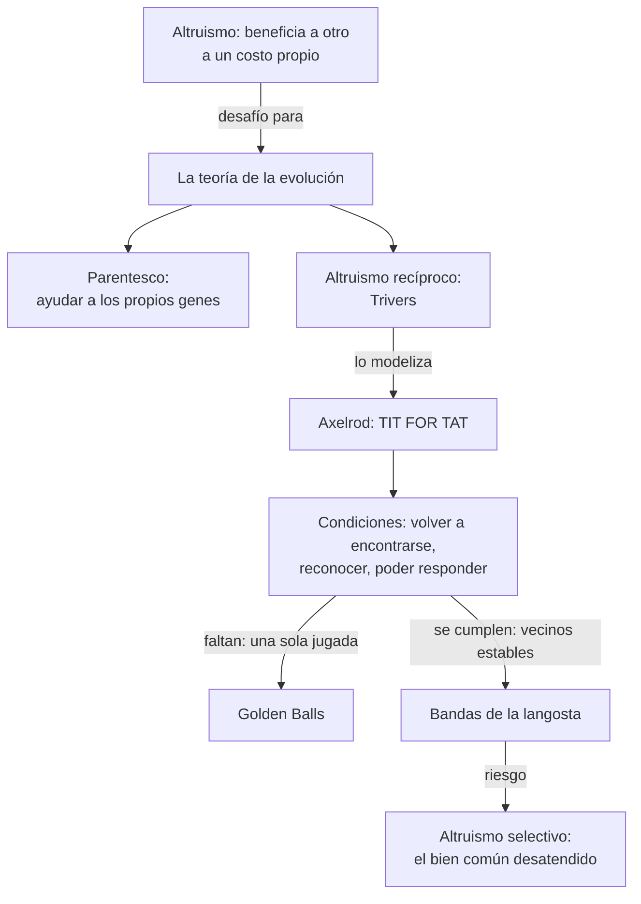
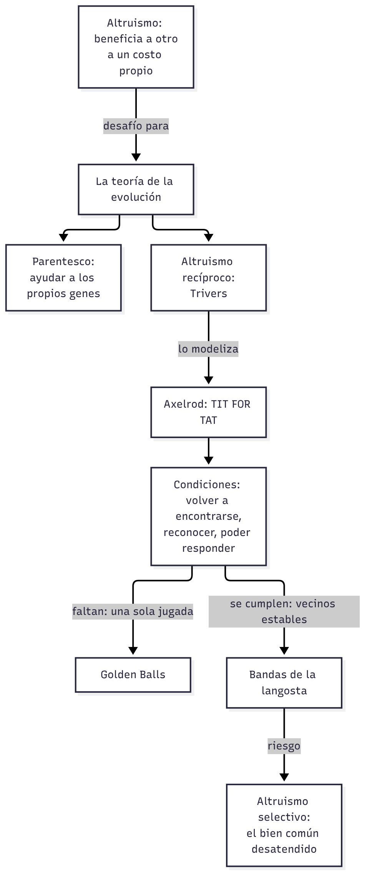
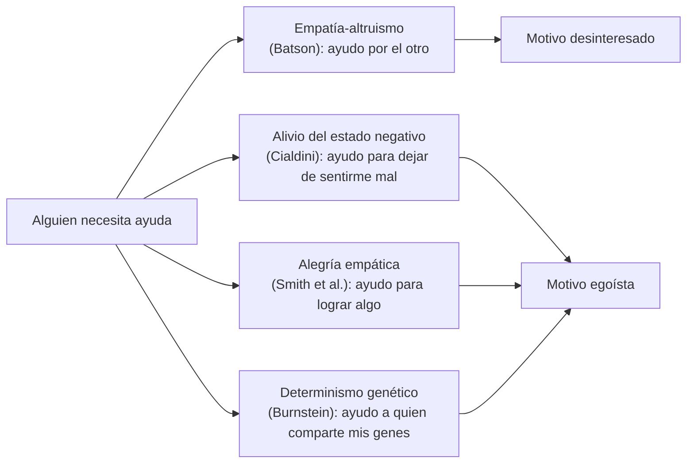
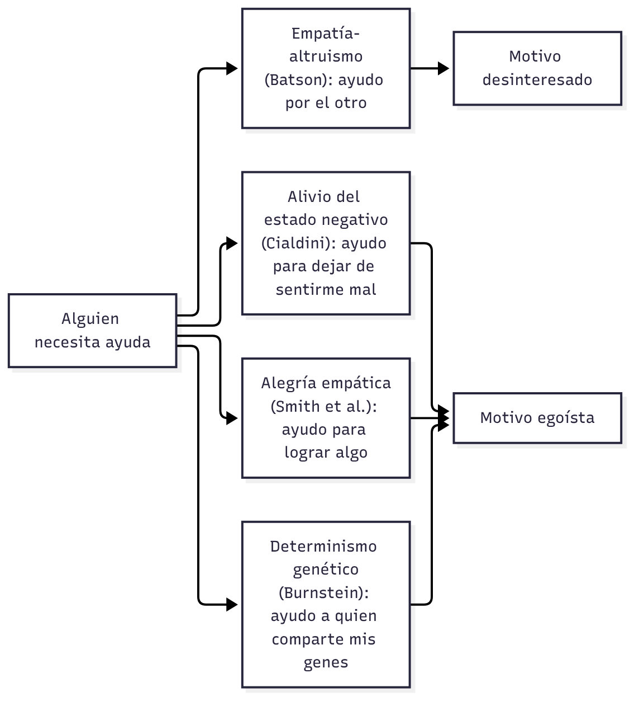

# Final reducido: altruismo y conducta prosocial · Guía oral

> **Para qué es esta guía:** para preparar la exposición del **10/12**, sobre un tema de la lista de la cátedra, con preguntas solo sobre ese tema (Cátedra de Psicología Social, 2026n). No es para leer en voz alta: es el orden de lo que vas a decir y lo que tenés que poder responder.
>
> **Duración:** el guion dura unos **16 minutos**, más que los 10 previstos, porque suma la bibliografía obligatoria de la unidad 9 que no se dio en clase. Si la mesa te pide acortar, los bloques marcados con **(recortable)** se pueden resumir en una frase sin perder el hilo.
>
> **Aviso sobre las fuentes:** el marco teórico sale de la clase 8 y de Baron y Byrne (2005), con las páginas del PDF de la cátedra. Los estudios que Baron y Byrne reseñan se citan como fuente secundaria. Axelrod está en las diapositivas 34 y 35; Golden Balls y la langosta de Maine son ejemplos tuyos. Los datos de los tres casos están verificados en las fichas de lectura: `C08_AxelrodHamilton_TorneoDelDilemaDelPrisionero_Lectura_Guia.md`, `C08_VanDenAssem_GoldenBalls_Lectura_Guia.md` y `C08_WaringAcheson_BandasDeLaLangostaDeMaine_Lectura_Guia.md`. **Consultá a la docente:** la consigna pide avisar con una semana de anticipación si se hace una articulación o variación entre temas. Tus casos son ejemplos dentro de un mismo tema, pero, si hay dudas, el plazo vence el **03/12**. La consigna no dice si se permite apoyo visual.

## Qué usás y de dónde viene

| Tema | Origen | Dónde |
|---|---|---|
| Conducta prosocial y altruismo | Clase | Diapositivas 5, 6 y 31 |
| Las cuatro explicaciones de la conducta prosocial, con sus experimentos | Programa (no dado en clase) | Baron y Byrne (2005), pp. 36-42 |
| El altruismo como desafío evolutivo | Clase | Diapositivas 31 y 32 |
| Parentesco, herencia y ambiente, el suricato | Programa (no dado en clase) | Baron y Byrne (2005), pp. 24 y 41-42 |
| Dilema del prisionero, Axelrod y TIT FOR TAT | Clase y artículo | Diapositivas 33-35; Axelrod y Hamilton (1981) |
| Altruismo recíproco de Trivers | Clase | Diapositivas 36 y 37 |
| Altruismo selectivo y bien común | Programa (no dado en clase) | Baron y Byrne (2005), p. 39 |
| Efecto espectador y cinco pasos | Clase | Diapositivas 12-18 (para preguntas) |
| Situación, hipocresía moral, emociones, personalidad, voluntariado, quién recibe ayuda | Programa (no dado en clase) | Baron y Byrne (2005), pp. 13-35 (para preguntas) |
| Golden Balls | Fuera del programa | van den Assem et al. (2012); Rauen y Belan (2025) |
| Langosta de Maine | Fuera del programa | Waring y Acheson (2018) |

## La idea en una frase

**Si traicionar siempre paga más, ¿por qué cooperamos?** La psicología social da cuatro respuestas sobre los **motivos** de quien ayuda, y la biología agrega el **parentesco** y la **reciprocidad**. Pero ninguna alcanza sin mirar la **estructura de la situación**: la cooperación surge cuando hay **futuro** (volver a encontrarse), **reconocimiento** (saber quién es quién) y **posibilidad de responder**. Los tres casos muestran qué pasa con esas condiciones, y el altruismo selectivo muestra que ni siquiera la empatía garantiza el bien común.

## Guion por bloques

### 0:00-1:00 · Apertura

- **Pregunta:** «Si traicionar siempre paga más, ¿por qué cooperamos?».
- **Definiciones:** la **conducta prosocial** es toda conducta social positiva, con o sin motivación altruista (Cátedra de Psicología Social, 2026i, diapositiva 6). El **altruismo**, en sentido biológico, beneficia a otro organismo no emparentado a un costo propio (diapositiva 31).
- **Recorrido:** voy a ir de los motivos de quien ayuda a la evolución, de ahí a un experimento con computadoras y a dos casos reales, uno de una sola jugada y otro de toda una vida, para terminar con un límite de la empatía.

### 1:00-4:30 · ¿Por qué ayudamos? Las cuatro explicaciones

Baron y Byrne (2005, p. 37) ordenan cuatro teorías. Las tres primeras ponen el acento en la **emoción** de quien ayuda; la cuarta, en los **genes**.

- **Empatía-altruismo (Batson).** Es la explicación menos egoísta: algunos actos prosociales están motivados **solo** por el deseo de ayudar a quien lo necesita (Baron y Byrne, 2005, p. 37).
  - **El experimento:** un participante mira por televisión a una estudiante que recibe descargas eléctricas y cuenta que de niña tuvo una experiencia traumática con la electricidad. Le ofrecen tomar su lugar o terminar el experimento. Con **empatía baja** (víctima distinta al participante), prefieren terminar. Con **empatía alta** (víctima parecida), aceptan **recibir las descargas en su lugar** (Batson et al., 1983, y Toi y Batson, 1982, citados en Baron y Byrne, 2005, p. 38).
  - **La crítica de Cialdini:** la empatía lleva a ayudar solo si hay **superposición entre uno y el otro**. Si el otro es parte de mi autoconcepto, al ayudarlo me ayudo a mí. Batson respondió con evidencia de que la empatía lleva a ayudar aun sin esa unidad (Cialdini et al., 1997, y Batson et al., 1997, citados en Baron y Byrne, 2005, p. 38).
- **Alivio de un estado negativo (Cialdini).** Ayudamos para **dejar de sentirnos mal**: la ayuda funciona como autoayuda. No importa si el malestar venía de antes, como una mala nota, o lo provocó la emergencia. En estos casos, la empatía no es necesaria (Cialdini et al., 1981 y 1987, citados en Baron y Byrne, 2005, pp. 39-40).
- **Alegría empática (Smith, Keating y Stotland).** Ayudamos para sentir que **logramos algo**. En su estudio, los participantes podían aconsejar a una estudiante que pensaba dejar la universidad. La empatía sola no alcanzó: hacía falta empatía **y saber que el consejo iba a tener efecto** (Smith et al., 1989, citados en Baron y Byrne, 2005, p. 40).
- **Determinismo genético.** Ayudamos sin saberlo a quien comparte nuestros genes, porque eso aumenta la probabilidad de que pasen a la siguiente generación (Baron y Byrne, 2005, pp. 40-42). Lo desarrollo en el próximo bloque.
- **Conclusión de los autores:** probablemente ayudamos por una **variedad de motivos**, en parte egoístas y en parte desinteresados, y personas distintas en situaciones distintas ayudan por razones distintas (Baron y Byrne, 2005, pp. 37 y 42).

> **Frase para decir:** «Batson y Cialdini discuten si existe el altruismo puro. Lo que voy a mostrar es que, para entender cuándo cooperamos, además del motivo hay que mirar la situación».

### 4:30-7:00 · El desafío evolutivo: parentesco, herencia y reciprocidad

- **El problema.** El altruismo no beneficia al individuo sino al grupo. Darwin propone que, si la competencia entre grupos supera a la competencia entre individuos, se seleccionan los grupos con más altruistas (diapositivas 31 y 32).
- **Primera salida: el parentesco.** Cuanto mayor es la similitud genética entre dos individuos, más probable es que uno ayude al otro, en varias especies (Ridley y Dawkins, 1981, citados en Baron y Byrne, 2005, p. 41). En los estudios de Burnstein et al. (1994), con decisiones hipotéticas, los participantes ayudaban más a **parientes cercanos** que a lejanos o a no parientes, y más a parientes **jóvenes** que a mayores: por ejemplo, más a una pariente en edad de tener hijos que a una posmenopáusica (citados en Baron y Byrne, 2005, p. 42).
- **¿Hay un gen de la ayuda?** No: Buck y Ginsberg (1991) no encontraron evidencia de un gen que determine la conducta prosocial. Lo que se hereda son **capacidades** para comunicar emociones y formar vínculos (citados en Baron y Byrne, 2005, p. 42). En más de 800 pares de gemelos y mellizos, la herencia explica alrededor de **un tercio** de la empatía afectiva y nada de la cognitiva; el resto depende del ambiente (Davis et al., 1994, citados en Baron y Byrne, 2005, p. 24). Esto responde al punto del programa sobre el papel de la herencia y del ambiente.
- **Una advertencia: el suricato.** Se creía que el centinela que vigila mientras el grupo come era altruista. Pero primero come hasta saciarse y es el primero en ver al depredador y escapar: actúa en su propio beneficio. El entusiasmo por las explicaciones evolucionistas puede llevar a una **percepción selectiva** (Clutton-Brock et al., 1999, citados en Baron y Byrne, 2005, pp. 41-42).
- **Segunda salida: la reciprocidad (Trivers).** El parentesco no explica que ayudemos a extraños. El costo del acto altruista se compensa con la reciprocidad futura, siempre que se pueda **identificar a los tramposos** (diapositiva 36): hoy por ti, mañana por mí (Axelrod y Hamilton, 1981, pp. 2-3).

### 7:00-9:00 · Axelrod: la cooperación entre egoístas

- **El dilema del prisionero:** si el otro coopera, me conviene traicionar; si traiciona, también. Pero si ambos traicionamos, quedamos peor que cooperando (Axelrod y Hamilton, 1981, p. 3). En **una sola jugada**, traicionar es la única estrategia estable (p. 4).
- **El torneo:** el politólogo Robert Axelrod invitó a especialistas a mandar estrategias para un dilema repetido de **200 jugadas**. Compitieron **14** más una aleatoria. Ganó la más simple, **TIT FOR TAT**, presentada por Anatol Rapoport: cooperar primero y después copiar lo que hizo el otro. En la segunda ronda, con **62** estrategias de seis países, volvió a ganar (p. 5).
- **Por qué gana:** **nunca traiciona primero**, **responde** a la traición y **perdona** después de una represalia (p. 5).
- **La condición:** funciona si la probabilidad de **volver a encontrarse** es alta (p. 5). En clase se la llamó «sombra del futuro» (diapositiva 37). Y el que traiciona no puede perderse en un **mar anónimo** (p. 7).

> **Frase para decir:** «Axelrod muestra que no hace falta ser bueno para cooperar: alcanza con tener futuro con el otro».

### 9:00-11:00 · Golden Balls: sin futuro

- **El juego:** dos finalistas eligen en secreto dividir o robar el pozo. Si los dos dividen, se reparten la mitad; si uno roba, se lleva todo; si ambos roban, nadie gana nada. Robar nunca da menos (van den Assem et al., 2012, pp. 2-3).
- **Qué pasó en 287 episodios:** cada jugador dividió el **53 %** de las veces. Quien había recibido el voto del rival para echarlo del programa cooperó menos: **reciprocidad** (p. 3).
- **Nick e Ibrahim (£13.600):** Nick anunció que iba a **robar** con total seguridad y prometió repartir después del programa. Ibrahim dudó, insistió en que dividieran los dos y finalmente dividió. **Nick también dividió**: los dos se llevaron £6.800 (Rauen y Belan, 2025, pp. 1, 5 y 10-15).
- **Lectura:** es una sola jugada, así que Axelrod predice traición. Nick **cambió la estructura**: creó un compromiso fuera del juego y le dejó a Ibrahim la responsabilidad de la decisión. Fue conducta prosocial, pero, con las cuatro explicaciones en la mano, el motivo parece más estratégico que empático.

### 11:00-13:00 · Las bandas de la langosta: todo el futuro

- **El dilema:** la langosta es un recurso común; cada pescador gana pescando más y el grupo pierde si todos lo hacen (Waring y Acheson, 2018, p. 2).
- **La respuesta:** **bandas de puerto** de 8 a 50 barcos defienden territorios no oficiales. A quien entra sin permiso le cortan las trampas, aunque sea ilegal y arriesgado (p. 2).
- **Cooperación costosa:** defender beneficia al grupo y cuesta al individuo. La banda controla quién entra y sanciona a quien saca langostas chicas o hembras con huevos (pp. 5-6).
- **De la banda a la ley:** en los 70, cuatro islas se fijaron límites de trampas. En 1995, la ley creó siete zonas que adoptaron esas prácticas (pp. 3, 8 y 11).
- **Lectura:** se cumplen las condiciones de Axelrod y Trivers: vecinos estables que se reencuentran toda la vida, se reconocen y pueden castigar. Axelrod mismo señala que la **territorialidad** favorece la cooperación (Axelrod y Hamilton, 1981, p. 7; diapositiva 37). Y conecta con Darwin: es selección entre grupos, porque prosperan las bandas que cooperan.

### 13:00-14:30 · Un límite: el altruismo selectivo (recortable)

- **El problema:** cuando hay recursos limitados para ayudar a un grupo, lo mejor para el grupo es repartirlos de forma equitativa. Pero el **egoísmo** («primero yo») y la **empatía dirigida a un solo miembro** llevan al mismo resultado: el grupo queda desatendido. Las dos alternativas amenazan el **bien común** (Batson et al., 1999, citados en Baron y Byrne, 2005, p. 39).
- **Ejemplo:** es mucho más fácil juntar ayuda para un niño con nombre y foto que para miles de niños desnutridos (Baron y Byrne, 2005, p. 39).
- **Lectura:** la empatía, que en Batson era la fuente del altruismo puro, no alcanza para resolver un dilema social. Lo que sostiene el recurso común de la langosta no son los buenos sentimientos, sino **reglas, control y sanción** que valen para todos.

### 14:30-16:00 · Cierre

| | Torneo de Axelrod | Golden Balls | Langosta de Maine |
|---|---|---|---|
| **¿Se vuelven a encontrar?** | Sí, 200 jugadas | No, una sola | Sí, toda la vida |
| **¿Pueden responder?** | Sí, en la jugada siguiente | No | Sí: cortan trampas y excluyen |
| **¿Qué sostiene la cooperación?** | Reciprocidad | Promesas, normas y estrategia | Normas, castigo y control del grupo |
| **¿Qué motivo predomina?** | Interés propio a largo plazo | Estrategia | Interés del grupo, con costo propio |

> **Frase de cierre:** «Batson y Cialdini discuten si ayudamos por el otro o por nosotros. Los tres casos muestran que, para que la cooperación se sostenga, importa menos el motivo que la situación. Cuando hay futuro, reconocimiento y respuesta, cooperar es la mejor jugada, incluso para un egoísta. Y cuando lo que está en juego es un bien común, ni la empatía alcanza: hacen falta reglas que valgan para todos».

## Apoyo visual sugerido

Si se permite, siete diapositivas:

1. **Título y pregunta:** «¿Por qué cooperamos si traicionar paga más?».
2. **Prosocial y altruista:** las definiciones.
3. **Las cuatro explicaciones:** el diagrama 02, con el experimento de Batson.
4. **Parentesco y herencia:** Burnstein, el tercio de los gemelos y el suricato.
5. **Matriz del dilema y TIT FOR TAT:** los tres rasgos.
6. **Dos casos:** foto o esquema de Golden Balls y un mapa de los territorios de Maine.
7. **El cuadro del cierre.**

Si no se permite, llevá el cuadro del cierre en un papel como ayuda memoria.

## Preguntas probables

### Sobre el guion

**1. ¿Qué diferencia hay entre conducta prosocial y altruismo?** La prosocial es la categoría amplia: toda conducta social positiva, con o sin motivación altruista. El altruismo implica ayudar sin esperar beneficio (diapositivas 6 y 31).

**2. ¿El experimento de Batson demuestra que existe el altruismo puro?** Muestra que con empatía alta se acepta un costo grande, como recibir descargas, aunque se pueda evitar. Pero Cialdini lo discute: si la víctima se parece a mí, al ayudarla me ayudo a mí mismo. El debate sigue abierto, y Baron y Byrne concluyen que hay motivos egoístas y desinteresados (Baron y Byrne, 2005, pp. 38 y 42).

**3. ¿TIT FOR TAT es altruista?** No en sentido estricto: es **reciprocidad condicional**. Coopera porque espera cooperación y responde a la traición. Es lo que Trivers llama altruismo recíproco: un costo hoy compensado por la reciprocidad futura (diapositiva 36).

**4. ¿Por qué traicionar es racional en una sola jugada?** Porque, haga lo que haga el otro, traicionar da más. Sin futuro no hay represalia posible (Axelrod y Hamilton, 1981, pp. 3-4).

**5. ¿Nick fue altruista o estratégico?** Su conducta fue prosocial, porque ambos ganaron, pero el motivo parece estratégico: los autores la ven como un movimiento para que Ibrahim no se quedara con todo (Rauen y Belan, 2025, p. 1). De las cuatro explicaciones, la empatía-altruismo es la que menos encaja. Es un buen ejemplo de que la conducta prosocial puede no tener motivación altruista.

**6. ¿Cortar trampas no es agresión y no altruismo?** Es castigo, y el castigo **sostiene** la cooperación dentro del grupo: sin respuesta a la traición, Axelrod muestra que la cooperación no se mantiene. Es altruista hacia adentro, porque el que defiende asume un costo por el grupo, y excluyente hacia afuera (Waring y Acheson, 2018, p. 5). Baron y Byrne muestran lo mismo en la ayuda cotidiana: ayudamos más a quien se nos parece (pregunta 13).

**7. ¿Cómo se relaciona con el efecto espectador?** En los dos casos, el **anonimato** debilita la cooperación. En Darley y Latané, a más testigos, menos ayuda, por **difusión de la responsabilidad** (diapositivas 12-18). En Axelrod, quien traiciona no debe perderse en un mar anónimo (Axelrod y Hamilton, 1981, p. 7).

**8. ¿Por qué cooperó el 53 % en Golden Balls, si robar nunca da menos?** Hay preferencias sociales y normas: la decisión es pública y televisada. Además, pesa la **reciprocidad** con el comportamiento previo del rival, y con pozos relativamente chicos cooperan más («big peanuts») (van den Assem et al., 2012, p. 3).

**9. ¿Qué lugar tienen las emociones?** En los dilemas sociales, culpa y vergüenza aumentan la cooperación, e ira y disgusto la dificultan (Saavedra et al., 2015, p. 1). Ketelaar y Au mostraron que, tras una oferta egoísta en juegos repetidos, quienes sintieron culpa ofrecieron más después (Saavedra et al., 2015, p. 6). Es la misma lógica del alivio de un estado negativo: ayudar para dejar de sentirse mal.

**10. ¿Qué limitaciones tiene el modelo de Axelrod?** Supone dos jugadores, elecciones simultáneas y pagos fijos (Axelrod y Hamilton, 1981, p. 4). El ganador depende de qué estrategias compitan, por eso agregaron un análisis ecológico (p. 5).

**11. ¿El determinismo genético explica la ayuda a extraños?** No. El parentesco explica ayudar a quien comparte nuestros genes, y no se encontró un gen de la ayuda. Para los extraños hace falta la reciprocidad de Trivers y Axelrod. Lo que sí se hereda son capacidades, como la empatía afectiva, en alrededor de un tercio (Baron y Byrne, 2005, pp. 24 y 42).

### Sobre la unidad 9 (programa, no desarrollado en el guion)

**12. ¿Qué es la empatía y cómo se desarrolla?** Es una respuesta **afectiva** (sentir lo que siente el otro) y **cognitiva** (entender qué siente y por qué, tomando su perspectiva). El componente afectivo aparece a los doce meses y se observa en otros primates; el cognitivo es humano y se desarrolla después de la infancia. Los niños empáticos suelen venir de familias cálidas, con mensajes claros sobre cómo las propias conductas afectan a otros (Baron y Byrne, 2005, pp. 22-25).

**13. ¿Ayudamos más a quien se nos parece?** Sí. Aumentan la ayuda la atracción, el atractivo físico y la similitud. En el estudio del «número equivocado», un desconocido pedía que llamaran a su pareja para avisar que llegaba tarde a su aniversario. Si pedía llamar a la novia, ayudaban el doble de mujeres y el triple de hombres que si pedía llamar al novio: con el novio, solo lo hizo el 35 % de las mujeres y el 30 % de los hombres (Shaw et al., 1994, citados en Baron y Byrne, 2005, pp. 13-14).

**14. ¿Influye lo que pensamos de la víctima?** Sí: ayudamos menos si la creemos **responsable** de su situación, por ejemplo si pensamos que el hombre tirado en la vereda está borracho. Tendemos a culpar más a quienes son distintos a nosotros (Baron y Byrne, 2005, pp. 14-15). Es el mismo mecanismo que hace que las bandas de la langosta excluyan a los de afuera.

**15. ¿La ayuda se contagia?** Sí, por **modelos prosociales**. Los conductores se detenían más a ayudar a una mujer con una rueda pinchada si antes habían visto a otra mujer recibir ayuda (Bryan y Test, 1967, citados en Baron y Byrne, 2005, p. 16). Los programas infantiles prosociales aumentan la conducta prosocial, y los videojuegos violentos la disminuyen (pp. 16-17). Se conecta con el aprendizaje social de Bandura y con el refuerzo de Skinner que se vio en clase (diapositivas 19-20).

**16. ¿Qué es la hipocresía moral?** Batson y Thompson (2001) distinguen tres motivos ante una elección moral: **interés propio**, **integridad moral** (querer ser moral) e **hipocresía moral** (querer parecer moral sin pagar el costo). En sus experimentos, más del 90 % decía que lo correcto era darle la tarea buena al otro, pero entre el 70 % y el 80 % se la asignó a sí mismo. Con una moneda para sortear, los que la tiraron se asignaron la tarea buena en la misma proporción: hicieron trampa. Cuando la moneda la tiraba el experimentador, era más fácil ser íntegro (citados en Baron y Byrne, 2005, pp. 17-19). **Con Golden Balls:** prometer dividir en público no garantiza dividir; por eso Nick sacó la decisión del terreno de las promesas.

**17. ¿El buen humor hace que ayudemos más?** En general sí: encontrar una moneda o un día de sol aumentan la ayuda. Pero si la emergencia es ambigua o ayudar es desagradable, el buen humor la reduce, para no estropearlo. El mal humor reduce la ayuda, salvo que ayudar haga sentir mejor, la emergencia sea clara y el malestar no sea muy intenso (Baron y Byrne, 2005, pp. 20-22).

**18. ¿Existe una personalidad altruista?** Bierhoff et al. (1991) compararon a quienes dieron primeros auxilios en un accidente con quienes no hicieron nada. Los que ayudaron tenían más **empatía**, **creencia en un mundo justo**, **responsabilidad social**, **locus de control interno** y **bajo egocentrismo**. Los mismos cinco rasgos aparecen en quienes rescataron judíos en Europa (Oliner y Oliner, 1988) (citados en Baron y Byrne, 2005, pp. 27-28). El maquiavelismo se asocia con menos ayuda (p. 27). Completa lo que se vio en clase sobre London: no hay un solo rasgo predictor (diapositivas 27-29).

**19. ¿Por qué la gente hace voluntariado?** Clary y Snyder (1999) describen seis funciones: valores, comprensión, crecimiento, profesión, social y protectora (reducir la culpa o escapar de los propios problemas). Alrededor de la mitad abandona en un año, y quienes siguen al menos dos años y medio están movidos por motivos «egoístas», como conocerse o mejorar la autoestima, más que por los humanitarios. El voluntariado obligatorio puede bajar el interés futuro. La **generatividad** es el compromiso adulto con las generaciones futuras (citados en Baron y Byrne, 2005, pp. 28-31). Es lo que la clase llamó voluntariado funcional (diapositivas 8-9).

**20. ¿Quién recibe más ayuda?** Las mujeres, y los que más ayudan son hombres. En parte porque muchas emergencias piden habilidades asociadas a los hombres, como cambiar una rueda, y en parte por motivos románticos o sexuales: los hombres que acababan de ver un video erótico ayudaron más a una mujer (Przybyla, 1985, citado en Baron y Byrne, 2005, pp. 32-33). **Pedir ayuda** de forma clara reduce la ambigüedad y aumenta la ayuda (p. 33).

**21. ¿Cómo se siente recibir ayuda?** Depende. La ayuda de un amigo, un hermano o alguien parecido amenaza la autoestima y genera resentimiento, pero motiva a arreglárselas solo en el futuro. La de un extraño distinto genera gratitud (Fisher et al., 1982, citados en Baron y Byrne, 2005, pp. 34-35).

**22. ¿Las personas buscan sentir empatía?** No cuando ayudar sale caro. Si la tarea para ayudar a un hombre sin hogar era fácil, la mayoría elegía escuchar un mensaje emocional sobre él; si era costosa, elegía la información objetiva, para no sentirse obligada a ayudar (Shaw, Batson y Todd, 1994, citados en Baron y Byrne, 2005, p. 38).

**23. ¿Qué se sabe de la neurobiología del altruismo?** El programa la nombra, pero no se dio en clase y Baron y Byrne no la desarrollan. Lo que podés decir: lo heredado no es un gen de la ayuda sino capacidades para comunicar emociones y formar vínculos (Baron y Byrne, 2005, p. 42). En la parte de neurociencia de la clase 8 se vieron las **representaciones compartidas yo-otro** (Cátedra de Psicología Social, 2026h, diapositivas 17-19), que se parecen a la superposición entre uno y el otro que propone Cialdini. Si piden más, reconocé que no forma parte de la bibliografía que trabajaste.

## Conceptos que conviene poder definir

- **Conducta prosocial:** conducta social positiva, con o sin motivación altruista.
- **Altruismo (biológico):** beneficia a otro no emparentado, a un costo propio.
- **Empatía:** respuesta afectiva (sentir lo que siente el otro) y cognitiva (entender qué siente y por qué).
- **Hipótesis de la empatía-altruismo:** algunos actos prosociales están motivados solo por el deseo de ayudar a quien lo necesita.
- **Modelo del alivio de un estado negativo:** ayudamos para reducir nuestras emociones negativas.
- **Hipótesis de la alegría empática:** ayudamos por la emoción positiva de tener un efecto beneficioso sobre otro.
- **Modelo del determinismo genético:** ayudamos más a quien se nos parece genéticamente, porque eso favorece que nuestros genes pasen a la siguiente generación.
- **Altruismo recíproco:** cooperar selectivamente con quien coopera; el costo se compensa con la reciprocidad futura.
- **Altruismo selectivo:** ayudar a un miembro que nos conmueve en vez de repartir entre todos, a costa del bien común.
- **Hipocresía moral:** querer parecer moral evitando el costo de serlo.
- **Personalidad altruista:** empatía, creencia en un mundo justo, responsabilidad social, locus de control interno y bajo egocentrismo.
- **Generatividad:** compromiso adulto con el bienestar de las generaciones futuras.
- **Dilema del prisionero:** traicionar conviene a cada uno, pero la traición mutua deja peor a ambos.
- **TIT FOR TAT:** cooperar primero y después copiar la jugada anterior del otro.
- **Estrategia evolutivamente estable:** la que, adoptada por una población, no puede ser invadida por otra.
- **Sombra del futuro:** la probabilidad de volver a encontrarse, que hace rentable cooperar.
- **Dilema social:** conflicto entre el interés propio y el colectivo (Saavedra et al., 2015, p. 3).
- **Difusión de la responsabilidad:** cada testigo espera que actúe otro.

## Referencias

Axelrod, R., & Hamilton, W. D. (1981). The evolution of cooperation. *Science, 211*(4489), 1390-1396. https://doi.org/10.1126/science.7466396

Baron, R. A., & Byrne, D. (2005). Conducta prosocial: ayudar a otros. En *Psicología social* (10.ª ed., cap. 10). Pearson Educación.

Cátedra de Psicología Social. (2026h). *Neurociencia social* [Diapositivas de clase, clase 8]. Universidad Favaloro.

Cátedra de Psicología Social. (2026i). *Altruismo* [Diapositivas de clase, clase 8]. Universidad Favaloro.

Cátedra de Psicología Social. (2026n). *Información acerca del recuperatorio y el final* [Documento de cátedra]. Universidad Favaloro.

Rauen, F. J., & Belan, A. B. (2025). Nick and Ibrahim's prisoner's dilemma in *Split or Steal*: Relevance and goal conciliation in *Golden Balls*. *D.E.L.T.A., 41*(3), 1-22. https://doi.org/10.1590/1678-460X202541365621

Saavedra, B. A., Mola, D. J., Gancedo, K. M., & Reyna, C. (2015). Una revisión sistemática sobre emociones morales y dilemas sociales. *Summa Psicológica UST, 12*(1), 63-76.

van den Assem, M. J., van Dolder, D., & Thaler, R. H. (2012). Split or steal? Cooperative behavior when the stakes are large. *Management Science, 58*(1), 2-20. https://doi.org/10.1287/mnsc.1110.1413

Waring, T., & Acheson, J. (2018). Evidence of cultural group selection in territorial lobstering in Maine. *Sustainability Science, 13*(1), 21-34. https://doi.org/10.1007/s11625-017-0501-x
