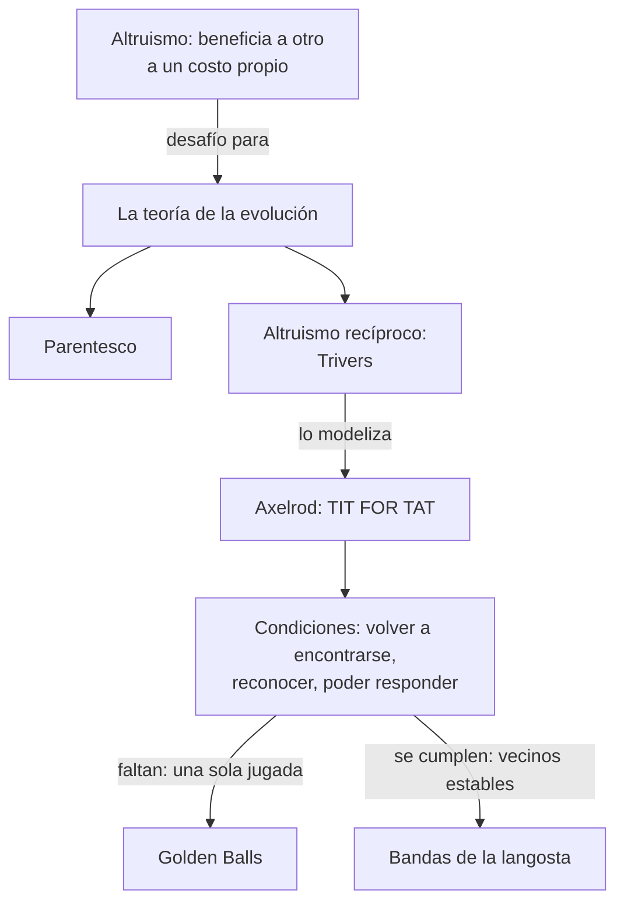

# Final reducido: altruismo y conducta prosocial · Guía oral

> **Para qué es esta guía:** para preparar una exposición de unos **10 minutos** el **10/12**, sobre un tema de la lista de la cátedra, con preguntas solo sobre ese tema (Cátedra de Psicología Social, 2026n). No es para leer en voz alta: es el orden de lo que vas a decir y lo que tenés que poder responder.
>
> **Aviso sobre las fuentes:** el marco teórico sale de la clase 8 y de Baron y Byrne (2005). Axelrod está en las diapositivas 34 y 35; Golden Balls y la langosta de Maine son ejemplos tuyos. Los datos de los tres casos están verificados en las fichas de lectura: `C08_AxelrodHamilton_TorneoDelDilemaDelPrisionero_Lectura_Guia.md`, `C08_VanDenAssem_GoldenBalls_Lectura_Guia.md` y `C08_WaringAcheson_BandasDeLaLangostaDeMaine_Lectura_Guia.md`. **Consultá a la docente:** la consigna pide avisar con una semana de anticipación si se hace una articulación o variación entre temas. Tus casos son ejemplos dentro de un mismo tema, pero, si hay dudas, el plazo vence el **03/12**. La consigna no dice si se permite apoyo visual.

## Qué usás y de dónde viene

| Tema | Origen | Dónde |
|---|---|---|
| Conducta prosocial y altruismo | Clase | Diapositivas 5, 6 y 31 |
| Motivos para ayudar | Programa | Baron y Byrne (2005), p. 37 |
| El altruismo como desafío evolutivo | Clase | Diapositivas 31 y 32 |
| Dilema del prisionero, Axelrod y TIT FOR TAT | Clase y artículo | Diapositivas 33-35; Axelrod y Hamilton (1981) |
| Altruismo recíproco de Trivers | Clase | Diapositivas 36 y 37 |
| Efecto espectador | Clase | Diapositivas 12-18 (para preguntas) |
| Golden Balls | Fuera del programa | van den Assem et al. (2012); Rauen y Belan (2025) |
| Langosta de Maine | Fuera del programa | Waring y Acheson (2018) |

## La idea en una frase

**Si traicionar siempre paga más, ¿por qué cooperamos?** Porque la cooperación no depende solo de las buenas intenciones: también de la **estructura de la situación**. Surge cuando hay **futuro** (volver a encontrarse), **reconocimiento** (saber quién es quién) y **posibilidad de responder**. Los tres casos muestran qué pasa con esas condiciones.

## Guion por bloques

### 0:00-1:00 · Apertura

- **Pregunta:** «Si traicionar siempre paga más, ¿por qué cooperamos?».
- **Definiciones:** la **conducta prosocial** es toda conducta social positiva, con o sin motivación altruista (Cátedra de Psicología Social, 2026i, diapositiva 6). El **altruismo**, en sentido biológico, beneficia a otro organismo no emparentado a un costo propio (diapositiva 31).
- **Recorrido:** voy a ir de la teoría a un experimento con computadoras y a dos casos reales, uno de una sola jugada y otro de toda una vida.

### 1:00-3:00 · El problema

- **Por qué ayudamos.** Baron y Byrne (2005, p. 37) ordenan cuatro explicaciones: **empatía-altruismo** (ayudar a quien lo necesita), **alivio de un estado negativo** propio, **alegría empática** por haber ayudado y **determinismo genético**.
- **El desafío evolutivo.** El altruismo no beneficia al individuo sino al grupo. Darwin propone que, si la competencia entre grupos supera a la competencia entre individuos, se seleccionan los grupos con más altruistas (diapositivas 31 y 32).
- **Dos salidas teóricas:** el **parentesco**, porque ayudar a parientes beneficia genes compartidos, y la **reciprocidad**: hoy por ti, mañana por mí (Axelrod y Hamilton, 1981, pp. 2-3).
- **Trivers:** el costo del acto altruista se compensa con la reciprocidad futura, siempre que se pueda **identificar a los tramposos** (diapositiva 36).

### 3:00-5:00 · Axelrod: la cooperación entre egoístas

- **El dilema del prisionero:** si el otro coopera, me conviene traicionar; si traiciona, también. Pero si ambos traicionamos, quedamos peor que cooperando (Axelrod y Hamilton, 1981, p. 3). En **una sola jugada**, traicionar es la única estrategia estable (p. 4).
- **El torneo:** el politólogo Robert Axelrod invitó a especialistas a mandar estrategias para un dilema repetido de **200 jugadas**. Compitieron **14** más una aleatoria. Ganó la más simple, **TIT FOR TAT**, presentada por Anatol Rapoport: cooperar primero y después copiar lo que hizo el otro. En la segunda ronda, con **62** estrategias de seis países, volvió a ganar (p. 5).
- **Por qué gana:** **nunca traiciona primero**, **responde** a la traición y **perdona** después de una represalia (p. 5).
- **La condición:** funciona si la probabilidad de **volver a encontrarse** es alta (p. 5). En clase se la llamó «sombra del futuro» (diapositiva 37). Y el que traiciona no puede perderse en un **mar anónimo** (p. 7).

> **Frase para decir:** «Axelrod muestra que no hace falta ser bueno para cooperar: alcanza con tener futuro con el otro».

### 5:00-7:00 · Golden Balls: sin futuro

- **El juego:** dos finalistas eligen en secreto dividir o robar el pozo. Si los dos dividen, se reparten la mitad; si uno roba, se lleva todo; si ambos roban, nadie gana nada. Robar nunca da menos (van den Assem et al., 2012, pp. 2-3).
- **Qué pasó en 287 episodios:** cada jugador dividió el **53 %** de las veces. Quien había recibido el voto del rival para echarlo del programa cooperó menos: **reciprocidad** (p. 3).
- **Nick e Ibrahim (£13.600):** Nick anunció que iba a **robar** con total seguridad y prometió repartir después del programa. Ibrahim dudó, insistió en que dividieran los dos y finalmente dividió. **Nick también dividió**: los dos se llevaron £6.800 (Rauen y Belan, 2025, pp. 1, 5 y 10-15).
- **Lectura:** es una sola jugada, así que Axelrod predice traición. Nick **cambió la estructura**: creó un compromiso fuera del juego y le dejó a Ibrahim la responsabilidad de la decisión. Fue cooperación, pero por estrategia más que por altruismo puro.

### 7:00-9:00 · Las bandas de la langosta: todo el futuro

- **El dilema:** la langosta es un recurso común; cada pescador gana pescando más y el grupo pierde si todos lo hacen (Waring y Acheson, 2018, p. 2).
- **La respuesta:** **bandas de puerto** de 8 a 50 barcos defienden territorios no oficiales. A quien entra sin permiso le cortan las trampas, aunque sea ilegal y arriesgado (p. 2).
- **Cooperación costosa:** defender beneficia al grupo y cuesta al individuo. La banda controla quién entra y sanciona a quien saca langostas chicas o hembras con huevos (pp. 5-6).
- **De la banda a la ley:** en los 70, cuatro islas se fijaron límites de trampas. En 1995, la ley creó siete zonas que adoptaron esas prácticas (pp. 3, 8 y 11).
- **Lectura:** se cumplen las condiciones de Axelrod y Trivers: vecinos estables que se reencuentran toda la vida, se reconocen y pueden castigar. Axelrod mismo señala que la **territorialidad** favorece la cooperación (Axelrod y Hamilton, 1981, p. 7; diapositiva 37).

### 9:00-10:00 · Cierre

| | Torneo de Axelrod | Golden Balls | Langosta de Maine |
|---|---|---|---|
| **¿Se vuelven a encontrar?** | Sí, 200 jugadas | No, una sola | Sí, toda la vida |
| **¿Pueden responder?** | Sí, en la jugada siguiente | No | Sí: cortan trampas y excluyen |
| **¿Qué sostiene la cooperación?** | Reciprocidad | Promesas, normas y estrategia | Normas, castigo y control del grupo |

> **Frase de cierre:** «El altruismo no es solo una virtud de las personas: también es un producto de las situaciones. Cuando hay futuro, reconocimiento y respuesta, cooperar es la mejor jugada, incluso para un egoísta».

## Apoyo visual sugerido

Si se permite, cinco diapositivas:

1. **Título y pregunta:** «¿Por qué cooperamos si traicionar paga más?».
2. **Prosocial y altruista:** definiciones y el desafío evolutivo.
3. **Matriz del dilema y TIT FOR TAT:** los tres rasgos.
4. **Dos casos:** foto o esquema de Golden Balls y un mapa de los territorios de Maine.
5. **El cuadro del cierre.**

Si no se permite, llevá el cuadro del cierre en un papel como ayuda memoria.

## Preguntas probables

**1. ¿Qué diferencia hay entre conducta prosocial y altruismo?** La prosocial es la categoría amplia: toda conducta social positiva, con o sin motivación altruista. El altruismo implica ayudar sin esperar beneficio (diapositivas 6 y 31).

**2. ¿TIT FOR TAT es altruista?** No en sentido estricto: es **reciprocidad condicional**. Coopera porque espera cooperación y responde a la traición. Es lo que Trivers llama altruismo recíproco: un costo hoy compensado por la reciprocidad futura (diapositiva 36).

**3. ¿Por qué traicionar es racional en una sola jugada?** Porque, haga lo que haga el otro, traicionar da más. Sin futuro no hay represalia posible (Axelrod y Hamilton, 1981, pp. 3-4).

**4. ¿Nick fue altruista o estratégico?** Su conducta fue prosocial, porque ambos ganaron, pero el motivo parece estratégico: los autores la ven como un movimiento para que Ibrahim no se quedara con todo (Rauen y Belan, 2025, p. 1). Es un buen ejemplo de que la conducta prosocial puede no tener motivación altruista.

**5. ¿Cortar trampas no es agresión y no altruismo?** Es castigo, y el castigo **sostiene** la cooperación dentro del grupo: sin respuesta a la traición, Axelrod muestra que la cooperación no se mantiene. Es altruista hacia adentro, porque el que defiende asume un costo por el grupo, y excluyente hacia afuera (Waring y Acheson, 2018, p. 5).

**6. ¿Cómo se relaciona con el efecto espectador?** En los dos casos, el **anonimato** debilita la cooperación. En Darley y Latané, a más testigos, menos ayuda, por **difusión de la responsabilidad** (diapositivas 12-18). En Axelrod, quien traiciona no debe perderse en un mar anónimo (Axelrod y Hamilton, 1981, p. 7).

**7. ¿Por qué cooperó el 53 % en Golden Balls, si robar nunca da menos?** Hay preferencias sociales y normas: la decisión es pública y televisada. Además, pesa la **reciprocidad** con el comportamiento previo del rival, y con pozos relativamente chicos cooperan más («big peanuts») (van den Assem et al., 2012, p. 3).

**8. ¿Qué lugar tienen las emociones?** En los dilemas sociales, culpa y vergüenza aumentan la cooperación, e ira y disgusto la dificultan (Saavedra et al., 2015, p. 1). Ketelaar y Au mostraron que, tras una oferta egoísta en juegos repetidos, quienes sintieron culpa ofrecieron más después (Saavedra et al., 2015, p. 6).

**9. ¿Qué limitaciones tiene el modelo de Axelrod?** Supone dos jugadores, elecciones simultáneas y pagos fijos (Axelrod y Hamilton, 1981, p. 4). El ganador depende de qué estrategias compitan, por eso agregaron un análisis ecológico (p. 5).

**10. ¿Cuál de los motivos de Baron y Byrne explica mejor cada caso?** En los casos de reciprocidad pesan más los motivos que no son puramente altruistas. La empatía-altruismo explicaría ayudar sin esperar nada a cambio (Baron y Byrne, 2005, p. 37).

## Conceptos que conviene poder definir

- **Conducta prosocial:** conducta social positiva, con o sin motivación altruista.
- **Altruismo (biológico):** beneficia a otro no emparentado, a un costo propio.
- **Altruismo recíproco:** cooperar selectivamente con quien coopera; el costo se compensa con la reciprocidad futura.
- **Dilema del prisionero:** traicionar conviene a cada uno, pero la traición mutua deja peor a ambos.
- **TIT FOR TAT:** cooperar primero y después copiar la jugada anterior del otro.
- **Estrategia evolutivamente estable:** la que, adoptada por una población, no puede ser invadida por otra.
- **Sombra del futuro:** la probabilidad de volver a encontrarse, que hace rentable cooperar.
- **Dilema social:** conflicto entre el interés propio y el colectivo (Saavedra et al., 2015, p. 3).
- **Difusión de la responsabilidad:** cada testigo espera que actúe otro.

## Referencias

Axelrod, R., & Hamilton, W. D. (1981). The evolution of cooperation. *Science, 211*(4489), 1390-1396. https://doi.org/10.1126/science.7466396

Baron, R. A., & Byrne, D. (2005). Conducta prosocial: ayudar a otros. En *Psicología social* (10.ª ed., cap. 10). Pearson Educación.

Cátedra de Psicología Social. (2026i). *Altruismo* [Diapositivas de clase, clase 8]. Universidad Favaloro.

Cátedra de Psicología Social. (2026n). *Información acerca del recuperatorio y el final* [Documento de cátedra]. Universidad Favaloro.

Rauen, F. J., & Belan, A. B. (2025). Nick and Ibrahim's prisoner's dilemma in *Split or Steal*: Relevance and goal conciliation in *Golden Balls*. *D.E.L.T.A., 41*(3), 1-22. https://doi.org/10.1590/1678-460X202541365621

Saavedra, B. A., Mola, D. J., Gancedo, K. M., & Reyna, C. (2015). Una revisión sistemática sobre emociones morales y dilemas sociales. *Summa Psicológica UST, 12*(1), 63-76.

van den Assem, M. J., van Dolder, D., & Thaler, R. H. (2012). Split or steal? Cooperative behavior when the stakes are large. *Management Science, 58*(1), 2-20. https://doi.org/10.1287/mnsc.1110.1413

Waring, T., & Acheson, J. (2018). Evidence of cultural group selection in territorial lobstering in Maine. *Sustainability Science, 13*(1), 21-34. https://doi.org/10.1007/s11625-017-0501-x
