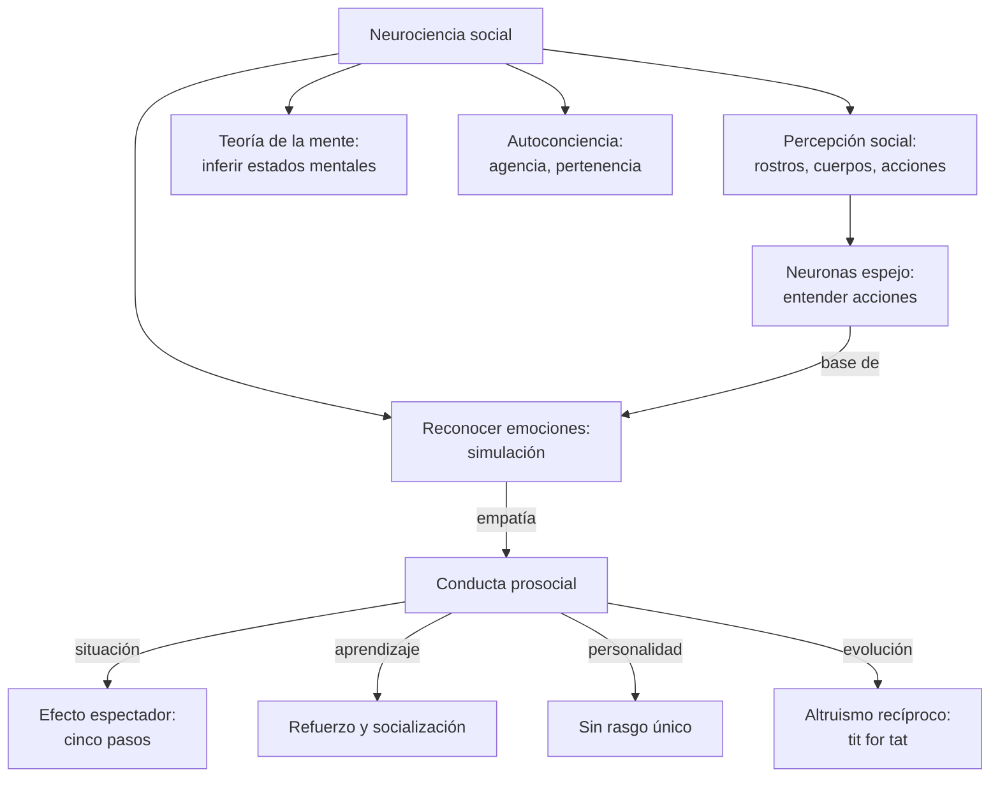
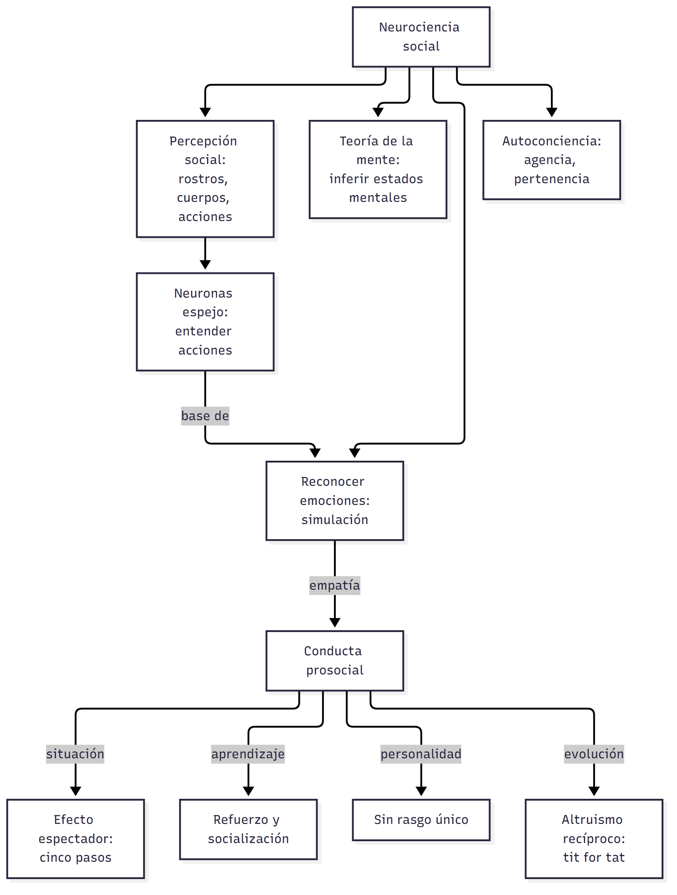
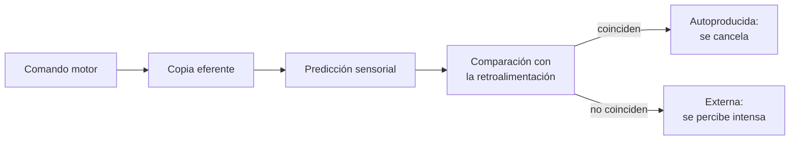
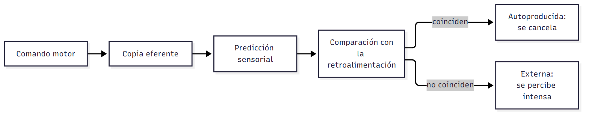

# C08 — Neurociencia social y altruismo · Versión de cursada

> **Fuentes:**
>
> - Baron, R. A., & Byrne, D. (2005). Conducta prosocial: ayudar a otros. En *Psicología social* (10.ª ed., cap. 10). Pearson Educación.
> - Bonini, L., Rotunno, C., Arcuri, E., & Gallese, V. (2022). Mirror neurons 30 years later: Implications and applications. *Trends in Cognitive Sciences*.
> - Cátedra de Psicología Social. (2026h). *Neurociencia social* [Diapositivas de clase, clase 8]. Universidad Favaloro.
> - Cátedra de Psicología Social. (2026i). *Altruismo* [Diapositivas de clase, clase 8]. Universidad Favaloro.
> - Grande-García, I. (2009). Neurociencia social: una breve introducción al estudio de las bases neurobiológicas de la conducta social. *Psicología y Ciencia Social, 11*(1-2).

> **Aviso sobre las fuentes:** **versión de cursada** (protocolo A): lo que se dio el 01/10 y lo que piden las unidades 7 y 9. Las páginas son las de los PDF de la cátedra. El programa y las diapositivas citan a Grande-García con año 2012, y el PDF dice 2009: se usa 2009. Bonini et al. es optativo. Del programa de la unidad 7 **no** se dieron en estas diapositivas la hipótesis del cerebro social ni el *hyperscanning* ni la neurociencia cultural: quedan afuera. De la unidad 9, las cuatro explicaciones motivacionales de Baron y Byrne no están en las diapositivas: van breves, marcadas «Programa», en §9.

> **Idea-fuerza:** La **neurociencia social** estudia los procesos nerviosos, endocrinos e inmunes que nos permiten interactuar con el mundo social: percibir a otros, entender sus acciones (**neuronas espejo**), inferir su mente (**teoría de la mente**), reconocer sus emociones y reconocernos a nosotros mismos. La **conducta prosocial** se explica en varios niveles: situación (**efecto espectador**), refuerzo, percepción, personalidad, socialización y evolución (**altruismo recíproco**) (Cátedra de Psicología Social, 2026h, diapositivas 3, 5, 9 y 13; 2026i, diapositivas 12, 19 y 36).

## Mapa: qué pide el programa y qué se dio en clase

| Tema | Programa | Clase | Sección |
|---|---|---|---|
| Definición e historia de la neurociencia social | ✔ | ✔ | §1 |
| Componentes del cerebro social | ✔ | ✔ | §2-5 |
| Aportes a la psicología social | ✔ | ✔ | §5 |
| Hipótesis del cerebro social, *hyperscanning*, neurociencia cultural | ✔ | — | No dado |
| Definición de altruismo y conducta prosocial | ✔ | ✔ | §6 |
| Responder a una emergencia | ✔ | ✔ | §7 |
| Refuerzo, percepción y personalidad | ✔ | ✔ | §8 |
| Empatía-altruismo, estado negativo, alegría empática | ✔ | — | §9 (Programa) |
| Altruismo recíproco y evolución | ✔ | ✔ | §10 |

---

# Parte I: neurociencia social

## 1. Qué es

Lo social y lo biológico se influyen mutuamente: los lazos de afiliación y crianza son esenciales para el bienestar, su interrupción produce estrés, y el aislamiento es un factor de riesgo de morbimortalidad (Cátedra de Psicología Social, 2026h, diapositiva 2).

Cacioppo y Berntson (1992) dan nombre a la disciplina: es el estudio interdisciplinario de los procesos neurobiológicos, nerviosos, endocrinos e inmunes, que nos permiten interactuar con el mundo social (Grande-García, 2009, p. 2). Combina la **neurociencia cognitiva** (neuroimagen, neuropsicología, técnicas neuroquímicas y neuroinmunológicas), las **ciencias cognitivas** y las **ciencias sociales** (Cátedra de Psicología Social, 2026h, diapositiva 4).

## 2. Percepción social

**Rostros y cuerpos** son una clase especial de estímulos (Cátedra de Psicología Social, 2026h, diapositivas 5-6):

| Región | Función |
|---|---|
| **Área fusiforme (FFA)** | Procesamiento de rostros (Kanwisher et al., 1997) |
| **Precúneo** | Caras familiares |
| **Amígdala** | Responde a lo desconocido |
| **STS** | Partes del cuerpo en movimiento |
| **EBA** | Cuerpos humanos, no objetos |

La percepción de rostros tiene dos componentes: los **estados emocionales, foco de atención e intenciones**, y la **identidad**. Estas áreas reflejan la distinción yo-otro.

**Percibir acciones.** La corteza motora primaria y áreas parietales se activan al percibir trayectorias biomecánicamente posibles, no imposibles (Grèzes, 2001, en Cátedra de Psicología Social, 2026h, diapositiva 7).

## 3. Neuronas espejo

Lo fundamental del sistema motor no es el movimiento sino la **acción**, definida por una meta. Toda acción tiene un aspecto externo, el movimiento, y uno interno, la imaginería motora (Cátedra de Psicología Social, 2026h, diapositiva 8).

Entendemos las acciones de los demás porque, al observarlas, se activan en nuestro cerebro representaciones motoras de esas mismas acciones. Parte de nuestro sistema motor se activa **«como si»** las ejecutáramos (Cátedra de Psicología Social, 2026h, diapositivas 9-10). La percepción (STS, regiones parieto-occipitales) y el entendimiento (región premotora) forman una red.

**Treinta años después.** Se describieron en 1992 en células premotoras de mono (Bonini et al., 2022, p. 1). La cátedra señala que quizá no sea la neurona individual la que refleja al otro, sino una maquinaria más compleja, distribuida en varias áreas, clave en el aprendizaje social (Cátedra de Psicología Social, 2026h, diapositivas 11-12).

→ Conecta con «no es posible no resonar» en `C02_ConstruccionSocialDeLaRealidad_Cursada_Guia.md`, §3.

## 4. Teoría de la mente y reconocimiento emocional

La **teoría de la mente** es la habilidad de inferir estados mentales de los demás: emociones, deseos, metas, intenciones y creencias. Se construye por capas (Cátedra de Psicología Social, 2026h, diapositivas 13-14):

- **Bloques de dominio específico:** detectar movimiento biológico, seguir la mirada, detectar intenciones, atención compartida, juego simulado, entender deseos y creencias.
- **Capacidades de dominio general (Stone):** metarrepresentación, recursividad y control ejecutivo.

Por eso no hay una sola región implicada.

**Reconocimiento emocional.** Los modelos de **simulación** sostienen que reconocer una emoción ajena implica simular en el propio cerebro la expresión observada, con sistemas somatosensoriales y motores (Cátedra de Psicología Social, 2026h, diapositiva 16; Grande-García, 2009, p. 4).

## 5. Autoconciencia

Las representaciones de uno y de los demás se superponen: hay **representaciones compartidas yo-otro**. El yo se descompone en sistemas disociables (Cátedra de Psicología Social, 2026h, diapositivas 17-19):

- **Autorreconocimiento:** aparece hacia el segundo año, con los pronombres y las emociones autoconscientes.
- **Agencia y pertenencia:** reconocernos como agentes y dueños de nuestras acciones.
- **Autorreflexión:** se correlaciona con la corteza prefrontal medial.
- **Memoria autobiográfica:** involucra hipocampo, prefrontal media y cíngulo posterior.

**Cierre de la clase.** Moscovici llamó representaciones sociales a un cuerpo de conocimientos que integra al individuo en la realidad. La neurociencia social permite estudiar sus bases biológicas (Cátedra de Psicología Social, 2026h, diapositiva 20). Por ejemplo, la intensidad de una actitud se asocia con la amígdala, y su valencia con sectores prefrontales (Grande-García, 2009, p. 7).

# Parte II: altruismo

## 6. Conducta prosocial y altruismo

La psicología social tiene dos vertientes: la **psicológica**, sobre cómo el psiquismo resulta de la relación con grupos, y la **sociológica**, sobre cómo el saber psicológico ayuda a comprender fenómenos sociales (Cátedra de Psicología Social, 2026i, diapositiva 3).

**Conducta prosocial:** toda conducta social positiva, **con o sin motivación altruista** (diapositiva 6). Roche (1991) la define por no buscar recompensa externa, favorecer a otros y aumentar la probabilidad de reciprocidad positiva (diapositiva 5). Son conductas complejas, con elementos cognitivos y afectivos (diapositiva 7).

Puede surgir de la **tensión interna** que la persona busca reducir, o del **voluntariado funcional**, que satisface motivos como sentirse mejor o lavar culpas (Cátedra de Psicología Social, 2026i, diapositivas 8-9).

> ⚠ **No confundir:** **prosocial** es la categoría amplia. **Altruista** implica ayudar sin esperar beneficio. En sentido biológico, altruismo es beneficiar a otro organismo no emparentado, a un costo propio (diapositiva 31).

## 7. Efecto espectador

**Kitty Genovese** fue asesinada en Nueva York con numerosos testigos que no ayudaron. El caso movió a **Darley y Latané** (Baron y Byrne, 2005, p. 4).

**Experimento (1968).** Los participantes oían por intercomunicador a un supuesto estudiante con un ataque. Creían estar solos con la víctima, o en grupos de 3 o de 6 personas. Se midió cuántos ayudaban y cuánto tardaban. **A más testigos, menos ayuda y más demora** (Cátedra de Psicología Social, 2026i, diapositivas 12-13).

**Cinco pasos para ayudar** (Cátedra de Psicología Social, 2026i, diapositivas 14-18):

| Paso | Obstáculo | Evidencia |
|---|---|---|
| 1. Darse cuenta | Exceso de estímulos, prisa | Seminaristas: ayudó 10 % con prisa y 63 % con tiempo |
| 2. Interpretar como emergencia | **Ignorancia pluralista**, miedo al ridículo | Humo: avisó 75 % solos y 38 % con otros inmóviles |
| 3. Asumir responsabilidad | **Difusión de la responsabilidad** | «Alguien más se encargará» |
| 4. Saber cómo ayudar | Falta de habilidades | La formación aumenta la intervención |
| 5. Decidir actuar | Costos: daño, vergüenza | «Álgebra cognitiva» |

(Baron y Byrne, 2005, pp. 9-10)

> ⚠ **No confundir:** en la **ignorancia pluralista**, nadie reacciona y cada uno concluye que no pasa nada (paso 2). En la **difusión**, se sabe que es grave, pero cada uno espera que actúe otro (paso 3).

## 8. Otras explicaciones

- **Refuerzos:** las conductas prosociales se sostienen cuando se aprueban. El grupo puede funcionar como estímulo discriminativo (Cátedra de Psicología Social, 2026i, diapositivas 19-20).
- **Percepción social:** actuamos según cómo interpretamos el hecho; intervienen el perceptor, la persona percibida, su relación y el contexto (diapositivas 21-25).
- **Personalidad:** London (1970) halló en quienes ayudaban a judíos espíritu de aventura, sentirse marginados, identificación con un progenitor de firmes convicciones y empatía. La **extensividad** es sentir responsabilidad por quienes no son del propio grupo. Pero **no hay un rasgo** único predictor (diapositivas 27-29).
- **Socialización:** las conductas altruistas se enseñan, primero en la familia y luego en la escuela (diapositiva 30).

## 9. Por qué ayudamos: tres motivos y los genes (Programa)

Baron y Byrne (2005, p. 37) ordenan estas explicaciones:

- **Empatía-altruismo:** ayudar a quien lo necesita hace sentirse bien.
- **Alivio de un estado negativo:** ayudar reduce el afecto negativo propio.
- **Alegría empática:** ayudar da la satisfacción de lograr algo.
- **Determinismo genético:** ayudar favorece a quienes comparten nuestros genes.

## 10. Altruismo y evolución

El altruismo es un **desafío para la teoría de la evolución**: Darwin planteaba que, si la competencia entre grupos supera a la competencia entre individuos, se seleccionan los grupos con más altruistas (Cátedra de Psicología Social, 2026i, diapositivas 31-32).

**Juegos.** En el **dilema del prisionero**, cada uno elige lealtad o traición sin comunicarse. **Axelrod** mostró que la cooperación puede surgir entre egoístas con **tit for tat**: cooperar primero y luego copiar lo que hizo el otro (diapositivas 33-35).

**Altruismo recíproco (Trivers).** El costo se compensa con la reciprocidad futura: la selección favorece a quienes cooperan selectivamente, siempre que se pueda identificar a los tramposos. En humanos habría condiciones favorables: larga vida, poca dispersión y grupos pequeños y estables (diapositivas 36-37). → Sigue en `C10_TomaDeDecisionesSociales_Cursada_Guia.md`.

## Para rendir (formato mixto)

**1) Opción múltiple.** Para la teoría de neuronas espejo, entendemos una acción porque: (a) la razonamos; (b) **se activan representaciones motoras propias**; (c) la memorizamos; (d) la imitamos siempre. — *Respuesta: b* (Cátedra de Psicología Social, 2026h, diapositiva 9).

**2) Opción múltiple.** Alguien ve humo y no avisa porque nadie reacciona. Es: (a) difusión de la responsabilidad; (b) **ignorancia pluralista**; (c) extensividad; (d) reactancia. — *Respuesta: b* (Baron y Byrne, 2005, p. 10).

**3) Verdadero o falso.** «Existe un rasgo que predice la conducta prosocial.» — *Falso.* Influyen el contexto y la interacción (Cátedra de Psicología Social, 2026i, diapositiva 29).

**4) Verdadero o falso.** «Una sensación autoproducida se percibe con más intensidad que una externa.» — *Falso.* Coincide con la predicción y se cancela (Cátedra de Psicología Social, 2026h, diapositiva 18).

**5) Pregunta abierta.** *Explicá el efecto espectador con el modelo de los cinco pasos.*

> **Esqueleto de la respuesta:** (1) Definición: más testigos, menos ayuda. (2) Darley y Latané (1968). (3) Los cinco pasos. (4) Dónde falla: ignorancia pluralista y difusión. (5) Conexión: influencia informativa de C06 (Cátedra de Psicología Social, 2026i, diapositivas 12-18).

## Referencias

Baron, R. A., & Byrne, D. (2005). Conducta prosocial: ayudar a otros. En *Psicología social* (10.ª ed., cap. 10). Pearson Educación.

Bonini, L., Rotunno, C., Arcuri, E., & Gallese, V. (2022). Mirror neurons 30 years later: Implications and applications. *Trends in Cognitive Sciences*.

Cátedra de Psicología Social. (2026h). *Neurociencia social* [Diapositivas de clase, clase 8]. Universidad Favaloro.

Cátedra de Psicología Social. (2026i). *Altruismo* [Diapositivas de clase, clase 8]. Universidad Favaloro.

Grande-García, I. (2009). Neurociencia social: una breve introducción al estudio de las bases neurobiológicas de la conducta social. *Psicología y Ciencia Social, 11*(1-2).
