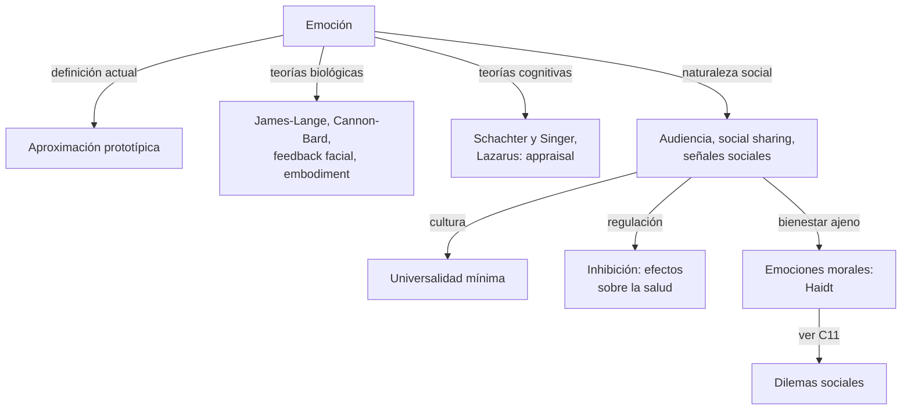
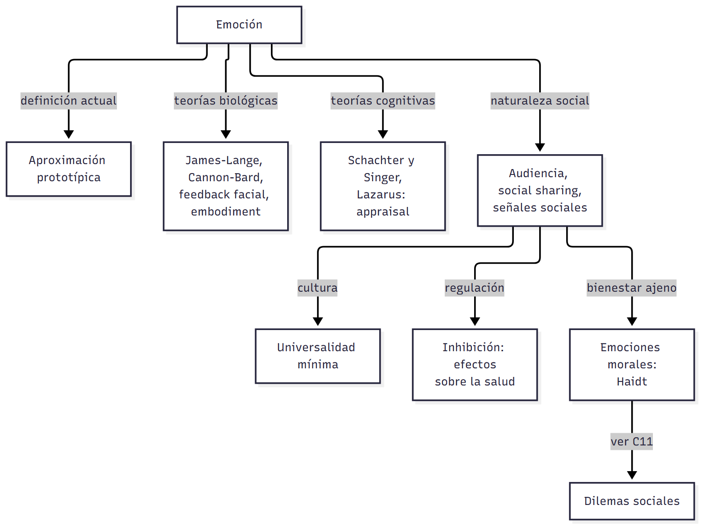
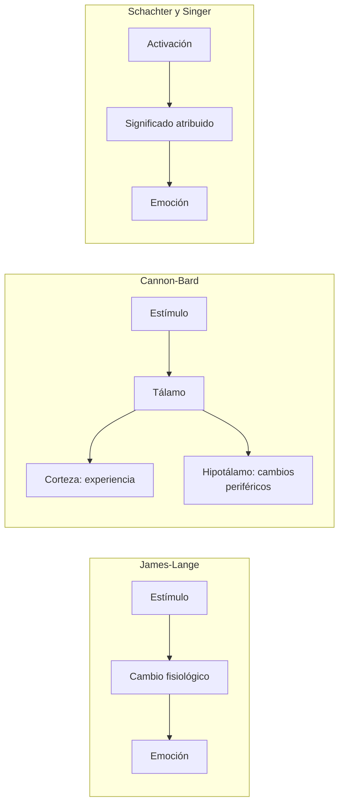
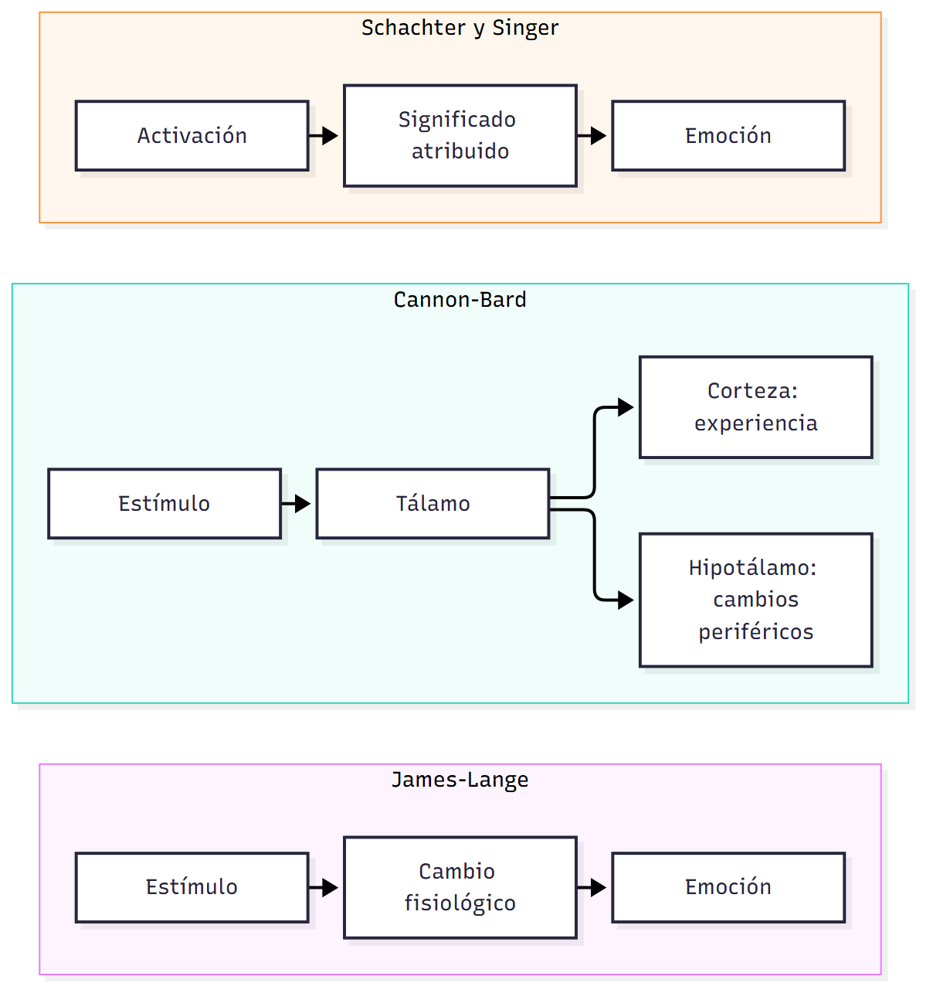

# C09 — Emociones sociales · Versión de cursada

> **Fuentes:**
>
> - Cátedra de Psicología Social. (2026j). *Emociones sociales y dilemas morales* [Diapositivas de clase, clase 9]. Universidad Favaloro.
> - Fernández Sedano, I., & Carrera Levillaín, P. (2007). Las emociones en Psicología social. En J. F. Morales, M. Moya, E. Gaviria, & I. Cuadrado (Coords.), *Psicología social* (3.ª ed., cap. 11). McGraw-Hill.
> - Saavedra, B. A., Mola, D. J., Gancedo, K. M., & Reyna, C. (2015). Una revisión sistemática sobre emociones morales y dilemas sociales. *Summa Psicológica UST, 12*(1), 63-76.

> **Aviso sobre las fuentes:** **versión de cursada** (protocolo A): lo que se dio el 08/10 y la parte de emociones de la unidad 8. Las páginas son las de los PDF de la cátedra. Las diapositivas citan el capítulo como «Morales et al., 2007»: sus autoras son Fernández Sedano y Carrera Levillaín. Las diapositivas 12 y 13 repiten el mismo texto bajo los nombres de Lazarus y Scherer. Las emociones morales siguen, con los resultados, en `C11_DilemasMorales_Cursada_Guia.md`. Queda afuera la taxonomía y las leyes emocionales del capítulo, que el programa nombra pero no se dieron.

> **Idea-fuerza:** La emoción no tiene una definición única: hoy se la piensa como un **prototipo**, una secuencia de antecedentes y reacciones donde ningún componente es necesario ni suficiente. Las teorías discuten qué va primero: el cuerpo, el cerebro, la cara o la **valoración cognitiva**. La psicología social agrega que las emociones son **sociales**: se expresan ante una audiencia, se comparten, varían con la cultura y su inhibición afecta la salud (Cátedra de Psicología Social, 2026j, diapositivas 4, 11, 14 y 21).

## Mapa: qué pide el programa y qué se dio en clase

| Tema | Programa | Clase | Sección |
|---|---|---|---|
| Relación entre emoción y psicología social | ✔ | ✔ | §1, §4 |
| Evolución histórica en el estudio de las emociones | ✔ | ✔ | §2, §3 |
| Efectos del contexto social sobre las emociones | ✔ | ✔ | §4 |
| Diferencias culturales | ✔ | ✔ | §5 |
| Influencia de las emociones sobre la salud | ✔ | ✔ | §6 |
| Emociones morales | ✔ | ✔ | §7 |
| Taxonomía, leyes y funciones emocionales | ✔ | — | No dado |

---

## 1. Qué es una emoción

**De la tríada a cinco componentes.** Ekman (1992) define la emoción como un patrón adaptativo de reacción corporal, en gran medida innato (Fernández Sedano y Carrera Levillaín, 2007, p. 3). La tríada reactiva tiene tres componentes: subjetivo, fisiológico y motórico-expresivo. **Scherer (1984)** la amplía a cinco: evaluación cognitiva, expresión motora, motivación, sentimiento subjetivo y activación fisiológica (Cátedra de Psicología Social, 2026j, diapositivas 2-3; Fernández Sedano y Carrera Levillaín, 2007, p. 4).

**Aproximación prototípica.** Como es imposible una definición cerrada, hoy se concibe la emoción como una secuencia de antecedentes y reacciones en la que **ningún componente es necesario ni suficiente**. Su núcleo incluye activación fisiológica, vivencia de pasión o descontrol, una situación causal y una tendencia de acción unida a normas sociales (Cátedra de Psicología Social, 2026j, diapositiva 4). La tristeza, por ejemplo, tiene atributos típicos: postura decaída, llanto, hablar poco, abandono del contacto social (diapositiva 5).

Russell y Barrett (1999) separan el **core affect**, procesos básicos de placer y activación, del **episodio emocional prototípico**, las categorías específicas con causas y reacciones (Cátedra de Psicología Social, 2026j, diapositiva 6).

| Concepto | Qué lo distingue |
|---|---|
| **Emoción** | Aislada en el tiempo, involuntaria, ante un estímulo relevante; se conoce su origen (Averill, 1997) |
| **Estado de ánimo** | Sin objeto concreto |
| **Sentimiento** | Expresión subjetiva, adquirida en la socialización |
| **Pasión** | Puede dominar la vida de la persona, fuera de su control |

(Cátedra de Psicología Social, 2026j, diapositivas 6-7)

## 2. Teorías clásicas

- **James-Lange (1890):** la emoción **resulta** de percibir los cambios fisiológicos (Cátedra de Psicología Social, 2026j, diapositiva 8; Fernández Sedano y Carrera Levillaín, 2007, p. 7).
- **Cannon-Bard (1927):** vía talámica. Reacciones físicas y experiencia ocurren **en simultáneo** (diapositiva 9; p. 7).
- **Feedback facial (Izard, Zajonc):** la expresión es clave para definir la experiencia, también para nosotros mismos (diapositiva 10; p. 8).
- **Embodiment (Niedenthal, Adolphs):** las respuestas corporales facilitan el procesamiento. Imitar una expresión ayuda a reconocerla (diapositiva 10).

## 3. Perspectiva cognitiva

- **Schachter y Singer (1962), teoría bifactorial:** la emoción depende de la activación y del **significado** que le damos (Cátedra de Psicología Social, 2026j, diapositiva 11; Fernández Sedano y Carrera Levillaín, 2007, p. 9).
- **Lazarus (1984, 1991), *appraisal*:** la emoción surge de la valoración cognitiva de la situación, de los recursos de afrontamiento y de sus posibles resultados (diapositivas 11-13; p. 11).

| Fase | Qué ocurre |
|---|---|
| **Primaria** | *Appraisal*: se evalúa la situación y se la interpreta como una emoción; hay respuesta subjetiva, expresiva y fisiológica |
| **Secundaria** | Se transforma lo evaluado según los recursos de afrontamiento: minimización, negación, exageración o redefinición |

> ⚠ **No confundir:** para **James-Lange** el cuerpo produce la emoción. Para **Schachter y Singer** la activación es necesaria, pero la interpretación define **cuál** emoción. Para **Lazarus** la valoración cognitiva es el origen.

## 4. La naturaleza social de las emociones

- **Averill (1980):** las emociones no son unitarias: varían según el contexto y el papel social de la persona (Cátedra de Psicología Social, 2026j, diapositiva 14).
- **Parkinson (1998):** la expresión es resultado de la interacción; las emociones son «disposiciones de acción, dirigidas intrínsecamente hacia una audiencia» (diapositiva 14; Fernández Sedano y Carrera Levillaín, 2007, p. 21).
- **Social sharing:** compartir experiencias, sobre todo negativas, ayuda a procesarlas. Pero escuchar reiteradamente episodios negativos «quema» la red de apoyo (diapositiva 15; p. 21).
- **Fridlund (1991, 1994):** en ciertas expresiones, como la sonrisa, importa más la presencia del otro que la experiencia emocional. Las expresiones son **señales sociales** de nuestras intenciones (diapositiva 16; p. 23).
- **Traue y Michael (1993):** las emociones son transacciones entre el individuo y su entorno (diapositiva 21; p. 30).

## 5. Cultura y universalidad

En las culturas **individualistas** hay más atribuciones internas y emociones centradas en el yo, como la culpa. En las **colectivistas** pesan los antecedentes grupales y las emociones positivas. Las sociedades más expresivas tienen mayor bienestar subjetivo (Cátedra de Psicología Social, 2026j, diapositiva 15; Fernández Sedano y Carrera Levillaín, 2007, p. 23).

**Hipótesis de mínima universalidad (Russell y Fernández-Dols, 1997).** Hay cierta semejanza entre culturas al interpretar expresiones faciales, pero eso no implica un sistema innato que una emociones concretas con expresiones universales (diapositiva 17; p. 24). Lo común es esto: hay patrones faciales compartidos, se coordinan con estados psicológicos y permiten inferir esos estados; la asociación con emociones específicas es propia de la cultura occidental (diapositiva 18).

## 6. Regulación emocional y salud

Usamos pensamientos para regular las emociones, y la cultura influye en cuánto se autocontrolan (Cátedra de Psicología Social, 2026j, diapositiva 20).

La **baja expresividad** puede ser adaptativa a corto plazo. A largo plazo, la **inhibición** de conductas, pensamientos y emociones exige un esfuerzo fisiológico que se vuelve un estresor acumulativo, y lleva a trastornos relacionados con el estrés (diapositiva 21; Fernández Sedano y Carrera Levillaín, 2007, p. 30).

## 7. Emociones morales

Se entienden como respuestas a problemas del ambiente. Según **Haidt (2003)**, las **emociones morales** se vinculan con el bienestar social, se construyen en las relaciones, permiten ver las consecuencias de las propias conductas en el bienestar ajeno y motivan a hacer el bien y evitar el mal (Cátedra de Psicología Social, 2026j, diapositiva 22; Saavedra et al., 2015, p. 2). Se identifican por dos rasgos: **inductores desinteresados**, porque se activan aunque la persona no participe, y **tendencias de acción prosocial** (diapositiva 23).

| Familia | Emociones |
|---|---|
| **Condena a los demás** | Ira, disgusto, desprecio |
| **Autoconciencia** | Culpa, vergüenza, bochorno |
| **Alabanza a los demás** | Gratitud, admiración |
| **Sufrimiento de los otros** | Compasión, empatía |

(Cátedra de Psicología Social, 2026j, diapositiva 23)

## Para rendir (formato mixto)

**1) Opción múltiple.** La aproximación prototípica sostiene que: (a) existe una definición cerrada; (b) la fisiología es necesaria; (c) **ningún componente es necesario ni suficiente**; (d) toda emoción es innata. — *Respuesta: c* (Cátedra de Psicología Social, 2026j, diapositiva 4).

**2) Opción múltiple.** «Estoy triste porque lloro» responde a: (a) **James-Lange**; (b) Cannon-Bard; (c) Lazarus; (d) Fridlund. — *Respuesta: a.* La emoción resulta de percibir los cambios fisiológicos (Cátedra de Psicología Social, 2026j, diapositiva 8).

**3) Verdadero o falso.** «Un estado de ánimo tiene un objeto concreto.» — *Falso.* Es lo que lo distingue de la emoción (Cátedra de Psicología Social, 2026j, diapositiva 7).

**4) Verdadero o falso.** «La inhibición emocional sostenida puede dañar la salud.» — *Verdadero.* Es un estresor acumulativo (Cátedra de Psicología Social, 2026j, diapositiva 21).

**5) Pregunta abierta.** *¿Por qué se dice que las emociones son sociales? Da dos autores.*

> **Esqueleto de la respuesta:** (1) Tesis: no son unitarias ni solo internas. (2) Parkinson: dirigidas a una audiencia. (3) Fridlund: señales sociales. (4) Ejemplo: sonrisa. (5) Cierre: la cultura modula expresión y regulación (Cátedra de Psicología Social, 2026j, diapositivas 14-16).

## Referencias

Cátedra de Psicología Social. (2026j). *Emociones sociales y dilemas morales* [Diapositivas de clase, clase 9]. Universidad Favaloro.

Fernández Sedano, I., & Carrera Levillaín, P. (2007). Las emociones en Psicología social. En J. F. Morales, M. Moya, E. Gaviria, & I. Cuadrado (Coords.), *Psicología social* (3.ª ed., cap. 11). McGraw-Hill.

Saavedra, B. A., Mola, D. J., Gancedo, K. M., & Reyna, C. (2015). Una revisión sistemática sobre emociones morales y dilemas sociales. *Summa Psicológica UST, 12*(1), 63-76.
