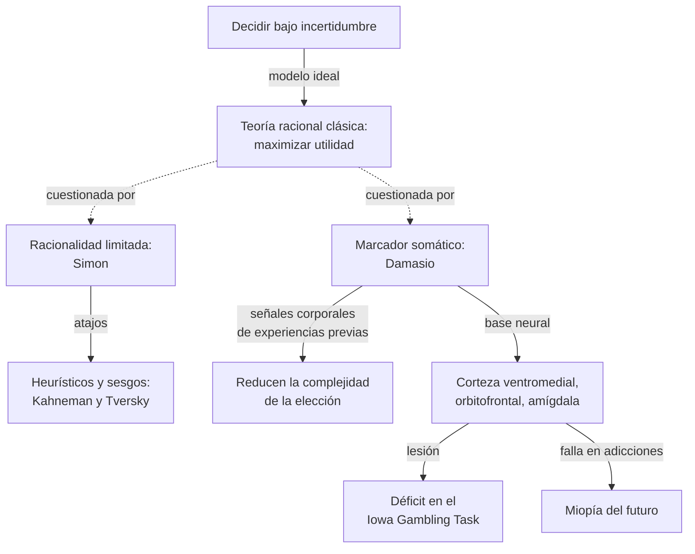
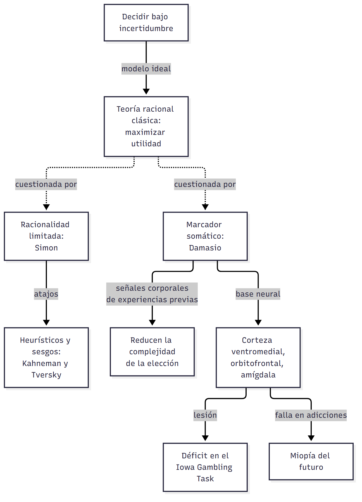
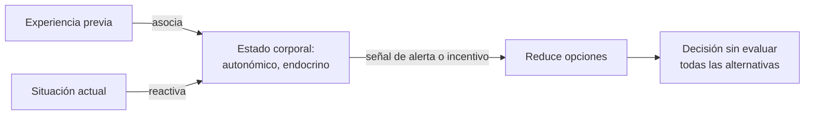
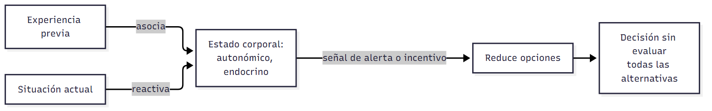
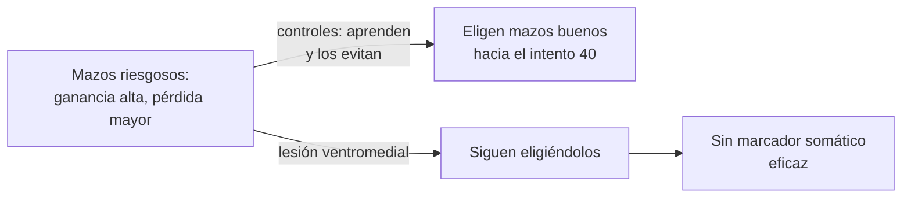
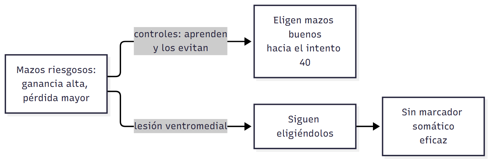

# C10 — Toma de decisiones sociales · Versión de cursada

> **Fuentes:**
>
> - Cátedra de Psicología Social. (2026k). *Toma de decisiones sociales* [Diapositivas de clase, clase 10]. Universidad Favaloro.
> - Cortada de Kohan, N., & Macbeth, G. (2006). Los sesgos cognitivos en la toma de decisiones. *Revista de Psicología, 2*(3).
> - Manes, F., Gleichgerrcht, E., & Torralva, T. (2009). Neurobiología de la toma de decisiones y de la cognición social. En *La neurociencia social en Sudamérica: una aproximación multinivel a perspectivas biológicas y sociales* (pp. 147-174).

> **Aviso sobre las fuentes:** **versión de cursada** (protocolo A): lo que se dio el 15/10 y lo que pide la unidad 10. Las páginas son las de los PDF de la cátedra. El programa nombra teoría de juegos, confianza, perdón, castigo altruista y normas de equidad: **esos temas no aparecen en estas diapositivas**. Los juegos se trataron en C08 (dilema del prisionero) y en C11 (ultimátum, dictador). La diapositiva 9 fecha en «septiembre 1843» el caso que ilustra con el cráneo atravesado y el doctor Harlow; la diapositiva no nombra al paciente.

> **Idea-fuerza:** Decidir es elegir entre alternativas bajo incertidumbre. La visión clásica supone un agente que maximiza, pero las personas tienen **racionalidad limitada**, usan **heurísticos** que generan **sesgos** y, según **Damasio**, necesitan la emoción para decidir: los **marcadores somáticos** orientan la elección. La evidencia viene de pacientes con lesión **ventromedial**, que fallan en el **Iowa Gambling Task** (Cátedra de Psicología Social, 2026k, diapositivas 3, 7, 10, 14 y 25).

## Mapa: qué pide el programa y qué se dio en clase

| Tema | Programa | Clase | Sección |
|---|---|---|---|
| Definición y teorías de la toma de decisiones | — | ✔ | §1 |
| Marcador somático | — | ✔ | §2 |
| Heurísticos y sesgos | ✔ (bibliografía) | ✔ | §3 |
| Decisión bajo riesgo | ✔ (bibliografía) | ✔ | §4 |
| Neuroanatomía y medición | ✔ (bibliografía) | ✔ | §5, §6 |
| Incentivos y recompensa | ✔ | ✔ | §7 |
| Teoría de juegos, confianza, castigo altruista | ✔ | Ver C08 y C11 | Sin desarrollo aquí |

---

## 1. Qué es decidir

La toma de decisiones es el acto de **elegir entre alternativas posibles sobre las cuales existe incertidumbre**. Suele darse en una situación donde hay desacuerdos sobre qué evaluación es válida, qué alternativas existen, qué consecuencias se esperan y qué valores deben servir de criterio (Cátedra de Psicología Social, 2026k, diapositiva 3).

El tema nació ligado a la ciencia política, para analizar a votantes y funcionarios (diapositiva 4). Históricamente se pasó de una elección abstracta de máxima utilidad a un proceso gradual, con transacciones entre intereses (diapositiva 5). No es solo un proceso intelectual: puede depender de procesos cuasi mecánicos de los que el agente no es consciente (diapositiva 6).

| Teoría | Idea central | Cuándo sirve |
|---|---|---|
| **Racional clásica** | Maximizar la utilidad esperada eligiendo la mejor opción | Modelo ideal |
| **Racionalidad limitada (Simon)** | Con recursos y tiempo limitados, buscamos una opción **aceptable** («satisfacción»), no la óptima | Valores en conflicto, como paz y seguridad |
| **Política burocrática** | Compiten intereses internos y poder | Cuando deciden varias personas |

(Cátedra de Psicología Social, 2026k, diapositiva 7)

Estas teorías no compiten necesariamente: se complementan según el contexto y el número de personas.

## 2. El marcador somático de Damasio

Para **Damasio (1994)**, las emociones y los sentimientos son elementos **esenciales** de la decisión, no un obstáculo para la razón. Evaluamos opciones en función de experiencias previas gracias a **marcadores somáticos**: señales corporales, como incomodidad o tranquilidad, que guían la decisión sin analizar cada alternativa (Cátedra de Psicología Social, 2026k, diapositivas 8 y 10).

**Hipótesis.** Las emociones resultan de estructuras neurales que representan estados corporales y los asocian con estímulos externos. Esos cambios se ligan a eventos e influyen en el procesamiento cognitivo. La emoción es fundamental para la supervivencia y **necesaria para la decisión racional** (Cátedra de Psicología Social, 2026k, diapositiva 11).

La clase lo ilustra con el caso del doctor Harlow, en el que una lesión frontal cambia la conducta sin borrar la inteligencia (diapositiva 9).

> ▸ **Complemento:** la imagen corresponde al caso conocido como Phineas Gage, que la literatura suele fechar en 1848, y no en 1843 como figura en la diapositiva. No está en los textos asignados: conviene contrastarlo con tu cuaderno.

> ⚠ **No confundir:** Damasio **no** dice que convenga decidir «con el corazón» en vez de con la razón. Dice que sin emoción tampoco hay decisión racional adecuada.

## 3. Heurísticos y sesgos

**Kahneman y Tversky** iniciaron en los años 70 este programa, que le valió a Kahneman el Nobel de Economía en 2002: ante la incertidumbre usamos **atajos mentales** en lugar de análisis extensos (Cátedra de Psicología Social, 2026k, diapositiva 14; Cortada de Kohan y Macbeth, 2006, p. 2).

Identificaron tres heurísticos generales: **accesibilidad**, **representatividad** y **anclaje o ajuste** (Cortada de Kohan y Macbeth, 2006, p. 6). Estos atajos generan **sesgos**: errores sistemáticos de juicio que afectan el proceso de elección (diapositiva 12). Dos ejemplos de la clase:

- **Sesgo de confirmación:** buscar información que reafirme creencias previas. → Conecta con el sesgo de autoconfirmación en `C02_ConstruccionSocialDeLaRealidad_Cursada_Guia.md`, §1.
- **Efecto de anclaje:** usar en exceso la información inicial.

Los sesgos se comparan con las **ilusiones perceptivas**, como la de Müller-Lyer: las dos líneas parecen distintas aunque miden lo mismo. Las distorsiones no se limitan a lo perceptivo: también ocurren al decidir (Cortada de Kohan y Macbeth, 2006, pp. 7-8).

Limitan la racionalidad en economía, psicología y organizaciones, y por eso hacen falta intervenciones para mejorar las decisiones (Cátedra de Psicología Social, 2026k, diapositiva 12).

> ⚠ **No confundir:** el **heurístico** es el atajo: suele funcionar. El **sesgo** es el error sistemático que ese atajo puede producir.

## 4. Decidir bajo riesgo

Hay tres tipos de decisiones: bajo **certeza**, bajo **ignorancia** y bajo **riesgo**, el caso más complejo, porque se manejan probabilidades (Cátedra de Psicología Social, 2026k, diapositiva 13; Cortada de Kohan y Macbeth, 2006, p. 3).

**Elección riesgosa.** Decidir bajo incertidumbre es aceptar una apuesta, como llevar o no paraguas sin conocer el clima. **Bernoulli (1738)** observó que preferimos lo seguro aunque la apuesta tenga mayor esperanza matemática (diapositiva 15; Cortada de Kohan y Macbeth, 2006, p. 8).

**Ejemplo.** Entre 800 seguros y una apuesta con 85 % de probabilidad de ganar 1.000, la mayoría elige lo seguro. La apuesta vale en promedio 850. Bernoulli lo explica con la **utilidad subjetiva**, una función cóncava: pasar de 100 a 200 se valora más que pasar de 1.100 a 1.200 (Cátedra de Psicología Social, 2026k, diapositiva 16).

## 5. Neuroanatomía de la decisión

Decidir requiere interacción de múltiples regiones. Comparte muchas áreas con la emoción, lo que sugiere una relación neuroanatómica estrecha (Cátedra de Psicología Social, 2026k, diapositivas 17-18; Manes et al., 2009, p. 4).

| Región | Función |
|---|---|
| **Corteza ventromedial** | Aprendizaje de feedback positivo y negativo |
| **Corteza orbitofrontal** | Más activa cuando decide un tercero; gatilla inductores **secundarios** del marcador somático (recuerdo de un evento emocional) |
| **Cíngulo anterior** | Más activo cuando decide uno mismo; evalúa recompensas previas |
| **Amígdala** | Gatilla inductores **primarios** (placer o aversión) |

(Cátedra de Psicología Social, 2026k, diapositivas 19-22)

El modelo de la diapositiva 18 distingue tres sistemas: codificación de estímulos (orbitofrontal), selección de la acción (cíngulo anterior) y recompensa esperada (ganglios basales y amígdala). También se diferencian decisiones **afectivas** y **no afectivas**.

Manes et al. (2009) vinculan la decisión con la **cognición social**, que estudia cómo nos influye la presencia real o imaginaria de otros (p. 3), y exploran si comparten sistemas con la teoría de la mente.

## 6. Iowa Gambling Task

**Tarea (Bechara et al., 1994).** Se eligen cartas de cuatro mazos con distintos perfiles de castigo y recompensa. Los controles prefieren los mazos «buenos» alrededor del intento 40, sobre 100 (Cátedra de Psicología Social, 2026k, diapositiva 24; Manes et al., 2009, p. 12).

**Resultado.** Los pacientes con lesión **ventromedial** prefieren los mazos riesgosos a los conservadores (diapositiva 25). Es uno de los experimentos que articulan la teoría: muestra que razonar no alcanza si falla la señal emocional.

## 7. Conductas adictivas

**Placer** se asocia con dopamina en el núcleo accumbens. La **miopía del futuro** es la incapacidad de ver consecuencias negativas a largo plazo frente a un placer inmediato (Cátedra de Psicología Social, 2026k, diapositiva 26).

La corteza orbitofrontal se activa con el deseo de consumir, y la dorsolateral prefrontal cuando hay sustancia disponible. La actividad dorsolateral estimula a la orbitofrontal y aumenta el deseo: interrumpir esa relación podría ser un blanco terapéutico (diapositiva 27).

## Para rendir (formato mixto)

**1) Opción múltiple.** Herbert Simon propone que decidimos: (a) maximizando siempre; (b) **eligiendo una opción aceptable**; (c) al azar; (d) por competencia burocrática. — *Respuesta: b* (Cátedra de Psicología Social, 2026k, diapositiva 7).

**2) Opción múltiple.** Los pacientes con lesión ventromedial en el Iowa Gambling Task: (a) eligen mazos buenos antes; (b) **prefieren los mazos riesgosos**; (c) no pueden jugar; (d) aprenden igual. — *Respuesta: b* (Cátedra de Psicología Social, 2026k, diapositiva 25).

**3) Verdadero o falso.** «Para Damasio, las emociones dificultan la decisión racional.» — *Falso.* Son necesarias para ella (Cátedra de Psicología Social, 2026k, diapositiva 11).

**4) Verdadero o falso.** «La mayoría prefiere una ganancia segura aun cuando la apuesta tenga mayor esperanza matemática.» — *Verdadero.* Es la aversión al riesgo (Cortada de Kohan y Macbeth, 2006, p. 8).

**5) Pregunta abierta.** *¿Cómo aporta el Iowa Gambling Task a la hipótesis del marcador somático?*

> **Esqueleto de la respuesta:** (1) Hipótesis: las señales corporales guían la elección. (2) Tarea: cuatro mazos. (3) Controles: aprenden hacia el intento 40. (4) Lesión ventromedial: siguen con los riesgosos. (5) Conclusión: sin esa señal la decisión falla (Cátedra de Psicología Social, 2026k, diapositivas 10, 24 y 25).

## Referencias

Cátedra de Psicología Social. (2026k). *Toma de decisiones sociales* [Diapositivas de clase, clase 10]. Universidad Favaloro.

Cortada de Kohan, N., & Macbeth, G. (2006). Los sesgos cognitivos en la toma de decisiones. *Revista de Psicología, 2*(3).

Manes, F., Gleichgerrcht, E., & Torralva, T. (2009). Neurobiología de la toma de decisiones y de la cognición social. En *La neurociencia social en Sudamérica: una aproximación multinivel a perspectivas biológicas y sociales* (pp. 147-174).
