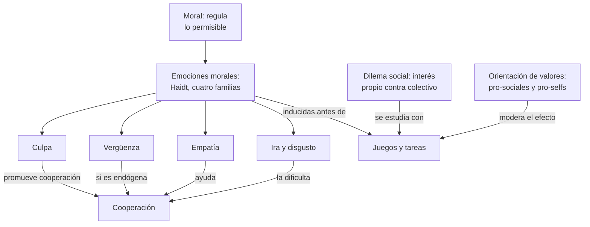
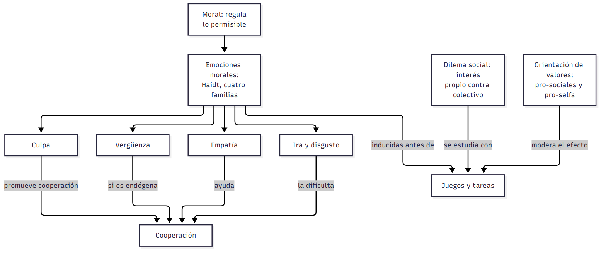
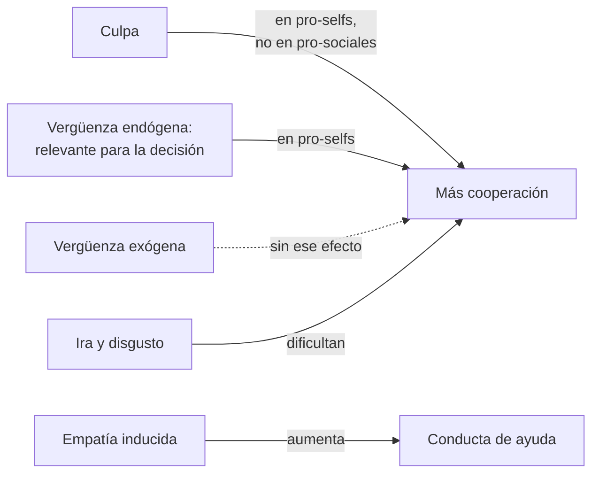
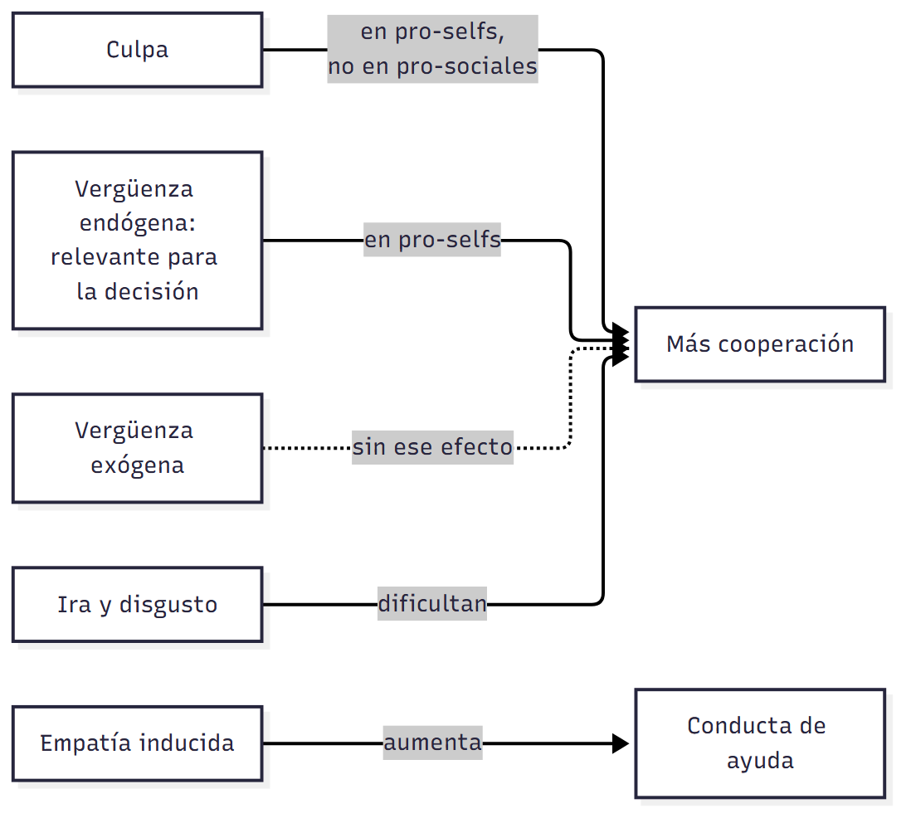
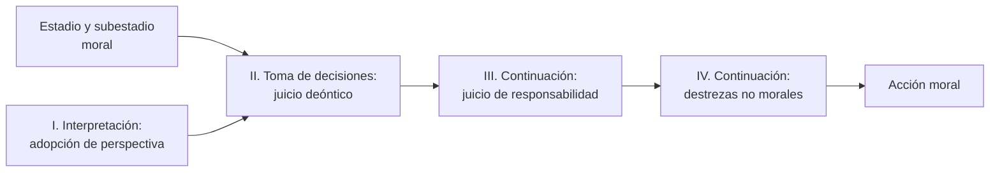
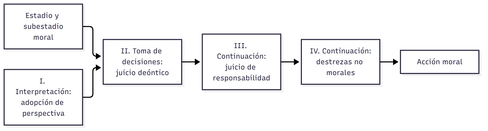
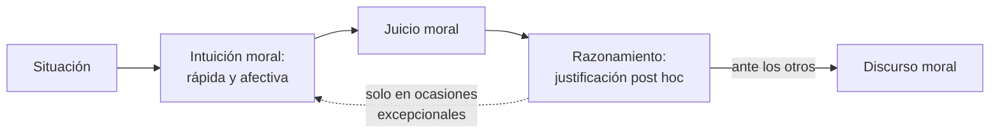
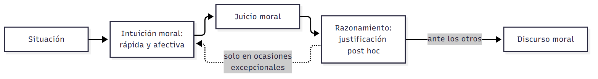

# C11 — Dilemas morales · Versión de cursada

> **Fuentes:**
>
> - Adell, J. (1990). El enfoque cognitivo-evolutivo de la acción moral: Problemas teóricos. *Recerca: Revista de Pensament i Anàlisi, 15*(1-2), 31-52.
> - Cátedra de Psicología Social. (2026l). *Dilemas morales* [Diapositivas de clase, clase 11]. Universidad Favaloro.
> - Fernández Sedano, I., & Carrera Levillaín, P. (2007). Las emociones en Psicología social. En J. F. Morales, M. Moya, E. Gaviria, & I. Cuadrado (Coords.), *Psicología social* (3.ª ed., cap. 11). McGraw-Hill.
> - Saavedra, B. A., Mola, D. J., Gancedo, K. M., & Reyna, C. (2015). Una revisión sistemática sobre emociones morales y dilemas sociales. *Summa Psicológica UST, 12*(1), 63-76.
> - Scotto, C. (2022). Cognición moral y cognición psicológica: Las intuiciones vienen primero. *Revista de Humanidades de Valparaíso*, (19), 15-42. https://doi.org/10.22370/rhv2022iss19pp15-42

> **Aviso sobre las fuentes:** **versión de cursada** (protocolo A): lo que se dio el 22/10, la parte moral de la unidad 8 y los dos textos que la cátedra exige para el TP3. Las páginas son las del PDF: en Adell, la de la revista es esa más 30; en Scotto, esa más 14. El programa fecha a Saavedra et al. en 2014; el artículo es de 2015. La cátedra cita «Segura, J. A. (1990)»: el artículo lo firma **Jordi Adell** (Adell Segura), y acá se cita como Adell (1990). Las diapositivas no desarrollan §8 a §11: salen de los textos. El PDF de Adell es un escaneo con errores de lectura: las cifras de Milgram y de Heinz se revisaron sobre la imagen del PDF. **Sigue sin material:** Greene, la corteza orbitofrontal en la cognición moral y la agresión figuran en el programa, pero no en estos textos ni en la lista del TP3. Piaget aparece solo como antecedente. Adell supone conocidos los estadios de Kohlberg: no los describe uno por uno. Los tres dilemas del tranvía figuran en las diapositivas solo como consignas para pensar.

> **Idea-fuerza:** La moral regula lo permitido en un grupo, y las emociones son su motor. Las **emociones morales** motivan a hacer el bien y evitar el mal, y en los **dilemas sociales**, donde chocan el interés propio y el colectivo, explican por qué las personas cooperan aunque la economía clásica prediga lo contrario. **Culpa y vergüenza** no funcionan igual, y su efecto depende de la **orientación de valores sociales** (Cátedra de Psicología Social, 2026l, diapositivas 3, 4, 6 y 9; Saavedra et al., 2015, p. 1). Dos modelos discuten cómo se forma lo moral: para **Kohlberg**, el juicio razonado guía la acción a través de un juicio de responsabilidad (Adell, 1990, p. 8); para **Haidt**, las intuiciones vienen primero y las razones después (Scotto, 2022, p. 8). Scotto extiende esa idea a la comprensión de otras mentes (p. 2).

## Mapa: qué pide el programa y qué se dio en clase

| Tema | Programa | Clase | Sección |
|---|---|---|---|
| Moral y normas | ✔ | ✔ | §1 |
| Emociones morales | ✔ | ✔ | §2, §3 |
| Dilemas sociales y su estudio | ✔ | ✔ | §4, §5 |
| Dilemas morales (tranvía) | ✔ | ✔ | §7 |
| Kohlberg: juicio y acción moral | ✔ | Texto del TP3 | §8 |
| Haidt: modelo intuicionista social | ✔ | Texto del TP3 | §9 |
| Mentalización y cognición psicológica | ✔ | Texto del TP3 | §10 |
| Piaget | ✔ | — | Solo nombrado en §8 |
| Greene, corteza orbitofrontal, agresión | ✔ | — | Sin material; fuera de la lista del TP3 |

---

## 1. Emociones y moral

«Las emociones son en sí mismas sociales y los fenómenos sociales son en sí mismos emocionales». Las normas aprendidas median lo que hacemos con ellas: ante algo desagradable podemos poner cara de asco, aguantar o sonreír (Cátedra de Psicología Social, 2026l, diapositiva 2).

La **moral** se relaciona con lo que está bien y mal en una conducta social. Brinda un sistema para regular lo permisible y es un conjunto de costumbres y valores de un grupo cultural. Muchas reglas son arbitrarias: gestos ofensivos en un país no lo son en otro. La neurociencia social busca los mecanismos que subyacen a la conducta moral (diapositiva 3).

## 2. Emociones morales

Retomando C09, las **emociones morales (Haidt, 2003)** están ligadas al bienestar de los demás. Se agrupan en cuatro familias: condena a los demás, autoconciencia, alabanza a los demás y sufrimiento de los otros (Cátedra de Psicología Social, 2026l, diapositiva 4). Haidt no considera moral a la empatía, pero hay evidencia de su papel en el altruismo: Batson propone el **modelo de empatía-altruismo** (Saavedra et al., 2015, p. 2).

Dos ideas completan el **enfoque funcionalista**, para el que las emociones responden a problemas del ambiente (diapositiva 4; Saavedra et al., 2015, p. 2):

- **Teoría valorativa:** la valoración cognitiva genera reacciones específicas; situaciones parecidas pueden dar emociones distintas.
- ***Feeling-is-for-doing***: el sistema emocional es el motivacional primario, y cada emoción cumple una función para lograr objetivos.

## 3. Culpa y vergüenza

| | Culpa | Vergüenza |
|---|---|---|
| **Qué la provoca** | Disrupciones morales drásticas: actos que perturban valores | Transgresiones no graves, reforzada por la exposición pública |
| **Foco** | Autoevaluación del acto, según valores internos | Autoevaluación negativa de uno mismo |
| **Fisiología** | | Enrojecimiento, aumento de frecuencia cardíaca |
| **Qué motiva** | Compensar a otros y reparar; fomenta la empatía | Autorregular el propio comportamiento |

(Cátedra de Psicología Social, 2026l, diapositiva 5)

> ⚠ **No confundir:** la **culpa** apunta a **lo que hice** y empuja a reparar. La **vergüenza** se vincula con la **exposición** y empuja a autorregularse o esconderse.

## 4. Qué es un dilema social

Según **Colman (2003)**, es una interacción entre dos o más personas con un conflicto entre el **interés propio y el colectivo**. La economía clásica supone que buscamos maximizar el beneficio personal, pero la evidencia muestra que las emociones explican por qué cooperamos igual (Cátedra de Psicología Social, 2026l, diapositiva 6; Saavedra et al., 2015, p. 3).

## 5. Cómo se estudian

Saavedra et al. (2015) revisaron **17 artículos**, con **33 estudios**, de EBSCO, ScienceDirect y OVID (pp. 1 y 4).

**Inducción de la emoción** (Cátedra de Psicología Social, 2026l, diapositiva 7):

| Método | % | Ejemplo |
|---|---|---|
| Lectura de una situación | 33,33 | Imaginar que se perdió la bicicleta prestada |
| Tareas de laboratorio o juegos | 30,30 | Por mal desempeño, el compañero no obtiene sus billetes de lotería |
| Recuerdo autobiográfico | 27,27 | Describir una experiencia de culpa o vergüenza |
| Información sobre un tercero | 9,09 | Video de alguien que relata su necesidad |

**Variable de personalidad: orientación de valores sociales.** Los **pro-sociales** tienden a maximizar la ganancia conjunta y a evitar la inequidad. Los **pro-selfs**, individualistas y competitivos, priorizan su beneficio (diapositiva 8; Saavedra et al., 2015, p. 3).

| Paradigma | Cómo funciona | Qué mide |
|---|---|---|
| **Ultimátum** | Uno propone un reparto; el otro acepta o rechaza | Rechazo de ofertas injustas |
| **Impunidad** | Igual, pero quien propone cobra aunque el otro rechace | Rechazo de ofertas injustas |
| **Give-Some** | Reparten recursos sin saber cuánto les asigna el otro | Cooperación |
| **Dilema del prisionero** | Rondas repetidas: cada uno puede castigar al otro | Cooperación |
| **Dictador** | Reparto de dinero entre uno mismo y otros | Conducta individual de quien reparte |
| **Tareas de distribución** | Repartir billetes de lotería | Dilema moral: ayudar a uno es dejar de ayudar a otro |

(Cátedra de Psicología Social, 2026l, diapositiva 8)

## 6. Resultados

- **Culpa:** promueve la cooperación en **pro-selfs**, no en pro-sociales. Tras una oferta egoísta, quienes sintieron culpa ofrecieron más después; el **78 %** de quienes no la sintieron siguió igual una semana más tarde (Ketelaar y Au, 2003). Se asocia con toma de perspectiva y mejores relaciones (Leith y Baumeister, 1998) (Cátedra de Psicología Social, 2026l, diapositiva 9; Saavedra et al., 2015, p. 6).
- **Vergüenza:** motiva tendencias prosociales en pro-selfs solo si es **endógena**, es decir, relevante para la decisión. La **exógena** no tiene ese efecto. No se vincula con la toma de perspectiva y se asocia con peores resultados interpersonales, aunque ayuda a ajustar la conducta (diapositiva 9; Saavedra et al., 2015, pp. 4-5).
- **Síntesis de la revisión:** culpa y vergüenza incrementan la cooperación, ira y disgusto la dificultan, y la inducción de empatía aumenta la ayuda (Saavedra et al., 2015, p. 1).

> 🎯 **Para el parcial:** en tus notas de clase figura que el examen usa «algunos experimentos paradigmáticos como articuladores de lo teórico» (F. Mendez Casariego, apuntes de clase, 22 de octubre de 2026). Ketelaar y Au son un buen ejemplo de esta clase.

## 7. Dilemas para pensar

Tres consignas de la clase (Cátedra de Psicología Social, 2026l, diapositiva 10):

1. **Tranvía:** un vagón va a matar a 5 personas; podés accionar una palanca y que mate a 1.
2. **Puente peatonal:** podés empujar a una persona para detener el vagón y salvar a 5.
3. **Donación de órganos:** podrías matar a un paciente sano para salvar a 5.

En los tres, el saldo numérico es el mismo: una vida por cinco. Lo que cambia es cómo se llega a ese resultado.

## 8. Juicio y acción moral: Kohlberg y Candee

**El problema.** Durante más de veinte años, Kohlberg estudió cómo se desarrolla el razonamiento moral por estadios. La conducta quedó para el final, porque era el tema de sus oponentes: las teorías del aprendizaje social (Adell, 1990, p. 3). El antecedente es **Hartshorne y May (1928-30)**: conocer la norma no se relacionaba con la conducta real, y lo que mejor explicaba la transgresión era la probabilidad de ser descubierto (p. 4).

**Dos enfoques generales (Blasi, 1980)** (Adell, 1990, pp. 4-5):

| | Tendencias de acción | Mediación cognitiva |
|---|---|---|
| **Acción moral** | Resultado automático de hábitos, rasgos o tendencias | Respuesta racional, derivada de comprender los fines |
| **Razonamiento** | No crea significados; a veces es una racionalización posterior | Imprescindible para construir significados morales |
| **Dónde está lo moral** | En el contenido o la función social de la conducta | En el juicio y la intención, no en el resultado |
| **Quiénes** | Sociobiología, psicoanálisis, teorías del aprendizaje | Piaget, Kohlberg |

Por eso una acción benéfica hecha por afán de notoriedad no es necesariamente moral (p. 5). Blasi concluye que razonamiento y acción están relacionados estadísticamente, pero que en 1980 faltaba una explicación teórica de esa relación (pp. 6-7).

**Dos juicios intermedios.** Los principios no llevan directamente a la acción (Adell, 1990, p. 8):

- **Juicio deóntico:** define **qué es justo**. ¿Es justo que Heinz robe el medicamento para salvar a su esposa?
- **Juicio de responsabilidad:** define **el papel del actor**. ¿Es Heinz responsable y está obligado a hacerlo?

La hipótesis es un **incremento monotónico**: al subir de estadio aumenta la consistencia entre ambos juicios (p. 9), porque disminuyen las excusas o **cuasi-obligaciones** (p. 10). Los **subestadios** son orientaciones que pueden aparecer en cada estadio: el **A** se orienta al respeto heterónomo por las reglas y la autoridad; el **B**, a la autonomía y la equidad (p. 11).

> ⚠ **No confundir:** saber **qué es justo** (deóntico) no es asumir **que me toca hacerlo** (responsabilidad). Ahí se abre la distancia entre pensar y actuar.

**El modelo** (Adell, 1990, p. 13):

La función IV incluye inteligencia para planificar, atención y retraso de la gratificación (p. 13). El proceso es recursivo: la acción también influye en el pensamiento (p. 14). Rest propone un modelo de cuatro componentes con conclusiones parecidas (p. 14).

**La evidencia que citan** (toda es anterior al modelo):

| Estudio | Diseño | Resultado |
|---|---|---|
| **McNamee (1978)** | 102 universitarios de 18 a 25 años. Un cómplice que dice haber tomado una droga pide ayuda, y el experimentador no se la da | A mayor estadio, más probabilidad y grado de ayuda. Quienes no intervinieron lo justificaron distinto según su estadio (pp. 9-10) |
| **Kohlberg en Milgram** | Evaluó a participantes del experimento de obediencia | A mayor estadio, más negativas. Todo el subestadio A siguió hasta el final; se negó el 86 % del B (p. 16) |
| **My Lai** | Declaraciones sobre la masacre | El único soldado que se negó fue evaluado como 4B (p. 17) |
| **Dilema de Heinz** | Entrevistas en tres países | El 90 % del estadio 5 cree que debe robar, frente al 60 % de los estadios más bajos (p. 11) |

→ Milgram está en `C07_ObedienciaYPoderDeLaSituacion_Cursada_Guia.md`. McNamee se parece a los estudios de ayuda de `C08_NeurocienciaSocialYAltruismo_Cursada_Guia.md`, §7.

La **amplitud de perspectiva** crece con el estadio: sí mismo (1), el otro concreto (2), los iguales (3), la nación (4), el grupo amplio de las constituciones y declaraciones de derechos (5) y la humanidad (6). El estadio 6 es hoy hipotético (Adell, 1990, pp. 15 y 19).

**Críticas de Adell** (pp. 16-20):

- La **prescriptividad** y la **universalizabilidad** no admiten grados: un juicio lo es o no lo es. Por lo tanto, no pueden justificar una jerarquía de adecuación moral (pp. 17-19).
- Las evidencias son **anteriores** al modelo: todavía no mostró poder predictivo (pp. 19-20). Además, medir el razonamiento después de actuar deja abierta la justificación *a posteriori* (p. 16).
- No se definieron las variables situacionales ni la relación entre dilemas hipotéticos y reales. Kohlberg fue excesivamente **cognitivista** (p. 20).
- Muchas veces el problema no es saber qué hacer, sino «encontrar la fuerza para hacerlo» (p. 20).

## 9. Las intuiciones vienen primero: el modelo de Haidt

La **imagen clásica** ponía la razón y la autonomía en el centro de la vida moral: deliberar y decidir según principios (Scotto, 2022, p. 3). El **modelo intuicionista social (MIS)** de Haidt (2001) la desafía con dos vías (p. 7):

| | Intuición moral | Razonamiento moral |
|---|---|---|
| **Proceso** | Rápido, automático, usualmente con carga afectiva | Controlado, más «en frío» |
| **Conciencia** | El sentimiento de bueno o malo aparece sin pasos conscientes | Actividad mental consciente |
| **Función** | Produce el juicio moral intuitivo | Justifica después, ante los otros |

El MIS se apoya en dos tesis: los juicios morales están influidos por procesos intuitivos, y el razonamiento moral es un **fenómeno social** de justificación, no el acto privado de un razonador solitario (Scotto, 2022, pp. 7-8). El razonamiento se vuelve sobre las intuiciones solo si estas son débiles y hay alta capacidad de incorporar información nueva (p. 7).

- **Metáfora:** el **jinete** racional está mayormente al servicio del **elefante** intuitivo (p. 8).
- **Error de la filosofía moral, según Haidt:** confundir la justificación posterior con la base de la cognición moral (p. 7).
- **Cinco fundamentos:** daño/cuidado, justicia/reciprocidad, autoridad/respeto, endogrupo/lealtad y pureza/santidad. Son innatos y también aprendidos culturalmente: dejan espacio a virtudes distintas, pero limitan las moralidades posibles (p. 8).
- **Estupefacción moral:** es uno de los hiatos entre la intuición y las convicciones razonadas (p. 14).

El marco es el **enfoque dual de la cognición** (Scotto, 2022, p. 13). Los dos sistemas operan en paralelo: a veces colaboran y a veces compiten.

| | Sistema 1 (intuitivo) | Sistema 2 (reflexivo) |
|---|---|---|
| **Velocidad** | Rápido, espontáneo | Lento |
| **Forma** | Asociativo, holístico, contextualizado | Basado en reglas, abstracto, secuencial |
| **Control** | Automático, inconsciente | Controlado, consciente |
| **Evolución** | Antiguo, compartido con otras especies | Reciente, distintivamente humano |

> ⚠ **No confundir:** Haidt aparece dos veces. Las **cuatro familias de emociones morales** son de 2003 (§2). El **modelo intuicionista** es de 2001 y explica cómo se forma el juicio.

## 10. También en la cognición psicológica

Entender intenciones y creencias ajenas es un *input* crítico para evaluar responsabilidades: por eso la comprensión psicológica es requisito de la competencia moral (Scotto, 2022, p. 5). La tesis de Scotto es que ambas cogniciones tienen una semejanza estructural (p. 7).

| | Teoría de la mente clásica | Enfoque interactivo o de segunda persona |
|---|---|---|
| **Perspectiva** | Observador separado de la mente ajena (p. 9) | Participante en encuentros cara a cara (p. 11) |
| **Objeto** | Creencias y deseos (p. 9) | Emociones, intenciones y fines (p. 11) |
| **Evidencia** | Conducta y generalizaciones (p. 9) | Comportamientos expresivos (p. 11) |
| **Proceso** | Inferencias, como un teórico (p. 9) | Detección rápida y menos demandante (p. 11) |

El **test de falsa creencia**, en su versión original, solo lo superaban niños de entre 3 años y medio y 4 años (p. 9). Con tareas implícitas se ven rastreos automáticos desde los 7 meses (pp. 14-15).

Los enfoques **no se reemplazan**: dan cuenta de capacidades complementarias en la cognición adulta (p. 12). La lectura de mentes debe ser **eficiente** y **flexible** a la vez (p. 12). Por eso se distingue una teoría de la mente **mínima**, eficiente pero inflexible, que rastrea estados sin representarlos, de una **plena**, flexible pero demandante (pp. 14-15).

**Comportamientos expresivos.** Son señales que muestran los propios estados, pueden ser voluntarias o involuntarias y característicamente se dirigen a una audiencia (Green, 2007, en Scotto, 2022, pp. 16-17). El repertorio incluye expresiones faciales, gestos, posturas, vocalizaciones no verbales y prosodia (p. 17). Son los objetos primarios de las **intuiciones psicológicas** (p. 6). → Conecta con Fridlund en `C09_EmocionesSociales_Cursada_Guia.md`, §4.

**Tipos de intuiciones** (Scotto, 2022, pp. 19-20):

| Tipo | Qué hace | Ejemplo |
|---|---|---|
| **De primer nivel** | Respuesta espontánea, constitutiva de la capacidad | La reacción ante una emoción moral |
| **De segundo nivel** | Creencia o juicio sobre esa respuesta | Juzgar que una acción es despreciable |
| **Holística** | Integra señales sin análisis | Postura, cara y tono muestran tristeza |
| **Inferencial** | Automatiza inferencias de experiencia acumulada | Atribuir agresividad por el grupo social |

**Cognición social implícita.** Un estado es implícito cuando es automático, típicamente inconsciente e inarticulado: la persona «sabe» más de lo que puede reportar. Se estudia con medidas indirectas como el **Test de Asociación Implícita (IAT)** (p. 22). Incluye **impresiones implícitas** y **sesgos implícitos**: asociaciones automáticas que pueden chocar con las creencias que la persona defiende (pp. 22-23).

**Conclusión.** Así como para el MIS las intuiciones morales vienen primero, las intuiciones psicológicas también preceden, fundamentan y acompañan formas más sofisticadas de lectura de mentes. Las razones llegan después (Scotto, 2022, pp. 23-24).

## 11. Kohlberg y Haidt, cara a cara

Esta comparación es de la guía: Adell escribe en 1990, antes del MIS, y ningún texto la hace punto por punto.

| | Kohlberg | Haidt |
|---|---|---|
| **Qué va primero** | El juicio moral, para que la acción sea moral | La intuición |
| **Papel de la razón** | Guía la elección y la responsabilidad | Justifica después |
| **Unidad de análisis** | El sujeto y sus estadios | El proceso social de justificación |
| **Crítica principal** | Excesivamente cognitivista (Adell, 1990, p. 20) | Discusión sobre el peso que da a las intuiciones (Scotto, 2022, p. 8) |

> 🔑 **Punto clave:** no son posiciones sin contacto. Para explicar a quienes actúan moralmente por debajo del estadio 5, Kohlberg y Candee recurren a **intuiciones** de valores morales (Adell, 1990, p. 12). Y según algunos especialistas, el juicio moral resulta de la interacción entre sistemas intuitivos y racionales (Scotto, 2022, p. 4).

## Para rendir (formato mixto)

**1) Opción múltiple.** Un dilema social es: (a) un desacuerdo entre culturas; (b) **un conflicto entre interés propio y colectivo**; (c) una norma implícita; (d) una decisión individual sin consecuencias. — *Respuesta: b* (Saavedra et al., 2015, p. 3).

**2) Opción múltiple.** La culpa promueve la cooperación sobre todo en: (a) pro-sociales; (b) **pro-selfs**; (c) ambos por igual; (d) ninguno. — *Respuesta: b* (Cátedra de Psicología Social, 2026l, diapositiva 9).

**3) Verdadero o falso.** «La vergüenza exógena motiva tendencias prosociales en pro-selfs.» — *Falso.* Solo la endógena (Cátedra de Psicología Social, 2026l, diapositiva 9).

**4) Verdadero o falso.** «En el juego de la Impunidad, si el otro rechaza, quien propone no cobra.» — *Falso.* Cobra igual (Cátedra de Psicología Social, 2026l, diapositiva 8).

**5) Pregunta abierta.** *Compará culpa y vergüenza según su origen, su función y su efecto en dilemas sociales.*

> **Esqueleto de la respuesta:** (1) Ambas son de autoconciencia (Haidt). (2) Culpa: disrupción moral y reparación. (3) Vergüenza: transgresión expuesta y autorregulación. (4) Efecto: culpa en pro-selfs; vergüenza si es endógena. (5) Cierre: lo moral depende de la emoción y de la persona (Cátedra de Psicología Social, 2026l, diapositivas 5 y 9).

**6) Opción múltiple.** Una persona cree que es justo denunciar un fraude, pero piensa que no le corresponde a ella hacerlo. Lo que falta es: (a) el juicio deóntico; (b) **el juicio de responsabilidad**; (c) la adopción de perspectiva; (d) la intuición moral. — *Respuesta: b* (Adell, 1990, p. 8).

**7) Opción múltiple.** Alguien siente rechazo inmediato ante un acto, lo condena y recién después busca argumentos. Ilustra: (a) **el modelo intuicionista social**; (b) el incremento monotónico; (c) el subestadio A; (d) la teoría de la mente plena. — *Respuesta: a* (Scotto, 2022, p. 7).

**8) Verdadero o falso.** «Para Hartshorne y May, conocer mejor la norma predecía menos transgresión.» — *Falso.* No se relacionaba con la conducta real (Adell, 1990, p. 4).

**9) Pregunta abierta.** *Explicá por qué saber qué es justo no alcanza para actuar, según Kohlberg y Candee, y qué objeta Adell.*

> **Esqueleto de la respuesta:** (1) Juicio deóntico y de responsabilidad. (2) Excusas y cuasi-obligaciones. (3) Destrezas no morales. (4) Ejemplo: McNamee o Milgram. (5) Crítica: evidencia previa al modelo y exceso de cognitivismo (Adell, 1990, pp. 8, 10, 13, 16 y 19-20).

## Referencias

Adell, J. (1990). El enfoque cognitivo-evolutivo de la acción moral: Problemas teóricos. *Recerca: Revista de Pensament i Anàlisi, 15*(1-2), 31-52.

Cátedra de Psicología Social. (2026l). *Dilemas morales* [Diapositivas de clase, clase 11]. Universidad Favaloro.

Fernández Sedano, I., & Carrera Levillaín, P. (2007). Las emociones en Psicología social. En J. F. Morales, M. Moya, E. Gaviria, & I. Cuadrado (Coords.), *Psicología social* (3.ª ed., cap. 11). McGraw-Hill.

Saavedra, B. A., Mola, D. J., Gancedo, K. M., & Reyna, C. (2015). Una revisión sistemática sobre emociones morales y dilemas sociales. *Summa Psicológica UST, 12*(1), 63-76.

Scotto, C. (2022). Cognición moral y cognición psicológica: Las intuiciones vienen primero. *Revista de Humanidades de Valparaíso*, (19), 15-42. https://doi.org/10.22370/rhv2022iss19pp15-42
