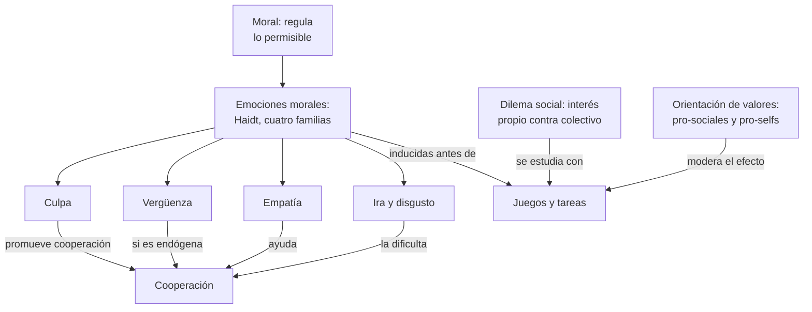
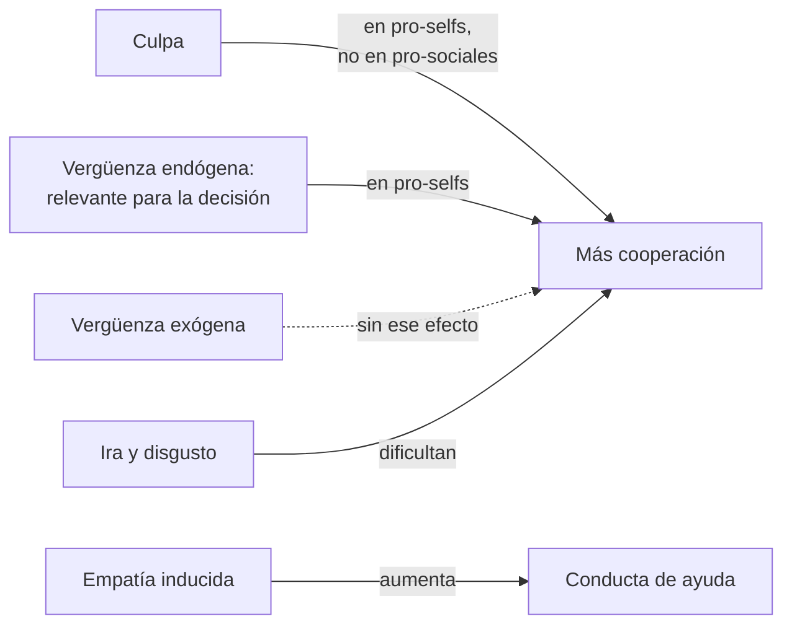

# C11 — Dilemas morales · Versión de cursada

> **Fuentes:**
>
> - Cátedra de Psicología Social. (2026l). *Dilemas morales* [Diapositivas de clase, clase 11]. Universidad Favaloro.
> - Fernández Sedano, I., & Carrera Levillaín, P. (2007). Las emociones en Psicología social. En J. F. Morales, M. Moya, E. Gaviria, & I. Cuadrado (Coords.), *Psicología social* (3.ª ed., cap. 11). McGraw-Hill.
> - Saavedra, B. A., Mola, D. J., Gancedo, K. M., & Reyna, C. (2015). Una revisión sistemática sobre emociones morales y dilemas sociales. *Summa Psicológica UST, 12*(1), 63-76.

> **Aviso sobre las fuentes:** **versión de cursada** (protocolo A): lo que se dio el 22/10 y la parte moral de la unidad 8. Las páginas son las del PDF de la cátedra. El programa fecha a Saavedra et al. en 2014; el artículo es de 2015. **Falta material:** el programa y el cronograma nombran a Kohlberg y Piaget, Haidt (modelo intuicionista), Greene, la corteza orbitofrontal en la cognición moral y la agresión, y el cronograma pide **Scotto (2022)** y **Segura (1990)**. Esos textos no están en Drive y las diapositivas no desarrollan esos temas: por eso **no se explican acá**. Si entran en el examen, hay que conseguir los textos. Los tres dilemas del tranvía figuran en las diapositivas solo como consignas para pensar.

> **Idea-fuerza:** La moral regula lo permitido en un grupo, y las emociones son su motor. Las **emociones morales** motivan a hacer el bien y evitar el mal, y en los **dilemas sociales**, donde chocan el interés propio y el colectivo, explican por qué las personas cooperan aunque la economía clásica prediga lo contrario. **Culpa y vergüenza** no funcionan igual, y su efecto depende de la **orientación de valores sociales** (Cátedra de Psicología Social, 2026l, diapositivas 3, 4, 6 y 9; Saavedra et al., 2015, p. 1).

## Mapa: qué pide el programa y qué se dio en clase

| Tema | Programa | Clase | Sección |
|---|---|---|---|
| Moral y normas | ✔ | ✔ | §1 |
| Emociones morales | ✔ | ✔ | §2, §3 |
| Dilemas sociales y su estudio | ✔ | ✔ | §4, §5 |
| Dilemas morales (tranvía) | ✔ | ✔ | §7 |
| Kohlberg, Piaget, Haidt, Greene | ✔ | — | Sin material |
| Mentalización, corteza orbitofrontal, agresión | ✔ | — | Sin material |

---

## 1. Emociones y moral

«Las emociones son en sí mismas sociales y los fenómenos sociales son en sí mismos emocionales». Las normas aprendidas median lo que hacemos con ellas: ante algo desagradable podemos poner cara de asco, aguantar o sonreír (Cátedra de Psicología Social, 2026l, diapositiva 2).

La **moral** se relaciona con lo que está bien y mal en una conducta social. Brinda un sistema para regular lo permisible y es un conjunto de costumbres y valores de un grupo cultural. Muchas reglas son arbitrarias: gestos ofensivos en un país no lo son en otro. La neurociencia social busca los mecanismos que subyacen a la conducta moral (diapositiva 3).

## 2. Emociones morales

Retomando C09, las **emociones morales (Haidt, 2003)** están ligadas al bienestar de los demás. Se agrupan en cuatro familias: condena a los demás, autoconciencia, alabanza a los demás y sufrimiento de los otros (Cátedra de Psicología Social, 2026l, diapositiva 4). Haidt no considera moral a la empatía, pero hay evidencia de su papel en el altruismo: Batson propone el **modelo de empatía-altruismo** (Saavedra et al., 2015, p. 2).

Dos ideas completan el **enfoque funcionalista**, para el que las emociones responden a problemas del ambiente (diapositiva 4; Saavedra et al., 2015, p. 2):

- **Teoría valorativa:** la valoración cognitiva genera reacciones específicas; situaciones parecidas pueden dar emociones distintas.
- ***Feeling-is-for-doing***: el sistema emocional es el motivacional primario, y cada emoción cumple una función para lograr objetivos.

## 3. Culpa y vergüenza

| | Culpa | Vergüenza |
|---|---|---|
| **Qué la provoca** | Disrupciones morales drásticas: actos que perturban valores | Transgresiones no graves, reforzada por la exposición pública |
| **Foco** | Autoevaluación del acto, según valores internos | Autoevaluación negativa de uno mismo |
| **Fisiología** | | Enrojecimiento, aumento de frecuencia cardíaca |
| **Qué motiva** | Compensar a otros y reparar; fomenta la empatía | Autorregular el propio comportamiento |

(Cátedra de Psicología Social, 2026l, diapositiva 5)

> ⚠ **No confundir:** la **culpa** apunta a **lo que hice** y empuja a reparar. La **vergüenza** se vincula con la **exposición** y empuja a autorregularse o esconderse.

## 4. Qué es un dilema social

Según **Colman (2003)**, es una interacción entre dos o más personas con un conflicto entre el **interés propio y el colectivo**. La economía clásica supone que buscamos maximizar el beneficio personal, pero la evidencia muestra que las emociones explican por qué cooperamos igual (Cátedra de Psicología Social, 2026l, diapositiva 6; Saavedra et al., 2015, p. 3).

## 5. Cómo se estudian

Saavedra et al. (2015) revisaron **17 artículos**, con **33 estudios**, de EBSCO, ScienceDirect y OVID (pp. 1 y 4).

**Inducción de la emoción** (Cátedra de Psicología Social, 2026l, diapositiva 7):

| Método | % | Ejemplo |
|---|---|---|
| Lectura de una situación | 33,33 | Imaginar que se perdió la bicicleta prestada |
| Tareas de laboratorio o juegos | 30,30 | Por mal desempeño, el compañero no obtiene sus billetes de lotería |
| Recuerdo autobiográfico | 27,27 | Describir una experiencia de culpa o vergüenza |
| Información sobre un tercero | 9,09 | Video de alguien que relata su necesidad |

**Variable de personalidad: orientación de valores sociales.** Los **pro-sociales** tienden a maximizar la ganancia conjunta y a evitar la inequidad. Los **pro-selfs**, individualistas y competitivos, priorizan su beneficio (diapositiva 8; Saavedra et al., 2015, p. 3).

| Paradigma | Cómo funciona | Qué mide |
|---|---|---|
| **Ultimátum** | Uno propone un reparto; el otro acepta o rechaza | Rechazo de ofertas injustas |
| **Impunidad** | Igual, pero quien propone cobra aunque el otro rechace | Rechazo de ofertas injustas |
| **Give-Some** | Reparten recursos sin saber cuánto les asigna el otro | Cooperación |
| **Dilema del prisionero** | Rondas repetidas: cada uno puede castigar al otro | Cooperación |
| **Dictador** | Reparto de dinero entre uno mismo y otros | Conducta individual de quien reparte |
| **Tareas de distribución** | Repartir billetes de lotería | Dilema moral: ayudar a uno es dejar de ayudar a otro |

(Cátedra de Psicología Social, 2026l, diapositiva 8)

## 6. Resultados

- **Culpa:** promueve la cooperación en **pro-selfs**, no en pro-sociales. Tras una oferta egoísta, quienes sintieron culpa ofrecieron más después; el **78 %** de quienes no la sintieron siguió igual una semana más tarde (Ketelaar y Au, 2003). Se asocia con toma de perspectiva y mejores relaciones (Leith y Baumeister, 1998) (Cátedra de Psicología Social, 2026l, diapositiva 9; Saavedra et al., 2015, p. 6).
- **Vergüenza:** motiva tendencias prosociales en pro-selfs solo si es **endógena**, es decir, relevante para la decisión. La **exógena** no tiene ese efecto. No se vincula con la toma de perspectiva y se asocia con peores resultados interpersonales, aunque ayuda a ajustar la conducta (diapositiva 9; Saavedra et al., 2015, pp. 4-5).
- **Síntesis de la revisión:** culpa y vergüenza incrementan la cooperación, ira y disgusto la dificultan, y la inducción de empatía aumenta la ayuda (Saavedra et al., 2015, p. 1).

> 🎯 **Para el parcial:** en tus notas de clase figura que el examen usa «algunos experimentos paradigmáticos como articuladores de lo teórico» (F. Mendez Casariego, apuntes de clase, 22 de octubre de 2026). Ketelaar y Au son un buen ejemplo de esta clase.

## 7. Dilemas para pensar

Tres consignas de la clase (Cátedra de Psicología Social, 2026l, diapositiva 10):

1. **Tranvía:** un vagón va a matar a 5 personas; podés accionar una palanca y que mate a 1.
2. **Puente peatonal:** podés empujar a una persona para detener el vagón y salvar a 5.
3. **Donación de órganos:** podrías matar a un paciente sano para salvar a 5.

En los tres, el saldo numérico es el mismo: una vida por cinco. Lo que cambia es cómo se llega a ese resultado.

## Para rendir (formato mixto)

**1) Opción múltiple.** Un dilema social es: (a) un desacuerdo entre culturas; (b) **un conflicto entre interés propio y colectivo**; (c) una norma implícita; (d) una decisión individual sin consecuencias. — *Respuesta: b* (Saavedra et al., 2015, p. 3).

**2) Opción múltiple.** La culpa promueve la cooperación sobre todo en: (a) pro-sociales; (b) **pro-selfs**; (c) ambos por igual; (d) ninguno. — *Respuesta: b* (Cátedra de Psicología Social, 2026l, diapositiva 9).

**3) Verdadero o falso.** «La vergüenza exógena motiva tendencias prosociales en pro-selfs.» — *Falso.* Solo la endógena (Cátedra de Psicología Social, 2026l, diapositiva 9).

**4) Verdadero o falso.** «En el juego de la Impunidad, si el otro rechaza, quien propone no cobra.» — *Falso.* Cobra igual (Cátedra de Psicología Social, 2026l, diapositiva 8).

**5) Pregunta abierta.** *Compará culpa y vergüenza según su origen, su función y su efecto en dilemas sociales.*

> **Esqueleto de la respuesta:** (1) Ambas son de autoconciencia (Haidt). (2) Culpa: disrupción moral y reparación. (3) Vergüenza: transgresión expuesta y autorregulación. (4) Efecto: culpa en pro-selfs; vergüenza si es endógena. (5) Cierre: lo moral depende de la emoción y de la persona (Cátedra de Psicología Social, 2026l, diapositivas 5 y 9).

## Referencias

Cátedra de Psicología Social. (2026l). *Dilemas morales* [Diapositivas de clase, clase 11]. Universidad Favaloro.

Fernández Sedano, I., & Carrera Levillaín, P. (2007). Las emociones en Psicología social. En J. F. Morales, M. Moya, E. Gaviria, & I. Cuadrado (Coords.), *Psicología social* (3.ª ed., cap. 11). McGraw-Hill.

Saavedra, B. A., Mola, D. J., Gancedo, K. M., & Reyna, C. (2015). Una revisión sistemática sobre emociones morales y dilemas sociales. *Summa Psicológica UST, 12*(1), 63-76.
