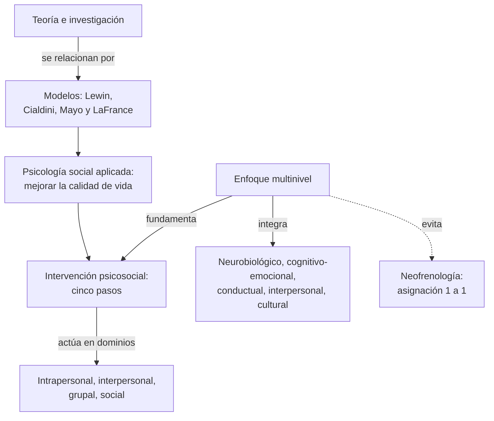
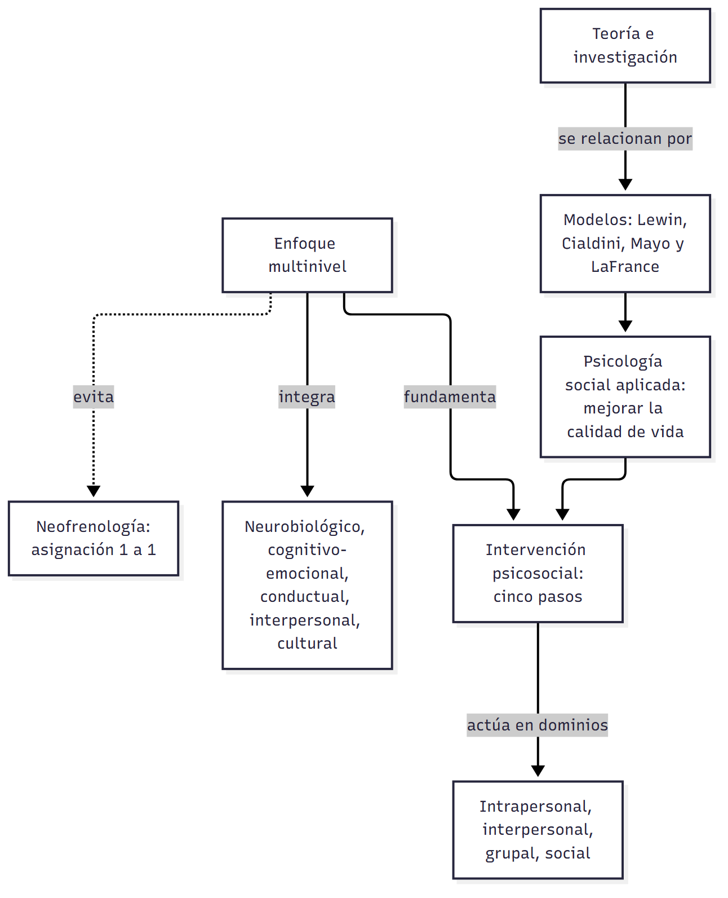
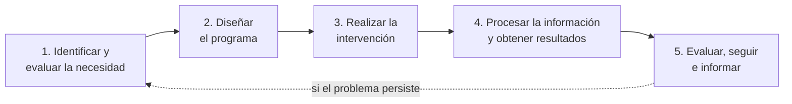
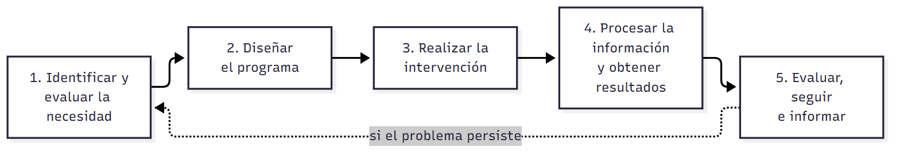
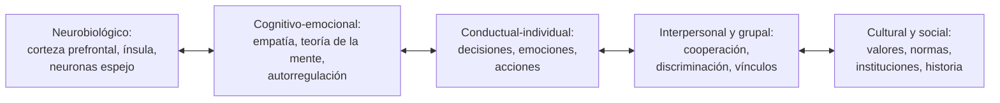
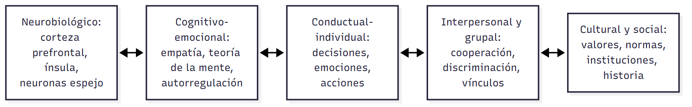

# C12 — Intervenciones y niveles de análisis · Versión de cursada

> **Fuentes:**
>
> - Cátedra de Psicología Social. (2026m). *Niveles de análisis de la psicología social e intervenciones* [Diapositivas de clase, clase 12]. Universidad Favaloro.

> **Aviso sobre las fuentes:** **versión de cursada** (protocolo A): lo que se dio el 29/10 y lo que pide la unidad 11. **Esta guía se apoya solo en las diapositivas:** los dos textos obligatorios de la unidad, Cacioppo et al. (2013) y Riveros et al. (2013), no están en Drive, y las citas a otros autores son las que hacen las diapositivas. La clase 13 de Drive contiene el mismo archivo que esta clase. Si conseguís esos textos, conviene validar esta guía con ellos.

> **Idea-fuerza:** La psicología social aplicada busca **mejorar la calidad de vida**. Comparte con la básica sus principios, pero suma utilidad social, comunicación accesible, trabajo a demanda y variabilidad. Tres modelos relacionan teoría y práctica: **Lewin, Cialdini y Mayo y LaFrance**. Una **intervención psicosocial** sigue cinco pasos. Y el **enfoque multinivel** obliga a explicar la conducta social desde lo neurobiológico hasta lo cultural, sin caer en la **neofrenología** (Cátedra de Psicología Social, 2026m, diapositivas 2, 4, 18, 27 y 31).

## Mapa: qué pide el programa y qué se dio en clase

| Tema | Programa | Clase | Sección |
|---|---|---|---|
| Relación entre lo básico y lo aplicado | ✔ | ✔ | §1 |
| Psicología social como ciencia aplicada | ✔ | ✔ | §1, §2 |
| Modelos de aplicación | — | ✔ | §3 |
| Intervención psicosocial y dominios | ✔ | ✔ | §4 |
| Pasos de las intervenciones | ✔ | ✔ | §5 |
| Niveles de análisis; integración | ✔ | ✔ | §6 |
| Cerebro social y entorno | ✔ | ✔ | §7 |
| Alcances y limitaciones | ✔ | ✔ | §8 |

---

## 1. Psicología social básica y aplicada

El objetivo de la aplicada es promover mejoras en el ajuste emocional y social, la salud física y el rendimiento: en síntesis, en la **calidad de vida**. Va más allá de buscar solución a problemas sociales (Cátedra de Psicología Social, 2026m, diapositiva 2).

**Semejanzas** (diapositiva 3): el conocimiento se nutre de investigaciones y es base de las aplicaciones; todos los contextos pueden generar conocimiento válido; teoría, investigación y aplicación se alimentan mutuamente; y se recurre siempre al método científico.

**Características específicas de la aplicada** (diapositiva 4):

| Característica | Qué significa |
|---|---|
| **Utilidad social** | Razón entre costo y efectividad, estimada en la planificación |
| **Resultados** | Se comunican con claridad, sin tecnicismos |
| **Aplicación a demanda** | A pedido de un cliente o agencia, en un tiempo limitado |
| **Variabilidad** | Afecta a las personas: hay que tener en cuenta sus puntos de vista |

## 2. Agenda de la disciplina

Hay tres grandes áreas: **procesos grupales**; **actitudes, opiniones y creencias**; y **percepción social y del yo**. Dos elementos las atraviesan: el **significado e interpretación subjetiva** y la **influencia interpersonal** (Ross et al., 2010, en Cátedra de Psicología Social, 2026m, diapositiva 5).

La agenda responde a fenómenos de cada época (diapositiva 6):

| Década | Teoría | Fenómeno social |
|---|---|---|
| 1940 | Etnocentrismo, agresión, propaganda | Holocausto y Segunda Guerra Mundial |
| 1950 | Prejuicio, racismo, identidad | Derechos civiles |
| 1960 | Obediencia, influencia minoritaria | Vietnam y mayo del 68 |
| 1970 | El yo | Generación *mí* |
| 1980 | Psicología positiva | Críticas al exceso de atención al yo |
| 1990 | Psicología cultural, colectivismo | Despegue económico del sudeste asiático |

Ross et al. (2010) aportan tres ideas (diapositiva 7): la **evaluación**, la **aplicabilidad de la investigación** y la **lección fundamental**: los problemas de conducta son esenciales en la dinámica social.

## 3. Tres modelos entre teoría y aplicación

| Modelo | Idea central | Cómo funciona |
|---|---|---|
| **Investigación-acción (Lewin, 1946)** | La investigación debe incluir diagnósticos de situaciones específicas | Conocimiento (diagnóstico) y acción en ciclos de planificación, ejecución y evaluación |
| **Ciclo completo (Cialdini, 1980, 1989)** | Contrapone laboratorio y vida cotidiana | Observación natural → experimentación (poder, generalidad, teoría) → observación natural de la validez → nuevo ciclo |
| **Psicología social aplicable (Mayo y LaFrance, 1980)** | No debería haber distancia entre experimentación y aplicación | Suma **calidad de vida** y **adaptadores**, que conectan calidad de vida, conocimiento e intervención |

(Cátedra de Psicología Social, 2026m, diapositivas 8-15)

La cátedra aclara que no hay ejemplos concretos de aplicación del modelo de Mayo y LaFrance (diapositiva 14).

## 4. Intervención psicosocial

| | Acciones psicosociales | Intervención psicosocial |
|---|---|---|
| **Definición** | Acciones supraindividuales, dirigidas a grupos, centradas en desigualdades y en los grupos más débiles | Técnicas o actividades que usa un interventor para producir cambios y resolver una carencia o problema social |
| **Clave** | Poder y su distribución (Sánchez-Vidal, 2002) | Mejorar el bienestar y la calidad de vida |

(Cátedra de Psicología Social, 2026m, diapositiva 16)

**Dominios** (diapositiva 17): **intrapersonal** (actitudes, creencias), **interpersonal** (padres e hijos, pares), **grupal** (cohesión, rendimiento) y **social** (estructuras: sexismo, racismo, inseguridad).

## 5. Los cinco pasos de la intervención

1. **Identificación de la necesidad:** una carencia se vuelve necesidad social cuando un grupo la define así. Hay que identificar a los **actores sociales**, medir con métodos formales y considerar el **contexto** para actuar de manera culturalmente apropiada (diapositivas 19-20).
2. **Diseño:** especificar objetivos, contenido y estrategias (discusión grupal, modelado, *role-playing*), planificar infraestructura y gastos, y definir **criterios e indicadores** (diapositivas 21-22).
3. **Realización:** requiere **flexibilidad** ante imprevistos y un desarrollo que permita evaluar la eficacia en cualquier momento (diapositiva 23).
4. **Procesamiento:** ajustar las medidas al diseño, distinguir variables independientes, dependientes y de control, obtener fiabilidad y validez, y garantizar **confidencialidad** (diapositiva 24).
5. **Evaluación y seguimiento:** evaluar antes, durante y después. El **seguimiento** examina si el efecto se mantiene en el tiempo. El **informe** detalla todo el proceso (diapositivas 25-26).

> ⚠ **No confundir:** la **evaluación** mide el resultado al finalizar. El **seguimiento** mira si ese efecto se mantiene después.

→ El modelado y el *role-playing* vienen de `C03_AprendizajeSocial_Cursada_Guia.md`, §8.

## 6. Enfoque multinivel

Surge como respuesta a las limitaciones de los modelos que explicaban la conducta social desde un solo nivel (Riveros et al., 2009, en Cátedra de Psicología Social, 2026m, diapositiva 27). Los niveles se conectan en ambos sentidos:

## 7. El cerebro social y el entorno

El **cerebro social** es la red que permite reconocer a otros y evaluar sus estados mentales y sentimientos, y predecir interacciones. Integra teoría de la mente, autorregulación, memoria autobiográfica, empatía, agencia y razonamiento moral (Cátedra de Psicología Social, 2026m, diapositiva 28).

La regulación social de la expresión genética muestra que **lo biológico no es predeterminado** (diapositivas 29-30):

- Los animales sociales privados de sus congéneres muestran daños cognitivos, conductuales, neurales, hormonales e inmunológicos. En humanos se ven deficiencias similares con **solo percibirse aislados**.
- La percepción del entorno social influye en si se activan genes de células inmunes contra bacterias o virus.

## 8. Límites: la neofrenología

La **neofrenología** o **error de categoría** consiste en asignar un fenómeno social a una región en un modelo 1:1: «¿qué parte del cerebro controla el altruismo?» (Cátedra de Psicología Social, 2026m, diapositiva 31).

Los hallazgos deben interpretarse con cautela: las explicaciones simplificadas pueden distorsionar y reforzar sesgos sociales. La reflexión crítica sobre el uso social y político de la evidencia es fundamental. La neurociencia social debe «dialogar entre neuronas, emociones y culturas» (diapositiva 32).

> 🔑 **Punto clave:** esta clase cierra la materia: conecta los tres niveles de procesos de C01 con el enfoque multinivel, y lleva la teoría a la intervención.

## Para rendir (formato mixto)

**1) Opción múltiple.** El ciclo de planificación, ejecución y evaluación es propio del modelo de: (a) Cialdini; (b) **Lewin**; (c) Mayo y LaFrance; (d) Ross. — *Respuesta: b* (Cátedra de Psicología Social, 2026m, diapositiva 9).

**2) Opción múltiple.** Una intervención que busca mejorar la cohesión de un equipo pertenece al dominio: (a) intrapersonal; (b) interpersonal; (c) **grupal**; (d) social. — *Respuesta: c* (Cátedra de Psicología Social, 2026m, diapositiva 17).

**3) Verdadero o falso.** «Mayo y LaFrance suman a la investigación y la intervención la calidad de vida.» — *Verdadero* (Cátedra de Psicología Social, 2026m, diapositiva 13).

**4) Verdadero o falso.** «Afirmar que una región controla el altruismo es un ejemplo de enfoque multinivel.» — *Falso.* Es neofrenología (Cátedra de Psicología Social, 2026m, diapositiva 31).

**5) Pregunta abierta.** *Explicá por qué el enfoque multinivel es una respuesta a la neofrenología.*

> **Esqueleto de la respuesta:** (1) Neofrenología: asignación 1:1. (2) Por qué falla: fenómenos complejos. (3) Multinivel: del nivel neurobiológico al cultural, en ambos sentidos. (4) Ejemplo: percibirse aislado modifica la inmunidad. (5) Cierre: dialogar entre niveles (Cátedra de Psicología Social, 2026m, diapositivas 27, 30 y 31).

## Referencias

Cátedra de Psicología Social. (2026m). *Niveles de análisis de la psicología social e intervenciones* [Diapositivas de clase, clase 12]. Universidad Favaloro.
