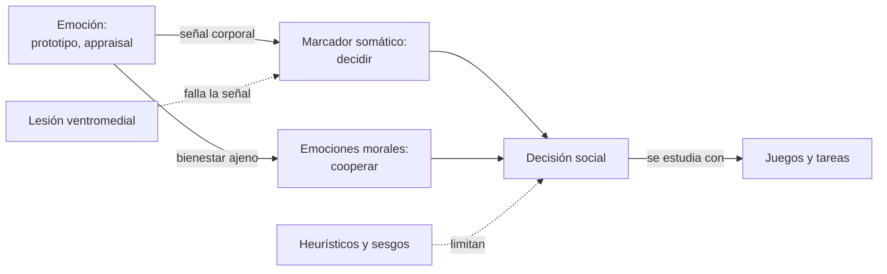
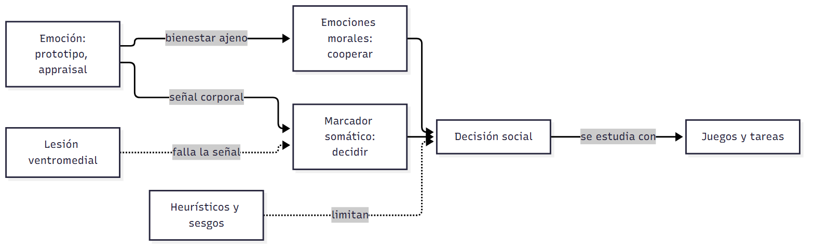

# Cuadro integrador — Emoción, moral y decisión

> **Idea-fuerza:** Las clases 9, 10 y 11 sostienen una misma tesis: **la emoción no se opone a la razón social, la hace posible**. La emoción clasifica situaciones, marca opciones en el cuerpo y motiva a cooperar. Todo sale de las guías de cursada: las citas completas están en cada guía.

## Cuadro 1: cómo se relacionan razón y emoción

| Enfoque | Autor | Papel de la emoción | Guía |
|---|---|---|---|
| Fisiológico | James-Lange | Resulta del cambio corporal | C09 §2 |
| Cognitivo | Schachter y Singer, Lazarus | Depende de cómo se interpreta o valora | C09 §3 |
| Social | Parkinson, Fridlund | Se dirige a una audiencia | C09 §4 |
| Sistémico | Laso Ortiz | Clasifica los mensajes | C02 §3 |
| Decisión | Damasio | Es necesaria para decidir bien | C10 §2 |
| Moral | Haidt | Motiva a hacer el bien | C09 §7, C11 §2 |
| Racional clásico | Economía clásica | Queda afuera: se maximiza el beneficio | C10 §1, C11 §4 |

## Cuadro 2: emociones morales

| Emoción | Familia | Efecto en dilemas sociales |
|---|---|---|
| Culpa | Autoconciencia | Más cooperación en pro-selfs; reparación |
| Vergüenza endógena | Autoconciencia | Tendencias prosociales en pro-selfs |
| Vergüenza exógena | Autoconciencia | Sin ese efecto |
| Empatía | Sufrimiento de los otros | Aumenta la ayuda |
| Ira y disgusto | Condena a los demás | Dificultan la cooperación |
| Gratitud, admiración | Alabanza a los demás | Se producen por la bondad ajena |

## Cuadro 3: juegos y tareas

| Paradigma | Mide | Clase |
|---|---|---|
| Dilema del prisionero | Cooperación; surge tit for tat | C08 §10, C11 §5 |
| Ultimátum, Impunidad | Rechazo de ofertas injustas | C11 §5 |
| Give-Some | Cooperación | C11 §5 |
| Dictador | Conducta de quien reparte | C11 §5 |
| Tareas de distribución | Dilema moral | C11 §5 |
| Iowa Gambling Task | Aprendizaje por castigo y recompensa | C10 §6 |

## Cuadro 4: mapa cerebral

| Región | Función | Clase |
|---|---|---|
| Ventromedial | Feedback positivo y negativo | C10 §5 |
| Orbitofrontal | Decisión de un tercero; deseo de consumir | C10 §5, §7 |
| Cíngulo anterior | Decisión propia; recompensas previas | C10 §5 |
| Amígdala | Inductores primarios; lo desconocido | C10 §5, C08 §2 |
| FFA | Rostros | C08 §2 |
| STS, EBA | Cuerpos y movimiento | C08 §2 |
| Prefrontal medial | Autorreflexión | C08 §5 |

> ⚠ **No confundir:** una región **no** «controla» una conducta: eso sería neofrenología (`C12_IntervencionesYNivelesDeAnalisis_Cursada_Guia.md`, §8).

## Tres preguntas integradoras

1. ¿Por qué Damasio y Saavedra et al. discuten, cada uno a su modo, con la visión racional clásica?
2. Compará la culpa y el marcador somático como guías de la conducta.
3. ¿Qué tienen en común el altruismo recíproco y la cooperación en dilemas sociales?

## Referencias

Las de las guías de cursada C02, C08, C09, C10, C11 y C12.
