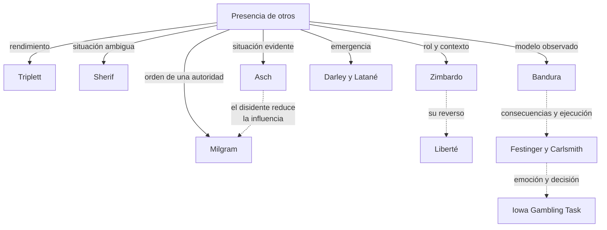
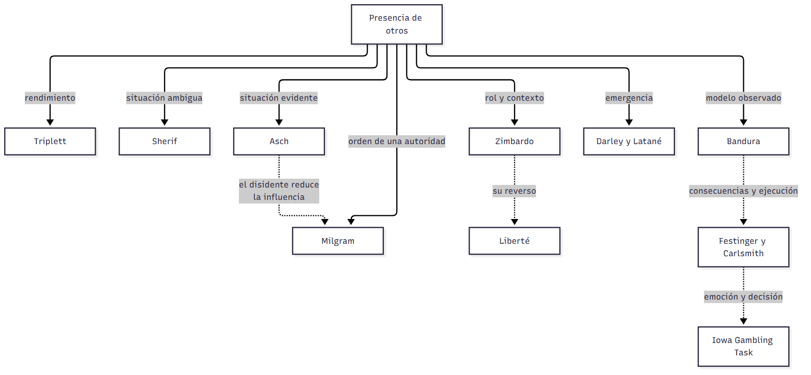

# Cuadro integrador — Experimentos paradigmáticos

> **Idea-fuerza:** Según tus notas de clase, el examen usa «algunos experimentos paradigmáticos como articuladores de lo teórico» (F. Mendez Casariego, apuntes de clase, 22 de octubre de 2026). Este cuadro reúne esos experimentos para que puedas ir de cada uno a la teoría que sostiene. Todo sale de las guías de cursada: las citas completas están en cada guía.

## Cuadro 1: los experimentos

| Experimento | Pregunta | Diseño | Resultado clave | Qué articula | Guía |
|---|---|---|---|---|---|
| **Triplett (1898)** | ¿La presencia de otros cambia el rendimiento? | 40 niños enrollan un carrete solos o en coacción | Cerca de la mitad mejora; algunos empeoran | Facilitación e inhibición social | C01 §4 |
| **Sherif (1935)** | ¿Cómo nacen las normas? | Efecto autocinético, solos y en grupo | Convergen y mantienen la norma a solas | Norma interiorizada, incertidumbre | C01 §4 |
| **Mullen** | ¿Los estereotipos predicen exclusión? | 19 grupos inmigrantes; complejidad y valencia | Menor complejidad, más exclusión | Tres niveles de procesos | C01 §2 |
| **Bandura, Ross y Ross (1961)** | ¿Se imita la agresión? | Niños ven a un adulto agresivo o no con un muñeco | Imitan aun sin el modelo | Modelado | C03 §9 |
| **Muñeco Bobo con consecuencias** | ¿Adquirir es ejecutar? | Modelo recompensado, castigado o sin consecuencias | Con incentivo todos ejecutan | Saber y hacer | C03 §9 |
| **Berger (1962)** | ¿Se aprende el miedo por observación? | Respuesta galvánica de la piel | El observador adquiere miedo | Condicionamiento vicario | C03 §4 |
| **Festinger y Carlsmith (1959)** | ¿Menos incentivo cambia más? | Decir que una tarea aburrida es interesante, por $1 o $20 | $1 cambia más la actitud | Disonancia | C05 §7 |
| **Stone et al. (1997)** | ¿Sirve la disonancia para el bien? | Listar razones propias o ajenas | Propias: compra de preservativos | Hipocresía inducida | C05 §7 |
| **Orbell et al. (2001)** | ¿Qué predice la intención? | Cuestionario sobre éxtasis | Actitud, norma y control | Conducta planeada | C05 §5 |
| **Asch (1951, 1955)** | ¿Cedemos con una respuesta evidente? | Líneas; 12 de 18 pruebas críticas | 76 % cede alguna vez; 37 % de las respuestas | Influencia normativa, unanimidad | C06 §3 |
| **Baron et al. (1996)** | ¿Cuándo pesa la información? | Tarea difícil o fácil, importante o no | Más conformidad si es difícil e importante | Influencia informativa | C06 §1 |
| **Prislin et al. (2000)** | ¿Qué pasa al cambiar de posición? | Mayoría y minoría que se invierten | Perder pesa más que ganar | Modelo asimétrico | C06 §6 |
| **Milgram (1963)** | ¿Obedecemos órdenes que dañan? | Profesor, aprendiz, descargas hasta 450 V | 65 % llega al final | Obediencia destructiva | C07 §1-2 |
| **Zimbardo (1971)** | ¿La situación cambia a las personas? | 24 jóvenes, guardias y presos | Se cancela al sexto día | Poder de la situación | C07 §5 |
| **Darley y Latané (1968)** | ¿Por qué no ayudamos? | Ataque oído por intercomunicador, grupos de 2, 3 y 6 | Más testigos, menos ayuda | Efecto espectador | C08 §7 |
| **Seminaristas** | ¿La prisa reduce la ayuda? | Con o sin prisa | 10 % frente a 63 % | Paso 1: notar | C08 §7 |
| **Humo** | ¿Los otros cambian la interpretación? | Solos o con otros inmóviles | 75 % frente a 38 % | Ignorancia pluralista | C08 §7 |
| **Ketelaar y Au (2003)** | ¿La culpa aumenta la cooperación? | Juegos repetidos | 78 % sin culpa sigue igual | Emociones morales | C11 §6 |
| **Hartshorne y May (1928-30)** | ¿Conocer la norma predice la conducta? | Conocimiento de normas y conductas de niños y adolescentes | Sin relación; pesa la probabilidad de ser descubierto | Distancia entre juicio y acción | C11, §8 |
| **McNamee (1978)** | ¿El estadio moral predice la ayuda? | 102 universitarios; un cómplice pide ayuda y el experimentador no se la da | A mayor estadio, más ayuda | Consistencia entre juicio y acción | C11, §8 |
| **Kohlberg en Milgram** | ¿El razonamiento moral predice la negativa? | Estadio y subestadio de participantes | Todo el subestadio A siguió; se negó el 86 % del B | Juicio moral y obediencia | C11, §8 |
| **Bechara et al. (1994)** | ¿Decidir requiere emoción? | Iowa Gambling Task | Lesión ventromedial: mazos riesgosos | Marcador somático | C10 §6 |

## Cuadro 2: formas de influencia

| | Conformidad | Condescendencia | Obediencia | Poder de la situación |
|---|---|---|---|---|
| **Quién influye** | Grupo o norma | Quien pide | Quien ordena | Rol y contexto |
| **Presión** | Implícita | Pedido directo | Orden | Estructural |
| **Motivo** | Ser aceptado o tener razón | Consistencia, reciprocidad, escasez | Transferir responsabilidad | Anonimato, deshumanización |
| **Experimento** | Asch, Sherif | Táctica del pie en la puerta | Milgram | Zimbardo |
| **Qué la reduce** | Romper la unanimidad | Conocer las tácticas | Pares que se rebelan | Salir del contexto, otro orden (Liberté) |

## No confundir

| X | Y | Criterio |
|---|---|---|
| Sherif | Asch | Situación **ambigua** frente a **evidente** |
| Asch | Milgram | Hay presión de pares frente a **orden** de una autoridad |
| Milgram | Zimbardo | Orden explícita frente a **rol y contexto** |
| Bandura | Festinger | Las consecuencias regulan la **ejecución** frente a cambiar la **actitud** |
| Efecto espectador | Conformidad | Inacción ante una emergencia frente a ajustarse a una norma |

## Tres preguntas integradoras

1. ¿Qué tienen en común Asch y Milgram cuando aparece un disidente? Conectá con el efecto espectador.
2. Elegí dos experimentos que muestren que la conducta no se explica solo por la personalidad.
3. Compará Bobo y Festinger y Carlsmith: ¿qué papel cumple la recompensa en cada uno?

## Referencias

Las de las guías de cursada C01, C03, C05, C06, C07, C08, C10 y C11.
