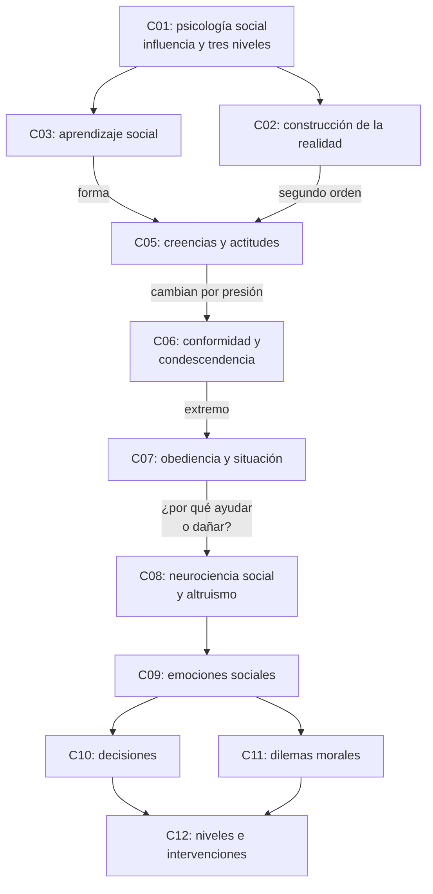
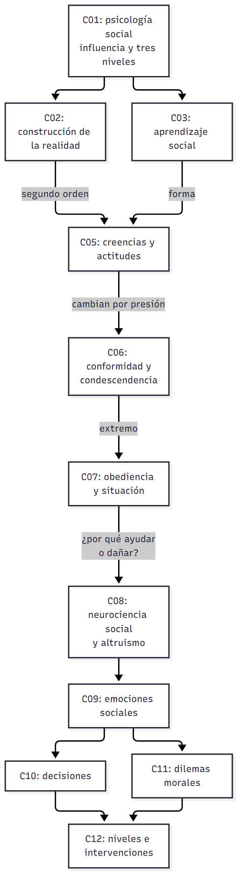

# Cuadro integrador — Niveles de análisis y mapa de la materia

> **Idea-fuerza:** La materia empieza con tres niveles de procesos (individual, grupal, macrosocial) y termina con un enfoque multinivel que va de lo neurobiológico a lo cultural. Cada tema se puede leer en todos esos niveles. Todo sale de las guías de cursada: las citas completas están en cada guía.

## Mapa de la materia

## Cuadro 1: los temas por nivel

| Tema | Neurobiológico | Cognitivo-emocional | Conductual-individual | Interpersonal y grupal | Cultural y social |
|---|---|---|---|---|---|
| **Comunicación** | Neuronas espejo | Emoción que clasifica | Conducta como mensaje | Simetría, complementariedad | Reglas tácitas |
| **Aprendizaje social** | | Atención, retención | Reproducción | Modelo | Socialización |
| **Actitudes** | Amígdala, prefrontal | Evaluación, disonancia | Intención y conducta | Comparación social | Representaciones sociales |
| **Influencia** | | Disonancia, atribución de responsabilidad | Obedecer, ceder | Norma, unanimidad | Autoridad, individualismo |
| **Altruismo** | Simulación | Empatía, cinco pasos | Ayudar | Efecto espectador | Valores, evolución |
| **Emociones** | Cambios corporales | Appraisal | Expresión | Audiencia, social sharing | Mínima universalidad |
| **Decisión** | Ventromedial | Marcador somático, sesgos | Elección | Decisiones colectivas | Política burocrática |
| **Moral** | | Culpa, vergüenza | Cooperar | Dilemas sociales | Normas arbitrarias |

Las celdas vacías indican que la materia no dio ese nivel para ese tema.

## Cuadro 2: los dos esquemas de niveles

| | C01: tres niveles | C12: enfoque multinivel |
|---|---|---|
| **Niveles** | Individual, grupal, macrosocial | Neurobiológico, cognitivo-emocional, conductual, interpersonal y grupal, cultural y social |
| **Foco** | Procesos psicosociales | Integrar lo biológico con lo social |
| **Autores** | Stangor y Jost, Tajfel, Jost | Riveros et al. |
| **Riesgo que evita** | Aislar al sujeto de lo social | Neofrenología |

## Cuadro 3: de la teoría a la intervención

| Concepto | Dónde se aplica | Clase de origen |
|---|---|---|
| Reencuadre | Terapia relacional | C02 §8 |
| Modelado y *role-playing* | Psicoterapia, estrategias de programa | C03 §8, C12 §5 |
| Hipocresía inducida | Promoción de la salud | C05 §7 |
| Conocimiento de la obediencia | Resistir órdenes destructivas | C07 §3 |
| Autogestión | Contextos de encierro: Liberté | C07 §7 |
| Enseñanza de valores | Familia y escuela | C08 §8 |
| Cinco pasos | Toda intervención psicosocial | C12 §5 |

## Sujeto activo: la idea que atraviesa la materia

| Clase | Cómo aparece |
|---|---|
| C01 | La persona puede modificar su contexto |
| C03 | Determinismo recíproco |
| C07 | Liberté transforma el encierro |
| C12 | Lo biológico no es predeterminado |

## Tres preguntas integradoras

1. Elegí un fenómeno y explicalo en tres niveles.
2. ¿Por qué decir «la región X controla el altruismo» contradice el enfoque multinivel?
3. Diseñá en cinco pasos una intervención para reducir el efecto espectador en una universidad.

## Referencias

Las de las guías de cursada C01 a C12.
